# LLM — da5004_2024T1_ET_AN

**Source:** `da5004_2024T1_ET_AN.pdf` · **Academic questions:** 15 · **Separately counted children:** 0
**Provenance:** `Large_Language_Models/da5004_2024T1_ET_AN.pdf` · SHA-256 `9dac4741472cae20ebc04dc9b3537117d8753b793450b78bf3e78671a0dd367d`

**Scope:** Section 7: LLM (Degree Level : Introduction to Large Language Models), physical pages 1 to 15. The in-scope subject starts at physical page 1 with Section Id 64065357858 and terminates on physical page 15 immediately prior to Section 8: DL(CV) (Section Id 64065357859).

## Questions

### Shared context 143

**Question ID:** `640653821561`

**Type:** General Note
**PDF pages:** 2

General Note:

- If the information is insufficient in any of the Numerical Answer Type (NAT) questions, enter -1 as the answer.
- Follow zero-based indexing if not mentioned otherwise
- In all your calculations, take at least two digits. For example, if the intermediate result is 1.860875, then take it as 1.86 to the next step.

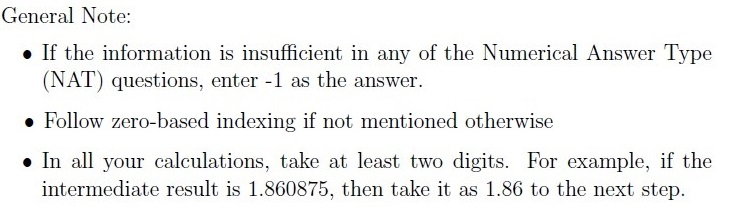

**Figure 1.** General Note specifying NAT insufficient information convention (-1), zero-based indexing, and rounding to at least two digits for intermediate calculations

### Question 144

**Question ID:** `640653821565`

**Portal container number:** `144`

**Portal container ID:** `640653821565`

**Type:** Multiple Choice Question · **Marks:** 2
**PDF pages:** 2, 3

GPT stands for

**Options**

**A.**

Generative Pre-trained Transformer

*Source option ID:* `6406532757246`

*Label added for presentation.*

**B.**

Generative Pre-trained Text

*Source option ID:* `6406532757247`

*Label added for presentation.*

**C.**

Generalized Pre-trained Transformer

*Source option ID:* `6406532757248`

*Label added for presentation.*

**D.**

Generative Pre-trained Transfer-text

*Source option ID:* `6406532757249`

*Label added for presentation.*

**Correct answer:** Generative Pre-trained Transformer

**Source evidence:** [{"page": 3, "bbox": [118.27, 137.75, 130.27, 149.75], "type": "green source option", "detail": "Green radio button marker next to option ID 6406532757246"}]

### Question 145

**Question ID:** `640653821579`

**Portal container number:** `145`

**Portal container ID:** `640653821579`

**Type:** Multiple Choice Question · **Marks:** 4
**PDF pages:** 3, 4

Consider an attention matrix $A = \text{softmax}(QK^T)$. Suppose we implement the block-wise sparse attention mechanism by multiplying attention matrix $A$ by a masking matrix $M$ of the same size. Suppose further the matrix $M$ contains four identity blocks. Using this approach, what is the computational complexity of the self-attention module?

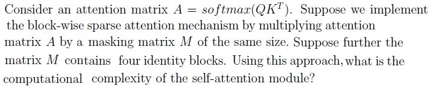

**Figure 2.** Block-wise sparse attention matrix formulation and complexity question

**Options**

**A.**

$O(T^2 / 4)$

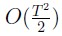

**Figure 3.** Option A complexity expression O(T^2 / 4)

*Source option ID:* `6406532757275`

*Label added for presentation.*

**B.**

$O(T^2)$

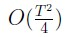

**Figure 4.** Option B complexity expression O(T^2)

*Source option ID:* `6406532757276`

*Label added for presentation.*

**C.**

$O(T^2 / 16)$

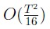

**Figure 5.** Option C complexity expression O(T^2 / 16)

*Source option ID:* `6406532757277`

*Label added for presentation.*

**D.**

$O(T)$

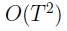

**Figure 6.** Option D complexity expression O(T)

*Source option ID:* `6406532757278`

*Label added for presentation.*

**Correct answer:** $O(T)$

**Source evidence:** [{"page": 4, "bbox": [118.27, 104.16, 130.27, 116.16], "type": "green source option", "detail": "Green radio button marker next to option ID 6406532757278"}]

### Question 146

**Question ID:** `640653821578`

**Portal container number:** `146`

**Portal container ID:** `640653821578`

**Type:** Multiple Select Question · **Marks:** 3
**PDF pages:** 4

Suppose we pre-train a model using a text-to-text framework. A user wants to fine-tune the pre-trained model on a regression task where the inputs are sentences but the labels are real-valued. The label values range from 0.1 to 2 with a step size of 0.1. Given these, choose the correct statements.

**Options**

**A.**

The objective function of the pre-trained model should be modified during fine-tuning

*Source option ID:* `6406532757271`

*Label added for presentation.*

**B.**

The objective function of the pre-trained model need not be modified during fine-tuning

*Source option ID:* `6406532757272`

*Label added for presentation.*

**C.**

Text-to-text framework cannot be used for any regression problem

*Source option ID:* `6406532757273`

*Label added for presentation.*

**D.**

We need to add a layer, on top of the output layer, that outputs a real value

*Source option ID:* `6406532757274`

*Label added for presentation.*

**Correct answer:** The objective function of the pre-trained model need not be modified during fine-tuning

**Source evidence:** [{"page": 4, "bbox": [118.27, 610.5, 130.27, 622.5], "type": "green source option", "detail": "Green checkbox marker next to option ID 6406532757272"}]

### Question 147

**Question ID:** `640653821577`

**Portal container number:** `147`

**Portal container ID:** `640653821577`

**Type:** Short Answer Question · **Marks:** 3
**PDF pages:** 5

**Shared context:** [ctx-143](#ctx-143)

Consider the following vocabulary learnt using the Byte Pair Encoding (BPE) algorithm. The base vocabulary contains letters from a — z and digits from 0 — 9. The rest of the tokens are learned from the dataset

$$V = \{a, b, c, \dots, z, 0, 1, \dots, 9, \text{in}, \text{th}, \text{lo}, \text{ing}, \text{et}, \text{ve}, \text{est}, \text{st}, 10, \text{[unk]}\}$$

Suppose the input word to the tokenizer is “SomeThing”. Assume that input text is normalized before applying pre-tokenization. Enter the number of tokens returned by the tokenizer. Ignore the special token used to represent the boundary of the word/token.

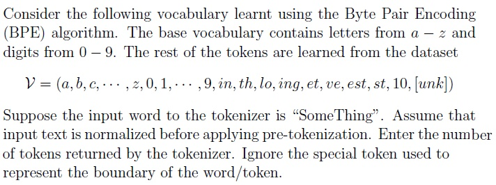

**Figure 7.** Byte Pair Encoding vocabulary and input tokenization question

**Correct answer:** 6

**Source evidence:** [{"page": 5, "bbox": [22.87, 725.0, 132.0, 755.0], "type": "explicit field", "detail": "Possible Answers: 6"}]

### Question 148

**Question ID:** `640653821576`

**Portal container number:** `148`

**Portal container ID:** `640653821576`

**Type:** Short Answer Question · **Marks:** 4
**PDF pages:** 5, 6

**Shared context:** [ctx-143](#ctx-143)

Consider a vocabulary $V$,

$$V = (\text{[start]}, \text{waiting}, \text{is}, \text{incredible}, \text{something}, \text{somewhere}, \text{to}, \text{be}, \text{known}, \text{[end]})$$

Assume that we have a pre-trained GPT model for text generation and the first input token to the model is always the special token [start]. The prediction probabilities output by the model are given below.

$$\begin{bmatrix}
0.05 & 0.02 & 0.14 & 0.07 & 0.41 & 0.09 & 0.08 & 0.05 & 0.08 & 0.01 \\
0.10 & 0.04 & 0.06 & 0.16 & 0.01 & 0.43 & 0.06 & 0.09 & 0.01 & 0.04 \\
0.05 & 0.07 & 0.28 & 0.29 & 0.03 & 0.08 & 0.04 & 0.08 & 0.04 & 0.04 \\
0.10 & 0.02 & 0.48 & 0.02 & 0.01 & 0.07 & 0.06 & 0.14 & 0.07 & 0.01 \\
0.08 & 0.29 & 0.04 & 0.01 & 0.04 & 0.03 & 0.25 & 0.05 & 0.15 & 0.06 \\
0.14 & 0.03 & 0.13 & 0.08 & 0.01 & 0.03 & 0.06 & 0.23 & 0.08 & 0.22
\end{bmatrix}$$

The zeroth row of the matrix is the output probability distribution by the model given the special [start] token as input. Following the Greedy Search decoding strategy, the subsequent rows give the conditional probability distribution conditioned over the previous tokens. Enter the generated text.

Note, enter the predicted tokens as in the vocabulary. Give a single space between predicted tokens. Leave no space before/after the first /last tokens.

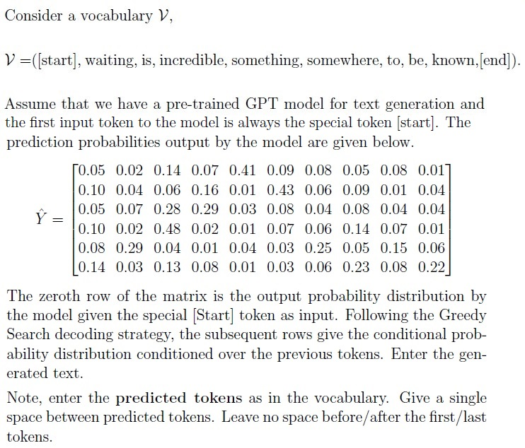

**Figure 8.** Vocabulary and conditional prediction probability distribution matrix for text generation

**Correct answer:** something somewhere incredible is waiting [end]

**Source evidence:** [{"page": 6, "bbox": [22.87, 500.0, 300.0, 540.0], "type": "explicit field", "detail": "Possible Answers: something somewhere incredible is waiting [end]"}]

### Shared context 149-150

**Question ID:** `640653821573`

**Type:** Comprehension
**PDF pages:** 7

Suppose a GPT model is pre-trained using the Causal Language Modelling (CLM) objective and fine-tuned on a text summarization task. The context length T of the model was kept at 2048 during both pre-training and fine-tuning. Assume that the model uses Absolute Position Embedding (APE) with learnable parameters.

Based on the above data, answer the given subquestions.

### Question 149

**Question ID:** `640653821574`

**Portal container number:** `149`

**Portal container ID:** `640653821574`

**Type:** Multiple Select Question · **Marks:** 3
**PDF pages:** 7

**Shared context:** [ctx-149-150](#ctx-149-150)

A user runs inference on the model N times with an input text that contains 712 tokens (including the special [start] token), then which of the following could be the possible length of summarized text

**Options**

**A.**

256

*Source option ID:* `6406532757259`

*Label added for presentation.*

**B.**

16

*Source option ID:* `6406532757260`

*Label added for presentation.*

**C.**

1024

*Source option ID:* `6406532757261`

*Label added for presentation.*

**D.**

512

*Source option ID:* `6406532757262`

*Label added for presentation.*

**E.**

2048

*Source option ID:* `6406532757263`

*Label added for presentation.*

**Correct answer:** 256; 16; 1024; 512

**Source evidence:** [{"page": 7, "bbox": [118.27, 608.34, 130.27, 620.34], "type": "green source option", "detail": "Green checkbox marker next to option ID 6406532757259 (256)"}, {"page": 7, "bbox": [118.27, 644.5, 130.27, 656.5], "type": "green source option", "detail": "Green checkbox marker next to option ID 6406532757260 (16)"}, {"page": 7, "bbox": [118.27, 680.66, 130.27, 692.66], "type": "green source option", "detail": "Green checkbox marker next to option ID 6406532757261 (1024)"}, {"page": 7, "bbox": [118.27, 716.83, 130.27, 728.83], "type": "green source option", "detail": "Green checkbox marker next to option ID 6406532757262 (512)"}]

### Question 150

**Question ID:** `640653821575`

**Portal container number:** `150`

**Portal container ID:** `640653821575`

**Type:** Multiple Select Question · **Marks:** 3
**PDF pages:** 7, 8

**Shared context:** [ctx-149-150](#ctx-149-150)

A user runs inference on the model N times with an input text that contains 712 tokens (including the special [start] token). However, the user observed that in each run the model generated the exact same summary. Based on this observation, select the decoding strategy that the model might be using

**Options**

**A.**

Greedy decoding strategy

*Source option ID:* `6406532757264`

*Label added for presentation.*

**B.**

Beam search with beam size K > 2

*Source option ID:* `6406532757265`

*Label added for presentation.*

**C.**

Top-k sampling with k > 3

*Source option ID:* `6406532757266`

*Label added for presentation.*

**D.**

Top-p sampling with p = 0.25

*Source option ID:* `6406532757267`

*Label added for presentation.*

**E.**

Greedy decoding by varying the temperature parameter T in the softmax function for each run

*Source option ID:* `6406532757268`

*Label added for presentation.*

**Correct answer:** Greedy decoding strategy; Beam search with beam size K > 2

**Source evidence:** [{"page": 8, "bbox": [118.27, 258.29, 130.27, 270.29], "type": "green source option", "detail": "Green checkbox marker next to option ID 6406532757264 (Greedy decoding strategy)"}, {"page": 8, "bbox": [118.27, 294.45, 130.27, 306.45], "type": "green source option", "detail": "Green checkbox marker next to option ID 6406532757265 (Beam search with beam size K > 2)"}]

### Shared context 151-152

**Question ID:** `640653821566`

**Type:** Comprehension
**PDF pages:** 8, 9

Consider the encoder layer of vanilla transformer architecture with the following configurations:

- Context length $T = 256$
- Embedding dim $d_{\text{embed}} = d_{\text{model}} = 256$
- Projected dimension $d_k = d_q = d_v = 32$
- Number of heads $n_h = 8$
- feed-forward layer dimension $d_{\text{ff}} = 1024$

The parameters in the feed-forward neural network layer comprise both weights and biases. The input and output embeddings are shared. The model uses Absolute Position Embedding (APE) using fixed sinusoidal encoding scheme.

Based on the above data, answer the given subquestions.

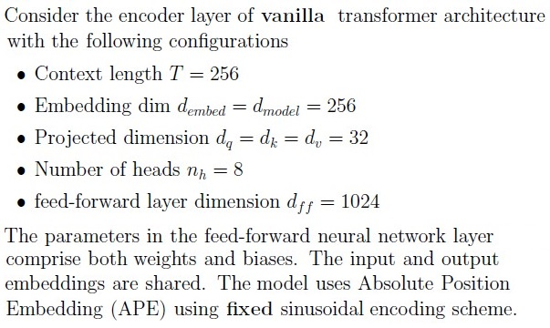

**Figure 9.** Vanilla transformer encoder configuration specifications

### Question 151

**Question ID:** `640653821567`

**Portal container number:** `151`

**Portal container ID:** `640653821567`

**Type:** Short Answer Question · **Marks:** 4
**PDF pages:** 9

**Shared context:** [ctx-151-152](#ctx-151-152), [ctx-143](#ctx-143)

Suppose the number of encoder layers N = 3. What is the total number of learnable parameters, including the parameters of the input and position embedding layers, in the model? Enter the final answer in thousands. For example, if the answer is 12,238, then enter 12 as the answer.

**Correct answer:** 2566

**Source evidence:** [{"page": 9, "bbox": [22.87, 736.55, 55.0, 755.0], "type": "explicit field", "detail": "Possible Answers: 2566"}]

### Question 152

**Question ID:** `640653821568`

**Portal container number:** `152`

**Portal container ID:** `640653821568`

**Type:** Short Answer Question · **Marks:** 3
**PDF pages:** 9, 10

**Shared context:** [ctx-151-152](#ctx-151-152), [ctx-143](#ctx-143)

Suppose we increase the context length from T = 256 to T = 512 keeping number of layers same (N = 3). How many parameters does the model need to learn additionally compared to the previous setting?

**Correct answer:** 0

**Source evidence:** [{"page": 10, "bbox": [22.87, 230.0, 55.0, 255.0], "type": "explicit field", "detail": "Possible Answers: 0"}]

### Shared context 153-154

**Question ID:** `640653821562`

**Type:** Comprehension
**PDF pages:** 10, 11

A vocabulary contains four words $V = (\text{coffee}, \text{drink}, \text{i}, \text{often})$ and the corresponding embedding matrix $E = \begin{bmatrix} 1 & 1 \\ 0.5 & 0.5 \\ 0.2 & 1 \\ 0 & 1 \end{bmatrix}$. Assume that no position information is added to the embeddings of input tokens. The parameters in the attention layer are

$$W_Q = \begin{bmatrix} 1 & 0.5 \\ -0.5 & 1 \end{bmatrix}, \quad W_K = \begin{bmatrix} 1 & -0.5 \\ 0.5 & 1 \end{bmatrix}, \quad W_V = \begin{bmatrix} 0.5 & 0 \\ 0 & 1 \end{bmatrix}, \quad W_O = \begin{bmatrix} 1 & 0 \\ -1 & 1 \end{bmatrix}$$

Suppose the input sentence is “i drink coffee often”. The corresponding attention matrix $A = \text{softmax}(QK^T)$ is given below

$$\begin{bmatrix}
0.06 & 0.45 & 0.15 & 0.35 \\
0.22 & 0.13 & 0.28 & 0.36 \\
0.06 & 0.25 & 0.17 & 0.53 \\
0.04 & 0.12 & 0.17 & 0.67
\end{bmatrix}$$

Then answer the following questions. If you think the given information is insufficient, then enter -1 as the answer.

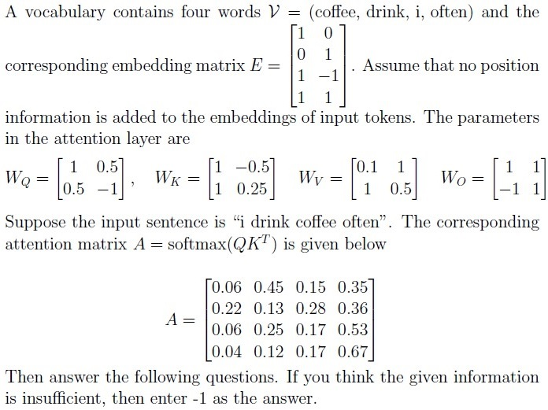

**Figure 10.** Vocabulary embeddings, attention layer weights, and attention matrix

### Question 153

**Question ID:** `640653821563`

**Portal container number:** `153`

**Portal container ID:** `640653821563`

**Type:** Short Answer Question · **Marks:** 4
**PDF pages:** 11, 12

**Shared context:** [ctx-153-154](#ctx-153-154), [ctx-143](#ctx-143)

Compute the representation for the word “often” and enter the sum of the elements in it.

**Correct answer:** 2.0 to 2.12

**Source evidence:** [{"page": 12, "bbox": [22.87, 20.0, 120.0, 45.0], "type": "explicit field", "detail": "Answers Type: Range, Possible Answers: 2.0 to 2.12"}]

### Question 154

**Question ID:** `640653821564`

**Portal container number:** `154`

**Portal container ID:** `640653821564`

**Type:** Short Answer Question · **Marks:** 4
**PDF pages:** 12

**Shared context:** [ctx-153-154](#ctx-153-154), [ctx-143](#ctx-143)

Suppose the input sentence is “coffee i drink often“. What is the attention score between the word “coffee” with “often”?

**Correct answer:** 0.53

**Source evidence:** [{"page": 12, "bbox": [22.87, 280.0, 75.0, 305.0], "type": "explicit field", "detail": "Possible Answers: 0.53"}]

### Shared context 155-157

**Question ID:** `640653821569`

**Type:** Comprehension
**PDF pages:** 12, 13

Consider a GPT model trained using Causal Language Modelling (CLM) objective. The matrix below shows the elements of $QK^T$ in the first layer of the model.

$$\begin{bmatrix}
0.07 & 2.56 & 0.25 & 2.36 & 3.06 & 1.83 & 2.31 & 0.77 \\
2.04 & 2.55 & 3.35 & 2.21 & 4.04 & 0.16 & 1.49 & 0.09 \\
2.34 & 3.65 & 2.63 & 0.95 & 3.37 & 3.59 & 4.3 & 2.02 \\
0.04 & 0.41 & 2.26 & 2.29 & 3.02 & 2.48 & 1.77 & 3.85 \\
0.78 & 2.81 & 0.26 & 0.3 & 2.16 & 2.56 & 3.09 & 2.83 \\
3.02 & 2.28 & 1.59 & 3.77 & 2.58 & 3.41 & 1.8 & 3.93 \\
3.09 & 1.23 & 2.02 & 1.77 & 0.42 & 0.99 & 2.05 & 2.0 \\
3.42 & 1.79 & 1.78 & 1.56 & 1.5 & 1.86 & 2.71 & 0.82
\end{bmatrix}$$

Based on the above data, answer the given subquestions.

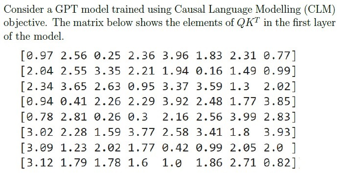

**Figure 11.** First layer QK^T matrix elements for CLM GPT model

### Question 155

**Question ID:** `640653821570`

**Portal container number:** `155`

**Portal container ID:** `640653821570`

**Type:** Short Answer Question · **Marks:** 3
**PDF pages:** 13

**Shared context:** [ctx-155-157](#ctx-155-157), [ctx-143](#ctx-143)

What is the input sequence length that would have generated this matrix?

**Correct answer:** 8

**Source evidence:** [{"page": 13, "bbox": [22.87, 680.0, 45.0, 705.0], "type": "explicit field", "detail": "Possible Answers: 8"}]

### Question 156

**Question ID:** `640653821571`

**Portal container number:** `156`

**Portal container ID:** `640653821571`

**Type:** Multiple Select Question · **Marks:** 4
**PDF pages:** 13, 14

**Shared context:** [ctx-155-157](#ctx-155-157)

Suppose the dimension of value vector, $d_v = 32$, then which of the following could be the dimensions of the key and query vectors $(d_k, d_q)$?

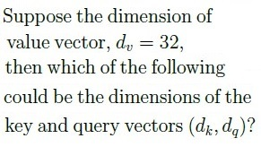

**Figure 12.** Key and query vector dimensions question

**Options**

**A.**

(8,8)

*Source option ID:* `6406532757253`

*Label added for presentation.*

**B.**

(32,8)

*Source option ID:* `6406532757254`

*Label added for presentation.*

**C.**

(32,32)

*Source option ID:* `6406532757255`

*Label added for presentation.*

**D.**

(64,64)

*Source option ID:* `6406532757256`

*Label added for presentation.*

**E.**

(8,32)

*Source option ID:* `6406532757257`

*Label added for presentation.*

**Correct answer:** (8,8); (32,32); (64,64)

**Source evidence:** [{"page": 14, "bbox": [118.27, 237.25, 130.27, 249.25], "type": "green source option", "detail": "Green checkbox marker next to option ID 6406532757253 ((8,8))"}, {"page": 14, "bbox": [118.27, 309.58, 130.27, 321.58], "type": "green source option", "detail": "Green checkbox marker next to option ID 6406532757255 ((32,32))"}, {"page": 14, "bbox": [118.27, 345.74, 130.27, 357.74], "type": "green source option", "detail": "Green checkbox marker next to option ID 6406532757256 ((64,64))"}]

### Question 157

**Question ID:** `640653821572`

**Portal container number:** `157`

**Portal container ID:** `640653821572`

**Type:** Short Answer Question · **Marks:** 4
**PDF pages:** 14, 15

**Shared context:** [ctx-155-157](#ctx-155-157), [ctx-143](#ctx-143)

Suppose we pass this $QK^T$ through the softmax function to compute the final attention score. Following zero-based indexing, at time step $t_3$, the attention score for the query $q_3$ is highest for the $i$-th key $k_i$. Enter the value of $i$.

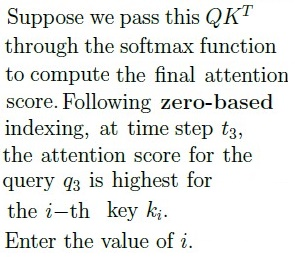

**Figure 13.** Attention score index question for query q3 and key ki

**Correct answer:** 3

**Source evidence:** [{"page": 15, "bbox": [22.87, 20.0, 45.0, 45.0], "type": "explicit field", "detail": "Possible Answers: 3"}]

### Question 158

**Question ID:** `640653821580`

**Portal container number:** `158`

**Portal container ID:** `640653821580`

**Type:** Multiple Select Question · **Marks:** 2
**PDF pages:** 15

Which of the following approaches uses a full-attention mechanism during inference with attention complexity $O(T)$ at time step $t = T$? Assume $T \gg n_h$, and $T > d_{\text{model}}$, if required.

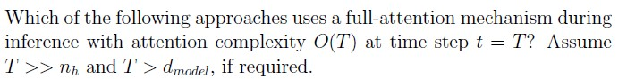

**Figure 14.** Full-attention inference complexity question

**Options**

**A.**

Multi-Query attention

*Source option ID:* `6406532757279`

*Label added for presentation.*

**B.**

Grouped Query attention

*Source option ID:* `6406532757280`

*Label added for presentation.*

**C.**

Paged attention

*Source option ID:* `6406532757281`

*Label added for presentation.*

**D.**

None of these

*Source option ID:* `6406532757282`

*Label added for presentation.*

**Correct answer:** Multi-Query attention; Grouped Query attention; Paged attention

**Source evidence:** [{"page": 15, "bbox": [118.27, 500.45, 130.27, 512.45], "type": "green source option", "detail": "Green checkbox marker next to option ID 6406532757279 (Multi-Query attention)"}, {"page": 15, "bbox": [118.27, 536.61, 130.27, 548.61], "type": "green source option", "detail": "Green checkbox marker next to option ID 6406532757280 (Grouped Query attention)"}, {"page": 15, "bbox": [118.27, 572.78, 130.27, 584.78], "type": "green source option", "detail": "Green checkbox marker next to option ID 6406532757281 (Paged attention)"}]

## Answer key

| Source question | Source identity | Correct answer | PDF pages |
| :--- | :--- | :--- | :--- |
| 144 | 640653821565 | Generative Pre-trained Transformer | 2, 3 |
| 145 | 640653821579 | $O(T)$ | 3, 4 |
| 146 | 640653821578 | The objective function of the pre-trained model need not be modified during fine-tuning | 4 |
| 147 | 640653821577 | 6 | 5 |
| 148 | 640653821576 | something somewhere incredible is waiting [end] | 5, 6 |
| 149 | 640653821574 | 256; 16; 1024; 512 | 7 |
| 150 | 640653821575 | Greedy decoding strategy; Beam search with beam size K > 2 | 7, 8 |
| 151 | 640653821567 | 2566 | 9 |
| 152 | 640653821568 | 0 | 9, 10 |
| 153 | 640653821563 | 2.0 to 2.12 | 11, 12 |
| 154 | 640653821564 | 0.53 | 12 |
| 155 | 640653821570 | 8 | 13 |
| 156 | 640653821571 | (8,8); (32,32); (64,64) | 13, 14 |
| 157 | 640653821572 | 3 | 14, 15 |
| 158 | 640653821580 | Multi-Query attention; Grouped Query attention; Paged attention | 15 |

## Extraction notes

**Status:** verified-source-limitation
**Count reconciliation:** The portal declared 12 questions and 50 marks for Section 7 (LLM). The 50 marks reconcile exactly across the 15 academic questions: Q144 (2) + Q145 (4) + Q146 (3) + Q147 (3) + Q148 (4) + Comprehension subquestions Q149 (3) + Q150 (3) + Q151 (4) + Q152 (3) + Q153 (4) + Q154 (4) + Q155 (3) + Q156 (4) + Q157 (4) + Q158 (2) = 50 marks. The source PDF contains 11 portal sub-sections, 1 administrative confirmation entry (Q142, 0 marks), 1 shared-context calculation note entry (Q143, 0 marks), 4 comprehension passages (shared context), and 15 academic questions (Q144-Q158). The declared count of 12 questions in the portal header does not match the observed count of 15 academic questions or 11 sub-sections; this portal-count mismatch is an unexplained source discrepancy and is preserved as a verified source limitation.

- The LLM exam paper is delivered via an online computer-based portal. Section 7 (LLM) begins at page 1 and ends on page 15 immediately preceding Section 8 (DL(CV)).
- Official answers for all MCQ and MSQ items are uniquely identified by green option markers (xref 20) in the source PDF.
- Official answers for all Short Answer items are specified by explicit 'Possible Answers' fields in the source PDF.
- Passages for comprehension questions (149-150, 151-152, 153-154, 155-157) are modeled as shared-context entries with appropriate cross-references.
- All visual raster mathematical expressions and matrices have been extracted as high-fidelity PNG assets and transcribed into LaTeX.
- Section 7 (LLM) header declares Number of Questions: 12 and Number of Questions to be attempted: 12 (with Section Marks: 50). However, the section contains 11 portal sub-sections and 15 academic questions totaling exactly 50 marks. This portal declared count discrepancy (declared 12 vs 15 academic questions / 11 sub-sections) is an unexplained source limitation in the official exam portal metadata.

**Excluded source entries:**

- {"classification": "subject-confirmation", "page": 1, "bbox": [22.87, 700.0, 580.0, 792.0], "reason": "Administrative subject confirmation asking candidate to confirm subject and cross check hall ticket", "identity": "142"}
- {"classification": "administrative-acknowledgment-options", "page": 2, "bbox": [22.87, 509.35, 510.76, 598.0], "reason": "Administrative acknowledgment options (Useful Data has been mentioned above / This data attachment is just for a reference & not for an evaluation) excluded semantically while preserving calculation note as shared context", "identity": "143"}
