# LLM — da5004_2024T1_ET_FN

**Source:** `da5004_2024T1_ET_FN.pdf` · **Academic questions:** 15 · **Separately counted children:** 0
**Provenance:** `Large_Language_Models/da5004_2024T1_ET_FN.pdf` · SHA-256 `6e96f77cf13e0cb118b82718a3c26d95f5d122dc30f54f3acaf9a5fc24211ffc`

**Scope:** Section 9: LLM (Degree Level : Introduction to Large Language Models), physical pages 1 to 15. The in-scope subject starts at physical page 1 with Section Id 64065357830 and terminates on physical page 15 immediately prior to Section 10: Stat computing (Section Id 64065357831).

## Questions

### Shared context 197

**Question ID:** `640653820862`

**Type:** General Note
**PDF pages:** 2

General Note:

- If the information is insufficient in any of the Numerical Answer Type (NAT) questions, enter -1 as the answer.
- Follow zero-based indexing if not mentioned otherwise
- In all your calculations, take at least two digits. For example, if the intermediate result is 1.860875, then take it as 1.86 to the next step.

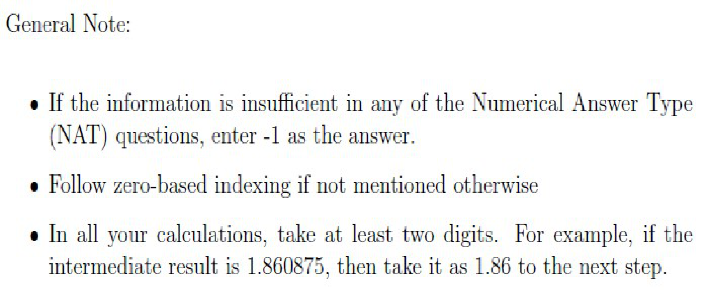

**Figure 1.** General Note specifying NAT insufficient information convention (-1), zero-based indexing, and rounding to at least two digits for intermediate calculations

### Question 198

**Question ID:** `640653820866`

**Type:** MCQ · **Marks:** 2
**PDF pages:** 3

BERT stands for

**Options**

**A.**

Bidirectional Encoder Representation for Text

*Source option ID:* `6406532755211`

*Label added for presentation.*

**B.**

Bidirectional Encoder Representation from Transformer

*Source option ID:* `6406532755212`

*Label added for presentation.*

**C.**

Bidirectionaly Extracted Representation from Transformer

*Source option ID:* `6406532755213`

*Label added for presentation.*

**D.**

Bidirectionaly Extracted Representation of Text

*Source option ID:* `6406532755214`

*Label added for presentation.*

**Correct answer:** B. Bidirectional Encoder Representation from Transformer

**Source evidence:** [{"page": 3, "bbox": [22.87, 246.6, 118.27, 262.92], "type": "green source option", "detail": "Green option marker 6406532755212"}]

### Question 199

**Question ID:** `640653820882`

**Type:** MCQ · **Marks:** 2
**PDF pages:** 3

The statement that, in general, position information can also be injected into the attention layers of a transformer model instead of the embedding of input tokens is

**Options**

**A.**

TRUE

*Source option ID:* `6406532755241`

*Label added for presentation.*

**B.**

FALSE

*Source option ID:* `6406532755242`

*Label added for presentation.*

**Correct answer:** A. TRUE

**Source evidence:** [{"page": 3, "bbox": [22.87, 589.1, 118.27, 605.42], "type": "green source option", "detail": "Green option marker 6406532755241"}]

### Question 200

**Question ID:** `640653820881`

**Type:** MCQ · **Marks:** 4
**PDF pages:** 3, 4

Consider an attention matrix $A = \text{softmax}(QK^T)$. Suppose we implement the block-wise sparse attention mechanism by multiplying attention matrix $A$ by a masking matrix $M$ of the same size. Suppose further the matrix $M$ contains four identity blocks. Using this approach, what is the computational complexity of the self-attention module?

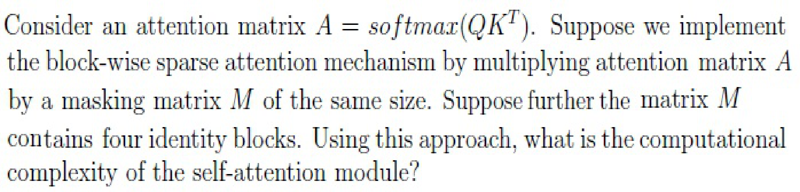

**Figure 2.** Block-wise sparse attention matrix formulation and complexity question

**Options**

**A.**

$O(T^2 / 4)$

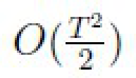

**Figure 3.** Option A complexity expression O(T^2 / 4)

*Source option ID:* `6406532755237`

*Label added for presentation.*

**B.**

$O(T)$

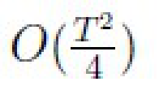

**Figure 4.** Option B complexity expression O(T)

*Source option ID:* `6406532755238`

*Label added for presentation.*

**C.**

$O(T^2 / 16)$

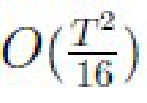

**Figure 5.** Option C complexity expression O(T^2 / 16)

*Source option ID:* `6406532755239`

*Label added for presentation.*

**D.**

$O(T^2)$

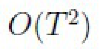

**Figure 6.** Option D complexity expression O(T^2)

*Source option ID:* `6406532755240`

*Label added for presentation.*

**Correct answer:** D. $O(T^2)$

**Source evidence:** [{"page": 4, "bbox": [22.87, 478.18, 118.27, 494.5], "type": "green source option", "detail": "Green option marker 6406532755240"}]

### Question 201

**Question ID:** `640653820877`

**Type:** SA · **Marks:** 4
**PDF pages:** 4, 5

**Shared context:** [ctx-197](#ctx-197)

Consider a vocabulary $V$,

$$V = ([\text{start}], \text{waiting}, \text{is}, \text{incredible}, \text{something}, \text{somewhere}, \text{to}, \text{be}, \text{known}, [\text{end}])$$

Assume that we have a pre-trained GPT model for text generation and the first input token to the model is always the special token $[\text{start}]$. The prediction probabilities output by the model are given below.

$$\begin{bmatrix}
0.05 & 0.02 & 0.14 & 0.07 & 0.09 & 0.41 & 0.08 & 0.05 & 0.08 & 0.01 \\
0.10 & 0.04 & 0.06 & 0.16 & 0.43 & 0.01 & 0.06 & 0.09 & 0.01 & 0.04 \\
0.05 & 0.07 & 0.28 & 0.29 & 0.03 & 0.08 & 0.04 & 0.08 & 0.04 & 0.04 \\
0.10 & 0.02 & 0.48 & 0.02 & 0.01 & 0.07 & 0.06 & 0.14 & 0.07 & 0.01 \\
0.08 & 0.29 & 0.04 & 0.01 & 0.04 & 0.03 & 0.25 & 0.05 & 0.15 & 0.06 \\
0.14 & 0.03 & 0.13 & 0.08 & 0.01 & 0.03 & 0.06 & 0.23 & 0.08 & 0.22
\end{bmatrix}$$

The zeroth row of the matrix is the output probability distribution by the model given the special $[\text{Start}]$ token as input. Following the Greedy Search decoding strategy, the subsequent rows give the conditional probability distribution conditioned over the previous tokens. Enter the generated text.

Note, enter the predicted tokens as in the vocabulary. Give a single space between predicted tokens. Leave no space before/after the first/last tokens.

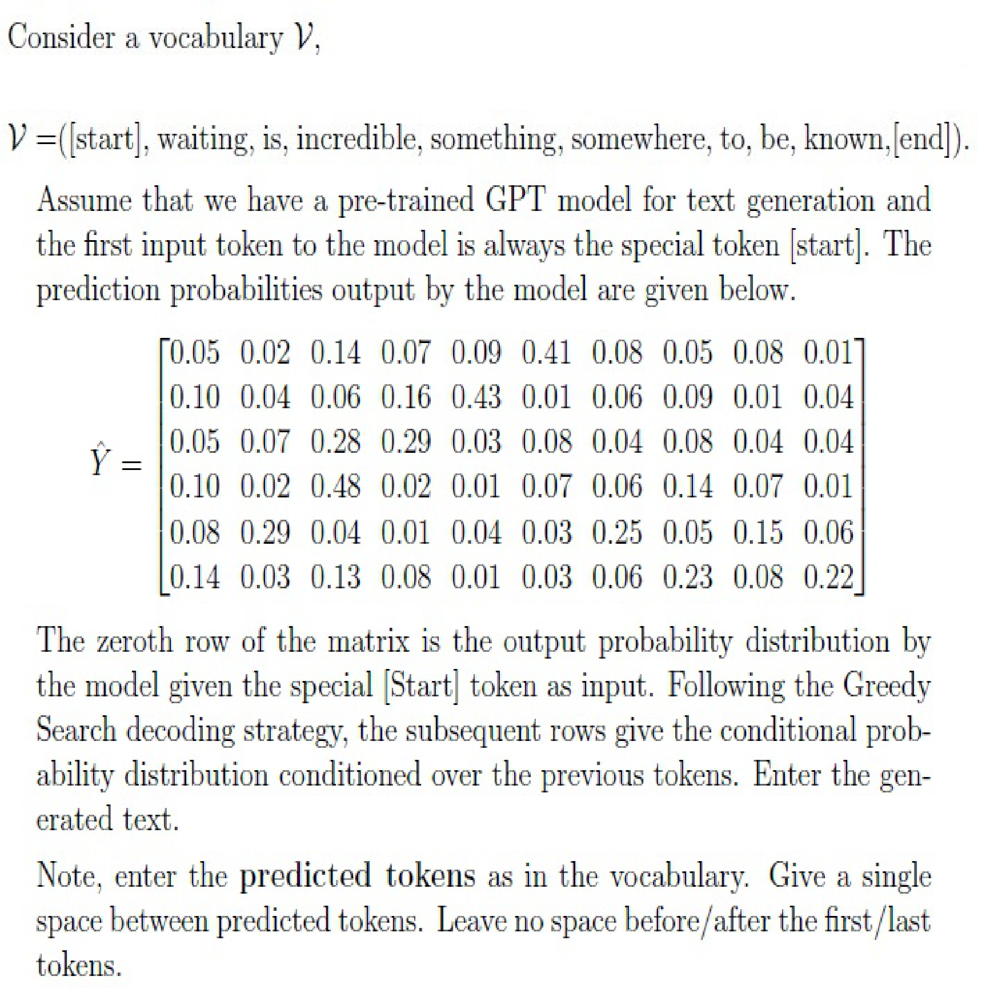

**Figure 7.** Vocabulary and conditional prediction probability distribution matrix for text generation

**Correct answer:** somewhere something incredible is waiting be

**Source evidence:** [{"page": 5, "bbox": [22.87, 620.5, 454.12, 650.0], "type": "explicit field", "detail": "Possible Answers: somewhere something incredible is waiting be"}]

### Shared context 202-203

**Question ID:** `640653820874`

**Type:** Comprehension
**PDF pages:** 6

Suppose a GPT model is pre-trained using the Causal Language Modelling (CLM) objective and fine-tuned on a text summarization task. The context length T of the model was kept at 1024 during both pre-training and fine-tuning. Assume that the model uses Absolute Position Embedding (APE) with learnable parameters.

Based on the above data, answer the given subquestions.

### Question 202

**Question ID:** `640653820875`

**Type:** MSQ · **Marks:** 3
**PDF pages:** 6

**Shared context:** [ctx-202-203](#ctx-202-203)

A user runs inference on the model N times with an input text that contains 712 tokens (including the special [start] token), then which of the following could be the possible length of summarized text

**Options**

**A.**

256

*Source option ID:* `6406532755225`

*Label added for presentation.*

**B.**

16

*Source option ID:* `6406532755226`

*Label added for presentation.*

**C.**

1024

*Source option ID:* `6406532755227`

*Label added for presentation.*

**D.**

512

*Source option ID:* `6406532755228`

*Label added for presentation.*

**Correct answer:** A. 256, B. 16

**Source evidence:** [{"page": 6, "bbox": [22.87, 581.02, 118.27, 597.34], "type": "green source option", "detail": "Green option marker 6406532755225"}, {"page": 6, "bbox": [22.87, 617.18, 118.27, 633.5], "type": "green source option", "detail": "Green option marker 6406532755226"}]

### Question 203

**Question ID:** `640653820876`

**Type:** MSQ · **Marks:** 3
**PDF pages:** 6, 7

**Shared context:** [ctx-202-203](#ctx-202-203)

A user runs inference on the model N times with an input text that contains 712 tokens (including the special [start] token). However, the user observed that in each run the model generated the exact same summary. Based on this observation, select the decoding strategy that the model might be using

**Options**

**A.**

Greedy decoding strategy

*Source option ID:* `6406532755229`

*Label added for presentation.*

**B.**

Beam search with beam size K > 2

*Source option ID:* `6406532755230`

*Label added for presentation.*

**C.**

Top-k sampling with K > 3

*Source option ID:* `6406532755231`

*Label added for presentation.*

**D.**

Top-P sampling with p = 0.25

*Source option ID:* `6406532755232`

*Label added for presentation.*

**E.**

Greedy decoding by varying the temperature parameter T in the softmax function for each run

*Source option ID:* `6406532755233`

*Label added for presentation.*

**Correct answer:** A. Greedy decoding strategy, B. Beam search with beam size K > 2

**Source evidence:** [{"page": 7, "bbox": [22.87, 207.47, 118.27, 223.79], "type": "green source option", "detail": "Green option marker 6406532755229"}, {"page": 7, "bbox": [22.87, 243.63, 118.27, 259.95], "type": "green source option", "detail": "Green option marker 6406532755230"}]

### Shared context 204-205

**Question ID:** `640653820878`

**Type:** Comprehension
**PDF pages:** 7

Consider the following vocabulary learnt using the Byte Pair Encoding (BPE) algorithm. The base vocabulary contains letters from a – z and digits from 0 – 9. The rest of the tokens are learned from the dataset

$$V = (\text{a}, \text{b}, \text{c}, \dots, \text{z}, 0, 1, \dots, 9, \text{in}, \text{th}, \text{lo}, \text{ing}, \text{et}, \text{ve}, \text{est}, \text{st}, 10, [\text{unk}])$$

Based on the above data, answer the given subquestions.

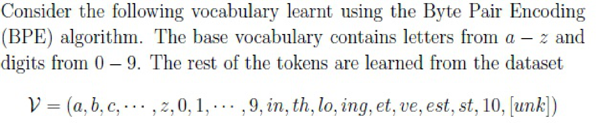

**Figure 8.** Byte Pair Encoding vocabulary and input tokenization context

### Question 204

**Question ID:** `640653820879`

**Type:** SA · **Marks:** 3
**PDF pages:** 7, 8

**Shared context:** [ctx-204-205](#ctx-204-205), [ctx-197](#ctx-197)

Suppose the input word to the tokenizer is “SomeThing”. Assume that input text is normalized before applying pre-tokenization. Enter the number of tokens returned by the tokenizer. Ignore the special token used to represent the boundary of the word/token.

**Correct answer:** 6

**Source evidence:** [{"page": 8, "bbox": [22.87, 253.8, 100.0, 275.0], "type": "explicit field", "detail": "Possible Answers: 6"}]

### Question 205

**Question ID:** `640653820880`

**Type:** SA · **Marks:** 3
**PDF pages:** 8

**Shared context:** [ctx-204-205](#ctx-204-205), [ctx-197](#ctx-197)

Suppose the input word to the tokenizer is “1000000”.Enter the number of tokens returned by the tokenizer.

**Correct answer:** 6

**Source evidence:** [{"page": 8, "bbox": [22.87, 621.7, 100.0, 645.0], "type": "explicit field", "detail": "Possible Answers: 6"}]

### Shared context 206-207

**Question ID:** `640653820867`

**Type:** Comprehension
**PDF pages:** 9

Consider the encoder layer of vanilla transformer architecture with the following configurations

- Context length $T = 256$
- Embedding dim $d_{\text{embed}} = d_{\text{model}} = 256$
- Projected dimension $d_k = d_q = d_v = 32$
- Number of heads $n_h = 8$
- feed-forward layer dimension $d_{\text{ff}} = 1024$

The parameters in the feed-forward neural network layer comprise both weights and biases. The input and output embeddings are shared. The model uses Absolute Position Embedding (APE) using fixed sinusoidal encoding scheme.

Based on the above data, answer the given subquestions.

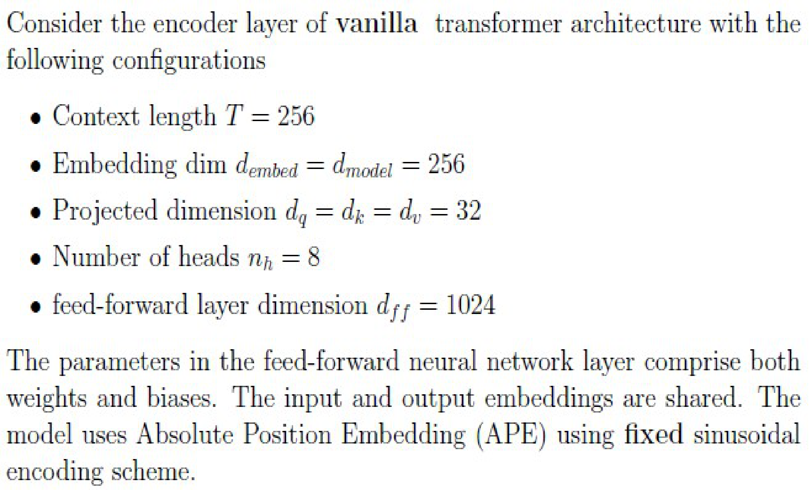

**Figure 9.** Vanilla transformer encoder configuration specifications

### Question 206

**Question ID:** `640653820868`

**Type:** SA · **Marks:** 4
**PDF pages:** 9, 10

**Shared context:** [ctx-206-207](#ctx-206-207), [ctx-197](#ctx-197)

Suppose the number of encoder layers N = 3. What is the total number of learnable parameters, including the parameters of the input and position embedding layers, in the model? Enter the final answer in thousands. For example, if the answer is 12,238, then enter 12 as the answer.

**Correct answer:** 2566

**Source evidence:** [{"page": 10, "bbox": [22.87, 21.3, 100.0, 45.0], "type": "explicit field", "detail": "Possible Answers: 2566"}]

### Question 207

**Question ID:** `640653820869`

**Type:** SA · **Marks:** 3
**PDF pages:** 10

**Shared context:** [ctx-206-207](#ctx-206-207), [ctx-197](#ctx-197)

Suppose we increase the context length from T = 256 to T = 512 keeping number of layers same (N = 3). How many parameters does the model need to learn additionally compared to the previous setting?

**Correct answer:** 0

**Source evidence:** [{"page": 10, "bbox": [22.87, 412.8, 100.0, 435.0], "type": "explicit field", "detail": "Possible Answers: 0"}]

### Shared context 208-209

**Question ID:** `640653820863`

**Type:** Comprehension
**PDF pages:** 10, 11

A vocabulary contains four words $V = (\text{coffee}, \text{i}, \text{like}, \text{much})$ and the corresponding embedding matrix $E = \begin{bmatrix} 1 & 0 \\ 0 & 1 \\ 1 & -1 \\ 1 & 1 \end{bmatrix}$. Assume that no position information is added to the embeddings of input tokens. The parameters in the attention layer are

$$W_Q = \begin{bmatrix} 1 & 0.5 \\ -0.5 & 1 \end{bmatrix}, \quad W_K = \begin{bmatrix} 1 & -0.5 \\ 0.5 & 1 \end{bmatrix}, \quad W_V = \begin{bmatrix} 0.5 & 0 \\ 0 & 1 \end{bmatrix}, \quad W_O = \begin{bmatrix} 1 & 0 \\ -1 & 1 \end{bmatrix}$$

Suppose the input sentence is “i like coffee much”. The corresponding attention matrix $A = \text{softmax}(QK^T)$ is given below

$$\begin{bmatrix}
0.13 & 0.22 & 0.28 & 0.36 \\
0.45 & 0.06 & 0.15 & 0.35 \\
0.25 & 0.06 & 0.17 & 0.53 \\
0.12 & 0.04 & 0.17 & 0.67
\end{bmatrix}$$

Then answer the given subquestions . If you think the given information is insufficient, then enter -1 as the answer.

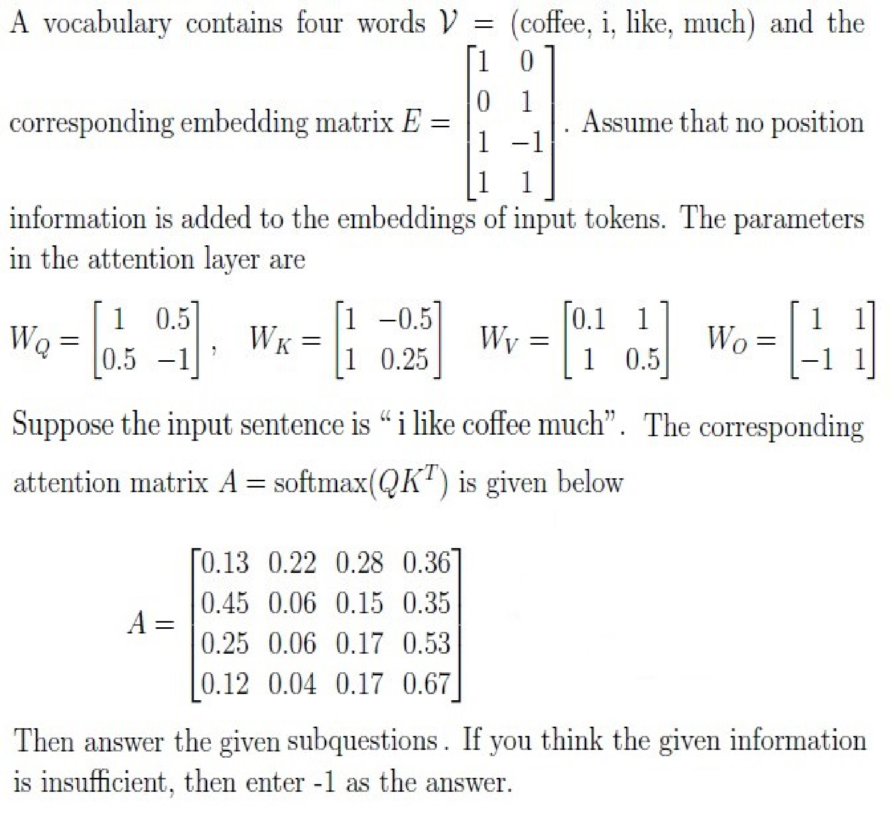

**Figure 10.** Vocabulary embeddings, attention layer weights, and attention matrix

### Question 208

**Question ID:** `640653820864`

**Type:** SA · **Marks:** 4
**PDF pages:** 11

**Shared context:** [ctx-208-209](#ctx-208-209), [ctx-197](#ctx-197)

Compute the representation for the word “coffee” and enter the sum of the elements in it.

**Correct answer:** 1.75 to 1.95

**Source evidence:** [{"page": 11, "bbox": [22.87, 738.3, 120.0, 760.0], "type": "explicit field", "detail": "Possible Answers: 1.75 to 1.95"}]

### Question 209

**Question ID:** `640653820865`

**Type:** SA · **Marks:** 4
**PDF pages:** 12

**Shared context:** [ctx-208-209](#ctx-208-209), [ctx-197](#ctx-197)

Suppose the input sentence is “coffee i like much“. What is the attention score between the word “coffee” with “much”?

**Correct answer:** 0.53

**Source evidence:** [{"page": 12, "bbox": [22.87, 306.8, 100.0, 330.0], "type": "explicit field", "detail": "Possible Answers: 0.53"}]

### Shared context 210-212

**Question ID:** `640653820870`

**Type:** Comprehension
**PDF pages:** 12, 13

Consider a GPT model trained using Causal Language Modelling (CLM) objective. The matrix below shows the elements of $QK^T$ in the first layer of the model.

$$\begin{bmatrix}
0.07 & 2.56 & 0.25 & 2.36 & 3.06 & 1.83 & 2.31 & 0.77 \\
2.04 & 2.55 & 3.35 & 2.21 & 4.04 & 0.16 & 1.49 & 0.09 \\
2.34 & 3.65 & 2.63 & 0.95 & 3.37 & 3.59 & 4.3 & 2.02 \\
0.04 & 0.41 & 2.26 & 2.29 & 3.02 & 2.48 & 1.77 & 3.85 \\
0.78 & 2.81 & 0.26 & 0.3 & 2.16 & 2.56 & 3.09 & 2.83 \\
3.02 & 2.28 & 1.59 & 3.77 & 2.58 & 3.41 & 1.8 & 3.93 \\
3.09 & 1.23 & 2.02 & 1.77 & 0.42 & 0.99 & 2.05 & 2.0 \\
3.42 & 1.79 & 1.78 & 1.56 & 1.5 & 1.86 & 2.71 & 0.82
\end{bmatrix}$$

Based on the above data, answer the given subquestions.

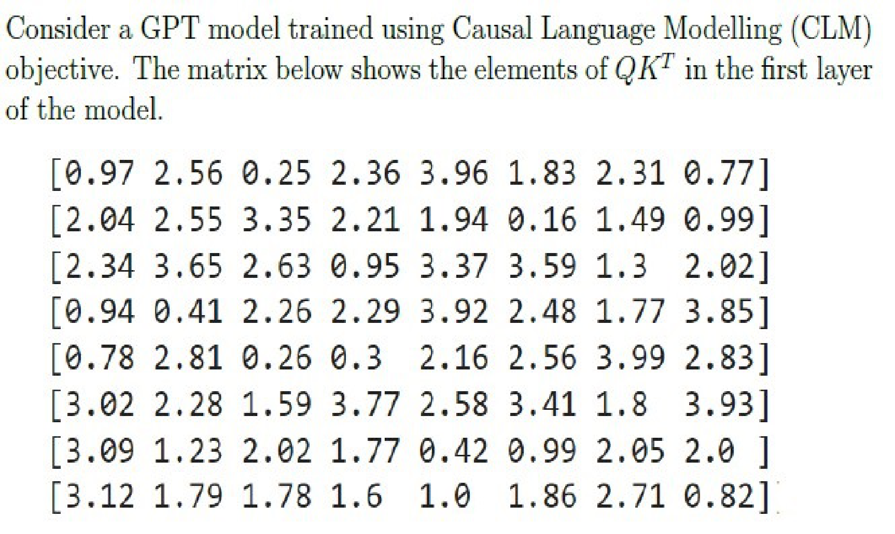

**Figure 11.** First layer QK^T matrix elements for CLM GPT model

### Question 210

**Question ID:** `640653820871`

**Type:** SA · **Marks:** 3
**PDF pages:** 13

**Shared context:** [ctx-210-212](#ctx-210-212), [ctx-197](#ctx-197)

What is the input sequence length that would have generated this matrix?

**Correct answer:** 8

**Source evidence:** [{"page": 13, "bbox": [22.87, 650.4, 100.0, 670.0], "type": "explicit field", "detail": "Possible Answers: 8"}]

### Question 211

**Question ID:** `640653820872`

**Type:** MSQ · **Marks:** 4
**PDF pages:** 13, 14

**Shared context:** [ctx-210-212](#ctx-210-212)

Suppose the dimension of value vector, $d_v = 16$, then which of the following could be the dimensions of the key and query vectors $(d_k, d_q)$?

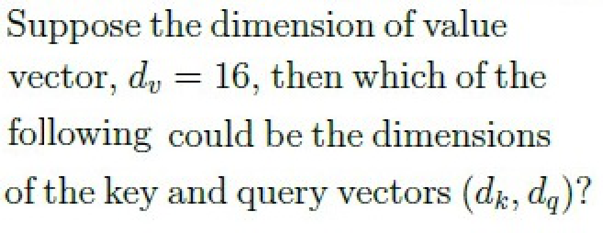

**Figure 12.** Key and query vector dimensions question

**Options**

**A.**

(8,8)

*Source option ID:* `6406532755218`

*Label added for presentation.*

**B.**

(64,64)

*Source option ID:* `6406532755219`

*Label added for presentation.*

**C.**

(32,32)

*Source option ID:* `6406532755220`

*Label added for presentation.*

**D.**

(16,16)

*Source option ID:* `6406532755221`

*Label added for presentation.*

**E.**

(8,16)

*Source option ID:* `6406532755222`

*Label added for presentation.*

**F.**

(16,8)

*Source option ID:* `6406532755223`

*Label added for presentation.*

**Correct answer:** A. (8,8), B. (64,64), C. (32,32), D. (16,16)

**Source evidence:** [{"page": 14, "bbox": [22.87, 182.18, 118.27, 198.5], "type": "green source option", "detail": "Green option marker 6406532755218"}, {"page": 14, "bbox": [22.87, 218.34, 118.27, 234.66], "type": "green source option", "detail": "Green option marker 6406532755219"}, {"page": 14, "bbox": [22.87, 254.51, 118.27, 270.83], "type": "green source option", "detail": "Green option marker 6406532755220"}, {"page": 14, "bbox": [22.87, 290.67, 118.27, 306.99], "type": "green source option", "detail": "Green option marker 6406532755221"}]

### Question 212

**Question ID:** `640653820873`

**Type:** SA · **Marks:** 4
**PDF pages:** 14, 15

**Shared context:** [ctx-210-212](#ctx-210-212), [ctx-197](#ctx-197)

Suppose we pass this $QK^T$ through the softmax function to compute the final attention score. Following zero-based indexing, at time step $t_3$, the attention score for the query $q_3$ is highest for the $i$-th key $k_i$. Enter the value of $i$.

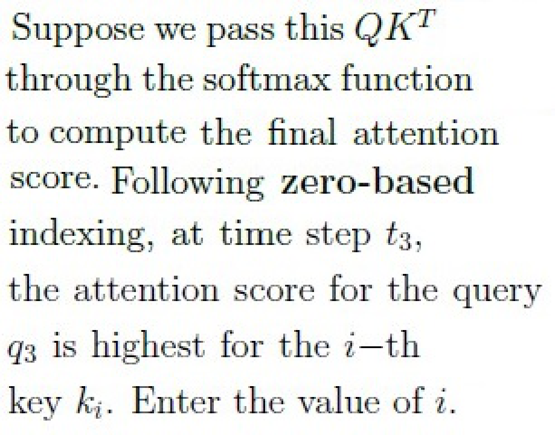

**Figure 13.** Attention score index question for query q3 and key ki

**Correct answer:** 3

**Source evidence:** [{"page": 15, "bbox": [22.87, 21.3, 100.0, 45.0], "type": "explicit field", "detail": "Possible Answers: 3"}]

## Answer key

| Source question | Source identity | Correct answer | PDF pages |
| :--- | :--- | :--- | :--- |
| 198 | 640653820866 | B. Bidirectional Encoder Representation from Transformer | 3 |
| 199 | 640653820882 | A. TRUE | 3 |
| 200 | 640653820881 | D. $O(T^2)$ | 3, 4 |
| 201 | 640653820877 | somewhere something incredible is waiting be | 4, 5 |
| 202 | 640653820875 | A. 256, B. 16 | 6 |
| 203 | 640653820876 | A. Greedy decoding strategy, B. Beam search with beam size K > 2 | 6, 7 |
| 204 | 640653820879 | 6 | 7, 8 |
| 205 | 640653820880 | 6 | 8 |
| 206 | 640653820868 | 2566 | 9, 10 |
| 207 | 640653820869 | 0 | 10 |
| 208 | 640653820864 | 1.75 to 1.95 | 11 |
| 209 | 640653820865 | 0.53 | 12 |
| 210 | 640653820871 | 8 | 13 |
| 211 | 640653820872 | A. (8,8), B. (64,64), C. (32,32), D. (16,16) | 13, 14 |
| 212 | 640653820873 | 3 | 14, 15 |

## Extraction notes

**Status:** verified-source-limitation
**Count reconciliation:** The portal declared 11 questions and 50 marks for Section 9 (LLM). The 50 marks reconcile exactly across the 15 academic questions: Q198 (2) + Q199 (2) + Q200 (4) + Q201 (4) + Q202 (3) + Q203 (3) + Q204 (3) + Q205 (3) + Q206 (4) + Q207 (3) + Q208 (4) + Q209 (4) + Q210 (3) + Q211 (4) + Q212 (4) = 50 marks. The source PDF contains 8 portal sub-sections for Section 9, 1 administrative confirmation entry (Q196, 0 marks), 1 shared-context calculation note entry (Q197, 0 marks), 5 comprehension passages (shared context), and 15 academic questions (Q198-Q212). The declared count of 11 questions in the portal header does not match the observed count of 15 academic questions or 8 sub-sections; this portal-count mismatch is an unexplained source discrepancy and is preserved as a verified source limitation.

- Section 9 LLM is in-scope from page 1 (y=115.0) to page 15 (y=134.7). Preceding content on page 1 belongs to Section 8, and succeeding content on page 15 belongs to Section 10 (Stat computing).
- All math formulas in image-only comprehension contexts and questions (ctx-197, q200, q201, ctx-204-205, ctx-206-207, ctx-208-209, ctx-210-212, q211, q212) have been verified against 288 DPI source crops.
- Portal header declared count of 11 questions does not match observed count of 15 academic questions or 8 sub-sections, though 50 section marks reconcile exactly.
- Question 197 General Note raster contains administrative acknowledgment options which were excluded semantically, leaving no independent evaluation answer.

**Excluded source entries:**

- {"classification": "subject-confirmation", "page": 1, "bbox": [22.87, 750.0, 580.0, 840.0], "reason": "Administrative subject confirmation asking candidate to confirm subject and cross check hall ticket", "identity": "196"}
- {"classification": "administrative-acknowledgment-options", "page": 2, "bbox": [22.87, 579.6, 510.76, 670.0], "reason": "Administrative acknowledgment options (Instruction has been mentioned above / This Instruction is just for a reference & not for an evaluation) excluded semantically while preserving calculation note as shared context", "identity": "197"}
