# LLM — da5004_2024T1_Q1_NA

**Source:** `da5004_2024T1_Q1_NA.pdf` · **Academic questions:** 15 · **Separately counted children:** 0
**Provenance:** `Large_Language_Models/da5004_2024T1_Q1_NA.pdf` · SHA-256 `f9418c188bfff09ac15cb4a6a868d71310090e68352296324cbdedd8e4502f30`

**Scope:** Section 12: LLM (Degree Level : Introduction to Large Language Models), physical pages 1 to 14. The in-scope subject starts at physical page 1 with Section Id 64065351461 at y=423.24 and terminates on physical page 14 immediately prior to Section 13: BDBN (Section Id 64065351462) at y=729.60.

## Questions

### Shared context 183

**Question ID:** `640653739755`

**Type:** General Note
**PDF pages:** 2, 3

General Note:

- If you find the given information is insufficient in any of the Numerical Answer Type (NAT) questions, enter -1 as the answer.
- In all your calculations, take at least two digits. For example, if the intermediate result is 1.860875, then take it as 1.86 to the next step.

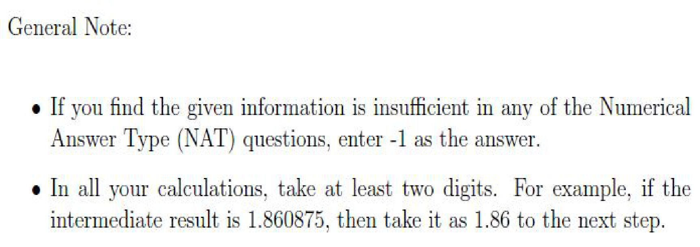

**Figure 1.** General Note specifying NAT insufficient information convention (-1) and rounding to at least two digits for intermediate calculations

### Shared context 184-187

**Question ID:** `640653739756`

**Type:** Comprehension
**PDF pages:** 3, 4

Consider a vocabulary $V = (A, T, C, G)$ and the corresponding embedding matrix $E = \begin{bmatrix} 1 & 0 \\ 0 & 1 \\ 1 & -1 \\ 1 & 1 \end{bmatrix}$. For example, the 0-th row of $E$ is the embedding for 0-th token of $V$ and so on.

The following sequence $X = (G, C, C, T, A, G)$ is to be processed by the encoder layer of the transformer architecture by appropriately adding the positional information using the following encoding scheme:

$$P(pos, 2i) = \sin\left(\frac{pos}{10000^{2i/d_{model}}}\right)$$

$$P(pos, 2i+1) = \cos\left(\frac{pos}{10000^{2i/d_{model}}}\right)$$

Assume the index for the position starts from zero. Add positional information to all the tokens in the sequence. Let the resultant sequence be denoted by $H = E(X) + P$, ($H$ will be used in the subsequent questions, please write it down). Here, $E(X)$ denotes the embedding for each token in $X$.

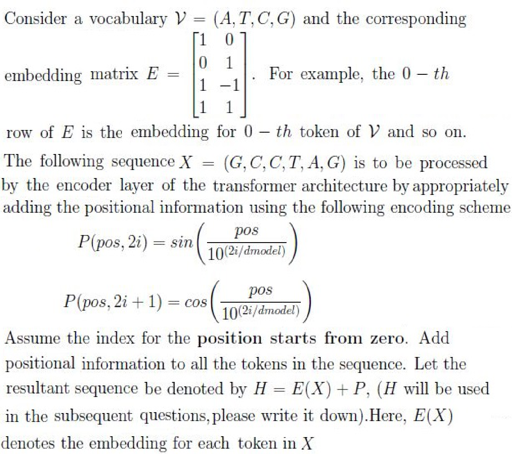

**Figure 2.** Vocabulary V, embedding matrix E, sequence X, and positional encoding scheme equations for transformer encoder

Based on the above data, answer the given subquestions.

### Question 184

**Question ID:** `640653739757`

**Type:** Short Answer Question · **Marks:** 3
**PDF pages:** 4, 5

**Shared context:** [ctx-184-187](#ctx-184-187), [ctx-183](#ctx-183)

What is the sum of the elements in the embedding vector $P_3$?

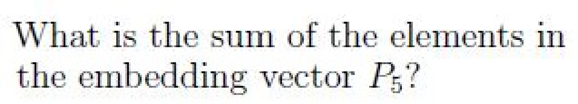

**Figure 3.** Question 184 prompt: sum of elements in embedding vector P_3

**Correct answer:** -0.73 to -0.63

**Source evidence:** [{"page": 5, "bbox": [22.87, 21.27, 120.0, 37.6], "type": "explicit field", "detail": "Possible Answers: -0.73 to -0.63"}]

### Question 185

**Question ID:** `640653739758`

**Type:** Short Answer Question · **Marks:** 2
**PDF pages:** 5

**Shared context:** [ctx-184-187](#ctx-184-187), [ctx-183](#ctx-183)

What is the sum of the elements in the 3-rd token, $h_3 \in H$

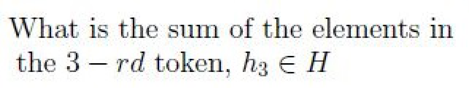

**Figure 4.** Question 185 prompt: sum of elements in the 3rd token h_3 in H

**Correct answer:** 0.13 to 0.20

**Source evidence:** [{"page": 5, "bbox": [22.87, 436.0, 120.0, 452.0], "type": "explicit field", "detail": "Possible Answers: 0.13 to 0.20"}]

### Question 186

**Question ID:** `640653739759`

**Type:** Short Answer Question · **Marks:** 3
**PDF pages:** 5, 6

**Shared context:** [ctx-184-187](#ctx-184-187), [ctx-183](#ctx-183)

The bottommost encoder layer of the transformer contains the following parameter matrices:

$$W_Q = \begin{bmatrix} 1 & 0 \\ 0 & 1 \end{bmatrix}, \quad W_K = \begin{bmatrix} 1 & 0 \\ 0 & 1 \end{bmatrix}, \quad W_V = \begin{bmatrix} 0 & 1 \\ 1 & 0 \end{bmatrix}, \quad W_O = \begin{bmatrix} 1 & 1 \\ 1 & 1 \end{bmatrix}$$

given that the embeddings are row vectors, compute the attention score to produce the new representation for the token (T) at the 3-rd position in the sequence X.

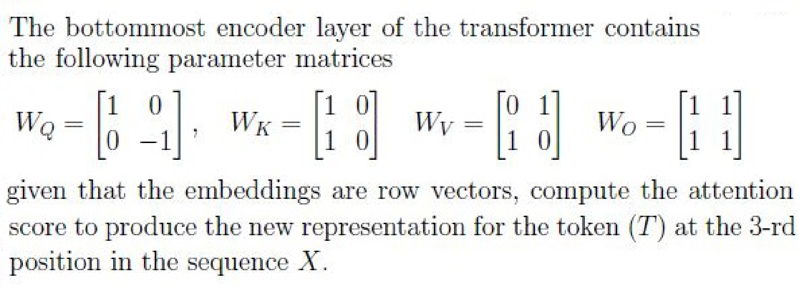

**Figure 5.** Transformer bottommost encoder parameter matrices W_Q, W_K, W_V, W_O and attention computation context

What is the un-normalized attention weight given for the token (A) at the 4th position?

Note: unnormalized here implies the raw score before applying softmax. Avoid scaling the dot-product by $\sqrt{d_k}$

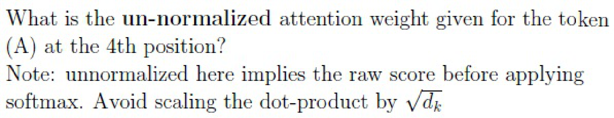

**Figure 6.** Question 186 prompt: un-normalized attention weight for token (A) at 4th position without scaling by sqrt(d_k)

**Correct answer:** -0.06 to -0.035

**Source evidence:** [{"page": 6, "bbox": [22.87, 21.27, 130.0, 37.6], "type": "explicit field", "detail": "Possible Answers: -0.06 to -0.035"}]

### Question 187

**Question ID:** `640653739760`

**Type:** Multiple Choice Question · **Marks:** 2
**PDF pages:** 6

**Shared context:** [ctx-184-187](#ctx-184-187)

The bottommost encoder layer of the transformer contains the following parameter matrices:

$$W_Q = \begin{bmatrix} 1 & 0 \\ 0 & 1 \end{bmatrix}, \quad W_K = \begin{bmatrix} 1 & 0 \\ 0 & 1 \end{bmatrix}, \quad W_V = \begin{bmatrix} 0 & 1 \\ 1 & 0 \end{bmatrix}, \quad W_O = \begin{bmatrix} 1 & 1 \\ 1 & 1 \end{bmatrix}$$

given that the embeddings are row vectors, compute the attention score to produce the new representation for the token (T) at the 3-rd position in the sequence X.

**Figure 7.** Encoder layer parameter matrices and attention score context for token (T) at 3rd position

Which token in the sequence was given the highest score?

**Options**

**A.**

G

*Source option ID:* `6406532474508`

*Label added for presentation.*

**B.**

C

*Source option ID:* `6406532474509`

*Label added for presentation.*

**C.**

T

*Source option ID:* `6406532474510`

*Label added for presentation.*

**D.**

A

*Source option ID:* `6406532474511`

*Label added for presentation.*

**Correct answer:** G

**Source evidence:** [{"page": 6, "bbox": [22.87, 608.79, 118.27, 625.11], "type": "green source option", "detail": "Option 6406532474508 marked with green indicator (color 32768)"}]

### Shared context 188-189

**Question ID:** `640653739761`

**Type:** Comprehension
**PDF pages:** 7

Consider the following configuration for the Vannila transformer architecture with one encoder layer and one decoder layer.

- Source and target vocabulary size = 100
- maximum sequence length = 32
- length of context window ($T$) for both encoder and decoder = 32
- number of heads $n_h = 2$
- $d_{ff} = 4 * d_{model}$
- $d_q = d_k = d_v = \frac{d_{model}}{n_h}$

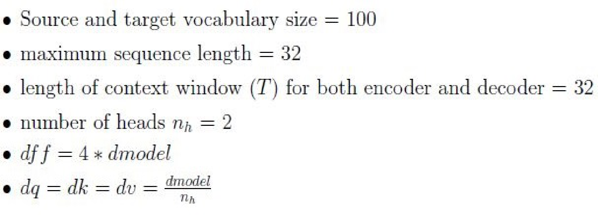

**Figure 8.** Vanilla transformer architecture configuration specifications for vocabulary, sequence length, context window, heads, and dimensions

Based on the above data, answer the given subquestions.

### Question 188

**Question ID:** `640653739762`

**Type:** Short Answer Question · **Marks:** 3
**PDF pages:** 7, 8

**Shared context:** [ctx-188-189](#ctx-188-189), [ctx-183](#ctx-183)

Suppose the number of learnable parameters in the source input embedding layer is 1600, how many parameters are there in the positional embedding layer of the source language? Assume the positional embeddings are learnable.

**Correct answer:** 512

**Source evidence:** [{"page": 8, "bbox": [22.87, 21.27, 60.0, 37.6], "type": "explicit field", "detail": "Possible Answers: 512"}]

### Question 189

**Question ID:** `640653739763`

**Type:** Short Answer Question · **Marks:** 3
**PDF pages:** 8

**Shared context:** [ctx-188-189](#ctx-188-189), [ctx-183](#ctx-183)

How many parameters are there in the multi-head attention layer of the encoder (exclude the parameters in the WO matrix used for linear transformation)?

**Correct answer:** 768

**Source evidence:** [{"page": 8, "bbox": [22.87, 336.84, 60.0, 355.2], "type": "explicit field", "detail": "Possible Answers: 768"}]

### Question 190

**Question ID:** `640653739764`

**Type:** Multiple Choice Question · **Marks:** 4
**PDF pages:** 8, 9

Let $R_E \in \mathbb{R}^{T_1 \times d_{model}}$ be the representation from the topmost encoder layer of the encoder and $Z_D \in \mathbb{R}^{T_2 \times d_{model}}$ be the output of Multi-head Masked Attention layer of one of the decoder layers. What will be the size of the attention matrix in the Multi-head Cross Attention layer of the same decoder layer? Assume $d_q = d_k = d_v = d$ if required.

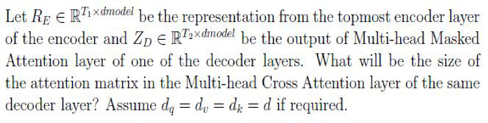

**Figure 9.** Topmost encoder representation R_E and decoder masked attention output Z_D dimension formulation for cross-attention matrix size

**Options**

**A.**

$T_1 \times T_2$

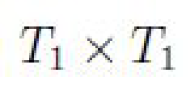

**Figure 10.** Option A attention matrix dimension T_1 x T_2

*Source option ID:* `6406532474514`

*Label added for presentation.*

**B.**

$T_2 \times T_2$

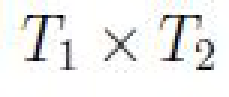

**Figure 11.** Option B attention matrix dimension T_2 x T_2

*Source option ID:* `6406532474515`

*Label added for presentation.*

**C.**

$T_1 \times T_1$

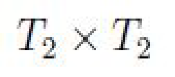

**Figure 12.** Option C attention matrix dimension T_1 x T_1

*Source option ID:* `6406532474516`

*Label added for presentation.*

**D.**

$T_2 \times T_1$

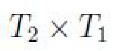

**Figure 13.** Option D attention matrix dimension T_2 x T_1

*Source option ID:* `6406532474517`

*Label added for presentation.*

**Correct answer:** $T_2 \times T_1$

**Source evidence:** [{"page": 9, "bbox": [22.87, 262.67, 118.27, 278.99], "type": "green source option", "detail": "Option 6406532474517 marked with green indicator (color 32768)"}]

### Question 191

**Question ID:** `640653739770`

**Type:** Multiple Choice Question · **Marks:** 4
**PDF pages:** 9

Suppose we run the pre-trained GPT model in an autoregressive fashion for generating a text sequence. Then, the statement that “ We do not need to add the positional embedding to the predicted tokens at every time step” is

**Options**

**A.**

TRUE

*Source option ID:* `6406532474530`

*Label added for presentation.*

**B.**

FALSE

*Source option ID:* `6406532474531`

*Label added for presentation.*

**Correct answer:** TRUE

**Source evidence:** [{"page": 9, "bbox": [22.87, 579.84, 118.27, 596.16], "type": "green source option", "detail": "Option 6406532474530 marked with green indicator (color 32768)"}]

### Question 192

**Question ID:** `640653739765`

**Type:** Multiple Select Question · **Marks:** 3
**PDF pages:** 9, 10

Suppose we have a dataset for machine translation tasks with thousands of samples. Suppose a team considers training the transformer model. The model could be trained in two approaches

A  Autoregressive training
B  Teacher forcing

Choose the correct statements

**Options**

**A.**

Approach A helps the model to converge faster than approach B

*Source option ID:* `6406532474518`

*Label added for presentation.*

**B.**

Approach B helps the model converge faster than approach A

*Source option ID:* `6406532474519`

*Label added for presentation.*

**C.**

One can start the training with approach B first and then switch to approach A after some training steps

*Source option ID:* `6406532474520`

*Label added for presentation.*

**D.**

Once the training starts with approach B and then switching to approach A after some training steps can not be done

*Source option ID:* `6406532474521`

*Label added for presentation.*

**Correct answer:** Approach B helps the model converge faster than approach A; One can start the training with approach B first and then switch to approach A after some training steps

**Source evidence:** [{"page": 10, "bbox": [22.87, 340.62, 118.27, 356.94], "type": "green source option", "detail": "Option 6406532474519 marked with green indicator (color 32768)"}, {"page": 10, "bbox": [22.87, 376.8, 118.27, 393.12], "type": "green source option", "detail": "Option 6406532474520 marked with green indicator (color 32768)"}]

### Question 193

**Question ID:** `640653739766`

**Type:** Multiple Select Question · **Marks:** 4
**PDF pages:** 10, 11

A team trained a Language model using the GPT architecture using a large corpus of text. The model configurations are given below:

- Vocabulary size = 30000
- $d_{model} = 512$
- length of context window $T = 1024$
- $d_{ff} = 4 * d_{model}$
- $d_q = d_k = d_v = 64$

They trained the model for millions of steps and stopped the training after the loss had decreased significantly. Then, they used the model to generate the text by giving the special starting token [BOS] as an input to the model. Select the length of the text sequence that the model could generate.

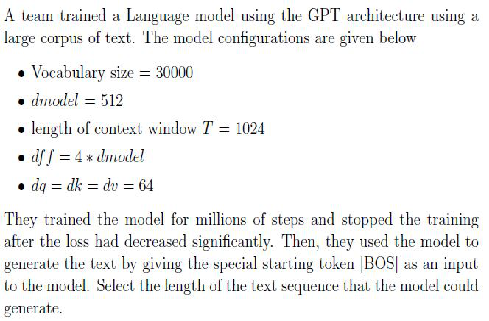

**Figure 14.** GPT language model training configurations and text generation sequence length prompt

**Options**

**A.**

512

*Source option ID:* `6406532474522`

*Label added for presentation.*

**B.**

1024

*Source option ID:* `6406532474523`

*Label added for presentation.*

**C.**

1536

*Source option ID:* `6406532474524`

*Label added for presentation.*

**D.**

2048

*Source option ID:* `6406532474525`

*Label added for presentation.*

**Correct answer:** 512; 1024; 1536; 2048

**Source evidence:** [{"page": 11, "bbox": [22.87, 343.93, 118.27, 360.25], "type": "green source option", "detail": "Option 6406532474522 marked with green indicator (color 32768)"}, {"page": 11, "bbox": [22.87, 380.09, 118.27, 396.41], "type": "green source option", "detail": "Option 6406532474523 marked with green indicator (color 32768)"}, {"page": 11, "bbox": [22.87, 416.26, 118.27, 432.58], "type": "green source option", "detail": "Option 6406532474524 marked with green indicator (color 32768)"}, {"page": 11, "bbox": [22.87, 452.42, 118.27, 468.74], "type": "green source option", "detail": "Option 6406532474525 marked with green indicator (color 32768)"}]

### Question 194

**Question ID:** `640653739771`

**Type:** Multiple Select Question · **Marks:** 4
**PDF pages:** 11, 12

Choose the correct statements

**Options**

**A.**

All the parameters of the GPT model are randomly initialized during pre-training

*Source option ID:* `6406532474532`

*Label added for presentation.*

**B.**

The model minimizes the CLM objective during fine-tuning to improve the performance

*Source option ID:* `6406532474533`

*Label added for presentation.*

**C.**

All parameters of the GPT model are randomly initialized during fine-tuning

*Source option ID:* `6406532474534`

*Label added for presentation.*

**D.**

In general, fine-tuning requires a dataset with labels

*Source option ID:* `6406532474535`

*Label added for presentation.*

**Correct answer:** All the parameters of the GPT model are randomly initialized during pre-training; In general, fine-tuning requires a dataset with labels

**Source evidence:** [{"page": 11, "bbox": [22.87, 699.09, 118.27, 715.41], "type": "green source option", "detail": "Option 6406532474532 marked with green indicator (color 32768)"}, {"page": 12, "bbox": [22.87, 67.09, 118.27, 83.41], "type": "green source option", "detail": "Option 6406532474535 marked with green indicator (color 32768)"}]

### Question 195

**Question ID:** `640653739772`

**Type:** Multiple Select Question · **Marks:** 4
**PDF pages:** 12

Which of the following decoding strategies is (are) appropriate for machine translation tasks? Assume we have infinite compute and the values for $k > 3, p > 0.35$ where required.

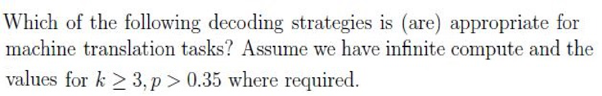

**Figure 15.** Decoding strategies evaluation prompt for machine translation tasks with infinite compute

**Options**

**A.**

Top-k sampling

*Source option ID:* `6406532474536`

*Label added for presentation.*

**B.**

Beam search with the beam size K = 2

*Source option ID:* `6406532474537`

*Label added for presentation.*

**C.**

Top-p sampling

*Source option ID:* `6406532474538`

*Label added for presentation.*

**D.**

Exhaustive search

*Source option ID:* `6406532474539`

*Label added for presentation.*

**E.**

None of these

*Source option ID:* `6406532474540`

*Label added for presentation.*

**Correct answer:** Beam search with the beam size K = 2; Exhaustive search

**Source evidence:** [{"page": 12, "bbox": [22.87, 395.43, 118.27, 411.75], "type": "green source option", "detail": "Option 6406532474537 marked with green indicator (color 32768)"}, {"page": 12, "bbox": [22.87, 467.77, 118.27, 484.09], "type": "green source option", "detail": "Option 6406532474539 marked with green indicator (color 32768)"}]

### Shared context 196-197

**Question ID:** `640653739767`

**Type:** Comprehension
**PDF pages:** 12, 13

Consider a GPT model used for Causal language modelling. We feed the input sentence “This is a

cool idea” to the model by appending special staring [BOS] and ending [EOS] tokens ( that is, “[BOS] This is a cool idea [EOS]”). Assume the context length of the model is 7. The attention matrix computed in one of the attention layers is given below

Table 1: Attention score matrix (7x7):

$$\begin{bmatrix} 1 & 0 & 0 & 0 & 0 & 0 & 0 \\ 0.5 & 0.5 & 0 & 0 & 0 & 0 & 0 \\ 0.3 & 0.2 & 0.5 & 0 & 0 & 0 & 0 \\ 0.1 & 0.1 & 0.8 & 0 & 0 & 0 & 0 \\ 0 & 0.15 & 0 & 0.6 & 0.25 & 0 & 0 \\ 0.25 & 0.35 & 0 & 0.2 & 0.1 & 0.1 & 0 \\ 0.1 & 0.1 & 0.1 & 0.1 & 0.1 & 0.4 & 0.1 \end{bmatrix}$$

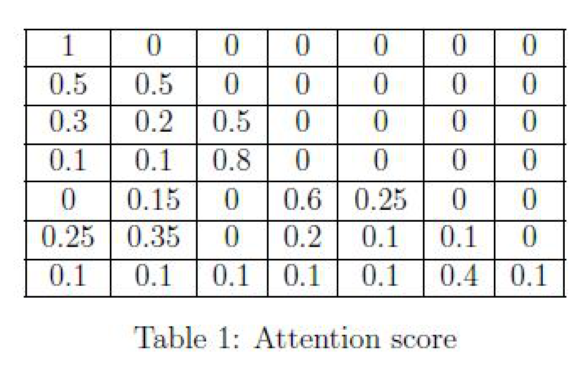

**Figure 16.** Table 1: 7x7 Attention score matrix for causal language modelling with BOS and EOS tokens

Based on the above data, answer the given subquestions.

### Question 196

**Question ID:** `640653739768`

**Type:** Multiple Choice Question · **Marks:** 4
**PDF pages:** 13

**Shared context:** [ctx-196-197](#ctx-196-197)

The attention score matrix given in Table 1 is appropriate for the causal language modelling task

**Options**

**A.**

True

*Source option ID:* `6406532474526`

*Label added for presentation.*

**B.**

False

*Source option ID:* `6406532474527`

*Label added for presentation.*

**C.**

Insufficient information

*Source option ID:* `6406532474528`

*Label added for presentation.*

**Correct answer:** True

**Source evidence:** [{"page": 13, "bbox": [22.87, 587.31, 118.27, 603.63], "type": "green source option", "detail": "Option 6406532474526 marked with green indicator (color 32768)"}]

### Question 197

**Question ID:** `640653739769`

**Type:** Short Answer Question · **Marks:** 4
**PDF pages:** 13, 14

**Shared context:** [ctx-196-197](#ctx-196-197), [ctx-183](#ctx-183)

Assume the time step starts from t = 0 and ends at t = 6. Suppose the model is at time step t = 4, what is the attention value assigned for the word “is”?

**Correct answer:** 0

**Source evidence:** [{"page": 14, "bbox": [22.87, 230.88, 35.0, 249.24], "type": "explicit field", "detail": "Possible Answers: 0"}]

### Question 198

**Question ID:** `640653739773`

**Type:** Multiple Choice Question · **Marks:** 3
**PDF pages:** 14

The statement that “the Next Sentence Prediction (NSP) task requires the BERT model to run autoregressively given the first sentence( or segment)” is

**Options**

**A.**

TRUE

*Source option ID:* `6406532474541`

*Label added for presentation.*

**B.**

FALSE

*Source option ID:* `6406532474542`

*Label added for presentation.*

**Correct answer:** FALSE

**Source evidence:** [{"page": 14, "bbox": [22.87, 645.58, 118.27, 661.9], "type": "green source option", "detail": "Option 6406532474542 marked with green indicator (color 32768)"}]

## Answer key

| Source question | Source identity | Correct answer | PDF pages |
| :--- | :--- | :--- | :--- |
| 184 | 640653739757 | -0.73 to -0.63 | 4, 5 |
| 185 | 640653739758 | 0.13 to 0.20 | 5 |
| 186 | 640653739759 | -0.06 to -0.035 | 5, 6 |
| 187 | 640653739760 | G | 6 |
| 188 | 640653739762 | 512 | 7, 8 |
| 189 | 640653739763 | 768 | 8 |
| 190 | 640653739764 | $T_2 \times T_1$ | 8, 9 |
| 191 | 640653739770 | TRUE | 9 |
| 192 | 640653739765 | Approach B helps the model converge faster than approach A; One can start the training with approach B first and then switch to approach A after some training steps | 9, 10 |
| 193 | 640653739766 | 512; 1024; 1536; 2048 | 10, 11 |
| 194 | 640653739771 | All the parameters of the GPT model are randomly initialized during pre-training; In general, fine-tuning requires a dataset with labels | 11, 12 |
| 195 | 640653739772 | Beam search with the beam size K = 2; Exhaustive search | 12 |
| 196 | 640653739768 | True | 13 |
| 197 | 640653739769 | 0 | 13, 14 |
| 198 | 640653739773 | FALSE | 14 |

## Extraction notes

**Status:** verified-source-limitation
**Count reconciliation:** The portal declared 12 questions and 50 marks for Section 12 (LLM). The 50 marks reconcile exactly across the 15 academic questions: Comprehension 184-187 subquestions Q184 (3) + Q185 (2) + Q186 (3) + Q187 (2) + Comprehension 188-189 subquestions Q188 (3) + Q189 (3) + Q190 (4) + Q191 (4) + Q192 (3) + Q193 (4) + Q194 (4) + Q195 (4) + Comprehension 196-197 subquestions Q196 (4) + Q197 (4) + Q198 (3) = 50 marks. The source PDF contains 8 portal sub-sections, 1 administrative confirmation entry (Q182, 0 marks), 1 shared-context calculation note entry (ctx-183, 0 marks), 3 comprehension passages (ctx-184-187, ctx-188-189, ctx-196-197), and 15 academic questions (Q184-Q198). The declared count of 12 questions in the portal header does not match the observed count of 15 academic questions or 8 sub-sections; this portal-count mismatch is an unexplained source discrepancy and is preserved as a verified source limitation.

- The LLM exam paper is delivered via an online computer-based portal. Section 12 (LLM) begins at page 1 (y=423.24) and ends on page 14 (y=729.60) immediately preceding Section 13 (BDBN).
- Official answers for all MCQ and MSQ items are uniquely identified by green option markers (color 32768, xref 20) in the source PDF.
- Official answers for all Short Answer items are specified by explicit 'Possible Answers' fields in the source PDF.
- Passages for comprehension questions (184-187, 188-189, 196-197) and the General Note are modeled as shared-context entries with appropriate cross-references.
- All visual raster mathematical expressions, formulas, and matrices have been extracted as high-fidelity PNG assets and transcribed into LaTeX.
- Section 12 (LLM) header declares Number of Questions: 12 and Number of Questions to be attempted: 12 (with Section Marks: 50). However, the section contains 8 portal sub-sections and 15 academic questions totaling exactly 50 marks. This portal declared count discrepancy (declared 12 vs 15 academic questions / 8 sub-sections) is an unexplained source limitation in the official exam portal metadata.

**Excluded source entries:**

- {"classification": "preceding-subject-question", "page": 1, "bbox": [22.87, 21.27, 548.69, 355.2], "reason": "Out-of-scope question 181 belonging to preceding Section 11 prior to LLM Section 12 start", "identity": "181"}
- {"classification": "subject-confirmation", "page": 2, "bbox": [22.87, 127.27, 581.19, 533.43], "reason": "Administrative subject confirmation asking candidate to confirm subject and cross check hall ticket", "identity": "182"}
- {"classification": "administrative-acknowledgment-options", "page": 3, "bbox": [22.87, 177.27, 510.76, 265.91], "reason": "Administrative acknowledgment options (Useful Data has been mentioned above / This data attachment is just for a reference & not for an evaluation) excluded semantically while preserving calculation note as shared context", "identity": "183"}
- {"classification": "following-subject-heading", "page": 14, "bbox": [20.62, 729.6, 405.42, 808.41], "reason": "Out-of-scope heading for subsequent Section 13 BDBN (Section Id 64065351462)", "identity": "Section 13"}
