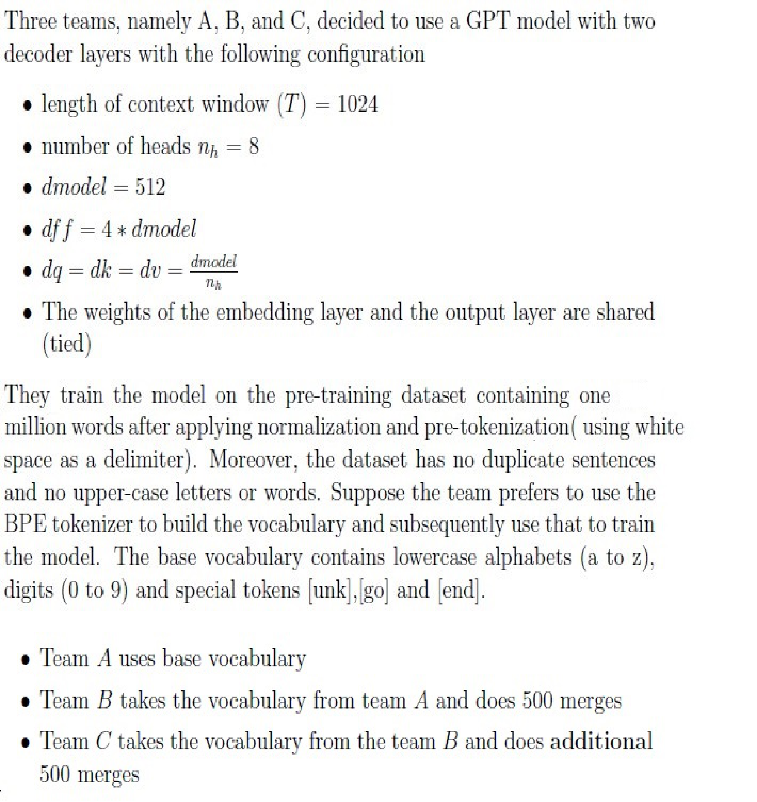
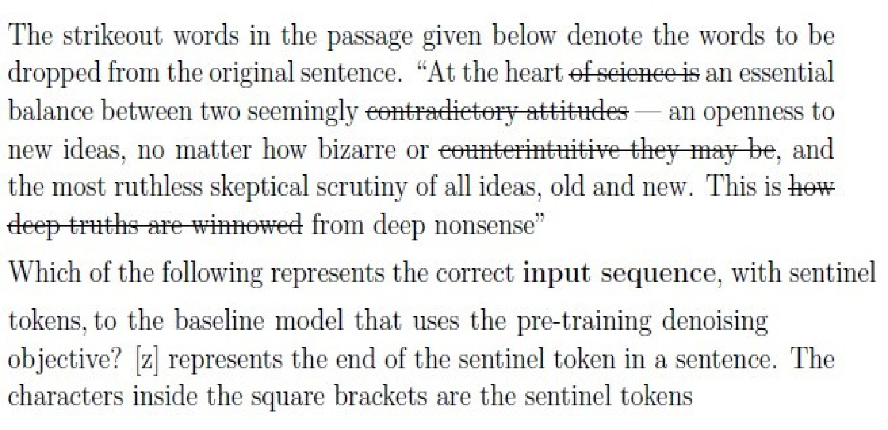

# LLM — da5004_2024T1_Q2_NA

**Source:** `da5004_2024T1_Q2_NA.pdf` · **Academic questions:** 14 · **Separately counted children:** 0
**Provenance:** `Large_Language_Models/da5004_2024T1_Q2_NA.pdf` · SHA-256 `16520154f663ca4cdfb46776746bd323fc0bc7c3d905f6c76f04afec1e2183db`

**Scope:** Section 9: LLM (Degree Level : Introduction to Large Language Models), physical pages 1 to 12. The in-scope subject starts at physical page 1 with Section Id 64065353062 and terminates on physical page 12 immediately prior to Section 10: DL(CV) (Section Id 64065353063).

## Questions

### Shared context 134-137

**Question ID:** `640653766127`

**Type:** Comprehension
**PDF pages:** 2, 3

Three teams, namely A, B, and C, decided to use a GPT model with two decoder layers with the following configuration:

- length of context window ($T$) = 1024
- number of heads $n_h = 8$
- $d_{\text{model}} = 512$
- $d_{\text{ff}} = 4 * d_{\text{model}}$
- $d_q = d_k = d_v = \frac{d_{\text{model}}}{n_h}$
- The weights of the embedding layer and the output layer are shared (tied)

They train the model on the pre-training dataset containing one million words after applying normalization and pre-tokenization (using white space as a delimiter). Moreover, the dataset has no duplicate sentences and no upper-case letters or words. Suppose the team prefers to use the BPE tokenizer to build the vocabulary and subsequently use that to train the model. The base vocabulary contains lowercase alphabets (a to z), digits (0 to 9) and special tokens [unk], [go] and [end].

- Team A uses base vocabulary
- Team B takes the vocabulary from team A and does 500 merges
- Team C takes the vocabulary from the team B and does additional 500 merges

Based on the above data answer the given subquestions.

**Figure 1.** GPT decoder configuration specifications, pre-training corpus properties, base vocabulary, and BPE merge setup for Teams A, B, and C

### Question 134

**Question ID:** `640653766128`

**Type:** SA · **Marks:** 3
**PDF pages:** 3, 4

**Shared context:** [ctx-134-137](#ctx-134-137)

What is the size of the vocabulary built by the Team C?

**Correct answer:** 1039

**Source evidence:** [{"page": 4, "bbox": [22.87, 95.0, 118.27, 120.0], "type": "explicit field", "detail": "Possible Answers: 1039"}]

### Question 135

**Question ID:** `640653766129`

**Type:** MSQ · **Marks:** 4
**PDF pages:** 4

**Shared context:** [ctx-134-137](#ctx-134-137)

Choose the correct statements about the number of parameters in the model (excluding the 
embedding and output layer parameters)

**Options**

**A.**

Team A model has less number of parameters than the team B

*Source option ID:* `6406532564121`

**B.**

Team B model has less number of parameters than the team C

*Source option ID:* `6406532564122`

**C.**

Team C model has more number of parameters than the team A

*Source option ID:* `6406532564123`

**D.**

All models have the same number of parameters

*Source option ID:* `6406532564124`

**Correct answer:** All models have the same number of parameters

**Source evidence:** [{"page": 4, "bbox": [22.87, 477.0, 118.27, 493.0], "type": "green source option", "detail": "Option 6406532564124 marked with green color 32768"}]

### Question 136

**Question ID:** `640653766130`

**Type:** MSQ · **Marks:** 4
**PDF pages:** 4, 5

**Shared context:** [ctx-134-137](#ctx-134-137)

Assume that the word “acrophobia” is not present in the vocabulary, then which of the following 
tokenizer(s) is(are) guaranteed to tokenize this word into sub-words units (i.e., it does not return 
[unk] token)

**Options**

**A.**

The tokenizer used by the team A

*Source option ID:* `6406532564125`

**B.**

the tokenizer used by the team B

*Source option ID:* `6406532564126`

**C.**

the tokenizer used by the team C

*Source option ID:* `6406532564127`

**D.**

None of the given options

*Source option ID:* `6406532564128`

**Correct answer:** The tokenizer used by the team A, the tokenizer used by the team B, the tokenizer used by the team C

**Source evidence:** [{"page": 4, "bbox": [22.87, 766.0, 118.27, 782.0], "type": "green source option", "detail": "Option 6406532564125 marked with green color 32768"}, {"page": 4, "bbox": [22.87, 802.0, 118.27, 818.0], "type": "green source option", "detail": "Option 6406532564126 marked with green color 32768"}, {"page": 5, "bbox": [22.87, 30.0, 118.27, 46.0], "type": "green source option", "detail": "Option 6406532564127 marked with green color 32768"}]

### Question 137

**Question ID:** `640653766131`

**Type:** MCQ · **Marks:** 3
**PDF pages:** 5

**Shared context:** [ctx-134-137](#ctx-134-137)

Assume that team A and team B pre-trained the model for 1 million steps. Suppose they want to 
fine-tune the model for sentiment classification tasks (where the dataset contains sentences, digits 
and emojis). Choose the correct statement

**Options**

**A.**

Team A can use the tokenizer from Team B and fine-tune the model and vice 
versa

*Source option ID:* `6406532564129`

**B.**

We can not interchange both teams’ tokenizers while fine-tuning.

*Source option ID:* `6406532564130`

**Correct answer:** Team A can use the tokenizer from Team B and fine-tune the model and vice versa

**Source evidence:** [{"page": 5, "bbox": [22.87, 356.0, 118.27, 390.0], "type": "green source option", "detail": "Option 6406532564129 marked with green color 32768"}]

### Question 138

**Question ID:** `640653766132`

**Type:** MSQ · **Marks:** 4
**PDF pages:** 5, 6

Suppose we have two decoder-only models, namely Model A and Model B. Assume we have two datasets, one for unsupervised pre-training (Web-Text) and the other for supervised training (text summarization). Model A was trained directly on the training set of the supervised dataset. Model B was trained on the pre-training dataset using the CLM objective. Suppose we want to test the performance of both models on the test set of summarization task. Then choose the correct statements

**Options**

**A.**

Model A can directly be used on the test set

*Source option ID:* `6406532564131`

**B.**

It is possible to use Model B directly on the test set without fine-tuning on the 
training set

*Source option ID:* `6406532564132`

**C.**

Model B should be fine-tuned first on the training set and then use the test 
set.

*Source option ID:* `6406532564133`

**Correct answer:** Model A can directly be used on the test set, It is possible to use Model B directly on the test set without fine-tuning on the training set

**Source evidence:** [{"page": 6, "bbox": [22.87, 83.0, 118.27, 100.0], "type": "green source option", "detail": "Option 6406532564131 marked with green color 32768"}, {"page": 6, "bbox": [22.87, 119.0, 118.27, 155.0], "type": "green source option", "detail": "Option 6406532564132 marked with green color 32768"}]

### Question 139

**Question ID:** `640653766137`

**Type:** MSQ · **Marks:** 4
**PDF pages:** 6, 7

The strikeout words in the passage given below denote the words to be dropped from the original sentence. “At the heart ~~of science is~~ an essential balance between two seemingly ~~contradictory attitudes~~ — an openness to new ideas, no matter how bizarre or ~~counterintuitive they may be~~, and the most ruthless skeptical scrutiny of all ideas, old and new. This is ~~how deep truths are winnowed~~ from deep nonsense”

Which of the following represents the correct input sequence, with sentinel tokens, to the baseline model that uses the pre-training denoising objective? [z] represents the end of the sentinel token in a sentence. The characters inside the square brackets are the sentinel tokens

**Figure 2.** Passage with strikeout words indicating dropped tokens and sentinel token placement question

**Options**

**A.**

[v] of science is [w] contradictory attitudes [x] counterintuitive they may be [y] 
how deep truths are winnowed [z]

*Source option ID:* `6406532564145`

**B.**

[a] of science is [b] contradictory attitudes [c] counterintuitive they may be [d] 
how deep truths are winnowed [z]

*Source option ID:* `6406532564146`

**C.**

[v] of science is [w] contradictory attitudes [x] counterintuitive they may be [y] 
how deep truths are winnowed

*Source option ID:* `6406532564147`

**D.**

[a] of science is [b] contradictory attitudes [c] counterintuitive they may be [d] 
how deep truths are winnowed

*Source option ID:* `6406532564148`

**E.**

[w] contradictory attitudes [v] of science is [x] counterintuitive they may be [y] 
how deep truths are winnowed [z]

*Source option ID:* `6406532564149`

**F.**

[v] of science is [v] contradictory attitudes [x] counterintuitive they may be [x] 
how deep truths are winnowed [y]

*Source option ID:* `6406532564150`

**Correct answer:** [v] of science is [w] contradictory attitudes [x] counterintuitive they may be [y] how deep truths are winnowed, [a] of science is [b] contradictory attitudes [c] counterintuitive they may be [d] how deep truths are winnowed

**Source evidence:** [{"page": 6, "bbox": [22.87, 761.0, 118.27, 797.0], "type": "green source option", "detail": "Option 6406532564147 marked with green color 32768"}, {"page": 7, "bbox": [22.87, 30.0, 118.27, 66.0], "type": "green source option", "detail": "Option 6406532564148 marked with green color 32768"}]

### Question 140

**Question ID:** `640653766133`

**Type:** MSQ · **Marks:** 3
**PDF pages:** 7

Which of the following models uses a form of denoising objective for pre-training?

**Options**

**A.**

BERT

*Source option ID:* `6406532564134`

**B.**

GPT-1 and GPT-2

*Source option ID:* `6406532564135`

**C.**

BART

*Source option ID:* `6406532564136`

**D.**

T5

*Source option ID:* `6406532564137`

**Correct answer:** BERT, BART, T5

**Source evidence:** [{"page": 7, "bbox": [22.87, 526.0, 118.27, 543.0], "type": "green source option", "detail": "Option 6406532564134 marked with green color 32768"}, {"page": 7, "bbox": [22.87, 598.0, 118.27, 615.0], "type": "green source option", "detail": "Option 6406532564136 marked with green color 32768"}, {"page": 7, "bbox": [22.87, 634.0, 118.27, 651.0], "type": "green source option", "detail": "Option 6406532564137 marked with green color 32768"}]

### Shared context 141-142

**Question ID:** `640653766134`

**Type:** Comprehension
**PDF pages:** 7, 8

Consider training an encoder-decoder model (say, T5 baseline) on a pre-training dataset that contains 1 Billion tokens. Let the batch size be 64 × 128, that is $2^{13}$ tokens. Suppose the model is trained for $2^{15}$ steps by varying the size of the data (all other aspects are fixed)

A. Train the model only on the first one million tokens, referred to as Model A
B. Train the model on the entire dataset, referred to as Model B

Based on the above data answer the given subquestions.

### Question 141

**Question ID:** `640653766135`

**Type:** MSQ · **Marks:** 4
**PDF pages:** 8

**Shared context:** [ctx-141-142](#ctx-141-142)

Which of the following statements is (are) correct under this setup?

**Options**

**A.**

Training loss of Model A will be less than training loss of Model B

*Source option ID:* `6406532564138`

**B.**

Training loss of Model B will be less than training loss of Model A

*Source option ID:* `6406532564139`

**C.**

Test loss of Model B will likely be less than test loss of Model A

*Source option ID:* `6406532564140`

**D.**

Test loss of Model A will likely be less than test loss of Model B

*Source option ID:* `6406532564141`

**Correct answer:** Training loss of Model A will be less than training loss of Model B, Test loss of Model B will likely be less than test loss of Model A

**Source evidence:** [{"page": 8, "bbox": [22.87, 557.0, 118.27, 574.0], "type": "green source option", "detail": "Option 6406532564138 marked with green color 32768"}, {"page": 8, "bbox": [22.87, 629.0, 118.27, 646.0], "type": "green source option", "detail": "Option 6406532564140 marked with green color 32768"}]

### Question 142

**Question ID:** `640653766136`

**Type:** MSQ · **Marks:** 4
**PDF pages:** 8, 9

**Shared context:** [ctx-141-142](#ctx-141-142)

Which of the following modifications will improve the performance of both models?

**Options**

**A.**

Increasing the training steps helps Model B more than Model A in terms of 
generalization performance

*Source option ID:* `6406532564142`

**B.**

Increasing the training steps helps both Model A and Model B in terms of 
generalization performance

*Source option ID:* `6406532564143`

**C.**

None of the given modifications helps the model to improve their 
generalization performance

*Source option ID:* `6406532564144`

**Correct answer:** Increasing the training steps helps Model B more than Model A in terms of generalization performance

**Source evidence:** [{"page": 9, "bbox": [22.87, 110.0, 118.27, 146.0], "type": "green source option", "detail": "Option 6406532564142 marked with green color 32768"}]

### Question 143

**Question ID:** `640653766138`

**Type:** MSQ · **Marks:** 5
**PDF pages:** 9, 10

Consider a summarization task. Assume the prefix is “Summarize the following:” and the input 
sentence is “There are a lot of videos on YouTube etc. that give the appearance of education, but if 
you look closely they are really just entertainment. This is very convenient for everyone involved: 
the people watching enjoy thinking they are learning (but they are just having fun)” and the model 
is supposed to summarize it.Then which of the following architectures could be used for this task

**Options**

**A.**

A decoder-only model with a causal mask

*Source option ID:* `6406532564151`

**B.**

A decoder-only model with a prefix mask

*Source option ID:* `6406532564152`

**C.**

An encoder-only model with a fully visible mask

*Source option ID:* `6406532564153`

**D.**

Encoder-Decoder model with fully visible mask in the encoder and causal mask 
in the decoder

*Source option ID:* `6406532564154`

**Correct answer:** A decoder-only model with a causal mask, A decoder-only model with a prefix mask, Encoder-Decoder model with fully visible mask in the encoder and causal mask in the decoder

**Source evidence:** [{"page": 9, "bbox": [22.87, 699.0, 118.27, 716.0], "type": "green source option", "detail": "Option 6406532564151 marked with green color 32768"}, {"page": 9, "bbox": [22.87, 736.0, 118.27, 753.0], "type": "green source option", "detail": "Option 6406532564152 marked with green color 32768"}, {"page": 10, "bbox": [22.87, 30.0, 118.27, 66.0], "type": "green source option", "detail": "Option 6406532564154 marked with green color 32768"}]

### Question 144

**Question ID:** `640653766139`

**Type:** MSQ · **Marks:** 4
**PDF pages:** 10

Suppose we are given a Model A with N layers and the dataset with D tokens. Choose the correct 
statements according to the scaling law.

**Options**

**A.**

Increasing the model size requires a proportionate increase in the dataset size 
to reduce the test loss

*Source option ID:* `6406532564155`

**B.**

Increasing the model size requires a proportionate increase in the dataset size 
to reduce the training loss

*Source option ID:* `6406532564156`

**C.**

Increasing the model size requires us to double the dataset size to reduce the 
test loss

*Source option ID:* `6406532564157`

**D.**

Increasing the model size requires us to double the dataset size to reduce the 
train loss

*Source option ID:* `6406532564158`

**Correct answer:** Increasing the model size requires a proportionate increase in the dataset size to reduce the test loss

**Source evidence:** [{"page": 10, "bbox": [22.87, 430.0, 118.27, 466.0], "type": "green source option", "detail": "Option 6406532564155 marked with green color 32768"}]

### Question 145

**Question ID:** `640653766140`

**Type:** MCQ · **Marks:** 3
**PDF pages:** 10, 11

Which of the following components in the data pre-processing pipeline removes pages that 
contain bad words?

**Options**

**A.**

Language Identification

*Source option ID:* `6406532564159`

**B.**

Exact Deduplication

*Source option ID:* `6406532564160`

**C.**

Fuzzy Deduplication

*Source option ID:* `6406532564161`

**D.**

ML classifiers for quality filtering

*Source option ID:* `6406532564162`

**E.**

Simple heuristics to detect toxic contents

*Source option ID:* `6406532564163`

**Correct answer:** Simple heuristics to detect toxic contents

**Source evidence:** [{"page": 11, "bbox": [22.87, 355.0, 118.27, 372.0], "type": "green source option", "detail": "Option 6406532564163 marked with green color 32768"}]

### Question 146

**Question ID:** `640653766141`

**Type:** MCQ · **Marks:** 3
**PDF pages:** 11

Suppose a team wants to build a dataset for a low-resource language. They took all Wikipedia 
dumps for that language and found that the dataset size was insufficient. Then the statement that 
using years of Common Crawl Snapshots would be helpful to increase the size of the dataset is

**Options**

**A.**

TRUE

*Source option ID:* `6406532564164`

**B.**

FALSE

*Source option ID:* `6406532564165`

**Correct answer:** TRUE

**Source evidence:** [{"page": 11, "bbox": [22.87, 648.0, 118.27, 665.0], "type": "green source option", "detail": "Option 6406532564164 marked with green color 32768"}]

### Question 147

**Question ID:** `640653766142`

**Type:** MCQ · **Marks:** 2
**PDF pages:** 11, 12

The statement that the presence of significant duplicate contents in the pre-training dataset 
degrades the performance of Large Language Models is

**Options**

**A.**

TRUE

*Source option ID:* `6406532564166`

**B.**

FALSE

*Source option ID:* `6406532564167`

**Correct answer:** TRUE

**Source evidence:** [{"page": 12, "bbox": [22.87, 260.0, 118.27, 277.0], "type": "green source option", "detail": "Option 6406532564166 marked with green color 32768"}]

## Answer key

| Source question | Source identity | Correct answer | PDF pages |
| :--- | :--- | :--- | :--- |
| 134 | 640653766128 | 1039 | 3, 4 |
| 135 | 640653766129 | All models have the same number of parameters | 4 |
| 136 | 640653766130 | The tokenizer used by the team A, the tokenizer used by the team B, the tokenizer used by the team C | 4, 5 |
| 137 | 640653766131 | Team A can use the tokenizer from Team B and fine-tune the model and vice versa | 5 |
| 138 | 640653766132 | Model A can directly be used on the test set, It is possible to use Model B directly on the test set without fine-tuning on the training set | 5, 6 |
| 139 | 640653766137 | [v] of science is [w] contradictory attitudes [x] counterintuitive they may be [y] how deep truths are winnowed, [a] of science is [b] contradictory attitudes [c] counterintuitive they may be [d] how deep truths are winnowed | 6, 7 |
| 140 | 640653766133 | BERT, BART, T5 | 7 |
| 141 | 640653766135 | Training loss of Model A will be less than training loss of Model B, Test loss of Model B will likely be less than test loss of Model A | 8 |
| 142 | 640653766136 | Increasing the training steps helps Model B more than Model A in terms of generalization performance | 8, 9 |
| 143 | 640653766138 | A decoder-only model with a causal mask, A decoder-only model with a prefix mask, Encoder-Decoder model with fully visible mask in the encoder and causal mask in the decoder | 9, 10 |
| 144 | 640653766139 | Increasing the model size requires a proportionate increase in the dataset size to reduce the test loss | 10 |
| 145 | 640653766140 | Simple heuristics to detect toxic contents | 10, 11 |
| 146 | 640653766141 | TRUE | 11 |
| 147 | 640653766142 | TRUE | 11, 12 |

## Extraction notes

**Status:** verified-source-limitation
**Count reconciliation:** The portal declared 11 questions and 50 marks for Section 9 (LLM). The 50 marks reconcile exactly across the 14 academic questions: Q134 (3) + Q135 (4) + Q136 (4) + Q137 (3) + Q138 (4) + Q139 (4) + Q140 (3) + Q141 (4) + Q142 (4) + Q143 (5) + Q144 (4) + Q145 (3) + Q146 (3) + Q147 (2) = 50 marks. The source PDF contains 9 portal sub-sections, 1 administrative confirmation entry (Q133, 0 marks), 2 comprehension passages (shared context ctx-134-137 and ctx-141-142), 14 academic questions (Q134-Q147), and 1 preceding-subject exclusion on page 1. The declared count of 11 questions in the portal header does not match the observed count of 14 academic questions or 9 sub-sections; this portal-count mismatch is an unexplained source discrepancy and is preserved as a verified source limitation.

- The LLM exam paper is delivered via an online computer-based portal. Section 9 (LLM) begins at page 1 and ends on page 12 immediately preceding Section 10 (DL(CV)).
- Page 1 preceding material contains 5 long answer questions from a prior exam subject along with submission status options; these are excluded as out of scope.
- Question 133 is an administrative subject confirmation (0 marks) and is excluded from academic questions.
- Comprehension passages for Q134-137 (page 3) and Q141-142 (page 8) are preserved as shared-context entries ctx-134-137 and ctx-141-142.
- Question 139 stem is an image containing strikeout text indicating dropped tokens and sentinel tokens; high-resolution crop assets/q139-q139-stem-01-p006.png is preserved with faithful visual transcription.
- Section 9 (LLM) header declares Number of Questions: 11 and Number of Questions to be attempted: 11 (with Section Marks: 50). However, the section contains 9 portal sub-sections and 14 academic questions totaling exactly 50 marks. This portal declared count discrepancy (declared 11 vs 14 academic questions / 9 sub-sections) is an unexplained source discrepancy in the official exam portal metadata.

**Excluded source entries:**

- {"classification": "out-of-scope-preceding-subject", "page": 1, "bbox": [22.87, 16.75, 454.12, 385.0], "reason": "Preceding subject exam content (Online Social Media long answer questions and submission options) before the Section 9 LLM section header", "identity": "preceding-subject-p1"}
- {"classification": "subject-confirmation", "page": 2, "bbox": [22.87, 147.0, 580.0, 560.0], "reason": "Administrative subject confirmation asking candidate to confirm subject 'DEGREE LEVEL : INTRODUCTION TO LARGE LANGUAGE MODELS (COMPUTER BASED EXAM)' and cross check hall ticket", "identity": "133"}
