# LLM — da5004_2024T3_ET_AN

**Source:** `da5004_2024T3_ET_AN.pdf` · **Academic questions:** 20 · **Separately counted children:** 0
**Provenance:** `Large_Language_Models/da5004_2024T3_ET_AN.pdf` · SHA-256 `d736eeb92b600ca39f3def504e926f3882ea25aebae8a835e51b2682685f9ca6`

**Scope:** LLM (Degree Level : Large Language Models (Computer Based Exam)), physical pages 1 to 10. The in-scope exam content starts on physical page 1 with Subject Confirmation and Question 175 and terminates on physical page 10 after Question 195.

## Questions

### Shared context 175

**Question ID:** `6406531046025`

**Type:** General Note
**PDF pages:** 1

General Note:

- If you find the given information is insufficient in any of the Numerical Answer Type (NAT) questions, enter -1 as the answer.
- In all your calculations, take at least two digits. For example, if the intermediate result is 1.860875, then take it as 1.86 to the next step.

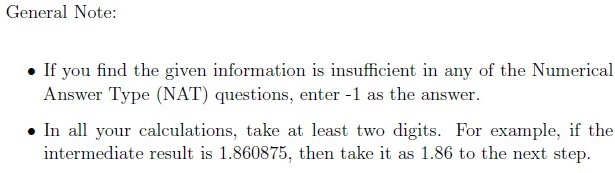

**Figure 1.** General Note specifying NAT insufficient information convention (-1) and rounding to at least two digits for intermediate calculations

### Question 176

**Question ID:** `6406531046026`

**Type:** Short Answer Question · **Marks:** 3
**PDF pages:** 1, 2

**Shared context:** [ctx-175](#ctx-175)

The input embeddings for the words “learning”, “brings” and “joy” are $h_1 = [1.0, 0.5, 1]$, $h_2 = [1, 0.25, 0]$, and $h_3 = [0.1, 0.1, 0.9]$, respectively. Note that the embeddings are row vectors. The projection matrices are as follows:

$$W_Q = \begin{bmatrix} 1 & 1 \\ -1 & 1 \\ 0 & 1 \end{bmatrix}, \quad W_K = \begin{bmatrix} 1 & 1 \\ 1 & 0 \\ 0 & 1 \end{bmatrix}, \quad W_V = \begin{bmatrix} 0 & 0 \\ -1 & -1 \\ 1 & 0 \end{bmatrix}$$

The following quantities are computed as:

$$Q = H W_Q, \quad K = H W_K, \quad V = H W_V$$

Let $e_{ij}$ denote the unnormalized attention score, $\alpha_{ij}$ denote the normalized attention score (ignore the scaling by $\sqrt{d_k}$) and $z_j$ denote the linear combination of the value vectors for the $j$-th word.

Enter the value of first element i.e. with index (0,0) of $z_1$.

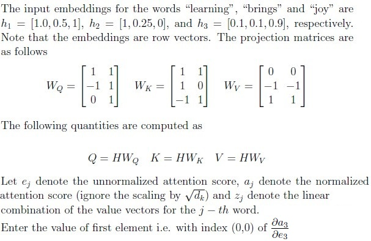

**Figure 2.** Self-attention query, key, value projection matrices and attention score calculation question

**Correct answer:** 0.2 to 0.3

**Source evidence:** [{"page": 2, "bbox": [22.87, 85.0, 180.0, 150.0], "type": "explicit field", "detail": "Possible Answers: 0.2 to 0.3"}]

### Question 177

**Question ID:** `6406531046027`

**Type:** Multiple Choice Question · **Marks:** 3
**PDF pages:** 2, 3

Assume that we have a large corpus of text. The vocabulary constructed from the text contains 
10000 words. Of these, 100 words occurred only once in the entire corpus of text. The parameters 
of the embedding layer and the output layer of the model are shared. Suppose we create a batch 
of 256 samples (each sample is a sentence from the corpus). None of these samples contains any 
of the 100 rare words. Suppose we pre-train the model for one iteration using the batch of 
samples, then:

**Options**

**A.**

it is certain that the embeddings of none of these 100 rare words will get 
updated.

*Source option ID:* `6406533531262`

**B.**

there is a chance that the embeddings of all or some of these 100 rare words 
will get updated

*Source option ID:* `6406533531263`

**C.**

the embeddings of all these 100 rare words will defintely get updated

*Source option ID:* `6406533531264`

**D.**

None of these

*Source option ID:* `6406533531265`

**Correct answer:** there is a chance that the embeddings of all or some of these 100 rare words 
will get updated

**Source evidence:** [{"page": 2, "bbox": [119.02, 706.74, 131.02, 718.74], "type": "green source option", "detail": "Option ID 6406533531263 marked in green (#008000)"}]

### Question 178

**Question ID:** `6406531046028`

**Type:** Multiple Choice Question · **Marks:** 3
**PDF pages:** 3

Suppose we use a pre-trained model for text generation with the given prompt “I am going to”. 
Which of the following decoding strategies can be used such that the pre-trained model generates 
same text completion each time it is executed

**Options**

**A.**

Beam search with beam size 4

*Source option ID:* `6406533531266`

**B.**

Greedy approach

*Source option ID:* `6406533531267`

**C.**

Top-K with k = 2

*Source option ID:* `6406533531268`

**D.**

None of these

*Source option ID:* `6406533531269`

**Correct answer:** Greedy approach

**Source evidence:** [{"page": 3, "bbox": [119.02, 230.66, 131.02, 242.66], "type": "green source option", "detail": "Option ID 6406533531267 marked in green (#008000)"}]

### Question 179

**Question ID:** `6406531046036`

**Type:** Multiple Select Question · **Marks:** 3
**PDF pages:** 3

Assume that we have 12 sufficiently large supervised NLP datasets for different tasks like 
sentiment classification, textual entailment, language understanding and so on. Suppose we take 
all the samples (dropping labels) from these datasets to train the GPT model using the CLM 
objective.Then which of the following transfer learning approaches is (are) appropriate to transfer 
the knowledge to any of these 12 downstream tasks?

**Options**

**A.**

Zero shot learning

*Source option ID:* `6406533531287`

**B.**

Few-shot learning

*Source option ID:* `6406533531288`

**C.**

Full Fine-tuning

*Source option ID:* `6406533531289`

**D.**

None of the given approaches are appropriate as the model has already been 
trained using samples from all the 12 datasets

*Source option ID:* `6406533531290`

**Correct answer:** Zero shot learning; Few-shot learning; Full Fine-tuning

**Source evidence:** [{"page": 3, "bbox": [119.02, 482.12, 131.02, 494.12], "type": "green source option", "detail": "Option ID 6406533531287 marked in green (#008000)"}, {"page": 3, "bbox": [119.02, 502.94, 131.02, 514.94], "type": "green source option", "detail": "Option ID 6406533531288 marked in green (#008000)"}, {"page": 3, "bbox": [119.02, 523.76, 131.02, 535.76], "type": "green source option", "detail": "Option ID 6406533531289 marked in green (#008000)"}]

### Question 180

**Question ID:** `6406531046037`

**Type:** Multiple Choice Question · **Marks:** 2
**PDF pages:** 3, 4

What is the order of the language modeling pipeline?

**Options**

**A.**

First, the model, which handles text and returns raw predictions.The tokenizer 

then makes sense of these predictions and converts them back to text when needed.

*Source option ID:* `6406533531291`

**B.**

First, the tokenizer, which handles text and returns IDs. The model handles 
these IDs and outputs a prediction, which can be some text.

*Source option ID:* `6406533531292`

**C.**

The tokenizer handles text and returns IDs. The model handles these IDs and 
outputs a prediction. The tokenizer can then be used once again to convert these predictions back 
to some text.

*Source option ID:* `6406533531293`

**D.**

None of these

*Source option ID:* `6406533531294`

**Correct answer:** The tokenizer handles text and returns IDs. The model handles these IDs and 
outputs a prediction. The tokenizer can then be used once again to convert these predictions back 
to some text.

**Source evidence:** [{"page": 4, "bbox": [119.02, 85.0, 131.02, 97.0], "type": "green source option", "detail": "Option ID 6406533531293 marked in green (#008000)"}]

### Question 181

**Question ID:** `6406531046041`

**Type:** Multiple Choice Question · **Marks:** 2
**PDF pages:** 4

Consider following statment and mark if it is true or false: 
 
Repeating examples in the pre-training datasets are completely harmless for downstream 
performance.

**Options**

**A.**

TRUE

*Source option ID:* `6406533531310`

**B.**

FALSE

*Source option ID:* `6406533531311`

**Correct answer:** FALSE

**Source evidence:** [{"page": 4, "bbox": [119.02, 331.0, 131.02, 343.0], "type": "green source option", "detail": "Option ID 6406533531311 marked in green (#008000)"}]

### Question 182

**Question ID:** `6406531046042`

**Type:** Multiple Choice Question · **Marks:** 2
**PDF pages:** 4

What is the time complexity of the computing attention matrix A with strided local attention 
(parameterized by c) and batch size of one? The symbols have the usual meaning.

**Options**

**A.**

$O(cTd)$

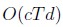

**Figure 3.** Option A complexity expression O(cTd)

*Source option ID:* `6406533531312`

**B.**

$O(cTd^2)$

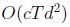

**Figure 4.** Option B complexity expression O(cTd^2)

*Source option ID:* `6406533531313`

**C.**

$O(c + Td)$

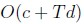

**Figure 5.** Option C complexity expression O(c + Td)

*Source option ID:* `6406533531314`

**D.**

$O(T + cd)$

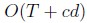

**Figure 6.** Option D complexity expression O(T + cd)

*Source option ID:* `6406533531315`

**E.**

None of these.

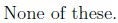

**Figure 7.** Option E None of these

*Source option ID:* `6406533531316`

**Correct answer:** $O(cTd)$

**Source evidence:** [{"page": 4, "bbox": [119.02, 502.94, 131.02, 514.94], "type": "green source option", "detail": "Option ID 6406533531312 marked in green (#008000)"}]

### Question 183

**Question ID:** `6406531046047`

**Type:** Multiple Choice Question · **Marks:** 2
**PDF pages:** 4, 5

Suppose we take a pre-trained model GPT-2 model and use it for grammatical acceptance test (based on perplexity score). Say the starting position of the input is shifted $k$ units to the right where $k \ge 0$ is some integer, i.e. if the index of a token in the input is 1 (0-based indexing) then its new position is $1 + k$. In general token at $i$ index is shifted to $i + k$.

Choose the correct statement:

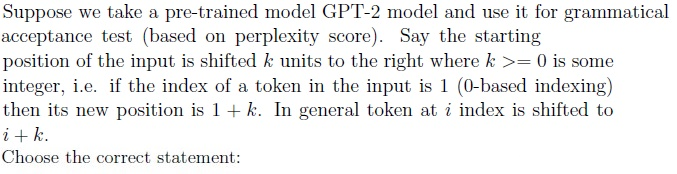

**Figure 8.** Pre-trained GPT-2 model grammatical acceptance test and input position shifting question

**Options**

**A.**

k = 0 will perform same as compared to k = 600

*Source option ID:* `6406533531320`

**B.**

k = 0 will perform worse compared to k = 600

*Source option ID:* `6406533531321`

**C.**

k = 0 will perform better compared to k = 600

*Source option ID:* `6406533531322`

**D.**

Value of k is irrelevant as the difference between position embeddings of two 
consicutive tokens remain the same.

*Source option ID:* `6406533531323`

**Correct answer:** k = 0 will perform better compared to k = 600

**Source evidence:** [{"page": 5, "bbox": [119.02, 216.34, 131.02, 228.34], "type": "green source option", "detail": "Option ID 6406533531322 marked in green (#008000)"}]

### Question 184

**Question ID:** `6406531046048`

**Type:** Multiple Choice Question · **Marks:** 2
**PDF pages:** 5

Which of the following is correct expression for $q_{ij}$? The symbols have usual meaning.

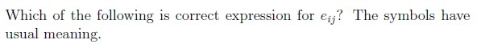

**Figure 9.** Attention score q_ij expression question

**Options**

**A.**

$x_i^T W_Q W_K^T x_j + x_i^T W_Q W_K^T p_j + p_i^T W_Q W_K^T x_j + p_i^T W_Q W_K^T p_j$

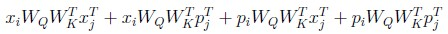

**Figure 10.** Option A expanded attention score expression with positive cross terms

*Source option ID:* `6406533531324`

**B.**

$x_i^T W_Q W_K^T x_j - x_i^T W_Q W_K^T p_j + p_i^T W_Q W_K^T x_j - p_i^T W_Q W_K^T p_j$

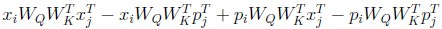

**Figure 11.** Option B attention score expression with negative cross terms

*Source option ID:* `6406533531325`

**C.**

$x_i^T W_K W_Q^T x_j + x_i^T W_K W_Q^T p_j + p_i^T W_K W_Q^T x_j + p_i^T W_K W_Q^T p_j$

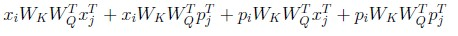

**Figure 12.** Option C attention score expression with z_i and z_j terms

*Source option ID:* `6406533531326`

**D.**

$x_i W_Q W_K x_j^T + x_i W_Q W_K p_j^T + p_i W_Q W_K x_j^T + p_i W_Q W_K p_j^T$

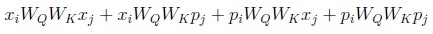

**Figure 13.** Option D attention score expression with transposed weight variants

*Source option ID:* `6406533531327`

**E.**

None of these

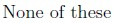

**Figure 14.** Option E None of these

*Source option ID:* `6406533531328`

**Correct answer:** $x_i^T W_Q W_K^T x_j + x_i^T W_Q W_K^T p_j + p_i^T W_Q W_K^T x_j + p_i^T W_Q W_K^T p_j$

**Source evidence:** [{"page": 5, "bbox": [119.02, 435.87, 131.02, 447.87], "type": "green source option", "detail": "Option ID 6406533531324 marked in green (#008000)"}]

### Shared context 185-189

**Question ID:** `6406531046030`

**Type:** Comprehension
**PDF pages:** 5, 6

Consider the following dictionary with the number of word occurrences in a corpus:

$$w_0 = \{\text{“blast”} : 2, \; \text{“bitterest”} : 1, \; \text{“we”} : 4\}$$

Note: Append </w> to each word at the end.
You will be working with word piece algorithm, answer the given sub questions in that context:

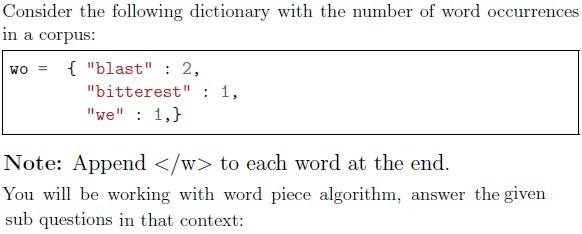

**Figure 15.** WordPiece algorithm vocabulary dictionary with word counts and end-of-word marker instructions

### Question 185

**Question ID:** `6406531046031`

**Type:** Short Answer Question · **Marks:** 2
**PDF pages:** 6

**Shared context:** [ctx-185-189](#ctx-185-189)

How many tokens are there in the initial vocabulary?

**Correct answer:** 10

**Source evidence:** [{"page": 6, "bbox": [22.87, 440.0, 150.0, 500.0], "type": "explicit field", "detail": "Possible Answers: 10"}]

### Question 186

**Question ID:** `6406531046032`

**Type:** Multiple Choice Question · **Marks:** 3
**PDF pages:** 6

**Shared context:** [ctx-185-189](#ctx-185-189)

Which of the following pairs has the least score before any merge?

**Options**

**A.**

('e', '</w>')

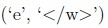

**Figure 16.** Option A pair ('e', '</w>')

*Source option ID:* `6406533531275`

**B.**

('s', 't')

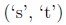

**Figure 17.** Option B pair ('s', 't')

*Source option ID:* `6406533531276`

**C.**

('o', 'b')

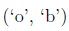

**Figure 18.** Option C pair ('o', 'b')

*Source option ID:* `6406533531277`

**D.**

('l', 'e')

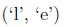

**Figure 19.** Option D pair ('l', 'e')

*Source option ID:* `6406533531278`

**E.**

('w', 'e')

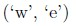

**Figure 20.** Option E pair ('w', 'e')

*Source option ID:* `6406533531279`

**Correct answer:** ('e', '</w>')

**Source evidence:** [{"page": 6, "bbox": [119.02, 577.62, 131.02, 589.62], "type": "green source option", "detail": "Option ID 6406533531275 marked in green (#008000)"}]

### Question 187

**Question ID:** `6406531046033`

**Type:** Short Answer Question · **Marks:** 3
**PDF pages:** 7

**Shared context:** [ctx-185-189](#ctx-185-189)

Which pair will be merged in the very first merge? Say the pair is (‘a’,‘b’), then enter “ab” (without 
quotes and white spaces). If there is a tie between two or more candidates, pick the one that 
occurs first in the original vocabulary. 
 
NOTE: Enter the exact answer without any space in the beginning or at the end.

**Correct answer:** la

**Source evidence:** [{"page": 7, "bbox": [22.87, 430.0, 150.0, 480.0], "type": "explicit field", "detail": "Possible Answers: la"}]

### Question 188

**Question ID:** `6406531046034`

**Type:** Short Answer Question · **Marks:** 3
**PDF pages:** 7

**Shared context:** [ctx-185-189](#ctx-185-189)

What is the score of the pair merged in the very first merge?

**Correct answer:** 1.0

**Source evidence:** [{"page": 7, "bbox": [22.87, 560.0, 150.0, 610.0], "type": "explicit field", "detail": "Possible Answers: 1.0"}]

### Question 189

**Question ID:** `6406531046035`

**Type:** Multiple Choice Question · **Marks:** 3
**PDF pages:** 7, 8

**Shared context:** [ctx-185-189](#ctx-185-189)

Assuming that the algorithm was stopped after one merge only, how will the word “last</w>” be tokenized with the given vocabulary?

Please note that </w> is already appended to the word.

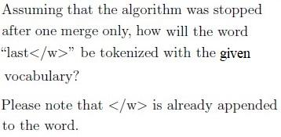

**Figure 21.** Tokenization of the word last</w> after one merge with the given vocabulary

**Options**

**A.**

l, as, t, </w>

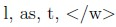

**Figure 22.** Option A tokenization: l, as, t, </w>

*Source option ID:* `6406533531282`

**B.**

la, s, t, </w>

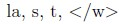

**Figure 23.** Option B tokenization: la, s, t, </w>

*Source option ID:* `6406533531283`

**C.**

l, a, s, t, </w>

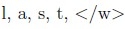

**Figure 24.** Option C tokenization: l, a, s, t, </w>

*Source option ID:* `6406533531284`

**D.**

l, a, st, </w>

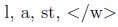

**Figure 25.** Option D tokenization: l, a, st, </w>

*Source option ID:* `6406533531285`

**E.**

None of these

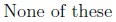

**Figure 26.** Option E None of these

*Source option ID:* `6406533531286`

**Correct answer:** la, s, t, </w>

**Source evidence:** [{"page": 8, "bbox": [119.02, 44.32, 131.02, 56.32], "type": "green source option", "detail": "Option ID 6406533531283 marked in green (#008000)"}]

### Question 190

**Question ID:** `6406531046029`

**Type:** Multiple Select Question · **Marks:** 2
**PDF pages:** 8

Consider the following statements about decreasing the size of the vocabulary

**Options**

**A.**

It increases number of tokens required to represent a sentence

*Source option ID:* `6406533531270`

**B.**

It Increases the computational complexity computing attention matrix

*Source option ID:* `6406533531271`

**C.**

It increases the context length T

*Source option ID:* `6406533531272`

**D.**

None of these

*Source option ID:* `6406533531273`

**Correct answer:** It increases number of tokens required to represent a sentence; It Increases the computational complexity computing attention matrix; It increases the context length T

**Source evidence:** [{"page": 8, "bbox": [119.02, 391.31, 131.02, 403.31], "type": "green source option", "detail": "Option ID 6406533531270 marked in green (#008000)"}, {"page": 8, "bbox": [119.02, 412.13, 131.02, 424.13], "type": "green source option", "detail": "Option ID 6406533531271 marked in green (#008000)"}, {"page": 8, "bbox": [119.02, 432.95, 131.02, 444.95], "type": "green source option", "detail": "Option ID 6406533531272 marked in green (#008000)"}]

### Question 191

**Question ID:** `6406531046038`

**Type:** Multiple Select Question · **Marks:** 2
**PDF pages:** 8

Choose the correct statements regarding an encoder-decoder transformer model:

**Options**

**A.**

Multi head masked attention block in decoder makes use of a mask.

*Source option ID:* `6406533531295`

**B.**

Transformer model is an improvement over its RNN based predecessor for 
machine translation.

*Source option ID:* `6406533531296`

**C.**

For machine tranlation task the input and output embedding layers have to be 
identical.

*Source option ID:* `6406533531297`

**D.**

None of these.

*Source option ID:* `6406533531298`

**Correct answer:** Multi head masked attention block in decoder makes use of a mask.; Transformer model is an improvement over its RNN based predecessor for 
machine translation.

**Source evidence:** [{"page": 8, "bbox": [119.02, 595.01, 131.02, 607.01], "type": "green source option", "detail": "Option ID 6406533531295 marked in green (#008000)"}, {"page": 8, "bbox": [119.02, 615.83, 131.02, 627.83], "type": "green source option", "detail": "Option ID 6406533531296 marked in green (#008000)"}]

### Question 192

**Question ID:** `6406531046039`

**Type:** Multiple Select Question · **Marks:** 2
**PDF pages:** 8, 9

Consider C4 pipeline. Which of the following will NOT pass through it as it is?

**Options**

**A.**

ir a la escuela es un buen habito.

(Above sentence is spanish translation of “Going to school is a good habit”)

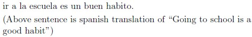

**Figure 27.** Option A Spanish sentence ir a la escuela es un buen habito

*Source option ID:* `6406533531299`

**B.**

Following function computes n — th Fibonacci number:

def fibo(n):
    if n <= 1:
        return n
    return fibo(n - 1) + fibo(n - 2)

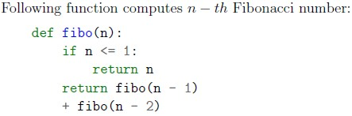

**Figure 28.** Option B Python code snippet computing n-th Fibonacci number

*Source option ID:* `6406533531300`

**C.**

Lorem ipsum dolor sit amet.

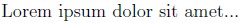

**Figure 29.** Option C Latin placeholder text Lorem ipsum dolor sit amet

*Source option ID:* `6406533531301`

**D.**

Please enable JavaScript to use our site.
Home
Products
Shipping
Contact
FAQ

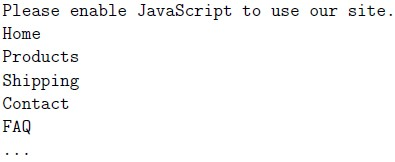

**Figure 30.** Option D Website navigation placeholder text Please enable JavaScript to use our site

*Source option ID:* `6406533531302`

**E.**

D Gukesh defeated defending champion Ding Liren at the World Chess Championship. D Gukesh defeated defending champion Ding Liren at the World Chess Championship.

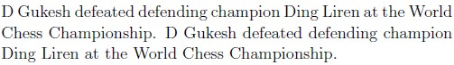

**Figure 31.** Option E Duplicate text sentences regarding D Gukesh defeating Ding Liren

*Source option ID:* `6406533531303`

**F.**

Sardar Vallabhbhai Patel was the first deputy prime minister of independent India.

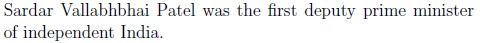

**Figure 32.** Option F Sentence regarding Sardar Vallabhbhai Patel

*Source option ID:* `6406533531304`

**G.**

None of these.

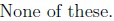

**Figure 33.** Option G None of these

*Source option ID:* `6406533531305`

**Correct answer:** ir a la escuela es un buen habito. (Above sentence is spanish translation of “Going to school is a good habit”); Following function computes n — th Fibonacci number: def fibo(n): if n <= 1: return n return fibo(n - 1) + fibo(n - 2); Lorem ipsum dolor sit amet.; Please enable JavaScript to use our site. Home Products Shipping Contact FAQ; D Gukesh defeated defending champion Ding Liren at the World Chess Championship. D Gukesh defeated defending champion Ding Liren at the World Chess Championship.

**Source evidence:** [{"page": 9, "bbox": [119.02, 81.07, 131.02, 93.07], "type": "green source option", "detail": "Option ID 6406533531299 marked in green (#008000)"}, {"page": 9, "bbox": [119.02, 215.64, 131.02, 227.64], "type": "green source option", "detail": "Option ID 6406533531300 marked in green (#008000)"}, {"page": 9, "bbox": [119.02, 257.22, 131.02, 269.22], "type": "green source option", "detail": "Option ID 6406533531301 marked in green (#008000)"}, {"page": 9, "bbox": [119.02, 403.04, 131.02, 415.04], "type": "green source option", "detail": "Option ID 6406533531302 marked in green (#008000)"}, {"page": 9, "bbox": [119.02, 482.12, 131.02, 494.12], "type": "green source option", "detail": "Option ID 6406533531303 marked in green (#008000)"}]

### Question 193

**Question ID:** `6406531046040`

**Type:** Multiple Select Question · **Marks:** 2
**PDF pages:** 9

Which of the following are correct about GPT-1 model:

**Options**

**A.**

It is a decoder only model.

*Source option ID:* `6406533531306`

**B.**

It uses absolute positional encoding.

*Source option ID:* `6406533531307`

**C.**

It uses a composite dataset for pre-training.

*Source option ID:* `6406533531308`

**D.**

None of these.

*Source option ID:* `6406533531309`

**Correct answer:** It is a decoder only model.; It uses absolute positional encoding.

**Source evidence:** [{"page": 9, "bbox": [119.02, 736.32, 131.02, 748.32], "type": "green source option", "detail": "Option ID 6406533531306 marked in green (#008000)"}, {"page": 9, "bbox": [119.02, 757.14, 131.02, 769.14], "type": "green source option", "detail": "Option ID 6406533531307 marked in green (#008000)"}]

### Question 194

**Question ID:** `6406531046043`

**Type:** Short Answer Question · **Marks:** 2
**PDF pages:** 10

How many entries of unnormalized attention matrix QKT will be calculated with strided attention 
mechanism with c = 5. The sequence length is T = 32

**Correct answer:** 164

**Source evidence:** [{"page": 10, "bbox": [22.87, 280.0, 150.0, 330.0], "type": "explicit field", "detail": "Possible Answers: 164"}]

### Shared context 195-196

**Question ID:** `6406531046044`

**Type:** Comprehension
**PDF pages:** 10

Assume that you are using block attention model. Sequence length $T = 32$, number of blocks $n = 4$, identity permutation for $Q$ matrix and $\pi = (2,0,3,1)$ for $K^T$ matrix. The mask matrix is denoted by $M$.

Answer the given sub question:

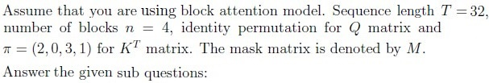

**Figure 34.** Block attention model configuration specifications with permutation pi = (2,0,3,1)

### Question 195

**Question ID:** `6406531046045`

**Type:** Short Answer Question · **Marks:** 2
**PDF pages:** 10

**Shared context:** [ctx-195-196](#ctx-195-196)

How many non zero entries will be there in the mask matrix M?

**Correct answer:** 256

**Source evidence:** [{"page": 10, "bbox": [22.87, 770.0, 150.0, 820.0], "type": "explicit field", "detail": "Possible Answers: 256"}]

## Answer key

| Source question | Source identity | Correct answer | PDF pages |
| :--- | :--- | :--- | :--- |
| 176 | 6406531046026 | 0.2 to 0.3 | 1, 2 |
| 177 | 6406531046027 | there is a chance that the embeddings of all or some of these 100 rare words  will get updated | 2, 3 |
| 178 | 6406531046028 | Greedy approach | 3 |
| 179 | 6406531046036 | Zero shot learning; Few-shot learning; Full Fine-tuning | 3 |
| 180 | 6406531046037 | The tokenizer handles text and returns IDs. The model handles these IDs and  outputs a prediction. The tokenizer can then be used once again to convert these predictions back  to some text. | 3, 4 |
| 181 | 6406531046041 | FALSE | 4 |
| 182 | 6406531046042 | $O(cTd)$ | 4 |
| 183 | 6406531046047 | k = 0 will perform better compared to k = 600 | 4, 5 |
| 184 | 6406531046048 | $x_i^T W_Q W_K^T x_j + x_i^T W_Q W_K^T p_j + p_i^T W_Q W_K^T x_j + p_i^T W_Q W_K^T p_j$ | 5 |
| 185 | 6406531046031 | 10 | 6 |
| 186 | 6406531046032 | ('e', '</w>') | 6 |
| 187 | 6406531046033 | la | 7 |
| 188 | 6406531046034 | 1.0 | 7 |
| 189 | 6406531046035 | la, s, t, </w> | 7, 8 |
| 190 | 6406531046029 | It increases number of tokens required to represent a sentence; It Increases the computational complexity computing attention matrix; It increases the context length T | 8 |
| 191 | 6406531046038 | Multi head masked attention block in decoder makes use of a mask.; Transformer model is an improvement over its RNN based predecessor for  machine translation. | 8 |
| 192 | 6406531046039 | ir a la escuela es un buen habito. (Above sentence is spanish translation of “Going to school is a good habit”); Following function computes n — th Fibonacci number: def fibo(n): if n <= 1: return n return fibo(n - 1) + fibo(n - 2); Lorem ipsum dolor sit amet.; Please enable JavaScript to use our site. Home Products Shipping Contact FAQ; D Gukesh defeated defending champion Ding Liren at the World Chess Championship. D Gukesh defeated defending champion Ding Liren at the World Chess Championship. | 8, 9 |
| 193 | 6406531046040 | It is a decoder only model.; It uses absolute positional encoding. | 9 |
| 194 | 6406531046043 | 164 | 10 |
| 195 | 6406531046045 | 256 | 10 |

## Extraction notes

**Status:** verified-source-limitation
**Count reconciliation:** The portal header does not declare a Section Marks or Number of Questions table. The source PDF contains 1 administrative subject confirmation entry (Page 1, 0 marks), 1 shared-context calculation note entry (ctx-175, 0 marks), 2 comprehension passages (ctx-185-189, ctx-195-196), and 20 academic questions (Q176-Q195) totaling 48 marks across 8 portal sub-sections. The second comprehension block on page 10 (Question Id 6406531046044) declares Question Numbers (195 to 196), but the PDF terminates on page 10 after Question 195; Question 196 is absent from the source. The observed academic count of 20 questions reconciles all detected question entries in the source PDF without invented reconciliation.

- Extracted all 20 academic questions (Q176-Q195) and 3 shared context entries (ctx-175, ctx-185-189, ctx-195-196) from the 10-page source PDF.
- Preserved exact raster images and verified transcriptions for all mathematical formulas and diagrams.
- Comprehension container Question Id : 6406531046044 on page 10 declares Question Numbers : (195 to 196), but physical page 10 terminates the document after Question 195. Question 196 is absent/truncated in the source PDF.
- Question 175 is an administrative general note container carrying reference NAT instructions (insufficient info -1, two-digit rounding) and 0 marks with administrative acknowledgment options; preserved calculation instructions as shared context ctx-175 while excluding acknowledgment options.
- No top-level portal section header table (Section Marks, Number of Questions) is present on page 1; exam begins directly with Subject Confirmation question.
- Short answer Question 176 provides an accepted answer range 0.2 to 0.3.

**Excluded source entries:**

- {"classification": "subject-confirmation", "page": 1, "bbox": [22.87, 55.39, 569.03, 246.16], "reason": "Administrative subject confirmation asking candidate to confirm subject and cross check hall ticket", "identity": "confirmation"}
- {"classification": "administrative-acknowledgment-options", "page": 1, "bbox": [23.62, 280.0, 560.0, 360.0], "reason": "Administrative acknowledgment options (Instructions has been mentioned above / This Instructions is just for a reference & not for an evaluation) excluded semantically while preserving calculation note as shared context", "identity": "175"}
