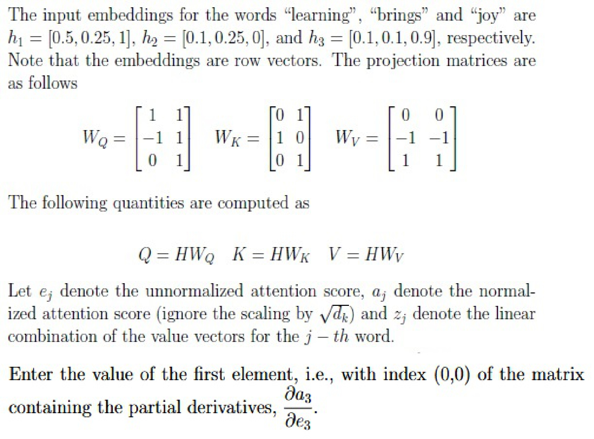
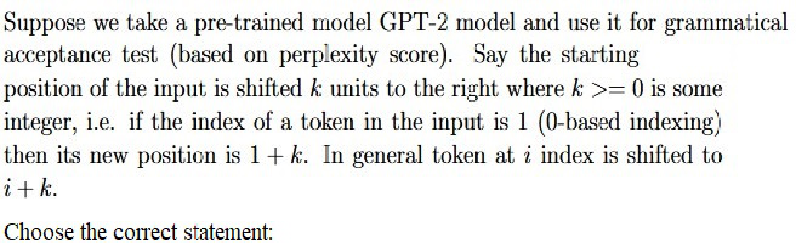
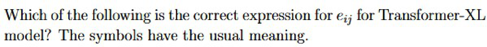
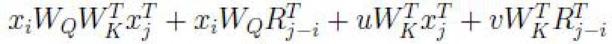
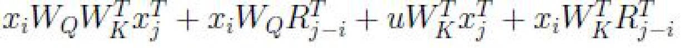
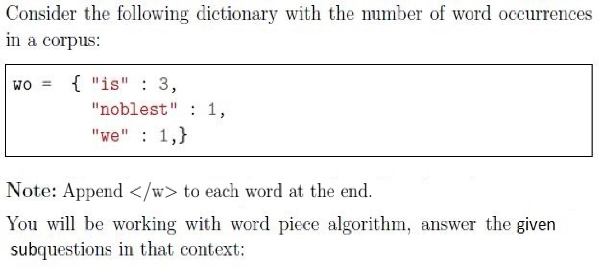
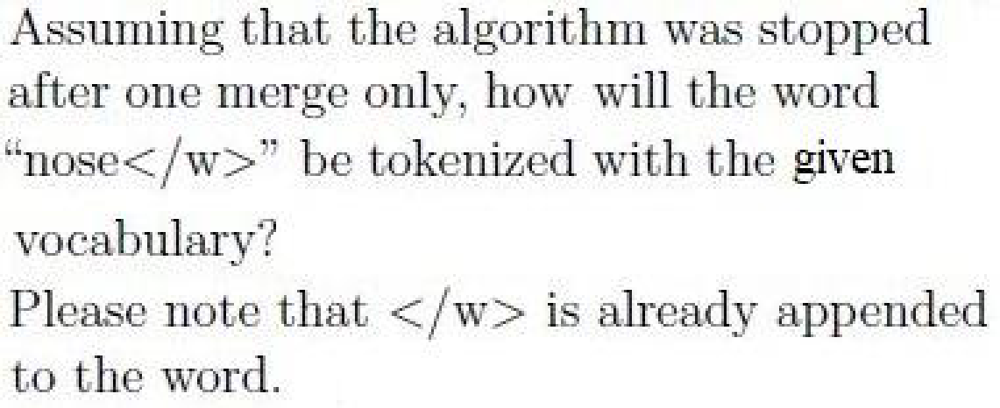
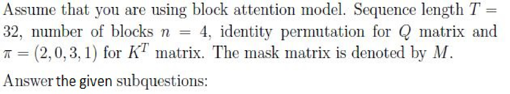
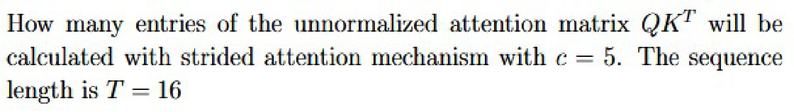

# LLM — da5004_2024T3_ET_FN

**Source:** `da5004_2024T3_ET_FN.pdf` · **Academic questions:** 21 · **Separately counted children:** 0
**Provenance:** `Large_Language_Models/da5004_2024T3_ET_FN.pdf` · SHA-256 `9673ae8d3a7498f580eafa795d3a154c7561f2053e69c36884fc27718e40afcd`

**Scope:** Large Language Models (LLM) section (Section 8, Section Id: 64065375424) spanning from page 1 at y=59.68 to page 12 at y=35.11 (Question 209 answer). Preceding Section 7 content on page 1 and succeeding Section 9 (i-NLP) content on page 12 are excluded as out of subject scope.

## Questions

### Shared context 188

<a id="ctx-188"></a>

**Question ID:** `6406531040920`

**Type:** General Note
**PDF pages:** 2

General Note:

- If you find the given information is insufficient in any of the Numerical Answer Type (NAT) questions, enter -1 as the answer.
- In all your calculations, take at least two digits. For example, if the intermediate result is 1.860875, then take it as 1.86 to the next step.

### Question 189

<a id="q189"></a>

**Question ID:** `6406531040921`

**Type:** SA · **Marks:** 3
**PDF pages:** 2, 3

**Shared context:** [ctx-188](#ctx-188)

The input embeddings for the words “learning”, “brings” and “joy” are $h_1 = [0.5, 0.25, 1]$, $h_2 = [0.1, 0.25, 0]$, and $h_3 = [0.1, 0.1, 0.9]$, respectively. Note that the embeddings are row vectors. The projection matrices are as follows

$$W_Q = \begin{bmatrix} 1 & 1 \\ -1 & 1 \\ 0 & 1 \end{bmatrix}, \quad W_K = \begin{bmatrix} 0 & 1 \\ 1 & 0 \\ 0 & 1 \end{bmatrix}, \quad W_V = \begin{bmatrix} 0 & 0 \\ -1 & -1 \\ 1 & 1 \end{bmatrix}$$

The following quantities are computed as

$$Q = H W_Q, \quad K = H W_K, \quad V = H W_V$$

Let $e_{ij}$ denote the unnormalized attention score, $a_{ij}$ denote the normalized attention score (ignore the scaling by $\sqrt{d_k}$) and $z_i$ denote the linear combination of the value vectors for the $i$-th word.

Enter the value of the first element, i.e., with index (0,0) of the matrix containing the partial derivatives, $\frac{\partial a_{ij}}{\partial e_{ij}}$



**Figure 1.** Input word embeddings, projection matrices W_Q, W_K, W_V, and partial derivative prompt for words learning, brings, and joy

**Correct answer:** 0.2 to 0.3

**Source evidence:** [{"page": 3, "bbox": [22.87, 70.0, 150.0, 100.0], "type": "explicit field", "detail": "Official source Range answer: 0.2 to 0.3"}]

### Question 190

<a id="q190"></a>

**Question ID:** `6406531040922`

**Type:** MSQ · **Marks:** 2
**PDF pages:** 3

**Shared context:** [ctx-188](#ctx-188)

Choose the correct statements regarding an encoder-decoder transformer model:

**Options**

**A.**

A self attention block makes use of a mask matrix.

*Source option ID:* `6406533516331`

*Label added for presentation.*

**B.**

Multi head self attention block is part of the encoder.

*Source option ID:* `6406533516332`

*Label added for presentation.*

**C.**

Teacher forcing can help speed up the training process for tasks such as machine translation.

*Source option ID:* `6406533516333`

*Label added for presentation.*

**D.**

None of these.

*Source option ID:* `6406533516334`

*Label added for presentation.*

**Correct answer:** Multi head self attention block is part of the encoder.; Teacher forcing can help speed up the training process for tasks such as machine translation.

**Source evidence:** [{"page": 3, "bbox": [23.62, 276.7, 119.02, 293.02], "type": "green source option", "detail": "Green marked option 6406533516332 (B)"}, {"page": 3, "bbox": [23.62, 297.52, 119.02, 313.84], "type": "green source option", "detail": "Green marked option 6406533516333 (C)"}]

### Question 191

<a id="q191"></a>

**Question ID:** `6406531040925`

**Type:** MSQ · **Marks:** 2
**PDF pages:** 3

**Shared context:** [ctx-188](#ctx-188)

Consider the following statements about increasing the size of the vocabulary

**Options**

**A.**

It reduces number of tokens required to represent a sentence

*Source option ID:* `6406533516344`

*Label added for presentation.*

**B.**

It Increases the computational complexity as embedding matrix size increases

*Source option ID:* `6406533516345`

*Label added for presentation.*

**C.**

It increases the context length T

*Source option ID:* `6406533516346`

*Label added for presentation.*

**D.**

None of these

*Source option ID:* `6406533516347`

*Label added for presentation.*

**Correct answer:** It reduces number of tokens required to represent a sentence; It Increases the computational complexity as embedding matrix size increases

**Source evidence:** [{"page": 3, "bbox": [23.62, 475.9, 119.02, 492.22], "type": "green source option", "detail": "Green marked option 6406533516344 (A)"}, {"page": 3, "bbox": [23.62, 496.72, 119.02, 513.04], "type": "green source option", "detail": "Green marked option 6406533516345 (B)"}]

### Question 192

<a id="q192"></a>

**Question ID:** `6406531040934`

**Type:** MSQ · **Marks:** 2
**PDF pages:** 3, 4

**Shared context:** [ctx-188](#ctx-188)

Consider the C4 pipeline. Which of the following will NOT pass through it as it is?

**Options**

**A.**

Zur Schule zu gehen ist eine gute Angewohnheit.

(Above sentence is german translation of “Going to school is a good habit” )

*Source option ID:* `6406533516369`

*Label added for presentation.*

**B.**

Following function computes n — th Fibonacci number:

```java
public static int fibo(int n):
if( n <= 1){
return n
}
return fibo(n - 1) + fibo(n - 2)
```

*Source option ID:* `6406533516370`

*Label added for presentation.*

**C.**

Lorem ipsum dolor sit amet...

*Source option ID:* `6406533516371`

*Label added for presentation.*

**D.**

Please enable JavaScript to use our site.
Home
Products
Shipping
Contact
FAQ

*Source option ID:* `6406533516372`

*Label added for presentation.*

**E.**

D Gukesh defeated defending champion Ding Liren at the World Chess Championship. D Gukesh defeated defending champion Ding Liren at the World Chess Championship.

*Source option ID:* `6406533516373`

*Label added for presentation.*

**F.**

Jawaharlal Nehru was the first prime minister of indipendent India.

*Source option ID:* `6406533516374`

*Label added for presentation.*

**G.**

None of these.

*Source option ID:* `6406533516375`

*Label added for presentation.*

**Correct answer:** Zur Schule zu gehen ist eine gute Angewohnheit.

(Above sentence is german translation of “Going to school is a good habit” ); Following function computes n — th Fibonacci number:

```java
public static int fibo(int n):
if( n <= 1){
return n
}
return fibo(n - 1) + fibo(n - 2)
```; Lorem ipsum dolor sit amet...; Please enable JavaScript to use our site.
Home
Products
Shipping
Contact
FAQ; D Gukesh defeated defending champion Ding Liren at the World Chess Championship. D Gukesh defeated defending champion Ding Liren at the World Chess Championship.

**Source evidence:** [{"page": 3, "bbox": [23.62, 727.53, 119.02, 743.85], "type": "green source option", "detail": "Green marked option 6406533516369 (A)"}, {"page": 3, "bbox": [23.62, 764.67, 119.02, 780.99], "type": "green source option", "detail": "Green marked option 6406533516370 (B)"}, {"page": 4, "bbox": [23.62, 144.5, 119.02, 160.82], "type": "green source option", "detail": "Green marked option 6406533516371 (C)"}, {"page": 4, "bbox": [23.62, 291.83, 119.02, 308.15], "type": "green source option", "detail": "Green marked option 6406533516372 (D)"}, {"page": 4, "bbox": [23.62, 370.15, 119.02, 386.47], "type": "green source option", "detail": "Green marked option 6406533516373 (E)"}]

### Question 193

<a id="q193"></a>

**Question ID:** `6406531040935`

**Type:** MSQ · **Marks:** 2
**PDF pages:** 4

**Shared context:** [ctx-188](#ctx-188)

Which of the following are correct about GPT-3 model with 175B parameters:

**Options**

**A.**

It is an encoder-decoder only model.

*Source option ID:* `6406533516376`

*Label added for presentation.*

**B.**

It uses absolute postional encoding.

*Source option ID:* `6406533516377`

*Label added for presentation.*

**C.**

It uses a composite dataset for pre-training.

*Source option ID:* `6406533516378`

*Label added for presentation.*

**D.**

None of these.

*Source option ID:* `6406533516379`

*Label added for presentation.*

**Correct answer:** It uses absolute postional encoding.; It uses a composite dataset for pre-training.

**Source evidence:** [{"page": 4, "bbox": [23.62, 651.93, 119.02, 668.25], "type": "green source option", "detail": "Green marked option 6406533516377 (B)"}, {"page": 4, "bbox": [23.62, 672.75, 119.02, 689.07], "type": "green source option", "detail": "Green marked option 6406533516378 (C)"}]

### Question 194

<a id="q194"></a>

**Question ID:** `6406531040923`

**Type:** MSQ · **Marks:** 3
**PDF pages:** 4, 5

**Shared context:** [ctx-188](#ctx-188)

Choose all the correct statements about the GPT model:

**Options**

**A.**

All the parameters of are randomly initialized during pre-training

*Source option ID:* `6406533516335`

*Label added for presentation.*

**B.**

The model minimizes the CLM objective during fine-tuning for downstream tasks like sentiment classification to improve the performance

*Source option ID:* `6406533516336`

*Label added for presentation.*

**C.**

All parameters are randomly initialized during fine-tuning

*Source option ID:* `6406533516337`

*Label added for presentation.*

**D.**

In general, fine-tuning requires a dataset with labels

*Source option ID:* `6406533516338`

*Label added for presentation.*

**E.**

None of these

*Source option ID:* `6406533516339`

*Label added for presentation.*

**Correct answer:** All the parameters of are randomly initialized during pre-training; In general, fine-tuning requires a dataset with labels

**Source evidence:** [{"page": 5, "bbox": [23.62, 95.59, 119.02, 111.91], "type": "green source option", "detail": "Green marked option 6406533516335 (A)"}, {"page": 5, "bbox": [23.62, 174.37, 119.02, 190.69], "type": "green source option", "detail": "Green marked option 6406533516338 (D)"}]

### Question 195

<a id="q195"></a>

**Question ID:** `6406531040932`

**Type:** MSQ · **Marks:** 3
**PDF pages:** 5

**Shared context:** [ctx-188](#ctx-188)

Consider fine-tuning the T5 model on a sentiment classification task. The T5 model was pre-trained using the C4 dataset. Suppose, in the original dataset, the positive samples are denoted by integer 1 and the negative samples are denoted by integer 0. Choose the necessary modifications that one needs to perform to use the T5 model for fine-tuning:

**Options**

**A.**

Map the label 0 to “negative” and 1 to “positive” in the dataset

*Source option ID:* `6406533516361`

*Label added for presentation.*

**B.**

Map the label 0 to “0” and 1 to “1” in the dataset

*Source option ID:* `6406533516362`

*Label added for presentation.*

**C.**

Update the vocabulary of T5 with the modified labels

*Source option ID:* `6406533516363`

*Label added for presentation.*

**D.**

Add at least one linear layer on top of the decoder for final classification

*Source option ID:* `6406533516364`

*Label added for presentation.*

**Correct answer:** Map the label 0 to “negative” and 1 to “positive” in the dataset; Map the label 0 to “0” and 1 to “1” in the dataset

**Source evidence:** [{"page": 5, "bbox": [23.62, 385.39, 119.02, 401.71], "type": "green source option", "detail": "Green marked option 6406533516361 (A)"}, {"page": 5, "bbox": [23.62, 406.21, 119.02, 422.53], "type": "green source option", "detail": "Green marked option 6406533516362 (B)"}]

### Question 196

<a id="q196"></a>

**Question ID:** `6406531040924`

**Type:** MCQ · **Marks:** 3
**PDF pages:** 5, 6

**Shared context:** [ctx-188](#ctx-188)

Suppose we use a pre-trained model for text generation with the given prompt “I am going to”. Which of the following decoding strategies can be used such that the pre-trained model generates different text completion each time it is executed

**Options**

**A.**

Beam search with beam size 1

*Source option ID:* `6406533516340`

*Label added for presentation.*

**B.**

Greedy approach

*Source option ID:* `6406533516341`

*Label added for presentation.*

**C.**

Top-K with k = 2

*Source option ID:* `6406533516342`

*Label added for presentation.*

**D.**

None of these

*Source option ID:* `6406533516343`

*Label added for presentation.*

**Correct answer:** Top-K with k = 2

**Source evidence:** [{"page": 5, "bbox": [23.62, 767.28, 119.02, 787.53], "type": "green source option", "detail": "Green marked option 6406533516342 (C)"}]

### Question 197

<a id="q197"></a>

**Question ID:** `6406531040933`

**Type:** MCQ · **Marks:** 2
**PDF pages:** 6

**Shared context:** [ctx-188](#ctx-188)

What is the order of the language modeling pipeline?

**Options**

**A.**

First, the model, which handles text and returns raw predictions. The tokenizer then makes sense of these predictions and converts them back to text when needed.

*Source option ID:* `6406533516365`

*Label added for presentation.*

**B.**

First, the tokenizer, which handles text and returns IDs. The model handles these IDs and outputs a prediction, which can be some text.

*Source option ID:* `6406533516366`

*Label added for presentation.*

**C.**

The tokenizer handles text and returns IDs. The model handles these IDs and outputs a prediction. The tokenizer can then be used once again to convert these predictions back to some text.

*Source option ID:* `6406533516367`

*Label added for presentation.*

**D.**

None of these

*Source option ID:* `6406533516368`

*Label added for presentation.*

**Correct answer:** The tokenizer handles text and returns IDs. The model handles these IDs and outputs a prediction. The tokenizer can then be used once again to convert these predictions back to some text.

**Source evidence:** [{"page": 6, "bbox": [23.62, 313.23, 119.02, 359.31], "type": "green source option", "detail": "Green marked option 6406533516367 (C)"}]

### Question 198

<a id="q198"></a>

**Question ID:** `6406531040936`

**Type:** MCQ · **Marks:** 2
**PDF pages:** 6

**Shared context:** [ctx-188](#ctx-188)

Consider following statment and mark true or false:

Repeating examples in the pre-training datasets are completely harmless for downstream performance.

**Options**

**A.**

TRUE

*Source option ID:* `6406533516380`

*Label added for presentation.*

**B.**

FALSE

*Source option ID:* `6406533516381`

*Label added for presentation.*

**Correct answer:** FALSE

**Source evidence:** [{"page": 6, "bbox": [23.62, 577.71, 119.02, 594.03], "type": "green source option", "detail": "Green marked option 6406533516381 (B)"}]

### Question 199

<a id="q199"></a>

**Question ID:** `6406531040937`

**Type:** MCQ · **Marks:** 2
**PDF pages:** 6, 7

**Shared context:** [ctx-188](#ctx-188)

What is the time complexity of the computing attention score matrix A with a batch size of one? The symbols have usual meaning.

**Options**

**A.**

$O(T^2 d)$

*Source option ID:* `6406533516382`

*Label added for presentation.*

**B.**

$O(T d^2)$

*Source option ID:* `6406533516383`

*Label added for presentation.*

**C.**

$O(T d)$

*Source option ID:* `6406533516384`

*Label added for presentation.*

**D.**

$O(T + d)$

*Source option ID:* `6406533516385`

*Label added for presentation.*

**E.**

None of these.

*Source option ID:* `6406533516386`

*Label added for presentation.*

**Correct answer:** $O(T^2 d)$

**Source evidence:** [{"page": 6, "bbox": [23.62, 744.2, 119.02, 760.52], "type": "green source option", "detail": "Green marked option 6406533516382 (A)"}]

### Question 200

<a id="q200"></a>

**Question ID:** `6406531040942`

**Type:** MCQ · **Marks:** 2
**PDF pages:** 7

**Shared context:** [ctx-188](#ctx-188)

Suppose we take a pre-trained model GPT-2 model and use it for grammatical acceptance test (based on perplexity score). Say the starting position of the input is shifted $k$ units to the right where $k \ge 0$ is some integer, i.e. if the index of a token in the input is 1 (0-based indexing) then its new position is $1+k$. In general token at $i$ index is shifted to $i+k$.

Choose the correct statement:



**Figure 2.** GPT-2 model grammatical acceptance test perplexity evaluation prompt under input shift by k units

**Options**

**A.**

$k = 0$ will perform same as compared to $k = 400$

*Source option ID:* `6406533516390`

*Label added for presentation.*

**B.**

$k = 0$ will perform worse compared to $k = 400$

*Source option ID:* `6406533516391`

*Label added for presentation.*

**C.**

$k = 0$ will perform better compared to $k = 400$

*Source option ID:* `6406533516392`

*Label added for presentation.*

**D.**

Value of $k$ is irrelevant as the difference between position embeddings of two consecutive tokens remain the same.

*Source option ID:* `6406533516393`

*Label added for presentation.*

**Correct answer:** $k = 0$ will perform better compared to $k = 400$

**Source evidence:** [{"page": 7, "bbox": [23.62, 514.22, 119.02, 530.54], "type": "green source option", "detail": "Green marked option 6406533516392 (C)"}]

### Question 201

<a id="q201"></a>

**Question ID:** `6406531040943`

**Type:** MCQ · **Marks:** 2
**PDF pages:** 7, 8

**Shared context:** [ctx-188](#ctx-188)

Which of the following is the correct expression for $e_{ij}$ for Transformer-XL model? The symbols have the usual meaning.



**Figure 3.** Transformer-XL relative positional attention score expression e_ij question stem

**Options**

**A.**

$E_{x_i}^T W_q^T W_{k,E} E_{x_j} + E_{x_i}^T W_q^T W_{k,R} R_{i-j} + u^T W_{k,E} E_{x_j} + v^T W_{k,R} R_{i-j}$



**Figure 4.** Option A relative positional attention score expression

*Source option ID:* `6406533516394`

*Label added for presentation.*

**B.**

$E_{x_i}^T W_q^T W_{k,E} E_{x_j} + E_{x_i}^T W_q^T W_{k,R} R_{i-j} + u^T W_{k,E} R_{i-j} + v^T W_{k,R} E_{x_j}$


**Figure 5.** Option B relative positional attention score expression

*Source option ID:* `6406533516395`

*Label added for presentation.*

**C.**

$E_{x_i}^T W_q^T W_{k,E} E_{x_j} + E_{x_i}^T W_q^T W_{k,R} R_{i-j} + u^T W_{k,E} E_{x_i} + v^T W_{k,R} R_{i-j}$



**Figure 6.** Option C relative positional attention score expression

*Source option ID:* `6406533516396`

*Label added for presentation.*

**D.**

$u^T W_{k,E} E_{x_j} + v^T W_{k,R} R_{i-j} + E_{x_i}^T W_q^T W_{k,E} E_{x_j} + E_{x_i}^T W_q^T W_{k,R} R_{i-j}$


**Figure 7.** Option D relative positional attention score expression

*Source option ID:* `6406533516397`

*Label added for presentation.*

**E.**

None of these

*Source option ID:* `6406533516398`

*Label added for presentation.*

**Correct answer:** $E_{x_i}^T W_q^T W_{k,E} E_{x_j} + E_{x_i}^T W_q^T W_{k,R} R_{i-j} + u^T W_{k,E} E_{x_j} + v^T W_{k,R} R_{i-j}$

**Source evidence:** [{"page": 7, "bbox": [23.62, 774.73, 119.02, 791.05], "type": "green source option", "detail": "Green marked option 6406533516394 (A)"}]

### Shared context 202-206

<a id="ctx-202-206"></a>

**Question ID:** `6406531040926`

**Type:** Comprehension
**PDF pages:** 8

Consider the following dictionary with the number of word occurrences in a corpus:

$$w_c = \{ \text{“is”} : 3, \; \text{“noblest”} : 1, \; \text{“we”} : 1 \}$$

Note: Append `</w>` to each word at the end.

You will be working with word piece algorithm, answer the given subquestions in that context:



**Figure 8.** WordPiece algorithm comprehension passage containing corpus vocabulary dictionary w_c

### Question 202

<a id="q202"></a>

**Question ID:** `6406531040927`

**Type:** SA · **Marks:** 2
**PDF pages:** 8

**Shared context:** [ctx-188](#ctx-188), [ctx-202-206](#ctx-202-206)

How many tokens are there in the initial vocabulary?

**Correct answer:** 10

**Source evidence:** [{"page": 8, "bbox": [22.87, 735.0, 50.0, 755.0], "type": "explicit field", "detail": "Official source Equal answer: 10"}]

### Question 203

<a id="q203"></a>

**Question ID:** `6406531040928`

**Type:** MCQ · **Marks:** 3
**PDF pages:** 9

**Shared context:** [ctx-188](#ctx-188), [ctx-202-206](#ctx-202-206)

Which of the following pairs has the least score before any merge?

**Options**

**A.**

('e', '</w>')

*Source option ID:* `6406533516349`

*Label added for presentation.*

**B.**

('s', 't')

*Source option ID:* `6406533516350`

*Label added for presentation.*

**C.**

('o', 'b')

*Source option ID:* `6406533516351`

*Label added for presentation.*

**D.**

('l', 'e')

*Source option ID:* `6406533516352`

*Label added for presentation.*

**E.**

('w', 'e')

*Source option ID:* `6406533516353`

*Label added for presentation.*

**Correct answer:** ('e', '</w>')

**Source evidence:** [{"page": 9, "bbox": [23.62, 141.6, 119.02, 157.92], "type": "green source option", "detail": "Green marked option 6406533516349 (A)"}]

### Question 204

<a id="q204"></a>

**Question ID:** `6406531040929`

**Type:** SA · **Marks:** 3
**PDF pages:** 9

**Shared context:** [ctx-188](#ctx-188), [ctx-202-206](#ctx-202-206)

Which pair will be merged the very first merge? Say the pair is (‘a’,‘b’), then enter “ab” (without quotes and white spaces). If there is a tie between two or more candidates, enter the one that occurs first in the original vocabulary.

NOTE: Enter the exact answer without any space in the beginning or at the end.

**Correct answer:** no

**Source evidence:** [{"page": 9, "bbox": [22.87, 580.0, 50.0, 600.0], "type": "explicit field", "detail": "Official source Equal answer: no"}]

### Question 205

<a id="q205"></a>

**Question ID:** `6406531040930`

**Type:** SA · **Marks:** 3
**PDF pages:** 9, 10

**Shared context:** [ctx-188](#ctx-188), [ctx-202-206](#ctx-202-206)

What is the score of the pair merged in the very first merge?

**Correct answer:** 1.0

**Source evidence:** [{"page": 10, "bbox": [22.87, 90.0, 50.0, 110.0], "type": "explicit field", "detail": "Official source Equal answer: 1.0"}]

### Question 206

<a id="q206"></a>

**Question ID:** `6406531040931`

**Type:** MCQ · **Marks:** 3
**PDF pages:** 10

**Shared context:** [ctx-188](#ctx-188), [ctx-202-206](#ctx-202-206)

Assuming that the algorithm was stopped after one merge only, how will the word “nose</w>” be tokenized with the given vocabulary?

Please note that `</w>` is already appended to the word.



**Figure 9.** WordPiece tokenization question stem for nose</w> after one merge

**Options**

**A.**

n, os, e, </w>

*Source option ID:* `6406533516356`

*Label added for presentation.*

**B.**

no, s, e, </w>

*Source option ID:* `6406533516357`

*Label added for presentation.*

**C.**

n, o, s, e, </w>

*Source option ID:* `6406533516358`

*Label added for presentation.*

**D.**

n, o, se, </w>

*Source option ID:* `6406533516359`

*Label added for presentation.*

**E.**

None of these

*Source option ID:* `6406533516360`

*Label added for presentation.*

**Correct answer:** no, s, e, </w>

**Source evidence:** [{"page": 10, "bbox": [23.62, 383.75, 119.02, 400.07], "type": "green source option", "detail": "Green marked option 6406533516357 (B)"}]

### Shared context 207-208

<a id="ctx-207-208"></a>

**Question ID:** `6406531040939`

**Type:** Comprehension
**PDF pages:** 10

Assume that you are using block attention model. Sequence length $T = 32$, number of blocks $n = 4$, identity permutation for $Q$ matrix and $\pi = (2,0,3,1)$ for $K^T$ matrix. The mask matrix is denoted by $M$.

Answer the given subquestions:



**Figure 10.** Block attention model comprehension passage with sequence length T=32 and permutation vector pi=(2,0,3,1)

### Question 207

<a id="q207"></a>

**Question ID:** `6406531040940`

**Type:** SA · **Marks:** 2
**PDF pages:** 11

**Shared context:** [ctx-188](#ctx-188), [ctx-207-208](#ctx-207-208)

How many non zero entries will be there in the mask matrix M?

**Correct answer:** 256

**Source evidence:** [{"page": 11, "bbox": [22.87, 210.0, 50.0, 230.0], "type": "explicit field", "detail": "Official source Equal answer: 256"}]

### Question 208

<a id="q208"></a>

**Question ID:** `6406531040941`

**Type:** SA · **Marks:** 2
**PDF pages:** 11

**Shared context:** [ctx-188](#ctx-188), [ctx-207-208](#ctx-207-208)

What will be the value of following expression?

$$M[0, 0] + M[9, 7] + M[4, 20] + M[18, 31]$$

**Correct answer:** 3

**Source evidence:** [{"page": 11, "bbox": [22.87, 476.5, 50.0, 495.0], "type": "explicit field", "detail": "Official source Equal answer: 3"}]

### Question 209

<a id="q209"></a>

**Question ID:** `6406531040938`

**Type:** SA · **Marks:** 2
**PDF pages:** 11, 12

**Shared context:** [ctx-188](#ctx-188)

How many entries of the unnormalized attention matrix $QK^T$ will be calculated with strided attention mechanism with $s = 5$. The sequence length is $T = 16$



**Figure 11.** Strided attention mechanism unnormalized matrix computation entries question stem for s=5, T=16

**Correct answer:** 74

**Source evidence:** [{"page": 12, "bbox": [22.87, 16.75, 38.29, 35.11], "type": "explicit field", "detail": "Official source Equal answer: 74"}]

## Answer key

| Source question | Source identity | Correct answer | PDF pages |
| :--- | :--- | :--- | :--- |
| 189 | 6406531040921 | 0.2 to 0.3 | 2, 3 |
| 190 | 6406531040922 | Multi head self attention block is part of the encoder.; Teacher forcing can help speed up the training process for tasks such as machine translation. | 3 |
| 191 | 6406531040925 | It reduces number of tokens required to represent a sentence; It Increases the computational complexity as embedding matrix size increases | 3 |
| 192 | 6406531040934 | Zur Schule zu gehen ist eine gute Angewohnheit.  (Above sentence is german translation of “Going to school is a good habit” ); Following function computes n — th Fibonacci number:  ```java public static int fibo(int n): if( n <= 1){ return n } return fibo(n - 1) + fibo(n - 2) ```; Lorem ipsum dolor sit amet...; Please enable JavaScript to use our site. Home Products Shipping Contact FAQ; D Gukesh defeated defending champion Ding Liren at the World Chess Championship. D Gukesh defeated defending champion Ding Liren at the World Chess Championship. | 3, 4 |
| 193 | 6406531040935 | It uses absolute postional encoding.; It uses a composite dataset for pre-training. | 4 |
| 194 | 6406531040923 | All the parameters of are randomly initialized during pre-training; In general, fine-tuning requires a dataset with labels | 4, 5 |
| 195 | 6406531040932 | Map the label 0 to “negative” and 1 to “positive” in the dataset; Map the label 0 to “0” and 1 to “1” in the dataset | 5 |
| 196 | 6406531040924 | Top-K with k = 2 | 5, 6 |
| 197 | 6406531040933 | The tokenizer handles text and returns IDs. The model handles these IDs and outputs a prediction. The tokenizer can then be used once again to convert these predictions back to some text. | 6 |
| 198 | 6406531040936 | FALSE | 6 |
| 199 | 6406531040937 | $O(T^2 d)$ | 6, 7 |
| 200 | 6406531040942 | $k = 0$ will perform better compared to $k = 400$ | 7 |
| 201 | 6406531040943 | $E_{x_i}^T W_q^T W_{k,E} E_{x_j} + E_{x_i}^T W_q^T W_{k,R} R_{i-j} + u^T W_{k,E} E_{x_j} + v^T W_{k,R} R_{i-j}$ | 7, 8 |
| 202 | 6406531040927 | 10 | 8 |
| 203 | 6406531040928 | ('e', '</w>') | 9 |
| 204 | 6406531040929 | no | 9 |
| 205 | 6406531040930 | 1.0 | 9, 10 |
| 206 | 6406531040931 | no, s, e, </w> | 10 |
| 207 | 6406531040940 | 256 | 11 |
| 208 | 6406531040941 | 3 | 11 |
| 209 | 6406531040938 | 74 | 11, 12 |

## Extraction notes

**Status:** verified
**Count reconciliation:** The portal declared 18 questions and 50 marks for Section 8 (LLM). The 50 marks reconcile exactly across the 21 academic questions: Q189 (3) + Q190 (2) + Q191 (2) + Q192 (2) + Q193 (2) + Q194 (3) + Q195 (3) + Q196 (3) + Q197 (2) + Q198 (2) + Q199 (2) + Q200 (2) + Q201 (2) + Q202 (2) + Q203 (3) + Q204 (3) + Q205 (3) + Q206 (3) + Q207 (2) + Q208 (2) + Q209 (2) = 50 marks. The source PDF contains 9 portal sub-sections for Section 8, 1 administrative confirmation entry (Q187, 0 marks), 1 shared-context calculation general note (Q188, 0 marks), 2 multi-question comprehension passages (Q202-206 with 5 sub-questions, and Q207-208 with 2 sub-questions), and 21 academic questions (Q189-Q209). In the portal declared count of 18 items, each multi-question comprehension passage was counted as 1 container (16 individual items + 2 comprehension containers = 18 items). The observed academic question count is 21.

- Section 8 (LLM) is preceded on page 1 by Section 7 tail options (True/False) and succeeded on page 12 by Section 9 (i-NLP) starting at Question 210, both excluded as outside course boundary.
- Question 188 general calculation instructions preserved as shared-context entry ctx-188 with acknowledgment options excluded.
- Comprehension passage for Q202-206 preserved as shared-context entry ctx-202-206.
- Comprehension passage for Q207-208 preserved as shared-context entry ctx-207-208.

**Excluded source entries:**

- {"classification": "subject-confirmation", "page": 1, "bbox": [22.87, 725.0, 569.0, 840.0], "reason": "Administrative subject confirmation asking candidate to confirm subject and cross check hall ticket", "identity": "187"}
- {"classification": "administrative-acknowledgment-options", "page": 2, "bbox": [22.87, 220.0, 485.73, 277.48], "reason": "Administrative acknowledgment options (Instructions has been mentioned above / This Instructions is just for a reference & not for an evaluation) excluded semantically while preserving calculation note as shared context", "identity": "188"}
