# LLM — da5004_2024T3_Q1_NA

**Source:** `da5004_2024T3_Q1_NA.pdf` · **Academic questions:** 19 · **Separately counted children:** 0
**Provenance:** `Large_Language_Models/da5004_2024T3_Q1_NA.pdf` · SHA-256 `8534bc668949ec367f47353bf5ed1635cd8673eeb8c6ce627783c78c4adab6e2`

**Scope:** Section 14: LLM (Degree Level : Large Language Models), physical pages 1 to 13. The in-scope subject starts at physical page 1 with Section Id 64065369323 at y=672.4 and terminates on physical page 13 immediately prior to Section 15: DLP (Section Id 64065369324) at y=603.3.

## Questions

### Shared context 274

**Question ID:** `640653993598`

**Type:** General Note
**PDF pages:** 2

General Note:

• If you find the given information is insufficient in any of the Numerical Answer Type (NAT) questions, enter -1 as the answer.

• In all your calculations, take at least two digits. For example, if the intermediate result is 1.860875, then take it as 1.86 to the next step.

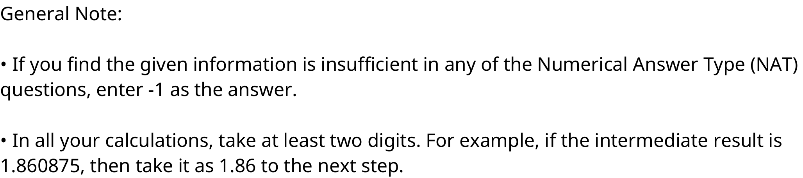

**Figure 1.** General Note specifying NAT insufficient information convention (-1) and rounding to at least two digits for intermediate calculations

### Question 275

**Question ID:** `640653993604`

**Type:** Multiple Choice Question · **Marks:** 2
**PDF pages:** 3

**Shared context:** [ctx-274](#ctx-274)

Teacher forcing for training an transformer model is:

**Options**

**A.**

mandatory.

*Source option ID:* `6406533355913`

*Label added for presentation.*

**B.**

optional.

*Source option ID:* `6406533355914`

*Label added for presentation.*

**Correct answer:** optional.

**Source evidence:** [{"page": 3, "bbox": [23.62, 212.2, 119.02, 228.52], "type": "green source option", "detail": "Option 6406533355914 marked green (color 32768)"}]

### Question 276

**Question ID:** `640653993616`

**Type:** Multiple Choice Question · **Marks:** 2
**PDF pages:** 3

**Shared context:** [ctx-274](#ctx-274)

Choose the correct statements regarding transformer architecture:

**Options**

**A.**

Residual connections are practically optional in a transformer model with 10 encoder layers and 10 decoder layers.

*Source option ID:* `6406533355937`

*Label added for presentation.*

**B.**

Having multiple heads helps in capturing different relationships between input tokens.

*Source option ID:* `6406533355938`

*Label added for presentation.*

**C.**

One hot encoding is a good choice for position encoding.

*Source option ID:* `6406533355939`

*Label added for presentation.*

**D.**

Batch normalization can be used instead of layer normalization.

*Source option ID:* `6406533355940`

*Label added for presentation.*

**E.**

None of these.

*Source option ID:* `6406533355941`

*Label added for presentation.*

**Correct answer:** Having multiple heads helps in capturing different relationships between input tokens.

**Source evidence:** [{"page": 3, "bbox": [23.62, 390.58, 119.02, 406.9], "type": "green source option", "detail": "Option 6406533355938 marked green (color 32768)"}]

### Shared context 277-280

**Question ID:** `640653993599`

**Type:** Comprehension
**PDF pages:** 3, 4

**Shared context:** [ctx-274](#ctx-274)

Consider the transformer-based encoder-decoder model used for machine translation with the following configuration (except the source and target vocabulary size, all other configuration values are the same for the encoder and decoder). The size of the vocabulary includes all the special tokens as well.

1. Source vocabulary size, $|V_s|$: 500
2. Target vocabulary size, $|V_t|$: 750
3. The context length, $T$: 128
4. The embedding dimension, $d_{embed} = d_{model}$: 64
5. The projection dimensions, $d_q = d_k = d_v$: 16
6. The number of heads, $n_h$: 4
7. The hidden dimension of FFNN, $d_{ff}$: 256
8. Uses layer norm and residual connection

We pass the sample from the source language “I enjoyed the movie Transformer” to the encoder and its translation “Naan transformer padaththai rasithen” to the decoder. All the learnable parameters are randomly initialized. The model uses the teacher-forcing approach throughout the training process.

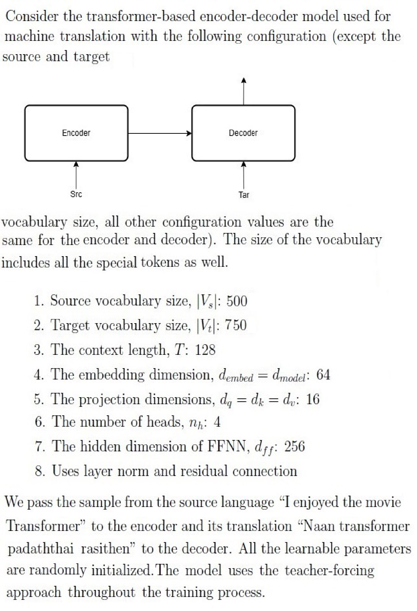

**Figure 2.** Transformer encoder-decoder machine translation model configuration parameters and specifications

Based on the above data, answer the given subquestions.

### Question 277

**Question ID:** `640653993600`

**Type:** Short Answer Question · **Marks:** 2
**PDF pages:** 4, 5

**Shared context:** [ctx-277-280](#ctx-277-280), [ctx-274](#ctx-274)

Assume the model has two layers (N = 2). Calculate the total number of parameters in the model (excluding the embedding layer and output layer). Moreover, no bias was added to the neuron in the FFNN layers.

**Correct answer:** 230656

**Source evidence:** [{"page": 5, "bbox": [22.87, 153.25, 100.0, 169.57], "type": "explicit field", "detail": "Possible Answers: 230656"}]

### Question 278

**Question ID:** `640653993601`

**Type:** Short Answer Question · **Marks:** 2
**PDF pages:** 5

**Shared context:** [ctx-277-280](#ctx-277-280), [ctx-274](#ctx-274)

How many parameters does the output layer have?

**Correct answer:** 48000

**Source evidence:** [{"page": 5, "bbox": [22.87, 387.12, 100.0, 403.44], "type": "explicit field", "detail": "Possible Answers: 48000"}]

### Question 279

**Question ID:** `640653993602`

**Type:** Short Answer Question · **Marks:** 2
**PDF pages:** 5

**Shared context:** [ctx-277-280](#ctx-277-280), [ctx-274](#ctx-274)

How many parameters does the embedding layer have?

**Correct answer:** 32000

**Source evidence:** [{"page": 5, "bbox": [22.87, 621.0, 100.0, 637.32], "type": "explicit field", "detail": "Possible Answers: 32000"}]

### Question 280

**Question ID:** `640653993603`

**Type:** Short Answer Question · **Marks:** 2
**PDF pages:** 5, 6

**Shared context:** [ctx-277-280](#ctx-277-280), [ctx-274](#ctx-274)

At time step t = 1, the prediction probability for the words “Naan”, “transformer” and “padaththai” are 0.55,0.15 and 0.2, respectively. What is the probability for the word “rasithen”? If you think, the given information is insufficient enter -1

**Correct answer:** -1

**Source evidence:** [{"page": 6, "bbox": [22.87, 99.8, 50.0, 116.12], "type": "explicit field", "detail": "Possible Answers: -1"}]

### Shared context 281-284

**Question ID:** `640653993617`

**Type:** Comprehension
**PDF pages:** 6

**Shared context:** [ctx-274](#ctx-274)

Consider following input matrix to a single neural network layer:

$$X = \begin{bmatrix} 1 & 2 & 3 \\ 4 & 7 & 11 \\ -3 & 5 & -2 \end{bmatrix}$$

It has 3 samples with 3 features each i.e. batch size is 3.
Each column represents a sample. Left most column represents the first sample and topmost row represents the first feature vector.
Note: assume $\gamma = 1, \beta = 0$ and $\epsilon = 10^{-5}$ for both batch and layer normalization, if not mentioned explicitly. Use standard scaling.

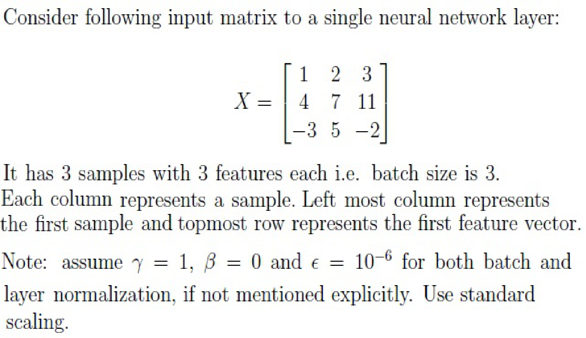

**Figure 3.** Input matrix X and batch/layer normalization configuration specifications

Based on the above data, answer the given subquestions.

### Question 281

**Question ID:** `640653993618`

**Type:** Short Answer Question · **Marks:** 2
**PDF pages:** 6

**Shared context:** [ctx-281-284](#ctx-281-284), [ctx-274](#ctx-274)

Say matrix F is computed by applying batch normalization on X, what will be sum of every element in first/topmost row of F?

**Correct answer:** 0 to 0.01

**Source evidence:** [{"page": 6, "bbox": [22.87, 751.05, 100.0, 767.37], "type": "explicit field", "detail": "Possible Answers: 0 to 0.01"}]

### Question 282

**Question ID:** `640653993619`

**Type:** Short Answer Question · **Marks:** 2
**PDF pages:** 6, 7

**Shared context:** [ctx-281-284](#ctx-281-284), [ctx-274](#ctx-274)

Say matrix F is computed by applying layer normalization on X, what will be sum of every element in first/leftmost column of F?

**Correct answer:** 0 to 0.01

**Source evidence:** [{"page": 7, "bbox": [22.87, 208.28, 100.0, 224.6], "type": "explicit field", "detail": "Possible Answers: 0 to 0.01"}]

### Question 283

**Question ID:** `640653993620`

**Type:** Short Answer Question · **Marks:** 2
**PDF pages:** 7

**Shared context:** [ctx-281-284](#ctx-281-284), [ctx-274](#ctx-274)

Say $\sigma_1, \sigma_2$ and $\sigma_3$ were the standard deviations used to compute batch normalization of X. What is $\sum_{i=1}^3 \sigma_i^2$?

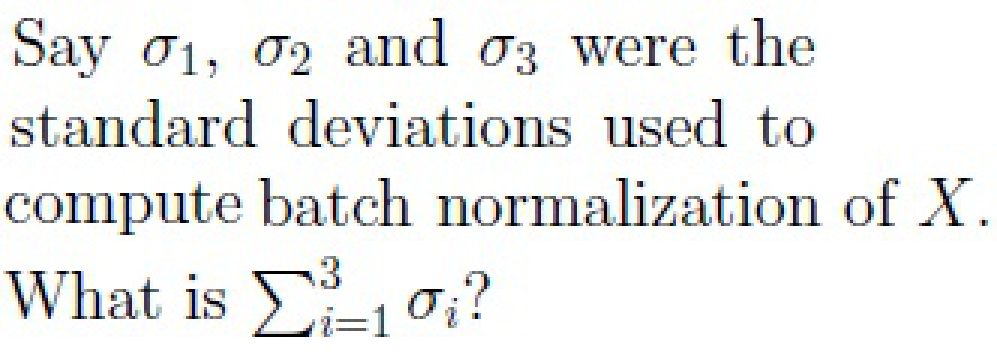

**Figure 4.** Question 283 prompt: sum of squared standard deviations for batch normalization of X

**Correct answer:** 8.95 to 9.05

**Source evidence:** [{"page": 7, "bbox": [22.87, 517.75, 100.0, 534.07], "type": "explicit field", "detail": "Possible Answers: 8.95 to 9.05"}]

### Question 284

**Question ID:** `640653993621`

**Type:** Short Answer Question · **Marks:** 2
**PDF pages:** 7, 8

**Shared context:** [ctx-281-284](#ctx-281-284), [ctx-274](#ctx-274)

Say $\sigma_1, \sigma_2$ and $\sigma_3$ were the standard deviations used to compute layer normalization of X. What is $\sum_{i=1}^3 \sigma_i^2$?

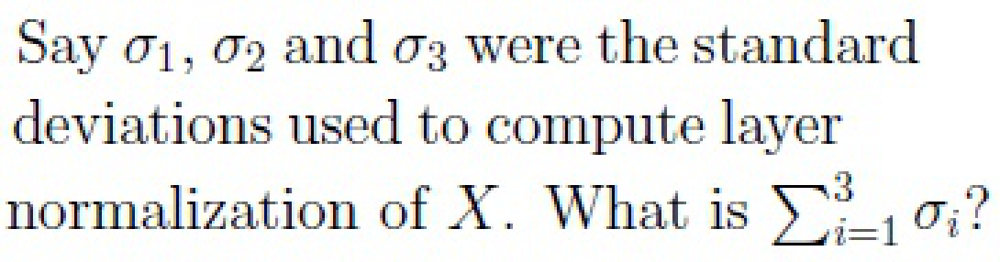

**Figure 5.** Question 284 prompt: sum of squared standard deviations for layer normalization of X

**Correct answer:** 12.45 to 12.55

**Source evidence:** [{"page": 8, "bbox": [22.87, 0.8, 100.0, 17.12], "type": "explicit field", "detail": "Possible Answers: 12.45 to 12.55"}]

### Shared context 285-288

**Question ID:** `640653993611`

**Type:** Comprehension
**PDF pages:** 8

**Shared context:** [ctx-274](#ctx-274)

Consider a vocabulary $V$,

$V = (\text{[start]}, \text{breaking}, \text{ground}, \text{a}, \text{is}, \text{seismology}, \text{study}, \text{experience}, \text{earth quake}, \text{[end]})$.

Assume that we have a pre-trained GPT model for text generation and the first input token to the model is always the special token [start]. The prediction probabilities outputted by the model are given below.

$$\begin{bmatrix}
0.04 & 0.01 & 0.14 & 0.07 & 0.09 & 0.41 & 0.08 & 0.05 & 0.08 & 0.01 \\
0.10 & 0.03 & 0.06 & 0.16 & 0.43 & 0.01 & 0.06 & 0.09 & 0.01 & 0.04 \\
0.06 & 0.08 & 0.28 & 0.29 & 0.03 & 0.08 & 0.04 & 0.08 & 0.04 & 0.04 \\
0.11 & 0.03 & 0.48 & 0.02 & 0.01 & 0.07 & 0.06 & 0.14 & 0.07 & 0.01 \\
0.09 & 0.29 & 0.04 & 0.01 & 0.04 & 0.03 & 0.25 & 0.05 & 0.15 & 0.06 \\
0.14 & 0.22 & 0.13 & 0.08 & 0.01 & 0.03 & 0.06 & 0.23 & 0.08 & 0.03
\end{bmatrix}$$

The columns of the matrix are in the same order as the words listed in the vocabulary set above.

The zeroth row of the matrix is the output probability distribution by the model given the special [Start] token as input.

Following the Greedy Search decoding strategy, the subsequent rows give the conditional probability distribution conditioned over the previous tokens. If you think the given information is insufficient for any sub-questions, then enter -1 as your answer.

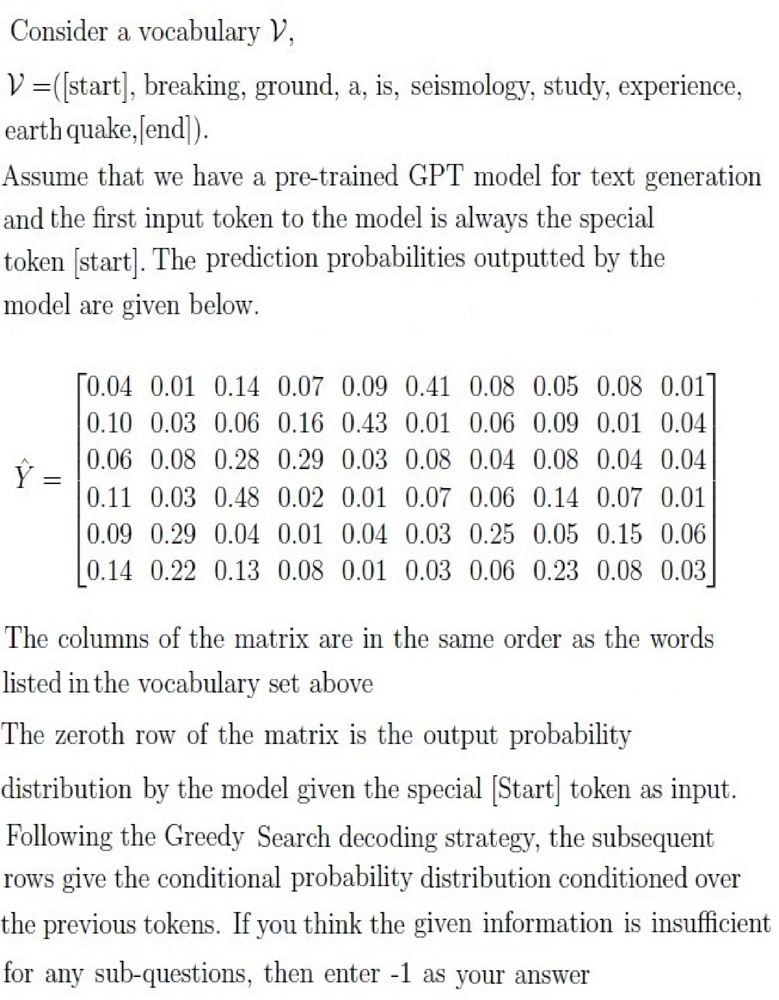

**Figure 6.** Pre-trained GPT vocabulary and prediction probability distribution matrix for greedy decoding

Based on the above data, answer the given subquestions.

### Question 285

**Question ID:** `640653993612`

**Type:** Short Answer Question · **Marks:** 1
**PDF pages:** 9

**Shared context:** [ctx-285-288](#ctx-285-288), [ctx-274](#ctx-274)

What is the probability of the predicted word equal to “Seismology” given the “[Start]” token as the initial input $P(y_1 = \text{Seismology} \mid y_0 = \text{[Start]})$?

![Question 285 prompt: probability of predicted word Seismology given [Start] token](assets/da5004_2024T3_Q1_NA/q285-q285-stem-01-p009.png)

**Figure 7.** Question 285 prompt: probability of predicted word Seismology given [Start] token

**Correct answer:** 0.41

**Source evidence:** [{"page": 9, "bbox": [22.87, 301.8, 80.0, 318.12], "type": "explicit field", "detail": "Possible Answers: 0.41"}]

### Question 286

**Question ID:** `640653993613`

**Type:** Short Answer Question · **Marks:** 2
**PDF pages:** 9

**Shared context:** [ctx-285-288](#ctx-285-288), [ctx-274](#ctx-274)

Say the probability of the sequence “Seismology is a ground breaking experience” is p, then what is $1000 \times p$?

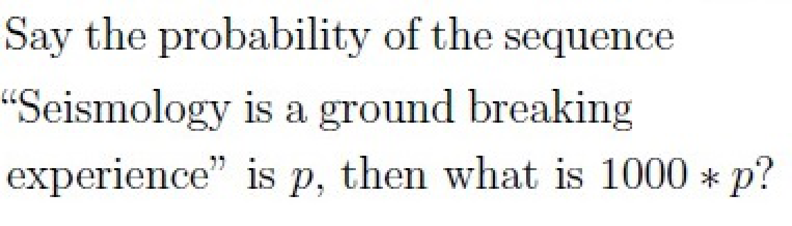

**Figure 8.** Question 286 prompt: scaled probability 1000 * p for sentence Seismology is a ground breaking experience

**Correct answer:** 1.6

**Source evidence:** [{"page": 9, "bbox": [22.87, 604.6, 80.0, 620.92], "type": "explicit field", "detail": "Possible Answers: 1.6"}]

### Question 287

**Question ID:** `640653993614`

**Type:** Short Answer Question · **Marks:** 2
**PDF pages:** 9, 10

**Shared context:** [ctx-285-288](#ctx-285-288), [ctx-274](#ctx-274)

What is the probability of the sequence “Seismology is earthquake study ”?

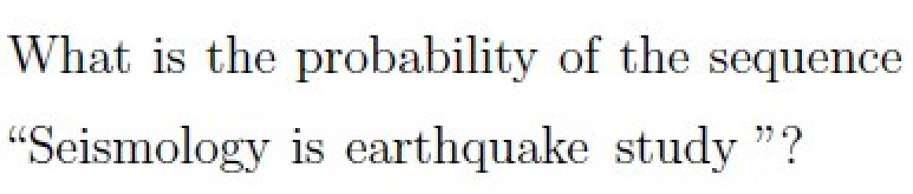

**Figure 9.** Question 287 prompt: probability of sequence Seismology is earthquake study

**Correct answer:** -1

**Source evidence:** [{"page": 10, "bbox": [22.87, 76.0, 50.0, 92.32], "type": "explicit field", "detail": "Possible Answers: -1"}]

### Question 288

**Question ID:** `640653993615`

**Type:** Short Answer Question · **Marks:** 2
**PDF pages:** 10

**Shared context:** [ctx-285-288](#ctx-285-288), [ctx-274](#ctx-274)

Suppose we use Top—k sampling, with k = 3, what is the probability of the predicted word equal to “Seismology” given the “[Start]” token as the initial input $P(y_1 = \text{Seismology} \mid y_0 = \text{[Start]})$?

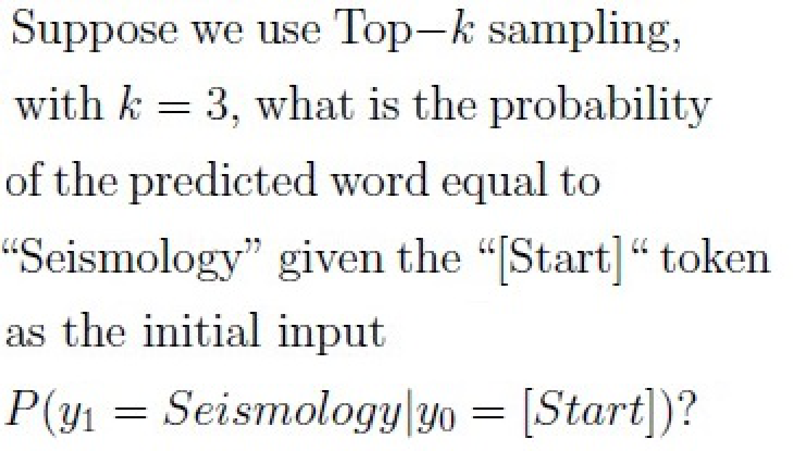

**Figure 10.** Question 288 prompt: top-k sampling probability for word Seismology with k=3

**Correct answer:** -1

**Source evidence:** [{"page": 10, "bbox": [22.87, 435.1, 50.0, 451.42], "type": "explicit field", "detail": "Possible Answers: -1"}]

### Shared context 289-291

**Question ID:** `640653993607`

**Type:** Comprehension
**PDF pages:** 10, 11

**Shared context:** [ctx-274](#ctx-274)

Rajesh has created a GPT-like transformer model. However he doesn’t have access to large compute infrastructure, so he has configured the original architecture in the following manner:

1. He has taken a vocabulary of size 1000 words/tokens.
2. Sequence length is 64.
3. Embedding dimension and $d_{model}$ is 128.
4. There are only 4 transformer blocks (layers).
5. Each transformer block (layer) has only 4 attention heads.
6. FFN hidden layer size is 256.

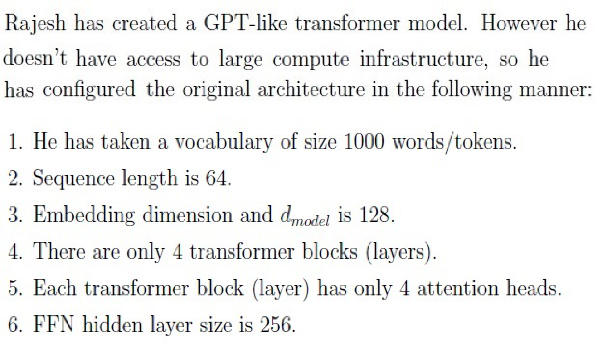

**Figure 11.** GPT-like transformer model architectural configuration specifications

Based on the above data, answer the given subquestions.

### Question 289

**Question ID:** `640653993608`

**Type:** Multiple Choice Question · **Marks:** 2
**PDF pages:** 11

**Shared context:** [ctx-289-291](#ctx-289-291), [ctx-274](#ctx-274)

What will be the shape of positional embedding?

**Options**

**A.**

64 × 128

*Source option ID:* `6406533355917`

*Label added for presentation.*

**B.**

64 × 4

*Source option ID:* `6406533355918`

*Label added for presentation.*

**C.**

12 × 128

*Source option ID:* `6406533355919`

*Label added for presentation.*

**D.**

512 × 768

*Source option ID:* `6406533355920`

*Label added for presentation.*

**E.**

None of these.

*Source option ID:* `6406533355921`

*Label added for presentation.*

**Correct answer:** 64 × 128

**Source evidence:** [{"page": 11, "bbox": [23.62, 443.88, 119.02, 460.2], "type": "green source option", "detail": "Option 6406533355917 marked green (color 32768)"}]

### Question 290

**Question ID:** `640653993609`

**Type:** Multiple Choice Question · **Marks:** 2
**PDF pages:** 11

**Shared context:** [ctx-289-291](#ctx-289-291), [ctx-274](#ctx-274)

What will be the shape of $W_K$?

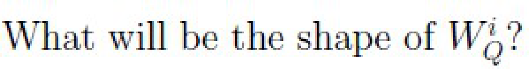

**Figure 12.** Question 290 prompt: shape of projection matrix W_K

**Options**

**A.**

32 × 32

*Source option ID:* `6406533355922`

*Label added for presentation.*

**B.**

64 × 32

*Source option ID:* `6406533355923`

*Label added for presentation.*

**C.**

128 × 16

*Source option ID:* `6406533355924`

*Label added for presentation.*

**D.**

128 × 32

*Source option ID:* `6406533355925`

*Label added for presentation.*

**E.**

8 × 32

*Source option ID:* `6406533355926`

*Label added for presentation.*

**F.**

None of these.

*Source option ID:* `6406533355927`

*Label added for presentation.*

**Correct answer:** 128 × 32

**Source evidence:** [{"page": 11, "bbox": [23.62, 742.79, 119.02, 759.11], "type": "green source option", "detail": "Option 6406533355925 marked green (color 32768)"}]

### Question 291

**Question ID:** `640653993610`

**Type:** Multiple Choice Question · **Marks:** 2
**PDF pages:** 12

**Shared context:** [ctx-289-291](#ctx-289-291), [ctx-274](#ctx-274)

What will be shape of the mask M?

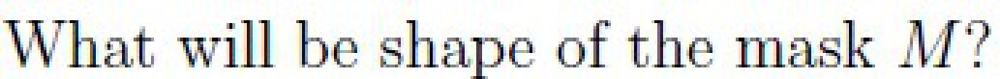

**Figure 13.** Question 291 prompt: shape of attention mask matrix M

**Options**

**A.**

16 × 16

*Source option ID:* `6406533355928`

*Label added for presentation.*

**B.**

32 × 32

*Source option ID:* `6406533355929`

*Label added for presentation.*

**C.**

64 × 64

*Source option ID:* `6406533355930`

*Label added for presentation.*

**D.**

128 × 128

*Source option ID:* `6406533355931`

*Label added for presentation.*

**E.**

None of these.

*Source option ID:* `6406533355932`

*Label added for presentation.*

**Correct answer:** 64 × 64

**Source evidence:** [{"page": 12, "bbox": [23.62, 163.17, 119.02, 179.49], "type": "green source option", "detail": "Option 6406533355930 marked green (color 32768)"}]

### Question 292

**Question ID:** `640653993605`

**Type:** Short Answer Question · **Marks:** 4
**PDF pages:** 12, 13

**Shared context:** [ctx-274](#ctx-274)

The input embeddings for the words “learning”, “brings” and “joy” are $h_1 = [0.5, 0.25, 1]$, $h_2 = [0.1, 0.25, 0]$, and $h_3 = [0.1, 0.1, 0.9]$, respectively. Note that the embeddings are row vectors. The projection matrices are as follows

$$W_Q = \begin{bmatrix} 1 & 0 \\ -1 & 1 \\ 0 & 1 \end{bmatrix} \quad W_K = \begin{bmatrix} 1 & 0 \\ 1 & 0 \\ 0 & 1 \end{bmatrix} \quad W_V = \begin{bmatrix} 0 & 0 \\ -1 & -1 \\ 1 & -1 \end{bmatrix}$$

The following quantities are computed as
$$Q = H W_Q \quad K = H W_K \quad V = H W_V$$

Let $e_{ij}$ denote the unnormalized attention score, $\alpha_{ij}$ denote the normalized attention score (ignore the scaling by $\sqrt{d_k}$) and $z_j$ denote the linear combination of the value vectors for the $j$-th word.

Suppose the gradient vector $\frac{\partial L}{\partial z_1} = [1, 2]$, then what is the gradient vector $\frac{\partial L}{\partial h_1}$? Enter the sum of gradients.

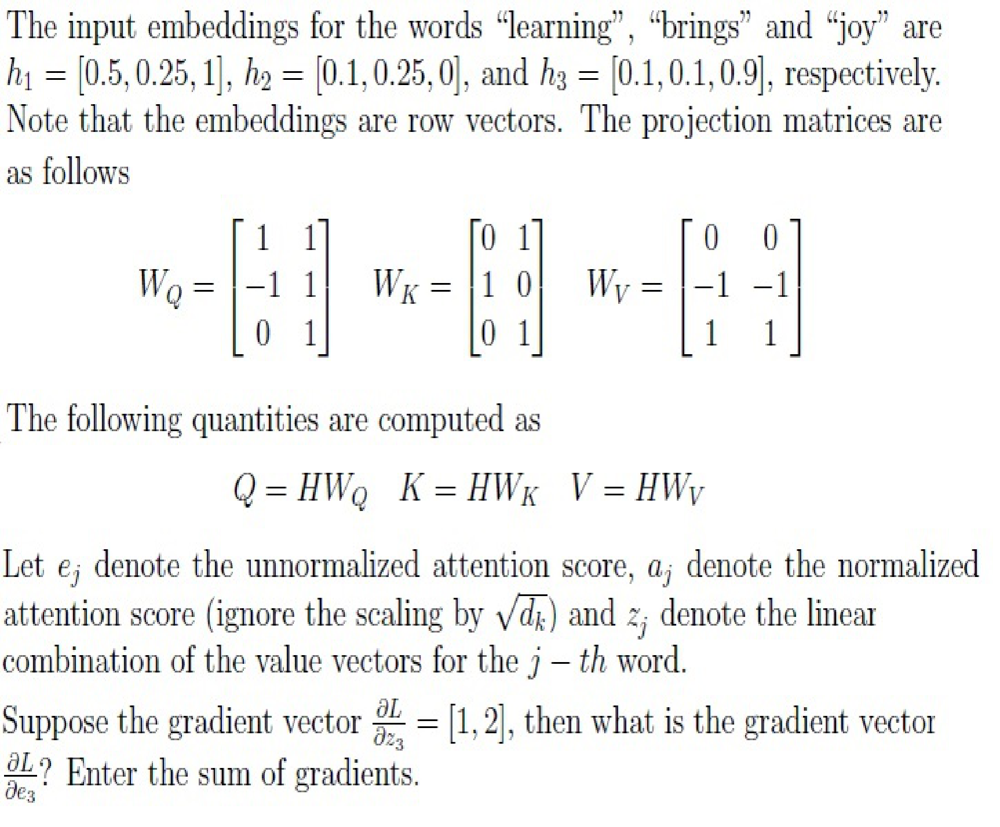

**Figure 14.** Question 292 prompt: input word embeddings, projection matrices W_Q, W_K, W_V, and attention gradient vector computation

**Correct answer:** 0

**Source evidence:** [{"page": 13, "bbox": [22.87, 21.27, 50.0, 37.6], "type": "explicit field", "detail": "Possible Answers: 0"}]

### Question 293

**Question ID:** `640653993606`

**Type:** Short Answer Question · **Marks:** 3
**PDF pages:** 13

**Shared context:** [ctx-274](#ctx-274)

Consider the embedding vector for a word, $x = [0.1, 0.2, -0.3, 0.4]$. Suppose the word is at position 2 in the given sentence. Add the corresponding position embedding $p$ to the word embedding to get $h$, i.e. the sum of the elements in $h = x + p$. Use the fixed-sinusoidal position embedding vector calculated using the formula given below

$$PE(pos, 2i) = \sin\left(\frac{pos}{10000^{2i/d_{model}}}\right)$$

$$PE(pos, 2i+1) = \cos\left(\frac{pos}{10000^{2i/d_{model}}}\right)$$

What is $h[0] + h[1]$ i.e. sum of first two elements of $h$?

![Question 293 prompt: sinusoidal positional embedding formula and sum of elements h[0] + h[1]](assets/da5004_2024T3_Q1_NA/q293-q293-stem-01-p013.png)

**Figure 15.** Question 293 prompt: sinusoidal positional embedding formula and sum of elements h[0] + h[1]

**Correct answer:** 0.75 to 0.85

**Source evidence:** [{"page": 13, "bbox": [22.87, 480.0, 100.0, 496.32], "type": "explicit field", "detail": "Possible Answers: 0.75 to 0.85"}]

## Answer key

| Source question | Source identity | Correct answer | PDF pages |
| :--- | :--- | :--- | :--- |
| 275 | 640653993604 | optional. | 3 |
| 276 | 640653993616 | Having multiple heads helps in capturing different relationships between input tokens. | 3 |
| 277 | 640653993600 | 230656 | 4, 5 |
| 278 | 640653993601 | 48000 | 5 |
| 279 | 640653993602 | 32000 | 5 |
| 280 | 640653993603 | -1 | 5, 6 |
| 281 | 640653993618 | 0 to 0.01 | 6 |
| 282 | 640653993619 | 0 to 0.01 | 6, 7 |
| 283 | 640653993620 | 8.95 to 9.05 | 7 |
| 284 | 640653993621 | 12.45 to 12.55 | 7, 8 |
| 285 | 640653993612 | 0.41 | 9 |
| 286 | 640653993613 | 1.6 | 9 |
| 287 | 640653993614 | -1 | 9, 10 |
| 288 | 640653993615 | -1 | 10 |
| 289 | 640653993608 | 64 × 128 | 11 |
| 290 | 640653993609 | 128 × 32 | 11 |
| 291 | 640653993610 | 64 × 64 | 12 |
| 292 | 640653993605 | 0 | 12, 13 |
| 293 | 640653993606 | 0.75 to 0.85 | 13 |

## Extraction notes

**Status:** verified-source-limitation
**Count reconciliation:** The portal header declares 10 questions and 40 marks for Section 14 (LLM). The 40 marks reconcile exactly across the 19 academic questions: Q275 (2) + Q276 (2) + Comprehension 277-280 subquestions Q277 (2) + Q278 (2) + Q279 (2) + Q280 (2) + Comprehension 281-284 subquestions Q281 (2) + Q282 (2) + Q283 (2) + Q284 (2) + Comprehension 285-288 subquestions Q285 (1) + Q286 (2) + Q287 (2) + Q288 (2) + Comprehension 289-291 subquestions Q289 (2) + Q290 (2) + Q291 (2) + Q292 (4) + Q293 (3) = 40 marks. The source PDF contains 7 portal sub-sections (Sub-sections 1 to 7), 1 administrative subject confirmation entry (Q273, 0 marks), 1 shared-context calculation note entry (ctx-274, 0 marks), 4 comprehension passages (ctx-277-280, ctx-281-284, ctx-285-288, ctx-289-291), and 19 academic questions (Q275-Q293). The declared count of 10 questions in the portal header corresponds to the portal container groupings / sub-sections rather than the 19 individual academic items; this portal-count relationship is preserved as an observed factual reconciliation with source limitation.

- The LLM exam paper is delivered via an online computer-based portal. Section 14 (LLM) begins at physical page 1 (y=672.4) and ends on physical page 13 (y=603.3) immediately preceding Section 15 (DLP).
- Official answers for all MCQ items are uniquely identified by green option markers (color 32768, xref 19) in the source PDF.
- Official answers for all Short Answer items are specified by explicit Possible Answers fields in the source PDF.
- Passages for comprehension questions (277-280, 281-284, 285-288, 289-291) and the General Note are modeled as shared-context entries with appropriate cross-references.
- All visual raster mathematical expressions, formulas, matrices, and comprehension passages have been extracted as high-fidelity PNG assets and transcribed into LaTeX.
- Section 14 (LLM) portal header declares Number of Questions: 10 and Number of Questions to be attempted: 10 (with Section Marks: 40). However, the section contains 7 portal sub-sections and 19 academic questions totaling exactly 40 marks. The declared count of 10 differs from the observed 19 academic questions and 7 sub-sections. The source does not establish an explanation for this discrepancy; no portal aggregation interpretation is inferred.

**Excluded source entries:**

- {"classification": "preceding-subject-questions", "page": 1, "bbox": [22.87, 0.0, 560.0, 660.0], "reason": "Out-of-scope finance / project evaluation questions (Q271, Q272 and unnumbered fragment) belonging to preceding section prior to LLM Section 14 start", "identity": "271-272"}
- {"classification": "subject-confirmation", "page": 2, "bbox": [22.87, 303.6, 569.03, 560.0], "reason": "Administrative subject confirmation asking candidate to confirm subject and cross check hall ticket", "identity": "273"}
- {"classification": "administrative-acknowledgment-options", "page": 2, "bbox": [23.62, 775.12, 560.0, 812.26], "reason": "Administrative acknowledgment options (Instructions has been mentioned above / This Instructions is just for a reference & not for an evaluation) excluded semantically while preserving calculation note as shared context", "identity": "274"}
- {"classification": "following-subject-heading", "page": 13, "bbox": [20.62, 603.3, 405.42, 821.0], "reason": "Out-of-scope heading for subsequent Section 15 DLP (Section Id 64065369324)", "identity": "Section 15"}
