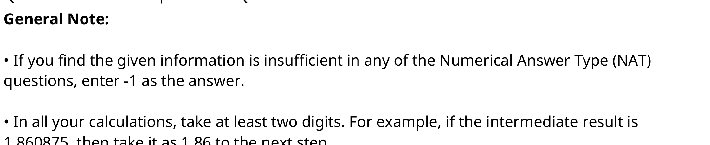
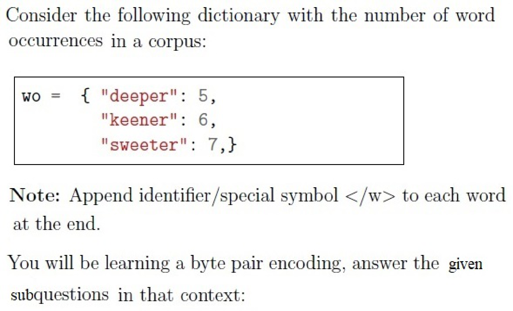
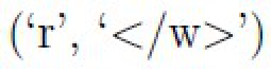
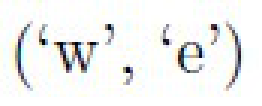
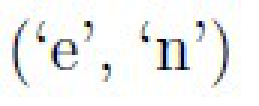
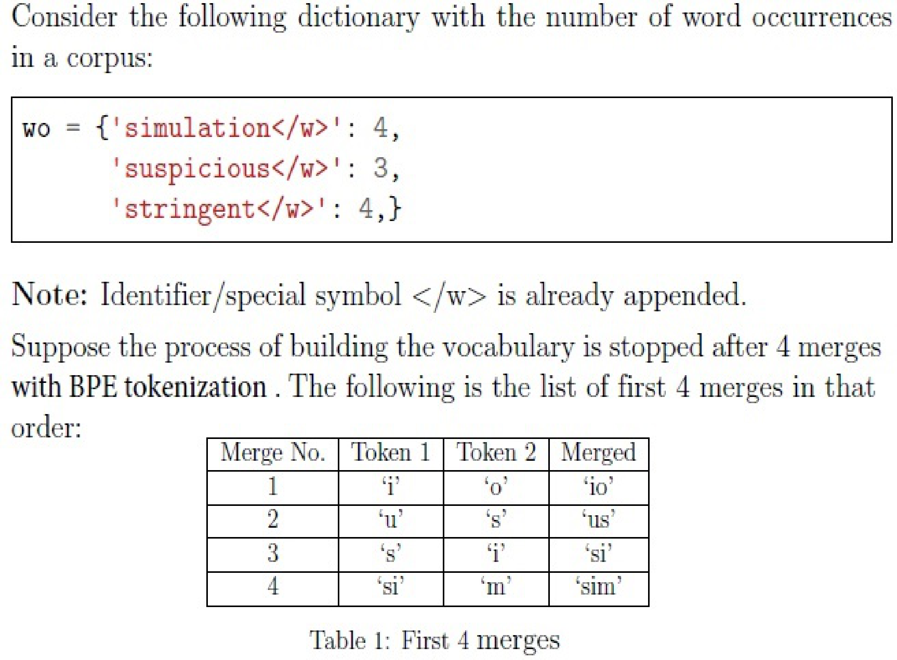
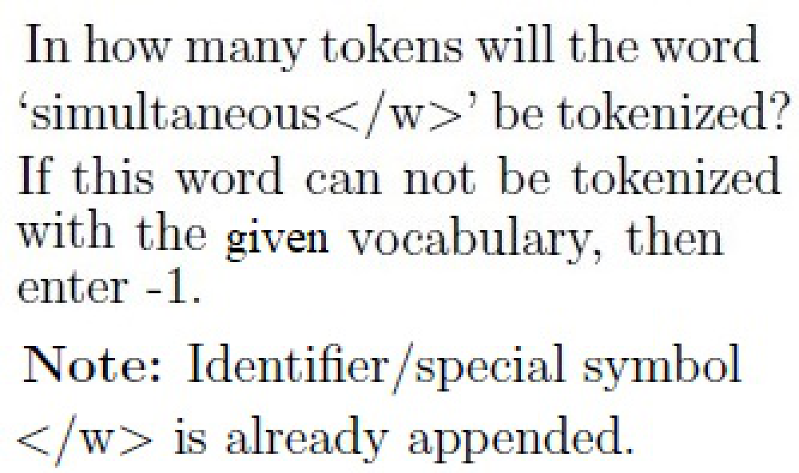
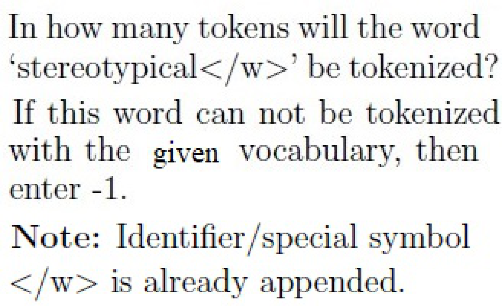
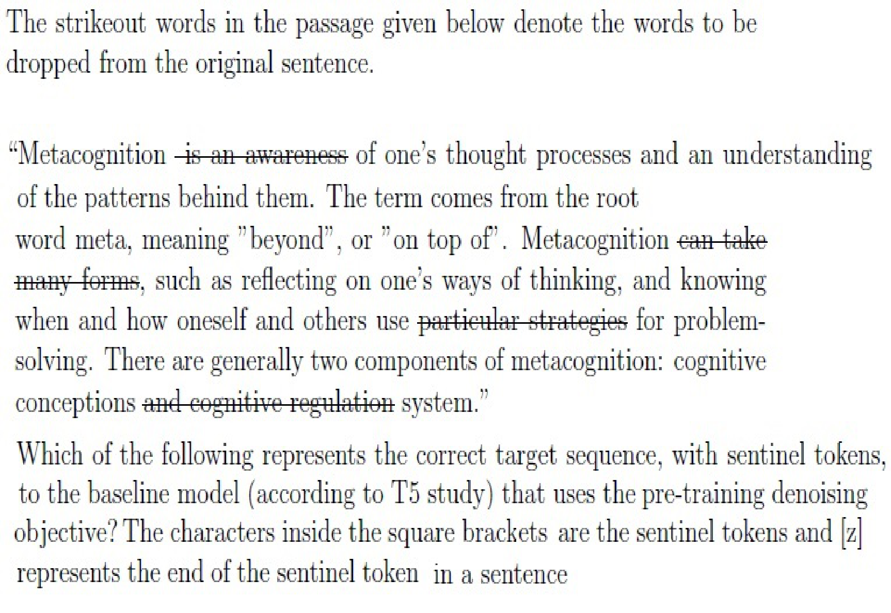

# LLM — da5004_2024T3_Q2_NA

**Source:** `da5004_2024T3_Q2_NA.pdf` · **Academic questions:** 16 · **Separately counted children:** 0
**Provenance:** `Large_Language_Models/da5004_2024T3_Q2_NA.pdf` · SHA-256 `9650afb628d82b6c2b23cd30714e0c83eecb08f8a98e5246437259209e2e12e9`

**Scope:** Section 8: LLM (Degree Level : Large Language Models (Computer Based Exam)), physical pages 1 to 10. The in-scope subject starts at physical page 1 with Section Id 64065374262 and terminates on physical page 10 after Question 155 immediately prior to Section 9: i-NLP (Section Id 64065374263).

## Questions

### Shared context 139

**Question ID:** `6406531030008`

**Type:** General Note
**PDF pages:** 2

General Note: 
 
• If you find the given information is insufficient in any of the Numerical Answer Type (NAT) 
questions, enter -1 as the answer. 
 
• In all your calculations, take at least two digits. For example, if the intermediate result is 
1.860875, then take it as 1.86 to the next step.

**Figure 1.** General Note calculation instructions and evaluation conditions for Numerical Answer Type (NAT) questions

### Shared context 140-145

**Question ID:** `6406531030009`

**Type:** Comprehension
**PDF pages:** 3

Consider the following dictionary with the number of word occurrences in a corpus:

$$w_0 = \{ \text{"deeper"}: 5, \text{"keener"}: 6, \text{"sweeter"}: 7 \}$$

Note: Append identifier /special symbol </w> to each word at the end.

You will be learning a byte pair encoding, answer the given subquestions in that context:

**Figure 2.** Corpus word dictionary with occurrence counts and BPE special end-of-word token instruction for Questions 140 to 145

### Question 140

**Question ID:** `6406531030010`

**Type:** SA · **Marks:** 2
**PDF pages:** 3

**Shared context:** [ctx-140-145](#ctx-140-145), [ctx-139](#ctx-139)

How many tokens are there in the initial vocabulary?

**Correct answer:** 10

**Source evidence:** [{"page": 3, "bbox": [22.87, 720.0, 100.0, 740.0], "type": "explicit field", "detail": "Possible Answers: 10"}]

### Question 141

**Question ID:** `6406531030011`

**Type:** MCQ · **Marks:** 3
**PDF pages:** 3, 4

**Shared context:** [ctx-140-145](#ctx-140-145)

Which of the following pairs has the least frequency before any merge?

**Options**

**A.**

('r', '</w>')

**Figure 3.** Question 141 Option A pair ('r', '</w>')

*Source option ID:* `6406533484116`

*Label added for presentation.*

**B.**

('w', 'e')

**Figure 4.** Question 141 Option B pair ('w', 'e')

*Source option ID:* `6406533484117`

*Label added for presentation.*

**C.**

('p', 'e')

**Figure 5.** Question 141 Option C pair ('p', 'e')

*Source option ID:* `6406533484118`

*Label added for presentation.*

**D.**

('e', 'n')

**Figure 6.** Question 141 Option D pair ('e', 'n')

*Source option ID:* `6406533484119`

*Label added for presentation.*

**E.**

('e', 'r')

**Figure 7.** Question 141 Option E pair ('e', 'r')

*Source option ID:* `6406533484120`

*Label added for presentation.*

**F.**

None of these.

**Figure 8.** Question 141 Option F None of these

*Source option ID:* `6406533484121`

*Label added for presentation.*

**Correct answer:** ('p', 'e')

**Source evidence:** [{"page": 4, "bbox": [23.62, 155.79, 119.02, 177.54], "type": "green source option", "detail": "Option 6406533484118 marked in green font (color 32768)"}]

### Question 142

**Question ID:** `6406531030012`

**Type:** SA · **Marks:** 3
**PDF pages:** 4

**Shared context:** [ctx-140-145](#ctx-140-145), [ctx-139](#ctx-139)

What is the most frequent byte-pair before the very first merge? Say the most frequent byte pair is 
(‘a’,‘b’), then enter “ab” (without quotes and white spaces). If there is a tie between two or more 
candidates, pick the one that occurs first in the original vocabulary.

**Correct answer:** ee

**Source evidence:** [{"page": 4, "bbox": [22.87, 540.0, 100.0, 560.0], "type": "explicit field", "detail": "Possible Answers: ee"}]

### Question 143

**Question ID:** `6406531030013`

**Type:** SA · **Marks:** 2
**PDF pages:** 4, 5

**Shared context:** [ctx-140-145](#ctx-140-145), [ctx-139](#ctx-139)

What is the frequency of the most frequent byte-pair before the very first merge?

**Correct answer:** 18

**Source evidence:** [{"page": 5, "bbox": [22.87, 16.75, 100.0, 35.0], "type": "explicit field", "detail": "Possible Answers: 18"}]

### Question 144

**Question ID:** `6406531030014`

**Type:** SA · **Marks:** 2
**PDF pages:** 5

**Shared context:** [ctx-140-145](#ctx-140-145), [ctx-139](#ctx-139)

How many tokens in the vocabulary will have their frequency revised/reduced after first merge?

**Correct answer:** 2

**Source evidence:** [{"page": 5, "bbox": [22.87, 230.0, 100.0, 250.0], "type": "explicit field", "detail": "Possible Answers: 2"}]

### Question 145

**Question ID:** `6406531030015`

**Type:** SA · **Marks:** 2
**PDF pages:** 5

**Shared context:** [ctx-140-145](#ctx-140-145), [ctx-139](#ctx-139)

After the first merge, how many tokens are there in the updated vocabulary?

**Correct answer:** 11

**Source evidence:** [{"page": 5, "bbox": [22.87, 430.0, 100.0, 450.0], "type": "explicit field", "detail": "Possible Answers: 11"}]

### Shared context 146-147

**Question ID:** `6406531030016`

**Type:** Comprehension
**PDF pages:** 5, 6

Consider the following dictionary with the number of word occurrences in a corpus:

$$w_0 = \{ \text{'simulation</w>'}: 4, \text{'suspicious</w>'}: 3, \text{'stringent</w>'}: 4 \}$$

Note: Identifier/special symbol </w> is already appended.

Suppose the process of building the vocabulary is stopped after 4 merges with BPE tokenization. The following is the list of first 4 merges in that order:

| Merge No. | Token 1 | Token 2 | Merged |
| :--- | :--- | :--- | :--- |
| 1 | 'i' | 'o' | 'io' |
| 2 | 'u' | 's' | 'us' |
| 3 | 's' | 'i' | 'si' |
| 4 | 'si' | 'm' | 'sim' |

Table 1: First 4 merges

Based on the above data, answer the given subquestions.

**Figure 9.** Corpus word dictionary and Table 1 showing first 4 BPE token merges for Questions 146 and 147

### Question 146

**Question ID:** `6406531030017`

**Type:** SA · **Marks:** 2
**PDF pages:** 6

**Shared context:** [ctx-146-147](#ctx-146-147), [ctx-139](#ctx-139)

In how many tokens will the word ‘simultaneous</w>’ be tokenized?
If this word can not be tokenized with the given vocabulary, then enter -1.

Note: Identifier/special symbol </w> is already appended.

**Figure 10.** Question 146 problem statement for tokenization of 'simultaneous</w>'

**Correct answer:** 10

**Source evidence:** [{"page": 6, "bbox": [22.87, 780.0, 100.0, 800.0], "type": "explicit field", "detail": "Possible Answers: 10"}]

### Question 147

**Question ID:** `6406531030018`

**Type:** SA · **Marks:** 2
**PDF pages:** 6, 7

**Shared context:** [ctx-146-147](#ctx-146-147), [ctx-139](#ctx-139)

In how many tokens will the word ‘stereotypical</w>’ be tokenized?
If this word can not be tokenized with the given vocabulary, then enter -1.

Note: Identifier/special symbol </w> is already appended.

**Figure 11.** Question 147 problem statement for tokenization of 'stereotypical</w>'

**Correct answer:** -1

**Source evidence:** [{"page": 7, "bbox": [22.87, 16.75, 100.0, 35.0], "type": "explicit field", "detail": "Possible Answers: -1"}]

### Question 148

**Question ID:** `6406531030019`

**Type:** MSQ · **Marks:** 2
**PDF pages:** 7

Which of the following represent(s) the normalization step(s) in building a tokenizer for the English 
language?

**Options**

**A.**

removing accents from characters.

*Source option ID:* `6406533484128`

*Label added for presentation.*

**B.**

converting upper case letters to small case letters.

*Source option ID:* `6406533484129`

*Label added for presentation.*

**C.**

assigning integers to tokens.

*Source option ID:* `6406533484130`

*Label added for presentation.*

**D.**

splitting a sentence by whitespaces.

*Source option ID:* `6406533484131`

*Label added for presentation.*

**E.**

the final post-processing step where the tokenizer adds the special tokens.

*Source option ID:* `6406533484132`

*Label added for presentation.*

**F.**

none of these.

*Source option ID:* `6406533484133`

*Label added for presentation.*

**Correct answer:** removing accents from characters. / converting upper case letters to small case letters.

**Source evidence:** [{"page": 7, "bbox": [23.62, 526.12, 119.02, 558.94], "type": "green source option", "detail": "Options 6406533484128 and 6406533484129 marked in green font (color 32768)"}]

### Question 149

**Question ID:** `6406531030022`

**Type:** MSQ · **Marks:** 2
**PDF pages:** 7, 8

Choose all the aspects of the pre-training datasets that impact the model’s performance.

**Options**

**A.**

Quality

*Source option ID:* `6406533484143`

*Label added for presentation.*

**B.**

Size

*Source option ID:* `6406533484144`

*Label added for presentation.*

**C.**

Diversity

*Source option ID:* `6406533484145`

*Label added for presentation.*

**D.**

None of these

*Source option ID:* `6406533484146`

*Label added for presentation.*

**Correct answer:** Quality / Size / Diversity

**Source evidence:** [{"page": 7, "bbox": [23.62, 771.46, 119.02, 804.28], "type": "green source option", "detail": "Options 6406533484143, 6406533484144, and 6406533484145 marked in green font (color 32768)"}]

### Question 150

**Question ID:** `6406531030020`

**Type:** MSQ · **Marks:** 4
**PDF pages:** 8

The strikeout words in the passage given below denote the words to be dropped from the original sentence.

“Metacognition ~~is an awareness~~ of one’s thought processes and an understanding of the patterns behind them. The term comes from the root word meta, meaning "beyond", or "on top of". Metacognition ~~can take many forms~~, such as reflecting on one’s ways of thinking, and knowing when and how oneself and others use ~~particular strategies~~ for problem-solving. There are generally two components of metacognition: cognitive conceptions ~~and cognitive regulation~~ system.”

Which of the following represents the correct target sequence, with sentinel tokens, to the baseline model (according to T5 study) that uses the pre-training denoising objective? The characters inside the square brackets are the sentinel tokens and [z] represents the end of the sentinel token in a sentence

**Figure 12.** Question 150 passage showing strikeout target words for T5 sentinel token denoising objective

**Options**

**A.**

[v] is an awareness [w] can take many forms [x] particular strategies [y] and 
cognitive regulation

*Source option ID:* `6406533484134`

*Label added for presentation.*

**B.**

[v] is an awareness [w] can take many forms [x] particular strategies [y] and 
cognitive regulation [z]

*Source option ID:* `6406533484135`

*Label added for presentation.*

**C.**

[v] is an awareness [w] can take many forms [x] and cognitive regulation [y] 
particular strategies

*Source option ID:* `6406533484136`

*Label added for presentation.*

**D.**

[v] is an awareness [w] particular strategies [x] can take many forms [y] and 
cognitive regulation

*Source option ID:* `6406533484137`

*Label added for presentation.*

**E.**

[a] is an awareness [b] can take many forms [c] particular strategies [d] and 
cognitive regulation

*Source option ID:* `6406533484138`

*Label added for presentation.*

**F.**

[a] is an awareness [b] can take many forms [c] particular strategies [d] and 
cognitive regulation[z]

*Source option ID:* `6406533484139`

*Label added for presentation.*

**G.**

[a] is an awareness [b] can take many forms [c] and cognitive regulation

*Source option ID:* `6406533484140`

*Label added for presentation.*

**H.**

None of these.

*Source option ID:* `6406533484141`

*Label added for presentation.*

**Correct answer:** [v] is an awareness [w] can take many forms [x] particular strategies [y] and cognitive regulation [z] / [a] is an awareness [b] can take many forms [c] particular strategies [d] and cognitive regulation[z]

**Source evidence:** [{"page": 8, "bbox": [23.62, 558.84, 119.02, 723.72], "type": "green source option", "detail": "Options 6406533484135 and 6406533484139 marked in green font (color 32768)"}]

### Question 151

**Question ID:** `6406531030021`

**Type:** SA · **Marks:** 3
**PDF pages:** 9

**Shared context:** [ctx-139](#ctx-139)

Suppose you are working on prefix language modeling. The sequence length is 32 and the first 
two tokens represent the task specific prefix. How many non-infinity elements are there in the 
mask for computing attention scores?

**Correct answer:** 529

**Source evidence:** [{"page": 9, "bbox": [22.87, 300.0, 100.0, 320.0], "type": "explicit field", "detail": "Possible Answers: 529"}]

### Question 152

**Question ID:** `6406531030023`

**Type:** MCQ · **Marks:** 3
**PDF pages:** 9

Which of the following components in the data pre-processing pipeline removes pages that 
contain bad words?

**Options**

**A.**

Language Identification

*Source option ID:* `6406533484147`

*Label added for presentation.*

**B.**

Exact Deduplication

*Source option ID:* `6406533484148`

*Label added for presentation.*

**C.**

Fuzzy Deduplication

*Source option ID:* `6406533484149`

*Label added for presentation.*

**D.**

ML classifiers for quality filtering

*Source option ID:* `6406533484150`

*Label added for presentation.*

**E.**

Simple heuristics to detect toxic contents

*Source option ID:* `6406533484151`

*Label added for presentation.*

**Correct answer:** Simple heuristics to detect toxic contents

**Source evidence:** [{"page": 9, "bbox": [23.62, 581.32, 119.02, 597.64], "type": "green source option", "detail": "Option 6406533484151 marked in green font (color 32768)"}]

### Question 153

**Question ID:** `6406531030024`

**Type:** MCQ · **Marks:** 2
**PDF pages:** 9, 10

Which of the following is an important implication of the scaling law:

**Options**

**A.**

Increasing the size of the model only can improve test performance, 
irrespective of the size of the training data.

*Source option ID:* `6406533484152`

*Label added for presentation.*

**B.**

Increasing the size of the data only can improve test performance, irrespective 
of the size of the model.

*Source option ID:* `6406533484153`

*Label added for presentation.*

**C.**

Both the size of the model and that of the data, have to be increased 
appropriately to improve test performance.

*Source option ID:* `6406533484154`

*Label added for presentation.*

**D.**

None of these.

*Source option ID:* `6406533484155`

*Label added for presentation.*

**Correct answer:** Both the size of the model and that of the data, have to be increased appropriately to improve test performance.

**Source evidence:** [{"page": 10, "bbox": [23.62, 54.64, 119.02, 70.96], "type": "green source option", "detail": "Option 6406533484154 marked in green font (color 32768)"}]

### Question 154

**Question ID:** `6406531030025`

**Type:** MSQ · **Marks:** 3
**PDF pages:** 10

Which of the following are the design choices for building a large language model?

**Options**

**A.**

Activation function in feed forward layer

*Source option ID:* `6406533484156`

*Label added for presentation.*

**B.**

Training dataset.

*Source option ID:* `6406533484157`

*Label added for presentation.*

**C.**

Positional encoding

*Source option ID:* `6406533484158`

*Label added for presentation.*

**D.**

Attention mechanism.

*Source option ID:* `6406533484159`

*Label added for presentation.*

**E.**

None of these.

*Source option ID:* `6406533484160`

*Label added for presentation.*

**Correct answer:** Activation function in feed forward layer / Training dataset. / Positional encoding / Attention mechanism.

**Source evidence:** [{"page": 10, "bbox": [23.62, 290.98, 119.02, 369.76], "type": "green source option", "detail": "Options 6406533484156, 6406533484157, 6406533484158, and 6406533484159 marked in green font (color 32768)"}]

### Question 155

**Question ID:** `6406531030026`

**Type:** MSQ · **Marks:** 3
**PDF pages:** 10

Consider an ideal data preprocessing pipeline to prepare a dataset. Which of the following 
sentences or sets of paragraphs will NOT pass through the pipeline as it is?

**Options**

**A.**

“You idiot. All those people from the country Sumatrazia are taking our jobs. If 
I get a chance, I will wipe that country off of the face of the planet.”

*Source option ID:* `6406533484161`

*Label added for presentation.*

**B.**

Rajesh is an amazing businessman. He holds a savings account with Dena 
bank. His phone number is 9876543210.

*Source option ID:* `6406533484162`

*Label added for presentation.*

**C.**

Deep learning is a subset of Machine Learning. 
Deep learning is a subset of Machine Learning.

*Source option ID:* `6406533484163`

*Label added for presentation.*

**D.**

India’s space agency ISRO says it has successfully brought back into Earth’s 
orbit a part of the rocket that carried its historic Moon mission recently.

*Source option ID:* `6406533484164`

*Label added for presentation.*

**E.**

Last Saturday, the Board of Control for Cricket in India (BCCI) officially 
communicated to the International Cricket Council (ICC) its decision to not send a team for the 
2025 ICC Champions Trophy to be held in Pakistan from February 19 to March 9.

*Source option ID:* `6406533484165`

*Label added for presentation.*

**F.**

None of these.

*Source option ID:* `6406533484166`

*Label added for presentation.*

**Correct answer:** “You idiot. All those people from the country Sumatrazia are taking our jobs. If I get a chance, I will wipe that country off of the face of the planet.” / Rajesh is an amazing businessman. He holds a savings account with Dena bank. His phone number is 9876543210. / Deep learning is a subset of Machine Learning. 
Deep learning is a subset of Machine Learning.

**Source evidence:** [{"page": 10, "bbox": [23.62, 531.82, 119.02, 622.42], "type": "green source option", "detail": "Options 6406533484161, 6406533484162, and 6406533484163 marked in green font (color 32768)"}]

## Answer key

| Source question | Source identity | Correct answer | PDF pages |
| :--- | :--- | :--- | :--- |
| 140 | 6406531030010 | 10 | 3 |
| 141 | 6406531030011 | ('p', 'e') | 3, 4 |
| 142 | 6406531030012 | ee | 4 |
| 143 | 6406531030013 | 18 | 4, 5 |
| 144 | 6406531030014 | 2 | 5 |
| 145 | 6406531030015 | 11 | 5 |
| 146 | 6406531030017 | 10 | 6 |
| 147 | 6406531030018 | -1 | 6, 7 |
| 148 | 6406531030019 | removing accents from characters. / converting upper case letters to small case letters. | 7 |
| 149 | 6406531030022 | Quality / Size / Diversity | 7, 8 |
| 150 | 6406531030020 | [v] is an awareness [w] can take many forms [x] particular strategies [y] and cognitive regulation [z] / [a] is an awareness [b] can take many forms [c] particular strategies [d] and cognitive regulation[z] | 8 |
| 151 | 6406531030021 | 529 | 9 |
| 152 | 6406531030023 | Simple heuristics to detect toxic contents | 9 |
| 153 | 6406531030024 | Both the size of the model and that of the data, have to be increased appropriately to improve test performance. | 9, 10 |
| 154 | 6406531030025 | Activation function in feed forward layer / Training dataset. / Positional encoding / Attention mechanism. | 10 |
| 155 | 6406531030026 | “You idiot. All those people from the country Sumatrazia are taking our jobs. If I get a chance, I will wipe that country off of the face of the planet.” / Rajesh is an amazing businessman. He holds a savings account with Dena bank. His phone number is 9876543210. / Deep learning is a subset of Machine Learning.  Deep learning is a subset of Machine Learning. | 10 |

## Extraction notes

**Status:** verified
**Count reconciliation:** The portal Section 8 table declares 12 questions (all mandatory) and 40 section marks. The portal question count reconciles with the source entries as follows: 1 administrative confirmation (Question 138, excluded), 1 general note (Question 139, preserved as shared context ctx-139 with administrative acknowledgment options excluded), 2 comprehension blocks counted as 1 question unit each by the portal (Question Id 6406531030009 spanning Q140-Q145, and Question Id 6406531030016 spanning Q146-Q147), and 8 standalone academic questions (Q148-Q155), totaling 1 + 1 + 1 + 1 + 8 = 12 portal question items. Across the 16 academic questions (Q140-Q155), the marks are: Q140 (2), Q141 (3), Q142 (3), Q143 (2), Q144 (2), Q145 (2) [Comprehension 1 total: 14 marks]; Q146 (2), Q147 (2) [Comprehension 2 total: 4 marks]; Q148 (2), Q149 (2), Q150 (4), Q151 (3), Q152 (3), Q153 (2), Q154 (3), Q155 (3) [Standalone total: 22 marks], giving exactly 14 + 4 + 22 = 40 marks, reconciling with the declared 40 Section Marks without discrepancy.

- Preserved 0-mark General Note calculation rules and NAT guidance (Question 139) as shared context ctx-139 with source crop, excluding only the administrative acknowledgment choices.
- Question 141 options are raster images; transcribed pairs verified against source crop assets.
- Question 146 and Question 147 problem statements are raster image crops with verified transcription; Question 147 answer -1 reflects lack of tokenization under the given vocabulary.
- Question 150 stem contains strikeout tokens denoting dropped words for T5 sentinel token objective; source crop preserved alongside verified transcription.

**Excluded source entries:**

- {"classification": "out-of-scope-preceding-subject", "page": 1, "bbox": [22.87, 16.75, 459.6, 730.0], "reason": "Preceding subject exam content (Question 137 and unnumbered options above it) prior to Section 8 LLM header at y=740.4", "identity": "preceding-subject-p1"}
- {"classification": "subject-confirmation", "page": 2, "bbox": [22.87, 342.2, 580.0, 580.0], "reason": "Administrative subject confirmation asking candidate to confirm subject 'DEGREE LEVEL : LARGE LANGUAGE MODELS (COMPUTER BASED EXAM)' and cross check hall ticket", "identity": "138"}
- {"classification": "administrative-acknowledgment-options", "page": 3, "bbox": [23.62, 17.5, 560.0, 60.0], "reason": "Administrative acknowledgment options (Instructions has been mentioned above / This Instructions is just for a reference & not for an evaluation) excluded semantically while preserving calculation note as shared context", "identity": "139"}
- {"classification": "out-of-scope-succeeding-subject", "page": 10, "bbox": [20.6, 794.8, 580.0, 842.0], "reason": "Succeeding subject Section 9 i-NLP header and content starting at y=794.8 on page 10 and continuing onto page 11 (Question 156 confirmation and Question 157 FastText)", "identity": "succeeding-subject-p10-p11"}
