# LLM — da5004_2025T1_Q1_NA

**Source:** `da5004_2025T1_Q1_NA.pdf` · **Academic questions:** 18 · **Separately counted children:** 0
**Provenance:** `Large_Language_Models/da5004_2025T1_Q1_NA.pdf` · SHA-256 `4019a127e45cedea3067b48841d0e0f39c576a2698c0edfdf64315da4b1b541d`

**Scope:** Section 7: LLM (Degree Level : Large Language Models), physical pages 1 to 10. The in-scope subject starts at physical page 1 with Section Id 64065379954 at y=79.96 and terminates on physical page 10 immediately prior to Section 8: i-NLP (Section Id 64065379955) at y=234.61.

## Questions

### Shared context 103

**Question ID:** `6406531130556`

**Type:** General Note
**PDF pages:** 1, 2

General Note:

- If you find the given information is insufficient in any of the Numerical Answer Type (NAT) questions, enter -1 as the answer.
- In all your calculations, take at least two digits. For example, if the intermediate result is 1.860875, then take it as 1.86 to the next step.

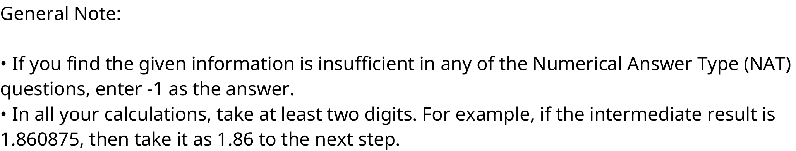

**Figure 1.** General Note specifying NAT insufficient information convention (-1) and rounding to at least two digits for intermediate calculations

### Question 104

**Question ID:** `6406531130557`

**Type:** Multiple Choice Question · **Marks:** 2
**PDF pages:** 2

Let $H_e \in \mathbb{R}^{T_1 \times d_{model}}$ be the representation from the topmost encoder layer of the encoder and $Z_d \in \mathbb{R}^{T_2 \times d_{model}}$ be the output of Multihead Masked Attention layer of one of the decoder layers. What will be the size of the attention matrix in the Multi-head Cross Attention layer of the same decoder layer? Assume $d_k = d_q = d_v = d$ if required.

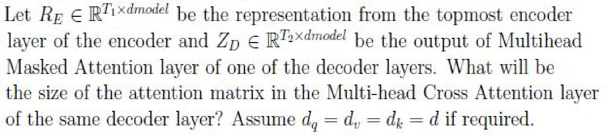

**Figure 2.** Topmost encoder representation R_E and decoder masked attention output Z_D dimension formulation for cross-attention matrix size

**Options**

**A.**

$T_1 \times T_1$

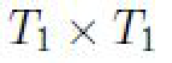

**Figure 3.** Option A attention matrix dimension T_1 x T_2

*Source option ID:* `6406533822520`

**B.**

$T_1 \times T_2$

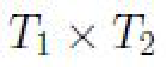

**Figure 4.** Option B attention matrix dimension T_2 x T_2

*Source option ID:* `6406533822521`

**C.**

$T_2 \times T_2$

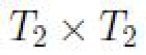

**Figure 5.** Option C attention matrix dimension T_1 x T_1

*Source option ID:* `6406533822522`

**D.**

$T_2 \times T_1$

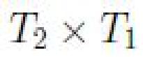

**Figure 6.** Option D attention matrix dimension T_2 x T_1

*Source option ID:* `6406533822523`

**Correct answer:** D

**Source evidence:** [{"page": 2, "bbox": [23.62, 601.42, 119.02, 617.74], "type": "green source option", "detail": "Option 6406533822523 marked with green color 32768 in source PDF"}]

### Question 105

**Question ID:** `6406531130558`

**Type:** Multiple Choice Question · **Marks:** 2
**PDF pages:** 2, 3

Consider following assertion and reason pair:  
 
Assertion: A transformer model cannot be trained in autogregressive mode for machine 
translation task. 
Reason: Teacher forcing improves the convergence rate.

Choose the correct statements

**Options**

**A.**

Assertion and Reason are both true and Reason is a correct explanation of 
Assertion.

*Source option ID:* `6406533822524`

**B.**

Assertion and Reason are both true and Reason is not a correct explanation of 
Assertion.

*Source option ID:* `6406533822525`

**C.**

Assertion is true but Reason is false.

*Source option ID:* `6406533822526`

**D.**

Assertion is false but Reason is true.

*Source option ID:* `6406533822527`

**Correct answer:** D

**Source evidence:** [{"page": 3, "bbox": [23.62, 151.24, 119.02, 167.56], "type": "green source option", "detail": "Option 6406533822527 marked with green color 32768 in source PDF"}]

### Question 106

**Question ID:** `6406531130560`

**Type:** Multiple Choice Question · **Marks:** 3
**PDF pages:** 3

Suppose we use a pre-trained model for text generation with the given prompt “I am going to”. 
Which of the following decoding strategies can be used such that the pre-trained model generates 
different text completion each time it is executed

**Options**

**A.**

Beam search with beam size 1

*Source option ID:* `6406533822532`

**B.**

Greedy approach

*Source option ID:* `6406533822533`

**C.**

Top-K with k = 2

*Source option ID:* `6406533822534`

**D.**

None of these

*Source option ID:* `6406533822535`

**Correct answer:** C

**Source evidence:** [{"page": 3, "bbox": [23.62, 424.73, 119.02, 441.05], "type": "green source option", "detail": "Option 6406533822534 marked with green color 32768 in source PDF"}]

### Question 107

**Question ID:** `6406531130561`

**Type:** Multiple Select Question · **Marks:** 2
**PDF pages:** 3

Which of the following models, in general, struggle to encode a context when translating long 
sentences?

**Options**

**A.**

An RNN model

*Source option ID:* `6406533822536`

**B.**

An RNN model with attention mechanism

*Source option ID:* `6406533822537`

**C.**

A transformer model

*Source option ID:* `6406533822538`

**Correct answer:** A

**Source evidence:** [{"page": 3, "bbox": [23.62, 661.08, 119.02, 677.4], "type": "green source option", "detail": "Option 6406533822536 marked with green color 32768 in source PDF"}]

### Question 108

**Question ID:** `6406531130562`

**Type:** Multiple Select Question · **Marks:** 2
**PDF pages:** 3, 4

Choose the correct statements

**Options**

**A.**

All the parameters of the GPT model are randomly initialized during pre-
training

*Source option ID:* `6406533822539`

**B.**

The model minimizes the CLM objective during fine-tuning to improve the 
performance

*Source option ID:* `6406533822540`

**C.**

All parameters of the GPT model are randomly initialized during fine-tuning

*Source option ID:* `6406533822541`

**D.**

In general, fine-tuning requires a dataset with labels

*Source option ID:* `6406533822542`

**Correct answer:** A, D

**Source evidence:** [{"page": 4, "bbox": [23.62, 36.82, 119.02, 53.14], "type": "green source option", "detail": "Option 6406533822539 marked with green color 32768 in source PDF"}, {"page": 4, "bbox": [23.62, 131.92, 119.02, 148.24], "type": "green source option", "detail": "Option 6406533822542 marked with green color 32768 in source PDF"}]

### Question 109

**Question ID:** `6406531130559`

**Type:** Multiple Select Question · **Marks:** 3
**PDF pages:** 4

Which of the following are correct statements regarding exhaustive decoding strategy? Note: $V$ represents the vocabulary.

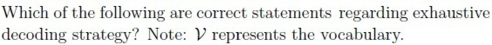

**Figure 7.** Question 109 prompt: correct statements regarding exhaustive decoding strategy with vocabulary V

**Options**

**A.**

To generate a 10 token output, $|V|^{10}$ possibilities will be considered.

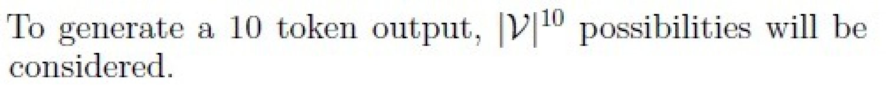

**Figure 8.** Option A exhaustive decoding search space |V|^10 possibilities for 10-token output

*Source option ID:* `6406533822528`

**B.**

To generate a 10 token output, $|V|^{12}$ possibilities will be considered.

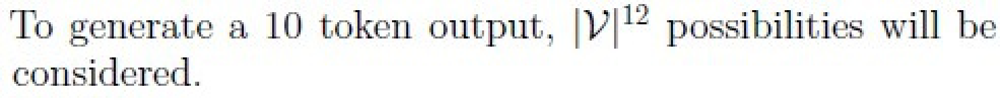

**Figure 9.** Option B exhaustive decoding search space |V|^12 possibilities for 10-token output

*Source option ID:* `6406533822529`

**C.**

It is a deterministic approach.

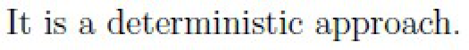

**Figure 10.** Option C exhaustive decoding is a deterministic approach

*Source option ID:* `6406533822530`

**D.**

It is a stochastic approach

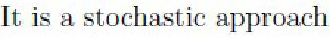

**Figure 11.** Option D exhaustive decoding is a stochastic approach

*Source option ID:* `6406533822531`

**Correct answer:** A, C

**Source evidence:** [{"page": 4, "bbox": [23.62, 381.23, 119.02, 397.55], "type": "green source option", "detail": "Option 6406533822528 marked with green color 32768 in source PDF"}, {"page": 4, "bbox": [23.62, 489.13, 119.02, 505.45], "type": "green source option", "detail": "Option 6406533822530 marked with green color 32768 in source PDF"}]

### Question 110

**Question ID:** `6406531130563`

**Type:** Multiple Select Question · **Marks:** 3
**PDF pages:** 4

Which of the following decoding strategies is (are) appropriate for machine translation tasks? 
Assume we have infinite compute and the values for k ≥ 3, p > 0.35 where required.

**Options**

**A.**

Top-k sampling

*Source option ID:* `6406533822543`

**B.**

Beam search with the beam size K = 2

*Source option ID:* `6406533822544`

**C.**

Top-p sampling

*Source option ID:* `6406533822545`

**D.**

Exhaustive search

*Source option ID:* `6406533822546`

**E.**

None of these

*Source option ID:* `6406533822547`

**Correct answer:** B, D

**Source evidence:** [{"page": 4, "bbox": [23.62, 727.69, 119.02, 744.01], "type": "green source option", "detail": "Option 6406533822544 marked with green color 32768 in source PDF"}, {"page": 4, "bbox": [23.62, 769.34, 119.02, 785.66], "type": "green source option", "detail": "Option 6406533822546 marked with green color 32768 in source PDF"}]

### Shared context 111-113

**Question ID:** `6406531130564`

**Type:** Comprehension
**PDF pages:** 5

Consider the following configuration for the Vanilla transformer architecture with one encoder layer and one decoder layer.

- Source vocabulary size = 100
- Target vocabulary size = 200
- maximum sequence length = 32
- length of context window ($T$) for both encoder and decoder = 32
- number of heads $n_h = 4$
- $d_{ff} = 4 * d_{model}$
- $d_q = d_k = d_v = \frac{d_{model}}{n_h}$

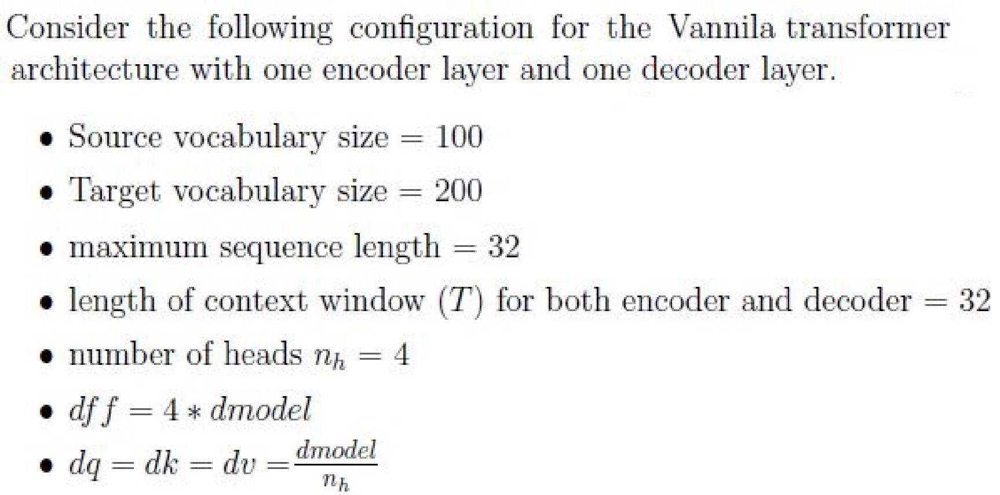

**Figure 12.** Vanilla transformer architecture configuration specifications for vocabulary, sequence length, context window, heads, and dimensions

Based on the above data, answer the given subquestions.

### Question 111

**Question ID:** `6406531130565`

**Portal container ID:** `6406531130564`

**Type:** Short Answer Question · **Marks:** 2
**PDF pages:** 5

**Shared context:** [ctx-111-113](#ctx-111-113), [ctx-103](#ctx-103)

Suppose the number of learnable parameters in the source input-embedding layer is 3200, how 
many parameters are there in the positional embedding layer of the source language?

**Correct answer:** 1024

**Source evidence:** [{"page": 5, "bbox": [22.87, 664.12, 70.36, 680.44], "type": "explicit field", "detail": "Possible Answers: 1024"}]

### Question 112

**Question ID:** `6406531130566`

**Portal container ID:** `6406531130564`

**Type:** Short Answer Question · **Marks:** 3
**PDF pages:** 5, 6

**Shared context:** [ctx-111-113](#ctx-111-113), [ctx-103](#ctx-103)

How many parameters are there in the multi-head attention layer of the encoder (exclude the 
parameters in the WO matrix used for linear transformation and FFN layer)?

**Correct answer:** 3072

**Source evidence:** [{"page": 6, "bbox": [22.87, 108.11, 70.36, 124.43], "type": "explicit field", "detail": "Possible Answers: 3072"}]

### Question 113

**Question ID:** `6406531130567`

**Portal container ID:** `6406531130564`

**Type:** Short Answer Question · **Marks:** 3
**PDF pages:** 6

**Shared context:** [ctx-111-113](#ctx-111-113), [ctx-103](#ctx-103)

How many parameters does the matrix WQ have in anyone head of the encoder?

**Correct answer:** 256

**Source evidence:** [{"page": 6, "bbox": [22.87, 324.94, 61.27, 341.26], "type": "explicit field", "detail": "Possible Answers: 256"}]

### Shared context 114-117

**Question ID:** `6406531130568`

**Type:** Comprehension
**PDF pages:** 6

Consider following input matrix to a single neural network layer:

$$X = \begin{bmatrix} 1 & 2 & 3 & 8 \\ 4 & 7 & 11 & 14 \end{bmatrix}$$

It has 4 samples with 2 features each i.e. batch size is 4. Each column represents a sample. Left most column represents the first sample and topmost row represents the first feature vector.

Note: assume $\gamma = 1$, $\beta = 0$ and $\epsilon = 10^{-5}$ for both batch and layer normalization, if not mentioned explicitly. Use standard scaling.

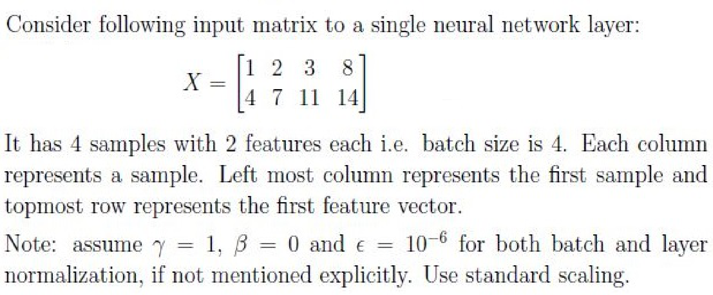

**Figure 13.** Input matrix X (4 samples with 2 features each) and normalization scaling parameter configurations

Based on the above data, answer the given subquestions.

### Question 114

**Question ID:** `6406531130569`

**Portal container ID:** `6406531130568`

**Type:** Short Answer Question · **Marks:** 1
**PDF pages:** 6, 7

**Shared context:** [ctx-114-117](#ctx-114-117), [ctx-103](#ctx-103)

Say matrix F is computed by applying batch normalization on X, what will be sum of every element 
in first / topmost row of F?

**Correct answer:** 0 to 0.01

**Source evidence:** [{"page": 7, "bbox": [22.87, 182.43, 86.82, 198.75], "type": "explicit field", "detail": "Answers Type : Range, Possible Answers : 0 to 0.01"}]

### Question 115

**Question ID:** `6406531130570`

**Portal container ID:** `6406531130568`

**Type:** Short Answer Question · **Marks:** 1
**PDF pages:** 7

**Shared context:** [ctx-114-117](#ctx-114-117), [ctx-103](#ctx-103)

Say matrix F is computed by applying layer normalization on X, what will be sum of every element 
in first / leftmost column of F?

**Correct answer:** 0 to 0.01

**Source evidence:** [{"page": 7, "bbox": [22.87, 444.24, 86.82, 460.56], "type": "explicit field", "detail": "Answers Type : Range, Possible Answers : 0 to 0.01"}]

### Question 116

**Question ID:** `6406531130571`

**Portal container ID:** `6406531130568`

**Type:** Short Answer Question · **Marks:** 2
**PDF pages:** 7

**Shared context:** [ctx-114-117](#ctx-114-117), [ctx-103](#ctx-103)

Say $\sigma_i$'s were the standard deviations used to compute batch normalization of $X$. What is $\sum_{i=1}^2 \sigma_i$?

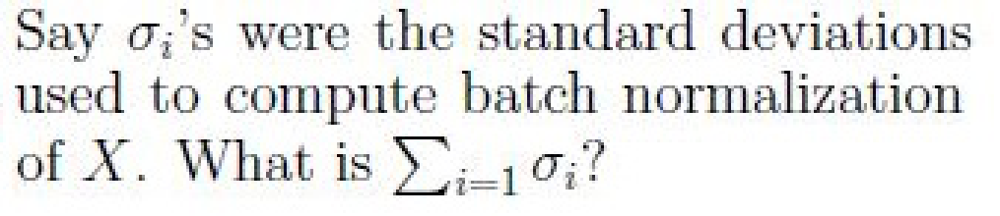

**Figure 14.** Question 116 prompt: sum of standard deviations sigma_i used to compute batch normalization of X

**Correct answer:** 10.95 to 11.05

**Source evidence:** [{"page": 7, "bbox": [22.87, 720.06, 122.38, 736.38], "type": "explicit field", "detail": "Answers Type : Range, Possible Answers : 10.95 to 11.05"}]

### Question 117

**Question ID:** `6406531130572`

**Portal container ID:** `6406531130568`

**Type:** Short Answer Question · **Marks:** 2
**PDF pages:** 7, 8

**Shared context:** [ctx-114-117](#ctx-114-117), [ctx-103](#ctx-103)

Say $\sigma_i$'s were the standard deviations used to compute layer normalization of $X$. What is $\sum_{i=1}^4 \sigma_i$?

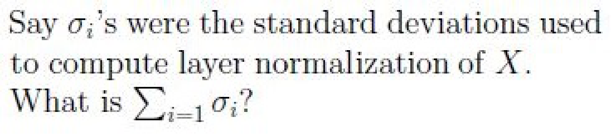

**Figure 15.** Question 117 prompt: sum of standard deviations sigma_i used to compute layer normalization of X

**Correct answer:** 6.45 to 6.55

**Source evidence:** [{"page": 8, "bbox": [22.87, 178.36, 107.0, 194.68], "type": "explicit field", "detail": "Answers Type : Range, Possible Answers : 6.45 to 6.55"}]

### Shared context 118-121

**Question ID:** `6406531130573`

**Type:** Comprehension
**PDF pages:** 8

Consider following corpus (in italics), which is used train a GPT like (i.e. decoder only) model for causal language modeling:

*Sachin Tendulkar is called God of Cricket. Sachin has broken many records. Sachin has highest number of centuries.*

*Sachin Pilgaonkar is a famous actor in Marathi cinema. Sachin has acted in, directed and produced numerous films. Sachin has broken many stereotypes.*

Assume each word in the above corpus is a token. Tokens are case insensitive i.e. “The” is same as “the”. Ignore special characters (e.g. period (.), semi colon (;), etc.)

Note: Estimate the joint probabilities using the Bayesian approach (no independence assumption) for the given corpus.

$x_i$ represents $i^{\text{th}}$ token from left to right. Tokens appear in italics.

Answer the given sub questions:

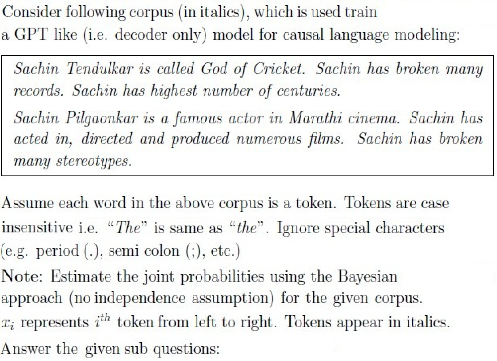

**Figure 16.** Causal language modeling training corpus text regarding Sachin Tendulkar and Sachin Pilgaonkar

### Question 118

**Question ID:** `6406531130574`

**Portal container ID:** `6406531130573`

**Type:** Short Answer Question · **Marks:** 2
**PDF pages:** 8, 9

**Shared context:** [ctx-118-121](#ctx-118-121), [ctx-103](#ctx-103)

What is the value of $10 \times P(\text{Sachin})$?

Note: $x_1 = \text{Sachin}$

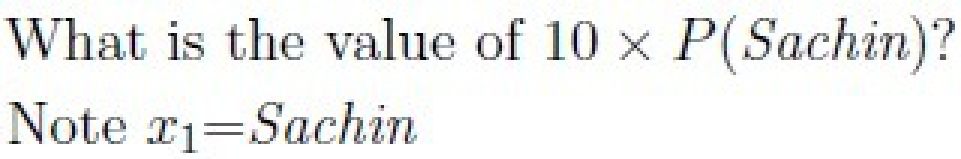

**Figure 17.** Question 118 prompt: value of 10 x P(Sachin) using Bayesian estimation on the given corpus

**Correct answer:** 1.37 to 1.47

**Source evidence:** [{"page": 9, "bbox": [22.87, 173.68, 107.0, 190.0], "type": "explicit field", "detail": "Answers Type : Range, Possible Answers : 1.37 to 1.47"}]

### Question 119

**Question ID:** `6406531130575`

**Portal container ID:** `6406531130573`

**Type:** Short Answer Question · **Marks:** 2
**PDF pages:** 9

**Shared context:** [ctx-118-121](#ctx-118-121), [ctx-103](#ctx-103)

What is the value of $100 \times P(\text{Sachin}, \text{Tendulkar})$?

Note: $x_1 = \text{Sachin}$ and $x_2 = \text{Tendulkar}$

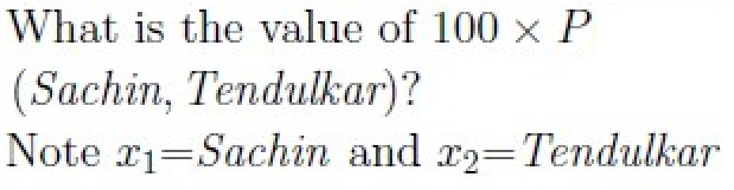

**Figure 18.** Question 119 prompt: value of 100 x P(Sachin, Tendulkar) using Bayesian estimation on the given corpus

**Correct answer:** 2.33 to 2.43

**Source evidence:** [{"page": 9, "bbox": [22.87, 454.74, 107.0, 471.06], "type": "explicit field", "detail": "Answers Type : Range, Possible Answers : 2.33 to 2.43"}]

### Question 120

**Question ID:** `6406531130576`

**Portal container ID:** `6406531130573`

**Type:** Short Answer Question · **Marks:** 3
**PDF pages:** 9

**Shared context:** [ctx-118-121](#ctx-118-121), [ctx-103](#ctx-103)

What is the value of the following expression $100 \times P(\text{Sachin}, \text{has}, \text{broken}, \text{many}, \text{records})$?

Note: $x_1 = \text{Sachin}$, $x_2 = \text{has}$, and so on.

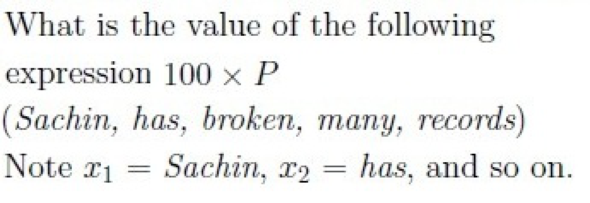

**Figure 19.** Question 120 prompt: value of 100 x P(Sachin, has, broken, many, records) using Bayesian estimation on the given corpus

**Correct answer:** 2.33 to 2.43

**Source evidence:** [{"page": 9, "bbox": [22.87, 764.88, 107.0, 781.2], "type": "explicit field", "detail": "Answers Type : Range, Possible Answers : 2.33 to 2.43"}]

### Question 121

**Question ID:** `6406531130577`

**Portal container ID:** `6406531130573`

**Type:** Multiple Choice Question · **Marks:** 2
**PDF pages:** 10

**Shared context:** [ctx-118-121](#ctx-118-121)

Once the model is sufficiently trained, which of the following tokens will have the highest 
probability to be the next token, if the input is “Sachin has”:

**Options**

**A.**

broken

*Source option ID:* `6406533822558`

**B.**

acted

*Source option ID:* `6406533822559`

**C.**

highest

*Source option ID:* `6406533822560`

**D.**

None of these

*Source option ID:* `6406533822561`

**Correct answer:** A

**Source evidence:** [{"page": 10, "bbox": [23.62, 130.45, 119.02, 146.77], "type": "green source option", "detail": "Option 6406533822558 marked with green color 32768 in source PDF"}]

## Answer key

| Source question | Source identity | Correct answer | PDF pages |
| :--- | :--- | :--- | :--- |
| 104 | 6406531130557 | D | 2 |
| 105 | 6406531130558 | D | 2, 3 |
| 106 | 6406531130560 | C | 3 |
| 107 | 6406531130561 | A | 3 |
| 108 | 6406531130562 | A, D | 3, 4 |
| 109 | 6406531130559 | A, C | 4 |
| 110 | 6406531130563 | B, D | 4 |
| 111 | 6406531130565 | 1024 | 5 |
| 112 | 6406531130566 | 3072 | 5, 6 |
| 113 | 6406531130567 | 256 | 6 |
| 114 | 6406531130569 | 0 to 0.01 | 6, 7 |
| 115 | 6406531130570 | 0 to 0.01 | 7 |
| 116 | 6406531130571 | 10.95 to 11.05 | 7 |
| 117 | 6406531130572 | 6.45 to 6.55 | 7, 8 |
| 118 | 6406531130574 | 1.37 to 1.47 | 8, 9 |
| 119 | 6406531130575 | 2.33 to 2.43 | 9 |
| 120 | 6406531130576 | 2.33 to 2.43 | 9 |
| 121 | 6406531130577 | A | 10 |

## Extraction notes

**Status:** verified-source-limitation
**Count reconciliation:** The portal declared 12 questions and 40 marks for Section 7 (LLM). The 40 marks reconcile exactly across the 18 academic questions: Q104 (2) + Q105 (2) + Q106 (3) + Q107 (2) + Q108 (2) + Q109 (3) + Q110 (3) + Comprehension 111-113 subquestions Q111 (2) + Q112 (3) + Q113 (3) + Comprehension 114-117 subquestions Q114 (1) + Q115 (1) + Q116 (2) + Q117 (2) + Comprehension 118-121 subquestions Q118 (2) + Q119 (2) + Q120 (3) + Q121 (2) = 40 marks. The source PDF contains 8 portal sub-sections, 1 administrative confirmation entry (Q102, 0 marks), 1 shared-context calculation note entry (ctx-103, 0 marks), 3 comprehension passages (ctx-111-113, ctx-114-117, ctx-118-121), and 18 academic questions (Q104-Q121). The declared count of 12 questions in the portal header corresponds to the 12 top-level portal question items (Q102, Q103, Q104, Q105, Q106, Q107, Q108, Q109, Q110, plus 3 comprehension containers); when counting the 18 individual academic questions (excluding administrative items Q102 and Q103), this represents a known portal container aggregation pattern and is preserved as a verified source limitation.

- Questions 104, 109, 116, 117, 118, 119, 120 and comprehension passages contain raster-rendered mathematical expressions; high-resolution 288 DPI crops are retained and transcribed with mathematical fidelity.
- Portal declared count of 12 questions differs from observed count of 18 academic questions; this reflects portal container grouping where 3 multi-question comprehension passages enclose 11 subquestions.

**Excluded source entries:**

- {"classification": "preceding-subject-options", "page": 1, "bbox": [23.62, 17.5, 384.94, 53.14], "reason": "Out-of-scope options 6406533822514 and 6406533822515 ('I have written answers on the answer sheets', 'Not applicable') belonging to preceding subject section prior to LLM Section 7 start", "identity": "Preceding section options"}
- {"classification": "subject-confirmation", "page": 1, "bbox": [22.87, 512.16, 569.03, 798.88], "reason": "Administrative subject confirmation asking candidate to confirm subject and cross check hall ticket", "identity": "102"}
- {"classification": "administrative-acknowledgment-options", "page": 2, "bbox": [23.62, 140.0, 510.0, 220.0], "reason": "Administrative acknowledgment options (Instructions has been mentioned above / This Instructions is just for a reference & not for an evaluation) excluded semantically while preserving General Note calculation instructions as shared context", "identity": "103"}
- {"classification": "following-subject-heading", "page": 10, "bbox": [20.62, 234.61, 595.3, 841.9], "reason": "Out-of-scope heading and confirmation question 122 for subsequent Section 8: i-NLP (Section Id 64065379955)", "identity": "Section 8"}
