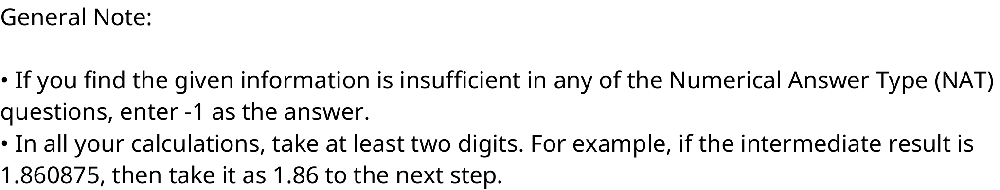
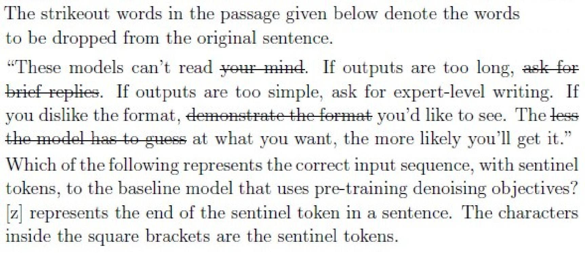
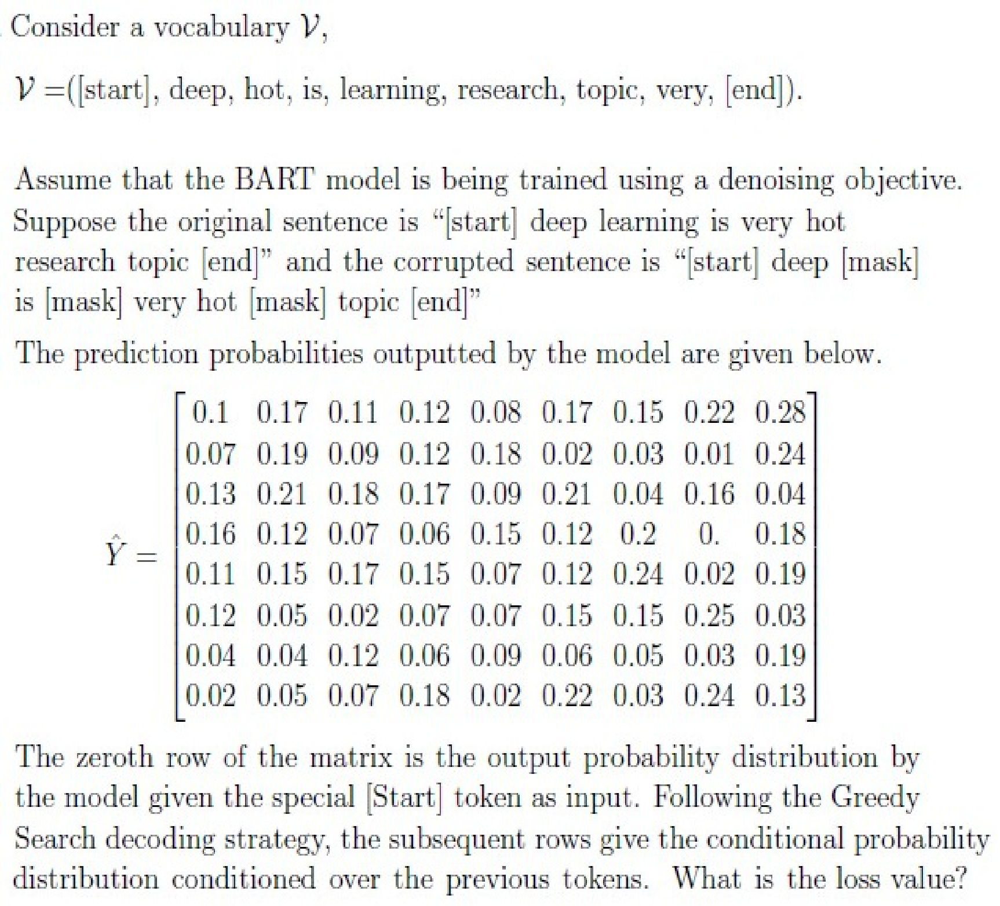
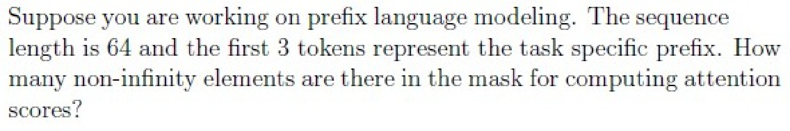
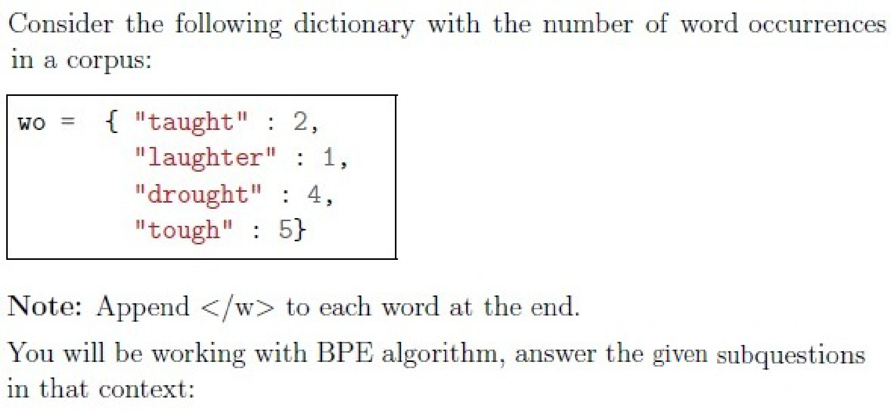
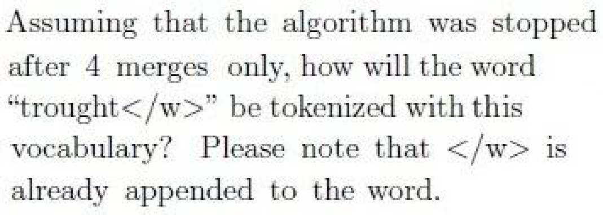

# LLM — da5004_2025T1_Q2_NA

**Source:** `da5004_2025T1_Q2_NA.pdf` · **Academic questions:** 18 · **Separately counted children:** 0
**Provenance:** `Large_Language_Models/da5004_2025T1_Q2_NA.pdf` · SHA-256 `43f88e07631991df1fab6f795f58ea1416e62a8b91afc31bee6a3bff2e2a2471`

**Scope:** Section 7 LLM (Large Language Models), Section Id 64065382586, pages 1 to 10. Prior exam material on page 1 (preceding subject section terminal options) and succeeding exam section on page 10 (Section 8 i-NLP) excluded. Administrative subject confirmation (Q117) excluded semantically.

## Questions

### Shared context 118

<a id="ctx-118"></a>

**Question ID:** `6406531172695`

**Type:** General Note
**PDF pages:** 1, 2

General Note:

• If you find the given information is insufficient in any of the Numerical Answer Type (NAT) questions, enter -1 as the answer.
• In all your calculations, take at least two digits. For example, if the intermediate result is 1.860875, then take it as 1.86 to the next step.



**Figure 1.** Question 118 General Note calculation instructions and NAT insufficiency guidelines

### Question 119

<a id="q119"></a>

**Question ID:** `6406531172696`

**Type:** MCQ · **Marks:** 2
**PDF pages:** 2

**Shared context:** [ctx-118](#ctx-118)

Consider following assertion and reason pair:

Assertion: A small vocabulary is desirable, as it reduces the size of the embedding matrix.
Reason: Decreasing the size of the vocabulary increases the number of tokens in the input.

**Options**

**A.**

Assertion and Reason are both true and Reason is a correct explanation of Assertion.

*Source option ID:* `6406533952673`

*Label added for presentation.*

**B.**

Assertion and Reason are both true and Reason is not a correct explanation of Assertion.

*Source option ID:* `6406533952674`

*Label added for presentation.*

**C.**

Assertion is true but Reason is false.

*Source option ID:* `6406533952675`

*Label added for presentation.*

**D.**

Assertion is false but Reason is true.

*Source option ID:* `6406533952676`

*Label added for presentation.*

**Correct answer:** Assertion is false but Reason is true.

**Source evidence:** [{"page": 2, "bbox": [23.62, 521.14, 119.02, 537.46], "type": "green source option", "detail": "Green marked option 6406533952676 (D)"}]

### Question 120

<a id="q120"></a>

**Question ID:** `6406531172698`

**Type:** MCQ · **Marks:** 2
**PDF pages:** 2

**Shared context:** [ctx-118](#ctx-118)

Consider following statement and mark if it is true or false:

Repeating examples in the pre-training datasets are completely harmless for downstream performance.

**Options**

**A.**

TRUE

*Source option ID:* `6406533952680`

*Label added for presentation.*

**B.**

FALSE

*Source option ID:* `6406533952681`

*Label added for presentation.*

**Correct answer:** FALSE

**Source evidence:** [{"page": 2, "bbox": [23.62, 732.16, 119.02, 748.48], "type": "green source option", "detail": "Green marked option 6406533952681 (B)"}]

### Question 121

<a id="q121"></a>

**Question ID:** `6406531172697`

**Type:** MCQ · **Marks:** 3
**PDF pages:** 3

**Shared context:** [ctx-118](#ctx-118)

What is the order of the language modeling pipeline?

**Options**

**A.**

First, the model, which handles text and returns raw predictions. The tokenizer then makes sense of these predictions and converts them back to text when needed.

*Source option ID:* `6406533952677`

*Label added for presentation.*

**B.**

First, the tokenizer, which handles text and returns IDs. The model handles these IDs and outputs a prediction, which can be some text.

*Source option ID:* `6406533952678`

*Label added for presentation.*

**C.**

The tokenizer handles text and returns IDs. The model handles these IDs and outputs a prediction. The tokenizer can then be used once again to convert these predictions back to some text.

*Source option ID:* `6406533952679`

*Label added for presentation.*

**Correct answer:** The tokenizer handles text and returns IDs. The model handles these IDs and outputs a prediction. The tokenizer can then be used once again to convert these predictions back to some text.

**Source evidence:** [{"page": 3, "bbox": [23.62, 207.7, 119.02, 224.02], "type": "green source option", "detail": "Green marked option 6406533952679 (C)"}]

### Question 122

<a id="q122"></a>

**Question ID:** `6406531172699`

**Type:** MSQ · **Marks:** 3
**PDF pages:** 3

**Shared context:** [ctx-118](#ctx-118)

Consider fine-tuning the T5 model on a sentiment classification task. The T5 model was pre-
trained using the C4 dataset. Suppose, in the original dataset, the positive samples are denoted by 
integer 2, neutral samples are denoted by integer 1 and the negative samples are denoted by 
integer 0. Choose the necessary modifications that one needs to perform to use the T5 model for 
fine-tuning:

**Options**

**A.**

Map the label 0 to “negative” and 1 to “positive” in the dataset

*Source option ID:* `6406533952682`

*Label added for presentation.*

**B.**

Map the label 0 to “negative”, 1 to “neutral” and 2 to “positive” in the dataset

*Source option ID:* `6406533952683`

*Label added for presentation.*

**C.**

Map the label 0 to “0”, 1 to “1” and 2 to “2” in the dataset

*Source option ID:* `6406533952684`

*Label added for presentation.*

**D.**

Update the vocabulary of T5 with the modified labels

*Source option ID:* `6406533952685`

*Label added for presentation.*

**E.**

Add at least one linear layer on top of the decoder for final classification

*Source option ID:* `6406533952686`

*Label added for presentation.*

**F.**

None of these.

*Source option ID:* `6406533952687`

*Label added for presentation.*

**Correct answer:** Map the label 0 to “negative”, 1 to “neutral” and 2 to “positive” in the dataset; Map the label 0 to “0”, 1 to “1” and 2 to “2” in the dataset

**Source evidence:** [{"page": 3, "bbox": [23.62, 525.64, 119.02, 541.96], "type": "green source option", "detail": "Green marked option 6406533952683 (B)"}, {"page": 3, "bbox": [23.62, 546.46, 119.02, 562.78], "type": "green source option", "detail": "Green marked option 6406533952684 (C)"}]

### Question 123

<a id="q123"></a>

**Question ID:** `6406531172700`

**Type:** MSQ · **Marks:** 3
**PDF pages:** 3, 4

**Shared context:** [ctx-118](#ctx-118)

The strikeout words in the passage given below denote the words to be dropped from the original sentence.

“These models can’t read ~~your mind~~. If outputs are too long, ~~ask for brief replies~~. If outputs are too simple, ask for expert-level writing. If you dislike the format, ~~demonstrate the format~~ you'd like to see. The ~~less the model has to guess~~ at what you want, the more likely you'll get it.”

Which of the following represents the correct input sequence, with sentinel tokens, to the baseline model that uses pre-training denoising objectives? '[z]' represents the end of the sentinel token in a sentence. The characters inside the square brackets are the sentinel tokens.



**Figure 2.** Question 123 prompt: passage with strikeout words indicating dropped tokens and sentinel token placement question

**Options**

**A.**

[a] your mind [b] ask for brief replies [c] demonstrate the format [d] less the model has to guess [e]

*Source option ID:* `6406533952688`

*Label added for presentation.*

**B.**

[a] your mind [b] ask for brief replies [c] demonstrate the format [d] less the model has to guess

*Source option ID:* `6406533952689`

*Label added for presentation.*

**C.**

[v] your mind [w] ask for brief replies [x] demonstrate the format [y] less the model has to guess

*Source option ID:* `6406533952690`

*Label added for presentation.*

**D.**

[v] your mind [w] ask for brief replies [x] demonstrate the format [y] less the model has to guess [z]

*Source option ID:* `6406533952691`

*Label added for presentation.*

**E.**

[a] your mind [b] demonstrate the format [c] ask for brief replies [d] less the model has to guess

*Source option ID:* `6406533952692`

*Label added for presentation.*

**F.**

None of these

*Source option ID:* `6406533952693`

*Label added for presentation.*

**Correct answer:** [a] your mind [b] ask for brief replies [c] demonstrate the format [d] less the model has to guess; [v] your mind [w] ask for brief replies [x] demonstrate the format [y] less the model has to guess

**Source evidence:** [{"page": 4, "bbox": [23.62, 267.21, 119.02, 283.53], "type": "green source option", "detail": "Green marked option 6406533952689 (B)"}, {"page": 4, "bbox": [23.62, 304.35, 119.02, 320.67], "type": "green source option", "detail": "Green marked option 6406533952690 (C)"}]

### Question 124

<a id="q124"></a>

**Question ID:** `6406531172701`

**Type:** MSQ · **Marks:** 3
**PDF pages:** 4

**Shared context:** [ctx-118](#ctx-118)

Suppose the T5 base model has to be fine tuned with gradual unfreezing. First layer of the 
encoder takes the input in appropriate format. Gradual unfreezing is divided in 12 (i.e. no. of 
layers) phases.  
 
Choose the correct statements:

**Options**

**A.**

In the first phase, weights of only the last layer of encoder and decoder (both) are unfrozen.

*Source option ID:* `6406533952694`

*Label added for presentation.*

**B.**

In the first phase, weights of only the last layer of decoder only are unfrozen.

*Source option ID:* `6406533952695`

*Label added for presentation.*

**C.**

In the first phase, weights of only the last layer of encoder only are unfrozen.

*Source option ID:* `6406533952696`

*Label added for presentation.*

**D.**

In the second phase, weights of only the second last layer of encoder and decoder (both) are unfrozen.

*Source option ID:* `6406533952697`

*Label added for presentation.*

**E.**

In the second phase, weights of the last two layers of encoder and decoder (both) are unfrozen.

*Source option ID:* `6406533952698`

*Label added for presentation.*

**F.**

In the first phase, weights of only the first layer of encoder and decoder (both) are unfrozen.

*Source option ID:* `6406533952699`

*Label added for presentation.*

**Correct answer:** In the first phase, weights of only the last layer of encoder and decoder (both) are unfrozen.; In the second phase, weights of only the second last layer of encoder and decoder (both) are unfrozen.

**Source evidence:** [{"page": 4, "bbox": [23.62, 622.29, 119.02, 638.61], "type": "green source option", "detail": "Green marked option 6406533952694 (A)"}, {"page": 4, "bbox": [23.62, 701.07, 119.02, 717.39], "type": "green source option", "detail": "Green marked option 6406533952697 (D)"}]

### Question 125

<a id="q125"></a>

**Question ID:** `6406531172702`

**Type:** MSQ · **Marks:** 3
**PDF pages:** 5

**Shared context:** [ctx-118](#ctx-118)

Which of the following models uses a form of denoising objective for pre-training?

**Options**

**A.**

BERT

*Source option ID:* `6406533952700`

*Label added for presentation.*

**B.**

GPT 3

*Source option ID:* `6406533952701`

*Label added for presentation.*

**C.**

BART

*Source option ID:* `6406533952702`

*Label added for presentation.*

**D.**

T5

*Source option ID:* `6406533952703`

*Label added for presentation.*

**Correct answer:** BERT; BART; T5

**Source evidence:** [{"page": 5, "bbox": [23.62, 133.42, 119.02, 149.74], "type": "green source option", "detail": "Green marked option 6406533952700 (A)"}, {"page": 5, "bbox": [23.62, 175.06, 119.02, 191.38], "type": "green source option", "detail": "Green marked option 6406533952702 (C)"}, {"page": 5, "bbox": [23.62, 195.88, 119.02, 212.2], "type": "green source option", "detail": "Green marked option 6406533952703 (D)"}]

### Question 126

<a id="q126"></a>

**Question ID:** `6406531172703`

**Type:** MSQ · **Marks:** 3
**PDF pages:** 5, 6

**Shared context:** [ctx-118](#ctx-118)

Consider the C4 pipeline. Which of the following will NOT pass through it as it is?

**Options**

**A.**

el aprendizaje automatico es genial.
(Above sentence is Spanish translation of “Machine learning is great” )

*Source option ID:* `6406533952704`

*Label added for presentation.*

**B.**

Following function prints each key-value pair from a dictionary:
# printing using For Loop
for key, value in input_dict.items():
    print(f"{key}: {value}")

*Source option ID:* `6406533952705`

*Label added for presentation.*

**C.**

Lorem ipsum dolor sit amet...

*Source option ID:* `6406533952706`

*Label added for presentation.*

**D.**

Please enable JavaScript to use our site.
Home
Products
Shipping
Contact
FAQ

*Source option ID:* `6406533952707`

*Label added for presentation.*

**E.**

Cricket is a very popular sport in India. Cricket is a very popular sport in India.

*Source option ID:* `6406533952708`

*Label added for presentation.*

**F.**

US tariffs will have negative economic consequences globally, some economists say.

*Source option ID:* `6406533952709`

*Label added for presentation.*

**G.**

None of these.

*Source option ID:* `6406533952710`

*Label added for presentation.*

**Correct answer:** el aprendizaje automatico es genial.
(Above sentence is Spanish translation of “Machine learning is great” ); Following function prints each key-value pair from a dictionary:
# printing using For Loop
for key, value in input_dict.items():
    print(f"{key}: {value}"); Lorem ipsum dolor sit amet...; Please enable JavaScript to use our site.
Home
Products
Shipping
Contact
FAQ; Cricket is a very popular sport in India. Cricket is a very popular sport in India.

**Source evidence:** [{"page": 5, "bbox": [23.62, 385.05, 119.02, 401.37], "type": "green source option", "detail": "Green marked option 6406533952704 (A)"}, {"page": 5, "bbox": [23.62, 490.37, 119.02, 506.69], "type": "green source option", "detail": "Green marked option 6406533952705 (B)"}, {"page": 5, "bbox": [23.62, 534.2, 119.02, 550.52], "type": "green source option", "detail": "Green marked option 6406533952706 (C)"}, {"page": 5, "bbox": [23.62, 681.52, 119.02, 697.84], "type": "green source option", "detail": "Green marked option 6406533952707 (D)"}, {"page": 5, "bbox": [23.62, 741.85, 119.02, 758.17], "type": "green source option", "detail": "Green marked option 6406533952708 (E)"}]

### Question 127

<a id="q127"></a>

**Question ID:** `6406531172704`

**Type:** MSQ · **Marks:** 3
**PDF pages:** 6

**Shared context:** [ctx-118](#ctx-118)

Which of the following are correct about GPT-3 model with 175B parameters:

**Options**

**A.**

It is an encoder-decoder only model.

*Source option ID:* `6406533952711`

*Label added for presentation.*

**B.**

It uses absolute postional encoding.

*Source option ID:* `6406533952712`

*Label added for presentation.*

**C.**

It uses a composite dataset for pre-training.

*Source option ID:* `6406533952713`

*Label added for presentation.*

**D.**

None of these.

*Source option ID:* `6406533952714`

*Label added for presentation.*

**Correct answer:** It uses absolute postional encoding.; It uses a composite dataset for pre-training.

**Source evidence:** [{"page": 6, "bbox": [23.62, 223.38, 119.02, 239.7], "type": "green source option", "detail": "Green marked option 6406533952712 (B)"}, {"page": 6, "bbox": [23.62, 244.2, 119.02, 260.52], "type": "green source option", "detail": "Green marked option 6406533952713 (C)"}]

### Question 128

<a id="q128"></a>

**Question ID:** `6406531172705`

**Type:** SA · **Marks:** 4
**PDF pages:** 6, 7

**Shared context:** [ctx-118](#ctx-118)

Consider a vocabulary $V$,

$V = (\text{[start]}, \text{deep}, \text{hot}, \text{is}, \text{learning}, \text{research}, \text{topic}, \text{very}, \text{[end]})$

Assume that the BART model is being trained using a denoising objective. Suppose the original sentence is “[start] deep learning is very hot research topic [end]” and the corrupted sentence is “[start] deep [mask] is [mask] very hot [mask] topic [end]”.

The prediction probabilities outputted by the model are given below.

$$\begin{matrix} 0.1 & 0.17 & 0.11 & 0.12 & 0.08 & 0.17 & 0.15 & 0.22 & 0.28 \\ 0.07 & 0.19 & 0.09 & 0.12 & 0.18 & 0.02 & 0.03 & 0.01 & 0.24 \\ 0.13 & 0.21 & 0.18 & 0.17 & 0.09 & 0.21 & 0.04 & 0.16 & 0.04 \\ 0.16 & 0.12 & 0.07 & 0.06 & 0.15 & 0.12 & 0.2 & 0. & 0.18 \\ 0.11 & 0.15 & 0.17 & 0.15 & 0.07 & 0.12 & 0.24 & 0.02 & 0.19 \\ 0.12 & 0.05 & 0.02 & 0.07 & 0.07 & 0.15 & 0.15 & 0.25 & 0.03 \\ 0.04 & 0.04 & 0.12 & 0.06 & 0.09 & 0.06 & 0.05 & 0.03 & 0.19 \\ 0.02 & 0.05 & 0.07 & 0.18 & 0.02 & 0.22 & 0.03 & 0.24 & 0.13 \end{matrix}$$

The zeroth row of the matrix is the output probability distribution by the model given the special [start] token as input. Following the Greedy Search decoding strategy, the subsequent rows give the conditional probability distribution conditioned over the previous tokens. What is the loss value?



**Figure 3.** Question 128 prompt: BART model denoising objective vocabulary, corrupted sentence, and 8x9 prediction probability matrix

**Correct answer:** 1.90 to 2.0

**Source evidence:** [{"page": 7, "bbox": [22.87, 132.67, 88.66, 151.03], "type": "explicit field", "detail": "Possible Answers: 1.90 to 2.0"}]

### Question 129

<a id="q129"></a>

**Question ID:** `6406531172706`

**Type:** SA · **Marks:** 3
**PDF pages:** 7

**Shared context:** [ctx-118](#ctx-118)

Suppose you are working on prefix language modeling. The sequence length is 64 and the first 3 tokens represent the task specific prefix. How many non-infinity elements are there in the mask for computing attention scores?



**Figure 4.** Question 129 prompt: prefix language modeling sequence length and non-infinity elements in attention mask

**Correct answer:** 2115

**Source evidence:** [{"page": 7, "bbox": [22.87, 488.19, 53.7, 506.55], "type": "explicit field", "detail": "Possible Answers: 2115"}]

### Shared context 130-136

<a id="ctx-130-136"></a>

**Question ID:** `6406531172707`

**Type:** Comprehension
**PDF pages:** 7, 8

**Shared context:** [ctx-118](#ctx-118)

Consider the following dictionary with the number of word occurrences in a corpus:

```python
wo = {
    "taught": 2,
    "laughter": 1,
    "drought": 4,
    "tough": 5
}
```

Note: Append `</w>` to each word at the end. You will have to do BPE merges on this dictionary to answer the following questions.



**Figure 5.** Byte Pair Encoding (BPE) corpus dictionary of word occurrences and initial tokenization rules

### Question 130

<a id="q130"></a>

**Question ID:** `6406531172708`

**Type:** SA · **Marks:** 2
**PDF pages:** 8

**Shared context:** [ctx-118](#ctx-118), [ctx-130-136](#ctx-130-136)

How many tokens are there in the initial vocabulary?

**Correct answer:** 11

**Source evidence:** [{"page": 8, "bbox": [22.87, 266.97, 36.31, 285.33], "type": "explicit field", "detail": "Possible Answers: 11"}]

### Question 131

<a id="q131"></a>

**Question ID:** `6406531172709`

**Type:** MCQ · **Marks:** 3
**PDF pages:** 8

**Shared context:** [ctx-118](#ctx-118), [ctx-130-136](#ctx-130-136)

Which of the following pairs has the highest frequency before any merge?

**Options**

**A.**

(‘u’, ‘g’)

*Source option ID:* `6406533952718`

*Label added for presentation.*

**B.**

(‘a’, ‘u’)

*Source option ID:* `6406533952719`

*Label added for presentation.*

**C.**

(‘g’, ‘h’)

*Source option ID:* `6406533952720`

*Label added for presentation.*

**D.**

(‘h’, ‘t’)

*Source option ID:* `6406533952721`

*Label added for presentation.*

**E.**

(‘w’, ‘e’)

*Source option ID:* `6406533952722`

*Label added for presentation.*

**F.**

None of these.

*Source option ID:* `6406533952723`

*Label added for presentation.*

**Correct answer:** (‘u’, ‘g’)

**Source evidence:** [{"page": 8, "bbox": [23.62, 593.37, 119.02, 609.69], "type": "green source option", "detail": "Green marked option 6406533952718 (A)"}]

### Question 132

<a id="q132"></a>

**Question ID:** `6406531172710`

**Type:** SA · **Marks:** 2
**PDF pages:** 8, 9

**Shared context:** [ctx-118](#ctx-118), [ctx-130-136](#ctx-130-136)

What is the frequency of the pair merged in the very first merge?

**Correct answer:** 12

**Source evidence:** [{"page": 9, "bbox": [22.87, 132.67, 36.31, 151.03], "type": "explicit field", "detail": "Possible Answers: 12"}]

### Question 133

<a id="q133"></a>

**Question ID:** `6406531172711`

**Type:** SA · **Marks:** 3
**PDF pages:** 9

**Shared context:** [ctx-118](#ctx-118), [ctx-130-136](#ctx-130-136)

What is the minimum number of merges, after which there is a token with exactly 3 English 
letters?

**Correct answer:** 2

**Source evidence:** [{"page": 9, "bbox": [22.87, 452.19, 29.59, 470.55], "type": "explicit field", "detail": "Possible Answers: 2"}]

### Question 134

<a id="q134"></a>

**Question ID:** `6406531172712`

**Type:** SA · **Marks:** 3
**PDF pages:** 9

**Shared context:** [ctx-118](#ctx-118), [ctx-130-136](#ctx-130-136)

Which pair will be merged in the third merge? Say the pair is (‘ab’,‘c’), then enter “abc” (without 
quotes and white spaces). If there is a tie between two or more candidates, pick the one that 
occurs first in the original vocabulary. 
 
NOTE: Enter the exact answer without any extra space in the beginning or at the end.

**Correct answer:** ough

**Source evidence:** [{"page": 9, "bbox": [22.87, 727.47, 54.78, 745.83], "type": "explicit field", "detail": "Possible Answers: ough"}]

### Question 135

<a id="q135"></a>

**Question ID:** `6406531172713`

**Type:** SA · **Marks:** 2
**PDF pages:** 9, 10

**Shared context:** [ctx-118](#ctx-118), [ctx-130-136](#ctx-130-136)

Assume that the process is stopped after 4 merges. How many tokens from the initial vocabulary 

will have their frequency revised/reduced to 0?

**Correct answer:** 6

**Source evidence:** [{"page": 10, "bbox": [22.87, 132.67, 29.59, 151.03], "type": "explicit field", "detail": "Possible Answers: 6"}]

### Question 136

<a id="q136"></a>

**Question ID:** `6406531172714`

**Type:** MCQ · **Marks:** 3
**PDF pages:** 10

**Shared context:** [ctx-118](#ctx-118), [ctx-130-136](#ctx-130-136)

Assuming that the algorithm was stopped after 4 merges only, how will the word “trought</w>” be tokenized with this vocabulary? Please note that </w> is already appended to the word.



**Figure 6.** Question 136 prompt: tokenization of word trought</w> after 4 merges

**Options**

**A.**

t, r, ough, t</w>

*Source option ID:* `6406533952728`

*Label added for presentation.*

**B.**

tr, ough, t</w>

*Source option ID:* `6406533952729`

*Label added for presentation.*

**C.**

t, r, ou, gh, t</w>

*Source option ID:* `6406533952730`

*Label added for presentation.*

**D.**

t, r, ough, t, </w>

*Source option ID:* `6406533952731`

*Label added for presentation.*

**E.**

tr, ough, t, </w>

*Source option ID:* `6406533952732`

*Label added for presentation.*

**F.**

None of these

*Source option ID:* `6406533952733`

*Label added for presentation.*

**Correct answer:** t, r, ough, t</w>

**Source evidence:** [{"page": 10, "bbox": [23.62, 380.63, 119.02, 396.95], "type": "green source option", "detail": "Green marked option 6406533952728 (A)"}]

## Answer key

| Source question | Source identity | Correct answer | PDF pages |
| :--- | :--- | :--- | :--- |
| 119 | 6406531172696 | Assertion is false but Reason is true. | 2 |
| 120 | 6406531172698 | FALSE | 2 |
| 121 | 6406531172697 | The tokenizer handles text and returns IDs. The model handles these IDs and outputs a prediction. The tokenizer can then be used once again to convert these predictions back to some text. | 3 |
| 122 | 6406531172699 | Map the label 0 to “negative”, 1 to “neutral” and 2 to “positive” in the dataset; Map the label 0 to “0”, 1 to “1” and 2 to “2” in the dataset | 3 |
| 123 | 6406531172700 | [a] your mind [b] ask for brief replies [c] demonstrate the format [d] less the model has to guess; [v] your mind [w] ask for brief replies [x] demonstrate the format [y] less the model has to guess | 3, 4 |
| 124 | 6406531172701 | In the first phase, weights of only the last layer of encoder and decoder (both) are unfrozen.; In the second phase, weights of only the second last layer of encoder and decoder (both) are unfrozen. | 4 |
| 125 | 6406531172702 | BERT; BART; T5 | 5 |
| 126 | 6406531172703 | el aprendizaje automatico es genial. (Above sentence is Spanish translation of “Machine learning is great” ); Following function prints each key-value pair from a dictionary: # printing using For Loop for key, value in input_dict.items():     print(f"{key}: {value}"); Lorem ipsum dolor sit amet...; Please enable JavaScript to use our site. Home Products Shipping Contact FAQ; Cricket is a very popular sport in India. Cricket is a very popular sport in India. | 5, 6 |
| 127 | 6406531172704 | It uses absolute postional encoding.; It uses a composite dataset for pre-training. | 6 |
| 128 | 6406531172705 | 1.90 to 2.0 | 6, 7 |
| 129 | 6406531172706 | 2115 | 7 |
| 130 | 6406531172708 | 11 | 8 |
| 131 | 6406531172709 | (‘u’, ‘g’) | 8 |
| 132 | 6406531172710 | 12 | 8, 9 |
| 133 | 6406531172711 | 2 | 9 |
| 134 | 6406531172712 | ough | 9 |
| 135 | 6406531172713 | 6 | 9, 10 |
| 136 | 6406531172714 | t, r, ough, t</w> | 10 |

## Extraction notes

**Status:** verified
**Count reconciliation:** The portal header declares 14 questions and 50 marks for Section 7 (LLM). The 50 marks reconcile exactly across the 18 academic questions: Q119 (2) + Q120 (2) + Q121 (3) + Q122 (3) + Q123 (3) + Q124 (3) + Q125 (3) + Q126 (3) + Q127 (3) + Q128 (4) + Q129 (3) + Comprehension subquestions Q130 (2) + Q131 (3) + Q132 (2) + Q133 (3) + Q134 (3) + Q135 (2) + Q136 (3) = 50 marks. The source PDF contains 1 administrative confirmation entry (Q117, 0 marks, excluded semantically), 1 shared-context calculation general note (Q118, 0 marks, preserved as ctx-118 with acknowledgment options excluded), 11 standalone academic questions (Q119-Q129), and 1 comprehension container (Question Numbers: 130 to 136, Question Id: 6406531172707) containing 7 academic questions (Q130-Q136). The declared count of 14 items in the portal header corresponds to 1 confirmation + 1 general note + 11 standalone questions + 1 comprehension container = 14 items. The observed academic question count is 18.

- Question 118 general calculation note preserved as shared-context entry ctx-118 with administrative acknowledgment choices excluded.
- Questions 130 to 136 are comprehension subquestions associated with shared-context passage ctx-130-136.
- Questions 123, 128, 129, ctx-130-136, and 136 retain source crops at 288 DPI to preserve strikethrough styling, mathematical matrix notation, layout formulas, and raster text.

**Excluded source entries:**

- {"classification": "preceding-subject-options", "page": 1, "bbox": [23.62, 17.5, 400.0, 54.64], "reason": "Terminal options from preceding exam section (Section 6) appearing before Section 7 LLM heading", "identity": "6406533952667, 6406533952668"}
- {"classification": "subject-confirmation", "page": 1, "bbox": [22.87, 638.93, 540.96, 761.14], "reason": "Administrative subject confirmation question verifying registration and hall ticket details with YES/NO options, excluded semantically per extraction contract", "identity": "6406531172694"}
- {"classification": "succeeding-subject-header", "page": 10, "bbox": [22.87, 660.0, 450.0, 820.0], "reason": "Header and metadata for subsequent subject Section 8 i-NLP (Section Id 64065382587)", "identity": "64065382587"}
