# LLM — da5004_2025T2_ET_AN

**Source:** `da5004_2025T2_ET_AN.pdf` · **Academic questions:** 17 · **Separately counted children:** 0
**Provenance:** `Large_Language_Models/da5004_2025T2_ET_AN.pdf` · SHA-256 `ebfbbeca42f9982db555b144a29fab8641c6557f65bf498714e879a0c7f2cf00`

**Scope:** LLM (Degree Level : Large Language Models (Computer Based Exam)), Section 9, physical pages 1 to 12. Exam content begins on page 1 with Section 9 header (Section Id 64065399890) and Question 191 on page 2, and terminates on page 12 following Question 208 prior to Section 10 DLP.

## Questions

### Question 192

**Question ID:** `6406531425134`

**Type:** Multiple Choice Question · **Marks:** 3
**PDF pages:** 2, 3

Given the input string:
sunshine

And the following vocabulary of subword tokens with their corresponding log-probabilities:

| Subword | Log-Probability (base e) |
| :--- | :--- |
| sun | -0.5 |
| shine | -0.7 |
| sunshine | -1.6 |
| su | -0.3 |
| nshine | -0.4 |
| n | -1.8 |
| shi | -0.6 |
| ne | -0.5 |

Using the Viterbi algorithm (as used in the SentencePiece tokenizer), determine the most probable tokenization of the input string. The probability of a tokenized sequence is the sum of the log-probabilities of the selected subwords. Only subwords from the vocabulary may be used.

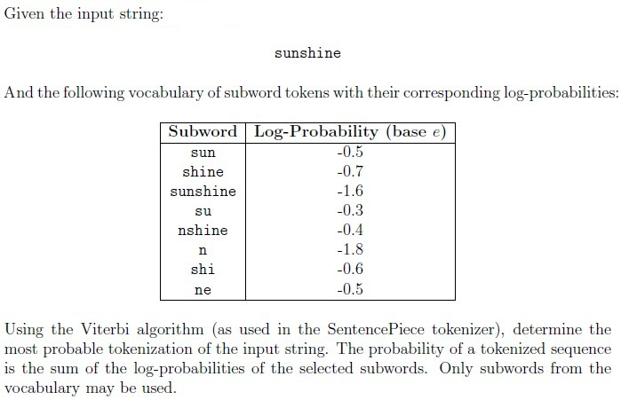

**Figure 1.** SentencePiece vocabulary dictionary with token log-probabilities and Viterbi algorithm instructions

**Options**

**A.**

[sunshine]

![Subword tokenization candidate sequence [sunshine]](assets/da5004_2025T2_ET_AN/q192-q192-option-a-01-p002.png)

**Figure 2.** Subword tokenization candidate sequence [sunshine]

*Source option ID:* `6406534763570`

*Label added for presentation.*

**B.**

[su, nshine]

![Subword tokenization candidate sequence [su, nshine]](assets/da5004_2025T2_ET_AN/q192-q192-option-b-01-p003.png)

**Figure 3.** Subword tokenization candidate sequence [su, nshine]

*Source option ID:* `6406534763571`

*Label added for presentation.*

**C.**

[sun, shine]

![Subword tokenization candidate sequence [sun, shine]](assets/da5004_2025T2_ET_AN/q192-q192-option-c-01-p003.png)

**Figure 4.** Subword tokenization candidate sequence [sun, shine]

*Source option ID:* `6406534763572`

*Label added for presentation.*

**D.**

[sun, shi, ne]

![Subword tokenization candidate sequence [sun, shi, ne]](assets/da5004_2025T2_ET_AN/q192-q192-option-d-01-p003.png)

**Figure 5.** Subword tokenization candidate sequence [sun, shi, ne]

*Source option ID:* `6406534763573`

*Label added for presentation.*

**Correct answer:** [su, nshine]

**Source evidence:** [{"page": 3, "bbox": [23.62, 21.93, 119.02, 38.25], "type": "green source option", "detail": "Option 6406534763571 is rendered in green (color 32768)"}]

### Question 193

**Question ID:** `6406531425135`

**Type:** Multiple Choice Question · **Marks:** 2
**PDF pages:** 3

A GPT model is trained using causal language modeling. During training, for a sequence of T = 4 
tokens, which of the following correctly represents the attention mask matrix applied to the 
attention logits?

**Options**

**A.**

$$\begin{bmatrix} 0 & -\infty & -\infty & -\infty \\ 0 & 0 & -\infty & -\infty \\ 0 & 0 & 0 & -\infty \\ 0 & 0 & 0 & 0 \end{bmatrix}$$

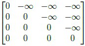

**Figure 6.** Causal attention mask candidate matrix with zero lower triangle and minus infinity upper triangle

*Source option ID:* `6406534763574`

*Label added for presentation.*

**B.**

$$\begin{bmatrix} 0 & \infty & \infty & \infty \\ 0 & 0 & \infty & \infty \\ 0 & 0 & 0 & \infty \\ 0 & 0 & 0 & 0 \end{bmatrix}$$

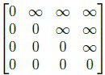

**Figure 7.** Attention mask candidate matrix with positive infinity in upper triangle

*Source option ID:* `6406534763575`

*Label added for presentation.*

**C.**

$$\begin{bmatrix} 1 & 0 & 0 & 0 \\ 1 & 1 & 0 & 0 \\ 1 & 1 & 1 & 0 \\ 1 & 1 & 1 & 1 \end{bmatrix}$$

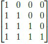

**Figure 8.** Attention mask candidate matrix with 1 lower triangle and 0 upper triangle

*Source option ID:* `6406534763576`

*Label added for presentation.*

**D.**

$$\begin{bmatrix} 0 & 1 & 1 & 1 \\ 0 & 0 & 1 & 1 \\ 0 & 0 & 0 & 1 \\ 0 & 0 & 0 & 0 \end{bmatrix}$$

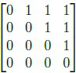

**Figure 9.** Attention mask candidate matrix with 0 lower triangle and 1 upper triangle

*Source option ID:* `6406534763577`

*Label added for presentation.*

**Correct answer:** $$\begin{bmatrix} 0 & -\infty & -\infty & -\infty \\ 0 & 0 & -\infty & -\infty \\ 0 & 0 & 0 & -\infty \\ 0 & 0 & 0 & 0 \end{bmatrix}$$

**Source evidence:** [{"page": 3, "bbox": [23.62, 407.95, 119.02, 424.27], "type": "green source option", "detail": "Option 6406534763574 is rendered in green (color 32768)"}]

### Question 194

**Question ID:** `6406531425136`

**Type:** Multiple Choice Question · **Marks:** 2
**PDF pages:** 3, 4

Match the given attention masks with their corresponding variants of attention mechanisms. In each figure, the colored cells indicate positions where a query token ($Q_i$) attends to a key token ($K_j$), while the white cells represent positions that are not attended. Choose the correct option.

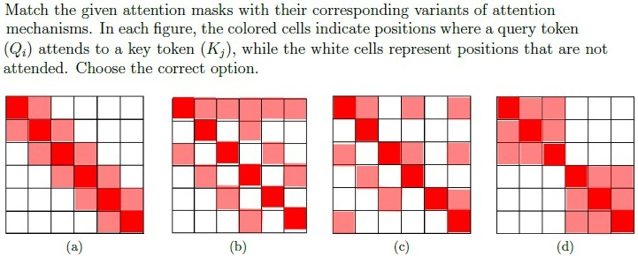

**Figure 10.** Attention mask patterns (a), (b), (c), and (d) for sparse attention mechanisms

**Options**

**A.**

(a) : Random Local Attention, 
(b) : Strided Local Attention, 
(c) : Sparse Block Attention, 
(d) : Local + Global Attention

*Source option ID:* `6406534763578`

*Label added for presentation.*

**B.**

(a) : Strided Local Attention, 
(b) : Local + Global Attention, 
(c) : Random Local Attention, 
(d) : Sparse Block Attention

*Source option ID:* `6406534763579`

*Label added for presentation.*

**C.**

(a) : Strided Local Attention, 
(b) : Random Local Attention, 
(c) : Local + Global Attention, 
(d) : Sparse Block Attention

*Source option ID:* `6406534763580`

*Label added for presentation.*

**D.**

(a) : Sparse Block Attention, 
(b) : Local + Global Attention, 
(c) : Strided Local Attention, 
(d) : Random Local Attention

*Source option ID:* `6406534763581`

*Label added for presentation.*

**Correct answer:** (a) : Strided Local Attention, (b) : Local + Global Attention, (c) : Random Local Attention, (d) : Sparse Block Attention

**Source evidence:** [{"page": 4, "bbox": [23.62, 330.6, 119.02, 346.92], "type": "green source option", "detail": "Option 6406534763579 is rendered in green (color 32768)"}]

### Question 195

**Question ID:** `6406531425137`

**Type:** Multiple Select Question · **Marks:** 3
**PDF pages:** 4, 5

Which of the following preprocessing steps are commonly used when preparing data for 
transformer models like BERT?

**Options**

**A.**

Adding special tokens such as [CLS] and [SEP] to the sequence

*Source option ID:* `6406534763582`

*Label added for presentation.*

**B.**

Splitting tokens into subword units using a model-specific tokenizer

*Source option ID:* `6406534763583`

*Label added for presentation.*

**C.**

Removing all punctuation marks to ensure cleaner embeddings

*Source option ID:* `6406534763584`

*Label added for presentation.*

**D.**

Adding positional information to each token embedding

*Source option ID:* `6406534763585`

*Label added for presentation.*

**Correct answer:** Adding special tokens such as [CLS] and [SEP] to the sequence; Splitting tokens into subword units using a model-specific tokenizer; Adding positional information to each token embedding

**Source evidence:** [{"page": 4, "bbox": [23.62, 734.64, 119.02, 813.42], "type": "green source option", "detail": "Options 6406534763582, 6406534763583, 6406534763585 are rendered in green (color 32768)"}]

### Question 196

**Question ID:** `6406531425138`

**Type:** Multiple Select Question · **Marks:** 3
**PDF pages:** 5

Which modifications are used in transformers to handle longer sequences efficiently?

**Options**

**A.**

Using sparse attention patterns to reduce computational complexity

*Source option ID:* `6406534763586`

*Label added for presentation.*

**B.**

Applying low-rank matrix factorization to approximate attention

*Source option ID:* `6406534763587`

*Label added for presentation.*

**C.**

Increasing only the feed-forward network width without modifying attention

*Source option ID:* `6406534763588`

*Label added for presentation.*

**D.**

Replacing the softmax function in attention with other activation function for 
faster training

*Source option ID:* `6406534763589`

*Label added for presentation.*

**Correct answer:** Using sparse attention patterns to reduce computational complexity; Applying low-rank matrix factorization to approximate attention

**Source evidence:** [{"page": 5, "bbox": [23.62, 133.42, 119.02, 170.56], "type": "green source option", "detail": "Options 6406534763586, 6406534763587 are rendered in green (color 32768)"}]

### Question 197

**Question ID:** `6406531425139`

**Type:** Multiple Select Question · **Marks:** 3
**PDF pages:** 5

In Transformer models that use relative position embeddings (such as in Transformer-XL or T5), 
clipping is often applied to the relative position indices. Which of the following statements about 
clipping in relative position embeddings are correct?

**Options**

**A.**

Clipping ensures that very large relative distances are mapped to a fixed 
maximum distance.

*Source option ID:* `6406534763590`

*Label added for presentation.*

**B.**

Without clipping, the model would require embeddings for every possible 
relative distance, which is infeasible for long sequences.

*Source option ID:* `6406534763591`

*Label added for presentation.*

**C.**

Clipping increases the precision of embeddings for large relative distances.

*Source option ID:* `6406534763592`

*Label added for presentation.*

**D.**

Clipping introduces an upper bound k such that all distances greater than k 
are mapped to the same index.

*Source option ID:* `6406534763593`

*Label added for presentation.*

**Correct answer:** Clipping ensures that very large relative distances are mapped to a fixed maximum distance.; Without clipping, the model would require embeddings for every possible relative distance, which is infeasible for long sequences.; Clipping introduces an upper bound k such that all distances greater than k are mapped to the same index.

**Source evidence:** [{"page": 5, "bbox": [23.62, 386.08, 119.02, 497.51], "type": "green source option", "detail": "Options 6406534763590, 6406534763591, 6406534763593 are rendered in green (color 32768)"}]

### Question 198

**Question ID:** `6406531425140`

**Type:** Short Answer Question · **Marks:** 2
**PDF pages:** 5, 6

Consider the following probability distribution over a vocabulary of 10 tokens:
[0.06, 0.20, 0.14, 0.06, 0.09, 0.08, 0.05, 0.15, 0.06, 0.11]

You apply top-p (nucleus) sampling with p = 0.7. How many tokens are included in the sampling pool?

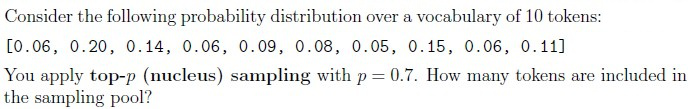

**Figure 11.** Vocabulary token probability distribution array and nucleus sampling parameters

**Correct answer:** 6

**Source evidence:** [{"page": 6, "bbox": [22.87, 50.0, 180.0, 90.0], "type": "explicit field", "detail": "Possible Answers: 6"}]

### Shared context 199 to 200

**Question ID:** `6406531425141`

**Type:** Comprehension
**PDF pages:** 6

A vocabulary $\mathcal{V} = \{\text{tea}, \text{you}, \text{enjoy}, \text{often}\}$ is associated with the following embedding matrix:

$$E = \begin{bmatrix} 1 & 0 \\ 0 & 1 \\ 1 & 1 \\ 0 & 0 \end{bmatrix}$$

Words are indexed in the order shown above: “tea” (index 0), “you” (1), “enjoy” (2), and “often” (3). No positional encodings are used.

The parameters of the attention layer are:

$$W_Q = \begin{bmatrix} 0.5 & 1 \\ 1 & 0.5 \end{bmatrix}, \quad W_K = \begin{bmatrix} 1 & 0.5 \\ -0.5 & 1 \end{bmatrix}, \quad W_V = \begin{bmatrix} 1 & 0.2 \\ 0.5 & 0.5 \end{bmatrix}, \quad W_O = \begin{bmatrix} 0.5 & 0.6 \\ 1 & -1 \end{bmatrix}$$

For the input sequence “you enjoy tea often”. The computed attention matrix $A = \text{softmax}\left(\frac{Q K^T}{\sqrt{d_k}}\right)$ is given as:

$$A = \begin{bmatrix} 0.55 & 0.32 & 0.11 & 0.02 \\ 0.43 & 0.25 & 0.21 & 0.1 \\ 0.39 & 0.39 & 0.16 & 0.07 \\ 0.24 & 0.4 & 0.2 & 0.17 \end{bmatrix}$$

Answer the given subquestions. If you believe the information is insufficient, enter -1 as your answer.

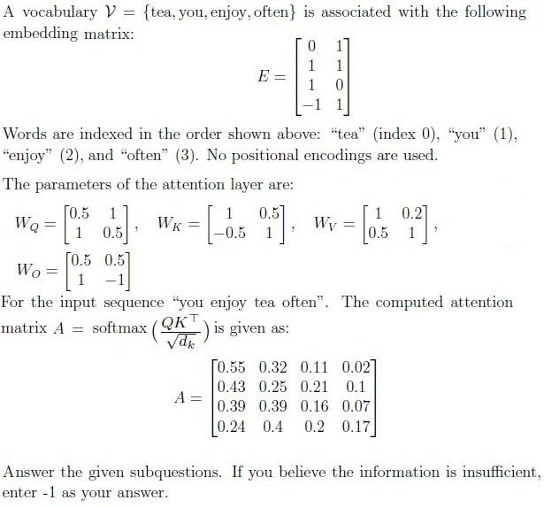

**Figure 12.** Vocabulary embedding matrix, projection matrices WQ, WK, WV, WO, and computed attention matrix A

### Question 199

**Question ID:** `6406531425142`

**Portal container ID:** `6406531425141`

**Type:** Short Answer Question · **Marks:** 3
**PDF pages:** 6, 7

**Shared context:** [ctx-199-200](#ctx-199-200)

For the input “you enjoy tea often”, compute the final representation of the word “enjoy” after the 
attention layer (i.e., after applying WQ, WK, WV , attention weights, and WO). Enter the sum of the 
elements in the resulting vector.

**Correct answer:** 0.92 to 1.0

**Source evidence:** [{"page": 7, "bbox": [22.87, 85.0, 180.0, 150.0], "type": "explicit field", "detail": "Possible Answers: 0.92 to 1.0"}]

### Question 200

**Question ID:** `6406531425143`

**Portal container ID:** `6406531425141`

**Type:** Short Answer Question · **Marks:** 2
**PDF pages:** 7

**Shared context:** [ctx-199-200](#ctx-199-200)

Suppose the input sentence is “tea you enjoy often”. Using the same matrices and processing 
method, what is the attention score (i.e., softmax entry from A) for the query word “tea” attending 
to key word “often”?

**Correct answer:** 0.04 to 0.10

**Source evidence:** [{"page": 7, "bbox": [22.87, 280.0, 180.0, 340.0], "type": "explicit field", "detail": "Possible Answers: 0.04 to 0.10"}]

### Shared context 201 to 203

**Question ID:** `6406531425150`

**Type:** Comprehension
**PDF pages:** 7, 8

Suppose we have context length $T = 30$ and the number of blocks $n = 5$ for the block attention mechanism.

The masking matrix $M$ is defined as:

$$M_{ij} = \begin{cases} 1 & \text{if } \lfloor j / (T/n) \rfloor = \pi(\lfloor i / (T/n) \rfloor) \\ 0 & \text{otherwise} \end{cases}$$

where $i$ is row indices and $j$ is columns indexes both starting from 0. Here, $\pi$ is a permutation of $\{0, 1, \dots, (n - 1)\}$, which determines the allowed query—key block pairs. Specifically, if a query token $i$ lies in block $r = \lfloor i / (T/n) \rfloor$, then it can attend only to key tokens in block $\pi(r)$.

Equivalently, if we partition queries and keys into blocks,
$$Q = (Q_0, Q_1, \dots, Q_{n-1}), \quad K = (K_0, K_1, \dots, K_{n-1})$$
then block $Q_r$ attends only to block $K_{\pi(r)}$.

This block-restricted attention reduces computation by limiting interactions to the query—key block pairs specified by $\pi$.

Answer the given subquestions using the attention mask $M \in \{0, 1\}^{T \times T}$ image, where black squares represent entries equal to 1 and white squares represent entries equal to 0.

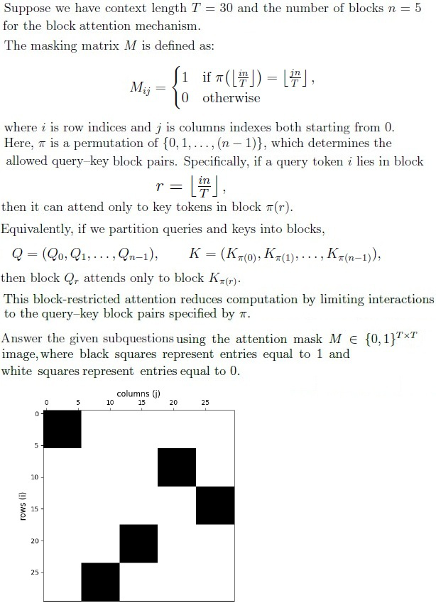

**Figure 13.** Block attention formulation, query-key block permutation equations, and 30x30 masking grid image

### Question 201

**Question ID:** `6406531425151`

**Portal container ID:** `6406531425150`

**Type:** Multiple Choice Question · **Marks:** 2
**PDF pages:** 8, 9

**Shared context:** [ctx-201-203](#ctx-201-203)

Choose the correct representation of π for the given mask image.

**Options**

**A.**

π = (2, 1, 3, 4, 0)

*Source option ID:* `6406534763608`

*Label added for presentation.*

**B.**

π = (0, 4, 3, 1, 2)

*Source option ID:* `6406534763609`

*Label added for presentation.*

**C.**

π = (0, 3, 4, 2, 1)

*Source option ID:* `6406534763610`

*Label added for presentation.*

**D.**

All of these

*Source option ID:* `6406534763611`

*Label added for presentation.*

**Correct answer:** π = (0, 3, 4, 2, 1)

**Source evidence:** [{"page": 9, "bbox": [23.62, 59.14, 119.02, 75.46], "type": "green source option", "detail": "Option 6406534763610 is rendered in green (color 32768)"}]

### Question 202

**Question ID:** `6406531425152`

**Portal container ID:** `6406531425150`

**Type:** Short Answer Question · **Marks:** 1
**PDF pages:** 9

**Shared context:** [ctx-201-203](#ctx-201-203)

How many permutations of π are possible for n = 5?

**Correct answer:** 120

**Source evidence:** [{"page": 9, "bbox": [22.87, 240.0, 180.0, 290.0], "type": "explicit field", "detail": "Possible Answers: 120"}]

### Question 203

**Question ID:** `6406531425153`

**Portal container ID:** `6406531425150`

**Type:** Short Answer Question · **Marks:** 2
**PDF pages:** 9

**Shared context:** [ctx-201-203](#ctx-201-203)

What percentage of entries in the attention matrix are zero (i.e., the sparsity)?

**Correct answer:** 80

**Source evidence:** [{"page": 9, "bbox": [22.87, 450.0, 180.0, 500.0], "type": "explicit field", "detail": "Possible Answers: 80"}]

### Shared context 204 to 208

**Question ID:** `6406531425144`

**Type:** Comprehension
**PDF pages:** 9, 10

Consider the short sentence:
“small models sometimes beat big ones”

A model processes this sequence using the naive relative positional embedding method. The model’s embedding dimension is $d_{\text{model}} = 4$, and the number of tokens is $T = 6$. We use zero-based indexing for token positions:

0: small, 1: models, 2: sometimes, 3: beat, 4: big, 5: ones

Note: In this context, the relative position between two tokens is:
$$\text{Relative position} = j - i$$
(rows = current token $i$, columns = other token $j$).

1. Token embeddings (rows correspond to tokens in order):

$$X = \begin{bmatrix} 1 & 1 & 1 & 1 \\ 2 & 2 & 2 & 2 \\ 3 & 3 & 3 & 3 \\ 4 & 4 & 4 & 4 \\ 5 & 5 & 5 & 5 \\ 6 & 6 & 6 & 6 \end{bmatrix}$$

Denote the $i$-th row by $x_i$.

2. Positional embedding definition: For a relative position,

$$p_{(j - i)} = \left[ \frac{j - i}{5}, \frac{j - i}{5}, \frac{j - i}{5}, \frac{j - i}{5} \right]$$

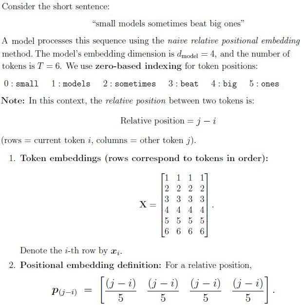

**Figure 14.** Sentence token definitions, embedding matrix X, and relative positional embedding formula

### Question 204

**Question ID:** `6406531425145`

**Portal container ID:** `6406531425144`

**Type:** Multiple Choice Question · **Marks:** 2
**PDF pages:** 10

**Shared context:** [ctx-204-208](#ctx-204-208)

Choose the sequence of relative positions $(j - i)$ for the token "sometimes" with respect to each token in the sentence.

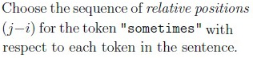

**Figure 15.** Relative position sequence question stem for token sometimes

**Options**

**A.**

(0, 1, 2, 3, 4, 5)

*Source option ID:* `6406534763597`

*Label added for presentation.*

**B.**

(-1, 0, 1, 2, 3, 4)

*Source option ID:* `6406534763598`

*Label added for presentation.*

**C.**

(-3, -2, -1, 0, 1, 2)

*Source option ID:* `6406534763599`

*Label added for presentation.*

**D.**

(-2, -1, 0, 1, 2, 3)

*Source option ID:* `6406534763600`

*Label added for presentation.*

**Correct answer:** (-2, -1, 0, 1, 2, 3)

**Source evidence:** [{"page": 10, "bbox": [23.62, 768.02, 119.02, 784.34], "type": "green source option", "detail": "Option 6406534763600 is rendered in green (color 32768)"}]

### Question 205

**Question ID:** `6406531425146`

**Portal container ID:** `6406531425144`

**Type:** Multiple Choice Question · **Marks:** 2
**PDF pages:** 10, 11

**Shared context:** [ctx-204-208](#ctx-204-208)

Choose the value of $p_{(j - i)}$ for the current token “big” and the other token ”small”.

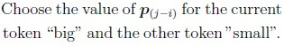

**Figure 16.** Positional embedding value question stem for current token big and other token small

**Options**

**A.**

[−0.4,−0.4,−0.4,−0.4]

*Source option ID:* `6406534763601`

*Label added for presentation.*

**B.**

[−0.1,−0.1,−0.1,−0.1]

*Source option ID:* `6406534763602`

*Label added for presentation.*

**C.**

[−0.8,−0.8,−0.8,−0.8]

*Source option ID:* `6406534763603`

*Label added for presentation.*

**D.**

[−0.2,−0.2,−0.2,−0.2]

*Source option ID:* `6406534763604`

*Label added for presentation.*

**Correct answer:** [−0.8,−0.8,−0.8,−0.8]

**Source evidence:** [{"page": 11, "bbox": [23.62, 162.6, 119.02, 178.92], "type": "green source option", "detail": "Option 6406534763603 is rendered in green (color 32768)"}]

### Question 206

**Question ID:** `6406531425147`

**Portal container ID:** `6406531425144`

**Type:** Short Answer Question · **Marks:** 3
**PDF pages:** 11

**Shared context:** [ctx-204-208](#ctx-204-208)

With a naive implementation, for each token embedding we combine (by addition) relative position embeddings. For token index $i \in \{0, \dots, T - 1\}$,

$$h_i = x_i + \sum_{j=0}^{T-1} p_{(j - i)}$$

compute the final combined embedding $h_i$ for the token "models" (i.e., $i = 1$).

Submit the sum of all the elements of $h_i$.

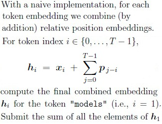

**Figure 17.** Naive relative position combined embedding formulation and question for token models

**Correct answer:** 15.2

**Source evidence:** [{"page": 11, "bbox": [22.87, 600.0, 180.0, 660.0], "type": "explicit field", "detail": "Possible Answers: 15.2"}]

### Question 207

**Question ID:** `6406531425148`

**Portal container ID:** `6406531425144`

**Type:** Short Answer Question · **Marks:** 2
**PDF pages:** 11, 12

**Shared context:** [ctx-204-208](#ctx-204-208)

Compute $e_{ij}$ for the current token “big” and other token “small”.

$$e_{ij} = x_i W_Q (x_j W_K + p_{(j - i)})^T$$

Assume $W_Q = I$ and $W_K = 2I$ where $I$ is an identity matrix. Answer $e_{ij}$ correct upto 1 digit after the decimal.

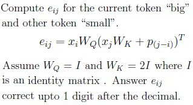

**Figure 18.** Pre-attention score e_ij formula with relative position embedding and parameters WQ, WK

**Correct answer:** 23.7 to 24.3

**Source evidence:** [{"page": 12, "bbox": [22.87, 120.0, 180.0, 160.0], "type": "explicit field", "detail": "Possible Answers: 23.7 to 24.3"}]

### Question 208

**Question ID:** `6406531425149`

**Portal container ID:** `6406531425144`

**Type:** Short Answer Question · **Marks:** 3
**PDF pages:** 12

**Shared context:** [ctx-204-208](#ctx-204-208)

Now consider the same sequence but assume the model uses the ALiBi (Attention with Linear Biases) method. The model has $H = 4$ heads and the per-head slope is defined as

$$m_h = 2^{-8h/H}, \quad h \in \{1, 2, \dots, H\}$$

The pre-attention $e_{ij}$ for head $h$ are computed as:

$$e_{ij} = x_i W_Q (x_j W_K)^T - m_h \cdot |i - j|$$

Assume $W_Q = I$ and $W_K = 2I$ where $I$ is an identity matrix. Answer $e_{ij}$ for the current token “big” and other token “small” for head $h = 2$, correct upto 1 digit after the decimal.

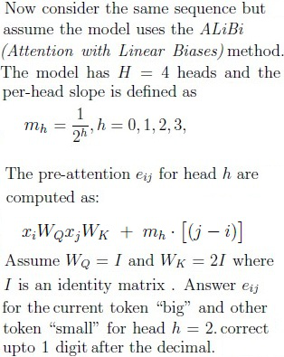

**Figure 19.** ALiBi pre-attention score formulation with slope m_h and linear bias term

**Correct answer:** 39

**Source evidence:** [{"page": 12, "bbox": [22.87, 630.0, 180.0, 680.0], "type": "explicit field", "detail": "Possible Answers: 39"}]

## Answer key

| Source question | Source identity | Correct answer | PDF pages |
| :--- | :--- | :--- | :--- |
| 192 | 6406531425134 | [su, nshine] | 2, 3 |
| 193 | 6406531425135 | $$\begin{bmatrix} 0 & -\infty & -\infty & -\infty \\ 0 & 0 & -\infty & -\infty \\ 0 & 0 & 0 & -\infty \\ 0 & 0 & 0 & 0 \end{bmatrix}$$ | 3 |
| 194 | 6406531425136 | (a) : Strided Local Attention, (b) : Local + Global Attention, (c) : Random Local Attention, (d) : Sparse Block Attention | 3, 4 |
| 195 | 6406531425137 | Adding special tokens such as [CLS] and [SEP] to the sequence; Splitting tokens into subword units using a model-specific tokenizer; Adding positional information to each token embedding | 4, 5 |
| 196 | 6406531425138 | Using sparse attention patterns to reduce computational complexity; Applying low-rank matrix factorization to approximate attention | 5 |
| 197 | 6406531425139 | Clipping ensures that very large relative distances are mapped to a fixed maximum distance.; Without clipping, the model would require embeddings for every possible relative distance, which is infeasible for long sequences.; Clipping introduces an upper bound k such that all distances greater than k are mapped to the same index. | 5 |
| 198 | 6406531425140 | 6 | 5, 6 |
| 199 | 6406531425142 | 0.92 to 1.0 | 6, 7 |
| 200 | 6406531425143 | 0.04 to 0.10 | 7 |
| 201 | 6406531425151 | π = (0, 3, 4, 2, 1) | 8, 9 |
| 202 | 6406531425152 | 120 | 9 |
| 203 | 6406531425153 | 80 | 9 |
| 204 | 6406531425145 | (-2, -1, 0, 1, 2, 3) | 10 |
| 205 | 6406531425146 | [−0.8,−0.8,−0.8,−0.8] | 10, 11 |
| 206 | 6406531425147 | 15.2 | 11 |
| 207 | 6406531425148 | 23.7 to 24.3 | 11, 12 |
| 208 | 6406531425149 | 39 | 12 |

## Extraction notes

**Status:** verified
**Count reconciliation:** Section 9 declares 11 questions and 40 marks. The 11 portal question entries correspond to 1 administrative subject-confirmation question (Question 191), 7 standalone academic questions (Questions 192-198), and 3 comprehension blocks (Questions 199-200, 201-203, and 204-208) containing 10 subquestions. Total academic questions reconcile to exactly 17 (7 standalone + 10 comprehension subquestions). Marks sum exactly to 3 + 2 + 2 + 3 + 3 + 3 + 2 + 3 + 2 + 2 + 1 + 2 + 2 + 2 + 3 + 2 + 3 = 40, matching the declared Section Marks of 40.

- Comprehension passages ctx-199-200, ctx-201-203, and ctx-204-208 contain shared context mathematical layouts and diagrams; complete transcriptions and high-resolution crops are retained.
- Official answers for all questions are directly verifiable from the source PDF (green answer markers for MCQs/MSQs and explicit Possible Answers fields for Numeric/SA questions).

**Excluded source entries:**

- {"classification": "out-of-scope-section", "page": 1, "bbox": [0.0, 0.0, 595.3, 373.69], "reason": "Preceding section exam content (Multiple Choice Question, options 6406534763564 to 6406534763567) before Section 9 LLM header", "identity": "preceding-section"}
- {"classification": "subject-confirmation", "page": 2, "bbox": [22.87, 16.75, 580.0, 280.0], "reason": "Administrative subject confirmation asking candidate to confirm subject and cross check hall ticket", "identity": "191"}
- {"classification": "out-of-scope-section", "page": 12, "bbox": [0.0, 673.59, 595.3, 841.9], "reason": "Subsequent Section 10 DLP (Deep Learning for Perception) exam header terminating LLM section", "identity": "following-section-10"}
