# LLM — da5004_2025T2_ET_FN

**Source:** `da5004_2025T2_ET_FN.pdf` · **Academic questions:** 17 · **Separately counted children:** 0
**Provenance:** `Large_Language_Models/da5004_2025T2_ET_FN.pdf` · SHA-256 `838e6b1ea02e15a09eb284d2f3db7950d356652b030197a1e328941d9dbf50f3`

**Scope:** Large Language Models (LLM) section (Section 6, Section Id: 64065399797) spanning from page 1 at y=237.40 to page 12 at y=426.10 (Question 154 answer). Preceding Section 5 content on page 1 (y=0 to y=232.20) and succeeding Section 7 (DL(CV)) content on page 12 (y=431.30 to y=841.89) are excluded as out of subject scope.

## Questions

### Question 138

**Question ID:** `6406531422514`

**Type:** MCQ · **Marks:** 2
**PDF pages:** 2

Given the input string:

**moonlight**

And the following vocabulary of subword tokens with their corresponding log-probabilities:

| Subword | Log-Probability (base e) |
| :--- | :--- |
| moon | -0.4 |
| light | -1.0 |
| moonlight | -1.8 |
| moo | -0.3 |
| nlight | -0.6 |
| n | -2.0 |
| li | -0.5 |
| ght | -0.5 |

Using the Viterbi algorithm (as used in the SentencePiece tokenizer), determine the most probable tokenization of the input string. The probability of a tokenized sequence is the sum of the log-probabilities of the selected subwords. Only subwords from the vocabulary may be used.

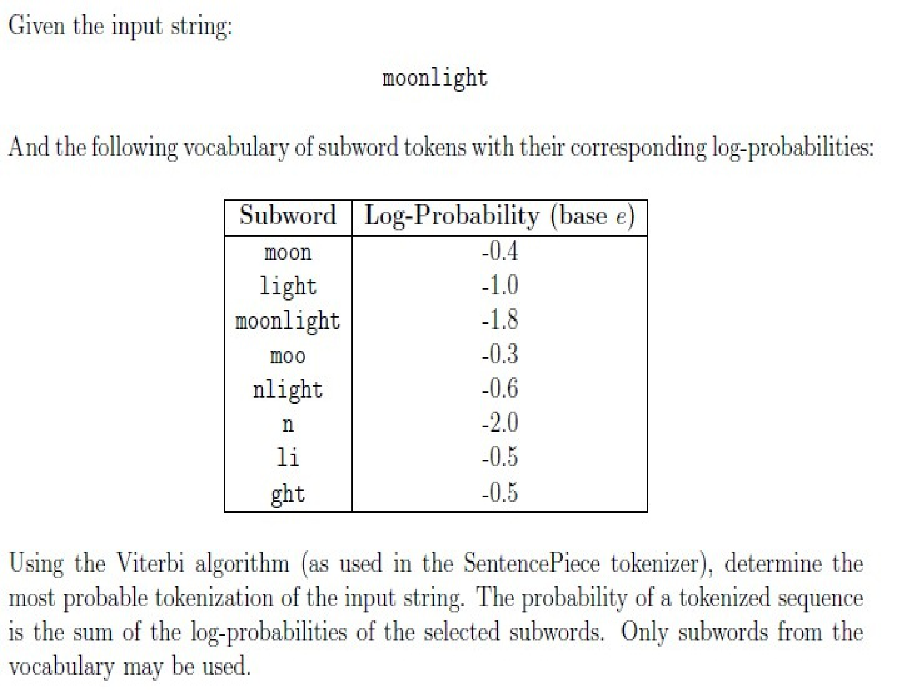

**Figure 1.** Input string, subword vocabulary log-probabilities table, and Viterbi tokenization problem description

**Options**

**A.**

[moonlight]

![Option A token sequence [moonlight]](assets/da5004_2025T2_ET_FN/q138-q138-option-a-01-p002.png)

**Figure 2.** Option A token sequence [moonlight]

*Source option ID:* `6406534756305`

*Label added for presentation.*

**B.**

[moo, nlight]

![Option B token sequence [noo, nlight]](assets/da5004_2025T2_ET_FN/q138-q138-option-b-01-p002.png)

**Figure 3.** Option B token sequence [noo, nlight]

*Source option ID:* `6406534756306`

*Label added for presentation.*

**C.**

[moon, light]

![Option C token sequence [moon, light]](assets/da5004_2025T2_ET_FN/q138-q138-option-c-01-p002.png)

**Figure 4.** Option C token sequence [moon, light]

*Source option ID:* `6406534756307`

*Label added for presentation.*

**D.**

[moon, li, ght]

![Option D token sequence [moon, li, ght]](assets/da5004_2025T2_ET_FN/q138-q138-option-d-01-p002.png)

**Figure 5.** Option D token sequence [moon, li, ght]

*Source option ID:* `6406534756308`

*Label added for presentation.*

**Correct answer:** [moo, nlight]

**Source evidence:** [{"page": 2, "bbox": [119.02, 707.13, 131.02, 719.13], "type": "green source option", "detail": "Green marked option 6406534756306 (B)"}]

### Question 139

**Question ID:** `6406531422515`

**Type:** MCQ · **Marks:** 2
**PDF pages:** 3

Match the given attention masks with their corresponding variants of attention mechanisms. In each figure, the colored cells indicate positions where a query token ($Q_i$) attends to a key token ($K_j$), while the white cells represent positions that are not attended. Choose the correct option.

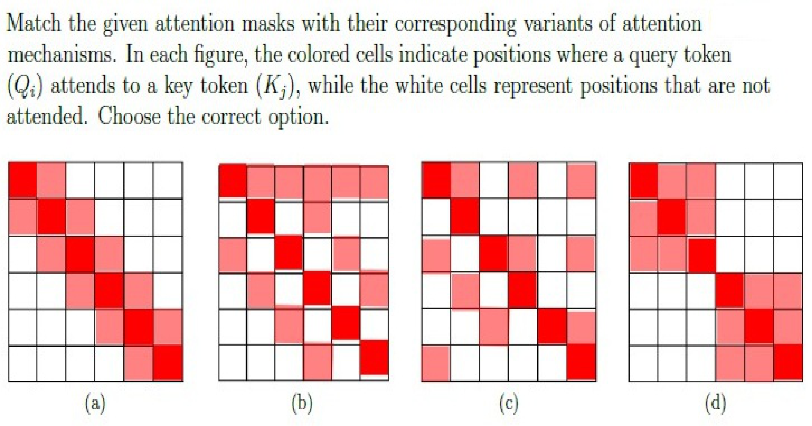

**Figure 6.** Attention mask diagrams (a), (b), (c), (d) for attention pattern matching

**Options**

**A.**

(a) : Random Local Attention,
(b) : Strided Local Attention,
(c) : Sparse Block Attention,
(d) : Local + Global Attention

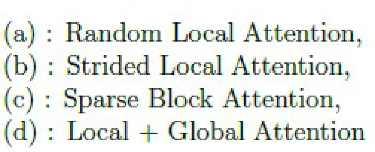

**Figure 7.** Option A attention mechanism matching list

*Source option ID:* `6406534756309`

*Label added for presentation.*

**B.**

(a) : Strided Local Attention,
(b) : Local + Global Attention,
(c) : Random Local Attention,
(d) : Sparse Block Attention

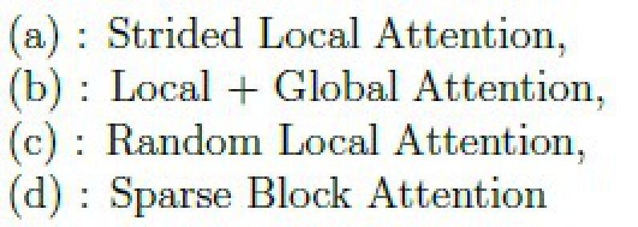

**Figure 8.** Option B attention mechanism matching list

*Source option ID:* `6406534756310`

*Label added for presentation.*

**C.**

(a) : Strided Local Attention,
(b) : Random Local Attention,
(c) : Local + Global Attention,
(d) : Sparse Block Attention

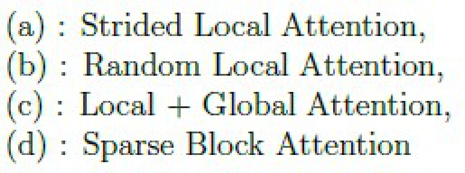

**Figure 9.** Option C attention mechanism matching list

*Source option ID:* `6406534756311`

*Label added for presentation.*

**D.**

(a) : Sparse Block Attention,
(b) : Local + Global Attention,
(c) : Strided Local Attention,
(d) : Random Local Attention

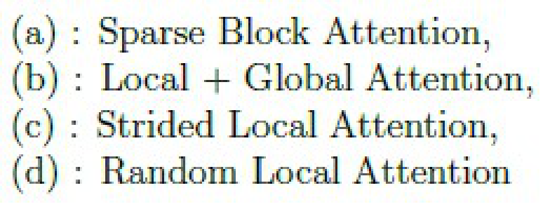

**Figure 10.** Option D attention mechanism matching list

*Source option ID:* `6406534756312`

*Label added for presentation.*

**Correct answer:** (a) : Strided Local Attention,
(b) : Local + Global Attention,
(c) : Random Local Attention,
(d) : Sparse Block Attention

**Source evidence:** [{"page": 3, "bbox": [119.02, 506.43, 131.02, 518.43], "type": "green source option", "detail": "Green marked option 6406534756310 (B)"}]

### Question 140

**Question ID:** `6406531422516`

**Type:** MSQ · **Marks:** 3
**PDF pages:** 4

Which of the following statements about subword tokenizers (e.g., Byte Pair Encoding, 
SentencePiece) is true?

**Options**

**A.**

They always split words into individual characters.

*Source option ID:* `6406534756313`

*Label added for presentation.*

**B.**

They help handle rare words by breaking them into smaller units.

*Source option ID:* `6406534756314`

*Label added for presentation.*

**C.**

They require the vocabulary to contain every possible word in the language.

*Source option ID:* `6406534756315`

*Label added for presentation.*

**D.**

They can reduce the overall vocabulary size compared to word-level 
tokenizers.

*Source option ID:* `6406534756316`

*Label added for presentation.*

**Correct answer:** They help handle rare words by breaking them into smaller units.; They can reduce the overall vocabulary size compared to word-level 
tokenizers.

**Source evidence:** [{"page": 4, "bbox": [119.02, 152.06, 131.02, 164.06], "type": "green source option", "detail": "Green marked option 6406534756314 (B)"}, {"page": 4, "bbox": [119.02, 193.7, 131.02, 205.7], "type": "green source option", "detail": "Green marked option 6406534756316 (D)"}]

### Question 141

**Question ID:** `6406531422517`

**Type:** MSQ · **Marks:** 3
**PDF pages:** 4

A GPT-based model is fine-tuned for story generation. During evaluation, you test different 
decoding strategies on the same prompt: 
 
1. Method A: Every run produces the exact same story, even when executed multiple times. 
2. Method B: The story changes slightly in each run, but overall structure and key events remain 
similar. 
3. Method C: The story is wildly different each time, sometimes even changing the genre. 
 
Based on the observations, select the most likely decoding strategies for each method:

**Options**

**A.**

Method A: Greedy decoding

*Source option ID:* `6406534756317`

*Label added for presentation.*

**B.**

Method A: Top-K sampling with K = 50

*Source option ID:* `6406534756318`

*Label added for presentation.*

**C.**

Method B: Top-P sampling with p = 0.9

*Source option ID:* `6406534756319`

*Label added for presentation.*

**D.**

Method C: Top-P sampling with p = 0.5 and high temperature T = 1.5

*Source option ID:* `6406534756320`

*Label added for presentation.*

**E.**

Method C: Beam search with K = 5

*Source option ID:* `6406534756321`

*Label added for presentation.*

**Correct answer:** Method A: Greedy decoding; Method B: Top-P sampling with p = 0.9; Method C: Top-P sampling with p = 0.5 and high temperature T = 1.5

**Source evidence:** [{"page": 4, "bbox": [119.02, 481.82, 131.02, 493.82], "type": "green source option", "detail": "Green marked option 6406534756317 (A)"}, {"page": 4, "bbox": [119.02, 523.49, 131.02, 535.49], "type": "green source option", "detail": "Green marked option 6406534756319 (C)"}, {"page": 4, "bbox": [119.02, 544.34, 131.02, 556.34], "type": "green source option", "detail": "Green marked option 6406534756320 (D)"}]

### Question 142

**Question ID:** `6406531422518`

**Type:** MSQ · **Marks:** 3
**PDF pages:** 4

Which of the following are valid design choices when building a transformer-based language 
model?

**Options**

**A.**

Number of transformer layers

*Source option ID:* `6406534756322`

*Label added for presentation.*

**B.**

Learning rate schedule

*Source option ID:* `6406534756323`

*Label added for presentation.*

**C.**

Font style of the source code

*Source option ID:* `6406534756324`

*Label added for presentation.*

**D.**

Vocabulary size

*Source option ID:* `6406534756325`

*Label added for presentation.*

**E.**

Type of normalization (e.g., LayerNorm)

*Source option ID:* `6406534756326`

*Label added for presentation.*

**Correct answer:** Number of transformer layers; Learning rate schedule; Vocabulary size; Type of normalization (e.g., LayerNorm)

**Source evidence:** [{"page": 4, "bbox": [119.02, 722.75, 131.02, 734.75], "type": "green source option", "detail": "Green marked option 6406534756322 (A)"}, {"page": 4, "bbox": [119.02, 743.57, 131.02, 755.57], "type": "green source option", "detail": "Green marked option 6406534756323 (B)"}, {"page": 4, "bbox": [119.02, 785.21, 131.02, 797.21], "type": "green source option", "detail": "Green marked option 6406534756325 (D)"}, {"page": 4, "bbox": [119.02, 806.03, 131.02, 818.03], "type": "green source option", "detail": "Green marked option 6406534756326 (E)"}]

### Question 143

**Question ID:** `6406531422519`

**Type:** MSQ · **Marks:** 3
**PDF pages:** 5

Which of the following statements about Top-k and Nucleus (Top-p) sampling are correct?

**Options**

**A.**

Top-k keeps only the k most probable tokens before sampling.

*Source option ID:* `6406534756327`

*Label added for presentation.*

**B.**

Top-p dynamically chooses the smallest set of tokens whose cumulative 
probability exceeds p.

*Source option ID:* `6406534756328`

*Label added for presentation.*

**C.**

Top-k is always a subset of Top-p.

*Source option ID:* `6406534756329`

*Label added for presentation.*

**D.**

Top-p always has a fixed number of candidate tokens.

*Source option ID:* `6406534756330`

*Label added for presentation.*

**Correct answer:** Top-k keeps only the k most probable tokens before sampling.; Top-p dynamically chooses the smallest set of tokens whose cumulative 
probability exceeds p.

**Source evidence:** [{"page": 5, "bbox": [119.02, 134.24, 131.02, 146.24], "type": "green source option", "detail": "Green marked option 6406534756327 (A)"}, {"page": 5, "bbox": [119.02, 155.06, 131.02, 167.06], "type": "green source option", "detail": "Green marked option 6406534756328 (B)"}]

### Question 144

**Question ID:** `6406531422520`

**Type:** MSQ · **Marks:** 3
**PDF pages:** 5

Which of the following preprocessing steps are commonly required when preparing data for 
transformer models like BERT?

**Options**

**A.**

Lowercasing text (for uncased models)

*Source option ID:* `6406534756331`

*Label added for presentation.*

**B.**

Splitting into subword units using BPE or WordPiece

*Source option ID:* `6406534756332`

*Label added for presentation.*

**C.**

Removing all punctuation marks

*Source option ID:* `6406534756333`

*Label added for presentation.*

**D.**

Adding position indices for each token

*Source option ID:* `6406534756334`

*Label added for presentation.*

**Correct answer:** Lowercasing text (for uncased models); Splitting into subword units using BPE or WordPiece; Adding position indices for each token

**Source evidence:** [{"page": 5, "bbox": [119.02, 370.58, 131.02, 382.58], "type": "green source option", "detail": "Green marked option 6406534756331 (A)"}, {"page": 5, "bbox": [119.02, 391.4, 131.02, 403.4], "type": "green source option", "detail": "Green marked option 6406534756332 (B)"}, {"page": 5, "bbox": [119.02, 433.04, 131.02, 445.04], "type": "green source option", "detail": "Green marked option 6406534756334 (D)"}]

### Question 145

**Question ID:** `6406531422521`

**Type:** SA · **Marks:** 3
**PDF pages:** 5, 6

Suppose a language model outputs the following logits for a vocabulary of size 4:

| Token | Logit |
| :--- | :--- |
| cat | 1.5 |
| sat | 0.5 |
| on | 0.0 |
| mat | -0.5 |

You apply Low Temperature Sampling with temperature $T = 2.0$. After applying the softmax on the temperature-scaled logits, what is the probability assigned to the token “cat”? (Give your answer up to 2 decimal places)

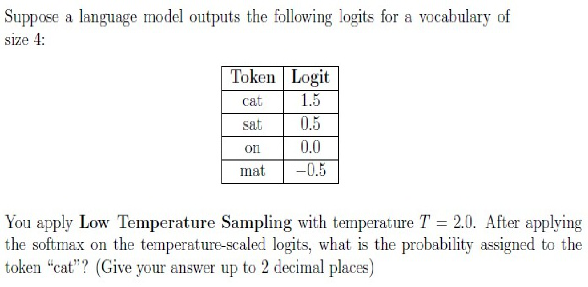

**Figure 11.** Vocabulary logits table and low temperature sampling setup for token cat

**Correct answer:** 0.38 to 0.44

**Source evidence:** [{"page": 6, "bbox": [22.87, 105.0, 160.0, 130.0], "type": "explicit field", "detail": "Official source Range answer: 0.38 to 0.44"}]

### Shared context 146 to 147

**Question ID:** `6406531422522`

**Portal container ID:** `6406531422522`

**Type:** Comprehension
**PDF pages:** 6

A vocabulary $V = \{\text{tea}, \text{you}, \text{enjoy}, \text{often}\}$ is associated with the following embedding matrix:

$$E = \begin{bmatrix} 0 & 1 \\ 1 & 0 \\ 1 & 1 \\ -1 & 1 \end{bmatrix}$$

Words are indexed in the order shown above: “tea” (index 0), “you” (1), “enjoy” (2), and “often” (3). No positional encodings are used.

The parameters of the attention layer are:

$$W_Q = \begin{bmatrix} 0.5 & 1 \\ -0.5 & 0.5 \end{bmatrix}, \quad W_K = \begin{bmatrix} 1 & 0.5 \\ -0.5 & 1 \end{bmatrix}, \quad W_V = \begin{bmatrix} 1 & 0.2 \\ 0.5 & 0.5 \end{bmatrix}, \quad W_O = \begin{bmatrix} 0.5 & 0.5 \\ 0.5 & 1 \end{bmatrix}$$

For the input sequence “you enjoy tea often”. The computed attention matrix $A = \text{softmax}\left(\frac{Q K^T}{\sqrt{d_k}}\right)$ is given as:

$$A = \begin{bmatrix} 0.55 & 0.32 & 0.11 & 0.02 \\ 0.43 & 0.25 & 0.21 & 0.10 \\ 0.39 & 0.39 & 0.16 & 0.07 \\ 0.24 & 0.40 & 0.20 & 0.17 \end{bmatrix}$$

Answer the given subquestions. If you believe the information is insufficient, enter -1 as your answer.

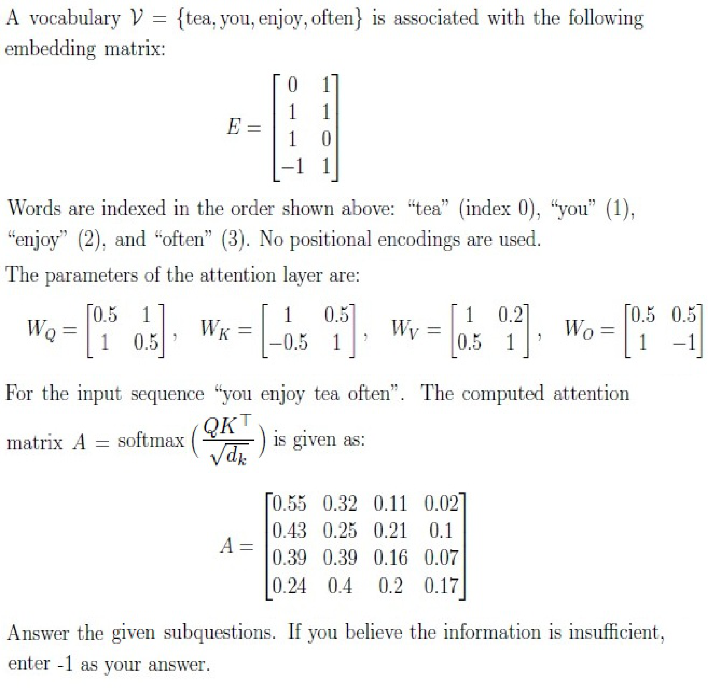

**Figure 12.** Vocabulary embeddings, projection matrices W_Q, W_K, W_V, W_O, and computed attention matrix A

### Question 146

**Question ID:** `6406531422523`

**Portal container ID:** `6406531422522`

**Type:** SA · **Marks:** 3
**PDF pages:** 6, 7

**Shared context:** [ctx-146-147](#ctx-146-147)

For the input “you enjoy tea often”, compute the final representation of the word “tea” after the 
attention layer (i.e., after applying WQ, WK, WV , attention weights, and WO). Enter the sum of the 
elements in the resulting vector.

**Correct answer:** 0.98 to 1.06

**Source evidence:** [{"page": 7, "bbox": [22.87, 180.0, 160.0, 205.0], "type": "explicit field", "detail": "Official source Range answer: 0.98 to 1.06"}]

### Question 147

**Question ID:** `6406531422524`

**Portal container ID:** `6406531422522`

**Type:** SA · **Marks:** 2
**PDF pages:** 7

**Shared context:** [ctx-146-147](#ctx-146-147)

Suppose the input sentence is “tea you enjoy often”. Using the same matrices and processing 
method, what is the attention score (i.e., softmax entry from A) for the query word “tea” attending 
to key word “often”?

**Correct answer:** 0.04 to 0.10

**Source evidence:** [{"page": 7, "bbox": [22.87, 420.0, 160.0, 445.0], "type": "explicit field", "detail": "Official source Range answer: 0.04 to 0.10"}]

### Shared context 148 to 150

**Question ID:** `6406531422530`

**Portal container ID:** `6406531422530`

**Type:** Comprehension
**PDF pages:** 7, 8

Suppose we have context length $T = 30$ and the number of blocks $n = 5$ for the block attention mechanism.

The masking matrix $M$ is defined as:

$$M_{ij} = \begin{cases} 1 & \text{if } \pi\left(\lfloor i/6 \rfloor\right) = \lfloor j/6 \rfloor \\ 0 & \text{otherwise} \end{cases}$$

where $i$ is row indices and $j$ is columns indexes both starting from 0.

Here, $\pi$ is a permutation of $\{0, 1, \dots, (n-1)\}$, which determines the allowed query-key block pairs. Specifically, if a query token $i$ lies in block $r = \lfloor i/6 \rfloor$, then it can attend only to key tokens in block $\pi(r)$.

Equivalently, if we partition queries and keys into blocks:

$$Q = (Q_0, Q_1, \dots, Q_{n-1}), \quad K = (K_{\pi(0)}, K_{\pi(1)}, \dots, K_{\pi(n-1)})$$

then block $Q_r$ attends only to block $K_{\pi(r)}$.

This block-restricted attention reduces computation by limiting interactions to the query-key block pairs specified by $\pi$.

Answer the given sub-questions using the attention mask $M \in \{0, 1\}^{T \times T}$ image, where black squares represent entries equal to 1 and white squares represent entries equal to 0.

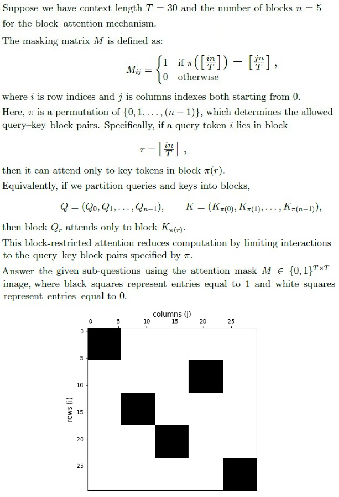

**Figure 13.** Block attention mechanism definition, permutation matrix, and attention mask M image

### Question 148

**Question ID:** `6406531422531`

**Portal container ID:** `6406531422530`

**Type:** MCQ · **Marks:** 2
**PDF pages:** 8, 9

**Shared context:** [ctx-148-150](#ctx-148-150)

Choose the correct representation of $\pi$ for the given mask image.

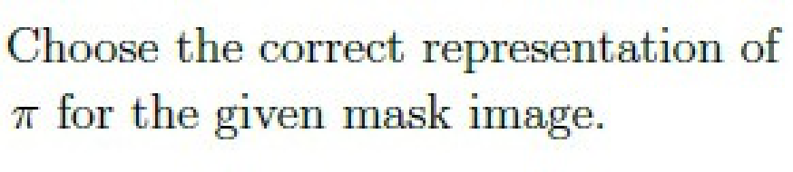

**Figure 14.** Prompt to choose correct representation of permutation pi for given mask image

**Options**

**A.**

$\pi = (0, 2, 3, 1, 4)$

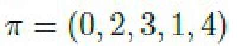

**Figure 15.** Option A permutation mapping

*Source option ID:* `6406534756348`

*Label added for presentation.*

**B.**

$\pi = (0, 6, 12, 18, 24)$

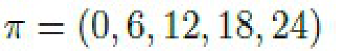

**Figure 16.** Option B permutation mapping

*Source option ID:* `6406534756349`

*Label added for presentation.*

**C.**

$\pi = (0, 3, 1, 2, 4)$

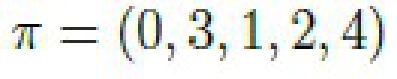

**Figure 17.** Option C permutation mapping

*Source option ID:* `6406534756350`

*Label added for presentation.*

**D.**

All of these

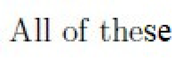

**Figure 18.** Option D permutation mapping

*Source option ID:* `6406534756351`

*Label added for presentation.*

**Correct answer:** $\pi = (0, 3, 1, 2, 4)$

**Source evidence:** [{"page": 9, "bbox": [119.02, 111.15, 131.02, 123.15], "type": "green source option", "detail": "Green marked option 6406534756350 (C)"}]

### Question 149

**Question ID:** `6406531422532`

**Portal container ID:** `6406531422530`

**Type:** SA · **Marks:** 1
**PDF pages:** 9

**Shared context:** [ctx-148-150](#ctx-148-150)

How many permutations of $\pi$ are possible for $n = 5$?

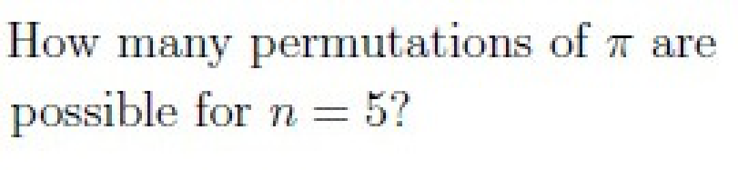

**Figure 19.** Prompt for total number of permutations of pi for n = 5

**Correct answer:** 120

**Source evidence:** [{"page": 9, "bbox": [22.87, 410.0, 100.0, 435.0], "type": "explicit field", "detail": "Official source Equal answer: 120"}]

### Question 150

**Question ID:** `6406531422533`

**Portal container ID:** `6406531422530`

**Type:** SA · **Marks:** 2
**PDF pages:** 9

**Shared context:** [ctx-148-150](#ctx-148-150)

What percentage of entries in the attention matrix are zero (i.e., the sparsity)?

**Correct answer:** 80

**Source evidence:** [{"page": 9, "bbox": [22.87, 610.0, 100.0, 635.0], "type": "explicit field", "detail": "Official source Equal answer: 80"}]

### Shared context 151 to 154

**Question ID:** `6406531422525`

**Portal container ID:** `6406531422525`

**Type:** Comprehension
**PDF pages:** 9, 10

Consider the short sentence:
“large language models are cool”
A transformer processes this sequence using the naive relative positional embedding method. The transformer’s embedding dimension is $d_{\text{model}} = 4$, and the number of tokens is $T = 5$. We use zero-based indexing for token positions:

0: large, 1: language, 2: models, 3: are, 4: cool

Note: In this context, the relative position ($k$) between two tokens is:
Relative position = $j - i$
rows = current token $i$, cols = other token $j$
Positive values mean the other token is after the current token, negative values mean it is before, and 0 means it is the same token.

1. Token embeddings (rows correspond to tokens in order):

$$X = \begin{bmatrix} 1 & 1 & 1 & 1 \\ 2 & 2 & 2 & 2 \\ 3 & 3 & 3 & 3 \\ 4 & 4 & 4 & 4 \\ 5 & 5 & 5 & 5 \end{bmatrix}$$

Denote the $i$-th row by $x_i$.

2. Positional embedding definition: For a relative position $k \in \mathbb{Z}$,

$$p_{j-i} = \left[ \frac{j-i}{10}, \frac{j-i}{10}, \frac{j-i}{10}, \frac{j-i}{10} \right]$$

Based on the above data, answer the given subquestions.

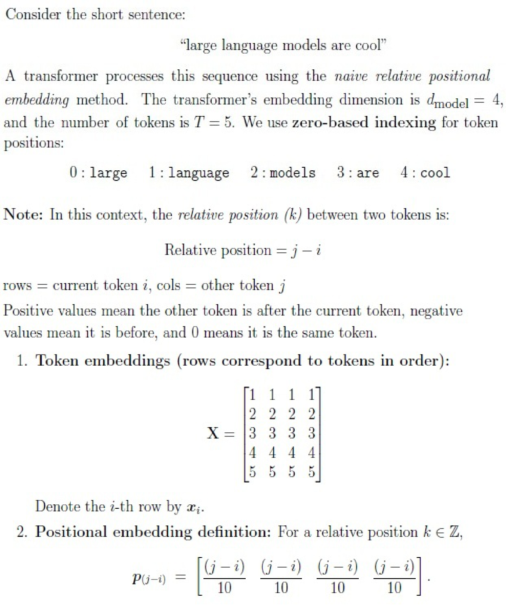

**Figure 20.** Relative positional embedding definition, token embeddings matrix X, and relative position vector formula

### Question 151

**Question ID:** `6406531422526`

**Portal container ID:** `6406531422525`

**Type:** MCQ · **Marks:** 1
**PDF pages:** 10, 11

**Shared context:** [ctx-151-154](#ctx-151-154)

Choose the sequence of relative positions (j — i) for the token "models" with respect to each token in the sentence.

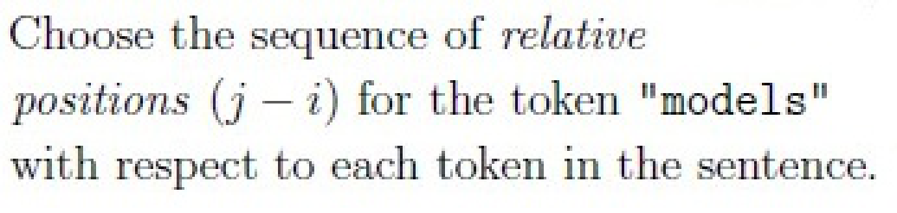

**Figure 21.** Prompt for relative positions sequence for token models

**Options**

**A.**

(0, 1, 2, 3, 4)

*Source option ID:* `6406534756338`

*Label added for presentation.*

**B.**

(-1, 0, 1, 2, 3)

*Source option ID:* `6406534756339`

*Label added for presentation.*

**C.**

(-2, -1, 0, 1, 2)

*Source option ID:* `6406534756340`

*Label added for presentation.*

**D.**

(-3, -2, -1, 0, 1)

*Source option ID:* `6406534756341`

*Label added for presentation.*

**Correct answer:** (-2, -1, 0, 1, 2)

**Source evidence:** [{"page": 11, "bbox": [119.02, 39.14, 131.02, 51.14], "type": "green source option", "detail": "Green marked option 6406534756340 (C)"}]

### Question 152

**Question ID:** `6406531422527`

**Portal container ID:** `6406531422525`

**Type:** MCQ · **Marks:** 1
**PDF pages:** 11

**Shared context:** [ctx-151-154](#ctx-151-154)

Choose the value of $p_{j-i}$ for the current token “model” and other token “large”.

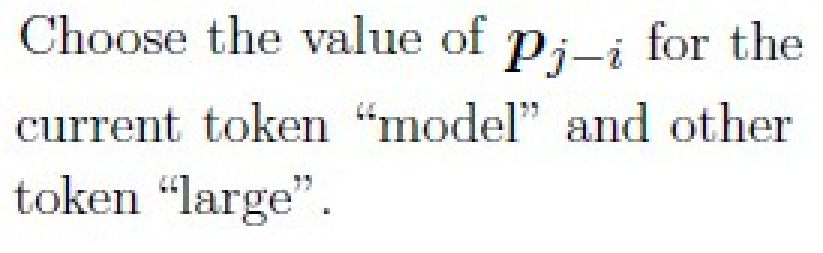

**Figure 22.** Prompt for positional embedding vector p_{j-i} for current token model and other token large

**Options**

**A.**

[0.2, 0.2, 0.2, 0.2]

![Option A vector [0.2, 0.2, 0.2, 0.2]](assets/da5004_2025T2_ET_FN/q152-q152-option-a-01-p011.png)

**Figure 23.** Option A vector [0.2, 0.2, 0.2, 0.2]

*Source option ID:* `6406534756342`

*Label added for presentation.*

**B.**

[-0.2, -0.2, -0.2, -0.2]

![Option B vector [-0.2, -0.2, -0.2, -0.2]](assets/da5004_2025T2_ET_FN/q152-q152-option-b-01-p011.png)

**Figure 24.** Option B vector [-0.2, -0.2, -0.2, -0.2]

*Source option ID:* `6406534756343`

*Label added for presentation.*

**C.**

[-0.3, -0.3, -0.3, -0.3]

![Option C vector [-0.3, -0.3, -0.3, -0.3]](assets/da5004_2025T2_ET_FN/q152-q152-option-c-01-p011.png)

**Figure 25.** Option C vector [-0.3, -0.3, -0.3, -0.3]

*Source option ID:* `6406534756344`

*Label added for presentation.*

**D.**

[-0.4, -0.4, -0.4, -0.4]

![Option D vector [-0.4, -0.4, -0.4, -0.4]](assets/da5004_2025T2_ET_FN/q152-q152-option-d-01-p011.png)

**Figure 26.** Option D vector [-0.4, -0.4, -0.4, -0.4]

*Source option ID:* `6406534756345`

*Label added for presentation.*

**Correct answer:** [-0.2, -0.2, -0.2, -0.2]

**Source evidence:** [{"page": 11, "bbox": [119.02, 295.89, 131.02, 307.89], "type": "green source option", "detail": "Green marked option 6406534756343 (B)"}]

### Question 153

**Question ID:** `6406531422528`

**Portal container ID:** `6406531422525`

**Type:** SA · **Marks:** 3
**PDF pages:** 11, 12

**Shared context:** [ctx-151-154](#ctx-151-154)

With a naive implementation, for each token embedding, we need a way to combine (say, addition) relative position embeddings. For token index $i \in \{0, \dots, T-1\}$,

$$h_i = x_i + \sum_{j=0}^{T-1} p_{j-i}$$

Using the naive formula above, compute the final combined embedding $h_i$ for the token "language" (i.e., $i = 1$). Submit the sum of all the elements.

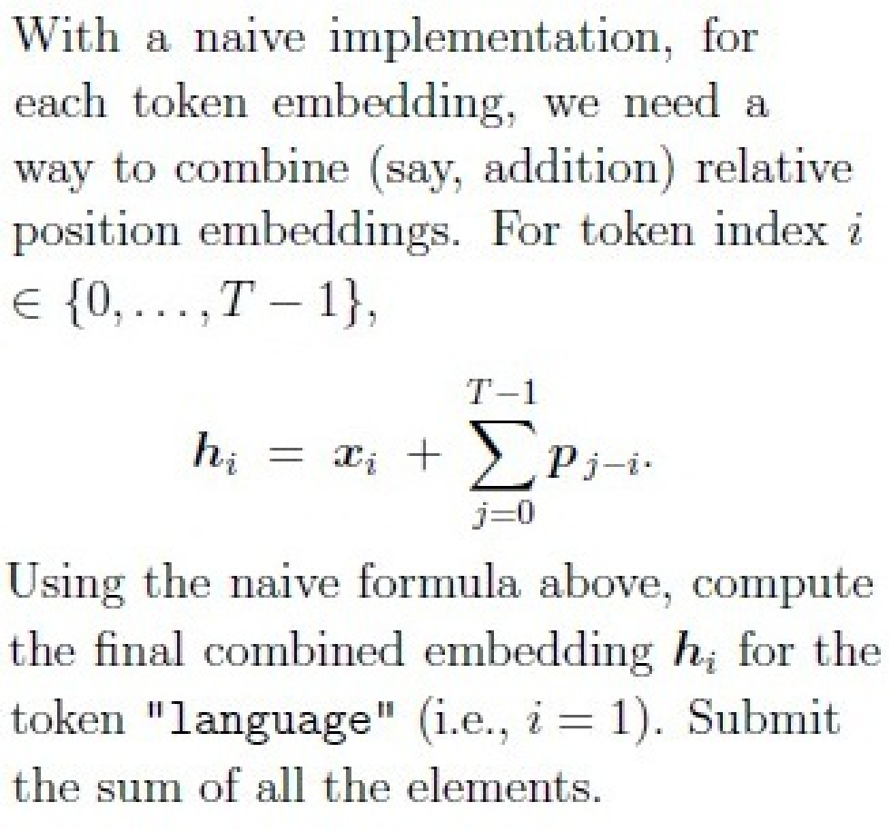

**Figure 27.** Prompt for combined embedding h_i calculation for token language

**Correct answer:** 10

**Source evidence:** [{"page": 12, "bbox": [22.87, 55.0, 100.0, 75.0], "type": "explicit field", "detail": "Official source Equal answer: 10"}]

### Question 154

**Question ID:** `6406531422529`

**Portal container ID:** `6406531422525`

**Type:** SA · **Marks:** 3
**PDF pages:** 12

**Shared context:** [ctx-151-154](#ctx-151-154)

Compute $e_{ij}$ for the current token “models” and other token “large”.

$$e_{ij} = x_i W_Q (x_j W_K + p_{j-i})^T$$

Assume $W_Q = I$ and $W_K = 2I$ where $I$ is an identity matrix. Answer $e_{ij}$ correct upto 1 digit after the decimal.

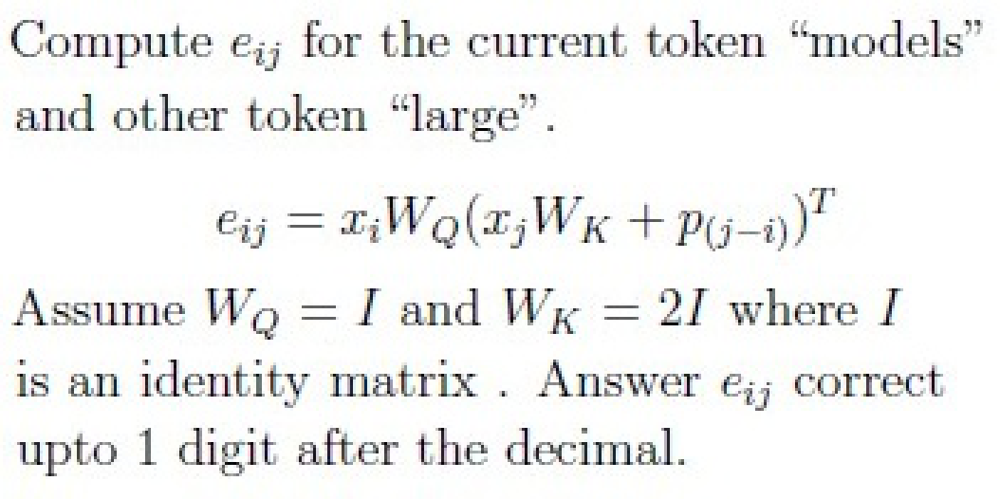

**Figure 28.** Prompt for relative attention score e_{ij} calculation for tokens models and large

**Correct answer:** 21.3 to 22.0

**Source evidence:** [{"page": 12, "bbox": [22.87, 405.0, 150.0, 430.0], "type": "explicit field", "detail": "Official source Range answer: 21.3 to 22.0"}]

## Answer key

| Source question | Source identity | Correct answer | PDF pages |
| :--- | :--- | :--- | :--- |
| 138 | 6406531422514 | [moo, nlight] | 2 |
| 139 | 6406531422515 | (a) : Strided Local Attention, (b) : Local + Global Attention, (c) : Random Local Attention, (d) : Sparse Block Attention | 3 |
| 140 | 6406531422516 | They help handle rare words by breaking them into smaller units.; They can reduce the overall vocabulary size compared to word-level  tokenizers. | 4 |
| 141 | 6406531422517 | Method A: Greedy decoding; Method B: Top-P sampling with p = 0.9; Method C: Top-P sampling with p = 0.5 and high temperature T = 1.5 | 4 |
| 142 | 6406531422518 | Number of transformer layers; Learning rate schedule; Vocabulary size; Type of normalization (e.g., LayerNorm) | 4 |
| 143 | 6406531422519 | Top-k keeps only the k most probable tokens before sampling.; Top-p dynamically chooses the smallest set of tokens whose cumulative  probability exceeds p. | 5 |
| 144 | 6406531422520 | Lowercasing text (for uncased models); Splitting into subword units using BPE or WordPiece; Adding position indices for each token | 5 |
| 145 | 6406531422521 | 0.38 to 0.44 | 5, 6 |
| 146 | 6406531422523 | 0.98 to 1.06 | 6, 7 |
| 147 | 6406531422524 | 0.04 to 0.10 | 7 |
| 148 | 6406531422531 | $\pi = (0, 3, 1, 2, 4)$ | 8, 9 |
| 149 | 6406531422532 | 120 | 9 |
| 150 | 6406531422533 | 80 | 9 |
| 151 | 6406531422526 | (-2, -1, 0, 1, 2) | 10, 11 |
| 152 | 6406531422527 | [-0.2, -0.2, -0.2, -0.2] | 11 |
| 153 | 6406531422528 | 10 | 11, 12 |
| 154 | 6406531422529 | 21.3 to 22.0 | 12 |

## Extraction notes

**Status:** verified
**Count reconciliation:** Section 6 declares 12 portal questions and 40 section marks. The 12 portal containers comprise: 1 administrative confirmation question (Q137, 0 marks, excluded), 8 standalone questions (Q138: 2 marks, Q139: 2 marks, Q140: 3 marks, Q141: 3 marks, Q142: 3 marks, Q143: 3 marks, Q144: 3 marks, Q145: 3 marks; total standalone = 22 marks), and 3 comprehension portal containers (Q146-147: 5 marks; Q148-150: 5 marks; Q151-154: 8 marks; comprehension subquestions total 18 marks). Total academic questions = 8 standalone + 9 comprehension subquestions = 17 academic questions. Total marks = 22 + 18 = 40 marks, exactly reconciling the declared section marks and question containers.

**Excluded source entries:**

- {"classification": "subject-confirmation", "page": 1, "bbox": [22.87, 689.2, 542.5, 841.89], "reason": "Administrative subject confirmation asking candidate to confirm subject and cross check hall ticket", "identity": "137"}
