# LLM — da5004_2025T2_Q1_NA

**Source:** `da5004_2025T2_Q1_NA.pdf` · **Academic questions:** 21 · **Separately counted children:** 0
**Provenance:** `Large_Language_Models/da5004_2025T2_Q1_NA.pdf` · SHA-256 `a8f64888d57debe8682701d05682f6028b33f9120ac354ab933639265a872afa`

**Scope:** Section 8: LLM (Degree Level : Large Language Models (Computer Based Exam)), physical pages 1 to 15. The in-scope subject begins on physical page 1 with Section 8 header (Section Id 64065391701) at y=491.39 and terminates on physical page 15 immediately preceding Section 9: DL(CV) (Section Id 64065391702) at y=406.50.

## Questions

### Question 135

**Question ID:** `6406531279474`

**Type:** Multiple Choice Question · **Marks:** 2
**PDF pages:** 2

Transformers process input tokens:

**Options**

**A.**

One at a time (sequentially)

*Source option ID:* `6406534313782`

**B.**

In reverse order

*Source option ID:* `6406534313783`

**C.**

All at once (in parallel)

*Source option ID:* `6406534313784`

**D.**

Only after seeing the full input

*Source option ID:* `6406534313785`

**Correct answer:** All at once (in parallel)

**Source evidence:** [{"page": 2, "bbox": [23.62, 586.6, 119.02, 602.92], "type": "green source option", "detail": "Option 6406534313784 is rendered in green (color 32768)"}]

### Question 136

**Question ID:** `6406531279475`

**Type:** Multiple Choice Question · **Marks:** 2
**PDF pages:** 3

What is the purpose of the softmax function in the attention mechanism?

**Options**

**A.**

Normalize attention scores to a probability distribution

*Source option ID:* `6406534313786`

**B.**

Add non-linearity to the model

*Source option ID:* `6406534313787`

**C.**

To predict the correct class for the loss function

*Source option ID:* `6406534313788`

**D.**

Remove redundant features from the input

*Source option ID:* `6406534313789`

**Correct answer:** Normalize attention scores to a probability distribution

**Source evidence:** [{"page": 3, "bbox": [23.62, 114.1, 119.02, 130.42], "type": "green source option", "detail": "Option 6406534313786 is rendered in green (color 32768)"}]

### Question 137

**Question ID:** `6406531279476`

**Type:** Multiple Choice Question · **Marks:** 2
**PDF pages:** 3

What is the main difference between GPT and BERT pre-training objectives?

**Options**

**A.**

GPT uses Masked Language Modeling, BERT uses Causal Language Modeling

*Source option ID:* `6406534313790`

**B.**

GPT uses Causal Language Modeling, BERT uses Masked Language Modeling

*Source option ID:* `6406534313791`

**C.**

Both use Masked Language Modeling

*Source option ID:* `6406534313792`

**D.**

Both use Causal Language Modeling

*Source option ID:* `6406534313793`

**Correct answer:** GPT uses Causal Language Modeling, BERT uses Masked Language Modeling

**Source evidence:** [{"page": 3, "bbox": [23.62, 338.62, 119.02, 354.94], "type": "green source option", "detail": "Option 6406534313791 is rendered in green (color 32768)"}]

### Question 138

**Question ID:** `6406531279477`

**Type:** Multiple Choice Question · **Marks:** 2
**PDF pages:** 3

In Top-K sampling for language generation, increasing the value of K typically has which of the following effects?

**Options**

**A.**

It makes the output more deterministic and repetitive.

*Source option ID:* `6406534313794`

**B.**

It reduces the probability of selecting high-frequency words.

*Source option ID:* `6406534313795`

**C.**

It increases the diversity of the generated text but may reduce coherence if K is too large.

*Source option ID:* `6406534313796`

**D.**

It guarantees grammatical correctness by focusing on top-ranked tokens only.

*Source option ID:* `6406534313797`

**Correct answer:** It increases the diversity of the generated text but may reduce coherence if K is too large.

**Source evidence:** [{"page": 3, "bbox": [23.62, 579.46, 119.02, 595.78], "type": "green source option", "detail": "Option 6406534313796 is rendered in green (color 32768)"}]

### Question 139

**Question ID:** `6406531279478`

**Type:** Multiple Choice Question · **Marks:** 2
**PDF pages:** 4

Why are residual connections important in transformer architectures?

**Options**

**A.**

They reduce memory consumption.

*Source option ID:* `6406534313798`

**B.**

They add extra cost of compute by adding batch normalization.

*Source option ID:* `6406534313799`

**C.**

They help in training deep networks by enabling gradient flow.

*Source option ID:* `6406534313800`

**D.**

They remove the need for layer normalization.

*Source option ID:* `6406534313801`

**Correct answer:** They help in training deep networks by enabling gradient flow.

**Source evidence:** [{"page": 4, "bbox": [23.62, 155.74, 119.02, 172.06], "type": "green source option", "detail": "Option 6406534313800 is rendered in green (color 32768)"}]

### Question 140

**Question ID:** `6406531279479`

**Type:** Multiple Select Question · **Marks:** 3
**PDF pages:** 4

Which of the following statements are true regarding causal language modeling (CLM)?

**Options**

**A.**

The model only attends to past and current tokens during training.

*Source option ID:* `6406534313802`

**B.**

The model is trained by predicting the next token in a sequence.

*Source option ID:* `6406534313803`

**C.**

The model uses bidirectional context.

*Source option ID:* `6406534313804`

**D.**

The CLM objective is commonly used for encoder-only models.

*Source option ID:* `6406534313805`

**Correct answer:** The model only attends to past and current tokens during training.; The model is trained by predicting the next token in a sequence.

**Source evidence:** [{"page": 4, "bbox": [23.62, 375.76, 119.02, 392.08], "type": "green source option", "detail": "Option 6406534313802 is rendered in green (color 32768)"}, {"page": 4, "bbox": [23.62, 396.58, 119.02, 412.9], "type": "green source option", "detail": "Option 6406534313803 is rendered in green (color 32768)"}]

### Question 141

**Question ID:** `6406531279480`

**Type:** Multiple Select Question · **Marks:** 3
**PDF pages:** 4

Which of the following are valid reasons why transformer-based large language models are widely used in natural language processing?

**Options**

**A.**

Transformers process input sequences in parallel, enabling faster training.

*Source option ID:* `6406534313806`

**B.**

They use recurrence to remember long-term dependencies more effectively than LSTMs.

*Source option ID:* `6406534313807`

**C.**

Transformers are limited to short text inputs due to their architecture.

*Source option ID:* `6406534313808`

**D.**

Large transformer models can be fine-tuned for various NLP tasks using a single pre-trained model.

*Source option ID:* `6406534313809`

**Correct answer:** Transformers process input sequences in parallel, enabling faster training.; Large transformer models can be fine-tuned for various NLP tasks using a single pre-trained model.

**Source evidence:** [{"page": 4, "bbox": [23.62, 595.78, 119.02, 612.1], "type": "green source option", "detail": "Option 6406534313806 is rendered in green (color 32768)"}, {"page": 4, "bbox": [23.62, 674.56, 119.02, 690.88], "type": "green source option", "detail": "Option 6406534313809 is rendered in green (color 32768)"}]

### Question 142

**Question ID:** `6406531279481`

**Type:** Multiple Select Question · **Marks:** 3
**PDF pages:** 5

Which elements are included in BERT’s input representation for Next Sentence Prediction?

**Options**

**A.**

[CLS] token at the beginning of input.

![[CLS] token at the beginning of input option block](assets/da5004_2025T2_Q1_NA/q142-q142-option-a-01-p005.png)

**Figure 1.** [CLS] token at the beginning of input option block

*Source option ID:* `6406534313810`

**B.**

[SEP] token to separate sentence A and sentence B.

![[SEP] token to separate sentence A and sentence B option block](assets/da5004_2025T2_Q1_NA/q142-q142-option-b-01-p005.png)

**Figure 2.** [SEP] token to separate sentence A and sentence B option block

*Source option ID:* `6406534313811`

**C.**

Segment embeddings to distinguish sentence A and sentence B.

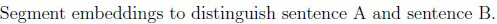

**Figure 3.** Segment embeddings to distinguish sentence A and sentence B option block

*Source option ID:* `6406534313812`

**D.**

Position embeddings are not required for Next Sentence Prediction.

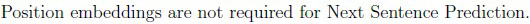

**Figure 4.** Position embeddings are not required for Next Sentence Prediction option block

*Source option ID:* `6406534313813`

**Correct answer:** [CLS] token at the beginning of input.; [SEP] token to separate sentence A and sentence B.; Segment embeddings to distinguish sentence A and sentence B.

**Source evidence:** [{"page": 5, "bbox": [23.62, 120.03, 119.02, 136.35], "type": "green source option", "detail": "Option 6406534313810 is rendered in green (color 32768)"}, {"page": 5, "bbox": [23.62, 161.6, 119.02, 177.92], "type": "green source option", "detail": "Option 6406534313811 is rendered in green (color 32768)"}, {"page": 5, "bbox": [23.62, 203.93, 119.02, 220.25], "type": "green source option", "detail": "Option 6406534313812 is rendered in green (color 32768)"}]

### Question 143

**Question ID:** `6406531279482`

**Type:** Multiple Select Question · **Marks:** 3
**PDF pages:** 5

How does Top-p (nucleus) sampling differ from Top-K sampling in language generation?

**Options**

**A.**

It samples only from a fixed number of tokens at each step.

*Source option ID:* `6406534313814`

**B.**

It samples from the smallest set of tokens whose cumulative probability exceeds p.

*Source option ID:* `6406534313815`

**C.**

It always selects the top-p tokens with equal probability.

*Source option ID:* `6406534313816`

**D.**

It guarantees diversity by selecting all low-probability tokens.

*Source option ID:* `6406534313817`

**Correct answer:** It samples from the smallest set of tokens whose cumulative probability exceeds p.

**Source evidence:** [{"page": 5, "bbox": [23.62, 424.63, 119.02, 440.95], "type": "green source option", "detail": "Option 6406534313815 is rendered in green (color 32768)"}]

### Question 144

**Question ID:** `6406531279483`

**Type:** Short Answer Question · **Marks:** 3
**PDF pages:** 6

Consider the embedding vector for a word, $x = [0.5, -0.4, 0.3, -0.2]^T$. Suppose the word is at position 3 in the given sentence. Add the corresponding position embedding $p$ to the word embedding to get $h$, i.e. the sum of the elements in $h = x + p$. Use the fixed sinusoidal position embedding vector calculated using the formula given below:

$$\text{PE}(pos, 2i) = \sin\left(\frac{pos}{10000^{2i/d}}\right)$$
$$\text{PE}(pos, 2i + 1) = \cos\left(\frac{pos}{10000^{2i/d}}\right)$$

What is the value of $h[0] - h[1]$ i.e. substract second element from the first element of $h$ vector ? (Answer correct up to 2 values after the decimal)

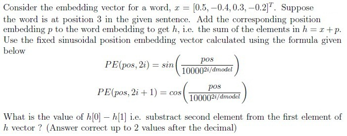

**Figure 5.** Sinusoidal positional embedding formulation and question parameters for token position 3

**Correct answer:** 1.98 to 2.08

**Source evidence:** [{"page": 6, "bbox": [22.87, 404.1, 180.0, 422.5], "type": "explicit field", "detail": "Possible Answers: 1.98 to 2.08"}]

### Question 145

**Question ID:** `6406531279484`

**Type:** Short Answer Question · **Marks:** 3
**PDF pages:** 7

Suppose a language model outputs the following logits for a vocabulary of size 4:

| Token | Logit |
| :--- | :--- |
| the | 2.0 |
| sky | 1.0 |
| is | 0.5 |
| blue | -1.0 |

You apply temperature scaling with temperature $T = 0.5$. After applying the softmax on the temperature-scaled logits, what is the probability assigned to the token “the”? (Give your answer up to 2 decimal places)

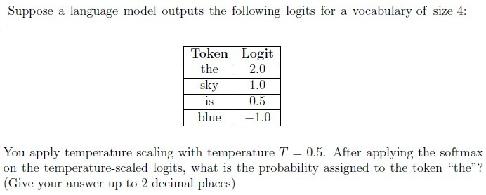

**Figure 6.** Vocabulary token logits table and temperature scaling parameter T=0.5 for softmax probability calculation

**Correct answer:** 0.81 to 0.87

**Source evidence:** [{"page": 7, "bbox": [22.87, 405.6, 180.0, 424.0], "type": "explicit field", "detail": "Possible Answers: 0.81 to 0.87"}]

### Question 146

**Question ID:** `6406531279485`

**Type:** Short Answer Question · **Marks:** 3
**PDF pages:** 7

A transformer generates the following attention weights for a token over four positions: (0.1, 0.2, 0.5, 0.2). The corresponding value vectors are:

$$v_1 = [1, 0], \quad v_2 = [0, 1], \quad v_3 = [1, 1], \quad v_4 = [2, 1]$$

Compute the output vector from the attention mechanism by taking the weighted sum of the value vectors, and return the first element of the resulting vector. (Round to 2 decimal places)

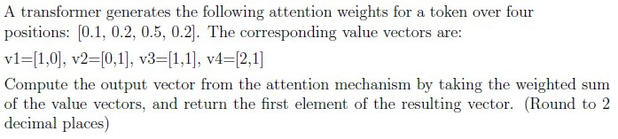

**Figure 7.** Attention weights and value vectors v1, v2, v3, v4 for weighted sum output vector calculation

**Correct answer:** 0.9 to 1.1

**Source evidence:** [{"page": 7, "bbox": [22.87, 749.0, 180.0, 767.3], "type": "explicit field", "detail": "Possible Answers: 0.9 to 1.1"}]

### Shared context 147 to 149

**Question ID:** `6406531279486`

**Type:** Comprehension
**PDF pages:** 9

**Question Description**
- Embedding dimension : $d_{\text{model}} = 4$
- Input sequence (sequence length = 2, $d_{\text{model}} = 4$) :
$$X = \begin{bmatrix} 1 & 0 & 1 & 0 \\ 0 & 2 & 0 & 2 \end{bmatrix}$$
- Number of heads: 2 (each head operates on 2 dimensions)
- For both the heads $d_K = d_Q = d_V = 2$
- Weight matrices for $W_Q, W_K, W_V$ first head :
$$W_Q^1, W_K^1, W_V^1 = \begin{bmatrix} 1 & 0 \\ 0 & 1 \\ 1 & 0 \\ 0 & 1 \end{bmatrix}$$
- Weight matrices for $W_Q, W_K, W_V$ second head :
$$W_Q^2, W_K^2, W_V^2 = \begin{bmatrix} 0 & 1 \\ 1 & 0 \\ 0 & 1 \\ 1 & 0 \end{bmatrix}$$
- The output from both heads are concatenated, then projected by:
$$W_O = \begin{bmatrix} 0.5 & 0 & 0 & 0 \\ 0 & 0.5 & 0 & 0 \\ 0 & 0 & 0.5 & 0 \\ 0 & 0 & 0 & 0.5 \end{bmatrix}$$
$$\text{Scaled Dot-Product Attention}(Q, K, V) = \text{softmax}\left(\frac{Q K^T}{\sqrt{d_K}}\right) V$$

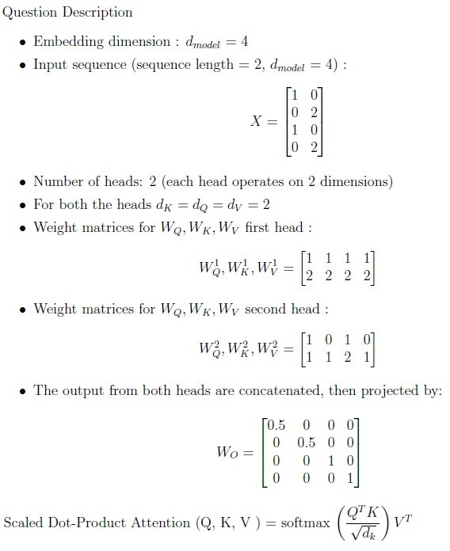

**Figure 8.** Comprehension data: embedding dimensions, input sequence matrix X, projection matrices WQ, WK, WV, WO, and attention formula

Based on the above data, answer the given subquestions.

### Question 147

**Question ID:** `6406531279487`

**Type:** Multiple Choice Question · **Marks:** 3
**PDF pages:** 9, 10

**Shared context:** [ctx-147-149](#ctx-147-149)

Select the scaled dot-product attention for the first head:

**Options**

**A.**

$$\begin{bmatrix} 0 & 0 \\ 1 & 1 \end{bmatrix}$$

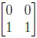

**Figure 9.** Candidate attention matrix for head 1 option A

*Source option ID:* `6406534313821`

**B.**

$$\begin{bmatrix} 0 & 0 \\ 6 & 12 \end{bmatrix}$$

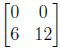

**Figure 10.** Candidate attention matrix for head 1 option B

*Source option ID:* `6406534313822`

**C.**

$$\begin{bmatrix} 1.46 & 2.92 \\ 4.53 & 9.08 \end{bmatrix}$$

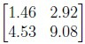

**Figure 11.** Candidate attention matrix for head 1 option C

*Source option ID:* `6406534313823`

**D.**

$$\begin{bmatrix} 1.98 & 3.76 \\ 4.02 & 8.31 \end{bmatrix}$$

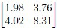

**Figure 12.** Candidate attention matrix for head 1 option D

*Source option ID:* `6406534313824`

**Correct answer:** $$\begin{bmatrix} 0 & 0 \\ 6 & 12 \end{bmatrix}$$

**Source evidence:** [{"page": 10, "bbox": [23.62, 101.75, 119.02, 118.07], "type": "green source option", "detail": "Option 6406534313822 is rendered in green (color 32768)"}]

### Question 148

**Question ID:** `6406531279488`

**Type:** Multiple Choice Question · **Marks:** 3
**PDF pages:** 10

**Shared context:** [ctx-147-149](#ctx-147-149)

Select the scaled dot-product attention for the second head:

**Options**

**A.**

$$\begin{bmatrix} 1.34 & 2.23 \\ 0.66 & 4.77 \end{bmatrix}$$

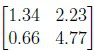

**Figure 13.** Candidate attention matrix for head 2 option A

*Source option ID:* `6406534313825`

**B.**

$$\begin{bmatrix} 2.33 & 1.32 \\ 2.94 & 3.76 \end{bmatrix}$$

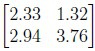

**Figure 14.** Candidate attention matrix for head 2 option B

*Source option ID:* `6406534313826`

**C.**

$$\begin{bmatrix} 1.96 & 1.68 \\ 3.04 & 2.32 \end{bmatrix}$$

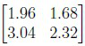

**Figure 15.** Candidate attention matrix for head 2 option C

*Source option ID:* `6406534313827`

**D.**

$$\begin{bmatrix} 2.65 & 2.60 \\ 2.58 & 2.32 \end{bmatrix}$$

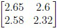

**Figure 16.** Candidate attention matrix for head 2 option D

*Source option ID:* `6406534313828`

**Correct answer:** $$\begin{bmatrix} 1.34 & 2.23 \\ 0.66 & 4.77 \end{bmatrix}$$

**Source evidence:** [{"page": 10, "bbox": [23.62, 401.65, 119.02, 417.97], "type": "green source option", "detail": "Option 6406534313825 is rendered in green (color 32768)"}]

### Question 149

**Question ID:** `6406531279489`

**Type:** Multiple Choice Question · **Marks:** 2
**PDF pages:** 10, 11

**Shared context:** [ctx-147-149](#ctx-147-149)

Concatenate the outputs from both the attention heads, then apply the output projection matrix Wo to produce the final output of the multi-head attention mechanism. Select the correct result of this operation.

**Options**

**A.**

$$\begin{bmatrix} 0.73 & 1.46 \\ 2.26 & 4.54 \\ 2.33 & 1.32 \\ 2.94 & 3.76 \end{bmatrix}$$

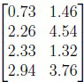

**Figure 17.** Candidate multi-head attention projection matrix option A

*Source option ID:* `6406534313829`

**B.**

$$\begin{bmatrix} 0.99 & 1.88 \\ 2.01 & 4.16 \\ 1.96 & 1.68 \\ 3.04 & 2.32 \end{bmatrix}$$

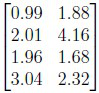

**Figure 18.** Candidate multi-head attention projection matrix option B

*Source option ID:* `6406534313830`

**C.**

$$\begin{bmatrix} 0.00 & 0.00 \\ 0.50 & 0.50 \\ 2.65 & 2.60 \\ 2.58 & 2.32 \end{bmatrix}$$

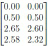

**Figure 19.** Candidate multi-head attention projection matrix option C

*Source option ID:* `6406534313831`

**D.**

$$\begin{bmatrix} 0.00 & 0.00 \\ 3.00 & 6.00 \\ 1.34 & 2.23 \\ 0.66 & 4.77 \end{bmatrix}$$

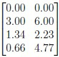

**Figure 20.** Candidate multi-head attention projection matrix option D

*Source option ID:* `6406534313832`

**Correct answer:** $$\begin{bmatrix} 0.00 & 0.00 \\ 3.00 & 6.00 \\ 1.34 & 2.23 \\ 0.66 & 4.77 \end{bmatrix}$$

**Source evidence:** [{"page": 11, "bbox": [23.62, 355.9, 119.02, 372.22], "type": "green source option", "detail": "Option 6406534313832 is rendered in green (color 32768)"}]

### Shared context 150 to 152

**Question ID:** `6406531279490`

**Type:** Comprehension
**PDF pages:** 12

Apply “add and norm” layer to the output of the multihead attention in which :
- Input sequence (sequence length = 2, $d_{\text{model}} = 4$) to Multihead Attention:
$$X = \begin{bmatrix} 1 & 2 & 3 & 4 \\ 2 & 1 & 3 & 4 \end{bmatrix}$$
- Multi head Attention Output :
$$\text{MHA}(X) = \begin{bmatrix} 2 & 3 & 1 & 2 \\ 5 & 4 & 1 & 2 \end{bmatrix}$$
$$\text{LayerNorm}(x) = \frac{x - \mu}{\sigma} \odot \gamma + \beta$$

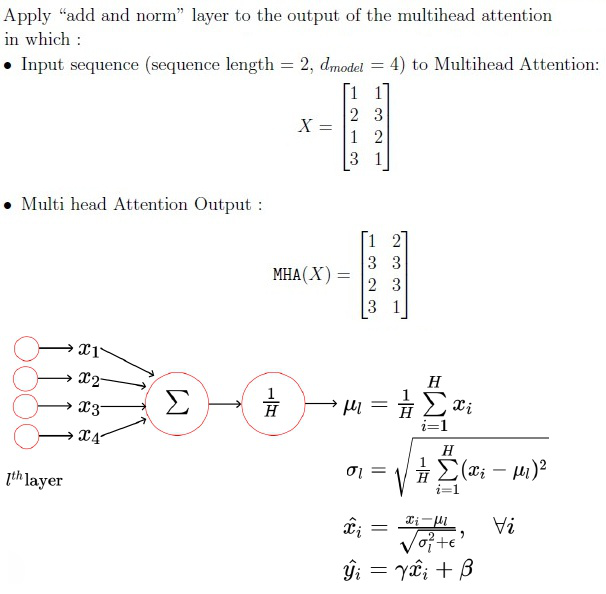

**Figure 21.** Comprehension data: Add and Norm layer instructions, input sequence matrix X, and multi-head attention output matrix MHA(X)

Based on the above data, answer the given subquestions.

### Question 150

**Question ID:** `6406531279491`

**Type:** Short Answer Question · **Marks:** 1
**PDF pages:** 12, 13

**Shared context:** [ctx-150-152](#ctx-150-152)

For the given input matrix X and multihead attention output MHA(X), apply a residual connection and store the result in matrix R, and finally compute the sum of all elements in matrix R.

**Correct answer:** 36

**Source evidence:** [{"page": 13, "bbox": [22.87, 16.8, 180.0, 35.1], "type": "explicit field", "detail": "Possible Answers: 36"}]

### Question 151

**Question ID:** `6406531279492`

**Type:** Short Answer Question · **Marks:** 2
**PDF pages:** 13

**Shared context:** [ctx-150-152](#ctx-150-152)

To apply the layer normalization on the matrix R. How many learning parameters ($\theta$) will be required ?

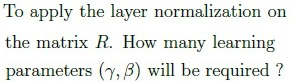

**Figure 22.** Question stem: Layer normalization learnable parameters count calculation for matrix R

**Correct answer:** 8

**Source evidence:** [{"page": 13, "bbox": [22.87, 299.3, 180.0, 317.7], "type": "explicit field", "detail": "Possible Answers: 8"}]

### Question 152

**Question ID:** `6406531279493`

**Type:** Short Answer Question · **Marks:** 3
**PDF pages:** 13

**Shared context:** [ctx-150-152](#ctx-150-152)

Initialize $\gamma = 2, \beta = 1$ and use $\epsilon = 0$ and apply the layer normalization on the matrix R and sum of all the elements of the final output.

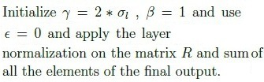

**Figure 23.** Question stem: Layer normalization initialization parameters gamma=2, beta=1, epsilon=0 and output sum calculation

**Correct answer:** 8

**Source evidence:** [{"page": 13, "bbox": [22.87, 598.4, 180.0, 616.7], "type": "explicit field", "detail": "Possible Answers: 8"}]

### Shared context 153 to 155

**Question ID:** `6406531279494`

**Type:** Comprehension
**PDF pages:** 14

The table presents the conditional probability distribution over vocabulary tokens at each timestep during sequence generation. Each column corresponds to a timestep (from 1 to 5), and the values represent the probability of selecting each token given the tokens chosen in all previous timesteps. For timestep t, the values in the column represent:

$$P(\text{token}_t \mid \text{token}_1, \text{token}_2, \dots, \text{token}_{t-1})$$

| timesteps | 1 | 2 | 3 | 4 | 5 |
| :--- | :--- | :--- | :--- | :--- | :--- |
| the | 0.07 | 0.19 | 0.20 | 0.42 | 0.08 |
| is | 0.04 | 0.13 | 0.12 | 0.26 | 0.08 |
| sky | 0.23 | 0.12 | 0.35 | 0.05 | 0.15 |
| [other] | 0.03 | 0.18 | 0.16 | 0.16 | 0.46 |
| very | 0.22 | 0.01 | 0.07 | 0.11 | 0.15 |
| blue | 0.33 | 0.25 | 0.08 | 0.05 | 0.08 |

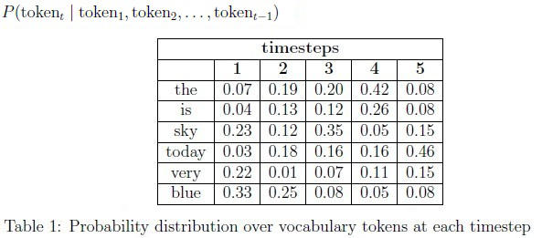

**Figure 24.** Table 1: Probability distribution over vocabulary tokens across timesteps 1 to 5

Based on the above data, answer the given subquestions.

### Question 153

**Question ID:** `6406531279495`

**Type:** Short Answer Question · **Marks:** 2
**PDF pages:** 14

**Shared context:** [ctx-153-155](#ctx-153-155)

In exhaustive search, at timestep t=1, we run the decoder once to obtain probability distributions over all tokens in the vocabulary. Given the 6 tokens available in the table in the main question, how many times must we run the decoder at timestep t=4?

**Correct answer:** 216

**Source evidence:** [{"page": 14, "bbox": [22.87, 672.0, 180.0, 690.4], "type": "explicit field", "detail": "Possible Answers: 216"}]

### Question 154

**Question ID:** `6406531279496`

**Type:** Short Answer Question · **Marks:** 1
**PDF pages:** 14, 15

**Shared context:** [ctx-153-155](#ctx-153-155)

How many total sequences of exactly length 5 are possible according to exhaustive search?

**Correct answer:** 7776

**Source evidence:** [{"page": 15, "bbox": [22.87, 113.4, 180.0, 131.7], "type": "explicit field", "detail": "Possible Answers: 7776"}]

### Question 155

**Question ID:** `6406531279497`

**Type:** Short Answer Question · **Marks:** 2
**PDF pages:** 15

**Shared context:** [ctx-153-155](#ctx-153-155)

If we use top-k sampling with k=2 at timestep 1, what is the normalized probability of selecting token “sky” at the timestep=1?

**Correct answer:** 0.41

**Source evidence:** [{"page": 15, "bbox": [22.87, 363.6, 180.0, 381.9], "type": "explicit field", "detail": "Possible Answers: 0.41"}]

## Answer key

| Source question | Source identity | Correct answer | PDF pages |
| :--- | :--- | :--- | :--- |
| 135 | 6406531279474 | All at once (in parallel) | 2 |
| 136 | 6406531279475 | Normalize attention scores to a probability distribution | 3 |
| 137 | 6406531279476 | GPT uses Causal Language Modeling, BERT uses Masked Language Modeling | 3 |
| 138 | 6406531279477 | It increases the diversity of the generated text but may reduce coherence if K is too large. | 3 |
| 139 | 6406531279478 | They help in training deep networks by enabling gradient flow. | 4 |
| 140 | 6406531279479 | The model only attends to past and current tokens during training.; The model is trained by predicting the next token in a sequence. | 4 |
| 141 | 6406531279480 | Transformers process input sequences in parallel, enabling faster training.; Large transformer models can be fine-tuned for various NLP tasks using a single pre-trained model. | 4 |
| 142 | 6406531279481 | [CLS] token at the beginning of input.; [SEP] token to separate sentence A and sentence B.; Segment embeddings to distinguish sentence A and sentence B. | 5 |
| 143 | 6406531279482 | It samples from the smallest set of tokens whose cumulative probability exceeds p. | 5 |
| 144 | 6406531279483 | 1.98 to 2.08 | 6 |
| 145 | 6406531279484 | 0.81 to 0.87 | 7 |
| 146 | 6406531279485 | 0.9 to 1.1 | 7 |
| 147 | 6406531279487 | $$\begin{bmatrix} 0 & 0 \\ 6 & 12 \end{bmatrix}$$ | 9, 10 |
| 148 | 6406531279488 | $$\begin{bmatrix} 1.34 & 2.23 \\ 0.66 & 4.77 \end{bmatrix}$$ | 10 |
| 149 | 6406531279489 | $$\begin{bmatrix} 0.00 & 0.00 \\ 3.00 & 6.00 \\ 1.34 & 2.23 \\ 0.66 & 4.77 \end{bmatrix}$$ | 10, 11 |
| 150 | 6406531279491 | 36 | 12, 13 |
| 151 | 6406531279492 | 8 | 13 |
| 152 | 6406531279493 | 8 | 13 |
| 153 | 6406531279495 | 216 | 14 |
| 154 | 6406531279496 | 7776 | 14, 15 |
| 155 | 6406531279497 | 0.41 | 15 |

## Extraction notes

**Status:** verified
**Count reconciliation:** Section 8 declares 16 questions and 50 marks. The 16 portal question units correspond to 1 administrative subject-confirmation question (Question 134, 0 marks), 12 standalone academic questions (Questions 135-139 [5 MCQs x 2 = 10 marks], Questions 140-143 [4 MSQs x 3 = 12 marks], Questions 144-146 [3 SAs x 3 = 9 marks]), and 3 comprehension blocks (Questions 147-149 [3+3+2 = 8 marks], Questions 150-152 [1+2+3 = 6 marks], and Questions 153-155 [2+1+2 = 5 marks]). Total academic questions reconcile to exactly 21 (12 standalone + 9 comprehension subquestions). Marks sum to 10 + 12 + 9 + 8 + 6 + 5 = 50, matching the declared Section Marks of 50.

**Excluded source entries:**

- {"classification": "out-of-scope-section", "page": 1, "bbox": [0.0, 0.0, 595.3, 491.39], "reason": "Preceding section exam content (options 6406534313773 to 6406534313775, and Question 133) prior to Section 8 LLM header", "identity": "preceding-section"}
- {"classification": "subject-confirmation", "page": 2, "bbox": [22.87, 80.0, 580.0, 280.0], "reason": "Administrative subject confirmation asking candidate to confirm subject and cross check hall ticket", "identity": "134"}
- {"classification": "out-of-scope-section", "page": 15, "bbox": [0.0, 406.5, 595.3, 841.9], "reason": "Subsequent Section 9 DL(CV) exam header terminating LLM section", "identity": "following-section-9"}
