# LLM — da5004_2025T2_Q2_NA

**Source:** `da5004_2025T2_Q2_NA.pdf` · **Academic questions:** 17 · **Separately counted children:** 0
**Provenance:** `Large_Language_Models/da5004_2025T2_Q2_NA.pdf` · SHA-256 `86c404a53c5610cb48b7c7d701bb4794a5f76fe4fb77a9aa07df66976036a9a5`

**Scope:** Large Language Models (LLM) section (Section 13, Section Id: 64065394491) spanning page 1 at y=78.10 to page 9 at y=842.00. Preceding Section 12 tail content at top of page 1 (y=0 to y=78.10, Possible Answers : 2) is excluded as out of subject scope.

## Questions

### Question 269

<a id="q269"></a>

**Question ID:** `6406531326571`

**Type:** MCQ · **Marks:** 2
**PDF pages:** 2

What is a primary motivation for using subword tokenization (like BPE or WordPiece) instead of 
word-level tokenization in transformers?

**Options**

**A.**

It increases vocabulary size exponentially

*Source option ID:* `6406534441547`

**B.**

It completely eliminates the need for a tokenizer

*Source option ID:* `6406534441548`

**C.**

It helps handle out-of-vocabulary words more effectively

*Source option ID:* `6406534441549`

**D.**

It prevents the model from needing positional encoding

*Source option ID:* `6406534441550`

**Correct answer:** It helps handle out-of-vocabulary words more effectively

**Source evidence:** [{"page": 2, "bbox": [23.62, 191.38, 131.02, 207.7], "type": "marked-options", "detail": "Green checkmark option 6406534441549"}]

### Question 270

<a id="q270"></a>

**Question ID:** `6406531326572`

**Type:** MCQ · **Marks:** 2
**PDF pages:** 2

What is a key implication of scaling laws in large language models?

**Options**

**A.**

Training longer always leads to better performance

*Source option ID:* `6406534441551`

**B.**

Larger models require less training data

*Source option ID:* `6406534441552`

**C.**

Model size and dataset size must scale together to maintain optimal 
performance

*Source option ID:* `6406534441553`

**D.**

None of these

*Source option ID:* `6406534441554`

**Correct answer:** Model size and dataset size must scale together to maintain optimal 
performance

**Source evidence:** [{"page": 2, "bbox": [23.62, 395.08, 131.02, 411.4], "type": "marked-options", "detail": "Green checkmark option 6406534441553"}]

### Question 271

<a id="q271"></a>

**Question ID:** `6406531326573`

**Type:** MCQ · **Marks:** 2
**PDF pages:** 2

Consider the Following Assertion and Reason pair : 
Assertion : In Byte Pair Encoding (BPE), each merge operation adds exactly one new token to the 
vocabulary. 
Reason : BPE helps reduce the size of the initial vocabulary by merging the most frequent tokens.

**Options**

**A.**

Both Assertion and Reason are true, and Reason is the correct explanation of 
Assertion.

*Source option ID:* `6406534441555`

**B.**

Both Assertion and Reason are true, but Reason is not the correct explanation 
of Assertion.

*Source option ID:* `6406534441556`

**C.**

Assertion is true, but Reason is false.

*Source option ID:* `6406534441557`

**D.**

Assertion is false, but Reason is true.

*Source option ID:* `6406534441558`

**Correct answer:** Assertion is true, but Reason is false.

**Source evidence:** [{"page": 2, "bbox": [23.62, 696.7, 131.02, 713.02], "type": "marked-options", "detail": "Green checkmark option 6406534441557"}]

### Question 272

<a id="q272"></a>

**Question ID:** `6406531326575`

**Type:** MCQ · **Marks:** 2
**PDF pages:** 2, 3

What is the primary advantage of T5’s text-to-text approach for transfer learning in NLP?

**Options**

**A.**

It reduces the computational cost of training models significantly.

*Source option ID:* `6406534441563`

**B.**

It allows a single model and architecture to be applied to a wide variety of NLP 
tasks without modification.

*Source option ID:* `6406534441564`

**C.**

It guarantees optimal performance on all tasks without fine-tuning.

*Source option ID:* `6406534441565`

**D.**

It eliminates the need for any pre-training data.

*Source option ID:* `6406534441566`

**Correct answer:** It allows a single model and architecture to be applied to a wide variety of NLP 
tasks without modification.

**Source evidence:** [{"page": 3, "bbox": [23.62, 76.96, 131.02, 93.28], "type": "marked-options", "detail": "Green checkmark option 6406534441564"}]

### Question 273

<a id="q273"></a>

**Question ID:** `6406531326576`

**Type:** MCQ · **Marks:** 2
**PDF pages:** 3

What is the format of output the T5 model is expected to generate during its span-corruption 
pretraining?

**Options**

**A.**

A sentence with masked tokens filled in

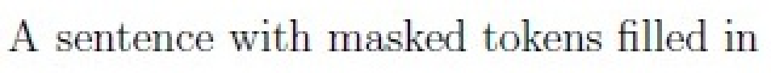

**Figure 1.** Option A: A sentence with masked tokens filled in

*Source option ID:* `6406534441567`

**B.**

A concatenation of masked spans in order, each preceded by the corresponding sentinel token

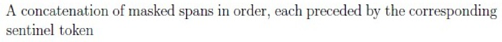

**Figure 2.** Option B: A concatenation of masked spans in order, each preceded by the corresponding sentinel token

*Source option ID:* `6406534441568`

**C.**

A binary classification of whether the span was masked correctly

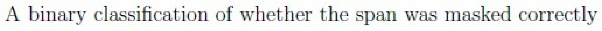

**Figure 3.** Option C: A binary classification of whether the span was masked correctly

*Source option ID:* `6406534441569`

**D.**

A sequence of original and corrupted spans separated by <mask\>


**Figure 4.** Option D: A sequence of original and corrupted spans separated by <mask\>

*Source option ID:* `6406534441570`

**Correct answer:** A concatenation of masked spans in order, each preceded by the corresponding sentinel token

**Source evidence:** [{"page": 3, "bbox": [23.62, 362.48, 131.02, 378.8], "type": "marked-options", "detail": "Green checkmark option 6406534441568"}]

### Question 274

<a id="q274"></a>

**Question ID:** `6406531326574`

**Type:** MCQ · **Marks:** 3
**PDF pages:** 3, 4

Given the input string:
peanutbutter

And the following vocabulary of subword tokens with their corresponding log-probabilities:

| Subword | Log-Probability (base $e$) |
|---|---|
| pea | -1.0 |
| nut | -0.8 |
| but | -1.2 |
| ter | -0.7 |
| butter | -1.0 |
| peanut | -0.5 |
| t | -2.0 |
| er | -1.5 |

Using the Viterbi algorithm (as used in the SentencePiece tokenizer), determine the most probable tokenization of the input string. The probability of a tokenized sequence is the sum of the log-probabilities of the selected subwords. Only subwords from the vocabulary may be used.

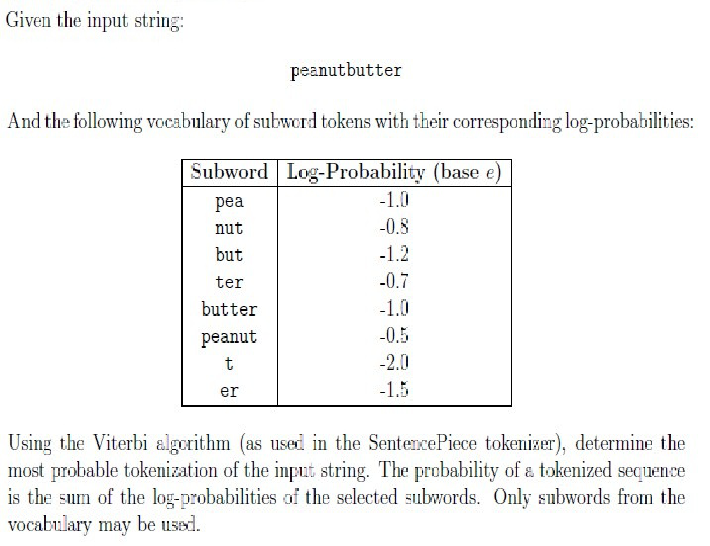

**Figure 5.** Viterbi algorithm tokenization problem with input string peanutbutter and vocabulary table

**Options**

**A.**

[peanut, but, ter]

![Option A: [peanut, but, ter]](assets/da5004_2025T2_Q2_NA/q274-q274-option-a-01-p004.png)

**Figure 6.** Option A: [peanut, but, ter]

*Source option ID:* `6406534441559`

**B.**

[pea, nut, butter]

![Option B: [pea, nut, butter]](assets/da5004_2025T2_Q2_NA/q274-q274-option-b-01-p004.png)

**Figure 7.** Option B: [pea, nut, butter]

*Source option ID:* `6406534441560`

**C.**

[peanut, butter]

![Option C: [peanut, butter]](assets/da5004_2025T2_Q2_NA/q274-q274-option-c-01-p004.png)

**Figure 8.** Option C: [peanut, butter]

*Source option ID:* `6406534441561`

**D.**

[pea, nut, but, ter]

![Option D: [pea, nut, but, ter]](assets/da5004_2025T2_Q2_NA/q274-q274-option-d-01-p004.png)

**Figure 9.** Option D: [pea, nut, but, ter]

*Source option ID:* `6406534441562`

**Correct answer:** [peanut, butter]

**Source evidence:** [{"page": 4, "bbox": [23.62, 471.4, 131.02, 487.72], "type": "marked-options", "detail": "Green checkmark option 6406534441561"}]

### Question 275

<a id="q275"></a>

**Question ID:** `6406531326577`

**Type:** MCQ · **Marks:** 3
**PDF pages:** 4, 5

Suppose you are given 4x more compute budget to scale a Transformer-based language model. 
According to scaling laws, what is the best way to utilize this increased compute for optimal 
model performance?

**Options**

**A.**

Increase the model size (number of parameters) by 4x and keep the dataset 
size and training steps the same.

*Source option ID:* `6406534441571`

**B.**

Train the same model on 4x more data for 4x more steps without changing 
the model size.

*Source option ID:* `6406534441572`

**C.**

Increase the model size by approximately 2x and increase the amount of 
training data by approximately 2x.

*Source option ID:* `6406534441573`

**D.**

Double the model size and halve the training data size to compensate.

*Source option ID:* `6406534441574`

**Correct answer:** Increase the model size by approximately 2x and increase the amount of 
training data by approximately 2x.

**Source evidence:** [{"page": 4, "bbox": [23.62, 781.21, 131.02, 797.53], "type": "marked-options", "detail": "Green checkmark option 6406534441573"}]

### Question 276

<a id="q276"></a>

**Question ID:** `6406531326578`

**Type:** MSQ · **Marks:** 3
**PDF pages:** 5

In a data preprocessing stage designed to prepare clean, diverse, and safe data, which of the 
following examples is likely to be filtered out?

**Options**

**A.**

“All people from that xyz area are thieves. They should be jailed immediately.”

*Source option ID:* `6406534441575`

**B.**

Kavya’s PAN number is BDZPK1234K and her registered address is 17/4, Green 
Park, Delhi.

*Source option ID:* `6406534441576`

**C.**

[“Reinforcement learning allows agents to learn optimal strategies through 
interaction with an environment.”, “Reinforcement learning allows agents to learn optimal 
strategies through interaction with an environment.”]

*Source option ID:* `6406534441577`

**D.**

The Union Budget 2024 proposes increased spending on green energy 
infrastructure.

*Source option ID:* `6406534441578`

**E.**

According to WHO, global life expectancy has increased by 6 years since 2000.

*Source option ID:* `6406534441579`

**F.**

None of these.

*Source option ID:* `6406534441580`

**Correct answer:** “All people from that xyz area are thieves. They should be jailed immediately.”; Kavya’s PAN number is BDZPK1234K and her registered address is 17/4, Green 
Park, Delhi.; [“Reinforcement learning allows agents to learn optimal strategies through 
interaction with an environment.”, “Reinforcement learning allows agents to learn optimal 
strategies through interaction with an environment.”]

**Source evidence:** [{"page": 5, "bbox": [23.62, 233.02, 131.02, 249.34], "type": "marked-options", "detail": "Green checkmark option 6406534441575"}, {"page": 5, "bbox": [23.62, 253.84, 131.02, 270.16], "type": "marked-options", "detail": "Green checkmark option 6406534441576"}, {"page": 5, "bbox": [23.62, 290.98, 131.02, 307.3], "type": "marked-options", "detail": "Green checkmark option 6406534441577"}]

### Question 277

<a id="q277"></a>

**Question ID:** `6406531326579`

**Type:** MSQ · **Marks:** 3
**PDF pages:** 5

What are the key challenges encountered when building a vocabulary for NLP models?

**Options**

**A.**

A larger vocabulary leads to a bigger embedding matrix and increased 
softmax computation

*Source option ID:* `6406534441581`

**B.**

Difficulty in handling out-of-vocabulary (OOV) words

*Source option ID:* `6406534441582`

**C.**

The size of each embedding vector increases with the number of out-of-
vocabulary (OOV) words

*Source option ID:* `6406534441583`

**D.**

More vocabulary entries always guarantee better model generalization

*Source option ID:* `6406534441584`

**Correct answer:** A larger vocabulary leads to a bigger embedding matrix and increased 
softmax computation; Difficulty in handling out-of-vocabulary (OOV) words

**Source evidence:** [{"page": 5, "bbox": [23.62, 543.64, 131.02, 559.96], "type": "marked-options", "detail": "Green checkmark option 6406534441581"}, {"page": 5, "bbox": [23.62, 580.78, 131.02, 597.1], "type": "marked-options", "detail": "Green checkmark option 6406534441582"}]

### Question 278

<a id="q278"></a>

**Question ID:** `6406531326580`

**Type:** MSQ · **Marks:** 3
**PDF pages:** 5, 6

Select all the correct input-output representations used for different pretraining objectives based 
on the base sentence: 
 
“The quick brown fox jumps over the lazy dog”

**Options**

**A.**

Span Corruption (T5’s Objective)
Input: "The <X> fox jumps over the <Y> dog"
Output: "<X> quick brown <Y> lazy <Z>"

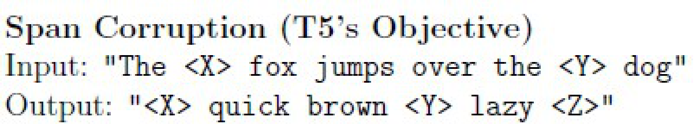

**Figure 10.** Option A: Span Corruption (T5 Objective) input-output representation

*Source option ID:* `6406534441585`

**B.**

Causal Language Modeling (CLM)
Input: "The quick brown fox jumps over the lazy"
Output: "The quick brown fox jumps over the lazy dog"

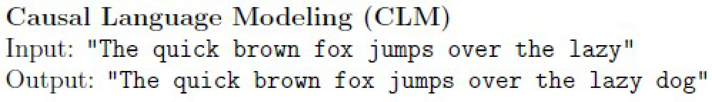

**Figure 11.** Option B: Causal Language Modeling (CLM) input-output representation

*Source option ID:* `6406534441586`

**C.**

Masked Language Modeling (MLM)
Input: "The [MASK] fox jumps over the lazy dog"
Output: "quick brown"

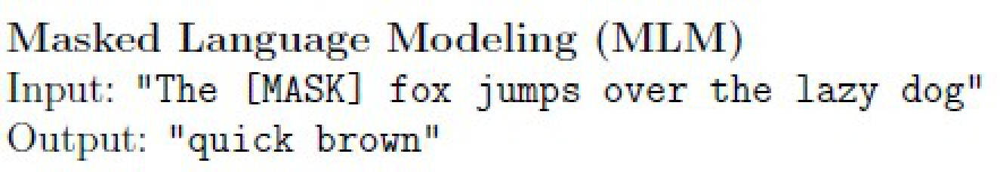

**Figure 12.** Option C: Masked Language Modeling (MLM) input-output representation

*Source option ID:* `6406534441587`

**D.**

Prefix Language Modeling
Input: "finish the sentence: The quick brown fox jumps"
Output: "over the lazy dog"

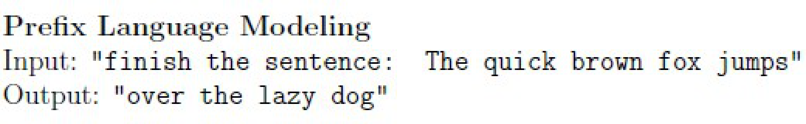

**Figure 13.** Option D: Prefix Language Modeling input-output representation

*Source option ID:* `6406534441588`

**Correct answer:** Span Corruption (T5’s Objective)
Input: "The <X> fox jumps over the <Y> dog"
Output: "<X> quick brown <Y> lazy <Z>"; Prefix Language Modeling
Input: "finish the sentence: The quick brown fox jumps"
Output: "over the lazy dog"

**Source evidence:** [{"page": 6, "bbox": [23.62, 58.68, 131.02, 75.0], "type": "marked-options", "detail": "Green checkmark option 6406534441585"}, {"page": 6, "bbox": [23.62, 302.65, 131.02, 318.97], "type": "marked-options", "detail": "Green checkmark option 6406534441588"}]

### Question 279

<a id="q279"></a>

**Question ID:** `6406531326581`

**Type:** SA · **Marks:** 2
**PDF pages:** 6, 7

In multi-task pretraining, tasks are sampled according to the Proportional Mixing Strategy:

$$r_m = \frac{\min(e_m, K)}{\sum_{n=1}^N \min(e_n, K)}$$

where:
- $e_m$ is the original number of examples in task $m$,
- Say we have $N$ tasks and original number of samples in each task is $e_n$ where $n \in \{1, 2, \dots, N\}$
- $K$ is the cap applied to all datasets.

Suppose you have two tasks:
- Task A: $e_1 = 10,000$
- Task B: $e_2 = 1,000,000$

What is the largest value of $K$ such that neither task has a sampling probability more than 50% (i.e. $\le 0.5$)?

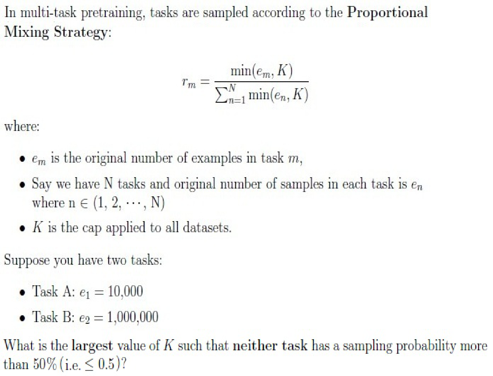

**Figure 14.** Multi-task pretraining Proportional Mixing Strategy mathematical formulation and problem

**Correct answer:** 10000

**Source evidence:** [{"page": 7, "bbox": [22.9, 113.4, 132.2, 151.0], "type": "numeric-answer", "detail": "Possible Answers : 10000"}]

### Question 280

<a id="q280"></a>

**Question ID:** `6406531326582`

**Type:** SA · **Marks:** 3
**PDF pages:** 7

Consider the scaling law for pretraining test loss:

$$L(N, D) = \left(\frac{N_c}{N}\right)^{\alpha_N} + \left(\frac{D_c}{D}\right)^{\alpha_D}$$

where $A = \left(\frac{N_c}{N}\right)^{\alpha_N}$, $B = \left(\frac{D_c}{D}\right)^{\alpha_D}$

- $N$: the number of non-embedding parameters
- $D$: the size of the dataset (in tokens)
- $N_c = 8.8 \times 10^8$
- $D_c = 5.4 \times 10^9$
- $\alpha_N = 0.076$
- $\alpha_D = 0.095$

Assume $A = 2B$. What is the approximate ratio of the new loss after doubling $N$ and $D$ to the original loss i.e., $\frac{L(2N, 2D)}{L(N, D)}$? (Answer correct upto 3 digits after the decimal)

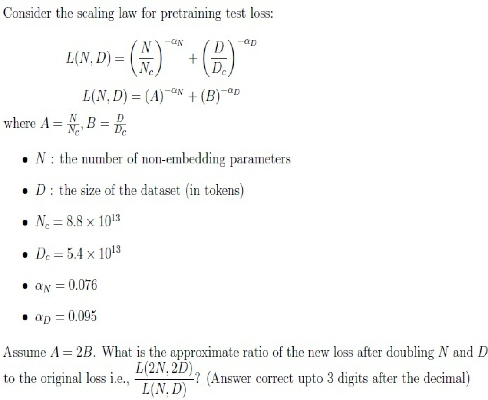

**Figure 15.** Scaling law for pretraining test loss mathematical formulation and parameter values

**Correct answer:** 0.914 to 0.975

**Source evidence:** [{"page": 7, "bbox": [22.9, 750.9, 132.2, 788.6], "type": "numeric-answer", "detail": "Possible Answers : 0.914 to 0.975"}]

### Shared context 281 to 285

<a id="ctx-281-285"></a>

**Question ID:** `6406531326583`

**Portal container ID:** `6406531326583`

**Type:** Comprehension
**PDF pages:** 8

Consider the following dictionary for the subword tokenization:

```python
vocabulary = {
    "gentler": 4,
    "brighter": 5,
    "crisper": 3
}
```

Append `</w>` to each word and consider it for all the calculations.

Based on the above data, answer the given subquestions.

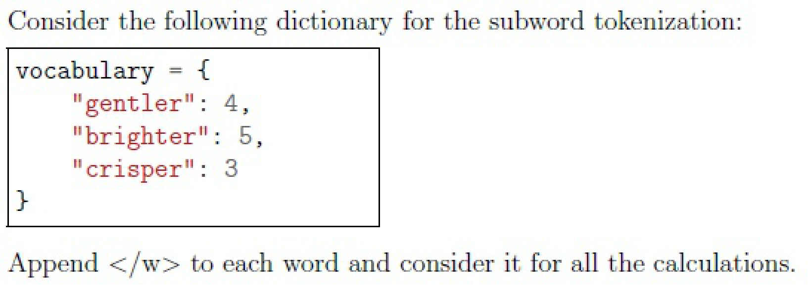

**Figure 16.** Vocabulary dictionary for subword tokenization with gentler, brighter, crisper and frequency counts

### Question 281

<a id="q281"></a>

**Question ID:** `6406531326584`

**Type:** SA · **Marks:** 2
**PDF pages:** 8

**Shared context:** [ctx-281-285](#ctx-281-285)

Using Byte Pair Encoding (BPE), how many distinct tokens are there in the initial vocabulary before 
any merges are performed?

**Correct answer:** 13

**Source evidence:** [{"page": 8, "bbox": [22.9, 562.5, 132.2, 600.2], "type": "numeric-answer", "detail": "Possible Answers : 13"}]

### Question 282

<a id="q282"></a>

**Question ID:** `6406531326585`

**Type:** MCQ · **Marks:** 2
**PDF pages:** 8

**Shared context:** [ctx-281-285](#ctx-281-285)

Which token pair has the lowest frequency before any merges in Byte Pair Encoding?

**Options**

**A.**

(‘b’, ‘r’)

*Source option ID:* `6406534441592`

**B.**

(‘t’, ‘l’)

*Source option ID:* `6406534441593`

**C.**

(‘p’, ‘e’)

*Source option ID:* `6406534441594`

**D.**

(‘e’, ‘r’)

*Source option ID:* `6406534441595`

**E.**

None of these

*Source option ID:* `6406534441596`

**Correct answer:** (‘p’, ‘e’)

**Source evidence:** [{"page": 8, "bbox": [23.62, 761.46, 131.02, 777.78], "type": "marked-options", "detail": "Green checkmark option 6406534441594"}]

### Question 283

<a id="q283"></a>

**Question ID:** `6406531326586`

**Type:** SA · **Marks:** 2
**PDF pages:** 9

**Shared context:** [ctx-281-285](#ctx-281-285)

What is the frequency of the most frequent byte-pair before the first merge in Byte Pair Encoding?

**Correct answer:** 12

**Source evidence:** [{"page": 9, "bbox": [22.9, 210.0, 132.2, 247.6], "type": "numeric-answer", "detail": "Possible Answers : 12"}]

### Question 284

<a id="q284"></a>

**Question ID:** `6406531326587`

**Type:** SA · **Marks:** 2
**PDF pages:** 9

**Shared context:** [ctx-281-285](#ctx-281-285)

If after three merges using Byte Pair Encoding (BPE), the vocabulary is as shown below, how many subword tokens will be used to tokenize the word “writer</w>” ?

```python
['</w>', 'b', 'c', 'e', 'g', 'h', 'i', 'l', 'n', 'p', 'r', 's', 't', 'er', 'er</w>', 'ri']
```

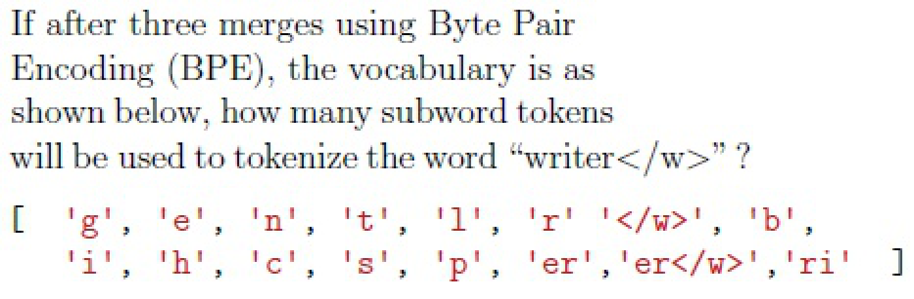

**Figure 17.** BPE vocabulary after three merges and tokenization question for word writer

**Correct answer:** 4

**Source evidence:** [{"page": 9, "bbox": [22.9, 545.8, 132.2, 583.4], "type": "numeric-answer", "detail": "Possible Answers : 4"}]

### Question 285

<a id="q285"></a>

**Question ID:** `6406531326588`

**Type:** MCQ · **Marks:** 2
**PDF pages:** 9

**Shared context:** [ctx-281-285](#ctx-281-285)

Which of the following pairs will be merged in the first iteration based on the following score used in the WordPiece tokenizer?

$$\text{score} = \frac{\text{count}(\alpha, \beta)}{\text{count}(\alpha) \times \text{count}(\beta)}$$

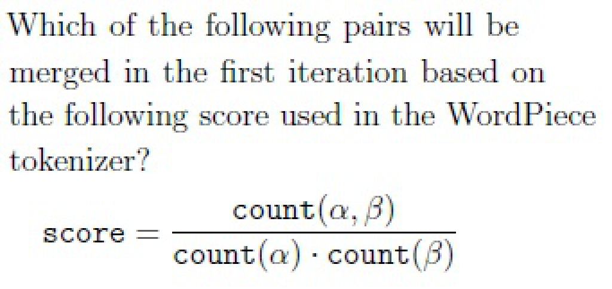

**Figure 18.** WordPiece tokenizer scoring formula and pair merging question

**Correct answer:** Answer not verifiable from the source PDF

**Source evidence:** [{"page": 9, "bbox": [22.87, 663.72, 278.62, 807.3], "type": "absent", "detail": "Question 285 ends after Options : on final page 9 of the source PDF with no option items or official answer key provided"}]

## Answer key

| Source question | Source identity | Correct answer | PDF pages |
| :--- | :--- | :--- | :--- |
| 269 | 6406531326571 | It helps handle out-of-vocabulary words more effectively | 2 |
| 270 | 6406531326572 | Model size and dataset size must scale together to maintain optimal  performance | 2 |
| 271 | 6406531326573 | Assertion is true, but Reason is false. | 2 |
| 272 | 6406531326575 | It allows a single model and architecture to be applied to a wide variety of NLP  tasks without modification. | 2, 3 |
| 273 | 6406531326576 | A concatenation of masked spans in order, each preceded by the corresponding sentinel token | 3 |
| 274 | 6406531326574 | [peanut, butter] | 3, 4 |
| 275 | 6406531326577 | Increase the model size by approximately 2x and increase the amount of  training data by approximately 2x. | 4, 5 |
| 276 | 6406531326578 | “All people from that xyz area are thieves. They should be jailed immediately.”; Kavya’s PAN number is BDZPK1234K and her registered address is 17/4, Green  Park, Delhi.; [“Reinforcement learning allows agents to learn optimal strategies through  interaction with an environment.”, “Reinforcement learning allows agents to learn optimal  strategies through interaction with an environment.”] | 5 |
| 277 | 6406531326579 | A larger vocabulary leads to a bigger embedding matrix and increased  softmax computation; Difficulty in handling out-of-vocabulary (OOV) words | 5 |
| 278 | 6406531326580 | Span Corruption (T5’s Objective) Input: "The <X> fox jumps over the <Y> dog" Output: "<X> quick brown <Y> lazy <Z>"; Prefix Language Modeling Input: "finish the sentence: The quick brown fox jumps" Output: "over the lazy dog" | 5, 6 |
| 279 | 6406531326581 | 10000 | 6, 7 |
| 280 | 6406531326582 | 0.914 to 0.975 | 7 |
| 281 | 6406531326584 | 13 | 8 |
| 282 | 6406531326585 | (‘p’, ‘e’) | 8 |
| 283 | 6406531326586 | 12 | 9 |
| 284 | 6406531326587 | 4 | 9 |
| 285 | 6406531326588 | Answer not verifiable from the source PDF | 9 |

## Extraction notes

**Status:** verified-source-limitation
**Count reconciliation:** Section 13 declares 14 portal questions and 40 section marks. The 14 portal containers comprise: 1 administrative confirmation question (Q268, 0 marks, excluded), 12 standalone questions (Q269: 2 marks, Q270: 2 marks, Q271: 2 marks, Q272: 2 marks, Q273: 2 marks, Q274: 3 marks, Q275: 3 marks, Q276: 3 marks, Q277: 3 marks, Q278: 3 marks, Q279: 2 marks, Q280: 3 marks; total standalone = 30 marks), and 1 comprehension portal container (Q281-285: 5 subquestions of 2 marks each = 10 marks). Total academic questions = 12 standalone + 5 comprehension subquestions = 17 academic questions. Total marks = 30 + 10 = 40 marks, exactly reconciling the declared section marks and 14 portal containers (1 confirmation + 12 standalone + 1 comprehension container = 14 portal questions).

- Section 13 LLM examination starts on page 1 after preceding section tail and continues through page 9.
- Question 285 (MCQ, 2 marks, Question Id: 6406531326588) on Page 9 has stem header and stem image (WordPiece tokenizer scoring formula) followed by 'Options :', but no option items or official answer key are present in the source PDF before the document ends at page 9. In accordance with extraction contract instructions, the answer is recorded with kind 'absent' and text 'Answer not verifiable from the source PDF'.

**Excluded source entries:**

- {"classification": "out-of-scope-tail", "page": 1, "bbox": [22.87, 16.8, 169.2, 54.4], "reason": "Tail of preceding Section 12 answer evaluation ('Possible Answers : 2') appearing above Section 13 LLM header", "identity": "section-12-tail"}
- {"classification": "subject-confirmation", "page": 1, "bbox": [22.87, 396.6, 580.0, 765.0], "reason": "Administrative subject confirmation asking candidate to confirm subject and cross check hall ticket", "identity": "268"}
