# LLM — da5004_2025T3_ET_AN

**Source:** `da5004_2025T3_ET_AN.pdf` · **Academic questions:** 25 · **Separately counted children:** 0
**Provenance:** `Large_Language_Models/da5004_2025T3_ET_AN.pdf` · SHA-256 `6bc0cc06ab867e0b2566fc2d47d2f4e1761a9cd7420f5fa7b9c4d2ee2769f5fb`

**Scope:** LLM (Degree Level : Large Language Models (Computer Based Exam)), physical pages 1 to 13. The in-scope exam content starts on physical page 1 with Subject Confirmation and Section LLM (Section Id: 640653124555) and terminates on physical page 13 after Question 26.

## Questions

### Shared context 23-26

**Question ID:** `6406531859519`

**Type:** Comprehension
**PDF pages:** 12

A team is developing a new large language model (LLM) for code generation, focusing on an autoregressive (AR) approach using the Causal Language Modeling (CLM) objective. They implement a standard Transformer decoder-only architecture. The team is training the model on a sequence of tokens $x = (x_1, x_2, \dots, x_T)$, where $T$ is the total length. The CLM objective aims to maximize the following log-likelihood:

$$\mathcal{L}(\theta) = \sum_{t=1}^{T-1} \log P(x_{t+1} \mid x_1, \dots, x_t; \theta)$$

During training, they strictly enforce teacher forcing, meaning the ground-truth previous tokens are always provided as input to predict the current token. Based on the above setup, answer the given subquestions.

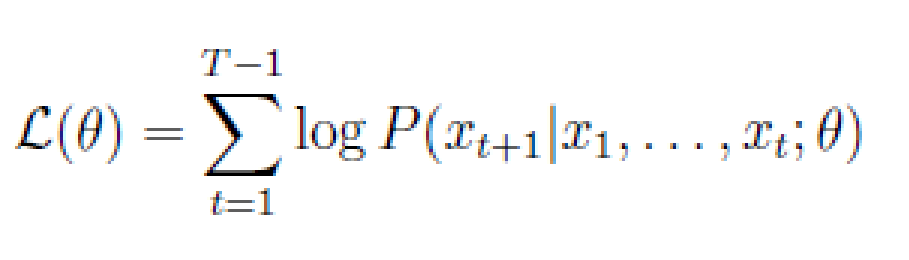

**Figure 1.** Causal language modeling objective log-likelihood formula over token sequence

### Question 2

**Question ID:** `6406531859498`

**Type:** Multiple Choice Question · **Marks:** 2
**PDF pages:** 2

A language model produces the following logits for the next token:

`{apple : 2.1, banana : 1.8, grape : 0.4, orange : 0.3, melon : -1.0}`

Before sampling, the model applies:
• Temperature scaling with $T = 0.5$
• Top-K sampling with $K = 2$

Which tokens are eligible to be sampled?

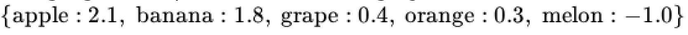

**Figure 2.** Language model next-token logit values for apple, banana, grape, orange, and melon

**Options**

**A.**

Only ''apple''

*Source option ID:* `6406536025082`

**B.**

"apple'' or ''banana''

*Source option ID:* `6406536025083`

**C.**

"apple'', ''banana'' or ''grape''

*Source option ID:* `6406536025084`

**D.**

"apple''or ''grape''

*Source option ID:* `6406536025085`

**Correct answer:** "apple'' or ''banana''

**Source evidence:** [{"page": 2, "bbox": [23.62, 267.73, 119.02, 284.05], "type": "green source option", "detail": "Option ID 6406536025083 marked in green (#008000)"}]

### Question 3

**Question ID:** `6406531859499`

**Type:** Multiple Choice Question · **Marks:** 2
**PDF pages:** 2

A neural network layer produces activations of hidden dimension $H = 512$.
You consider two normalization strategies:
1. Batch Normalization
2. Layer Normalization
Which option correctly states the number of trainable parameters added by each normalization method?

**Options**

**A.**

BatchNorm adds 512 parameters, LayerNorm adds 512 parameters

*Source option ID:* `6406536025086`

**B.**

BatchNorm adds 1024 parameters, LayerNorm adds 1024 parameters

*Source option ID:* `6406536025087`

**C.**

BatchNorm adds 1024 parameters, LayerNorm adds 512 parameters

*Source option ID:* `6406536025088`

**D.**

BatchNorm adds 512 parameters, LayerNorm adds 1024 parameters

*Source option ID:* `6406536025089`

**E.**

Both add 0 trainable parameters

*Source option ID:* `6406536025090`

**Correct answer:** BatchNorm adds 1024 parameters, LayerNorm adds 1024 parameters

**Source evidence:** [{"page": 2, "bbox": [23.62, 586.4, 119.02, 602.72], "type": "green source option", "detail": "Option ID 6406536025087 marked in green (#008000)"}]

### Question 4

**Question ID:** `6406531859500`

**Type:** Multiple Choice Question · **Marks:** 2
**PDF pages:** 3

A sub-word vocabulary is being constructed using the WordPiece algorithm. The following tokens and their frequencies are extracted:
• replay (frequency = 100)
• replus (frequency = 3)
The current vocabulary includes the tokens:
`{re, play, plus, ##play, ##plus}`

Two candidate merges are under consideration:
• Merge A: `re + play -> replay`
• Merge B: `re + plus -> replus`

Which of the above merges are most possible based on the WordPiece tokenizer?

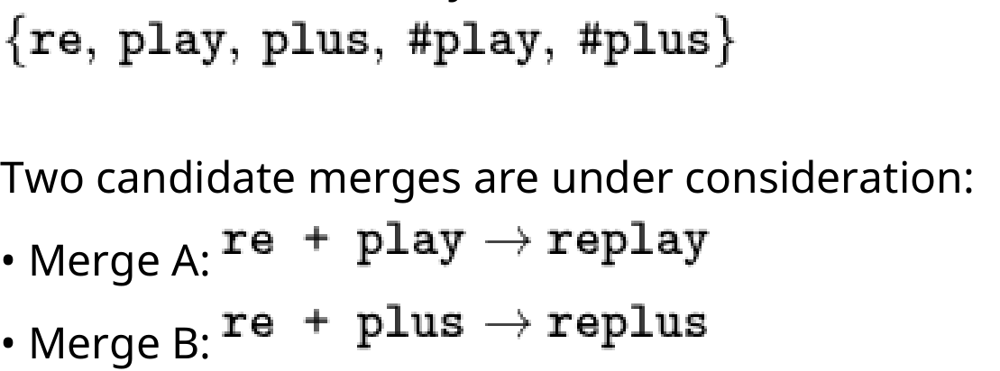

**Figure 3.** WordPiece current sub-word vocabulary and candidate merges A and B

**Options**

**A.**

Merge `re + play`

*Source option ID:* `6406536025091`

**B.**

Merge `re + plus`

*Source option ID:* `6406536025092`

**C.**

Insufficient information to determine

*Source option ID:* `6406536025093`

**Correct answer:** Insufficient information to determine

**Source evidence:** [{"page": 3, "bbox": [23.62, 401.32, 119.02, 417.64], "type": "green source option", "detail": "Option ID 6406536025093 marked in green (#008000)"}]

### Question 5

**Question ID:** `6406531859501`

**Type:** Multiple Choice Question · **Marks:** 2
**PDF pages:** 3

For a 4-category classification task, how would you use BERT's output?

**Options**

**A.**

Use all token embeddings and average them.

*Source option ID:* `6406536025094`

**B.**

Use the [CLS] token embedding as input to a classification layer.

*Source option ID:* `6406536025095`

**C.**

Use only the [SEP] token

*Source option ID:* `6406536025096`

**D.**

Use the [MASK] token predictions.

*Source option ID:* `6406536025097`

**Correct answer:** Use the [CLS] token embedding as input to a classification layer.

**Source evidence:** [{"page": 3, "bbox": [23.62, 563.38, 119.02, 579.7], "type": "green source option", "detail": "Option ID 6406536025095 marked in green (#008000)"}]

### Question 6

**Question ID:** `6406531859502`

**Type:** Multiple Choice Question · **Marks:** 2
**PDF pages:** 4

A hospital wants to extract disease mentions and treatment plans from unstructured clinical 
notes. Notes use heavy abbreviations like ``pt dx w/ CAD, rx aspirin'' 
For extracting specific disease names from text, which task should you fine-tune BERT for?

**Options**

**A.**

Masked Language Modeling

*Source option ID:* `6406536025098`

**B.**

Next Sentence Prediction

*Source option ID:* `6406536025099`

**C.**

Named Entity Recognition

*Source option ID:* `6406536025100`

**D.**

Text generation

*Source option ID:* `6406536025101`

**Correct answer:** Named Entity Recognition

**Source evidence:** [{"page": 4, "bbox": [23.62, 188.38, 119.02, 204.7], "type": "green source option", "detail": "Option ID 6406536025100 marked in green (#008000)"}]

### Question 7

**Question ID:** `6406531859503`

**Type:** Multiple Choice Question · **Marks:** 2
**PDF pages:** 4

Consider a sequence of length $T$ and a local block attention mechanism with $n$ blocks. If the attention matrix is restricted to only the main diagonal blocks (non-overlapping), what is the computational complexity of the self-attention operation for one layer (ignoring linear projections)? Assume $d$ be the model dimension.

**Options**

**A.**

$O((T/n)^2 \cdot d)$

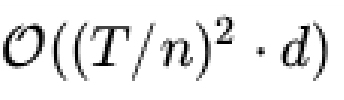

**Figure 4.** Option A computational complexity O((T/n)^2 * d)

*Source option ID:* `6406536025102`

**B.**

$O(T \cdot d^2)$

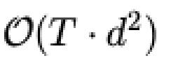

**Figure 5.** Option B computational complexity O(T * d^2)

*Source option ID:* `6406536025103`

**C.**

$O(T^2 \cdot d)$

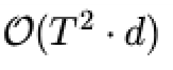

**Figure 6.** Option C computational complexity O(T^2 * d)

*Source option ID:* `6406536025104`

**D.**

$O((T^2/n) \cdot d)$

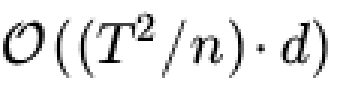

**Figure 7.** Option D computational complexity O((T^2/n) * d)

*Source option ID:* `6406536025105`

**Correct answer:** $O((T^2/n) \cdot d)$

**Source evidence:** [{"page": 4, "bbox": [23.62, 550.92, 119.02, 567.24], "type": "green source option", "detail": "Option ID 6406536025105 marked in green (#008000)"}]

### Question 8

**Question ID:** `6406531859504`

**Type:** Multiple Choice Question · **Marks:** 3
**PDF pages:** 5

Match the positional encoding method (Column A) with its property/behavior (Column B).

Column A (Methods)
1. APE
2. RPE
3. RoPE
4. ALiBi
5. NoPE

Column B (Properties / Observations)
A. Works even on sequence lengths far beyond training length without retraining, because attention bias grows proportionally to token distance.
B. Even if the model sees sequences only up to length 512 during training, it fails badly at length 1024, because positions above 512 have never had embeddings learned.
C. Creates an implicit rotation such that the attention score between positions $i$ and $j$ depends only on the difference $i - j$, not the positions themselves.
D. Uses a fixed-size bank of distance embeddings such that two attention pairs $(i, j)$ and $(k, l)$ with the same distance use the same embedding.
E. The model becomes permutation-invariant, meaning it treats ''cat sat mat'' the same as ``mat cat sat''.

**Options**

**A.**

1 -> B, 2 -> D, 3 -> C, 4 -> A, 5 -> E

*Source option ID:* `6406536025106`

**B.**

1 -> D, 2 -> A, 3 -> B, 4 -> C, 5 -> E

*Source option ID:* `6406536025107`

**C.**

1 -> B, 2 -> C, 3 -> A, 4 -> D, 5 -> E

*Source option ID:* `6406536025108`

**D.**

1 -> E, 2 -> D, 3 -> A, 4 -> C, 5 -> B

*Source option ID:* `6406536025109`

**Correct answer:** 1 -> B, 2 -> D, 3 -> C, 4 -> A, 5 -> E

**Source evidence:** [{"page": 5, "bbox": [23.62, 416.77, 119.02, 433.09], "type": "green source option", "detail": "Option ID 6406536025106 marked in green (#008000)"}]

### Question 9

**Question ID:** `6406531859505`

**Type:** Multiple Choice Question · **Marks:** 2
**PDF pages:** 6

A 2D vector $[4, 0]^T$ is rotated by $90^\circ$ using RoPE. What is the resulting vector?

**Options**

**A.**

$[0, 4]^T$

![Option A resulting vector [0, 4]](assets/da5004_2025T3_ET_AN/q9-q9-option-a-01-p006.png)

**Figure 8.** Option A resulting vector [0, 4]

*Source option ID:* `6406536025110`

**B.**

$[4, 0]^T$

![Option B resulting vector [4, 0]](assets/da5004_2025T3_ET_AN/q9-q9-option-b-01-p006.png)

**Figure 9.** Option B resulting vector [4, 0]

*Source option ID:* `6406536025111`

**C.**

$[0, -4]^T$

![Option C resulting vector [0, -4]](assets/da5004_2025T3_ET_AN/q9-q9-option-c-01-p006.png)

**Figure 10.** Option C resulting vector [0, -4]

*Source option ID:* `6406536025112`

**D.**

$[-4, 0]^T$

![Option D resulting vector [-4, 0]](assets/da5004_2025T3_ET_AN/q9-q9-option-d-01-p006.png)

**Figure 11.** Option D resulting vector [-4, 0]

*Source option ID:* `6406536025113`

**Correct answer:** $[0, 4]^T$

**Source evidence:** [{"page": 6, "bbox": [23.62, 124.46, 119.02, 140.78], "type": "green source option", "detail": "Option ID 6406536025110 marked in green (#008000)"}]

### Question 10

**Question ID:** `6406531859506`

**Type:** Multiple Choice Question · **Marks:** 2
**PDF pages:** 6

If a model uses RoPE, increasing the sequence length from 100 to 1000 requires:

**Options**

**A.**

900 more positional vectors

*Source option ID:* `6406536025114`

**B.**

$2 \times 1000 - 1$ RPE matrices

*Source option ID:* `6406536025115`

**C.**

No new parameters

*Source option ID:* `6406536025116`

**D.**

A new embedding matrix

*Source option ID:* `6406536025117`

**Correct answer:** No new parameters

**Source evidence:** [{"page": 6, "bbox": [23.62, 472.14, 119.02, 488.46], "type": "green source option", "detail": "Option ID 6406536025116 marked in green (#008000)"}]

### Question 11

**Question ID:** `6406531859507`

**Type:** Multiple Choice Question · **Marks:** 2
**PDF pages:** 6

In a sequence of length $T = 6$, how many different attention pairs produce a distance of $+1$?

**Options**

**A.**

1

**Figure 12.** Option A attention pair count 1

*Source option ID:* `6406536025118`

**B.**

3

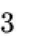

**Figure 13.** Option B attention pair count 3

*Source option ID:* `6406536025119`

**C.**

5

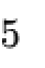

**Figure 14.** Option C attention pair count 5

*Source option ID:* `6406536025120`

**D.**

6

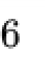

**Figure 15.** Option D attention pair count 6

*Source option ID:* `6406536025121`

**Correct answer:** 5

**Source evidence:** [{"page": 6, "bbox": [23.62, 730.72, 119.02, 747.04], "type": "green source option", "detail": "Option ID 6406536025120 marked in green (#008000)"}]

### Question 12

**Question ID:** `6406531859508`

**Type:** Multiple Choice Question · **Marks:** 2
**PDF pages:** 7

For a sequence of length $T = 6$, how many Absolute Positional Encoding (APE) vectors are needed, and how many Relative Positional Encoding (RPE) vectors are required?

**Options**

**A.**

APE = 6, RPE = 11

*Source option ID:* `6406536025122`

**B.**

APE = 6, RPE = 6

*Source option ID:* `6406536025123`

**C.**

APE = 12, RPE = 11

*Source option ID:* `6406536025124`

**D.**

APE = 5, RPE = 12

*Source option ID:* `6406536025125`

**Correct answer:** APE = 6, RPE = 11

**Source evidence:** [{"page": 7, "bbox": [23.62, 156.42, 119.02, 172.74], "type": "green source option", "detail": "Option ID 6406536025122 marked in green (#008000)"}]

### Question 13

**Question ID:** `6406531859509`

**Type:** Multiple Choice Question · **Marks:** 2
**PDF pages:** 7

A model with positional encoding crashes when the input length exceeds the training max length. 
Which encoding is it most likely using?

**Options**

**A.**

ALiBi

*Source option ID:* `6406536025126`

**B.**

APE

*Source option ID:* `6406536025127`

**C.**

RoPE

*Source option ID:* `6406536025128`

**D.**

RPE

*Source option ID:* `6406536025129`

**Correct answer:** APE

**Source evidence:** [{"page": 7, "bbox": [23.62, 397.26, 119.02, 413.58], "type": "green source option", "detail": "Option ID 6406536025127 marked in green (#008000)"}]

### Question 14

**Question ID:** `6406531859510`

**Type:** Multiple Choice Question · **Marks:** 3
**PDF pages:** 7

If the unmodified attention score is $q_i k_j^T$, then ALiBi changes it to:

**Options**

**A.**

$q_i k_j^T + \text{bias}_{ij}$ where bias is a learnable parameter.

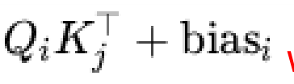

**Figure 16.** Option A ALiBi modified attention score with learnable bias

*Source option ID:* `6406536025130`

**B.**

$q_i k_j^T + B(i+j)$

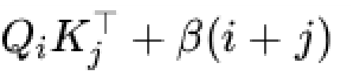

**Figure 17.** Option B ALiBi modified attention score with B(i+j)

*Source option ID:* `6406536025131`

**C.**

$q_i k_j^T - \gamma \cdot d$

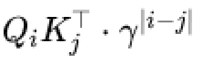

**Figure 18.** Option C ALiBi modified attention score with gamma * d penalty

*Source option ID:* `6406536025132`

**D.**

$q_i k_j^T - m|i - j|$

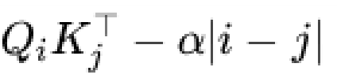

**Figure 19.** Option D ALiBi modified attention score with slope m * |i - j| penalty

*Source option ID:* `6406536025133`

**Correct answer:** $q_i k_j^T - m|i - j|$

**Source evidence:** [{"page": 7, "bbox": [23.62, 724.98, 119.02, 741.3], "type": "green source option", "detail": "Option ID 6406536025133 marked in green (#008000)"}]

### Question 15

**Question ID:** `6406531859511`

**Type:** Multiple Select Question · **Marks:** 3
**PDF pages:** 8

Which of the following decoding method(s) can generate a different output every time you run the 
model with the same prompt?

**Options**

**A.**

Greedy decoding

*Source option ID:* `6406536025134`

**B.**

Beam search with beam width = 1

*Source option ID:* `6406536025135`

**C.**

Top-p sampling with temperature T = 1

*Source option ID:* `6406536025136`

**D.**

Top-p sampling with temperature T > 1

*Source option ID:* `6406536025137`

**E.**

Beam search with beam width < 1

*Source option ID:* `6406536025138`

**Correct answer:** Top-p sampling with temperature T = 1; Top-p sampling with temperature T > 1

**Source evidence:** [{"page": 8, "bbox": [23.62, 172.06, 119.02, 188.38], "type": "green source option", "detail": "Option ID 6406536025136 marked in green (#008000)"}, {"page": 8, "bbox": [23.62, 198.06, 119.02, 214.38], "type": "green source option", "detail": "Option ID 6406536025137 marked in green (#008000)"}]

### Question 16

**Question ID:** `6406531859512`

**Type:** Multiple Select Question · **Marks:** 2
**PDF pages:** 8

Which of the following methods modifies/modify the attention scores AFTER computing $QK^T$?

**Options**

**A.**

RoPE

*Source option ID:* `6406536025139`

**B.**

APE

*Source option ID:* `6406536025140`

**C.**

ALiBi

*Source option ID:* `6406536025141`

**D.**

None of these

*Source option ID:* `6406536025142`

**Correct answer:** ALiBi

**Source evidence:** [{"page": 8, "bbox": [23.62, 446.27, 119.02, 462.59], "type": "green source option", "detail": "Option ID 6406536025141 marked in green (#008000)"}]

### Question 17

**Question ID:** `6406531859513`

**Type:** Multiple Select Question · **Marks:** 3
**PDF pages:** 9

Consider a BART encoder with sequence length $L$ and hidden size $d_{model}$ (fixed).
Now suppose the sequence length is doubled from $L$ to $2L$, keeping all other parameters unchanged.
Which of the following statements are true?

**Options**

**A.**

Self-attention FLOPs increase by a factor of 2.

*Source option ID:* `6406536025143`

**B.**

Self-attention FLOPs increase by a factor of 4.

*Source option ID:* `6406536025144`

**C.**

FFN FLOPs increase by a factor of 2.

*Source option ID:* `6406536025145`

**D.**

FFN FLOPs increase by a factor of 4.

*Source option ID:* `6406536025146`

**Correct answer:** Self-attention FLOPs increase by a factor of 4.; FFN FLOPs increase by a factor of 2.

**Source evidence:** [{"page": 9, "bbox": [23.62, 223.93, 119.02, 240.25], "type": "green source option", "detail": "Option ID 6406536025144 marked in green (#008000)"}, {"page": 9, "bbox": [23.62, 266.26, 119.02, 282.58], "type": "green source option", "detail": "Option ID 6406536025145 marked in green (#008000)"}]

### Question 18

**Question ID:** `6406531859514`

**Type:** Short Answer Question · **Marks:** 2
**PDF pages:** 9

You are implementing a custom Block Sparse Attention kernel. Given a sequence length $T = 1024$ and block size $B = 64$, you decide to compute the main diagonal blocks plus one random off-diagonal block for each block-row. How many total $B \times B$ block computations are performed?

**Correct answer:** 32

**Source evidence:** [{"page": 9, "bbox": [22.9, 605.0, 132.2, 642.7], "type": "explicit field", "detail": "Possible Answers: 32"}]

### Question 19

**Question ID:** `6406531859515`

**Type:** Multiple Select Question · **Marks:** 2
**PDF pages:** 10

Which of the following statements accurately describes the properties and computational 
complexities of the various sparse and block attention mechanisms?

**Options**

**A.**

Strided Local Attention reduces the computational complexity from quadratic to linear, specifically $O(cTd)$ where $c$ is the window size.

*Source option ID:* `6406536025148`

**B.**

Dilated Attention increases the computational complexity significantly 
compared to standard Strided Local Attention because it covers a wider receptive field.

*Source option ID:* `6406536025149`

**C.**

Global, Random, and Local Window attention patterns handle long sequences 
well.

*Source option ID:* `6406536025150`

**D.**

Empirical observations suggest that random permutations of blocks are 
significantly more important for performance than the identity permutation.

*Source option ID:* `6406536025151`

**Correct answer:** Strided Local Attention reduces the computational complexity from quadratic to linear, specifically $O(cTd)$ where $c$ is the window size.; Global, Random, and Local Window attention patterns handle long sequences well.

**Source evidence:** [{"page": 10, "bbox": [23.62, 130.42, 119.02, 146.74], "type": "green source option", "detail": "Option ID 6406536025148 marked in green (#008000)"}, {"page": 10, "bbox": [23.62, 227.7, 119.02, 244.02], "type": "green source option", "detail": "Option ID 6406536025150 marked in green (#008000)"}]

### Question 20

**Question ID:** `6406531859516`

**Type:** Short Answer Question · **Marks:** 2
**PDF pages:** 10

In the standard Transformer with 6 Encoder Layers, how many distinct sets of transformation weight matrices ($W_Q, W_K, W_V$) are learned in the entire Encoder stack, assuming 8 heads per layer?

**Correct answer:** 144

**Source evidence:** [{"page": 10, "bbox": [22.9, 538.3, 132.2, 575.9], "type": "explicit field", "detail": "Possible Answers: 144"}]

### Question 21

**Question ID:** `6406531859517`

**Type:** Short Answer Question · **Marks:** 2
**PDF pages:** 11

Suppose you are working on prefix language modeling. The sequence length is 10 and the first 
two tokens represent the task-specific prefix. How many non-infinity elements are there in the 
mask for computing attention scores?

**Correct answer:** 56

**Source evidence:** [{"page": 11, "bbox": [22.9, 223.3, 132.2, 261.0], "type": "explicit field", "detail": "Possible Answers: 56"}]

### Question 22

**Question ID:** `6406531859518`

**Type:** Short Answer Question · **Marks:** 2
**PDF pages:** 11

You are configuring a Large Language Model (LLM) for inference and need to estimate the memory footprint of the KV Cache. Calculate the KV cache memory required per token (in Bytes) given the following model architecture:
• Number of Layers ($L$): 32
• Number of Heads ($H$): 16
• Head Dimension ($d_{head}$): 128
• Precision: 2 Bytes (FP16)

**Correct answer:** 262144

**Source evidence:** [{"page": 11, "bbox": [22.9, 579.6, 132.2, 617.3], "type": "explicit field", "detail": "Possible Answers: 262144"}]

### Question 23

**Question ID:** `6406531859520`

**Type:** Multiple Choice Question · **Marks:** 1
**PDF pages:** 12

**Shared context:** [ctx-23-26](#ctx-23-26)

Which of the following describes the fundamental training mechanism of this model?

**Options**

**A.**

The model predicts the entire sequence $x$ simultaneously without considering dependencies.

*Source option ID:* `6406536025155`

**B.**

The model predicts the token $x_{t+1}$ based only on the tokens $x_1$ up to $x_t$.

*Source option ID:* `6406536025156`

**C.**

The model predicts a masked token $x_t$ based on both the left and right context tokens.

*Source option ID:* `6406536025157`

**Correct answer:** The model predicts the token $x_{t+1}$ based only on the tokens $x_1$ up to $x_t$.

**Source evidence:** [{"page": 12, "bbox": [23.62, 522.73, 119.02, 539.05], "type": "green source option", "detail": "Option ID 6406536025156 marked in green (#008000)"}]

### Question 24

**Question ID:** `6406531859521`

**Type:** Multiple Choice Question · **Marks:** 1
**PDF pages:** 12, 13

**Shared context:** [ctx-23-26](#ctx-23-26)

During the training phase on a sequence $x$ of length $T$, how does the teacher forcing mechanism specifically relate to the calculation of the loss function $\mathcal{L}(\theta)$?

**Options**

**A.**

It means the model uses its own previous predictions $(\hat{x}_1, \dots, \hat{x}_t)$ as input to predict $x_{t+1}$.

*Source option ID:* `6406536025158`

**B.**

It dictates that the loss is only calculated for tokens that were incorrectly 
predicted.

*Source option ID:* `6406536025159`

**C.**

It ensures that for every prediction $P(x_{t+1} \mid \dots)$, the model is conditioned on the ground-truth sequence $(x_1, \dots, x_t)$.

*Source option ID:* `6406536025160`

**D.**

It allows the model to see future tokens $(x_{t+2}, \dots, x_T)$ when predicting $x_{t+1}$.

*Source option ID:* `6406536025161`

**Correct answer:** It ensures that for every prediction $P(x_{t+1} \mid \dots)$, the model is conditioned on the ground-truth sequence $(x_1, \dots, x_t)$.

**Source evidence:** [{"page": 13, "bbox": [23.62, 82.14, 119.02, 98.46], "type": "green source option", "detail": "Option ID 6406536025160 marked in green (#008000)"}]

### Question 25

**Question ID:** `6406531859522`

**Type:** Multiple Choice Question · **Marks:** 1
**PDF pages:** 13

**Shared context:** [ctx-23-26](#ctx-23-26)

In the inference phase (when the model is used for generation), why is the teacher forcing 
technique not used, and what is the primary challenge this introduces?

**Options**

**A.**

Teacher forcing is used, but only with a small probability.

*Source option ID:* `6406536025162`

**B.**

It's not used because the ground-truth sequence is unknown; this introduces 
the exposure bias problem, where the model is unfamiliar with its own prediction errors.

*Source option ID:* `6406536025163`

**C.**

It's not used because it drastically slows down the inference speed.

*Source option ID:* `6406536025164`

**D.**

It's not used; the challenge is the need for a separate encoder-decoder 
architecture.

*Source option ID:* `6406536025165`

**Correct answer:** It's not used because the ground-truth sequence is unknown; this introduces 
the exposure bias problem, where the model is unfamiliar with its own prediction errors.

**Source evidence:** [{"page": 13, "bbox": [23.62, 339.17, 119.02, 355.49], "type": "green source option", "detail": "Option ID 6406536025163 marked in green (#008000)"}]

### Question 26

**Question ID:** `6406531859523`

**Type:** Multiple Choice Question · **Marks:** 1
**PDF pages:** 13

**Shared context:** [ctx-23-26](#ctx-23-26)

Which component of the Transformer decoder is essential for enforcing the Causal Language 
Modeling constraint?

**Options**

**A.**

The Feed-Forward Network layer.

*Source option ID:* `6406536025166`

**B.**

The Positional Encoding layer.

*Source option ID:* `6406536025167`

**C.**

The masked Self-Attention layer.

*Source option ID:* `6406536025168`

**D.**

The Cross-Attention layer.

*Source option ID:* `6406536025169`

**Correct answer:** The masked Self-Attention layer.

**Source evidence:** [{"page": 13, "bbox": [23.62, 608.15, 119.02, 624.47], "type": "green source option", "detail": "Option ID 6406536025168 marked in green (#008000)"}]

## Answer key

| Source question | Source identity | Correct answer | PDF pages |
| :--- | :--- | :--- | :--- |
| 2 | 6406531859498 | "apple'' or ''banana'' | 2 |
| 3 | 6406531859499 | BatchNorm adds 1024 parameters, LayerNorm adds 1024 parameters | 2 |
| 4 | 6406531859500 | Insufficient information to determine | 3 |
| 5 | 6406531859501 | Use the [CLS] token embedding as input to a classification layer. | 3 |
| 6 | 6406531859502 | Named Entity Recognition | 4 |
| 7 | 6406531859503 | $O((T^2/n) \cdot d)$ | 4 |
| 8 | 6406531859504 | 1 -> B, 2 -> D, 3 -> C, 4 -> A, 5 -> E | 5 |
| 9 | 6406531859505 | $[0, 4]^T$ | 6 |
| 10 | 6406531859506 | No new parameters | 6 |
| 11 | 6406531859507 | 5 | 6 |
| 12 | 6406531859508 | APE = 6, RPE = 11 | 7 |
| 13 | 6406531859509 | APE | 7 |
| 14 | 6406531859510 | $q_i k_j^T - m\|i - j\|$ | 7 |
| 15 | 6406531859511 | Top-p sampling with temperature T = 1; Top-p sampling with temperature T > 1 | 8 |
| 16 | 6406531859512 | ALiBi | 8 |
| 17 | 6406531859513 | Self-attention FLOPs increase by a factor of 4.; FFN FLOPs increase by a factor of 2. | 9 |
| 18 | 6406531859514 | 32 | 9 |
| 19 | 6406531859515 | Strided Local Attention reduces the computational complexity from quadratic to linear, specifically $O(cTd)$ where $c$ is the window size.; Global, Random, and Local Window attention patterns handle long sequences well. | 10 |
| 20 | 6406531859516 | 144 | 10 |
| 21 | 6406531859517 | 56 | 11 |
| 22 | 6406531859518 | 262144 | 11 |
| 23 | 6406531859520 | The model predicts the token $x_{t+1}$ based only on the tokens $x_1$ up to $x_t$. | 12 |
| 24 | 6406531859521 | It ensures that for every prediction $P(x_{t+1} \mid \dots)$, the model is conditioned on the ground-truth sequence $(x_1, \dots, x_t)$. | 12, 13 |
| 25 | 6406531859522 | It's not used because the ground-truth sequence is unknown; this introduces  the exposure bias problem, where the model is unfamiliar with its own prediction errors. | 13 |
| 26 | 6406531859523 | The masked Self-Attention layer. | 13 |

## Extraction notes

**Status:** verified
**Count reconciliation:** The portal header on physical page 1 declares 23 questions and 50 marks for Section LLM (Section Id: 640653124555). The 50 marks reconcile exactly across the 25 academic questions: Q2 (2) + Q3 (2) + Q4 (2) + Q5 (2) + Q6 (2) + Q7 (2) + Q8 (3) + Q9 (2) + Q10 (2) + Q11 (2) + Q12 (2) + Q13 (2) + Q14 (3) + Q15 (3) + Q16 (2) + Q17 (3) + Q18 (2) + Q19 (2) + Q20 (2) + Q21 (2) + Q22 (2) + Comprehension subquestions Q23 (1) + Q24 (1) + Q25 (1) + Q26 (1) = 50 marks. The declared portal count of 23 questions represents 1 administrative confirmation question (Q1), 21 standalone academic questions (Q2-Q22), and 1 comprehension portal container (Id: 6406531859519) enclosing 4 academic subquestions (Q23-Q26), yielding 1 + 21 + 1 = 23 portal questions and 25 total academic questions.

- Portal Question 1 is an administrative subject confirmation and is excluded from academic counts.
- Comprehension passage (Question Id 6406531859519) provides shared context for academic questions Q23 to Q26.
- Declared portal question count of 23 reflects 1 administrative question, 21 standalone questions, and 1 comprehension group containing 4 questions, totaling 25 academic questions.

**Excluded source entries:**

- {"classification": "confirmation", "page": 1, "bbox": [22.87, 55.39, 569.03, 246.16], "reason": "Administrative subject confirmation asking candidate to verify hall ticket for DEGREE LEVEL : LARGE LANGUAGE MODELS (COMPUTER BASED EXAM)", "identity": "6406531859497"}
