# LLM — da5004_2025T3_ET_FN

**Source:** `da5004_2025T3_ET_FN.pdf` · **Academic questions:** 24 · **Separately counted children:** 0
**Provenance:** `Large_Language_Models/da5004_2025T3_ET_FN.pdf` · SHA-256 `b55b6f7161c9d34961aac63d768c4345e767ccdbbd25a5efa8b32c7ae3149f59`

**Scope:** LLM (Degree Level : Large Language Models), physical pages 1 to 11. Section Id: 640653124706. In-scope content starts on physical page 1 with LLM section header and continues through physical page 11.

## Questions

### Question 2

**Question ID:** `6406531863525`

**Type:** MCQ · **Marks:** 1
**PDF pages:** 2

What happens when you use Batch Normalization with a batch size of 1?

**Options**

**A.**

It works perfectly fine

*Source option ID:* `6406536036762`

**B.**

The statistics become meaningless (mean=0, std=0)

*Source option ID:* `6406536036763`

**C.**

It automatically switches to Layer Normalization

*Source option ID:* `6406536036764`

**D.**

It uses the running statistics from training

*Source option ID:* `6406536036765`

**Correct answer:** The statistics become meaningless (mean=0, std=0)

**Source evidence:** [{"page": 2, "bbox": [23.62, 134.92, 119.02, 151.24], "type": "green source option", "detail": "Option 6406536036763 marked in green (color 32768)"}]

### Question 3

**Question ID:** `6406531863526`

**Type:** MCQ · **Marks:** 2
**PDF pages:** 2

A language model outputs the following logits for the next token: 
{cat: 3.2, dog: 2.9, bird: 1.1, fish: 0.5, snake: -0.4} 
Before sampling, the decoding pipeline performs: 
• Temperature scaling with T = 2.0 
• Top-K filtering with K = 3 
After applying both steps, which tokens remain eligible for sampling?

**Options**

**A.**

Only ''cat''

*Source option ID:* `6406536036766`

**B.**

'cat'' or ''dog''

*Source option ID:* `6406536036767`

**C.**

'cat'', ''dog'' or ''bird''

*Source option ID:* `6406536036768`

**D.**

'dog'', ''bird'' or ''fish''

*Source option ID:* `6406536036769`

**Correct answer:** 'cat'', ''dog'' or ''bird''

**Source evidence:** [{"page": 2, "bbox": [23.62, 441.08, 119.02, 457.4], "type": "green source option", "detail": "Option 6406536036768 marked in green (color 32768)"}]

### Question 4

**Question ID:** `6406531863527`

**Type:** MCQ · **Marks:** 2
**PDF pages:** 2

If a model's next-token probabilities are $P(A) = 0.5$, $P(B) = 0.2$, $P(C) = 0.15$, $P(D) = 0.1$, and $P(E) = 0.05$, and Top-P is set to $p = 0.8$. Which set of tokens will be included in the nucleus for sampling?

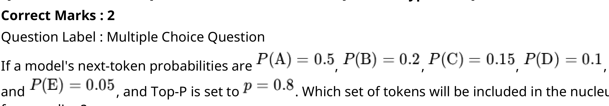

**Figure 1.** Next-token probabilities P(A)=0.5, P(B)=0.2, P(C)=0.15, P(D)=0.1, P(E)=0.05 and Top-P p=0.8 problem statement

**Options**

**A.**

Tokens A, B, C, D, E

*Source option ID:* `6406536036770`

**B.**

Tokens A, B

*Source option ID:* `6406536036771`

**C.**

Tokens A, B, C

*Source option ID:* `6406536036772`

**D.**

Tokens A, B, C, D

*Source option ID:* `6406536036773`

**E.**

Tokens A, B, D

*Source option ID:* `6406536036774`

**Correct answer:** Tokens A, B, C

**Source evidence:** [{"page": 2, "bbox": [23.62, 690.79, 119.02, 707.11], "type": "green source option", "detail": "Option 6406536036772 marked in green (color 32768)"}]

### Question 5

**Question ID:** `6406531863528`

**Type:** MCQ · **Marks:** 2
**PDF pages:** 3

In a WordPiece vocabulary-building step, the corpus contains the following tokenized sequences: 
• `un`, `##happy` (frequency = 120) 
• `un`, `##helpful` (frequency = 8) 

The current vocabulary includes the tokens: 
`un`, `happy`, `helpful`, `##happy`, `##helpful` 

Two candidate merges are being evaluated: 

• Merge A: `un` + `##happy` $\rightarrow$ `unhappy` 

• Merge B: `un` + `##helpful` $\rightarrow$ `unhelpful` 

Based purely on WordPiece's likelihood-based merge selection, which merge is more likely to be chosen?

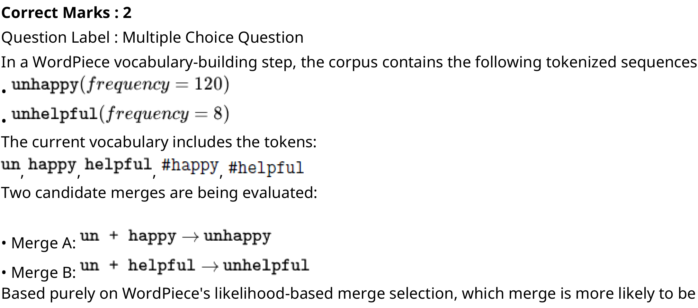

**Figure 2.** WordPiece vocabulary-building tokenized sequences, vocabulary tokens, and candidate merges A and B

**Options**

**A.**

Merge un + ##happy

**Figure 3.** Option A candidate merge un + ##happy

*Source option ID:* `6406536036775`

**B.**

Merge un + ##helpful

**Figure 4.** Option B candidate merge un + ##helpful

*Source option ID:* `6406536036776`

**C.**

Insufficient information to determine

*Source option ID:* `6406536036777`

**Correct answer:** Insufficient information to determine

**Source evidence:** [{"page": 3, "bbox": [23.62, 398.36, 119.02, 414.68], "type": "green source option", "detail": "Option 6406536036777 marked in green (color 32768)"}]

### Question 6

**Question ID:** `6406531863529`

**Type:** MCQ · **Marks:** 2
**PDF pages:** 3

A research team wants to classify scientific abstracts into multiple topics simultaneously (e.g., 
''ML'', ''biology'', ''statistics''), where each abstract may belong to more than one topic. They fine-
tune BERT for this task. Which modification is MOST appropriate?

**Options**

**A.**

Replace the [CLS] vector with an average of the top-4 attention heads

*Source option ID:* `6406536036778`

**B.**

Feed the [CLS] embedding into a linear layer with a sigmoid activation per 
label

*Source option ID:* `6406536036779`

**C.**

Use token embeddings individually and classify each token

*Source option ID:* `6406536036780`

**D.**

Use the [SEP] token embedding for multi-label prediction

*Source option ID:* `6406536036781`

**Correct answer:** Feed the [CLS] embedding into a linear layer with a sigmoid activation per 
label

**Source evidence:** [{"page": 3, "bbox": [23.62, 593.06, 119.02, 609.38], "type": "green source option", "detail": "Option 6406536036779 marked in green (color 32768)"}]

### Question 7

**Question ID:** `6406531863530`

**Type:** MCQ · **Marks:** 1
**PDF pages:** 4

A company wants to automatically correct noisy OCR text extracted from scanned documents. The 
text contains spelling mistakes, missing words, and scrambled phrases. Which model should they 
fine-tune?

**Options**

**A.**

BERT, because it masks tokens and predicts them independently

*Source option ID:* `6406536036782`

**B.**

BART, because it is trained with text corruption and autoregressive 
reconstruction

*Source option ID:* `6406536036783`

**C.**

GPT, because it is optimal for bidirectional correction

*Source option ID:* `6406536036784`

**D.**

BERT, because [CLS] captures global structure

*Source option ID:* `6406536036785`

**Correct answer:** BART, because it is trained with text corruption and autoregressive 
reconstruction

**Source evidence:** [{"page": 4, "bbox": [23.62, 167.56, 119.02, 183.88], "type": "green source option", "detail": "Option 6406536036783 marked in green (color 32768)"}]

### Question 8

**Question ID:** `6406531863531`

**Type:** MCQ · **Marks:** 1
**PDF pages:** 4

Computing the full self-attention matrix has a time complexity of
$$\mathcal{O}(T^2 d)$$
where $T$ is the sequence length and $d$ is the embedding dimension.

Which step in the self-attention mechanism is primarily responsible for this quadratic scaling?

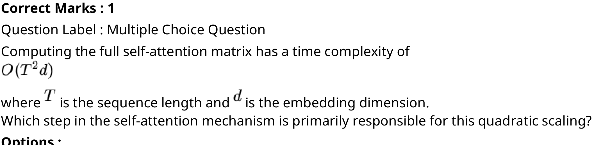

**Figure 5.** Full self-attention time complexity O(T^2 d) formulation and quadratic scaling inquiry

**Options**

**A.**

Computing the softmax for each row

*Source option ID:* `6406536036786`

**B.**

Computing the matrix product $QK^T$

**Figure 6.** Option B computing matrix product QK^T

*Source option ID:* `6406536036787`

**C.**

Multiplying the attention matrix $A$ with the value matrix $V$

**Figure 7.** Option C multiplying attention matrix A with value matrix V

*Source option ID:* `6406536036788`

**D.**

Performing layer normalization

*Source option ID:* `6406536036789`

**Correct answer:** Computing the matrix product $QK^T$

**Source evidence:** [{"page": 4, "bbox": [23.62, 456.59, 119.02, 472.91], "type": "green source option", "detail": "Option 6406536036787 marked in green (color 32768)"}]

### Question 9

**Question ID:** `6406531863532`

**Type:** MCQ · **Marks:** 1
**PDF pages:** 4

During autoregressive inference, key-value (KV) caching is used to avoid recomputing keys and 
values for previously generated tokens. If the KV cache is allowed to grow without any limit, which 
of the following failure modes can occur?

**Options**

**A.**

GPU memory exhaustion

*Source option ID:* `6406536036790`

**B.**

Latency becoming quadratic in the output length

*Source option ID:* `6406536036791`

**C.**

Inability to perform parallel token generation

*Source option ID:* `6406536036792`

**D.**

Beam search collapsing to a single token

*Source option ID:* `6406536036793`

**Correct answer:** GPU memory exhaustion

**Source evidence:** [{"page": 4, "bbox": [23.62, 711.43, 119.02, 727.75], "type": "green source option", "detail": "Option 6406536036790 marked in green (color 32768)"}]

### Question 10

**Question ID:** `6406531863533`

**Type:** MCQ · **Marks:** 2
**PDF pages:** 5

Consider a sequence of length $T$ processed by a local block self-attention mechanism with block size $B$, where $T$ is a multiple of $B$. The sequence is partitioned into $(T/B)$ non-overlapping contiguous blocks, and self-attention is computed only within each block (i.e., attention is restricted to the main diagonal blocks of the $T \times T$ attention matrix).

Ignoring the cost of linear projections for $Q, K, V$, what is the time complexity of the self-attention operation for one layer in terms of $T, B$ and the head dimension $d$?

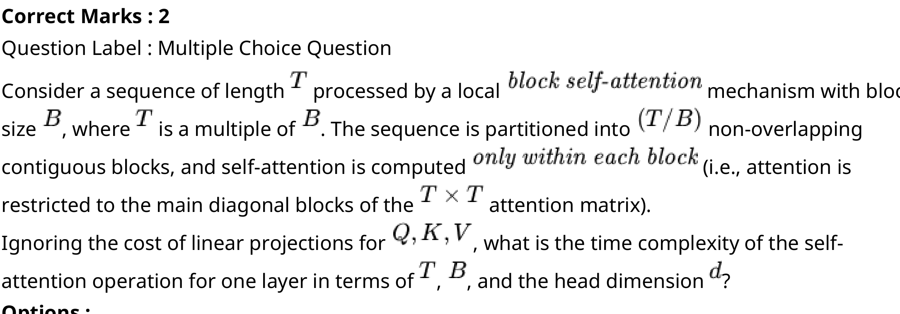

**Figure 8.** Local block self-attention mechanism configuration with sequence length T, block size B, and (T/B) blocks

**Options**

**A.**

$\mathcal{O}(T^2 \cdot d)$

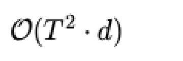

**Figure 9.** Option A time complexity O(T^2 * d)

*Source option ID:* `6406536036794`

**B.**

$\mathcal{O}((T^2 / B) \cdot d)$

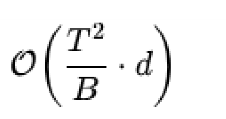

**Figure 10.** Option B time complexity O((T^2 / B) * d)

*Source option ID:* `6406536036795`

**C.**

$\mathcal{O}(T \cdot B \cdot d)$

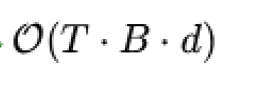

**Figure 11.** Option C time complexity O(T * B * d)

*Source option ID:* `6406536036796`

**D.**

$\mathcal{O}(T \cdot d)$

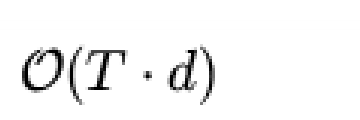

**Figure 12.** Option D time complexity O(T * d)

*Source option ID:* `6406536036797`

**Correct answer:** $\mathcal{O}(T \cdot B \cdot d)$

**Source evidence:** [{"page": 5, "bbox": [23.62, 346.63, 119.02, 362.95], "type": "green source option", "detail": "Option 6406536036796 marked in green (color 32768)"}]

### Question 11

**Question ID:** `6406531863534`

**Type:** MCQ · **Marks:** 2
**PDF pages:** 5

A 2D vector $[3, 4]$ is rotated by $180^\circ$ using RoPE. What is the resulting vector?

![2D vector [3, 4] rotated by 180 degrees using RoPE problem prompt](assets/da5004_2025T3_ET_FN/q11-q11-stem-01-p005.png)

**Figure 13.** 2D vector [3, 4] rotated by 180 degrees using RoPE problem prompt

**Options**

**A.**

[-3, -4]

![Option A resulting vector [-3, -4]](assets/da5004_2025T3_ET_FN/q11-q11-option-a-01-p005.png)

**Figure 14.** Option A resulting vector [-3, -4]

*Source option ID:* `6406536036798`

**B.**

[3, -4]

![Option B resulting vector [3, -4]](assets/da5004_2025T3_ET_FN/q11-q11-option-b-01-p005.png)

**Figure 15.** Option B resulting vector [3, -4]

*Source option ID:* `6406536036799`

**C.**

[-3, 4]

![Option C resulting vector [-3, 4]](assets/da5004_2025T3_ET_FN/q11-q11-option-c-01-p005.png)

**Figure 16.** Option C resulting vector [-3, 4]

*Source option ID:* `6406536036800`

**D.**

[3, 4]

![Option D resulting vector [3, 4]](assets/da5004_2025T3_ET_FN/q11-q11-option-d-01-p005.png)

**Figure 17.** Option D resulting vector [3, 4]

*Source option ID:* `6406536036801`

**Correct answer:** [-3, -4]

**Source evidence:** [{"page": 5, "bbox": [23.62, 558.38, 119.02, 574.7], "type": "green source option", "detail": "Option 6406536036798 marked in green (color 32768)"}]

### Question 12

**Question ID:** `6406531863535`

**Type:** MCQ · **Marks:** 2
**PDF pages:** 6

If a model uses Absolute Positional Embeddings (APE), increasing the sequence length from 100 to 
1000 requires:

**Options**

**A.**

No new parameters

*Source option ID:* `6406536036802`

**B.**

900 additional positional embedding vectors

*Source option ID:* `6406536036803`

**C.**

A new rotation matrix

*Source option ID:* `6406536036804`

**D.**

A distance-based bias matrix

*Source option ID:* `6406536036805`

**Correct answer:** 900 additional positional embedding vectors

**Source evidence:** [{"page": 6, "bbox": [23.62, 151.24, 119.02, 167.56], "type": "green source option", "detail": "Option 6406536036803 marked in green (color 32768)"}]

### Question 13

**Question ID:** `6406531863536`

**Type:** MCQ · **Marks:** 3
**PDF pages:** 6

In a sequence of length $T = 8$, how many different attention pairs produce a distance of $+2$?

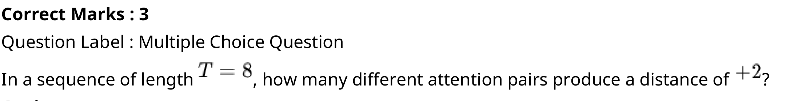

**Figure 18.** Sequence of length T = 8 and distance +2 attention pairs problem statement

**Options**

**A.**

3

*Source option ID:* `6406536036806`

**B.**

5

*Source option ID:* `6406536036807`

**C.**

6

*Source option ID:* `6406536036808`

**D.**

7

*Source option ID:* `6406536036809`

**Correct answer:** 6

**Source evidence:** [{"page": 6, "bbox": [23.62, 382.44, 119.02, 398.76], "type": "green source option", "detail": "Option 6406536036808 marked in green (color 32768)"}]

### Question 14

**Question ID:** `6406531863537`

**Type:** MCQ · **Marks:** 3
**PDF pages:** 6

For a sequence of length $L = 10$, how many learned positional vectors are required by the following methods? 
• Absolute Positional Encoding (APE) 
• Relative Positional Encoding (RPE) 
• ALiBi 
• NoPE (No Positional Encoding)

**Figure 19.** Learned positional vectors evaluation for sequence length L = 10 across APE, RPE, ALiBi, and NoPE

**Options**

**A.**

APE = 10, RPE = 19, ALiBi = 0, NoPE = 0

*Source option ID:* `6406536036810`

**B.**

APE = 10, RPE = 10, ALiBi = 19, NoPE = 0

*Source option ID:* `6406536036811`

**C.**

APE = 20, RPE = 19, ALiBi = 1, NoPE = 1

*Source option ID:* `6406536036812`

**D.**

APE = 10, RPE = 2T = 20, ALiBi = 10, NoPE = 0

*Source option ID:* `6406536036813`

**Correct answer:** APE = 10, RPE = 19, ALiBi = 0, NoPE = 0

**Source evidence:** [{"page": 6, "bbox": [23.62, 632.78, 119.02, 649.1], "type": "green source option", "detail": "Option 6406536036810 marked in green (color 32768)"}]

### Question 15

**Question ID:** `6406531863538`

**Type:** MCQ · **Marks:** 2
**PDF pages:** 7

Which of the following methods uses/use the concept: "The farther apart two tokens are, the less 
they should attend to each other''?

**Options**

**A.**

RoPE

*Source option ID:* `6406536036814`

**B.**

APE

*Source option ID:* `6406536036815`

**C.**

ALiBi

*Source option ID:* `6406536036816`

**D.**

RPE

*Source option ID:* `6406536036817`

**Correct answer:** ALiBi

**Source evidence:** [{"page": 7, "bbox": [23.62, 172.06, 119.02, 188.38], "type": "green source option", "detail": "Option 6406536036816 marked in green (color 32768)"}]

### Question 16

**Question ID:** `6406531863539`

**Type:** MCQ · **Marks:** 2
**PDF pages:** 7

You trained a model with max sequence length 512. At inference, you need to process sequence 
length 4096 without retraining. 
Which positional encoding will perform best out-of-the-box?

**Options**

**A.**

APE

*Source option ID:* `6406536036818`

**B.**

RPE

*Source option ID:* `6406536036819`

**C.**

RoPE

*Source option ID:* `6406536036820`

**D.**

ALiBi

*Source option ID:* `6406536036821`

**Correct answer:** ALiBi

**Source evidence:** [{"page": 7, "bbox": [23.62, 429.22, 119.02, 445.54], "type": "green source option", "detail": "Option 6406536036821 marked in green (color 32768)"}]

### Question 17

**Question ID:** `6406531863540`

**Type:** MCQ · **Marks:** 2
**PDF pages:** 7

A model using ALiBi is extended from context length 1K $\rightarrow$ 8K. 
How many new ALiBi parameters are added?

**Figure 20.** ALiBi context length extension from 1K to 8K added parameters question prompt

**Options**

**A.**

7000

*Source option ID:* `6406536036822`

**B.**

8000

*Source option ID:* `6406536036823`

**C.**

Depends on the number of distances

*Source option ID:* `6406536036824`

**D.**

0

*Source option ID:* `6406536036825`

**Correct answer:** 0

**Source evidence:** [{"page": 7, "bbox": [23.62, 654.42, 119.02, 670.74], "type": "green source option", "detail": "Option 6406536036825 marked in green (color 32768)"}]

### Question 18

**Question ID:** `6406531863541`

**Type:** SA · **Marks:** 3
**PDF pages:** 8

A mini-batch has 10 sentences, each padded to a length 100. Self-attention (single head) computes one score matrix per sentence. How many scalar scores are computed in total for a single head across the batch?

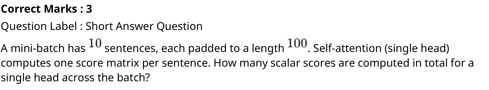

**Figure 21.** Mini-batch 10 sentences with padded length 100 scalar attention scores calculation prompt

**Correct answer:** 100000

**Source evidence:** [{"page": 8, "bbox": [22.87, 247.77, 69.12, 266.13], "type": "explicit field", "detail": "Possible Answers : 100000 in official source key"}]

### Question 19

**Question ID:** `6406531863542`

**Type:** SA · **Marks:** 2
**PDF pages:** 8

Suppose you are working on prefix language modeling. The sequence length is 15 and the first two tokens represent the task-specific prefix. How many non-infinity elements are there in the mask for computing attention scores?

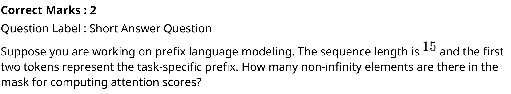

**Figure 22.** Prefix language modeling with sequence length 15 and two-token prefix non-infinity mask elements prompt

**Correct answer:** 121

**Source evidence:** [{"page": 8, "bbox": [22.87, 523.98, 46.0, 542.34], "type": "explicit field", "detail": "Possible Answers : 121 in official source key"}]

### Question 20

**Question ID:** `6406531863543`

**Type:** SA · **Marks:** 2
**PDF pages:** 9

A model uses a hybrid attention pattern in which each token attends to: 
• A local window of size 10 
• A set of 5 random tokens, 
• A set of 15 global tokens. 
Compute the total number of attention computations per token (integer expression).

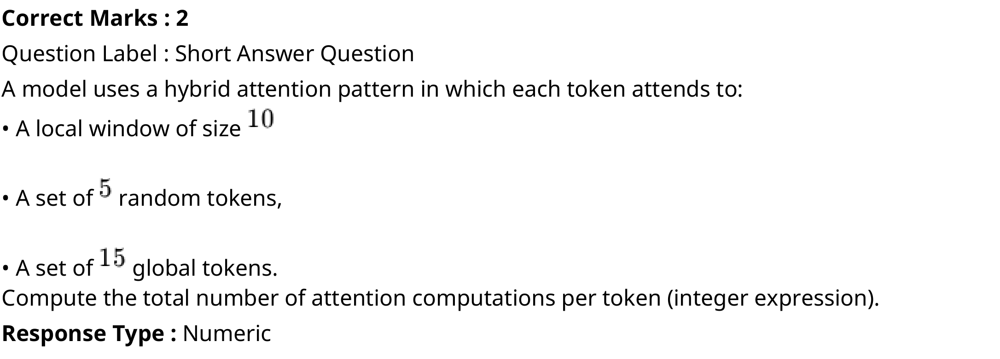

**Figure 23.** Hybrid attention pattern with local window 10, 5 random tokens, and 15 global tokens computation prompt

**Correct answer:** 30

**Source evidence:** [{"page": 9, "bbox": [22.87, 323.42, 41.38, 341.78], "type": "explicit field", "detail": "Possible Answers : 30 in official source key"}]

### Question 21

**Question ID:** `6406531863544`

**Type:** SA · **Marks:** 2
**PDF pages:** 9

During deployment of a transformer-based Large Language Model (LLM), you want to estimate the memory usage of the KV cache for efficient batching. Compute the KV-cache memory required per token (in Bytes) for the following model configuration: 
• Number of Transformer Blocks ($L$): 24 
• Attention Heads per Layer ($H$): 12 
• Head Dimension ($d_{\text{head}}$): 96 
• Precision used for KV tensors: 2 Bytes (FP16)

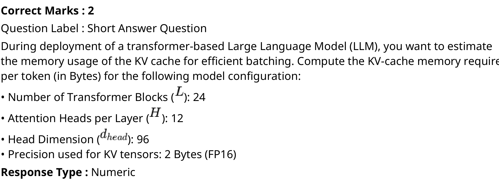

**Figure 24.** KV-cache memory calculation specifications: 24 blocks, 12 heads, 96 head dimension, FP16 precision

**Correct answer:** 110592

**Source evidence:** [{"page": 9, "bbox": [22.87, 694.46, 69.12, 712.82], "type": "explicit field", "detail": "Possible Answers : 110592 in official source key"}]

### Question 22

**Question ID:** `6406531863545`

**Type:** SA · **Marks:** 3
**PDF pages:** 10

You are implementing a custom Block Sparse Attention kernel. Given a sequence length $T = 1024$ and block size $B = 32$, you decide to compute the main diagonal blocks plus one random off-diagonal block for each block-row. How many total $B \times B$ block computations are performed?

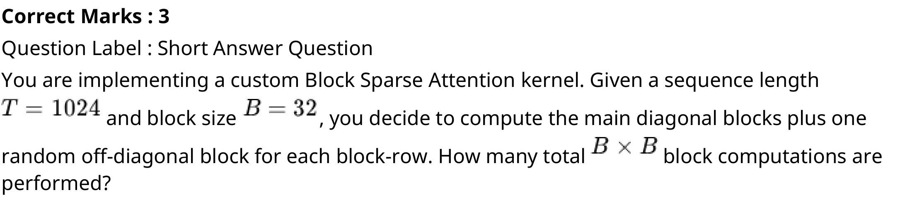

**Figure 25.** Custom Block Sparse Attention kernel with T = 1024, B = 32, and B x B block computations prompt

**Correct answer:** 64

**Source evidence:** [{"page": 10, "bbox": [22.87, 272.27, 41.38, 290.63], "type": "explicit field", "detail": "Possible Answers : 64 in official source key"}]

### Question 23

**Question ID:** `6406531863546`

**Type:** MSQ · **Marks:** 3
**PDF pages:** 10

A GPT-style causal language model is trained using the next-token prediction objective: 
$$\mathcal{L} = -\sum_{t=1}^T \log p_\theta(x_t \mid x_{<t})$$
During inference, the model must generate tokens autoregressively from left to right using only past context. 
Consider the following statements about GPT-style causal models.

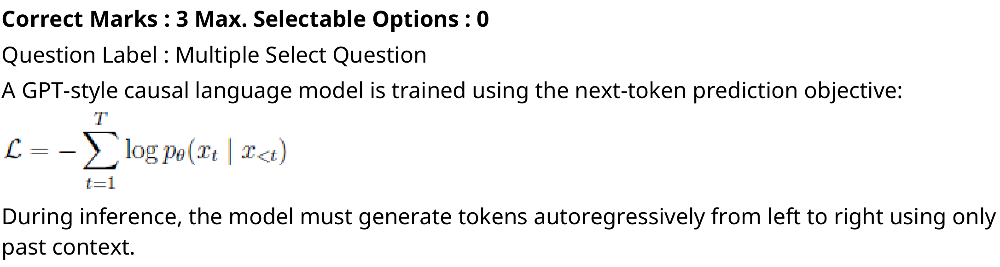

**Figure 26.** GPT-style causal language model training objective formula and autoregressive inference setup

**Options**

**A.**

GPT cannot condition on future tokens during training because the causal mask zeros out all attention to positions $> t$

**Figure 27.** Option A causal mask zeroing out attention to positions > t

*Source option ID:* `6406536036831`

**B.**

If two prefixes $x_{<t}$ and $x'_{<t}$ have identical embeddings at all positions, GPT must assign identical next-token distributions for both contexts

**Figure 28.** Option B identical embeddings prefixes x_<t and x'_<t next-token distribution statement

*Source option ID:* `6406536036832`

**C.**

Removing positional encodings would force GPT to treat all permutations of the same set of tokens as equivalent contexts

*Source option ID:* `6406536036833`

**D.**

Causal masking ensures that the computational cost of training scales linearly with sequence length

*Source option ID:* `6406536036834`

**Correct answer:** GPT cannot condition on future tokens during training because the causal mask zeros out all attention to positions $> t$; If two prefixes $x_{<t}$ and $x'_{<t}$ have identical embeddings at all positions, GPT must assign identical next-token distributions for both contexts; Removing positional encodings would force GPT to treat all permutations of the same set of tokens as equivalent contexts

**Source evidence:** [{"page": 10, "bbox": [23.62, 516.02, 119.02, 532.34], "type": "green source option", "detail": "Option 6406536036831 marked in green (color 32768)"}, {"page": 10, "bbox": [23.62, 582.85, 119.02, 599.17], "type": "green source option", "detail": "Option 6406536036832 marked in green (color 32768)"}, {"page": 10, "bbox": [23.62, 636.31, 119.02, 652.63], "type": "green source option", "detail": "Option 6406536036833 marked in green (color 32768)"}]

### Question 24

**Question ID:** `6406531863547`

**Type:** MSQ · **Marks:** 3
**PDF pages:** 11

Under which of the following decoding settings can the model produce different outputs across 
multiple runs on the same prompt?

**Options**

**A.**

Top-K sampling with $K = 1$ and temperature $T = 0$

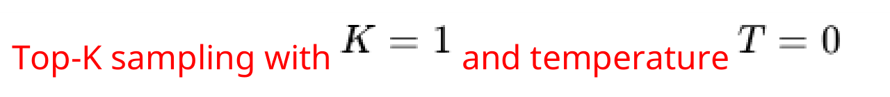

**Figure 29.** Option A Top-K sampling with K = 1 and temperature T = 0

*Source option ID:* `6406536036835`

**B.**

Top-K sampling with $K = 50$ and temperature $T = 1$

**Figure 30.** Option B Top-K sampling with K = 50 and temperature T = 1

*Source option ID:* `6406536036836`

**C.**

Nucleus (Top-p) sampling with $p = 0.9$ and temperature $T = 0.7$

**Figure 31.** Option C Nucleus (Top-p) sampling with p = 0.9 and temperature T = 0.7

*Source option ID:* `6406536036837`

**D.**

Greedy decoding after applying a temperature $T = 2$ to the logits

**Figure 32.** Option D Greedy decoding after applying temperature T = 2 to logits

*Source option ID:* `6406536036838`

**E.**

Beam search with beam width = 5

**Figure 33.** Option E Beam search with beam width = 5

*Source option ID:* `6406536036839`

**Correct answer:** Top-K sampling with $K = 50$ and temperature $T = 1$; Nucleus (Top-p) sampling with $p = 0.9$ and temperature $T = 0.7$

**Source evidence:** [{"page": 11, "bbox": [23.62, 180.95, 119.02, 197.27], "type": "green source option", "detail": "Option 6406536036836 marked in green (color 32768)"}, {"page": 11, "bbox": [23.62, 224.77, 119.02, 241.09], "type": "green source option", "detail": "Option 6406536036837 marked in green (color 32768)"}]

### Question 25

**Question ID:** `6406531863548`

**Type:** MSQ · **Marks:** 2
**PDF pages:** 11

Consider a BART encoder with sequence length $L$ and hidden size $d_{\text{model}}$ (fixed).  
Now suppose the sequence length is doubled from $L$ to $2L$, keeping all other parameters unchanged. 
Which of the following statements are true?

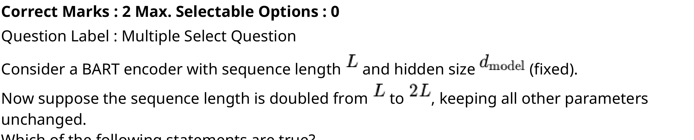

**Figure 34.** BART encoder sequence length L doubled to 2L with fixed hidden size d_model problem prompt

**Options**

**A.**

Self-attention FLOPs increase by a factor of 2

*Source option ID:* `6406536036840`

**B.**

Self-attention FLOPs increase by a factor of 4

*Source option ID:* `6406536036841`

**C.**

FFN FLOPs increase by a factor of 2

*Source option ID:* `6406536036842`

**D.**

FFN FLOPs increase by a factor of 4

*Source option ID:* `6406536036843`

**Correct answer:** Self-attention FLOPs increase by a factor of 4; FFN FLOPs increase by a factor of 2

**Source evidence:** [{"page": 11, "bbox": [23.62, 578.32, 119.02, 594.64], "type": "green source option", "detail": "Option 6406536036841 marked in green (color 32768)"}, {"page": 11, "bbox": [23.62, 620.64, 119.02, 636.96], "type": "green source option", "detail": "Option 6406536036842 marked in green (color 32768)"}]

## Answer key

| Source question | Source identity | Correct answer | PDF pages |
| :--- | :--- | :--- | :--- |
| 2 | 6406531863525 | The statistics become meaningless (mean=0, std=0) | 2 |
| 3 | 6406531863526 | 'cat'', ''dog'' or ''bird'' | 2 |
| 4 | 6406531863527 | Tokens A, B, C | 2 |
| 5 | 6406531863528 | Insufficient information to determine | 3 |
| 6 | 6406531863529 | Feed the [CLS] embedding into a linear layer with a sigmoid activation per  label | 3 |
| 7 | 6406531863530 | BART, because it is trained with text corruption and autoregressive  reconstruction | 4 |
| 8 | 6406531863531 | Computing the matrix product $QK^T$ | 4 |
| 9 | 6406531863532 | GPU memory exhaustion | 4 |
| 10 | 6406531863533 | $\mathcal{O}(T \cdot B \cdot d)$ | 5 |
| 11 | 6406531863534 | [-3, -4] | 5 |
| 12 | 6406531863535 | 900 additional positional embedding vectors | 6 |
| 13 | 6406531863536 | 6 | 6 |
| 14 | 6406531863537 | APE = 10, RPE = 19, ALiBi = 0, NoPE = 0 | 6 |
| 15 | 6406531863538 | ALiBi | 7 |
| 16 | 6406531863539 | ALiBi | 7 |
| 17 | 6406531863540 | 0 | 7 |
| 18 | 6406531863541 | 100000 | 8 |
| 19 | 6406531863542 | 121 | 8 |
| 20 | 6406531863543 | 30 | 9 |
| 21 | 6406531863544 | 110592 | 9 |
| 22 | 6406531863545 | 64 | 10 |
| 23 | 6406531863546 | GPT cannot condition on future tokens during training because the causal mask zeros out all attention to positions $> t$; If two prefixes $x_{<t}$ and $x'_{<t}$ have identical embeddings at all positions, GPT must assign identical next-token distributions for both contexts; Removing positional encodings would force GPT to treat all permutations of the same set of tokens as equivalent contexts | 10 |
| 24 | 6406531863547 | Top-K sampling with $K = 50$ and temperature $T = 1$; Nucleus (Top-p) sampling with $p = 0.9$ and temperature $T = 0.7$ | 11 |
| 25 | 6406531863548 | Self-attention FLOPs increase by a factor of 4; FFN FLOPs increase by a factor of 2 | 11 |

## Extraction notes

**Status:** verified
**Count reconciliation:** The portal header declared 25 questions and 50 marks for the LLM section. The source PDF contains 1 administrative subject confirmation question (Question 1, 0 marks, excluded) and 24 academic questions (Questions 2 to 25). The 50 section marks reconcile exactly across the 24 academic questions: Q2 (1) + Q3 (2) + Q4 (2) + Q5 (2) + Q6 (2) + Q7 (1) + Q8 (1) + Q9 (1) + Q10 (2) + Q11 (2) + Q12 (2) + Q13 (3) + Q14 (3) + Q15 (2) + Q16 (2) + Q17 (2) + Q18 (3) + Q19 (2) + Q20 (2) + Q21 (2) + Q22 (3) + Q23 (3) + Q24 (3) + Q25 (2) = 50 marks. Total questions (1 confirmation + 24 academic = 25 questions) and total marks (50) reconcile fully without discrepancy.

- All 24 academic questions (Q2-Q25) have been verified against native text and 288 DPI visual renders.
- All mathematical formulas, matrices, vectors, and token variables in stems and options have been transcribed into LaTeX and paired with 288 DPI high-resolution source crops.

**Excluded source entries:**

- {"classification": "subject-confirmation", "page": 1, "bbox": [22.87, 454.45, 570.0, 710.0], "reason": "Administrative subject confirmation asking candidate to confirm subject and cross check hall ticket", "identity": "1"}
