# LLM — da5004_2025T3_Q1_NA

**Source:** `da5004_2025T3_Q1_NA.pdf` · **Academic questions:** 20 · **Separately counted children:** 0
**Provenance:** `Large_Language_Models/da5004_2025T3_Q1_NA.pdf` · SHA-256 `30260f7a668f593215b5bcbb39bb0c90bf56b6d294b34b5d17c7189495954c0d`

**Scope:** Large Language Models (LLM) Section 10 examination content from page 1 to page 10. Preceding Section exam content on page 1 and administrative subject confirmation Question 172 on page 2 are excluded.

## Questions

### Question 173

**Question ID:** `6406531529852`

**Type:** MCQ · **Marks:** 2
**PDF pages:** 2

What is the primary reason for dividing the dot product of the query and key vectors by the square root of the key vector’s dimension, $\sqrt{d_k}$?

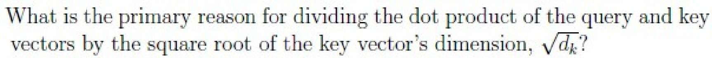

**Figure 1.** Question 173 stem: Query-key dot product scaling by square root of key dimension

**Options**

**A.**

To increase the numerical precision of the attention scores.

*Source option ID:* `6406535121364`

*Label added for presentation.*

**B.**

To reduce the overall computational cost of the attention mechanism.

*Source option ID:* `6406535121365`

*Label added for presentation.*

**C.**

To ensure that the sum of the attention scores for each query equals 1.

*Source option ID:* `6406535121366`

*Label added for presentation.*

**D.**

To avoid numerical issues and loss of gradients during training.

*Source option ID:* `6406535121367`

*Label added for presentation.*

**Correct answer:** To avoid numerical issues and loss of gradients during training.

**Source evidence:** [{"page": 2, "bbox": [23.62, 552.57, 119.02, 568.89], "type": "green source option", "detail": "Option ID 6406535121367 is highlighted green (#008000) in source PDF"}]

### Question 174

**Question ID:** `6406531529853`

**Type:** MCQ · **Marks:** 2
**PDF pages:** 2

Which of the following is true regarding sinusoidal encoding?

**Options**

**A.**

The encoding vector of words present at even positions in the given text sequence uses sine, and the encoding vector of words present at odd positions uses cosine.

*Source option ID:* `6406535121368`

*Label added for presentation.*

**B.**

The encoding vector of words present at odd positions in the given text sequence uses sine, and the encoding vector of words present at even positions uses cosine.

*Source option ID:* `6406535121369`

*Label added for presentation.*

**C.**

The encoding vector for each word position contains values computed using both sine (for even dimensions) and cosine (for odd dimensions).

*Source option ID:* `6406535121370`

*Label added for presentation.*

**Correct answer:** The encoding vector for each word position contains values computed using both sine (for even dimensions) and cosine (for odd dimensions).

**Source evidence:** [{"page": 2, "bbox": [23.62, 768.09, 119.02, 784.41], "type": "green source option", "detail": "Option ID 6406535121370 is highlighted green (#008000) in source PDF"}]

### Question 175

**Question ID:** `6406531529855`

**Type:** MCQ · **Marks:** 2
**PDF pages:** 3

We have a transformer model translating English to French. Suppose the target sequence is:

Target (French): ['je', 'suis', 'heureux']

Suppose the model predicted at time step $t$:
$t = 1$: 'je'
$t = 2$: 'content'
$t = 3$: 'heureux'

If teacher forcing is used, what will be the decoder input at time step 3?

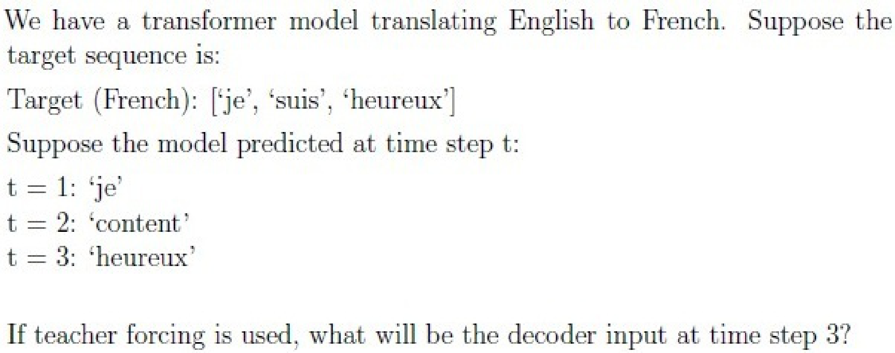

**Figure 2.** Question 175 stem: Transformer English-to-French translation teacher forcing scenario

**Options**

**A.**

‘content’

*Source option ID:* `6406535121375`

*Label added for presentation.*

**B.**

‘je’

*Source option ID:* `6406535121376`

*Label added for presentation.*

**C.**

‘suis’

*Source option ID:* `6406535121377`

*Label added for presentation.*

**D.**

‘heureux’

*Source option ID:* `6406535121378`

*Label added for presentation.*

**Correct answer:** ‘suis’

**Source evidence:** [{"page": 3, "bbox": [23.62, 311.05, 119.02, 327.37], "type": "green source option", "detail": "Option ID 6406535121377 is highlighted green (#008000) in source PDF"}]

### Question 176

**Question ID:** `6406531529856`

**Type:** MCQ · **Marks:** 2
**PDF pages:** 3

We have a decoder input of length 4 tokens: [x1, x2, x3, x4].
We use masked self-attention with the following pre-softmax attention scores:

$$\begin{bmatrix} 2 & 1 & 3 & 4 \\ 3 & 2 & 1 & 4 \\ 1 & 2 & 0 & 2 \\ 0 & 1 & 1 & 2 \end{bmatrix}$$

For token x3, the pre-softmax row is [1, 2, 0, 2]. After masking, what does it become?

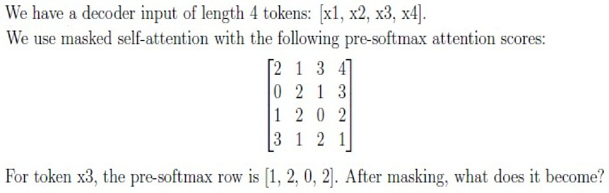

**Figure 3.** Question 176 stem: Decoder masked self-attention pre-softmax scores matrix and token x3 row masking

**Options**

**A.**

[1, 2, 0, 2]

![Option A: [1, 2, 0, 2]](assets/da5004_2025T3_Q1_NA/q176-q176-option-a-01-p003.png)

**Figure 4.** Option A: [1, 2, 0, 2]

*Source option ID:* `6406535121379`

*Label added for presentation.*

**B.**

[1, 2, 0, 0]

![Option B: [1, 2, 0, 0]](assets/da5004_2025T3_Q1_NA/q176-q176-option-b-01-p003.png)

**Figure 5.** Option B: [1, 2, 0, 0]

*Source option ID:* `6406535121380`

*Label added for presentation.*

**C.**

[1, 2, 0, -\infty]

![Option C: [1, 2, 0, -inf]](assets/da5004_2025T3_Q1_NA/q176-q176-option-c-01-p003.png)

**Figure 6.** Option C: [1, 2, 0, -inf]

*Source option ID:* `6406535121381`

*Label added for presentation.*

**D.**

[-\infty, 2, 0, 2]

![Option D: [-inf, 2, 0, 2]](assets/da5004_2025T3_Q1_NA/q176-q176-option-d-01-p003.png)

**Figure 7.** Option D: [-inf, 2, 0, 2]

*Source option ID:* `6406535121382`

*Label added for presentation.*

**E.**

[-\infty, -\infty, -\infty, 2]

![Option E: [-inf, -inf, -inf, 2]](assets/da5004_2025T3_Q1_NA/q176-q176-option-e-01-p003.png)

**Figure 8.** Option E: [-inf, -inf, -inf, 2]

*Source option ID:* `6406535121383`

*Label added for presentation.*

**Correct answer:** [1, 2, 0, -\infty]

**Source evidence:** [{"page": 3, "bbox": [23.62, 691.78, 119.02, 708.1], "type": "green source option", "detail": "Option ID 6406535121381 is highlighted green (#008000) in source PDF"}]

### Question 177

**Question ID:** `6406531529857`

**Type:** MCQ · **Marks:** 2
**PDF pages:** 4

In the context of language model training, teacher forcing is a technique where:

**Options**

**A.**

The correct target tokens from the training data are used as input for the next time step, regardless of the model’s prediction.

*Source option ID:* `6406535121384`

*Label added for presentation.*

**B.**

The model’s predictions are used as the input for the next time step, even if they are incorrect.

*Source option ID:* `6406535121385`

*Label added for presentation.*

**C.**

The model is forced to learn without any pre-trained weights.

*Source option ID:* `6406535121386`

*Label added for presentation.*

**D.**

The model is forced to correct the input data.

*Source option ID:* `6406535121387`

*Label added for presentation.*

**Correct answer:** The correct target tokens from the training data are used as input for the next time step, regardless of the model’s prediction.

**Source evidence:** [{"page": 4, "bbox": [23.62, 113.81, 119.02, 130.13], "type": "green source option", "detail": "Option ID 6406535121384 is highlighted green (#008000) in source PDF"}]

### Question 178

**Question ID:** `6406531529860`

**Type:** MCQ · **Marks:** 2
**PDF pages:** 4

Given a vocabulary of size $|V|$, how many sequences of maximum length 5 are possible?

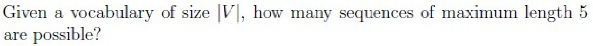

**Figure 9.** Question 178 stem: Maximum length 5 sequences for vocabulary size |V|

**Options**

**A.**

$|V|^5$

**Figure 10.** Option A: |V|^5

*Source option ID:* `6406535121397`

*Label added for presentation.*

**B.**

$5 \cdot |V|$

**Figure 11.** Option B: 5 * |V|

*Source option ID:* `6406535121398`

*Label added for presentation.*

**C.**

$\sum_{k=1}^5 |V|^k$

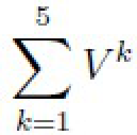

**Figure 12.** Option C: sum_{k=1}^5 |V|^k

*Source option ID:* `6406535121399`

*Label added for presentation.*

**D.**

$\frac{|V|^5 - 1}{|V| - 1}$

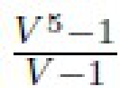

**Figure 13.** Option D: (|V|^5 - 1) / (|V| - 1)

*Source option ID:* `6406535121400`

*Label added for presentation.*

**Correct answer:** $\sum_{k=1}^5 |V|^k$

**Source evidence:** [{"page": 4, "bbox": [23.62, 503.77, 119.02, 520.09], "type": "green source option", "detail": "Option ID 6406535121399 is highlighted green (#008000) in source PDF"}]

### Question 179

**Question ID:** `6406531529854`

**Type:** MCQ · **Marks:** 3
**PDF pages:** 4, 5

You have a mini-batch of 2 samples, each with 2 features:

$$X = \begin{bmatrix} 1 & 2 \\ 3 & 4 \end{bmatrix}$$

• Rows represent samples
• Columns represent features

If Batch Normalization is applied across the batch for each feature (assume $\gamma = 1, \beta = 0$ and $\epsilon = 0$), what is the resulting normalized mini-batch?

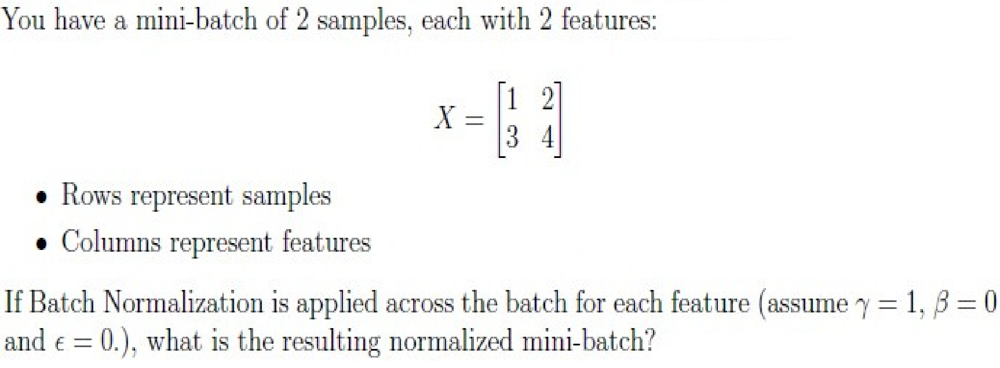

**Figure 14.** Question 179 stem: Mini-batch of 2 samples with 2 features and batch normalization

**Options**

**A.**

$\begin{bmatrix} -1 & -1 \\ 1 & 1 \end{bmatrix}$

![Option A: [[-1, -1], [1, 1]]](assets/da5004_2025T3_Q1_NA/q179-q179-option-a-01-p005.png)

**Figure 15.** Option A: [[-1, -1], [1, 1]]

*Source option ID:* `6406535121371`

*Label added for presentation.*

**B.**

$\begin{bmatrix} -0.707 & -0.707 \\ 0.707 & 0.707 \end{bmatrix}$

![Option B: [[-0.707, -0.707], [0.707, 0.707]]](assets/da5004_2025T3_Q1_NA/q179-q179-option-b-01-p005.png)

**Figure 16.** Option B: [[-0.707, -0.707], [0.707, 0.707]]

*Source option ID:* `6406535121372`

*Label added for presentation.*

**C.**

$\begin{bmatrix} -0.707 & 0.707 \\ -0.707 & 0.707 \end{bmatrix}$

![Option C: [[-0.707, 0.707], [-0.707, 0.707]]](assets/da5004_2025T3_Q1_NA/q179-q179-option-c-01-p005.png)

**Figure 17.** Option C: [[-0.707, 0.707], [-0.707, 0.707]]

*Source option ID:* `6406535121373`

*Label added for presentation.*

**D.**

$\begin{bmatrix} 1 & 1 \\ -1 & -1 \end{bmatrix}$

![Option D: [[1, 1], [-1, -1]]](assets/da5004_2025T3_Q1_NA/q179-q179-option-d-01-p005.png)

**Figure 18.** Option D: [[1, 1], [-1, -1]]

*Source option ID:* `6406535121374`

*Label added for presentation.*

**Correct answer:** $\begin{bmatrix} -1 & -1 \\ 1 & 1 \end{bmatrix}$

**Source evidence:** [{"page": 5, "bbox": [23.62, 227.0, 119.02, 243.32], "type": "green source option", "detail": "Option ID 6406535121371 is highlighted green (#008000) in source PDF"}]

### Question 180

**Question ID:** `6406531529858`

**Type:** MCQ · **Marks:** 3
**PDF pages:** 5

For a vocabulary of size $V$ and a fixed sequence length $L$, exhaustive decoding evaluates all possible sequences of length $L$. If we increase the sequence length to $L + 1$, how many additional sequences will need to be evaluated?

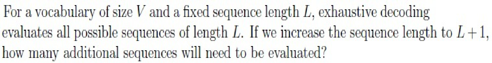

**Figure 19.** Question 180 stem: Exhaustive decoding sequence length increase from L to L+1

**Options**

**A.**

Same, no change

**Figure 20.** Option A: Same, no change

*Source option ID:* `6406535121388`

*Label added for presentation.*

**B.**

$V^L$ more sequences

**Figure 21.** Option B: V^L more sequences

*Source option ID:* `6406535121389`

*Label added for presentation.*

**C.**

$(V - 1) \cdot V^L$ more sequences

**Figure 22.** Option C: (V - 1) * V^L more sequences

*Source option ID:* `6406535121390`

*Label added for presentation.*

**D.**

$V$ more sequences

**Figure 23.** Option D: V more sequences

*Source option ID:* `6406535121391`

*Label added for presentation.*

**E.**

One more sequence

**Figure 24.** Option E: One more sequence

*Source option ID:* `6406535121392`

*Label added for presentation.*

**Correct answer:** $(V - 1) \cdot V^L$ more sequences

**Source evidence:** [{"page": 5, "bbox": [23.62, 698.8, 119.02, 715.12], "type": "green source option", "detail": "Option ID 6406535121390 is highlighted green (#008000) in source PDF"}]

### Question 181

**Question ID:** `6406531529861`

**Type:** MCQ · **Marks:** 3
**PDF pages:** 6

For a vocabulary size of 10, how many beams will there be in greedy search, beam search with beam size 3, and exhaustive search at step 1 and step 3, respectively?

**Options**

**A.**

Step 1: 
Greedy: 1, Beam: 1, Exhaustive: 1 
Step 3: 
Greedy: 1, Beam: 1, Exhaustive: 1

*Source option ID:* `6406535121401`

*Label added for presentation.*

**B.**

Step 1: 
Greedy: 1, Beam: 3, Exhaustive: 10 
Step 3: 
Greedy: 1, Beam: 3, Exhaustive: 10

*Source option ID:* `6406535121402`

*Label added for presentation.*

**C.**

Step 1: 
Greedy: 1, Beam: 3, Exhaustive: 1 
Step 3: 
Greedy: 1, Beam: 3, Exhaustive: 100

*Source option ID:* `6406535121403`

*Label added for presentation.*

**D.**

Step 1: 
Greedy: 1, Beam: 3, Exhaustive: 10 
Step 3: 
Greedy: 1, Beam: 3, Exhaustive: 1000

*Source option ID:* `6406535121404`

*Label added for presentation.*

**Correct answer:** Step 1: 
Greedy: 1, Beam: 3, Exhaustive: 10 
Step 3: 
Greedy: 1, Beam: 3, Exhaustive: 1000

**Source evidence:** [{"page": 6, "bbox": [23.62, 359.08, 119.02, 375.4], "type": "green source option", "detail": "Option ID 6406535121404 is highlighted green (#008000) in source PDF"}]

### Question 182

**Question ID:** `6406531529859`

**Type:** MSQ · **Marks:** 2
**PDF pages:** 6

Which of the following decoding strategies is/are inherently non-deterministic?

**Options**

**A.**

Beam

*Source option ID:* `6406535121393`

*Label added for presentation.*

**B.**

Greedy

*Source option ID:* `6406535121394`

*Label added for presentation.*

**C.**

Nucleus

*Source option ID:* `6406535121395`

*Label added for presentation.*

**D.**

Exhaustive

*Source option ID:* `6406535121396`

*Label added for presentation.*

**Correct answer:** Nucleus

**Source evidence:** [{"page": 6, "bbox": [23.62, 648.88, 119.02, 665.2], "type": "green source option", "detail": "Option ID 6406535121395 is highlighted green (#008000) in source PDF"}]

### Question 183

**Question ID:** `6406531529862`

**Type:** MSQ · **Marks:** 2
**PDF pages:** 6, 7

Which of the following statements about multiple attention heads in a Transformer are true?

**Options**

**A.**

They allow learning diverse local/global relations.

*Source option ID:* `6406535121405`

*Label added for presentation.*

**B.**

They reduce memory usage compared to one head.

*Source option ID:* `6406535121406`

*Label added for presentation.*

**C.**

Increasing the number of heads while keeping dmodel fixed, decreases the dimensionality handled by each head.

*Source option ID:* `6406535121407`

*Label added for presentation.*

**D.**

All heads necessarily learn completely independent information about the input.

*Source option ID:* `6406535121408`

*Label added for presentation.*

**Correct answer:** They allow learning diverse local/global relations.; Increasing the number of heads while keeping dmodel fixed, decreases the dimensionality handled by each head.

**Source evidence:** [{"page": 7, "bbox": [23.62, 17.5, 119.02, 33.82], "type": "green source option", "detail": "Option ID 6406535121405 is highlighted green (#008000) in source PDF"}, {"page": 7, "bbox": [23.62, 59.15, 119.02, 75.47], "type": "green source option", "detail": "Option ID 6406535121407 is highlighted green (#008000) in source PDF"}]

### Question 184

**Question ID:** `6406531529863`

**Type:** MSQ · **Marks:** 4
**PDF pages:** 7

Which of the following statements about the Transformer architecture are true?

**Options**

**A.**

Masking (look-ahead mask) is applied in every decoder self-attention layer, not just the first one.

*Source option ID:* `6406535121409`

*Label added for presentation.*

**B.**

Token embeddings are used in the encoder but not in the decoder.

*Source option ID:* `6406535121410`

*Label added for presentation.*

**C.**

Positional encoding is required only in the encoder, not in the decoder.

*Source option ID:* `6406535121411`

*Label added for presentation.*

**D.**

Token embeddings are used in both the encoder and the decoder.

*Source option ID:* `6406535121412`

*Label added for presentation.*

**E.**

Positional encodings are added to the input embeddings in both the encoder and the decoder.

*Source option ID:* `6406535121413`

*Label added for presentation.*

**Correct answer:** Masking (look-ahead mask) is applied in every decoder self-attention layer, not just the first one.; Token embeddings are used in both the encoder and the decoder.; Positional encodings are added to the input embeddings in both the encoder and the decoder.

**Source evidence:** [{"page": 7, "bbox": [23.62, 311.82, 119.02, 328.14], "type": "green source option", "detail": "Option ID 6406535121409 is highlighted green (#008000) in source PDF"}, {"page": 7, "bbox": [23.62, 390.6, 119.02, 406.92], "type": "green source option", "detail": "Option ID 6406535121412 is highlighted green (#008000) in source PDF"}, {"page": 7, "bbox": [23.62, 411.42, 119.02, 427.74], "type": "green source option", "detail": "Option ID 6406535121413 is highlighted green (#008000) in source PDF"}]

### Question 185

**Question ID:** `6406531529864`

**Type:** MSQ · **Marks:** 4
**PDF pages:** 7, 8

A transformer decoder uses a vocabulary of size 5. At step 1, the predicted token probabilities are:

| Token | Probability |
| :--- | :--- |
| A | 0.40 |
| B | 0.30 |
| C | 0.20 |
| D | 0.05 |
| E | 0.05 |

Which statement(s) is/are correct?

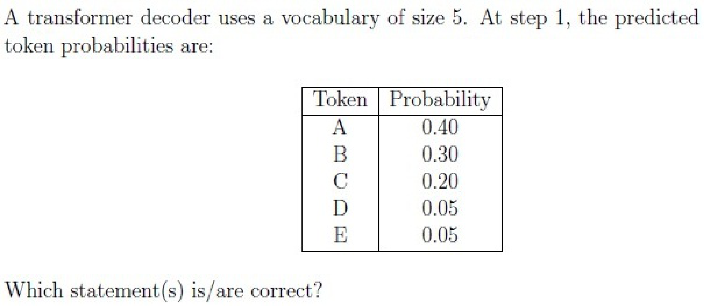

**Figure 25.** Question 185 stem: Transformer decoder predicted token probabilities at step 1

**Options**

**A.**

Beam search with beam size 2 will keep either A or B as per probability whereas Top-2 sampling will keep both A and B.

*Source option ID:* `6406535121414`

*Label added for presentation.*

**B.**

Beam search with beam size 2 will keep both A and B whereas Top-2 sampling will keep either A or B.

*Source option ID:* `6406535121415`

*Label added for presentation.*

**C.**

Beam search with beam size 2 will randomly choose any two tokens, whereas Top-2 sampling will always pick the two least probable tokens.

*Source option ID:* `6406535121416`

*Label added for presentation.*

**D.**

Beam search with beam size 2 will always keep the top-2 most probable tokens, whereas Top-2 sampling will restrict choices to top-2 tokens and then sample one probabilistically.

*Source option ID:* `6406535121417`

*Label added for presentation.*

**Correct answer:** Beam search with beam size 2 will keep both A and B whereas Top-2 sampling will keep either A or B.; Beam search with beam size 2 will always keep the top-2 most probable tokens, whereas Top-2 sampling will restrict choices to top-2 tokens and then sample one probabilistically.

**Source evidence:** [{"page": 7, "bbox": [23.62, 780.8, 119.02, 797.12], "type": "green source option", "detail": "Option ID 6406535121415 is highlighted green (#008000) in source PDF"}, {"page": 8, "bbox": [23.62, 54.64, 119.02, 70.96], "type": "green source option", "detail": "Option ID 6406535121417 is highlighted green (#008000) in source PDF"}]

### Question 186

**Question ID:** `6406531529865`

**Type:** SA · **Marks:** 3
**PDF pages:** 8

A Transformer with single self-attention layer has batch size $B = 4$, context length (sequence length) $T = 12$, and number of heads $h = 2$. How many scalar attention scores are computed in total across two heads and all sequences for one forward pass?

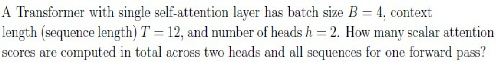

**Figure 26.** Question 186 stem: Total scalar attention scores calculation for B=4, T=12, h=2

**Correct answer:** 1152

**Source evidence:** [{"page": 8, "bbox": [22.87, 439.63, 61.41, 457.99], "type": "explicit field", "detail": "Official key provides Possible Answers: 1152"}]

### Question 187

**Question ID:** `6406531529866`

**Type:** SA · **Marks:** 3
**PDF pages:** 8

A Transformer model processes a sequence of $T = 1000$ tokens. Within the self-attention layer, the attention scores are stored as 32-bit floating-point numbers (float32). We compare two configurations that differ in the number of attention heads, $h$:

Model A: $h = 8$
Model B: $h = 16$

Using the given conversion factors (1 byte = 8 bits, 1 MB = $10^6$ bytes), calculate the percentage increase in memory (in MB) required to store all attention scores when moving from Model A to Model B.

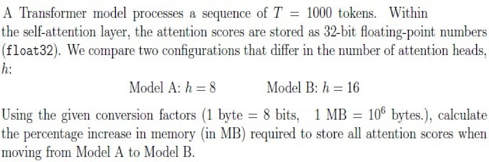

**Figure 27.** Question 187 stem: Percentage increase in memory from Model A (h=8) to Model B (h=16)

**Correct answer:** 99 to 101

**Source evidence:** [{"page": 8, "bbox": [22.87, 761.64, 91.56, 780.0], "type": "explicit field", "detail": "Official key provides Possible Answers: 99 to 101"}]

### Question 188

**Question ID:** `6406531529867`

**Type:** SA · **Marks:** 2
**PDF pages:** 9

In a Transformer model with hidden size $d_{\text{model}} = 512$, number of heads $h = 8$, and key/query dimension $d_k = 64$, how many trainable parameters are there in the projection matrix $W_Q$ for a given head?

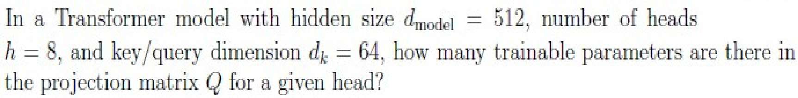

**Figure 28.** Question 188 stem: Trainable parameters in projection matrix W_Q for head dimension d_k=64

**Correct answer:** 32768

**Source evidence:** [{"page": 9, "bbox": [22.87, 296.88, 69.12, 315.24], "type": "explicit field", "detail": "Official key provides Possible Answers: 32768"}]

### Shared context 189 to 192

**Question ID:** `6406531529868`

**Type:** COMPREHENSION
**PDF pages:** 9

You are analyzing a GPT-style decoder-only Transformer trained as a causal language model with the following setup:

• Sequence length: $T = 1024$ tokens per input sequence.
• Batch size: $B = 32$.
• Hidden dimension: $d_{\text{model}} = 768$.
• Number of attention heads: $h = 8$.
• $d_k = \frac{d_{\text{model}}}{h}$
• Training uses next-token prediction with teacher forcing and a causal mask.
• The input sequence does not include a beginning-of-sequence (BOS) token.

Answer the given sub-questions:

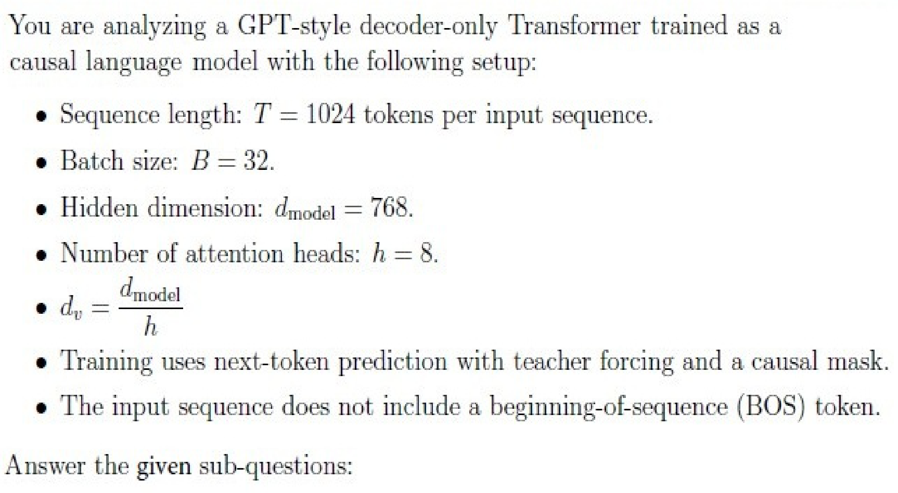

**Figure 29.** Comprehension passage: GPT-style decoder-only Transformer causal language model setup

### Question 189

**Question ID:** `6406531529869`

**Type:** SA · **Marks:** 3
**PDF pages:** 9, 10

**Shared context:** [ctx-189-192](#ctx-189-192)

How many next-token prediction targets are generated during training a full batch?

**Correct answer:** 32736

**Source evidence:** [{"page": 10, "bbox": [22.87, 171.31, 61.41, 189.67], "type": "explicit field", "detail": "Official key provides Possible Answers: 32736"}]

### Question 190

**Question ID:** `6406531529870`

**Type:** SA · **Marks:** 2
**PDF pages:** 10

**Shared context:** [ctx-189-192](#ctx-189-192)

For one sequence, how many non-zero attention scores remain in the masked attention score matrix (per head)?

**Correct answer:** 524800

**Source evidence:** [{"page": 10, "bbox": [22.87, 421.51, 69.12, 439.87], "type": "explicit field", "detail": "Official key provides Possible Answers: 524800"}]

### Question 191

**Question ID:** `6406531529871`

**Type:** SA · **Marks:** 2
**PDF pages:** 10

**Shared context:** [ctx-189-192](#ctx-189-192)

The output projection matrix $W_O$ maps the concatenated head outputs dimension back to $d_{\text{model}}$ dimension. How many trainable parameters does $W_O$ contain?

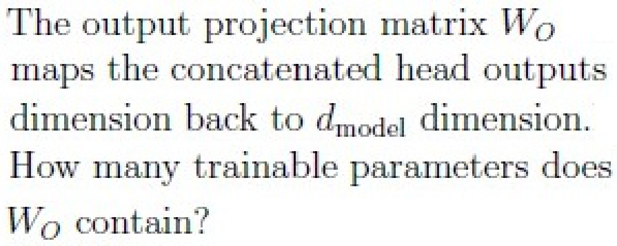

**Figure 30.** Question 191 stem: Output projection matrix W_O trainable parameters question

**Correct answer:** 589824

**Source evidence:** [{"page": 10, "bbox": [22.87, 731.82, 69.12, 750.18], "type": "explicit field", "detail": "Official key provides Possible Answers: 589824"}]

### Question 192

**Question ID:** `6406531529872`

**Type:** MSQ · **Marks:** 2
**PDF pages:** 10

**Shared context:** [ctx-189-192](#ctx-189-192)

[Question stem truncated in source PDF; document ends after question header]

**Correct answer:** Answer not verifiable from the source PDF

**Source evidence:** [{"page": 10, "bbox": [22.87, 772.5, 458.53, 808.14], "type": "absent", "detail": "Question 192 header appears at the bottom of final page 10 of the source PDF, but the question stem, options, and official answer key are truncated and absent before the document ends"}]

## Answer key

| Source question | Source identity | Correct answer | PDF pages |
| :--- | :--- | :--- | :--- |
| 173 | 6406531529852 | To avoid numerical issues and loss of gradients during training. | 2 |
| 174 | 6406531529853 | The encoding vector for each word position contains values computed using both sine (for even dimensions) and cosine (for odd dimensions). | 2 |
| 175 | 6406531529855 | ‘suis’ | 3 |
| 176 | 6406531529856 | [1, 2, 0, -\infty] | 3 |
| 177 | 6406531529857 | The correct target tokens from the training data are used as input for the next time step, regardless of the model’s prediction. | 4 |
| 178 | 6406531529860 | $\sum_{k=1}^5 \|V\|^k$ | 4 |
| 179 | 6406531529854 | $\begin{bmatrix} -1 & -1 \\ 1 & 1 \end{bmatrix}$ | 4, 5 |
| 180 | 6406531529858 | $(V - 1) \cdot V^L$ more sequences | 5 |
| 181 | 6406531529861 | Step 1:  Greedy: 1, Beam: 3, Exhaustive: 10  Step 3:  Greedy: 1, Beam: 3, Exhaustive: 1000 | 6 |
| 182 | 6406531529859 | Nucleus | 6 |
| 183 | 6406531529862 | They allow learning diverse local/global relations.; Increasing the number of heads while keeping dmodel fixed, decreases the dimensionality handled by each head. | 6, 7 |
| 184 | 6406531529863 | Masking (look-ahead mask) is applied in every decoder self-attention layer, not just the first one.; Token embeddings are used in both the encoder and the decoder.; Positional encodings are added to the input embeddings in both the encoder and the decoder. | 7 |
| 185 | 6406531529864 | Beam search with beam size 2 will keep both A and B whereas Top-2 sampling will keep either A or B.; Beam search with beam size 2 will always keep the top-2 most probable tokens, whereas Top-2 sampling will restrict choices to top-2 tokens and then sample one probabilistically. | 7, 8 |
| 186 | 6406531529865 | 1152 | 8 |
| 187 | 6406531529866 | 99 to 101 | 8 |
| 188 | 6406531529867 | 32768 | 9 |
| 189 | 6406531529869 | 32736 | 9, 10 |
| 190 | 6406531529870 | 524800 | 10 |
| 191 | 6406531529871 | 589824 | 10 |
| 192 | 6406531529872 | Answer not verifiable from the source PDF | 10 |

## Extraction notes

**Status:** verified-source-limitation
**Count reconciliation:** Section 10 declares 18 portal questions and 50 section marks. The 18 portal containers comprise: 1 administrative confirmation question (Q172, 0 marks, excluded), 16 standalone questions (Q173: 2 marks, Q174: 2 marks, Q175: 2 marks, Q176: 2 marks, Q177: 2 marks, Q178: 2 marks, Q179: 3 marks, Q180: 3 marks, Q181: 3 marks, Q182: 2 marks, Q183: 2 marks, Q184: 4 marks, Q185: 4 marks, Q186: 3 marks, Q187: 3 marks, Q188: 2 marks; total standalone = 41 marks), and 1 comprehension portal container (Q189-192: Q189: 3 marks, Q190: 2 marks, Q191: 2 marks, Q192: 2 marks; total comprehension = 9 marks). Total academic questions = 16 standalone + 4 comprehension subquestions = 20 academic questions. Total marks = 41 + 9 = 50 marks, exactly reconciling the declared section marks and 18 portal containers (1 confirmation + 16 standalone + 1 comprehension container = 18 portal questions).

- Question 192 (MSQ, 2 marks, Question Id: 6406531529872) appears at the bottom of Page 10 with only its question header ('Question Number : 192 Question Id : 6406531529872 Question Type : MSQ Correct Marks : 2 Max. Selectable Options : 0'). The question stem, options, and official answer are truncated before the document ends at page 10. In accordance with the extraction contract, the answer is recorded with kind 'absent' and text exactly 'Answer not verifiable from the source PDF'.

**Excluded source entries:**

- {"classification": "preceding-section-content", "page": 1, "bbox": [0.0, 0.0, 595.0, 380.0], "reason": "Preceding section examination question regarding contours of function f with options 6406535121340 and 6406535121341, appearing prior to Section 10 LLM header", "identity": "preceding-section"}
- {"classification": "subject-confirmation", "page": 2, "bbox": [22.87, 36.07, 569.03, 285.0], "reason": "Administrative subject confirmation asking candidate to confirm subject and cross check hall ticket", "identity": "172"}
