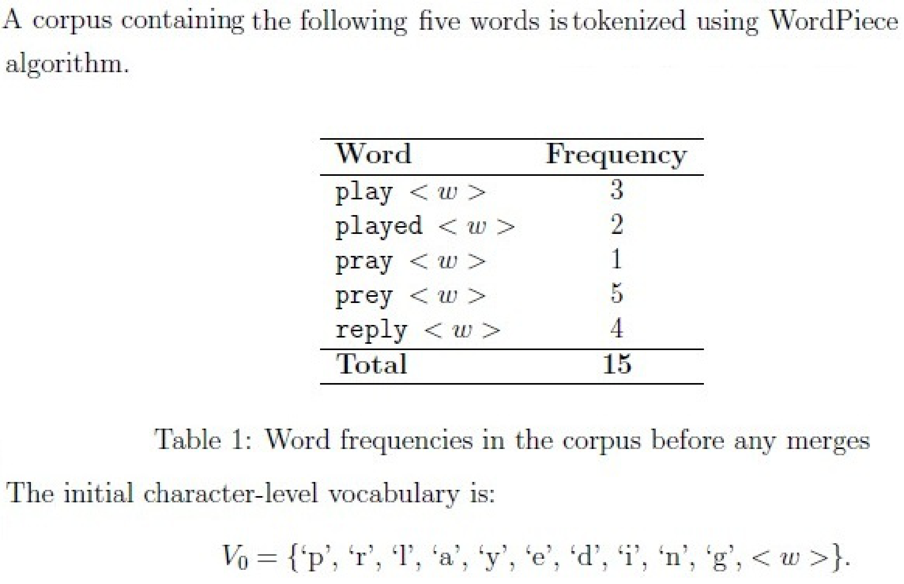
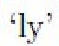
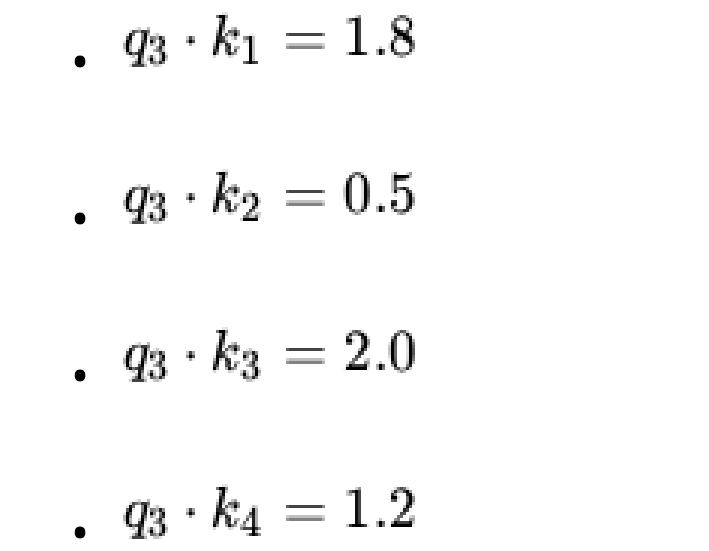
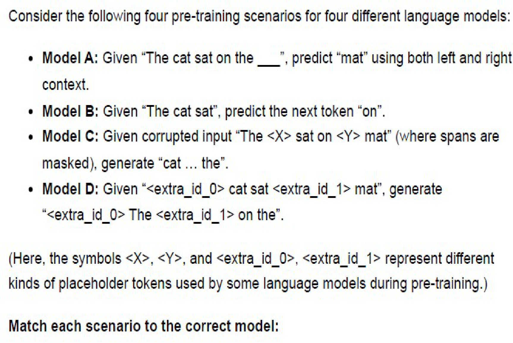
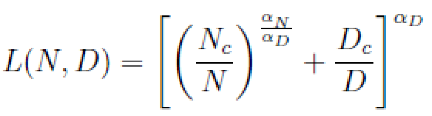
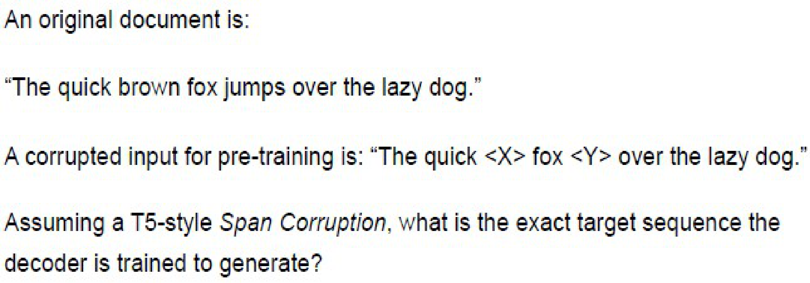
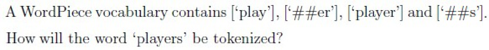

# LLM — da5004_2025T3_Q2_NA

**Source:** `da5004_2025T3_Q2_NA.pdf` · **Academic questions:** 22 · **Separately counted children:** 0
**Provenance:** `Large_Language_Models/da5004_2025T3_Q2_NA.pdf` · SHA-256 `f8bb8de26f2feee9023f2ae63201ebfbc33cfeaec70b9963fa796f253e248002`

**Scope:** Large Language Models (LLM) section (Section 6, Section Id: 640653121911) spanning page 1 at y=443.10 to page 13 at y=842.00. Preceding Section 5 tail content at top of page 1 (y=0 to y=443.10, including GMM question 105 and preceding options) is excluded as out of subject scope.

## Questions

### Shared context 107 to 109

**Question ID:** `6406531815698`

**Portal container ID:** `6406531815698`

**Type:** Comprehension
**PDF pages:** 2

A corpus containing the following five words is tokenized using WordPiece algorithm:

| Word | Frequency |
| :--- | :--- |
| `play <w>` | 3 |
| `played <w>` | 2 |
| `pray <w>` | 1 |
| `prey <w>` | 5 |
| `reply <w>` | 4 |
| **Total** | **15** |

*Table 1: Word frequencies in the corpus before any merges*

The initial character-level vocabulary is:
$V_0 = \{\text{'p'}, \text{'l'}, \text{'r'}, \text{'a'}, \text{'y'}, \text{'d'}, \text{'e'}, \text{<w>}\}$.

Based on the above data, answer the given subquestions.

**Figure 1.** WordPiece algorithm corpus word frequencies table and initial character vocabulary

### Question 107

**Question ID:** `6406531815699`

**Type:** SA · **Marks:** 2
**PDF pages:** 3

**Shared context:** [ctx-107-109](#ctx-107-109)

What is the score generated for the pair `['p', 'a']` before the first merge?

![Question 107 prompt: score generated for pair ['p', 'a'] before first merge](assets/da5004_2025T3_Q2_NA/q107-q107-stem-01-p003.png)

**Figure 2.** Question 107 prompt: score generated for pair ['p', 'a'] before first merge

**Correct answer:** 0

**Source evidence:** [{"page": 3, "bbox": [22.9, 219.0, 132.2, 235.3], "type": "numeric-answer", "detail": "Possible Answers : 0"}]

### Question 108

**Question ID:** `6406531815700`

**Type:** SA · **Marks:** 2
**PDF pages:** 3

**Shared context:** [ctx-107-109](#ctx-107-109)

What will be the score generated for the pair `['p', 'l']` before the first merge?

![Question 108 prompt: score generated for pair ['p', 'l'] before first merge](assets/da5004_2025T3_Q2_NA/q108-q108-stem-01-p003.png)

**Figure 3.** Question 108 prompt: score generated for pair ['p', 'l'] before first merge

**Correct answer:** 0.06 to 0.07

**Source evidence:** [{"page": 3, "bbox": [22.9, 508.3, 132.2, 524.6], "type": "numeric-answer", "detail": "Possible Answers : 0.06 to 0.07"}]

### Question 109

**Question ID:** `6406531815701`

**Type:** MCQ · **Marks:** 3
**PDF pages:** 3, 4

**Shared context:** [ctx-107-109](#ctx-107-109)

Which token will be generated in the first merge?

**Options**

**A.**

'pl'

**Figure 4.** Option A: 'pl'

*Source option ID:* `6406535903010`

**B.**

'la'

**Figure 5.** Option B: 'la'

*Source option ID:* `6406535903011`

**C.**

'ay'

**Figure 6.** Option C: 'ay'

*Source option ID:* `6406535903012`

**D.**

're'

**Figure 7.** Option D: 're'

*Source option ID:* `6406535903013`

**Correct answer:** 'la'

**Source evidence:** [{"page": 3, "bbox": [23.62, 731.87, 131.02, 748.37], "type": "marked-options", "detail": "Green checkmark option 6406535903011"}]

### Question 110

**Question ID:** `6406531815702`

**Type:** SA · **Marks:** 2
**PDF pages:** 4

A study is comparing three architectures, all trained with the same compute budget:

• Model A (Encoder-Decoder): A 12-layer encoder and a 12-layer decoder with separate parameters. Its total size is 220 million parameters.

• Model B (Decoder-Only): A 24-layer decoder-only model. Its total size is also approximately 220 million parameters.

• Model C (Shared Enc-Dec): A 12-layer encoder and a 12-layer decoder where the parameters are shared ($W_{\text{enc}} = W_{\text{dec}}$).

Assuming that the 12-layer encoder and 12-layer decoder in Model A have an equal number of parameters, what is the approximate total parameter count (in millions) of Model C?

**Correct answer:** 110

**Source evidence:** [{"page": 4, "bbox": [22.9, 442.2, 132.2, 458.5], "type": "numeric-answer", "detail": "Possible Answers : 110"}]

### Question 111

**Question ID:** `6406531815703`

**Type:** SA · **Marks:** 2
**PDF pages:** 4, 5

Consider a text corpus being processed using the Byte Pair Encoding (BPE) algorithm. The initial vocabulary contains 26 tokens (representing characters), and the corpus contains a total of 1000 tokens.
During BPE training, the following merge operations are performed. Each merge combines all occurrences of a particular token pair into a single new token, reducing the total token count accordingly:

1. Merge 1: Pair ('t', 'h') appears 24 times → merged into new token 'th'
2. Merge 2: Pair ('i', 'n') appears 18 times → merged into new token 'in'
3. Merge 3: Pair ('th', 'e') appears 10 times → merged into new token 'the'
4. Merge 4: Pair ('i', 's') appears 8 times → merged into new token 'is'

What is the final total number of tokens in the corpus after all 4 merges are completed?

**Correct answer:** 940

**Source evidence:** [{"page": 5, "bbox": [22.9, 219.0, 132.2, 235.3], "type": "numeric-answer", "detail": "Possible Answers : 940"}]

### Question 112

**Question ID:** `6406531815704`

**Type:** SA · **Marks:** 2
**PDF pages:** 5

If Byte-Pair Encoding (BPE) starts with 100 unique characters and performs 10000 merge operations, what will be the final vocabulary size?

**Correct answer:** 10100

**Source evidence:** [{"page": 5, "bbox": [22.9, 442.2, 132.2, 458.5], "type": "numeric-answer", "detail": "Possible Answers : 10100"}]

### Question 113

**Question ID:** `6406531815705`

**Type:** SA · **Marks:** 2
**PDF pages:** 5, 6

In a 4-token sequence, a Transformer is calculating the attention for the third Token. Its Query vector ($q_3$) must be compared against the Key vectors ($k_1, k_2, k_3, k_4$) of all tokens. The Causal LM mask is applied to the raw scores before the softmax function. The raw dot-product scores are:

• $q_3 \cdot k_1 = 1.8$
• $q_3 \cdot k_2 = 0.5$
• $q_3 \cdot k_3 = 2.0$
• $q_3 \cdot k_4 = 1.2$

After the Causal LM mask and the subsequent softmax function are applied, what will be the final attention probability assigned to Token 4?

**Figure 8.** Question 113 dot-product raw scores for Token 3 against Key vectors

**Correct answer:** 0

**Source evidence:** [{"page": 6, "bbox": [22.9, 361.6, 132.2, 377.9], "type": "numeric-answer", "detail": "Possible Answers : 0"}]

### Question 114

**Question ID:** `6406531815706`

**Type:** MSQ · **Marks:** 3
**PDF pages:** 6

Which of the following is/are primarily multilingual datasets? Select all that apply.

**Options**

**A.**

Sangraha

*Source option ID:* `6406535903018`

**B.**

DOLMA

*Source option ID:* `6406535903019`

**C.**

BookCorpus

*Source option ID:* `6406535903020`

**D.**

CommonCrawl

*Source option ID:* `6406535903021`

**Correct answer:** Sangraha; CommonCrawl

**Source evidence:** [{"page": 6, "bbox": [23.62, 484.85, 131.02, 501.17], "type": "marked-options", "detail": "Green checkmark option 6406535903018"}, {"page": 6, "bbox": [23.62, 608.69, 131.02, 625.01], "type": "marked-options", "detail": "Green checkmark option 6406535903021"}]

### Question 115

**Question ID:** `6406531815707`

**Type:** MSQ · **Marks:** 2
**PDF pages:** 6, 7

Which decoding method ensures the same response every time for a given prompt (assuming no randomness in model weights)? Select all that apply.

**Options**

**A.**

Top-k with k = 3, temperature > 1

*Source option ID:* `6406535903022`

**B.**

Top-k with k = 3, temperature = 1

*Source option ID:* `6406535903023`

**C.**

Top-p with p = 0.2, Temperature > 1

*Source option ID:* `6406535903024`

**D.**

Top-p with p = 0.2, Temperature = 1

*Source option ID:* `6406535903025`

**E.**

Beam Search with beam-size = 5

*Source option ID:* `6406535903026`

**F.**

Beam Search with beam-size = 1

*Source option ID:* `6406535903027`

**Correct answer:** Beam Search with beam-size = 5; Beam Search with beam-size = 1

**Source evidence:** [{"page": 7, "bbox": [23.62, 237.76, 131.02, 254.08], "type": "marked-options", "detail": "Green checkmark option 6406535903026"}, {"page": 7, "bbox": [23.62, 274.9, 131.02, 291.22], "type": "marked-options", "detail": "Green checkmark option 6406535903027"}]

### Question 116

**Question ID:** `6406531815708`

**Type:** MCQ · **Marks:** 2
**PDF pages:** 7

A data preprocessing pipeline removed data from the Common Crawl snapshot in three stages: 50% after language identification, 24% of the remaining after quality filtering, and 12% of what remained after deduplication. What percentage of the original Common Crawl snapshot remains in the final dataset? (Choose the closest number)

**Options**

**A.**

21%

*Source option ID:* `6406535903028`

**B.**

66%

*Source option ID:* `6406535903029`

**C.**

33%

*Source option ID:* `6406535903030`

**D.**

50%

*Source option ID:* `6406535903031`

**Correct answer:** 33%

**Source evidence:** [{"page": 7, "bbox": [23.62, 497.02, 131.02, 513.34], "type": "marked-options", "detail": "Green checkmark option 6406535903030"}]

### Question 117

**Question ID:** `6406531815709`

**Type:** MCQ · **Marks:** 3
**PDF pages:** 7, 8

A data preprocessing pipeline needs to apply the following steps on raw Common Crawl data:

1. Fuzzy deduplication (using MinHash)
2. Toxicity detection (using ML-based classifiers)
3. PII removal (using regex patterns)

4. Exact deduplication (using hash-based matching)
5. Quality filtering (using several rule-based heuristics)
6. URL Filtering

What is the most efficient sequence to apply these steps?

**Options**

**A.**

6 → 4 → 1 → 5 → 2 → 3

*Source option ID:* `6406535903032`

**B.**

1 → 4 → 2 → 5 → 3 → 6

*Source option ID:* `6406535903033`

**C.**

5 → 6 → 4 → 1 → 2 → 3

*Source option ID:* `6406535903034`

**D.**

4 → 5 → 6 → 1 → 3 → 2

*Source option ID:* `6406535903035`

**Correct answer:** 6 → 4 → 1 → 5 → 2 → 3

**Source evidence:** [{"page": 8, "bbox": [23.62, 187.8, 131.02, 205.8], "type": "marked-options", "detail": "Green checkmark option 6406535903032"}]

### Question 118

**Question ID:** `6406531815710`

**Type:** MCQ · **Marks:** 4
**PDF pages:** 8, 9

Consider the following four pre-training scenarios for four different language models:
• Model A: Given "The cat sat on the __", predict "mat" using both left and right context.
• Model B: Given "The cat sat", predict the next token "on".
• Model C: Given corrupted input "The <X> sat on <Y> mat" (where spans are masked), generate "cat ... the".
• Model D: Given "<extra_id_0> cat sat <extra_id_1> mat", generate "<extra_id_0> The <extra_id_1> on the".

(Here, the symbols `<X>`, `<Y>`, and `<extra_id_0>`, `<extra_id_1>` represent different kinds of placeholder tokens used by some language models during pre-training.)

Match each scenario to the correct model:

**Figure 9.** Question 118 pre-training scenarios for Model A, Model B, Model C, and Model D

**Options**

**A.**

A = BART, B = T5, C = BERT, D = GPT

*Source option ID:* `6406535903036`

**B.**

A = T5, B = BERT, C = GPT, D = BART

*Source option ID:* `6406535903037`

**C.**

A = BERT, B = GPT, C = BART, D = T5

*Source option ID:* `6406535903038`

**D.**

A = BERT, B = BART, C = GPT, D = T5

*Source option ID:* `6406535903039`

**Correct answer:** A = BERT, B = GPT, C = BART, D = T5

**Source evidence:** [{"page": 9, "bbox": [23.62, 59.14, 131.02, 75.46], "type": "marked-options", "detail": "Green checkmark option 6406535903038"}]

### Question 119

**Question ID:** `6406531815711`

**Type:** MCQ · **Marks:** 2
**PDF pages:** 9

Consider the scaling law:

$$L(N, D) = \left(\frac{N_c}{N}\right)^{\alpha_N} + \left(\frac{D_c}{D}\right)^{\alpha_D}$$

where $N$ = model parameters, $D$ = training tokens, $N_c, D_c$ = scale constants, $\alpha_N, \alpha_D$ = scaling exponents.

A team trains an LLM and observes the following losses for their model:
1. Training Loss
2. Test Loss (same distribution as training)
3. Test Loss (different distribution from training)

Which loss does $L(N, D)$ represent?

**Figure 10.** Question 119 scaling law loss equation L(N, D)

**Options**

**A.**

Both 2 and 3

*Source option ID:* `6406535903040`

**B.**

Both 1 and 2

*Source option ID:* `6406535903041`

**C.**

1 only

*Source option ID:* `6406535903042`

**D.**

2 only

*Source option ID:* `6406535903043`

**Correct answer:** 2 only

**Source evidence:** [{"page": 9, "bbox": [23.62, 690.67, 131.02, 706.99], "type": "marked-options", "detail": "Green checkmark option 6406535903043"}]

### Question 120

**Question ID:** `6406531815712`

**Type:** MCQ · **Marks:** 3
**PDF pages:** 9, 10

A company is building a sentiment analysis system for customer reviews. They have two options:
Option A: Fine-tune BERT for sentiment classification
Option B: Fine-tune BART for sentiment classification

Their requirements are:
• Process 10,000 reviews per minute
• Deploy on cost-effective cloud instances (memory-constrained)
• Simple positive/negative/neutral classification
• No need for explanations or text generation

Which statement best describes the trade-offs they should consider?

**Options**

**A.**

BART is expected to provide significantly better accuracy and is worth the extra computational cost since it's pre-trained on more diverse corruption tasks.

*Source option ID:* `6406535903044`

**B.**

BART is better because its decoder can verify the encoder's sentiment understanding, providing a built-in validation mechanism that improves robustness.

*Source option ID:* `6406535903045`

**C.**

They should use BART's encoder only and discard the decoder, which will give them the same efficiency as BERT with better pre-training.

*Source option ID:* `6406535903046`

**D.**

BERT is more suitable because sentiment classification only requires understanding (encoding), not generation (decoding), making it faster and more memory-efficient without sacrificing accuracy.

*Source option ID:* `6406535903047`

**Correct answer:** BERT is more suitable because sentiment classification only requires understanding (encoding), not generation (decoding), making it faster and more memory-efficient without sacrificing accuracy.

**Source evidence:** [{"page": 10, "bbox": [23.62, 384.13, 131.02, 400.45], "type": "marked-options", "detail": "Green checkmark option 6406535903047"}]

### Question 121

**Question ID:** `6406531815713`

**Type:** MCQ · **Marks:** 2
**PDF pages:** 10

Which of the following statements best describes the fundamental difference between the unsupervised pre-training objective used in T5 (span corruption) and its supervised fine-tuning objectives such as translation or summarization?

**Options**

**A.**

The pre-training objective is a denoising task, while the fine-tuning objective is a Causal Language Model (CLM) task.

*Source option ID:* `6406535903048`

**B.**

There is no fundamental difference; both are treated as "text-to-text" tasks, where the model is trained to generate a target sequence given an input sequence.

*Source option ID:* `6406535903049`

**C.**

The pre-training objective trains the model to fill in [MASK] tokens, while the fine-tuning objective trains the model to generate text from a [CLS] token.

*Source option ID:* `6406535903050`

**D.**

The pre-training objective trains the entire encoder-decoder, while the fine-tuning objective freezes the encoder and only trains the decoder.

*Source option ID:* `6406535903051`

**Correct answer:** There is no fundamental difference; both are treated as "text-to-text" tasks, where the model is trained to generate a target sequence given an input sequence.

**Source evidence:** [{"page": 10, "bbox": [23.62, 685.75, 131.02, 702.07], "type": "marked-options", "detail": "Green checkmark option 6406535903049"}]

### Question 122

**Question ID:** `6406531815714`

**Type:** MCQ · **Marks:** 2
**PDF pages:** 11

An original document is:
"The quick brown fox jumps over the lazy dog."

A corrupted input for pre-training is:
"The quick <X> fox <Y> over the lazy dog."

What is the target output for pre-training?

**Figure 11.** Question 122 corrupted document input and target output problem

**Options**

**A.**

brown jumps

**Figure 12.** Option A: brown jumps

*Source option ID:* `6406535903052`

**B.**

The quick brown fox jumps over the lazy dog.

**Figure 13.** Option B: The quick brown fox jumps over the lazy dog.

*Source option ID:* `6406535903053`

**C.**

<X> brown <Y> jumps <Z>

**Figure 14.** Option C: <X> brown <Y> jumps <Z>

*Source option ID:* `6406535903054`

**D.**

brown <X> jumps <Y>

**Figure 15.** Option D: brown <X> jumps <Y>

*Source option ID:* `6406535903055`

**Correct answer:** <X> brown <Y> jumps <Z>

**Source evidence:** [{"page": 11, "bbox": [23.62, 402.07, 131.02, 418.39], "type": "marked-options", "detail": "Green checkmark option 6406535903054"}]

### Question 123

**Question ID:** `6406531815715`

**Type:** MCQ · **Marks:** 2
**PDF pages:** 11, 12

A Transformer model is designed to handle both understanding and generation tasks. When given the input sequence $[A, B, C, D, E]$, its attention mask allows the following:

• When processing $A$ or $B$, the model can see both $A$ and $B$.
• When processing $C$, the model can see $A, B$ and $C$ but not $D, E$.

This attention scheme is the defining characteristic of which training objective?

**Options**

**A.**

Causal Language Modeling (CLM)

*Source option ID:* `6406535903056`

**B.**

Masked Language Modeling (MLM)

*Source option ID:* `6406535903057`

**C.**

Denoising Objective (like BART)

*Source option ID:* `6406535903058`

**D.**

Prefix Language Modeling (Prefix-LM)

*Source option ID:* `6406535903059`

**Correct answer:** Prefix Language Modeling (Prefix-LM)

**Source evidence:** [{"page": 12, "bbox": [23.62, 59.14, 131.02, 75.46], "type": "marked-options", "detail": "Green checkmark option 6406535903059"}]

### Question 124

**Question ID:** `6406531815716`

**Type:** MCQ · **Marks:** 2
**PDF pages:** 12

BART is an encoder-decoder model. During its denoising pre-training, what is fed as input to the decoder?

**Options**

**A.**

The corrupted text from the encoder.

*Source option ID:* `6406535903060`

**B.**

The original, uncorrupted text (shifted right by one token).

*Source option ID:* `6406535903061`

**C.**

A sequence of [MASK] tokens, one for each original word.

*Source option ID:* `6406535903062`

**D.**

Nothing; the decoder starts with only the < s > token.

*Source option ID:* `6406535903063`

**Correct answer:** The original, uncorrupted text (shifted right by one token).

**Source evidence:** [{"page": 12, "bbox": [23.62, 295.48, 131.02, 311.8], "type": "marked-options", "detail": "Green checkmark option 6406535903061"}]

### Question 125

**Question ID:** `6406531815717`

**Type:** MCQ · **Marks:** 2
**PDF pages:** 12

A WordPiece vocabulary contains `['play']`, `['##er']`, `['player']` and `['##s']`. How will the word 'players' be tokenized?

**Figure 16.** Question 125 WordPiece vocabulary and tokenization of players

**Options**

**A.**

['play', '##er', '##s']

![Option A: ['play', '##er', '##s']](assets/da5004_2025T3_Q2_NA/q125-q125-option-a-01-p012.png)

**Figure 17.** Option A: ['play', '##er', '##s']

*Source option ID:* `6406535903064`

**B.**

['player', '##s']

![Option B: ['player', '##s']](assets/da5004_2025T3_Q2_NA/q125-q125-option-b-01-p012.png)

**Figure 18.** Option B: ['player', '##s']

*Source option ID:* `6406535903065`

**C.**

['players']

![Option C: ['players']](assets/da5004_2025T3_Q2_NA/q125-q125-option-c-01-p012.png)

**Figure 19.** Option C: ['players']

*Source option ID:* `6406535903066`

**D.**

['p', 'l', 'a', 'y', '##s']

![Option D: ['p', 'l', 'a', 'y', '##s']](assets/da5004_2025T3_Q2_NA/q125-q125-option-d-01-p012.png)

**Figure 20.** Option D: ['p', 'l', 'a', 'y', '##s']

*Source option ID:* `6406535903067`

**Correct answer:** ['player', '##s']

**Source evidence:** [{"page": 12, "bbox": [23.62, 616.78, 131.02, 633.1], "type": "marked-options", "detail": "Green checkmark option 6406535903065"}]

### Question 126

**Question ID:** `6406531815718`

**Type:** MCQ · **Marks:** 2
**PDF pages:** 13

How does SentencePiece handle whitespace characters (like spaces) during tokenization?

**Options**

**A.**

It only keeps whitespace that appears next to punctuation marks.

*Source option ID:* `6406535903068`

**B.**

It discards all whitespace as a pre-processing step.

*Source option ID:* `6406535903069`

**C.**

It replaces all whitespace with a special [SPACE] token.

*Source option ID:* `6406535903070`

**D.**

It treats whitespace as part of the text stream and encodes it, often using a symbol like   (underscore).

*Source option ID:* `6406535903071`

**Correct answer:** It treats whitespace as part of the text stream and encodes it, often using a symbol like   (underscore).

**Source evidence:** [{"page": 13, "bbox": [23.62, 176.56, 131.02, 192.88], "type": "marked-options", "detail": "Green checkmark option 6406535903071"}]

### Question 127

**Question ID:** `6406531815719`

**Type:** MCQ · **Marks:** 2
**PDF pages:** 13

For a layer with 512 features, how many learnable parameters do BatchNorm and LayerNorm have?

**Options**

**A.**

BatchNorm: 512, LayerNorm: 512

*Source option ID:* `6406535903072`

**B.**

BatchNorm: 1024, LayerNorm: 512

*Source option ID:* `6406535903073`

**C.**

BatchNorm: 512, LayerNorm: 1024

*Source option ID:* `6406535903074`

**D.**

BatchNorm: 1024, LayerNorm: 1024

*Source option ID:* `6406535903075`

**Correct answer:** BatchNorm: 1024, LayerNorm: 1024

**Source evidence:** [{"page": 13, "bbox": [23.62, 497.54, 131.02, 513.86], "type": "marked-options", "detail": "Green checkmark option 6406535903075"}]

### Question 128

**Question ID:** `6406531815720`

**Type:** MCQ · **Marks:** 2
**PDF pages:** 13

In a standard Encoder-Decoder Transformer, where do the Query $Q$, Key $K$, and Value $V$ inputs for the Decoder's Cross-Attention sub-layer come from?

**Options**

**A.**

$Q$ comes from the decoder's previous sub-layer; $K$ and $V$ come from the final hidden states of the encoder.

*Source option ID:* `6406535903076`

**B.**

$Q$ comes from the final hidden states of the encoder; $K$ and $V$ come from the decoder's previous sub-layer.

*Source option ID:* `6406535903077`

**Correct answer:** $Q$ comes from the decoder's previous sub-layer; $K$ and $V$ come from the final hidden states of the encoder.

**Source evidence:** [{"page": 13, "bbox": [23.62, 726.43, 131.02, 742.75], "type": "marked-options", "detail": "Green checkmark option 6406535903076"}]

## Answer key

| Source question | Source identity | Correct answer | PDF pages |
| :--- | :--- | :--- | :--- |
| 107 | 6406531815699 | 0 | 3 |
| 108 | 6406531815700 | 0.06 to 0.07 | 3 |
| 109 | 6406531815701 | 'la' | 3, 4 |
| 110 | 6406531815702 | 110 | 4 |
| 111 | 6406531815703 | 940 | 4, 5 |
| 112 | 6406531815704 | 10100 | 5 |
| 113 | 6406531815705 | 0 | 5, 6 |
| 114 | 6406531815706 | Sangraha; CommonCrawl | 6 |
| 115 | 6406531815707 | Beam Search with beam-size = 5; Beam Search with beam-size = 1 | 6, 7 |
| 116 | 6406531815708 | 33% | 7 |
| 117 | 6406531815709 | 6 → 4 → 1 → 5 → 2 → 3 | 7, 8 |
| 118 | 6406531815710 | A = BERT, B = GPT, C = BART, D = T5 | 8, 9 |
| 119 | 6406531815711 | 2 only | 9 |
| 120 | 6406531815712 | BERT is more suitable because sentiment classification only requires understanding (encoding), not generation (decoding), making it faster and more memory-efficient without sacrificing accuracy. | 9, 10 |
| 121 | 6406531815713 | There is no fundamental difference; both are treated as "text-to-text" tasks, where the model is trained to generate a target sequence given an input sequence. | 10 |
| 122 | 6406531815714 | <X> brown <Y> jumps <Z> | 11 |
| 123 | 6406531815715 | Prefix Language Modeling (Prefix-LM) | 11, 12 |
| 124 | 6406531815716 | The original, uncorrupted text (shifted right by one token). | 12 |
| 125 | 6406531815717 | ['player', '##s'] | 12 |
| 126 | 6406531815718 | It treats whitespace as part of the text stream and encodes it, often using a symbol like   (underscore). | 13 |
| 127 | 6406531815719 | BatchNorm: 1024, LayerNorm: 1024 | 13 |
| 128 | 6406531815720 | $Q$ comes from the decoder's previous sub-layer; $K$ and $V$ come from the final hidden states of the encoder. | 13 |

## Extraction notes

**Status:** verified
**Count reconciliation:** Section 6 declares 21 portal questions and 50 section marks. The 21 portal containers comprise: 1 administrative confirmation question (Q106, 0 marks, excluded), 1 comprehension portal container (Question Id 6406531815698, containing Q107: 2 marks, Q108: 2 marks, Q109: 3 marks; total comprehension = 7 marks), and 19 standalone questions (Q110: 2 marks, Q111: 2 marks, Q112: 2 marks, Q113: 2 marks, Q114: 3 marks, Q115: 2 marks, Q116: 2 marks, Q117: 3 marks, Q118: 4 marks, Q119: 2 marks, Q120: 3 marks, Q121: 2 marks, Q122: 2 marks, Q123: 2 marks, Q124: 2 marks, Q125: 2 marks, Q126: 2 marks, Q127: 2 marks, Q128: 2 marks; total standalone = 43 marks). Total academic questions = 3 comprehension subquestions + 19 standalone questions = 22 academic questions. Total marks = 7 + 43 = 50 marks, exactly reconciling the declared section marks (50 marks) and declared portal containers (1 confirmation + 1 comprehension container + 19 standalone = 21 portal questions).

- Question 106 is a 0-mark administrative subject confirmation question, excluded semantically from academic count.
- Questions 107 to 109 are governed by Comprehension container 6406531815698 (Table 1: Word frequencies in the corpus before any merges for WordPiece tokenization).
- Question 128 has 2 printed options in the source PDF.
- Mathematical formulas and tables with raster sources have been transcribed with verified exact values and accompanied by 288 DPI source crops.

**Excluded source entries:**

- {"classification": "out-of-scope-tail", "page": 1, "bbox": [20.62, 17.5, 500.0, 420.0], "reason": "Tail of preceding Section 5 answer evaluation and GMM short answer question 105 (3 marks) appearing above Section 6 LLM header", "identity": "section-5-tail"}
- {"classification": "subject-confirmation", "page": 2, "bbox": [22.87, 161.0, 580.0, 360.0], "reason": "Administrative subject confirmation asking candidate to confirm subject and cross check hall ticket", "identity": "106"}
