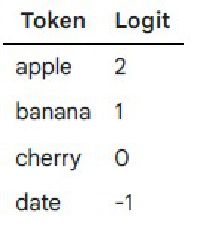
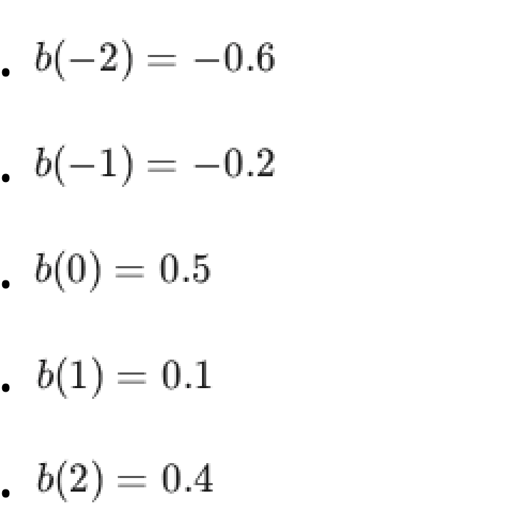
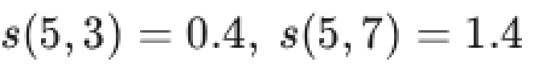
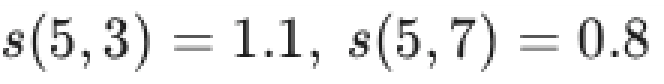
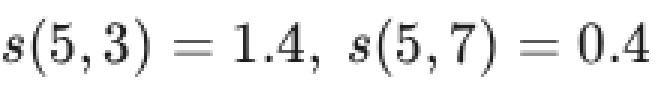
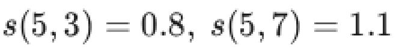
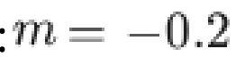

# LLM — da5004_2026T1_ET_AN

**Source:** `da5004_2026T1_ET_AN.pdf` · **Academic questions:** 20 · **Separately counted children:** 0
**Provenance:** `Large_Language_Models/da5004_2026T1_ET_AN.pdf` · SHA-256 `28e9d4083319a53cff846239018c574c6b31951a8c574a883676ea3b91863f55`

**Scope:** LLM (Degree Level : Large Language Models (Computer Based Exam)), physical pages 1 to 11. The in-scope exam content starts on physical page 1 with Section LLM (Section Id: 640653138793) and Subject Confirmation (Question 1) and terminates on physical page 11 after Question 21.

## Questions

### Question 2

**Question ID:** `6406532124837`

**Type:** MCQ · **Marks:** 2
**PDF pages:** 2

In the standard Transformer Decoder, the Multi-Head Attention layer is "Masked". What is the specific purpose of this mask during training?

**Options**

**A.**

To filter out padding tokens to save computation.

*Source option ID:* `6406536924689`

**B.**

To prevent the model from attending to the [CLS] and [SEP] special tokens.

*Source option ID:* `6406536924690`

**C.**

To preserve the auto-regressive property by ensuring that the prediction for position $t$ can only depend on known outputs at positions less than $t$ (preventing "peeking" into the future).

*Source option ID:* `6406536924691`

**D.**

To force the model to focus on the Encoder output rather than the Decoder input.

*Source option ID:* `6406536924692`

**Correct answer:** To preserve the auto-regressive property by ensuring that the prediction for position $t$ can only depend on known outputs at positions less than $t$ (preventing "peeking" into the future).

**Source evidence:** [{"page": 2, "bbox": [119.02, 432.9, 131.02, 444.9], "type": "marked-options", "detail": "Green checkmark option 6406536924691"}]

### Question 3

**Question ID:** `6406532124841`

**Type:** MCQ · **Marks:** 2
**PDF pages:** 2, 3

In the Span Corruption pre-training objective used by T5 (similar to the "Denoising" objective in BART), the input is:

"Thank you for <X> me to your <Y> last week."

(where `<X>` and `<Y>` represent masked spans).

What is the corresponding Target sequence that the decoder is trained to generate?

**Figure 1.** T5 span corruption masked input sentence Thank you for <X> me to your <Y> last week.

**Options**

**A.**

"inviting party"

**Figure 2.** Option A target sequence inviting party

*Source option ID:* `6406536924699`

**B.**

"<X> inviting <Y> party <Z>"
(containing only the missing contents delimited by sentinels)

**Figure 3.** Option B target sequence <X> inviting <Y> party <Z>

*Source option ID:* `6406536924700`

**C.**

"Thank you for inviting me to your party last week."
(The full original sentence)

**Figure 4.** Option C target sequence full original sentence

*Source option ID:* `6406536924701`

**D.**

"<X> inviting me <Y> party last week"

**Figure 5.** Option D target sequence <X> inviting me <Y> party last week

*Source option ID:* `6406536924702`

**Correct answer:** "<X> inviting <Y> party <Z>"
(containing only the missing contents delimited by sentinels)

**Source evidence:** [{"page": 3, "bbox": [119.02, 22.0, 131.02, 34.0], "type": "marked-options", "detail": "Green checkmark option 6406536924700"}]

### Question 4

**Question ID:** `6406532124851`

**Type:** MCQ · **Marks:** 2
**PDF pages:** 3

In Strided Local Attention, each token attends only to a local window of neighbors. While this reduces computational complexity to $O(c \cdot T \cdot d)$ (linear in $T$), what is a significant limitation of a single layer of such attention?

**Options**

**A.**

It has a limited receptive field and cannot capture long-range dependencies directly.

*Source option ID:* `6406536924730`

**B.**

It requires more memory than full attention.

*Source option ID:* `6406536924731`

**C.**

It cannot be parallelized on GPUs.

*Source option ID:* `6406536924732`

**D.**

It causes the gradients to explode.

*Source option ID:* `6406536924733`

**Correct answer:** It has a limited receptive field and cannot capture long-range dependencies directly.

**Source evidence:** [{"page": 3, "bbox": [119.02, 330.17, 131.02, 342.17], "type": "marked-options", "detail": "Green checkmark option 6406536924730"}]

### Question 5

**Question ID:** `6406532124855`

**Type:** MCQ · **Marks:** 2
**PDF pages:** 3

A transformer layer with absolute positional encoding and another with ALiBi are compared on sequences extended from length 128 to 512, without retraining.

Which numerical behavior is most likely for ALiBi in this extrapolation scenario?

**Options**

**A.**

Attention scores remain numerically well-shaped because ALiBi biases scale linearly with distance, not with a fixed maximum length.

*Source option ID:* `6406536924746`

**B.**

The model cannot compute positional information beyond 128 because ALiBi stores one embedding per absolute position up to 128 only.

*Source option ID:* `6406536924747`

**C.**

ALiBi attention becomes undefined for positions beyond 128 because its biases require precomputed lookup tables that stop at 128.

*Source option ID:* `6406536924748`

**D.**

Attention scores collapse to near zero for distant positions because ALiBi uses fixed sinusoidal patterns tied to the original length 128.

*Source option ID:* `6406536924749`

**Correct answer:** Attention scores remain numerically well-shaped because ALiBi biases scale linearly with distance, not with a fixed maximum length.

**Source evidence:** [{"page": 3, "bbox": [119.02, 599.15, 131.02, 611.15], "type": "marked-options", "detail": "Green checkmark option 6406536924746"}]

### Question 6

**Question ID:** `6406532124838`

**Type:** MSQ · **Marks:** 3
**PDF pages:** 4

Based on the BERT pre-training phase, select all correct constraints and properties regarding the input data.

**Options**

**A.**

The maximum context length (sequence length) supported is 512 tokens.

*Source option ID:* `6406536924693`

**B.**

The input text must be contiguous (long-range contiguous text), meaning sentences are not shuffled randomly.

*Source option ID:* `6406536924694`

**C.**

The vocabulary is built using BPE encoding.

*Source option ID:* `6406536924695`

**D.**

Special tokens [CLS] (at the start) and [SEP] (to separate sentences) are explicitly added to the input sequence.

*Source option ID:* `6406536924696`

**Correct answer:** The maximum context length (sequence length) supported is 512 tokens.; The input text must be contiguous (long-range contiguous text), meaning sentences are not shuffled randomly.; Special tokens [CLS] (at the start) and [SEP] (to separate sentences) are explicitly added to the input sequence.

**Source evidence:** [{"page": 4, "bbox": [119.02, 105.8, 131.02, 117.8], "type": "marked-options", "detail": "Green checkmark option 6406536924693"}, {"page": 4, "bbox": [119.02, 142.94, 131.02, 154.94], "type": "marked-options", "detail": "Green checkmark option 6406536924694"}, {"page": 4, "bbox": [119.02, 213.7, 131.02, 225.7], "type": "marked-options", "detail": "Green checkmark option 6406536924696"}]

### Question 7

**Question ID:** `6406532124842`

**Type:** MSQ · **Marks:** 3
**PDF pages:** 4

Select the statements that correctly distinguish fine-tuning from zero-shot prompting for GPT-style models.

**Options**

**A.**

In Fine-Tuning, the weights of the pre-trained model (and often a new specific head) are updated using backpropagation on a labeled dataset.

*Source option ID:* `6406536924703`

**B.**

In Zero-Shot Prompting, the model weights are frozen (not updated); the task is formulated purely through the design of the input text (prompt).

*Source option ID:* `6406536924704`

**C.**

Zero-Shot Prompting generally achieves higher accuracy than Fine-Tuning when abundant labeled data is available.

*Source option ID:* `6406536924705`

**D.**

Fine-Tuning typically requires a task-specific output layer (like a linear classifier), whereas Zero-Shot Prompting relies on the model generating text directly.

*Source option ID:* `6406536924706`

**Correct answer:** In Fine-Tuning, the weights of the pre-trained model (and often a new specific head) are updated using backpropagation on a labeled dataset.; In Zero-Shot Prompting, the model weights are frozen (not updated); the task is formulated purely through the design of the input text (prompt).; Fine-Tuning typically requires a task-specific output layer (like a linear classifier), whereas Zero-Shot Prompting relies on the model generating text directly.

**Source evidence:** [{"page": 4, "bbox": [119.02, 403.9, 131.02, 415.9], "type": "marked-options", "detail": "Green checkmark option 6406536924703"}, {"page": 4, "bbox": [119.02, 441.0, 131.02, 453.0], "type": "marked-options", "detail": "Green checkmark option 6406536924704"}, {"page": 4, "bbox": [119.02, 515.3, 131.02, 527.3], "type": "marked-options", "detail": "Green checkmark option 6406536924706"}]

### Question 8

**Question ID:** `6406532124839`

**Type:** SA · **Marks:** 2
**PDF pages:** 4, 5

You are using Top-$p$ (Nucleus) Sampling with $p = 0.80$. The model outputs the following sorted probability distribution for the next token:

• "apple": 0.40

• "banana": 0.25
• "cherry": 0.15
• "date": 0.10
• "elderberry": 0.10

How many tokens will be included in the candidate pool from which the final token is sampled? Enter the integer count.

**Correct answer:** 3

**Source evidence:** [{"page": 5, "bbox": [22.87, 335.9, 30.6, 354.3], "type": "explicit field", "detail": "Official key Possible Answers: 3"}]

### Question 9

**Question ID:** `6406532124843`

**Type:** SA · **Marks:** 2
**PDF pages:** 5

A Large Language Model is pre-trained for 1,000,000 ($10^6$) steps. The batch size is 2048 sequences. The sequence length (context window) is 512 tokens.

Calculate the total number of tokens the model sees during pre-training. Enter your answer in Billions (B). (e.g., if the answer is 500 Billion, enter 500).

**Correct answer:** 1046 to 1050

**Source evidence:** [{"page": 5, "bbox": [22.87, 664.8, 104.5, 683.2], "type": "explicit field", "detail": "Official key Possible Answers: 1046 to 1050"}]

### Question 10

**Question ID:** `6406532124847`

**Type:** SA · **Marks:** 2
**PDF pages:** 5, 6

The computational complexity and memory requirement of the Self-Attention mechanism is quadratic with respect to the sequence length $T$.

Specifically, the Attention Score matrix has a size of $T \times T$.

If you double the input sequence length $T$ (e.g., from 512 to 1024) while keeping the embedding dimension ($d_{model}$) constant, by what factor does the memory required to store the Attention Score matrix increase? Enter the integer value.

**Correct answer:** 4

**Source evidence:** [{"page": 6, "bbox": [22.87, 238.0, 30.6, 256.3], "type": "explicit field", "detail": "Official key Possible Answers: 4"}]

### Question 11

**Question ID:** `6406532124840`

**Type:** SA · **Marks:** 3
**PDF pages:** 6

Suppose a language model outputs the following logits for a vocabulary of size 4:

| Token | Logit |
| :--- | :--- |
| apple | 2 |
| banana | 1 |
| cherry | 0 |
| date | -1 |

You apply High Temperature Sampling with temperature $T = 2.0$. After applying the softmax on the temperature-scaled logits, what is the probability assigned to the token "apple"? (Give your answer up to 2 decimal places).

First, apply temperature scaling with $T = 2.0$:

**Figure 6.** Vocabulary token logit table for apple, banana, cherry, and date

**Correct answer:** 0.43 to 0.49

**Source evidence:** [{"page": 6, "bbox": [22.87, 786.7, 96.4, 805.1], "type": "explicit field", "detail": "Official key Possible Answers: 0.43 to 0.49"}]

### Question 12

**Question ID:** `6406532124848`

**Type:** SA · **Marks:** 3
**PDF pages:** 7

Consider a Strided Local Attention mechanism where each token attends to a window of $W$ tokens ($W/2$ left, $W/2$ right).

• Sequence Length ($T$) = 1000
• Embedding Dimension ($d$) = 64
• Window Size ($W$) = 10

How many multiplications are performed to compute the unnormalized attention scores ($QK^T$) for one attention head?

**Correct answer:** 640000

**Source evidence:** [{"page": 7, "bbox": [22.87, 335.0, 90.0, 355.0], "type": "explicit field", "detail": "Official key Possible Answers: 640000"}]

### Question 13

**Question ID:** `6406532124844`

**Type:** MCQ · **Marks:** 3
**PDF pages:** 7

Adapter Layers are a parameter-efficient fine-tuning strategy. Where are these layers typically inserted within a Transformer block?

**Options**

**A.**

Before the Self-Attention mechanism only.

*Source option ID:* `6406536924708`

**B.**

After the Feed-Forward Network (FFN) block and/or after the Self-Attention block.

*Source option ID:* `6406536924709`

**C.**

Replacing the Layer Normalization parameters.

*Source option ID:* `6406536924710`

**D.**

In parallel to the main residual connection.

*Source option ID:* `6406536924711`

**Correct answer:** After the Feed-Forward Network (FFN) block and/or after the Self-Attention block.

**Source evidence:** [{"page": 7, "bbox": [119.02, 691.88, 131.02, 703.88], "type": "marked-options", "detail": "Green checkmark option 6406536924709"}]

### Question 14

**Question ID:** `6406532124846`

**Type:** MCQ · **Marks:** 3
**PDF pages:** 7, 8

Why do standard LLM architectures include explicit Positional Encodings (like RoPE or Sinusoidal) despite the causal mask providing some implicit order?

**Options**

**A.**

To reduce the memory footprint of the $K$ and $V$ matrices.

*Source option ID:* `6406536924716`

**B.**

To ensure that the model can only attend to future tokens.

*Source option ID:* `6406536924717`

**C.**

To provide a strong inductive bias that allows the model to learn structural and distance-based relationships more efficiently than relying on masking alone.

*Source option ID:* `6406536924718`

**D.**

To fix a mathematical error in the original Dot-Product Attention formula.

*Source option ID:* `6406536924719`

**Correct answer:** To provide a strong inductive bias that allows the model to learn structural and distance-based relationships more efficiently than relying on masking alone.

**Source evidence:** [{"page": 8, "bbox": [119.02, 169.88, 131.02, 181.88], "type": "marked-options", "detail": "Green checkmark option 6406536924718"}]

### Question 15

**Question ID:** `6406532124850`

**Type:** MCQ · **Marks:** 3
**PDF pages:** 8

In the context of Grouped Query Attention (GQA), if we have $H$ query heads and $G$ groups, how many Key/Value heads are trained?

**Options**

**A.**

1 Key/Value head (same as MQA).

*Source option ID:* `6406536924726`

**B.**

$H$ Key/Value heads (same as MHA).

*Source option ID:* `6406536924727`

**C.**

$G$ Key/Value heads (where $1 < G < H$).

*Source option ID:* `6406536924728`

**D.**

$H \times G$ Key/Value heads.

*Source option ID:* `6406536924729`

**Correct answer:** $G$ Key/Value heads (where $1 < G < H$).

**Source evidence:** [{"page": 8, "bbox": [119.02, 426.15, 131.02, 438.15], "type": "marked-options", "detail": "Green checkmark option 6406536924728"}]

### Question 16

**Question ID:** `6406532124852`

**Type:** MCQ · **Marks:** 3
**PDF pages:** 8

Consider Multi-Query Attention (MQA). How does its architecture differ from standard Multi-Head Attention (MHA) to improve inference efficiency?

**Options**

**A.**

It uses multiple query heads but only a single attention head.

*Source option ID:* `6406536924734`

**B.**

It maintains multiple Query heads but shares a single Key and Value head across all Query heads.

*Source option ID:* `6406536924735`

**C.**

It quantizes the Query vectors to 4 bits.

*Source option ID:* `6406536924736`

**D.**

It removes the Value vectors entirely and uses Keys as Values.

*Source option ID:* `6406536924737`

**Correct answer:** It maintains multiple Query heads but shares a single Key and Value head across all Query heads.

**Source evidence:** [{"page": 8, "bbox": [119.02, 657.99, 131.02, 669.99], "type": "marked-options", "detail": "Green checkmark option 6406536924735"}]

### Question 17

**Question ID:** `6406532124854`

**Type:** MCQ · **Marks:** 3
**PDF pages:** 8, 9

In a transformer with relative positional encoding (RPE), attention logits between a query at position 5 and keys at positions 3 and 7 depend on relative distances $d = i - j$ where $i$ is the position of query and $j$ is the position of key.

Suppose the learned scalar biases as per RPE are:
• $b(-2) = -0.6$
• $b(-1) = -0.2$
• $b(0) = 0.5$
• $b(1) = 0.1$
• $b(2) = 0.4$

The base (content-only) attention logits are:
• $s(5, 3) = 1.0$
• $s(5, 7) = 1.0$

What are the final attention logits after incorporating RPE?

**Figure 7.** Learned scalar biases b(d) as per relative positional encoding

**Options**

**A.**

$s(5, 3) = 0.4, s(5, 7) = 1.4$

**Figure 8.** Option A final attention logits s(5,3) = 0.4, s(5,7) = 1.4

*Source option ID:* `6406536924742`

**B.**

$s(5, 3) = 1.1, s(5, 7) = 0.8$

**Figure 9.** Option B final attention logits s(5,3) = 1.1, s(5,7) = 0.8

*Source option ID:* `6406536924743`

**C.**

$s(5, 3) = 1.4, s(5, 7) = 0.4$

**Figure 10.** Option C final attention logits s(5,3) = 1.4, s(5,7) = 0.4

*Source option ID:* `6406536924744`

**D.**

$s(5, 3) = 0.8, s(5, 7) = 1.1$

**Figure 11.** Option D final attention logits s(5,3) = 0.8, s(5,7) = 1.1

*Source option ID:* `6406536924745`

**Correct answer:** $s(5, 3) = 1.4, s(5, 7) = 0.4$

**Source evidence:** [{"page": 9, "bbox": [119.02, 591.5, 131.02, 603.5], "type": "marked-options", "detail": "Green checkmark option 6406536924744"}]

### Question 18

**Question ID:** `6406532124856`

**Type:** MCQ · **Marks:** 3
**PDF pages:** 9, 10

In ALiBi, the attention score is modified using a distance-based bias

Suppose for a head the slope is:
$m = 0.2$

**Figure 12.** ALiBi head slope m = 0.2

For a query at position $i = 5$, attending to keys at positions $j = 3, 5, 8$:

What ALiBi bias values are subtracted from the logits for keys at positions 3, 5, and 8, respectively?

Note: Assume absolute distances.

**Options**

**A.**

$[0.4, 0, -0.6]$

![Option A ALiBi bias values [0.4, 0, -0.6]](assets/da5004_2026T1_ET_AN/q18-q18-option-a-01-p010.png)

**Figure 13.** Option A ALiBi bias values [0.4, 0, -0.6]

*Source option ID:* `6406536924750`

**B.**

$[0.4, 0, 0.6]$

![Option B ALiBi bias values [0.4, 0, 0.6]](assets/da5004_2026T1_ET_AN/q18-q18-option-b-01-p010.png)

**Figure 14.** Option B ALiBi bias values [0.4, 0, 0.6]

*Source option ID:* `6406536924751`

**C.**

$[-0.4, 0, 0.6]$

![Option C ALiBi bias values [-0.4, 0, 0.6]](assets/da5004_2026T1_ET_AN/q18-q18-option-c-01-p010.png)

**Figure 15.** Option C ALiBi bias values [-0.4, 0, 0.6]

*Source option ID:* `6406536924752`

**D.**

$[-0.4, 0, -0.6]$

![Option D ALiBi bias values [-0.4, 0, -0.6]](assets/da5004_2026T1_ET_AN/q18-q18-option-d-01-p010.png)

**Figure 16.** Option D ALiBi bias values [-0.4, 0, -0.6]

*Source option ID:* `6406536924753`

**Correct answer:** $[-0.4, 0, -0.6]$

**Source evidence:** [{"page": 10, "bbox": [119.02, 252.83, 131.02, 264.83], "type": "marked-options", "detail": "Green checkmark option 6406536924753"}]

### Question 19

**Question ID:** `6406532124845`

**Type:** MSQ · **Marks:** 2
**PDF pages:** 10

Which of the following statements about fine-tuning strategies such as gradual unfreezing and multi-task learning in the context of the T5 model are correct?

**Options**

**A.**

In gradual unfreezing, layers are progressively unfrozen starting from the task-specific (top) layers toward the input (bottom) layers.

*Source option ID:* `6406536924712`

**B.**

Multi-task learning in T5 typically improves performance uniformly across all tasks.

*Source option ID:* `6406536924713`

**C.**

Multi-task pre-training (as used in T5) followed by task-specific fine-tuning often performs better than relying on multi-task learning alone.

*Source option ID:* `6406536924714`

**D.**

Gradual unfreezing can help mitigate catastrophic forgetting of pre-trained representations during T5 fine-tuning.

*Source option ID:* `6406536924715`

**Correct answer:** In gradual unfreezing, layers are progressively unfrozen starting from the task-specific (top) layers toward the input (bottom) layers.; Multi-task learning in T5 typically improves performance uniformly across all tasks.; Gradual unfreezing can help mitigate catastrophic forgetting of pre-trained representations during T5 fine-tuning.

**Source evidence:** [{"page": 10, "bbox": [119.02, 484.7, 131.02, 496.7], "type": "marked-options", "detail": "Green checkmark option 6406536924712"}, {"page": 10, "bbox": [119.02, 521.8, 131.02, 533.8], "type": "marked-options", "detail": "Green checkmark option 6406536924713"}, {"page": 10, "bbox": [119.02, 596.1, 131.02, 608.1], "type": "marked-options", "detail": "Green checkmark option 6406536924715"}]

### Question 20

**Question ID:** `6406532124849`

**Type:** MSQ · **Marks:** 2
**PDF pages:** 10, 11

Select all correct statements regarding Local Attention Variants (like Sparse, Dilated, or Windowed Attention).

**Options**

**A.**

Many local attention variants reduce complexity toward linear with sequence length.

*Source option ID:* `6406536924722`

**B.**

They always outperform full attention on all tasks, regardless of sequence

length.

*Source option ID:* `6406536924723`

**C.**

Stacking multiple layers of local attention increases the effective receptive field, similar to dilated convolutions in CNNs.

*Source option ID:* `6406536924724`

**D.**

They can be combined with global tokens (e.g., in BigBird) to ensure some tokens can attend to the entire sequence.

*Source option ID:* `6406536924725`

**Correct answer:** Many local attention variants reduce complexity toward linear with sequence length.; Stacking multiple layers of local attention increases the effective receptive field, similar to dilated convolutions in CNNs.; They can be combined with global tokens (e.g., in BigBird) to ensure some tokens can attend to the entire sequence.

**Source evidence:** [{"page": 10, "bbox": [119.02, 770.0, 131.02, 782.0], "type": "marked-options", "detail": "Green checkmark option 6406536924722"}, {"page": 11, "bbox": [119.02, 39.1, 131.02, 51.1], "type": "marked-options", "detail": "Green checkmark option 6406536924724"}, {"page": 11, "bbox": [119.02, 76.3, 131.02, 88.3], "type": "marked-options", "detail": "Green checkmark option 6406536924725"}]

### Question 21

**Question ID:** `6406532124853`

**Type:** MSQ · **Marks:** 2
**PDF pages:** 11

Which of the following techniques are used in Flash Attention to speed up attention computation and save memory?

**Options**

**A.**

Tiling: Breaking the large matrices into smaller blocks that fit into the fast SRAM.

*Source option ID:* `6406536924738`

**B.**

Recomputation: Recomputing the attention matrix during the backward pass instead of storing it in HBM.

*Source option ID:* `6406536924739`

**C.**

Approximation: Using a low-rank approximation of the attention matrix to avoid exact calculation.

*Source option ID:* `6406536924740`

**D.**

Kernel Fusion: Fusing multiple operations (MatMul, Mask, Softmax, Dropout) into a single kernel to reduce memory reads/writes.

*Source option ID:* `6406536924741`

**Correct answer:** Tiling: Breaking the large matrices into smaller blocks that fit into the fast SRAM.; Recomputation: Recomputing the attention matrix during the backward pass instead of storing it in HBM.; Kernel Fusion: Fusing multiple operations (MatMul, Mask, Softmax, Dropout) into a single kernel to reduce memory reads/writes.

**Source evidence:** [{"page": 11, "bbox": [119.02, 250.2, 131.02, 262.2], "type": "marked-options", "detail": "Green checkmark option 6406536924738"}, {"page": 11, "bbox": [119.02, 287.3, 131.02, 299.3], "type": "marked-options", "detail": "Green checkmark option 6406536924739"}, {"page": 11, "bbox": [119.02, 361.6, 131.02, 373.6], "type": "marked-options", "detail": "Green checkmark option 6406536924741"}]

## Answer key

| Source question | Source identity | Correct answer | PDF pages |
| :--- | :--- | :--- | :--- |
| 2 | 6406532124837 | To preserve the auto-regressive property by ensuring that the prediction for position $t$ can only depend on known outputs at positions less than $t$ (preventing "peeking" into the future). | 2 |
| 3 | 6406532124841 | "<X> inviting <Y> party <Z>" (containing only the missing contents delimited by sentinels) | 2, 3 |
| 4 | 6406532124851 | It has a limited receptive field and cannot capture long-range dependencies directly. | 3 |
| 5 | 6406532124855 | Attention scores remain numerically well-shaped because ALiBi biases scale linearly with distance, not with a fixed maximum length. | 3 |
| 6 | 6406532124838 | The maximum context length (sequence length) supported is 512 tokens.; The input text must be contiguous (long-range contiguous text), meaning sentences are not shuffled randomly.; Special tokens [CLS] (at the start) and [SEP] (to separate sentences) are explicitly added to the input sequence. | 4 |
| 7 | 6406532124842 | In Fine-Tuning, the weights of the pre-trained model (and often a new specific head) are updated using backpropagation on a labeled dataset.; In Zero-Shot Prompting, the model weights are frozen (not updated); the task is formulated purely through the design of the input text (prompt).; Fine-Tuning typically requires a task-specific output layer (like a linear classifier), whereas Zero-Shot Prompting relies on the model generating text directly. | 4 |
| 8 | 6406532124839 | 3 | 4, 5 |
| 9 | 6406532124843 | 1046 to 1050 | 5 |
| 10 | 6406532124847 | 4 | 5, 6 |
| 11 | 6406532124840 | 0.43 to 0.49 | 6 |
| 12 | 6406532124848 | 640000 | 7 |
| 13 | 6406532124844 | After the Feed-Forward Network (FFN) block and/or after the Self-Attention block. | 7 |
| 14 | 6406532124846 | To provide a strong inductive bias that allows the model to learn structural and distance-based relationships more efficiently than relying on masking alone. | 7, 8 |
| 15 | 6406532124850 | $G$ Key/Value heads (where $1 < G < H$). | 8 |
| 16 | 6406532124852 | It maintains multiple Query heads but shares a single Key and Value head across all Query heads. | 8 |
| 17 | 6406532124854 | $s(5, 3) = 1.4, s(5, 7) = 0.4$ | 8, 9 |
| 18 | 6406532124856 | $[-0.4, 0, -0.6]$ | 9, 10 |
| 19 | 6406532124845 | In gradual unfreezing, layers are progressively unfrozen starting from the task-specific (top) layers toward the input (bottom) layers.; Multi-task learning in T5 typically improves performance uniformly across all tasks.; Gradual unfreezing can help mitigate catastrophic forgetting of pre-trained representations during T5 fine-tuning. | 10 |
| 20 | 6406532124849 | Many local attention variants reduce complexity toward linear with sequence length.; Stacking multiple layers of local attention increases the effective receptive field, similar to dilated convolutions in CNNs.; They can be combined with global tokens (e.g., in BigBird) to ensure some tokens can attend to the entire sequence. | 10, 11 |
| 21 | 6406532124853 | Tiling: Breaking the large matrices into smaller blocks that fit into the fast SRAM.; Recomputation: Recomputing the attention matrix during the backward pass instead of storing it in HBM.; Kernel Fusion: Fusing multiple operations (MatMul, Mask, Softmax, Dropout) into a single kernel to reduce memory reads/writes. | 11 |

## Extraction notes

**Status:** verified
**Count reconciliation:** 21 total portal questions declared in Section LLM. Question 1 (0 marks) is an administrative subject confirmation and is excluded. Questions 2 through 21 (50 total marks) are the 20 in-scope academic questions (11 MCQ, 4 MSQ, 5 SA). No child questions, shared passages, or no-paper notices.

**Excluded source entries:**

- {"classification": "subject-confirmation", "page": 1, "bbox": [22.87, 55.39, 569.03, 842.0], "reason": "Administrative subject confirmation asking candidate to verify hall ticket for DEGREE LEVEL : LARGE LANGUAGE MODELS (COMPUTER BASED EXAM).", "identity": "6406532124836"}
