# LLM — da5004_2026T1_Q1_NA

**Source:** `da5004_2026T1_Q1_NA.pdf` · **Academic questions:** 19 · **Separately counted children:** 0
**Provenance:** `Large_Language_Models/da5004_2026T1_Q1_NA.pdf` · SHA-256 `36b97be09a59b1a1d661caf11a5b7479012b91bdd61a2a7aeddcf627eb7196c0`

**Scope:** Section 1: LLM (Degree Level : Large Language Models), physical pages 2 to 12. The in-scope subject starts at physical page 2 with Section Id 640653129729 at y=515.54 and terminates on physical page 12 at y=168.0.

## Questions

### Question 2

**Question ID:** `6406531961494`

**Type:** Multiple Choice Question · **Marks:** 2
**PDF pages:** 3

In a self-attention mechanism, let the input be a matrix $X \in \mathbb{R}^{T \times d_{model}}$, where $T$ is the sequence length. If the dimension of the query projection matrix is $W_Q \in \mathbb{R}^{d_{model} \times d_k}$, what is the dimension of the Query matrix $Q$?

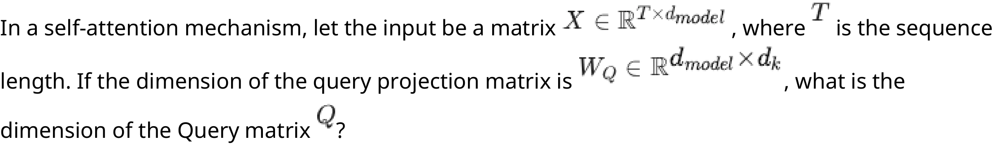

**Figure 1.** Question 2 prompt: self-attention query matrix dimension formulation with input X and query projection matrix W_Q

**Options**

**A.**

$d_{model} \times T$

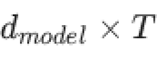

**Figure 2.** Option A dimension d_model x T

*Source option ID:* `6406536373621`

**B.**

$d_k \times T$

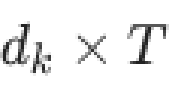

**Figure 3.** Option B dimension d_k x T

*Source option ID:* `6406536373622`

**C.**

$T \times d_k$

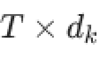

**Figure 4.** Option C dimension T x d_k

*Source option ID:* `6406536373623`

**D.**

$T \times d_{model}$

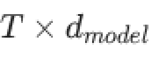

**Figure 5.** Option D dimension T x d_model

*Source option ID:* `6406536373624`

**Correct answer:** C

**Source evidence:** [{"page": 3, "bbox": [23.62, 605.31, 119.02, 621.63], "type": "green source option", "detail": "Option 6406536373623 marked with green color 32768 in source PDF"}]

### Question 3

**Question ID:** `6406531961495`

**Type:** Multiple Choice Question · **Marks:** 2
**PDF pages:** 3, 4

In the scaled dot-product attention equation $\text{Attention}(Q, K, V) = \text{softmax}\left(\frac{QK^T}{\sqrt{d_k}}\right) V$, what is the primary reason for dividing the dot product by $\sqrt{d_k}$?

**Figure 6.** Question 3 prompt: scaled dot-product attention formulation and scaling factor division

**Options**

**A.**

To ensure the matrix dimensions match for multiplication with $V$

*Source option ID:* `6406536373625`

**B.**

To reduce the number of trainable parameters in the model

*Source option ID:* `6406536373626`

**C.**

To prevent the dot product values from growing too large, which would push the softmax function into regions with extremely small gradients

*Source option ID:* `6406536373627`

**D.**

To normalize the embedding vectors to have a unit length

*Source option ID:* `6406536373628`

**Correct answer:** C

**Source evidence:** [{"page": 4, "bbox": [23.62, 135.71, 119.02, 152.03], "type": "green source option", "detail": "Option 6406536373627 marked with green color 32768 in source PDF"}]

### Question 4

**Question ID:** `6406531961496`

**Type:** Multiple Choice Question · **Marks:** 2
**PDF pages:** 4

Consider a Transformer Encoder stack consisting of $N = 6$ identical layers. If the input to the first layer is a sequence of word embeddings of shape $T \times d_{model}$ (where $T = 50$ and $d_{model} = 512$), what is the shape of the output of the final (6th) layer?

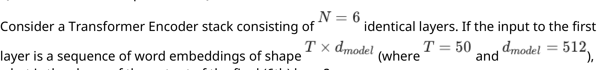

**Figure 7.** Question 4 prompt: Transformer Encoder stack specifications with N=6 layers and sequence shape T x d_model

**Options**

**A.**

$1 \times 512$ (A single context vector)

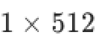

**Figure 8.** Option A shape 1 x 512 single context vector

*Source option ID:* `6406536373629`

**B.**

$6 \times 512$ (One vector per layer)

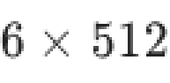

**Figure 9.** Option B shape 6 x 512 one vector per layer

*Source option ID:* `6406536373630`

**C.**

$50 \times 512$ (One vector per token, preserving sequence length)

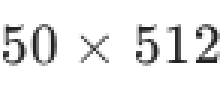

**Figure 10.** Option C shape 50 x 512 one vector per token

*Source option ID:* `6406536373631`

**D.**

$300 \times 512$ (Concatenation of all token vectors across layers)

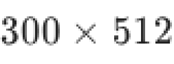

**Figure 11.** Option D shape 300 x 512 concatenation across layers

*Source option ID:* `6406536373632`

**Correct answer:** C

**Source evidence:** [{"page": 4, "bbox": [23.62, 474.68, 119.02, 491.0], "type": "green source option", "detail": "Option 6406536373631 marked with green color 32768 in source PDF"}]

### Question 5

**Question ID:** `6406531961500`

**Type:** Multiple Choice Question · **Marks:** 2
**PDF pages:** 4

In a standard Transformer encoder-decoder architecture, is masking typically applied in the cross-attention layer?

**Options**

**A.**

Yes, both causal masking and padding masking are applied to prevent the decoder from attending to future encoder positions

*Source option ID:* `6406536373645`

**B.**

Yes, only causal masking is applied to maintain the autoregressive property

*Source option ID:* `6406536373646`

**C.**

No causal masking is needed, but padding masking may be applied to ignore padded positions in the source sequence

*Source option ID:* `6406536373647`

**D.**

No masking is ever applied in cross-attention since the encoder processes the complete input sequence

*Source option ID:* `6406536373648`

**Correct answer:** C

**Source evidence:** [{"page": 4, "bbox": [23.62, 754.1, 119.02, 770.42], "type": "green source option", "detail": "Option 6406536373647 marked with green color 32768 in source PDF"}]

### Question 6

**Question ID:** `6406531961512`

**Type:** Multiple Choice Question · **Marks:** 2
**PDF pages:** 5

Consider the BERT architecture. During pre-training, it uses segment embeddings ($E_A, E_B$) to distinguish between sentences. However, during fine-tuning for a single-sentence classification task (e.g., Sentiment Analysis), how are these segment embeddings typically utilized?

**Options**

**A.**

Segment embeddings are not used; the embedding layer is disabled for single-sentence tasks.

*Source option ID:* `6406536373673`

**B.**

All tokens in the input sequence are assigned the same segment embedding (e.g., $E_A$).

*Source option ID:* `6406536373674`

**C.**

The first half of the sentence gets $E_A$ and the second half gets $E_B$ to maintain symmetry.

*Source option ID:* `6406536373675`

**D.**

Segment embeddings are randomly initialized for every new single-sentence input.

*Source option ID:* `6406536373676`

**Correct answer:** B

**Source evidence:** [{"page": 5, "bbox": [23.62, 214.38, 119.02, 230.7], "type": "green source option", "detail": "Option 6406536373674 marked with green color 32768 in source PDF"}]

### Question 7

**Question ID:** `6406531961513`

**Type:** Multiple Choice Question · **Marks:** 2
**PDF pages:** 5

Consider a decoding step in a language model where the logits for the next token are $z = [2.0, 1.0, 0.5]$. We apply a temperature scaling $z/T$ before the softmax. As $T \to 0$ (approaches zero), what does the resulting probability distribution $P(x)$ look like?

**Options**

**A.**

It approaches a uniform distribution where all tokens have equal probability.

*Source option ID:* `6406536373677`

**B.**

It approaches a "one-hot" distribution where the token with the highest logit has probability 1.0 (Greedy Search).

*Source option ID:* `6406536373678`

**C.**

It remains unchanged from the original softmax distribution.

*Source option ID:* `6406536373679`

**D.**

It causes numerical instability and results in NaNs.

*Source option ID:* `6406536373680`

**Correct answer:** B

**Source evidence:** [{"page": 5, "bbox": [23.62, 577.06, 119.02, 593.38], "type": "green source option", "detail": "Option 6406536373678 marked with green color 32768 in source PDF"}]

### Question 8

**Question ID:** `6406531961514`

**Type:** Multiple Choice Question · **Marks:** 2
**PDF pages:** 5, 6

You are fine-tuning a pre-trained BERT model for a spam classification task. The input sequence is: `[CLS] Win a free iPhone now [SEP]`. Which vector from the final layer output is typically passed to the classification head ($W_v$)?

**Options**

**A.**

The average pooling of all token vectors.

*Source option ID:* `6406536373681`

**B.**

The final hidden state vector corresponding to the `[SEP]` token ($h_{sep}$).

*Source option ID:* `6406536373682`

**C.**

The final hidden state vector corresponding to the `[CLS]` token ($h_{cls}$).

*Source option ID:* `6406536373683`

**D.**

The concatenation of all hidden state vectors.

*Source option ID:* `6406536373684`

**Correct answer:** C

**Source evidence:** [{"page": 6, "bbox": [23.62, 97.82, 119.02, 114.14], "type": "green source option", "detail": "Option 6406536373683 marked with green color 32768 in source PDF"}]

### Question 9

**Question ID:** `6406531961497`

**Type:** Multiple Select Question · **Marks:** 3
**PDF pages:** 6

Select all statements that correctly describe the motivation and behavior of Multi-Head Attention as compared to single-head attention.

**Options**

**A.**

It allows the model to jointly attend to information from different representation subspaces at different positions.

*Source option ID:* `6406536373633`

**B.**

It is mathematically similar to having multiple filters/kernels in a CNN to capture different features.

*Source option ID:* `6406536373634`

**C.**

It reduces the total number of parameters required compared to a single head with the same total dimension.

*Source option ID:* `6406536373635`

**D.**

Each head can theoretically learn to capture different linguistic relationships (e.g., one head links "it" to "animal", another links "it" to "tired").

*Source option ID:* `6406536373636`

**Correct answer:** A, B, D

**Source evidence:** [{"page": 6, "bbox": [23.62, 350.48, 119.02, 366.8], "type": "green source option", "detail": "Option 6406536373633 marked with green color 32768 in source PDF"}, {"page": 6, "bbox": [23.62, 387.62, 119.02, 403.94], "type": "green source option", "detail": "Option 6406536373634 marked with green color 32768 in source PDF"}, {"page": 6, "bbox": [23.62, 461.9, 119.02, 478.22], "type": "green source option", "detail": "Option 6406536373636 marked with green color 32768 in source PDF"}]

### Question 10

**Question ID:** `6406531961498`

**Type:** Multiple Select Question · **Marks:** 3
**PDF pages:** 6, 7

Given the vectorized self-attention calculation $\text{Attention}(Q, K, V) = \text{softmax}\left(\frac{QK^T}{\sqrt{d_k}}\right) V$, select all true statements regarding the matrix dimensions and operations. Assume $Q, K, V \in \mathbb{R}^{T \times d_k}, T > d_k$.

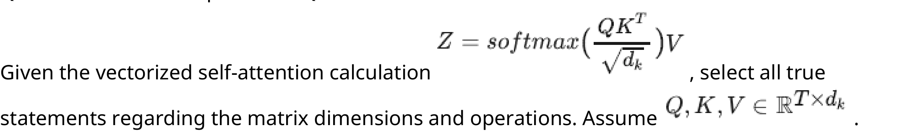

**Figure 12.** Question 10 prompt: vectorized self-attention equation and matrix dimension conditions

**Options**

**A.**

The matrix resulting from $QK^T$ has dimensions $T \times T$.

*Source option ID:* `6406536373637`

**B.**

The softmax operation is applied to the entire matrix at once (globally), not row-wise.

*Source option ID:* `6406536373638`

**C.**

The final output $Z$ has dimensions $T \times d_v$.

*Source option ID:* `6406536373639`

**D.**

The matrix $QK^T$ represents the raw affinity/score between every pair of tokens in the sequence.

*Source option ID:* `6406536373640`

**Correct answer:** A, C, D

**Source evidence:** [{"page": 6, "bbox": [23.62, 688.09, 119.02, 704.41], "type": "green source option", "detail": "Option 6406536373637 marked with green color 32768 in source PDF"}, {"page": 6, "bbox": [23.62, 773.55, 119.02, 789.87], "type": "green source option", "detail": "Option 6406536373639 marked with green color 32768 in source PDF"}, {"page": 7, "bbox": [23.62, 28.68, 119.02, 45.0], "type": "green source option", "detail": "Option 6406536373640 marked with green color 32768 in source PDF"}]

### Question 11

**Question ID:** `6406531961499`

**Type:** Multiple Select Question · **Marks:** 2
**PDF pages:** 7

In the context of the Transformer architecture, which of the following statements correctly describe the source of the Query ($Q$), Key ($K$), and Value ($V$) vectors during the Cross-Attention (Encoder-Decoder Attention) mechanism?

**Options**

**A.**

The Keys ($K$) and Values ($V$) are derived from the output of the Decoder.

*Source option ID:* `6406536373641`

**B.**

The Queries ($Q$) are generated from the previous hidden states of the Decoder.

*Source option ID:* `6406536373642`

**C.**

The Queries ($Q$), Keys ($K$), and Values ($V$) all originate from the same input sequence.

*Source option ID:* `6406536373643`

**D.**

This mechanism allows the Decoder to focus on relevant parts of the input sequence processed by the Encoder.

*Source option ID:* `6406536373644`

**Correct answer:** B, D

**Source evidence:** [{"page": 7, "bbox": [23.62, 363.85, 119.02, 380.17], "type": "green source option", "detail": "Option 6406536373642 marked with green color 32768 in source PDF"}, {"page": 7, "bbox": [23.62, 481.96, 119.02, 498.28], "type": "green source option", "detail": "Option 6406536373644 marked with green color 32768 in source PDF"}]

### Question 12

**Question ID:** `6406531961501`

**Type:** Short Answer Question · **Marks:** 2
**PDF pages:** 7, 8

Consider the positional encoding for a given position $pos$ and dimension $i$ is defined by:

$$PE_{(pos, 2i)} = \sin\left(\frac{pos}{10000^{2i/d_{model}}}\right)$$
$$PE_{(pos, 2i+1)} = \cos\left(\frac{pos}{10000^{2i/d_{model}}}\right)$$

Consider a Transformer model with a hidden state dimension $d_{model} = 128$. You are calculating the positional embedding for the 4th word in a sequence (index $pos = 3$, using 0-based indexing). Calculate the value of the 6th element (index $i = 5$) of the positional embedding vector for this word. (use radians for angle)

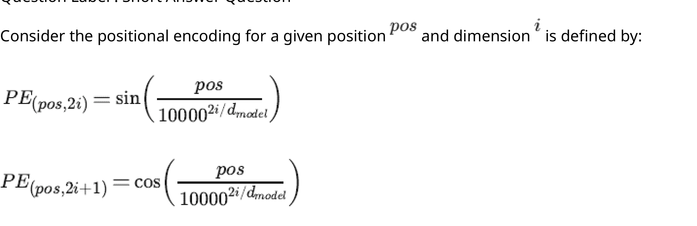

**Figure 13.** Question 12 prompt: sinusoidal positional encoding definitions PE(pos, 2i) and PE(pos, 2i+1)

**Correct answer:** -0.65 to -0.59

**Source evidence:** [{"page": 8, "bbox": [22.87, 185.0, 150.0, 205.0], "type": "explicit field", "detail": "Source PDF specifies official accepted answer range: -0.65 to -0.59"}]

### Shared context 13-15

**Question ID:** `6406531961502`

**Type:** Comprehension
**PDF pages:** 8, 9

Suppose you are given three encoder hidden states at time $t$:

$$h_1 = \begin{bmatrix} 1 \\ 0 \end{bmatrix}, \quad h_2 = \begin{bmatrix} 0 \\ 1 \end{bmatrix}, \quad h_3 = \begin{bmatrix} 1 \\ 1 \end{bmatrix}$$

The previous decoder hidden state is:

$$s_{t-1} = \begin{bmatrix} 1 \\ 2 \end{bmatrix}$$

Given the attention score function:

$$\text{score}(s_{t-1}, h_j) = v_{att}^T \tanh(U_{att} s_{t-1} + W_{att} h_j)$$

where the hyperbolic tangent function is defined as:

$$\tanh(x) = \frac{e^x - e^{-x}}{e^x + e^{-x}} = \frac{e^{2x} - 1}{e^{2x} + 1}$$

and

$$v_{att} = \begin{bmatrix} 1 \\ 1 \end{bmatrix}, \quad U_{att} = \begin{bmatrix} 1 & 0 \\ 0 & 1 \end{bmatrix}, \quad W_{att} = \begin{bmatrix} 1 & 0 \\ 0 & 1 \end{bmatrix}$$

Based on the above data, answer the given subquestions.

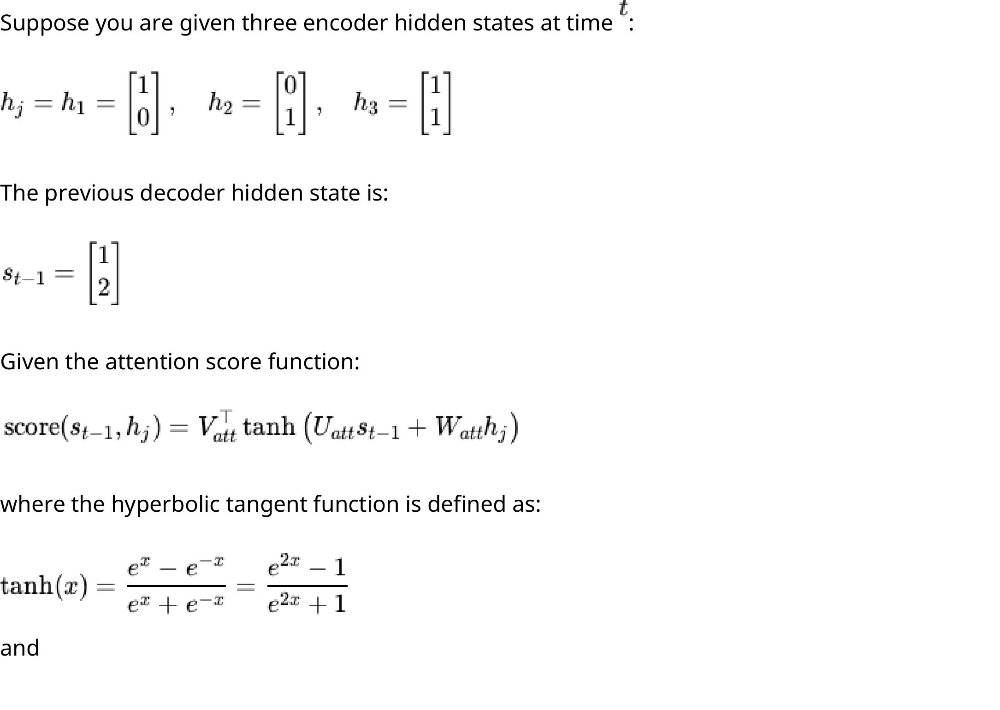

**Figure 14.** Comprehension passage for Q13-15: encoder hidden states h1, h2, h3, decoder state s_{t-1}, attention score function, and tanh definition

$$v_{att} = \begin{bmatrix} 1 \\ 1 \end{bmatrix}, \quad U_{att} = \begin{bmatrix} 1 & 0 \\ 0 & 1 \end{bmatrix}, \quad W_{att} = \begin{bmatrix} 1 & 0 \\ 0 & 1 \end{bmatrix}$$

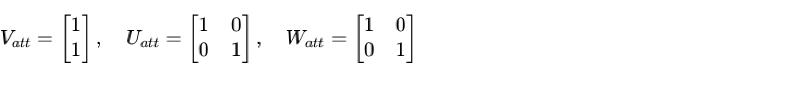

**Figure 15.** Comprehension passage continuation for Q13-15: weight matrices v_att, U_att, and W_att

### Question 13

**Question ID:** `6406531961503`

**Type:** Short Answer Question · **Marks:** 1
**PDF pages:** 9

**Shared context:** [ctx-13-15](#ctx-13-15)

Compute the attention score for hidden state $h_1$ using the given function. Enter the final answer correct to two decimal places.

**Correct answer:** 1.89 to 1.96

**Source evidence:** [{"page": 9, "bbox": [22.87, 280.0, 150.0, 300.0], "type": "explicit field", "detail": "Source PDF specifies official accepted answer range: 1.89 to 1.96"}]

### Question 14

**Question ID:** `6406531961504`

**Type:** Short Answer Question · **Marks:** 3
**PDF pages:** 9

**Shared context:** [ctx-13-15](#ctx-13-15)

Normalize the attention scores using the softmax function to obtain the attention weights $\alpha_t$:

$$\alpha_{tj} = \frac{\exp(\text{score}(s_{t-1}, h_j))}{\sum_{k=1}^n \exp(\text{score}(s_{t-1}, h_k))}$$

Submit $\alpha_{t1}$ (i.e., the first element of the $\alpha_t$ vector). Enter the final answer correct to two decimal places.

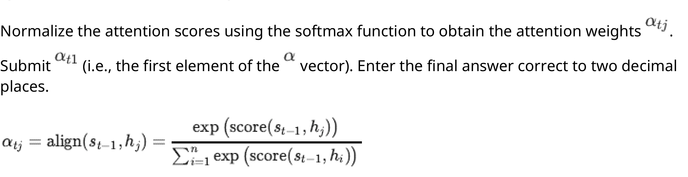

**Figure 16.** Question 14 prompt: softmax normalization equation for attention weights alpha_{tj}

**Correct answer:** 0.31 to 0.39

**Source evidence:** [{"page": 9, "bbox": [22.87, 650.0, 150.0, 670.0], "type": "explicit field", "detail": "Source PDF specifies official accepted answer range: 0.31 to 0.39"}]

### Question 15

**Question ID:** `6406531961505`

**Type:** Short Answer Question · **Marks:** 2
**PDF pages:** 9, 10

**Shared context:** [ctx-13-15](#ctx-13-15)

Calculate the context vector $c_t$:

$$c_t = \sum_{j=1}^n \alpha_{tj} h_j$$

Provide the sum of all elements of $c_t$. Enter the final answer correct to two decimal places.

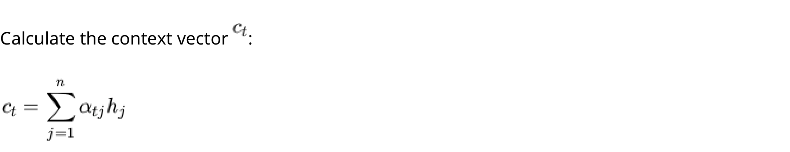

**Figure 17.** Question 15 prompt: context vector c_t formulation as weighted sum of encoder hidden states

**Correct answer:** 1.32 to 1.40

**Source evidence:** [{"page": 10, "bbox": [22.87, 175.0, 150.0, 195.0], "type": "explicit field", "detail": "Source PDF specifies official accepted answer range: 1.32 to 1.40"}]

### Shared context 16-20

**Question ID:** `6406531961506`

**Type:** Comprehension
**PDF pages:** 10

Consider the following Configuration for a GPT model:

• Vocabulary size: 40,000 tokens
• Embedding dimension (d_model): 768
• Maximum sequence length: 512
• Number of transformer blocks: 12
• Number of attention heads per block: 12
• Feed-forward network hidden dimension: 3,072
• Activation function: GELU

Note: In multi-head attention, the model dimension is split equally among all heads.

Based on the above data, answer the given subquestions.

### Question 16

**Question ID:** `6406531961507`

**Type:** Multiple Choice Question · **Marks:** 2
**PDF pages:** 10, 11

**Shared context:** [ctx-16-20](#ctx-16-20)

What is the number of parameters in the token embedding matrix?

**Options**

**A.**

30,720,000

*Source option ID:* `6406536373653`

**B.**

40,768

*Source option ID:* `6406536373654`

**C.**

393,216

*Source option ID:* `6406536373655`

**D.**

15,728,640,000

*Source option ID:* `6406536373656`

**Correct answer:** A

**Source evidence:** [{"page": 10, "bbox": [23.62, 804.14, 119.02, 820.46], "type": "green source option", "detail": "Option 6406536373653 marked with green color 32768 in source PDF"}]

### Question 17

**Question ID:** `6406531961508`

**Type:** Multiple Choice Question · **Marks:** 2
**PDF pages:** 11

**Shared context:** [ctx-16-20](#ctx-16-20)

What is the total number of parameters in the positional embedding matrix?

**Options**

**A.**

512,768

*Source option ID:* `6406536373657`

**B.**

393,216

*Source option ID:* `6406536373658`

**C.**

3,932,160

*Source option ID:* `6406536373659`

**D.**

39,321

*Source option ID:* `6406536373660`

**Correct answer:** B

**Source evidence:** [{"page": 11, "bbox": [23.62, 216.7, 119.02, 233.02], "type": "green source option", "detail": "Option 6406536373658 marked with green color 32768 in source PDF"}]

### Question 18

**Question ID:** `6406531961509`

**Type:** Multiple Choice Question · **Marks:** 2
**PDF pages:** 11

**Shared context:** [ctx-16-20](#ctx-16-20)

For ONE complete attention head, what is the total number of parameters (Q + K + V projections combined)?

**Options**

**A.**

49,152

*Source option ID:* `6406536373661`

**B.**

196,608

*Source option ID:* `6406536373662`

**C.**

589,824

*Source option ID:* `6406536373663`

**D.**

147,456

*Source option ID:* `6406536373664`

**Correct answer:** D

**Source evidence:** [{"page": 11, "bbox": [23.62, 473.86, 119.02, 490.18], "type": "green source option", "detail": "Option 6406536373664 marked with green color 32768 in source PDF"}]

### Question 19

**Question ID:** `6406531961510`

**Type:** Multiple Choice Question · **Marks:** 2
**PDF pages:** 11

**Shared context:** [ctx-16-20](#ctx-16-20)

After the multi-head attention computation, all head outputs are concatenated and projected back to the model dimension.

How many parameters are in the output projection matrix (weights only, excluding bias)?

**Options**

**A.**

768

*Source option ID:* `6406536373665`

**B.**

49,152

*Source option ID:* `6406536373666`

**C.**

589,824

*Source option ID:* `6406536373667`

**D.**

294,912

*Source option ID:* `6406536373668`

**Correct answer:** C

**Source evidence:** [{"page": 11, "bbox": [23.62, 701.2, 119.02, 717.52], "type": "green source option", "detail": "Option 6406536373667 marked with green color 32768 in source PDF"}]

### Question 20

**Question ID:** `6406531961511`

**Type:** Multiple Choice Question · **Marks:** 2
**PDF pages:** 11, 12

**Shared context:** [ctx-16-20](#ctx-16-20)

What is the total number of parameters in the complete FFN (including both weight matrices and bias vectors)?

**Options**

**A.**

2,359,296

*Source option ID:* `6406536373669`

**B.**

4,718,592

*Source option ID:* `6406536373670`

**C.**

4,722,432

*Source option ID:* `6406536373671`

**D.**

9,437,184

*Source option ID:* `6406536373672`

**Correct answer:** C

**Source evidence:** [{"page": 12, "bbox": [23.62, 114.1, 119.02, 130.42], "type": "green source option", "detail": "Option 6406536373671 marked with green color 32768 in source PDF"}]

## Answer key

| Source question | Source identity | Correct answer | PDF pages |
| :--- | :--- | :--- | :--- |
| 2 | 6406531961494 | C | 3 |
| 3 | 6406531961495 | C | 3, 4 |
| 4 | 6406531961496 | C | 4 |
| 5 | 6406531961500 | C | 4 |
| 6 | 6406531961512 | B | 5 |
| 7 | 6406531961513 | B | 5 |
| 8 | 6406531961514 | C | 5, 6 |
| 9 | 6406531961497 | A, B, D | 6 |
| 10 | 6406531961498 | A, C, D | 6, 7 |
| 11 | 6406531961499 | B, D | 7 |
| 12 | 6406531961501 | -0.65 to -0.59 | 7, 8 |
| 13 | 6406531961503 | 1.89 to 1.96 | 9 |
| 14 | 6406531961504 | 0.31 to 0.39 | 9 |
| 15 | 6406531961505 | 1.32 to 1.40 | 9, 10 |
| 16 | 6406531961507 | A | 10, 11 |
| 17 | 6406531961508 | B | 11 |
| 18 | 6406531961509 | D | 11 |
| 19 | 6406531961510 | C | 11 |
| 20 | 6406531961511 | C | 11, 12 |

## Extraction notes

**Status:** verified
**Count reconciliation:** The portal declared 14 questions and 40 marks for Section 1 (LLM). The 40 marks reconcile across all 19 academic questions: Q2 (2) + Q3 (2) + Q4 (2) + Q5 (2) + Q6 (2) + Q7 (2) + Q8 (2) + Q9 (3) + Q10 (3) + Q11 (2) + Q12 (2) + Comprehension 13-15 subquestions Q13 (1) + Q14 (3) + Q15 (2) + Comprehension 16-20 subquestions Q16 (2) + Q17 (2) + Q18 (2) + Q19 (2) + Q20 (2) = 40 marks. The 14 declared portal items in the section header correspond to the 14 top-level portal question items (Q1 confirmation, Q2 to Q12, plus 2 comprehension containers 13-15 and 16-20); when counting the 19 individual academic questions (excluding administrative confirmation Question 1), this represents the standard portal container aggregation pattern.

- Every academic question and option was verified visually and programmatically against the source PDF. Official answers for MCQ/MSQ are confirmed by green highlight markers (color 32768) in source PDF; numerical answer ranges are taken directly from the official portal answer specification.

**Excluded source entries:**

- {"classification": "subject-confirmation", "page": 2, "bbox": [22.87, 810.0, 569.0, 842.0], "reason": "Administrative hall ticket and subject verification prompt asking candidate to confirm registration for Large Language Models degree exam.", "identity": "6406531961493"}
- {"classification": "administrative-metadata", "page": 1, "bbox": [0.0, 0.0, 595.0, 842.0], "reason": "Portal administrative and exam console setup metadata preceding Section 1 (LLM).", "identity": "Group 1 / 64065332737"}
