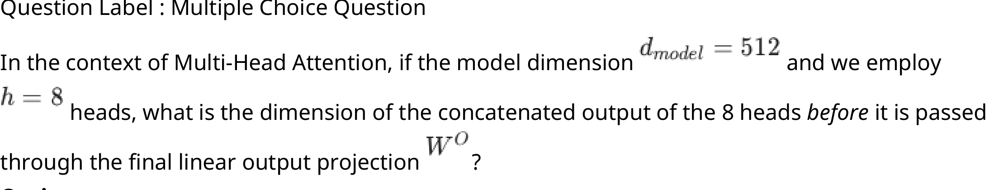
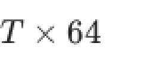
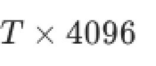
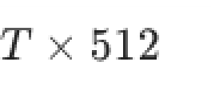
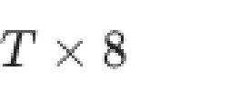
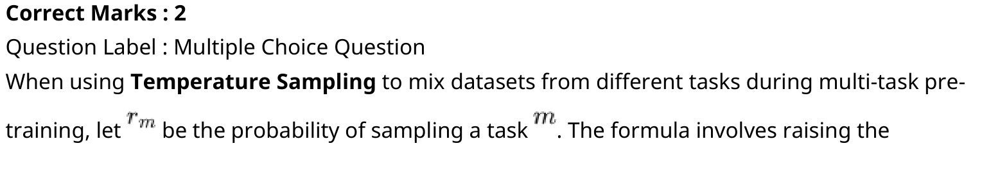
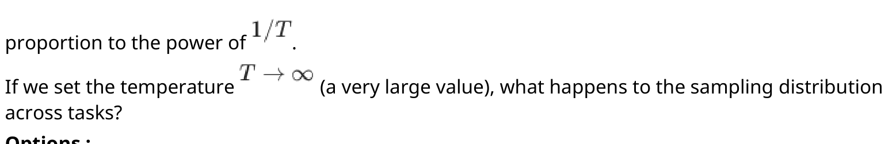
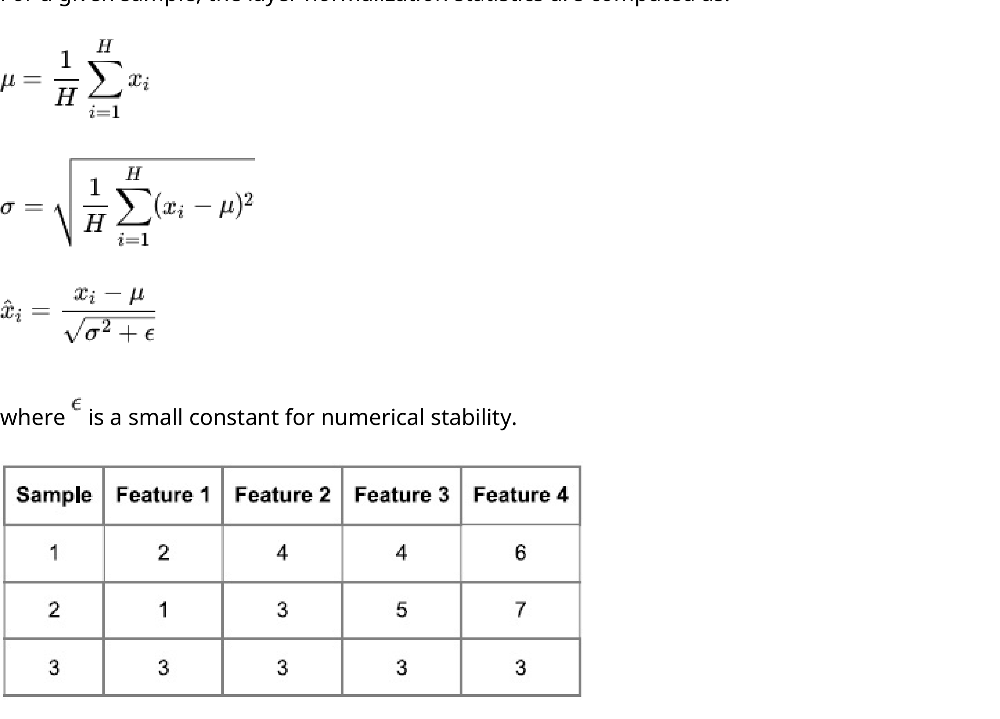
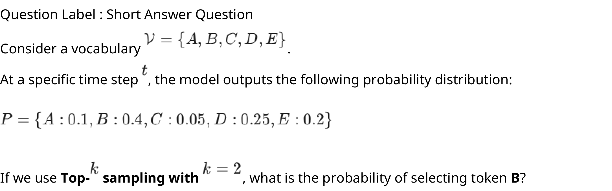

# LLM — da5004_2026T1_Q2_NA

**Source:** `da5004_2026T1_Q2_NA.pdf` · **Academic questions:** 21 · **Separately counted children:** 0
**Provenance:** `Large_Language_Models/da5004_2026T1_Q2_NA.pdf` · SHA-256 `a28d0ec52ebbc65212b4cb45c3c6cacd6cf214f4ae6919e31168c6b080c6e5db`

**Scope:** Section 1: LLM (Degree Level : Large Language Models), physical pages 1 to 12. The in-scope subject starts on physical page 1 with Section Id 640653134550 at y=487.88 and terminates on physical page 12 at y=60.0.

## Questions

### Question 2

**Question ID:** `6406532040065`

**Type:** MCQ · **Marks:** 2
**PDF pages:** 2

In the context of Multi-Head Attention, if the model dimension $d_{model} = 512$ and we employ $h = 8$ heads, what is the dimension of the concatenated output of the 8 heads before it is passed through the final linear output projection $W^O$?

**Figure 1.** Question 2 prompt: Multi-Head Attention dimension formulation with d_model=512, h=8, and output projection W^O

**Options**

**A.**

$T \times 64$

**Figure 2.** Option A dimension T x 64

*Source option ID:* `6406536642412`

**B.**

$T \times 4096$

**Figure 3.** Option B dimension T x 4096

*Source option ID:* `6406536642413`

**C.**

$T \times 512$

**Figure 4.** Option C dimension T x 512

*Source option ID:* `6406536642414`

**D.**

$T \times 8$

**Figure 5.** Option D dimension T x 8

*Source option ID:* `6406536642415`

**Correct answer:** $T \times 512$

**Source evidence:** [{"page": 2, "bbox": [23.62, 548.11, 119.02, 564.43], "type": "green source option", "detail": "Option C (6406536642414) marked green in portal source."}]

### Question 3

**Question ID:** `6406532040072`

**Type:** MCQ · **Marks:** 2
**PDF pages:** 2, 3

In the Masked Language Modeling (MLM) objective of BERT, 15% of tokens are chosen for prediction. Of these chosen tokens, 80% are replaced with [MASK], 10% are replaced with a random word, and 10% are left unchanged. What is the primary theoretical motivation for keeping 10% of the tokens unchanged?

**Options**

**A.**

To reduce the computational cost of the softmax layer during training.

*Source option ID:* `6406536642429`

**B.**

To prevent the network from overfitting to the [MASK] token.

*Source option ID:* `6406536642430`

**C.**

To mitigate the mismatch between pre-training (where [MASK] appears) and fine-tuning (where [MASK] does not appear), ensuring the model creates meaningful representations for non-masked words.

*Source option ID:* `6406536642431`

**D.**

To act as a regularizer similar to Dropout.

*Source option ID:* `6406536642432`

**Correct answer:** To mitigate the mismatch between pre-training (where [MASK] appears) and fine-tuning (where [MASK] does not appear), ensuring the model creates meaningful representations for non-masked words.

**Source evidence:** [{"page": 3, "bbox": [23.62, 91.82, 119.02, 108.14], "type": "green source option", "detail": "Option C (6406536642431) marked green in portal source."}]

### Question 4

**Question ID:** `6406532040073`

**Type:** MCQ · **Marks:** 2
**PDF pages:** 3

Why is the standard GPT architecture (Decoder-only with causal masking) generally unsuitable for the Masked Language Modeling (MLM) objective as implemented in BERT?

**Options**

**A.**

GPT models are too small to learn bidirectional contexts.

*Source option ID:* `6406536642433`

**B.**

The causal mask in GPT prevents the model from attending to future tokens, making it impossible to use right-side context to predict a masked token.

*Source option ID:* `6406536642434`

**C.**

GPT does not have positional embeddings, which are required for MLM.

*Source option ID:* `6406536642435`

**D.**

GPT uses ReLU activation, while BERT uses GELU, which is required for MLM.

*Source option ID:* `6406536642436`

**Correct answer:** The causal mask in GPT prevents the model from attending to future tokens, making it impossible to use right-side context to predict a masked token.

**Source evidence:** [{"page": 3, "bbox": [23.62, 348.17, 119.02, 364.49], "type": "green source option", "detail": "Option B (6406536642434) marked green in portal source."}]

### Question 5

**Question ID:** `6406532040081`

**Type:** MCQ · **Marks:** 2
**PDF pages:** 3

In the T5 (Text-to-Text Transfer Transformer) framework, every NLP task is cast as a text generation problem.
If you use T5 for a Semantic Textual Similarity (STS-B) task, where the goal is to predict a similarity score (e.g., 3.8) between two sentences, how does the model output this score?

**Options**

**A.**

It outputs a single scalar value from a regression head on top of the encoder.

*Source option ID:* `6406536642452`

**B.**

It generates the string "3.8" token-by-token using the decoder.

*Source option ID:* `6406536642453`

**C.**

It outputs a class label corresponding to a bucketed score range (e.g., "High Similarity").

*Source option ID:* `6406536642454`

**D.**

T5 cannot be used for regression tasks like STS-B.

*Source option ID:* `6406536642455`

**Correct answer:** It generates the string "3.8" token-by-token using the decoder.

**Source evidence:** [{"page": 3, "bbox": [23.62, 617.15, 119.02, 633.47], "type": "green source option", "detail": "Option B (6406536642453) marked green in portal source."}]

### Question 6

**Question ID:** `6406532040082`

**Type:** MCQ · **Marks:** 2
**PDF pages:** 3, 4

When using Temperature Sampling to mix datasets from different tasks during multi-task pre-training, let $r_m$ be the probability of sampling a task $m$. The formula involves raising the 

**Figure 6.** Source temperature-sampling stem and mathematical symbols, page 3

proportion to the power of $1/T$.
If we set the temperature $T \to \infty$ (a very large value), what happens to the sampling distribution across tasks?

**Figure 7.** Source temperature-sampling stem and mathematical symbols, page 4

**Options**

**A.**

The model trains almost exclusively on the largest dataset (highest resource task).

*Source option ID:* `6406536642456`

**B.**

The sampling distribution approaches a uniform distribution, where all tasks (large and small) are sampled with nearly equal probability.

*Source option ID:* `6406536642457`

**C.**

The model trains almost exclusively on the smallest dataset (lowest resource task).

*Source option ID:* `6406536642458`

**D.**

The sampling distribution remains proportional to the original dataset sizes.

*Source option ID:* `6406536642459`

**Correct answer:** The sampling distribution approaches a uniform distribution, where all tasks (large and small) are sampled with nearly equal probability.

**Source evidence:** [{"page": 4, "bbox": [23.62, 148.28, 119.02, 164.6], "type": "green source option", "detail": "Option B (6406536642457) marked green in portal source."}]

### Question 7

**Question ID:** `6406532040085`

**Type:** MCQ · **Marks:** 2
**PDF pages:** 4

When constructing training datasets for large language models (LLMs), which of the following best describes the key factors that must be balanced to achieve strong and reliable performance?

**Options**

**A.**

Model depth, number of parameters, and learning rate

*Source option ID:* `6406536642468`

**B.**

Scale, diversity, and quality of the training data

*Source option ID:* `6406536642469`

**C.**

Vocabulary size, tokenization method, and batch size

*Source option ID:* `6406536642470`

**D.**

Compute budget, optimizer choice, and hardware efficiency

*Source option ID:* `6406536642471`

**Correct answer:** Scale, diversity, and quality of the training data

**Source evidence:** [{"page": 4, "bbox": [23.62, 400.94, 119.02, 417.26], "type": "green source option", "detail": "Option B (6406536642469) marked green in portal source."}]

### Question 8

**Question ID:** `6406532040066`

**Type:** MSQ · **Marks:** 3
**PDF pages:** 4

Which of the following are components found within a standard Transformer Encoder layer?

**Options**

**A.**

Multi-Head Self-Attention mechanism

*Source option ID:* `6406536642416`

**B.**

Position-wise Feed-Forward Networks

*Source option ID:* `6406536642417`

**C.**

Cross-Attention mechanism (Encoder-Decoder attention)

*Source option ID:* `6406536642418`

**D.**

Masked Multi-Head Self-Attention

*Source option ID:* `6406536642419`

**Correct answer:** Multi-Head Self-Attention mechanism; Position-wise Feed-Forward Networks

**Source evidence:** [{"page": 4, "bbox": [23.62, 641.78, 119.02, 658.1], "type": "green source option", "detail": "Option A (6406536642416) marked green in portal source."}, {"page": 4, "bbox": [23.62, 662.6, 119.02, 678.92], "type": "green source option", "detail": "Option B (6406536642417) marked green in portal source."}]

### Question 9

**Question ID:** `6406532040067`

**Type:** MSQ · **Marks:** 3
**PDF pages:** 4, 5

Select all correct statements regarding the comparison between RNNs and Transformers.

**Options**

**A.**

In Transformers, the path length between any two positions in the sequence is constant $O(1)$, whereas in RNNs it is $O(T)$ (where $T$ is the sequence length).

*Source option ID:* `6406536642420`

**B.**

Transformers process tokens strictly sequentially during training in the same way as RNNs.

*Source option ID:* `6406536642421`

**C.**

Transformers allow for significantly more parallelization during training compared to RNNs.

*Source option ID:* `6406536642422`

**D.**

Attention mechanisms in Transformers utilize Query, Key, and Value vectors derived from input embeddings.

*Source option ID:* `6406536642423`

**Correct answer:** In Transformers, the path length between any two positions in the sequence is constant $O(1)$, whereas in RNNs it is $O(T)$ (where $T$ is the sequence length).; Transformers allow for significantly more parallelization during training compared to RNNs.; Attention mechanisms in Transformers utilize Query, Key, and Value vectors derived from input embeddings.

**Source evidence:** [{"page": 5, "bbox": [23.62, 36.82, 119.02, 53.14], "type": "green source option", "detail": "Option A (6406536642420) marked green in portal source."}, {"page": 5, "bbox": [23.62, 138.6, 119.02, 154.92], "type": "green source option", "detail": "Option C (6406536642422) marked green in portal source."}, {"page": 5, "bbox": [23.62, 175.74, 119.02, 192.06], "type": "green source option", "detail": "Option D (6406536642423) marked green in portal source."}]

### Question 10

**Question ID:** `6406532040083`

**Type:** MSQ · **Marks:** 3
**PDF pages:** 5

Select all correct findings from the T5 paper regarding Unsupervised Pre-training Objectives.

**Options**

**A.**

The specific corruption rate (e.g., 10%, 15%, 25%) had a minimal effect on downstream performance.

*Source option ID:* `6406536642460`

**B.**

Using a span length of around 3 tokens performed slightly better than masking single tokens.

*Source option ID:* `6406536642461`

**C.**

The "Deshuffling" objective (reordering shuffled sentences) significantly outperformed the Span Corruption objective.

*Source option ID:* `6406536642462`

**D.**

Replacing a corrupted span with a unique sentinel token worked better than simply dropping the tokens from the input.

*Source option ID:* `6406536642463`

**Correct answer:** The specific corruption rate (e.g., 10%, 15%, 25%) had a minimal effect on downstream performance.; Using a span length of around 3 tokens performed slightly better than masking single tokens.; Replacing a corrupted span with a unique sentinel token worked better than simply dropping the tokens from the input.

**Source evidence:** [{"page": 5, "bbox": [23.62, 333.3, 119.02, 349.62], "type": "green source option", "detail": "Option A (6406536642460) marked green in portal source."}, {"page": 5, "bbox": [23.62, 370.44, 119.02, 386.76], "type": "green source option", "detail": "Option B (6406536642461) marked green in portal source."}, {"page": 5, "bbox": [23.62, 444.72, 119.02, 461.04], "type": "green source option", "detail": "Option D (6406536642463) marked green in portal source."}]

### Question 11

**Question ID:** `6406532040084`

**Type:** MSQ · **Marks:** 3
**PDF pages:** 5

Consider the concept of Zero-Shot Transfer as popularized by GPT-2. Why might this be preferred over Supervised Fine-Tuning?

**Options**

**A.**

It allows the model to handle tasks for which no labeled training data is available.

*Source option ID:* `6406536642464`

**B.**

It always achieves higher accuracy than a fine-tuned SOTA model.

*Source option ID:* `6406536642465`

**C.**

It avoids the need to store a separate specialized model (checkpoint) for every downstream task.

*Source option ID:* `6406536642466`

**D.**

It mimics the human ability to perform tasks based on instructions without needing thousands of examples.

*Source option ID:* `6406536642467`

**Correct answer:** It allows the model to handle tasks for which no labeled training data is available.; It avoids the need to store a separate specialized model (checkpoint) for every downstream task.; It mimics the human ability to perform tasks based on instructions without needing thousands of examples.

**Source evidence:** [{"page": 5, "bbox": [23.62, 618.6, 119.02, 634.92], "type": "green source option", "detail": "Option A (6406536642464) marked green in portal source."}, {"page": 5, "bbox": [23.62, 676.56, 119.02, 692.88], "type": "green source option", "detail": "Option C (6406536642466) marked green in portal source."}, {"page": 5, "bbox": [23.62, 713.7, 119.02, 730.02], "type": "green source option", "detail": "Option D (6406536642467) marked green in portal source."}]

### Question 12

**Question ID:** `6406532040068`

**Type:** SA · **Marks:** 2
**PDF pages:** 6, 7

Let $x_{ij}$ denote the activation of the $j$-th neuron for the $i$-th training sample.

In Layer Normalization, normalization is performed across features for each individual sample.

Let $H$ be the number of neurons (features) in the hidden layer.

For a given sample, the layer normalization statistics are computed as:
$$\mu_i = \frac{1}{H} \sum_{j=1}^H x_{ij}$$
$$\sigma_i^2 = \frac{1}{H} \sum_{j=1}^H (x_{ij} - \mu_i)^2$$
$$\hat{x}_{ij} = \frac{x_{ij} - \mu_i}{\sqrt{\sigma_i^2 + \epsilon}}$$
where $\epsilon$ is a small constant for numerical stability.

| Sample | Feature 1 | Feature 2 | Feature 3 | Feature 4 |
| :--- | :--- | :--- | :--- | :--- |
| 1 | 2 | 4 | 4 | 6 |
| 2 | 1 | 3 | 5 | 7 |
| 3 | 3 | 3 | 3 | 3 |

Layer Normalization is applied independently to each sample in the given data above.

For Sample 2, after applying Layer Normalization, what is the maximum value in the normalized output vector?

(ignore the learnable parameters $\gamma$ and $\beta$, and assume $\epsilon = 0$):

**Figure 8.** Question 12 Layer Normalization formulas and feature table for Samples 1-3

**Correct answer:** 1.30 to 1.37

**Source evidence:** [{"page": 7, "bbox": [22.87, 16.0, 150.0, 50.0], "type": "explicit field", "detail": "Possible Answers range: 1.30 to 1.37 in source PDF."}]

### Shared context 13-14

**Question ID:** `6406532040069`

**Type:** COMPREHENSION
**PDF pages:** 7

Consider a GPT model used for Causal Language Modelling.
We feed the input sentence:

`[BOS] Data science needs clean data [EOS]`

Assume the context length is 7 (time steps $t = 0$ to $t = 6$).

The attention matrix computed in one attention layer is given below:

| $t$ | Token | 0 ([BOS]) | 1 (Data) | 2 (science) | 3 (needs) | 4 (clean) | 5 (data) | 6 ([EOS]) |
| :--- | :--- | :--- | :--- | :--- | :--- | :--- | :--- | :--- |
| 0 | [BOS] | 1.0 | 0.0 | 0.0 | 0.0 | 0.0 | 0.0 | 0.0 |
| 1 | Data | 0.6 | 0.4 | 0.0 | 0.0 | 0.0 | 0.0 | 0.0 |
| 2 | science | 0.2 | 0.3 | 0.5 | 0.0 | 0.0 | 0.0 | 0.0 |
| 3 | needs | 0.1 | 0.2 | 0.3 | 0.4 | 0.0 | 0.0 | 0.0 |
| 4 | clean | 0.0 | 0.1 | 0.2 | 0.3 | 0.4 | 0.0 | 0.0 |
| 5 | data | 0.05 | 0.15 | 0.2 | 0.2 | 0.2 | 0.1 | 0.0 |
| 6 | [EOS] | 0.1 | 0.1 | 0.1 | 0.1 | 0.1 | 0.2 | 0.3 |

Based on the above data, answer the given subquestions.

![Comprehension passage for Q13-14: input sentence [BOS] Data science needs clean data [EOS] and 7x7 attention weight matrix](assets/da5004_2026T1_Q2_NA/ctx-13-14-passage-01-p007.png)

**Figure 9.** Comprehension passage for Q13-14: input sentence [BOS] Data science needs clean data [EOS] and 7x7 attention weight matrix

### Question 13

**Question ID:** `6406532040070`

**Type:** MCQ · **Marks:** 2
**PDF pages:** 7

**Shared context:** [ctx-13-14](#ctx-13-14)

Is the given attention matrix valid for a causal language modelling task?

**Options**

**A.**

True

*Source option ID:* `6406536642425`

**B.**

False

*Source option ID:* `6406536642426`

**C.**

Insufficient information

*Source option ID:* `6406536642427`

**Correct answer:** False

**Source evidence:** [{"page": 7, "bbox": [23.62, 774.14, 119.02, 790.46], "type": "green source option", "detail": "Option B (6406536642426) marked green in portal source."}]

### Question 14

**Question ID:** `6406532040071`

**Type:** SA · **Marks:** 2
**PDF pages:** 8

**Shared context:** [ctx-13-14](#ctx-13-14)

At time step t = 5 (word: data), what is the attention weight assigned to the word science? (Provide exact answer)

**Correct answer:** 0.2

**Source evidence:** [{"page": 8, "bbox": [22.87, 240.0, 100.0, 260.0], "type": "explicit field", "detail": "Possible Answers: 0.2 in source PDF."}]

### Shared context 15-16

**Question ID:** `6406532040077`

**Type:** COMPREHENSION
**PDF pages:** 8

Sentence Corpus:

"the key to artificial intelligence has always been the representation"

Pre-processing Instructions:

• Convert all text to lowercase.
• Append the end-of-word symbol `</w>` to every word (e.g., "the" becomes `the</w>`).
• The Initial Vocabulary is defined as the set of all unique characters present in the corpus plus the `</w>` symbol.

Based on the above data, answer the given subquestions.

### Question 15

**Question ID:** `6406532040078`

**Type:** MCQ · **Marks:** 2
**PDF pages:** 8, 9

**Shared context:** [ctx-15-16](#ctx-15-16)

Which of the following character pairs occurs with the highest frequency across the entire sentence before any BPE merges are performed?

**Options**

**A.**

('r', 'e')

**Figure 10.** Option A character pair ('r', 'e')

*Source option ID:* `6406536642443`

**B.**

('w', 'a')

**Figure 11.** Option B character pair ('w', 'a')

*Source option ID:* `6406536642444`

**C.**

('e', 'p')

**Figure 12.** Option C character pair ('e', 'p')

*Source option ID:* `6406536642445`

**D.**

('e', 'n')

**Figure 13.** Option D character pair ('e', 'n')

*Source option ID:* `6406536642446`

**Correct answer:** ('e', 'n')

**Source evidence:** [{"page": 9, "bbox": [23.62, 91.82, 119.02, 108.14], "type": "green source option", "detail": "Option D (6406536642446) marked green in portal source."}]

### Question 16

**Question ID:** `6406532040079`

**Type:** SA · **Marks:** 2
**PDF pages:** 9

**Shared context:** [ctx-15-16](#ctx-15-16)

Calculate the total vocabulary size immediately after the first merge operation is completed.

Note: The vocabulary size includes all individual base characters/symbols plus the newly created merge token.

**Correct answer:** 20

**Source evidence:** [{"page": 9, "bbox": [22.87, 390.0, 100.0, 410.0], "type": "explicit field", "detail": "Possible Answers: 20 in source PDF."}]

### Question 17

**Question ID:** `6406532040074`

**Type:** SA · **Marks:** 3
**PDF pages:** 9, 10

Consider a vocabulary $\mathcal{V} = \{A, B, C, D, E\}$.
At a specific time step $t$, the model outputs the following probability distribution:
$$P = \{A : 0.1, B : 0.4, C : 0.05, D : 0.25, E : 0.2\}$$
If we use Top-$k$ sampling with $k = 2$, what is the probability of selecting token B?
(Calculate the re-normalized probability. Enter the value correct to 2 decimal places).

**Figure 14.** Question 17 prompt: vocabulary V and probability distribution P formulation

**Correct answer:** 0.59 to 0.65

**Source evidence:** [{"page": 10, "bbox": [22.87, 16.0, 150.0, 50.0], "type": "explicit field", "detail": "Possible Answers range: 0.59 to 0.65 in source PDF."}]

### Question 18

**Question ID:** `6406532040075`

**Type:** SA · **Marks:** 3
**PDF pages:** 10

Consider a small BERT-like model with the following configuration:

• Embedding dimension ($d_{model}$) = 128
• Vocabulary size ($|V|$) = 5000
• Maximum sequence length ($T$) = 64
• Number of segment types = 2

Calculate the total number of parameters in the Embedding Layer (sum of Token embeddings, Position embeddings, and Segment embeddings).
Enter the exact integer value.

**Correct answer:** 648448

**Source evidence:** [{"page": 10, "bbox": [22.87, 430.0, 100.0, 450.0], "type": "explicit field", "detail": "Possible Answers: 648448 in source PDF."}]

### Question 19

**Question ID:** `6406532040076`

**Type:** MCQ · **Marks:** 3
**PDF pages:** 10

What is a major disadvantage of character-level tokenization?

**Options**

**A.**

Character-level tokenization cannot represent punctuation marks or special symbols

*Source option ID:* `6406536642439`

**B.**

It has very large vocabulary size because each word is broken into multiple characters

*Source option ID:* `6406536642440`

**C.**

It produces much longer input sequences which increases computational cost.

*Source option ID:* `6406536642441`

**D.**

It fails to capture morphological patterns such as prefixes and suffixes, reducing the model's ability to understand word structure

*Source option ID:* `6406536642442`

**Correct answer:** It produces much longer input sequences which increases computational cost.

**Source evidence:** [{"page": 10, "bbox": [23.62, 764.54, 119.02, 780.86], "type": "green source option", "detail": "Option C (6406536642441) marked green in portal source."}]

### Question 20

**Question ID:** `6406532040080`

**Type:** MCQ · **Marks:** 3
**PDF pages:** 11

When using the SentencePiece, how are subword units selected?

**Options**

**A.**

Based on a probabilistic model that maximizes the likelihood of the training data.

*Source option ID:* `6406536642448`

**B.**

By randomly selecting character n-grams until the vocabulary limit is reached.

*Source option ID:* `6406536642449`

**C.**

By selecting only the top 50,000 most frequent words in the corpus.

*Source option ID:* `6406536642450`

**D.**

By iteratively merging the most frequent pair of adjacent characters.

*Source option ID:* `6406536642451`

**Correct answer:** Based on a probabilistic model that maximizes the likelihood of the training data.

**Source evidence:** [{"page": 11, "bbox": [23.62, 133.42, 119.02, 149.74], "type": "green source option", "detail": "Option A (6406536642448) marked green in portal source."}]

### Question 21

**Question ID:** `6406532040086`

**Type:** MSQ · **Marks:** 2
**PDF pages:** 11

To obtain high-quality training text from raw web data for large language models, which of the following mechanisms are typically included in the pre-processing pipeline?

**Options**

**A.**

Tokenizing text into subword units using Byte Pair Encoding (BPE)

*Source option ID:* `6406536642472`

**B.**

Deduplicating content at line, paragraph, and document levels

*Source option ID:* `6406536642473`

**C.**

Detecting and filtering toxic content such as hate speech and profanity

*Source option ID:* `6406536642474`

**D.**

Identifying the language of web pages

*Source option ID:* `6406536642475`

**E.**

Assessing the quality of content to remove low-value or spam text

*Source option ID:* `6406536642476`

**F.**

Detecting and removing Personally Identifiable Information (PII)

*Source option ID:* `6406536642477`

**G.**

Fine-tuning the model using reinforcement learning from human feedback (RLHF)

*Source option ID:* `6406536642478`

**Correct answer:** Deduplicating content at line, paragraph, and document levels; Detecting and filtering toxic content such as hate speech and profanity; Identifying the language of web pages; Assessing the quality of content to remove low-value or spam text; Detecting and removing Personally Identifiable Information (PII)

**Source evidence:** [{"page": 11, "bbox": [23.62, 448.54, 119.02, 464.86], "type": "green source option", "detail": "Option B (6406536642473) marked green in portal source."}, {"page": 11, "bbox": [23.62, 469.36, 119.02, 485.68], "type": "green source option", "detail": "Option C (6406536642474) marked green in portal source."}, {"page": 11, "bbox": [23.62, 490.18, 119.02, 506.5], "type": "green source option", "detail": "Option D (6406536642475) marked green in portal source."}, {"page": 11, "bbox": [23.62, 511.0, 119.02, 527.32], "type": "green source option", "detail": "Option E (6406536642476) marked green in portal source."}, {"page": 11, "bbox": [23.62, 531.82, 119.02, 548.14], "type": "green source option", "detail": "Option F (6406536642477) marked green in portal source."}]

### Question 22

**Question ID:** `6406532040087`

**Type:** MSQ · **Marks:** 2
**PDF pages:** 11, 12

Which of the following statements correctly explain the importance of deduplication during preprocessing of large-scale datasets used for training Deep Learning or Large Language Models?

**Options**

**A.**

Deduplication reduces the risk of overfitting by preventing repeated samples from dominating the gradient updates.

*Source option ID:* `6406536642479`

**B.**

Deduplication guarantees that the trained model will achieve higher accuracy on all downstream tasks.

*Source option ID:* `6406536642480`

**C.**

Deduplication helps avoid data leakage between training and evaluation sets,

leading to more reliable performance metrics.

*Source option ID:* `6406536642481`

**D.**

Deduplication eliminates the need for regularization techniques such as dropout and weight decay.

*Source option ID:* `6406536642482`

**Correct answer:** Deduplication reduces the risk of overfitting by preventing repeated samples from dominating the gradient updates.; Deduplication helps avoid data leakage between training and evaluation sets, leading to more reliable performance metrics.

**Source evidence:** [{"page": 11, "bbox": [23.62, 726.52, 119.02, 742.84], "type": "green source option", "detail": "Option A (6406536642479) marked green in portal source."}, {"page": 11, "bbox": [23.62, 800.8, 119.02, 817.12], "type": "green source option", "detail": "Option C (6406536642481) marked green in portal source."}]

## Answer key

| Source question | Source identity | Correct answer | PDF pages |
| :--- | :--- | :--- | :--- |
| 2 | 6406532040065 | $T \times 512$ | 2 |
| 3 | 6406532040072 | To mitigate the mismatch between pre-training (where [MASK] appears) and fine-tuning (where [MASK] does not appear), ensuring the model creates meaningful representations for non-masked words. | 2, 3 |
| 4 | 6406532040073 | The causal mask in GPT prevents the model from attending to future tokens, making it impossible to use right-side context to predict a masked token. | 3 |
| 5 | 6406532040081 | It generates the string "3.8" token-by-token using the decoder. | 3 |
| 6 | 6406532040082 | The sampling distribution approaches a uniform distribution, where all tasks (large and small) are sampled with nearly equal probability. | 3, 4 |
| 7 | 6406532040085 | Scale, diversity, and quality of the training data | 4 |
| 8 | 6406532040066 | Multi-Head Self-Attention mechanism; Position-wise Feed-Forward Networks | 4 |
| 9 | 6406532040067 | In Transformers, the path length between any two positions in the sequence is constant $O(1)$, whereas in RNNs it is $O(T)$ (where $T$ is the sequence length).; Transformers allow for significantly more parallelization during training compared to RNNs.; Attention mechanisms in Transformers utilize Query, Key, and Value vectors derived from input embeddings. | 4, 5 |
| 10 | 6406532040083 | The specific corruption rate (e.g., 10%, 15%, 25%) had a minimal effect on downstream performance.; Using a span length of around 3 tokens performed slightly better than masking single tokens.; Replacing a corrupted span with a unique sentinel token worked better than simply dropping the tokens from the input. | 5 |
| 11 | 6406532040084 | It allows the model to handle tasks for which no labeled training data is available.; It avoids the need to store a separate specialized model (checkpoint) for every downstream task.; It mimics the human ability to perform tasks based on instructions without needing thousands of examples. | 5 |
| 12 | 6406532040068 | 1.30 to 1.37 | 6, 7 |
| 13 | 6406532040070 | False | 7 |
| 14 | 6406532040071 | 0.2 | 8 |
| 15 | 6406532040078 | ('e', 'n') | 8, 9 |
| 16 | 6406532040079 | 20 | 9 |
| 17 | 6406532040074 | 0.59 to 0.65 | 9, 10 |
| 18 | 6406532040075 | 648448 | 10 |
| 19 | 6406532040076 | It produces much longer input sequences which increases computational cost. | 10 |
| 20 | 6406532040080 | Based on a probabilistic model that maximizes the likelihood of the training data. | 11 |
| 21 | 6406532040086 | Deduplicating content at line, paragraph, and document levels; Detecting and filtering toxic content such as hate speech and profanity; Identifying the language of web pages; Assessing the quality of content to remove low-value or spam text; Detecting and removing Personally Identifiable Information (PII) | 11 |
| 22 | 6406532040087 | Deduplication reduces the risk of overfitting by preventing repeated samples from dominating the gradient updates.; Deduplication helps avoid data leakage between training and evaluation sets, leading to more reliable performance metrics. | 11, 12 |

## Extraction notes

**Status:** verified
**Count reconciliation:** The portal declared 20 questions and 50 marks for Section 1 (LLM). The 50 marks reconcile across all 21 academic questions: Q2 (2) + Q3 (2) + Q4 (2) + Q5 (2) + Q6 (2) + Q7 (2) + Q8 (3) + Q9 (3) + Q10 (3) + Q11 (3) + Q12 (2) + Comprehension 13-14 subquestions Q13 (2) + Q14 (2) + Comprehension 15-16 subquestions Q15 (2) + Q16 (2) + Q17 (3) + Q18 (3) + Q19 (3) + Q20 (3) + Q21 (2) + Q22 (2) = 50 marks. The 20 declared portal items correspond to the 20 top-level portal question items (Q1 confirmation, Q2 to Q12, plus 2 comprehension containers 13-14 and 15-16, and Q17 to Q22). Excluding administrative confirmation Question 1 yields exactly 21 academic questions, reconciling the declared count and marks.

**Excluded source entries:**

- {"classification": "subject-confirmation", "page": 1, "bbox": [22.87, 810.0, 569.0, 842.0], "reason": "Administrative hall ticket and subject verification prompt asking candidate to confirm registration for Large Language Models degree exam.", "identity": "6406532040064"}
- {"classification": "administrative-metadata", "page": 1, "bbox": [0.0, 0.0, 595.0, 487.88], "reason": "Portal administrative and exam console setup metadata preceding Section 1 (LLM).", "identity": "Group 1 / 640653134550"}
