# LLM — da5004_2026T2_ET_AN

**Source:** `da5004_2026T2_ET_AN.pdf` · **Academic questions:** 20 · **Separately counted children:** 0
**Provenance:** `Large_Language_Models/da5004_2026T2_ET_AN.pdf` · SHA-256 `e7fe622cad19cf4c6d286992acfedc8d017495948fab96db6485b5c03f6b16bf`

**Scope:** LLM (Degree Level : Large Language Models (Computer Based Exam)), physical pages 1 to 14. Section LLM (Section Id: 640653148704, Marks: 50) begins on physical page 1 and extends through physical page 14.

## Questions

### Question 2

**Question ID:** `6406532280206`

**Type:** MCQ · **Marks:** 2
**PDF pages:** 2

Consider the following Assertion (A) and Reason (R) about the Transformer encoder.

Assertion (A): In a Transformer encoder, each token can attend to every other token in the input sequence through self-attention.
Reason (R): The encoder's self-attention mechanism uses a causal mask to prevent each token from attending to tokens that appear later in the sequence.

Choose the correct option:

**Options**

**A.**

Both Assertion (A) and Reason (R) are true, and Reason (R) is the correct explanation of Assertion (A).

*Source option ID:* `6406537408066`

**B.**

Both Assertion (A) and Reason (R) are true, but Reason (R) is not the correct explanation of Assertion (A).

*Source option ID:* `6406537408067`

**C.**

Assertion (A) is true, but Reason (R) is false.

*Source option ID:* `6406537408068`

**D.**

Assertion (A) is false, but Reason (R) is true

*Source option ID:* `6406537408069`

**E.**

Both Assertion (A) and Reason (R) are false.

*Source option ID:* `6406537408070`

**Correct answer:** Assertion (A) is true, but Reason (R) is false.

**Source evidence:** [{"page": 2, "bbox": [23.62, 530.0, 119.02, 546.3], "type": "green source option", "detail": "Option 6406537408068 rendered in green (color 32768) in CBT portal"}]

### Question 3

**Question ID:** `6406532280208`

**Type:** MCQ · **Marks:** 2
**PDF pages:** 2, 3

Which of the following statements regarding one-hot positional encoding and sinusoidal positional encoding is incorrect?

**Options**

**A.**

The dot product between two sinusoidal positional encoding vectors strictly increases as the relative distance between their positions increases, taking values in the range $[0, \infty)$

*Source option ID:* `6406537408072`

**B.**

The squared Euclidean norm of a sinusoidal positional encoding vector is a constant value independent of the position index

*Source option ID:* `6406537408073`

**C.**

For any two distinct positions, the dot product of their corresponding one-hot encoded vectors is zero, and the Euclidean distance between them is strictly constant

*Source option ID:* `6406537408074`

**D.**

One-hot positional encoding is incapable of mathematically representing relative distance between tokens

*Source option ID:* `6406537408075`

**Correct answer:** The dot product between two sinusoidal positional encoding vectors strictly increases as the relative distance between their positions increases, taking values in the range $[0, \infty)$

**Source evidence:** [{"page": 2, "bbox": [23.62, 729.16, 119.02, 745.48], "type": "green source option", "detail": "Option 6406537408072 rendered in green (color 32768) in CBT portal"}]

### Question 4

**Question ID:** `6406532280212`

**Type:** MCQ · **Marks:** 2
**PDF pages:** 3

You are designing an LLM to translate a sentence from English to Spanish with low computational complexity. The system has to consider a few possible sequences of words rather than committing to the single highest-probability word at every step. Which of the following decoding strategies is the most appropriate?

**Options**

**A.**

Beam search

*Source option ID:* `6406537408078`

**B.**

Exhaustive search

*Source option ID:* `6406537408079`

**C.**

Top-p sampling with p = 0.85

*Source option ID:* `6406537408080`

**D.**

Greedy decoding

*Source option ID:* `6406537408081`

**Correct answer:** Beam search

**Source evidence:** [{"page": 3, "bbox": [23.62, 298.3, 119.02, 314.6], "type": "green source option", "detail": "Option 6406537408078 rendered in green (color 32768) in CBT portal"}]

### Question 5

**Question ID:** `6406532280213`

**Type:** MCQ · **Marks:** 2
**PDF pages:** 3

In the Next Sentence Prediction task, how are the two input sentences distinguished by the BERT architecture?

**Options**

**A.**

By utilizing separate transformer encoders for each sentence and concatenating the outputs.

*Source option ID:* `6406537408082`

**B.**

By adding learnable segment embeddings to the token and positional embeddings of the respective sentences.

*Source option ID:* `6406537408083`

**C.**

By inserting a [MASK] token between the two sentences.

*Source option ID:* `6406537408084`

**D.**

By ensuring two different heads in the Multi-Head Attention setup attend to the specific sentences.

*Source option ID:* `6406537408085`

**Correct answer:** By adding learnable segment embeddings to the token and positional embeddings of the respective sentences.

**Source evidence:** [{"page": 3, "bbox": [23.62, 555.5, 119.02, 571.8], "type": "green source option", "detail": "Option 6406537408083 rendered in green (color 32768) in CBT portal"}]

### Question 6

**Question ID:** `6406532280207`

**Type:** SA · **Marks:** 3
**PDF pages:** 3, 4

Consider a mini-batch of 3 samples, each with 2 features. The input matrix X is given below, where

rows represent individual samples and columns represent features:

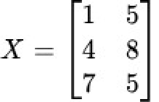

**Figure 1.** Input matrix X of 3 samples with 2 features

Layer Normalization is applied on this with a learned scale parameter $\gamma = 2$ and a shift parameter $\beta = 1$.

What is the final output value of the first feature for the third sample?

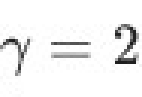

**Figure 2.** Learned scale parameter gamma = 2

Shift parameter $\beta = 1$:

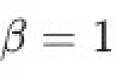

**Figure 3.** Learned shift parameter beta = 1

**Correct answer:** 3

**Source evidence:** [{"page": 4, "bbox": [22.87, 240.0, 120.0, 260.0], "type": "explicit field", "detail": "Possible Answers: 3 in CBT portal"}]

### Question 7

**Question ID:** `6406532280217`

**Type:** SA · **Marks:** 3
**PDF pages:** 4, 5

Consider a tokenizer processing the word "lion".

The vocabulary contains the following tokens along with the assigned log-probabilities.

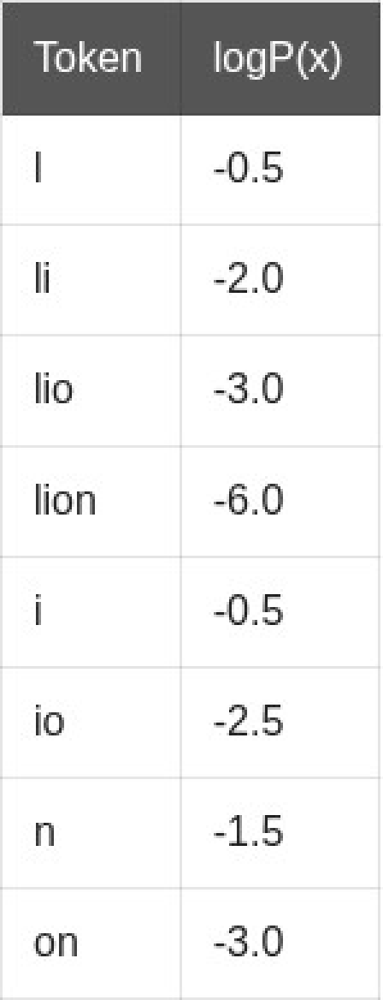

**Figure 4.** Vocabulary tokens with assigned log-probabilities for lion

To determine the optimal tokenization, the tokenizer uses the forward decoding algorithm (Viterbi

approach). Determine the most likely tokenization for the word "lion" using the algorithm.

Instructions: Enter your answer as a lowercase string with the segments separated by a comma.
For example, if the word is whereby and the answer has two segments where and by, enter the answer as where,by

NOTE: Enter the exact answer without any extra space in the beginning or at the end.

**Correct answer:** l,i,on

**Source evidence:** [{"page": 5, "bbox": [22.87, 240.0, 120.0, 260.0], "type": "explicit field", "detail": "Possible Answers: l,i,on in CBT portal"}]

### Question 8

**Question ID:** `6406532280222`

**Type:** SA · **Marks:** 3
**PDF pages:** 5

Suppose the relative position between two tokens at positions $i$ and $j$ is defined as $r = i - j$.

To limit the range of relative positions, clipping is applied using $c(r) = \max(-k, \min(r, k))$, where $k = 16$.

For a sequence of length $T = 128$, how many pairwise relative-position values are modified by the clipping operation?

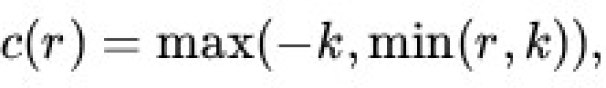

**Figure 5.** Relative position clipping function c(r) = max(-k, min(r, k))

**Correct answer:** 12432

**Source evidence:** [{"page": 5, "bbox": [22.87, 650.0, 120.0, 670.0], "type": "explicit field", "detail": "Possible Answers: 12432 in CBT portal"}]

### Shared context 9 to 10

**Portal container ID:** `6406532280209`

**Type:** COMPREHENSION
**PDF pages:** 6

Consider an LLM operating on a vocabulary consisting of 5 tokens. For a given context, the model produces the following logits:

| Token | Logit |
| :--- | :--- |
| token 1 | 2.5 |
| token 2 | 1.8 |
| token 3 | 1.2 |
| token 4 | 0.5 |
| token 5 | -0.2 |

To obtain the next token during generation, the model uses top-p sampling with $p = 0.80$.

Based on the above data, answer the given subquestions.

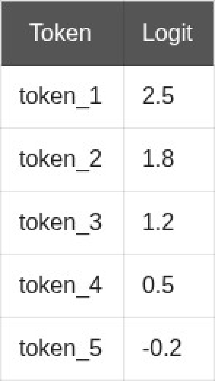

**Figure 6.** Logits produced by the model for vocabulary of 5 tokens

### Question 9

**Question ID:** `6406532280210`

**Portal container ID:** `6406532280209`

**Type:** SA · **Marks:** 2
**PDF pages:** 6

**Shared context:** [ctx-9-10](#ctx-9-10)

How many tokens are selected as candidate tokens?

**Correct answer:** 3

**Source evidence:** [{"page": 6, "bbox": [22.87, 590.0, 120.0, 610.0], "type": "explicit field", "detail": "Possible Answers: 3 in CBT portal"}]

### Question 10

**Question ID:** `6406532280211`

**Portal container ID:** `6406532280209`

**Type:** SA · **Marks:** 2
**PDF pages:** 6, 7

**Shared context:** [ctx-9-10](#ctx-9-10)

After renormalization of the probabilities, what is the highest probability value among those? (Round off to three decimal places)

**Correct answer:** 0.54 to 0.58

**Source evidence:** [{"page": 7, "bbox": [22.87, 70.0, 120.0, 90.0], "type": "explicit field", "detail": "Possible Answers: 0.54 to 0.58 in CBT portal"}]

### Question 11

**Question ID:** `6406532280214`

**Type:** MCQ · **Marks:** 3
**PDF pages:** 7

How did the GPT-2 model initially demonstrate "zero-shot domain transfer" capabilities on complex tasks like summarization and translation?

**Options**

**A.**

By utilizing specialized adapter layers trained explicitly for translation and summarization datasets.

*Source option ID:* `6406537408086`

**B.**

By formatting the raw input text with natural language prompts to induce task-specific outputs without updating model weights.

*Source option ID:* `6406537408087`

**C.**

By executing a secondary pre-training phase exclusively on Wikipedia and BookCorpus.

*Source option ID:* `6406537408088`

**D.**

By modifying the decoder architecture into a bidirectional encoder for specific tasks.

*Source option ID:* `6406537408089`

**Correct answer:** By formatting the raw input text with natural language prompts to induce task-specific outputs without updating model weights.

**Source evidence:** [{"page": 7, "bbox": [23.62, 367.3, 119.02, 383.6], "type": "green source option", "detail": "Option 6406537408087 rendered in green (color 32768) in CBT portal"}]

### Question 12

**Question ID:** `6406532280215`

**Type:** MCQ · **Marks:** 3
**PDF pages:** 7, 8

Match the following unsupervised objectives (I,II,III) to their corresponding Target output structures (A,B,C) based on the following:

I. Prefix Language Modelling
II. Masked Seq-to-Seq pretraining
III. Random spans

A. Interleaved sentinel tokens and missing text
B. The entire original text sequence
C. The suffix of the original text

**Options**

**A.**

I-A, II-B, III-C

*Source option ID:* `6406537408090`

**B.**

I-B, II-C, III-A

*Source option ID:* `6406537408091`

**C.**

I-C, II-A, III-B

*Source option ID:* `6406537408092`

**D.**

I-C, II-B, III-A

*Source option ID:* `6406537408093`

**E.**

I-B, II-A, III-C

*Source option ID:* `6406537408094`

**Correct answer:** I-C, II-B, III-A

**Source evidence:** [{"page": 8, "bbox": [23.62, 17.5, 119.02, 33.8], "type": "green source option", "detail": "Option 6406537408093 rendered in green (color 32768) in CBT portal"}]

### Question 13

**Question ID:** `6406532280216`

**Type:** MCQ · **Marks:** 3
**PDF pages:** 8

Consider the original text "The quick brown fox jumps over the lazy dog". If the input for a prefix language modelling objective is "The quick brown fox", what will the target be?

**Options**

**A.**

The quick brown fox jumps over the lazy dog

**Figure 7.** Option A target: The quick brown fox jumps over the lazy dog

*Source option ID:* `6406537408095`

**B.**

jumps over the lazy dog

**Figure 8.** Option B target: jumps over the lazy dog

*Source option ID:* `6406537408096`

**C.**

<y> jumps over the lazy dog <z>

**Figure 9.** Option C target: <y> jumps over the lazy dog <z>

*Source option ID:* `6406537408097`

**D.**

None of these

**Figure 10.** Option D target: None of these

*Source option ID:* `6406537408098`

**Correct answer:** jumps over the lazy dog

**Source evidence:** [{"page": 8, "bbox": [23.62, 250.1, 119.02, 266.5], "type": "green source option", "detail": "Option 6406537408096 rendered in green (color 32768) in CBT portal"}]

### Question 14

**Question ID:** `6406532280219`

**Type:** MCQ · **Marks:** 3
**PDF pages:** 8

Consider a transformer model that uses strided local attention with a fixed window size $c$. If the sequence length $T$ is doubled, by what factor does the computational time complexity of the attention mechanism change?

**Options**

**A.**

1

*Source option ID:* `6406537408101`

**B.**

2

*Source option ID:* `6406537408102`

**C.**

4

*Source option ID:* `6406537408103`

**D.**

8

*Source option ID:* `6406537408104`

**Correct answer:** 2

**Source evidence:** [{"page": 8, "bbox": [23.62, 544.3, 119.02, 560.6], "type": "green source option", "detail": "Option 6406537408102 rendered in green (color 32768) in CBT portal"}]

### Question 15

**Question ID:** `6406532280220`

**Type:** MCQ · **Marks:** 3
**PDF pages:** 8

What is the primary trade-off made by utilizing KV Cache during autoregressive decoding?

**Options**

**A.**

It reduces inference latency but utilizes smaller batch size

*Source option ID:* `6406537408105`

**B.**

It increases generation speed but reduces model accuracy

*Source option ID:* `6406537408106`

**C.**

It reduces computational overhead but increases memory usage

*Source option ID:* `6406537408107`

**D.**

It reduces training time by storing intermediate token representations

*Source option ID:* `6406537408108`

**Correct answer:** It reduces computational overhead but increases memory usage

**Source evidence:** [{"page": 8, "bbox": [23.62, 768.8, 119.02, 785.1], "type": "green source option", "detail": "Option 6406537408107 rendered in green (color 32768) in CBT portal"}]

### Question 16

**Question ID:** `6406532280218`

**Type:** SA · **Marks:** 4
**PDF pages:** 9

A Large Language model uses Grouped Query Attention with a KV cache during inference.
Consider the following model configuration:

• Precision: FP16 (16-bit floating point)
• Number of Transformer layers : 32
• Number of Query attention heads : 32
• Number of Key attention heads : 8
• Number of Value attention heads : 8
• Head dimension : 128
• Batch size : 4
• Maximum sequence length per request : 1024 tokens

Assume 2 bytes per FP16 value and 1 MB = 1048576 bytes
calculate the total memory required for the KV cache expressed in MB. Enter the value rounded to the nearest integer

**Correct answer:** 512

**Source evidence:** [{"page": 9, "bbox": [22.87, 590.0, 120.0, 610.0], "type": "explicit field", "detail": "Possible Answers: 512 in CBT portal"}]

### Question 17

**Question ID:** `6406532280221`

**Type:** MSQ · **Marks:** 3
**PDF pages:** 9, 10

Which of the following statements about length generalization in Large Language Models (LLMs) are correct?

**Options**

**A.**

Length generalization is the ability of an LLM to maintain effective performance on sequences longer than the sequence lengths predominantly used during training.

*Source option ID:* `6406537408109`

**B.**

Length generalization refers specifically to improving computational efficiency

when processing longer sequences.

*Source option ID:* `6406537408110`

**C.**

Length generalization can depend on the model architecture, positional encoding scheme, training procedure, and the nature of the task.

*Source option ID:* `6406537408111`

**D.**

Exposure to a wider range of sequence lengths during training can improve an LLM's ability to generalize to longer sequences.

*Source option ID:* `6406537408112`

**Correct answer:** Length generalization is the ability of an LLM to maintain effective performance on sequences longer than the sequence lengths predominantly used during training.; Length generalization can depend on the model architecture, positional encoding scheme, training procedure, and the nature of the task.; Exposure to a wider range of sequence lengths during training can improve an LLM's ability to generalize to longer sequences.

**Source evidence:** [{"page": 9, "bbox": [23.62, 748.8, 119.02, 765.2], "type": "green source option", "detail": "Option 6406537408109 rendered in green (color 32768) in CBT portal"}, {"page": 10, "bbox": [23.62, 38.3, 119.02, 54.6], "type": "green source option", "detail": "Option 6406537408111 rendered in green (color 32768) in CBT portal"}, {"page": 10, "bbox": [23.62, 75.5, 119.02, 91.8], "type": "green source option", "detail": "Option 6406537408112 rendered in green (color 32768) in CBT portal"}]

### Shared context 18 to 21

**Portal container ID:** `6406532280223`

**Type:** COMPREHENSION
**PDF pages:** 10, 11, 12

Consider the following matrices for Transformer architechture.

The token representations at positions $m = 1$ and $n = 3$ are:

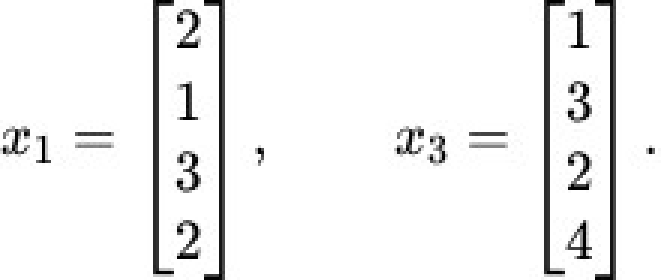

**Figure 11.** Token representations x_m and x_n

The query and key projection matrices are:

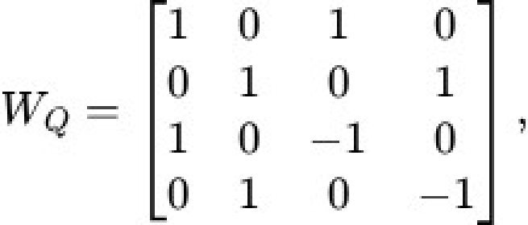

**Figure 12.** Query projection matrix W_Q

and key projection matrix $W_K$:

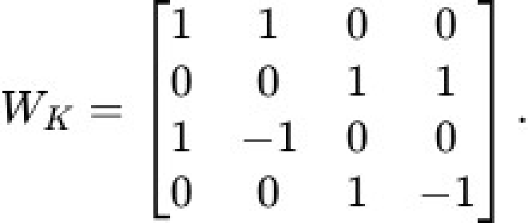

**Figure 13.** Key projection matrix W_K

RoPE Frequency

For RoPE, use the frequency formula $\theta_i = 10000^{-2(i-1)/d}$ for $i = 1, 2, \dots, d/2$.

All angles are measured in radians.

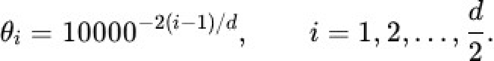

**Figure 14.** RoPE frequency formula theta_i = 10000^(-2(i-1)/d)

RoPE Rotation Matrix

For position $p$, define the RoPE rotation matrix as:

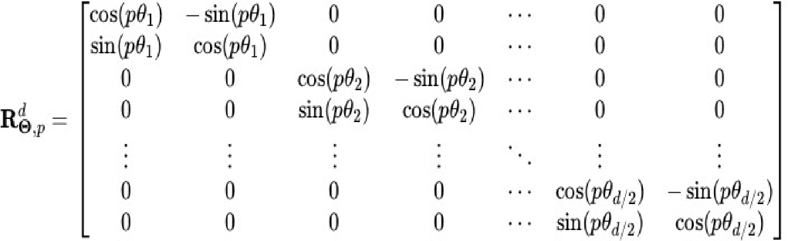

**Figure 15.** RoPE rotation matrix R_{Theta, p}^d definition

The position-dependent query and key vectors are $q_m = R_{\Theta, m}^d W_Q x_m$ and $k_n = R_{\Theta, n}^d W_K x_n$:

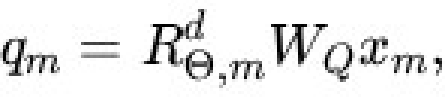

**Figure 16.** Position-dependent query vector q_m formula

Key vector $k_n$ formula:

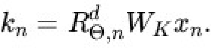

**Figure 17.** Position-dependent key vector k_n formula

Attention score formula:

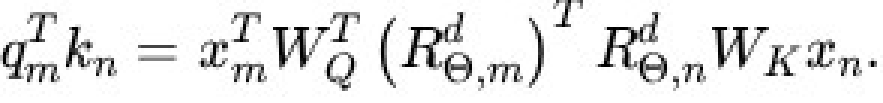

**Figure 18.** Unnormalized attention score q_m^T k_n expansion

Using the property $(R_{\Theta, m}^d)^T R_{\Theta, n}^d = R_{\Theta, n-m}^d$, the attention score can be expressed using the relative position:

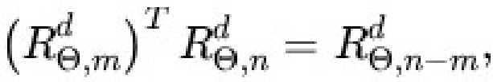

**Figure 19.** Property (R_{Theta, m}^d)^T R_{Theta, n}^d = R_{Theta, n-m}^d

Relative position attention score formula:

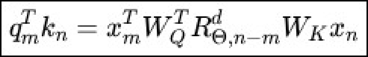

**Figure 20.** Attention score expressed using relative position rotation matrix

### Question 18

**Question ID:** `6406532280224`

**Portal container ID:** `6406532280223`

**Type:** MCQ · **Marks:** 1
**PDF pages:** 12

**Shared context:** [ctx-18-21](#ctx-18-21)

Compute $W_Q x_m$ and select the correct option

**Options**

**A.**

$[4, 13, 1, -1]^T$

![Option A vector [4, 13, 1, -1]^T](assets/da5004_2026T2_ET_AN/q18-q18-option-a-01-p012.png)

**Figure 21.** Option A vector [4, 13, 1, -1]^T

*Source option ID:* `6406537408114`

**B.**

$[5, 4, -1, 2]^T$

![Option B vector [5, 4, -1, 2]^T](assets/da5004_2026T2_ET_AN/q18-q18-option-b-01-p012.png)

**Figure 22.** Option B vector [5, 4, -1, 2]^T

*Source option ID:* `6406537408115`

**C.**

$[5, 13, -1, -1]^T$

![Option C vector [5, 13, -1, -1]^T](assets/da5004_2026T2_ET_AN/q18-q18-option-c-01-p012.png)

**Figure 23.** Option C vector [5, 13, -1, -1]^T

*Source option ID:* `6406537408116`

**D.**

$[3, 15, -2, 1]^T$

![Option D vector [3, 15, -2, 1]^T](assets/da5004_2026T2_ET_AN/q18-q18-option-d-01-p012.png)

**Figure 24.** Option D vector [3, 15, -2, 1]^T

*Source option ID:* `6406537408117`

**Correct answer:** $[5, 13, -1, -1]^T$

**Source evidence:** [{"page": 12, "bbox": [23.62, 524.1, 119.02, 540.4], "type": "green source option", "detail": "Option 6406537408116 rendered in green (color 32768) in CBT portal"}]

### Question 19

**Question ID:** `6406532280225`

**Portal container ID:** `6406532280223`

**Type:** MCQ · **Marks:** 1
**PDF pages:** 12, 13

**Shared context:** [ctx-18-21](#ctx-18-21)

Compute $W_K x_n$ and select the correct option

**Options**

**A.**

$[3, 16, -1, -2]^T$

![Option A vector [3, 16, -1, -2]^T](assets/da5004_2026T2_ET_AN/q19-q19-option-a-01-p013.png)

**Figure 25.** Option A vector [3, 16, -1, -2]^T

*Source option ID:* `6406537408118`

**B.**

$[4, 16, -2, -2]^T$

![Option B vector [4, 16, -2, -2]^T](assets/da5004_2026T2_ET_AN/q19-q19-option-b-01-p013.png)

**Figure 26.** Option B vector [4, 16, -2, -2]^T

*Source option ID:* `6406537408119`

**C.**

$[5, 4, 2, -1]^T$

![Option C vector [5, 4, 2, -1]^T](assets/da5004_2026T2_ET_AN/q19-q19-option-c-01-p013.png)

**Figure 27.** Option C vector [5, 4, 2, -1]^T

*Source option ID:* `6406537408120`

**D.**

$[2, 16, -2, 2]^T$

![Option D vector [2, 16, -2, 2]^T](assets/da5004_2026T2_ET_AN/q19-q19-option-d-01-p013.png)

**Figure 28.** Option D vector [2, 16, -2, 2]^T

*Source option ID:* `6406537408121`

**Correct answer:** $[4, 16, -2, -2]^T$

**Source evidence:** [{"page": 13, "bbox": [23.62, 168.5, 119.02, 184.8], "type": "green source option", "detail": "Option 6406537408119 rendered in green (color 32768) in CBT portal"}]

### Question 20

**Question ID:** `6406532280226`

**Portal container ID:** `6406532280223`

**Type:** SA · **Marks:** 2
**PDF pages:** 13

**Shared context:** [ctx-18-21](#ctx-18-21)

Construct the corresponding RoPE rotation matrix ($R_{\Theta, n-m}^d$) and submit the maximum value in it. (correct upto 2 decimal places)

All angles are measured in radians.

**Correct answer:** 0.98 to 1

**Source evidence:** [{"page": 13, "bbox": [22.87, 650.0, 120.0, 670.0], "type": "explicit field", "detail": "Possible Answers: 0.98 to 1 in CBT portal"}]

### Question 21

**Question ID:** `6406532280227`

**Portal container ID:** `6406532280223`

**Type:** SA · **Marks:** 3
**PDF pages:** 13, 14

**Shared context:** [ctx-18-21](#ctx-18-21)

Computing the final dot product $q_m^T k_n$. (correct upto 2 decimal places)

**Correct answer:** -22 to -19

**Source evidence:** [{"page": 14, "bbox": [22.87, 180.0, 120.0, 200.0], "type": "explicit field", "detail": "Possible Answers: -22 to -19 in CBT portal"}]

## Answer key

| Source question | Source identity | Correct answer | PDF pages |
| :--- | :--- | :--- | :--- |
| 2 | 6406532280206 | Assertion (A) is true, but Reason (R) is false. | 2 |
| 3 | 6406532280208 | The dot product between two sinusoidal positional encoding vectors strictly increases as the relative distance between their positions increases, taking values in the range $[0, \infty)$ | 2, 3 |
| 4 | 6406532280212 | Beam search | 3 |
| 5 | 6406532280213 | By adding learnable segment embeddings to the token and positional embeddings of the respective sentences. | 3 |
| 6 | 6406532280207 | 3 | 3, 4 |
| 7 | 6406532280217 | l,i,on | 4, 5 |
| 8 | 6406532280222 | 12432 | 5 |
| 9 | 6406532280210 | 3 | 6 |
| 10 | 6406532280211 | 0.54 to 0.58 | 6, 7 |
| 11 | 6406532280214 | By formatting the raw input text with natural language prompts to induce task-specific outputs without updating model weights. | 7 |
| 12 | 6406532280215 | I-C, II-B, III-A | 7, 8 |
| 13 | 6406532280216 | jumps over the lazy dog | 8 |
| 14 | 6406532280219 | 2 | 8 |
| 15 | 6406532280220 | It reduces computational overhead but increases memory usage | 8 |
| 16 | 6406532280218 | 512 | 9 |
| 17 | 6406532280221 | Length generalization is the ability of an LLM to maintain effective performance on sequences longer than the sequence lengths predominantly used during training.; Length generalization can depend on the model architecture, positional encoding scheme, training procedure, and the nature of the task.; Exposure to a wider range of sequence lengths during training can improve an LLM's ability to generalize to longer sequences. | 9, 10 |
| 18 | 6406532280224 | $[5, 13, -1, -1]^T$ | 12 |
| 19 | 6406532280225 | $[4, 16, -2, -2]^T$ | 12, 13 |
| 20 | 6406532280226 | 0.98 to 1 | 13 |
| 21 | 6406532280227 | -22 to -19 | 13, 14 |

## Extraction notes

**Status:** verified
**Count reconciliation:** Section LLM (Section Id 640653148704) declares 17 portal question containers and 50 section marks. The 17 portal containers comprise: 1 administrative confirmation question (Question 1, 0 marks, excluded), 14 standalone questions (Q2-Q8, Q11-Q17), and 2 comprehension portal containers (Question Id 6406532280209 containing Q9-Q10 for 4 marks; Question Id 6406532280223 containing Q18-Q21 for 7 marks). Total academic questions = 14 standalone + 6 comprehension subquestions = 20 academic questions. Total marks = 8 (Q2-Q5) + 9 (Q6-Q8) + 4 (Q9-Q10) + 15 (Q11-Q15) + 4 (Q16) + 3 (Q17) + 7 (Q18-Q21) = 50 marks, exactly reconciling the 17 declared containers and 50 section marks without discrepancies.

**Excluded source entries:**

- {"classification": "subject-confirmation", "page": 1, "bbox": [22.87, 55.39, 569.03, 842.0], "reason": "Administrative subject confirmation asking candidate to confirm subject DEGREE LEVEL : LARGE LANGUAGE MODELS (COMPUTER BASED EXAM) and cross check hall ticket", "identity": "6406532280205"}
