# LLM — da5004_2026T2_ET_FN

**Source:** `da5004_2026T2_ET_FN.pdf` · **Academic questions:** 20 · **Separately counted children:** 0
**Provenance:** `Large_Language_Models/da5004_2026T2_ET_FN.pdf` · SHA-256 `2ef6735b833c260e6f84905b1ae0c855b419a8589c8280d0783e9f9c34e2b0be`

**Scope:** LLM (Degree Level : Large Language Models), physical pages 1 to 11. Section Id: 640653139241. In-scope content starts on physical page 1 with LLM section header and continues through physical page 11.

## Questions

### Question 2

**Question ID:** `6406532136796`

**Type:** SA · **Marks:** 2
**PDF pages:** 2

Consider a Multi-Head Attention sub-layer with the following hyper-parameters:

• Embedding dimension ($d_{model}$) = 256
• Number of heads ($h$) = 4
• key/value dimension per head ($d_k = d_v$) = $d_{model} / h = 64$.

Calculate the total number of trainable parameters contained only in the projection matrices $W_i^Q$, $W_i^K$, $W_i^V$ and $W^O$. (Ignore biases). Enter the integer value.

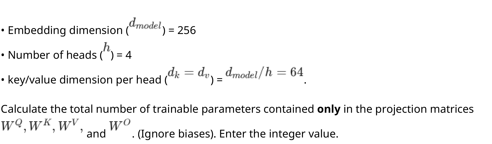

**Figure 1.** Multi-Head Attention sub-layer hyperparameters and trainable parameters specification

**Correct answer:** 262144

**Source evidence:** [{"page": 2, "bbox": [22.87, 529.3, 169.2, 545.6], "type": "explicit field", "detail": "Portal Short Answer Possible Answers: 262144"}]

### Question 3

**Question ID:** `6406532136806`

**Type:** SA · **Marks:** 2
**PDF pages:** 2, 3

For T5-Base, the model dimension is 768 and FFN dimension is 3072. Ignore bias. Find the number of parameters in the FFN of one encoder layer.

**Correct answer:** 4718592

**Source evidence:** [{"page": 3, "bbox": [22.87, 85.0, 169.2, 105.0], "type": "explicit field", "detail": "Portal Short Answer Possible Answers: 4718592"}]

### Question 4

**Question ID:** `6406532136797`

**Type:** SA · **Marks:** 3
**PDF pages:** 3

A batch of 5 sentences is passed through a Transformer Encoder. The sequences are padded to a maximum length of 20 tokens. The embedding dimension ($d_{model}$) is 64. What is the total number of elements (volume) in the output tensor produced by the final layer of the encoder for this batch?

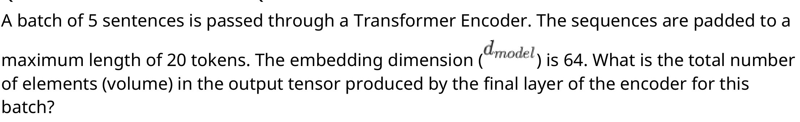

**Figure 2.** Transformer Encoder batch output tensor volume problem statement

**Correct answer:** 6400

**Source evidence:** [{"page": 3, "bbox": [22.87, 480.0, 169.2, 500.0], "type": "explicit field", "detail": "Portal Short Answer Possible Answers: 6400"}]

### Question 5

**Question ID:** `6406532136809`

**Type:** SA · **Marks:** 3
**PDF pages:** 3, 4

Calculate the KV Cache memory size in Megabytes for a single request (batch size = 1) with the following parameters:

• Number of layers: 24
• Embedding dimension (d_model): 1024
• Sequence length (n): 2048 tokens
• Precision: 16-bit (2 bytes per element)
• Assume standard Multi-Head Attention (MHA) where total KV dimension per layer is 2 x d_model (2 for K+V)

**Correct answer:** 192

**Source evidence:** [{"page": 4, "bbox": [22.87, 50.0, 169.2, 70.0], "type": "explicit field", "detail": "Portal Short Answer Possible Answers: 192"}]

### Question 6

**Question ID:** `6406532136798`

**Type:** MCQ · **Marks:** 2
**PDF pages:** 4

In BERT's Next Sentence Prediction task, how are the negative (NotNext) examples created?

**Options**

**A.**

By taking the sentence that immediately precedes the current sentence.

*Source option ID:* `6406536959407`

**B.**

By reversing the word order of the actual next sentence.

*Source option ID:* `6406536959408`

**C.**

By picking a random sentence from the corpus (50% of the time).

*Source option ID:* `6406536959409`

**D.**

By masking all verbs in the actual next sentence.

*Source option ID:* `6406536959410`

**Correct answer:** By picking a random sentence from the corpus (50% of the time).

**Source evidence:** [{"page": 4, "bbox": [23.6, 316.8, 119.0, 333.2], "type": "green source option", "detail": "Option 6406536959409 marked in green (color 32768)"}]

### Question 7

**Question ID:** `6406532136804`

**Type:** MCQ · **Marks:** 2
**PDF pages:** 4

What happens when a very large model is trained for many epochs on a relatively small dataset in the T5 scaling-law setting?

**Options**

**A.**

The performance continues to improve linearly with more training steps.

*Source option ID:* `6406536959433`

**B.**

The performance degrades due to overfitting (memorization) of the training data.

*Source option ID:* `6406536959434`

**C.**

The model automatically learns to augment the data, preventing overfitting.

*Source option ID:* `6406536959435`

**D.**

The performance plateaus but does not degrade.

*Source option ID:* `6406536959436`

**Correct answer:** The performance degrades due to overfitting (memorization) of the training data.

**Source evidence:** [{"page": 4, "bbox": [23.6, 516.0, 119.0, 532.4], "type": "green source option", "detail": "Option 6406536959434 marked in green (color 32768)"}]

### Question 8

**Question ID:** `6406532136808`

**Type:** MCQ · **Marks:** 2
**PDF pages:** 4, 5

PagedAttention is designed to address which specific inefficiency in Large Language Model (LLM) serving?

**Options**

**A.**

High computational latency of matrix multiplication.

*Source option ID:* `6406536959446`

**B.**

Memory fragmentation and waste in the KV cache due to pre-allocating contiguous memory blocks for variable-length sequences.

*Source option ID:* `6406536959447`

**C.**

Low bandwidth of the internet connection during API calls.

*Source option ID:* `6406536959448`

**D.**

The difficulty of training models on long sequences.

*Source option ID:* `6406536959449`

**Correct answer:** Memory fragmentation and waste in the KV cache due to pre-allocating contiguous memory blocks for variable-length sequences.

**Source evidence:** [{"page": 4, "bbox": [23.6, 752.4, 119.0, 768.7], "type": "green source option", "detail": "Option 6406536959447 marked in green (color 32768)"}]

### Question 9

**Question ID:** `6406532136810`

**Type:** MCQ · **Marks:** 2
**PDF pages:** 5

The standard Self-Attention mechanism has a time complexity of $\mathcal{O}(T^2 d)$, where $T$ is the sequence length and $d$ is the embedding dimension. In Kernel-based Linear Attention methods (like Linear Transformers), the associativity of matrix multiplication is exploited to compute $Q(K^T V)$ instead of $(QK^T)V$.

What is the resulting time complexity of this Linear Attention mechanism?

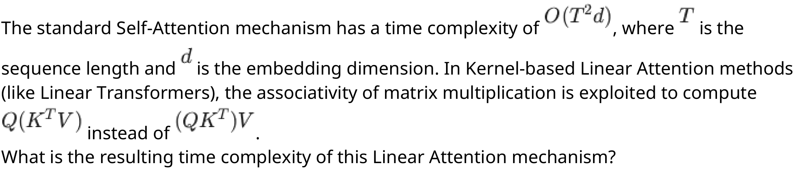

**Figure 3.** Linear Attention mechanism matrix multiplication associativity formulation

**Options**

**A.**

$\mathcal{O}(T^2)$

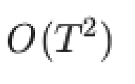

**Figure 4.** Option A time complexity O(T^2)

*Source option ID:* `6406536959451`

**B.**

$\mathcal{O}(T d^2)$

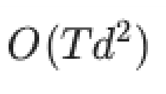

**Figure 5.** Option B time complexity O(T d^2)

*Source option ID:* `6406536959452`

**C.**

$\mathcal{O}(T d)$

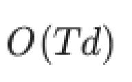

**Figure 6.** Option C time complexity O(T d)

*Source option ID:* `6406536959453`

**D.**

$\mathcal{O}(d^2)$

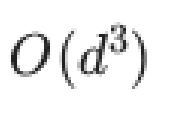

**Figure 7.** Option D time complexity O(d^2)

*Source option ID:* `6406536959454`

**Correct answer:** $\mathcal{O}(T d^2)$

**Source evidence:** [{"page": 5, "bbox": [23.6, 317.1, 119.0, 333.4], "type": "green source option", "detail": "Option 6406536959452 marked in green (color 32768)"}]

### Question 10

**Question ID:** `6406532136812`

**Type:** MCQ · **Marks:** 2
**PDF pages:** 5, 6

In a standard Transformer layer utilizing Rotary Positional Embeddings (RoPE), at which specific stage of the forward pass is the rotary transformation applied?

**Options**

**A.**

To the input embeddings X immediately before the Linear projections for Q, K, and V.

*Source option ID:* `6406536959459`

**B.**

To the Q and K vectors simultaneously using a coupled weight matrix within the Attention head.

*Source option ID:* `6406536959460`

**C.**

To the Q and K vectors independently, after their linear projections but before the scaled dot-product calculation.

*Source option ID:* `6406536959461`

**D.**

To the Q, K, and V vectors after the linear projections to ensure the entire latent space is rotationally invariant.

*Source option ID:* `6406536959462`

**Correct answer:** To the Q and K vectors independently, after their linear projections but before the scaled dot-product calculation.

**Source evidence:** [{"page": 5, "bbox": [23.6, 739.3, 119.0, 755.6], "type": "green source option", "detail": "Option 6406536959461 marked in green (color 32768)"}]

### Question 11

**Question ID:** `6406532136814`

**Type:** MCQ · **Marks:** 2
**PDF pages:** 6

In a Transformer using ALiBi, the attention score is modified as:

$$score_{i,j} = Q_i \cdot K_j - m \cdot |i - j|$$

Suppose a researcher proposes modifying ALiBi to:

$$score_{i,j} = Q_i \cdot K_j + m \cdot |i - j|$$

and claims that:

“The model will still learn to focus on nearby tokens through training.”

Which of the following is the most accurate critique of this proposal?

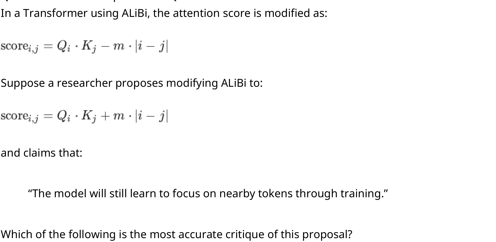

**Figure 8.** ALiBi attention score formulation and proposed modification

**Options**

**A.**

The modification will not affect attention behavior significantly because softmax normalizes all scores, making additive biases irrelevant.

*Source option ID:* `6406536959467`

**B.**

The modification will cause instability because the attention scores will become negative for nearby tokens and positive for distant tokens.

*Source option ID:* `6406536959468`

**C.**

The modification is equivalent to scaling (Q) and (K) vectors differently and therefore does not fundamentally change the positional bias.

*Source option ID:* `6406536959469`

**D.**

The modification will bias attention toward distant tokens, and due to the exponential nature of softmax, this effect can dominate learned $Q \cdot K$ similarities, making it difficult for training to recover locality.

*Source option ID:* `6406536959470`

**Correct answer:** The modification will bias attention toward distant tokens, and due to the exponential nature of softmax, this effect can dominate learned $Q \cdot K$ similarities, making it difficult for training to recover locality.

**Source evidence:** [{"page": 6, "bbox": [23.6, 528.7, 119.0, 545.0], "type": "green source option", "detail": "Option 6406536959470 marked in green (color 32768)"}]

### Question 12

**Question ID:** `6406532136799`

**Type:** MSQ · **Marks:** 3
**PDF pages:** 6, 7

Comparing the architectures of BERT and GPT, select all the structural differences that are true.

**Options**

**A.**

BERT uses bidirectional self-attention, allowing tokens to attend to both left and right contexts.

*Source option ID:* `6406536959411`

**B.**

GPT uses masked (causal) self-attention, allowing tokens to attend only to previous tokens.

*Source option ID:* `6406536959412`

**C.**

BERT is an autoregressive model, while GPT is an autoencoding model.

*Source option ID:* `6406536959413`

**D.**

During pre-training, BERT predicts masked tokens, whereas GPT predicts the next token in the sequence.

*Source option ID:* `6406536959414`

**Correct answer:** BERT uses bidirectional self-attention, allowing tokens to attend to both left and right contexts.; GPT uses masked (causal) self-attention, allowing tokens to attend only to previous tokens.; During pre-training, BERT predicts masked tokens, whereas GPT predicts the next token in the sequence.

**Source evidence:** [{"page": 6, "bbox": [23.6, 788.0, 119.0, 804.4], "type": "green source option", "detail": "Option 6406536959411 marked in green (color 32768)"}, {"page": 7, "bbox": [23.6, 17.5, 119.0, 33.8], "type": "green source option", "detail": "Option 6406536959412 marked in green (color 32768)"}, {"page": 7, "bbox": [23.6, 75.5, 119.0, 91.8], "type": "green source option", "detail": "Option 6406536959414 marked in green (color 32768)"}]

### Question 13

**Question ID:** `6406532136805`

**Type:** MSQ · **Marks:** 3
**PDF pages:** 7

Based on the architectural comparison experiments (Encoder-Decoder vs. Decoder-only vs. Encoder-only) discussed in the lectures:

**Options**

**A.**

Encoder-Decoder architectures generally perform best for sequence-to-sequence tasks like Translation and Summarization.

*Source option ID:* `6406536959437`

**B.**

A Decoder-only model with a Prefix-LM objective can match the performance of an Encoder-Decoder model.

*Source option ID:* `6406536959438`

**C.**

Sharing parameters between the encoder and decoder always improves performance regardless of task.

*Source option ID:* `6406536959439`

**D.**

Encoder-only models (like BERT) are typically less suitable for generation tasks compared to Encoder-Decoder models.

*Source option ID:* `6406536959440`

**Correct answer:** Encoder-Decoder architectures generally perform best for sequence-to-sequence tasks like Translation and Summarization.; A Decoder-only model with a Prefix-LM objective can match the performance of an Encoder-Decoder model.; Encoder-only models (like BERT) are typically less suitable for generation tasks compared to Encoder-Decoder models.

**Source evidence:** [{"page": 7, "bbox": [23.6, 249.3, 119.0, 265.7], "type": "green source option", "detail": "Option 6406536959437 marked in green (color 32768)"}, {"page": 7, "bbox": [23.6, 286.5, 119.0, 302.8], "type": "green source option", "detail": "Option 6406536959438 marked in green (color 32768)"}, {"page": 7, "bbox": [23.6, 360.8, 119.0, 377.1], "type": "green source option", "detail": "Option 6406536959440 marked in green (color 32768)"}]

### Question 14

**Question ID:** `6406532136811`

**Type:** MSQ · **Marks:** 3
**PDF pages:** 7

Select all true statements regarding KV Caching during the autoregressive inference of LLMs.

**Options**

**A.**

It trades off increased memory usage for reduced computational latency.

*Source option ID:* `6406536959455`

**B.**

It avoids recomputing the Key and Value vectors for tokens that have already been processed in previous steps.

*Source option ID:* `6406536959456`

**C.**

It is essential during the training phase to speed up backpropagation.

*Source option ID:* `6406536959457`

**D.**

The memory required for the KV cache grows linearly with the sequence length and batch size.

*Source option ID:* `6406536959458`

**Correct answer:** It trades off increased memory usage for reduced computational latency.; It avoids recomputing the Key and Value vectors for tokens that have already been processed in previous steps.; The memory required for the KV cache grows linearly with the sequence length and batch size.

**Source evidence:** [{"page": 7, "bbox": [23.6, 518.3, 119.0, 534.6], "type": "green source option", "detail": "Option 6406536959455 marked in green (color 32768)"}, {"page": 7, "bbox": [23.6, 539.1, 119.0, 555.5], "type": "green source option", "detail": "Option 6406536959456 marked in green (color 32768)"}, {"page": 7, "bbox": [23.6, 597.1, 119.0, 613.4], "type": "green source option", "detail": "Option 6406536959458 marked in green (color 32768)"}]

### Question 15

**Question ID:** `6406532136800`

**Type:** MSQ · **Marks:** 2
**PDF pages:** 7, 8

Select all correct statements regarding Decoding Strategies in language generation.

**Options**

**A.**

Beam Search with a beam width $k = 1$ is mathematically equivalent to Greedy Search.

*Source option ID:* `6406536959415`

**B.**

Greedy search is deterministic and often leads to repetitive or degenerative text loops.

*Source option ID:* `6406536959416`

**C.**

Top-$k$ sampling guarantees that the generated text will always be grammatically correct.

*Source option ID:* `6406536959417`

**D.**

Top-$p$ (Nucleus) sampling allows for a dynamic vocabulary size at each step, whereas Top-$k$ uses a fixed number of candidates.

*Source option ID:* `6406536959418`

**Correct answer:** Beam Search with a beam width $k = 1$ is mathematically equivalent to Greedy Search.; Greedy search is deterministic and often leads to repetitive or degenerative text loops.; Top-$p$ (Nucleus) sampling allows for a dynamic vocabulary size at each step, whereas Top-$k$ uses a fixed number of candidates.

**Source evidence:** [{"page": 8, "bbox": [23.6, 28.7, 119.0, 45.0], "type": "green source option", "detail": "Option 6406536959415 marked in green (color 32768)"}, {"page": 8, "bbox": [23.6, 82.1, 119.0, 98.5], "type": "green source option", "detail": "Option 6406536959416 marked in green (color 32768)"}, {"page": 8, "bbox": [23.6, 195.1, 119.0, 211.4], "type": "green source option", "detail": "Option 6406536959418 marked in green (color 32768)"}]

### Question 16

**Question ID:** `6406532136801`

**Type:** MSQ · **Marks:** 2
**PDF pages:** 8

In a feature-based approach using a pretrained transformer (like BERT) for a Multiple-Choice QA task, which of the following statements regarding the methodology are correct? (Select all that apply)

**Options**

**A.**

The weights of the pretrained transformer are updated via backpropagation during the training phase.

*Source option ID:* `6406536959419`

**B.**

The input must be formatted as multiple pairs, such as [CLS] Question [SEP] Choice_n, creating a distinct representation for each candidate answer.

*Source option ID:* `6406536959420`

**C.**

The final prediction is determined by passing the fixed output representations through a trainable linear layer and applying a Softmax function.

*Source option ID:* `6406536959421`

**D.**

The model generates the correct answer string token-by-token using an autoregressive decoding strategy like Greedy Search.

*Source option ID:* `6406536959422`

**Correct answer:** The input must be formatted as multiple pairs, such as [CLS] Question [SEP] Choice_n, creating a distinct representation for each candidate answer.; The final prediction is determined by passing the fixed output representations through a trainable linear layer and applying a Softmax function.

**Source evidence:** [{"page": 8, "bbox": [23.6, 450.0, 119.0, 466.3], "type": "green source option", "detail": "Option 6406536959420 marked in green (color 32768)"}, {"page": 8, "bbox": [23.6, 487.1, 119.0, 503.4], "type": "green source option", "detail": "Option 6406536959421 marked in green (color 32768)"}]

### Question 17

**Question ID:** `6406532136802`

**Type:** MCQ · **Marks:** 3
**PDF pages:** 8, 9

A Transformer processes a sequence of length 5 using 6 identical self-attention layers. Count the total number of allowed attention links across all layers and Choose the option representing the correct pair

(A) BERT
(B) GPT

**Options**

**A.**

BERT: 150, GPT: 90

*Source option ID:* `6406536959423`

**B.**

BERT: 90, GPT: 150

*Source option ID:* `6406536959424`

**C.**

BERT: 150, GPT: 150

*Source option ID:* `6406536959425`

**D.**

BERT: 90, GPT: 90

*Source option ID:* `6406536959426`

**E.**

BERT: 30, GPT: 36

*Source option ID:* `6406536959427`

**F.**

BERT: 36, GPT: 30

*Source option ID:* `6406536959428`

**Correct answer:** BERT: 150, GPT: 90

**Source evidence:** [{"page": 9, "bbox": [23.6, 17.5, 119.0, 33.8], "type": "green source option", "detail": "Option 6406536959423 marked in green (color 32768)"}]

### Question 18

**Question ID:** `6406532136803`

**Type:** MCQ · **Marks:** 3
**PDF pages:** 9

Consider the architecture of BART. Which of the following descriptions best match its structural design?

**Options**

**A.**

A Decoder-only model similar to GPT, but with bidirectional attention in the first layer.

*Source option ID:* `6406536959429`

**B.**

An Encoder-only model similar to BERT, but trained with a causal masking objective.

*Source option ID:* `6406536959430`

**C.**

An encoder-decoder model where the encoder processes a corrupted input bidirectionally and the decoder autoregressively reconstructs the original sequence.

*Source option ID:* `6406536959431`

**D.**

A dual-encoder model where one encoder processes the context and another processes the query.

*Source option ID:* `6406536959432`

**Correct answer:** An encoder-decoder model where the encoder processes a corrupted input bidirectionally and the decoder autoregressively reconstructs the original sequence.

**Source evidence:** [{"page": 9, "bbox": [23.6, 353.4, 119.0, 369.8], "type": "green source option", "detail": "Option 6406536959431 marked in green (color 32768)"}]

### Question 19

**Question ID:** `6406532136807`

**Type:** MCQ · **Marks:** 3
**PDF pages:** 9

Why is Flash Attention considered an "IO-aware" algorithm?

**Options**

**A.**

It reduces the number of parameters in the model to fit in GPU memory.

*Source option ID:* `6406536959442`

**B.**

It compresses the input data using JPEG-like encoding before processing.

*Source option ID:* `6406536959443`

**C.**

It optimizes the movement of data between the high-bandwidth memory (HBM) and the faster on-chip SRAM to avoid memory bandwidth bottlenecks.

*Source option ID:* `6406536959444`

**D.**

It writes all intermediate attention matrices to the hard disk to save RAM.

*Source option ID:* `6406536959445`

**Correct answer:** It optimizes the movement of data between the high-bandwidth memory (HBM) and the faster on-chip SRAM to avoid memory bandwidth bottlenecks.

**Source evidence:** [{"page": 9, "bbox": [23.6, 589.8, 119.0, 606.1], "type": "green source option", "detail": "Option 6406536959444 marked in green (color 32768)"}]

### Question 20

**Question ID:** `6406532136813`

**Type:** MCQ · **Marks:** 3
**PDF pages:** 9, 10

In a transformer with relative positional encoding (RPE), attention logits between a query at position 4 and keys at positions 2 and 6 depend on relative distances $d = i - j$ where $i$ is the position of query and $j$ is the position of key.

Suppose the learned scalar biases as per RPE are:
• $b(-2) = -0.5$
• $b(-1) = -0.3$
• $b(0) = 0.7$
• $b(1) = 0.2$
• $b(2) = 0.3$

The base (content-only) attention logits are:
• $s(4,2) = 1.2$
• $s(4,6) = 1.2$

What are the final attention logits after incorporating RPE?

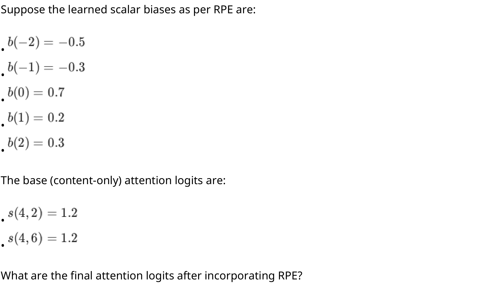

**Figure 9.** Relative positional encoding learned scalar biases and base attention logits

**Options**

**A.**

$s(4,2) = 0.7, s(4,6) = 1.5$

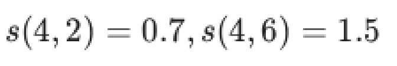

**Figure 10.** Question 20 option A: $s(4,2) = 0.7, s(4,6) = 1.5$

*Source option ID:* `6406536959463`

**B.**

$s(4,2) = 0.7, s(4,6) = 0.9$

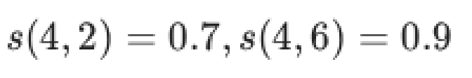

**Figure 11.** Question 20 option B: $s(4,2) = 0.7, s(4,6) = 0.9$

*Source option ID:* `6406536959464`

**C.**

$s(4,2) = 1.7, s(4,6) = 0.9$

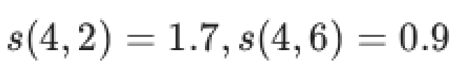

**Figure 12.** Question 20 option C: $s(4,2) = 1.7, s(4,6) = 0.9$

*Source option ID:* `6406536959465`

**D.**

$s(4,2) = 1.5, s(4,6) = 0.7$

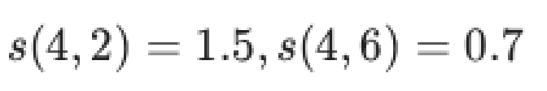

**Figure 13.** Question 20 option D: $s(4,2) = 1.5, s(4,6) = 0.7$

*Source option ID:* `6406536959466`

**Correct answer:** $s(4,2) = 1.5, s(4,6) = 0.7$

**Source evidence:** [{"page": 10, "bbox": [23.6, 502.7, 119.0, 519.1], "type": "green source option", "detail": "Option 6406536959466 marked in green (color 32768)"}]

### Question 21

**Question ID:** `6406532136815`

**Type:** MCQ · **Marks:** 3
**PDF pages:** 10, 11

An engineer is designing a Transformer model capable of length extrapolation (handling sequences longer than those seen during training) while minimizing the number of trainable weights. They are evaluating Absolute Positional Encodings (APE), Relative Positional Encodings (RPE), Rotary Positional Encodings (RoPE), and Attention with Linear Biases (ALiBi).Which of the following statements correctly describes the parameterization and behavior of these techniques?

**Options**

**A.**

RoPE is considered a learned encoding because the model must optimize the rotation angles $\theta$ as trainable parameters during the backpropagation phase.

*Source option ID:* `6406536959471`

**B.**

The engineer should choose APE or RPE to minimize weights, as both rely exclusively on fixed sinusoidal functions without requiring a lookup table.

*Source option ID:* `6406536959472`

**C.**

RoPE and ALiBi are preferable for this use case because they utilize fixed mathematical transformations, whereas standard APE and RPE typically require learning position-specific embedding weights.

*Source option ID:* `6406536959473`

**D.**

ALiBi is the only technique among the four that requires the model to learn a unique "slope" parameter for each attention head to determine the rate of penalty decay.

*Source option ID:* `6406536959474`

**Correct answer:** RoPE and ALiBi are preferable for this use case because they utilize fixed mathematical transformations, whereas standard APE and RPE typically require learning position-specific embedding weights.

**Source evidence:** [{"page": 11, "bbox": [23.6, 17.5, 119.0, 33.8], "type": "green source option", "detail": "Option 6406536959473 marked in green (color 32768)"}]

## Answer key

| Source question | Source identity | Correct answer | PDF pages |
| :--- | :--- | :--- | :--- |
| 2 | 6406532136796 | 262144 | 2 |
| 3 | 6406532136806 | 4718592 | 2, 3 |
| 4 | 6406532136797 | 6400 | 3 |
| 5 | 6406532136809 | 192 | 3, 4 |
| 6 | 6406532136798 | By picking a random sentence from the corpus (50% of the time). | 4 |
| 7 | 6406532136804 | The performance degrades due to overfitting (memorization) of the training data. | 4 |
| 8 | 6406532136808 | Memory fragmentation and waste in the KV cache due to pre-allocating contiguous memory blocks for variable-length sequences. | 4, 5 |
| 9 | 6406532136810 | $\mathcal{O}(T d^2)$ | 5 |
| 10 | 6406532136812 | To the Q and K vectors independently, after their linear projections but before the scaled dot-product calculation. | 5, 6 |
| 11 | 6406532136814 | The modification will bias attention toward distant tokens, and due to the exponential nature of softmax, this effect can dominate learned $Q \cdot K$ similarities, making it difficult for training to recover locality. | 6 |
| 12 | 6406532136799 | BERT uses bidirectional self-attention, allowing tokens to attend to both left and right contexts.; GPT uses masked (causal) self-attention, allowing tokens to attend only to previous tokens.; During pre-training, BERT predicts masked tokens, whereas GPT predicts the next token in the sequence. | 6, 7 |
| 13 | 6406532136805 | Encoder-Decoder architectures generally perform best for sequence-to-sequence tasks like Translation and Summarization.; A Decoder-only model with a Prefix-LM objective can match the performance of an Encoder-Decoder model.; Encoder-only models (like BERT) are typically less suitable for generation tasks compared to Encoder-Decoder models. | 7 |
| 14 | 6406532136811 | It trades off increased memory usage for reduced computational latency.; It avoids recomputing the Key and Value vectors for tokens that have already been processed in previous steps.; The memory required for the KV cache grows linearly with the sequence length and batch size. | 7 |
| 15 | 6406532136800 | Beam Search with a beam width $k = 1$ is mathematically equivalent to Greedy Search.; Greedy search is deterministic and often leads to repetitive or degenerative text loops.; Top-$p$ (Nucleus) sampling allows for a dynamic vocabulary size at each step, whereas Top-$k$ uses a fixed number of candidates. | 7, 8 |
| 16 | 6406532136801 | The input must be formatted as multiple pairs, such as [CLS] Question [SEP] Choice_n, creating a distinct representation for each candidate answer.; The final prediction is determined by passing the fixed output representations through a trainable linear layer and applying a Softmax function. | 8 |
| 17 | 6406532136802 | BERT: 150, GPT: 90 | 8, 9 |
| 18 | 6406532136803 | An encoder-decoder model where the encoder processes a corrupted input bidirectionally and the decoder autoregressively reconstructs the original sequence. | 9 |
| 19 | 6406532136807 | It optimizes the movement of data between the high-bandwidth memory (HBM) and the faster on-chip SRAM to avoid memory bandwidth bottlenecks. | 9 |
| 20 | 6406532136813 | $s(4,2) = 1.5, s(4,6) = 0.7$ | 9, 10 |
| 21 | 6406532136815 | RoPE and ALiBi are preferable for this use case because they utilize fixed mathematical transformations, whereas standard APE and RPE typically require learning position-specific embedding weights. | 10, 11 |

## Extraction notes

**Status:** verified
**Count reconciliation:** The portal header declared 21 questions and 50 marks for the LLM section. The source PDF contains 1 administrative subject confirmation question (Question 1, 0 marks, excluded) and 20 academic questions (Questions 2 to 21). The 50 section marks reconcile exactly across the 20 academic questions: Q2 (2) + Q3 (2) + Q4 (3) + Q5 (3) + Q6 (2) + Q7 (2) + Q8 (2) + Q9 (2) + Q10 (2) + Q11 (2) + Q12 (3) + Q13 (3) + Q14 (3) + Q15 (2) + Q16 (2) + Q17 (3) + Q18 (3) + Q19 (3) + Q20 (3) + Q21 (3) = 50 marks. Total questions (1 confirmation + 20 academic = 21 questions) and total marks (50) reconcile fully without discrepancy.

- Question 1 is an administrative confirmation with 0 marks excluded semantically.
- Questions 2, 4, 9, 11, and 20 contain raster mathematical formulas and expressions preserved as high-resolution crops at 288 DPI with verified LaTeX transcription.

**Excluded source entries:**

- {"classification": "subject-confirmation", "page": 1, "bbox": [22.87, 738.25, 575.0, 842.0], "reason": "Administrative subject confirmation asking candidate to confirm subject and cross check hall ticket", "identity": "1"}
