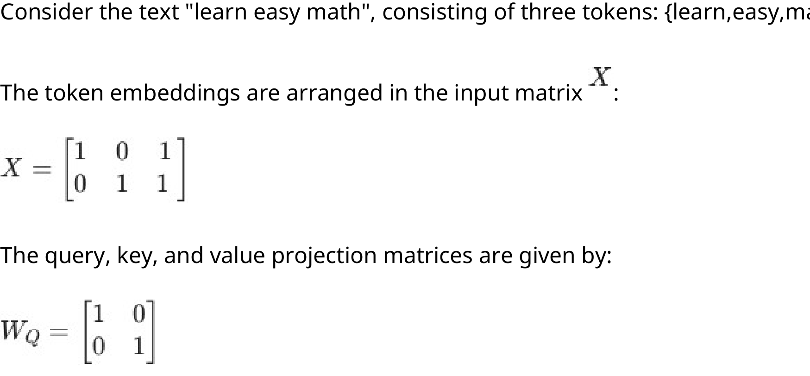
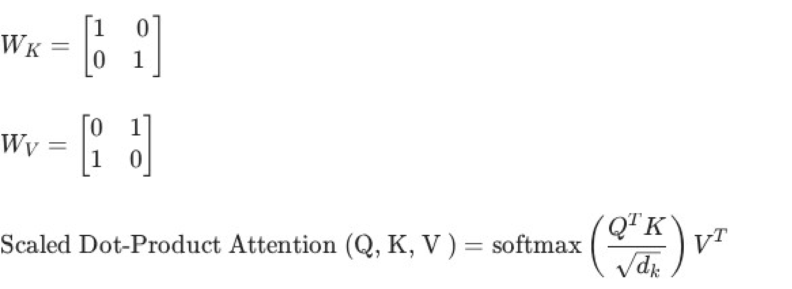
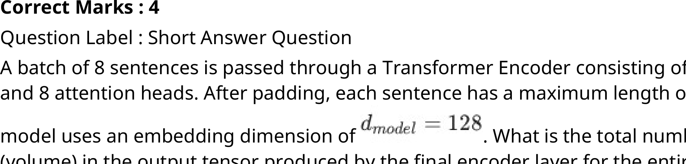
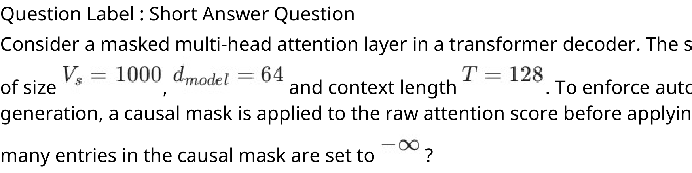
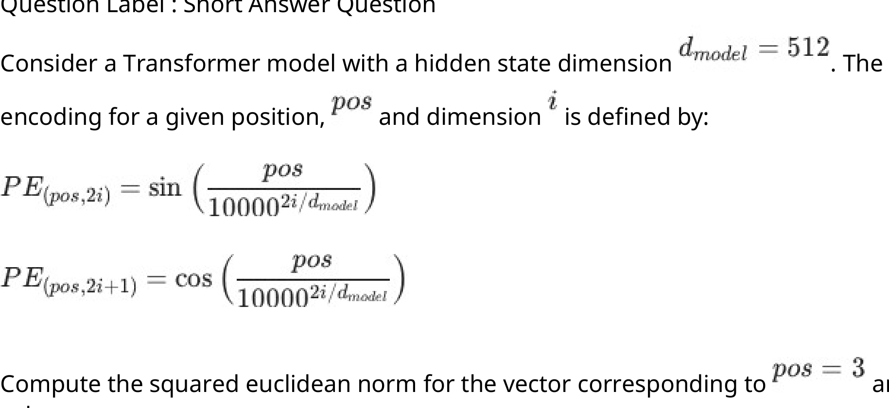
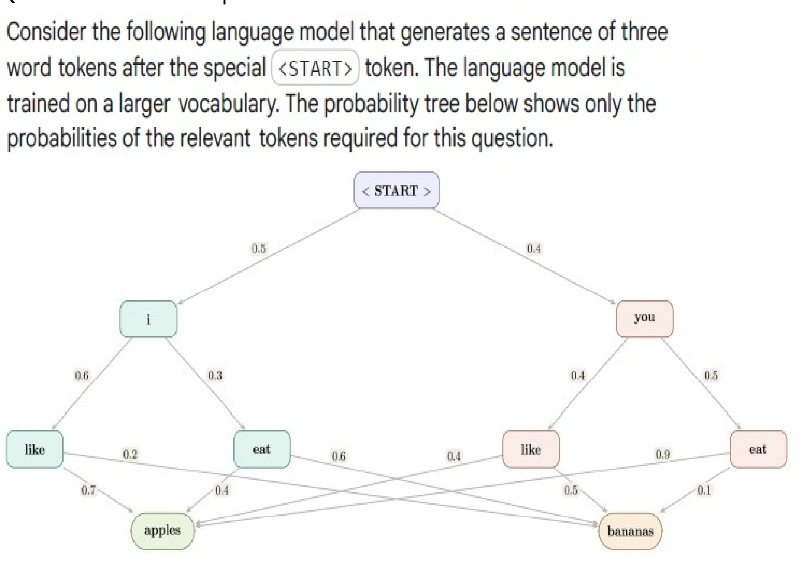
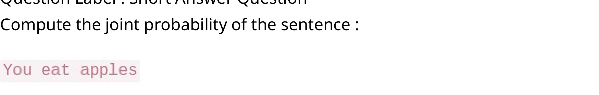
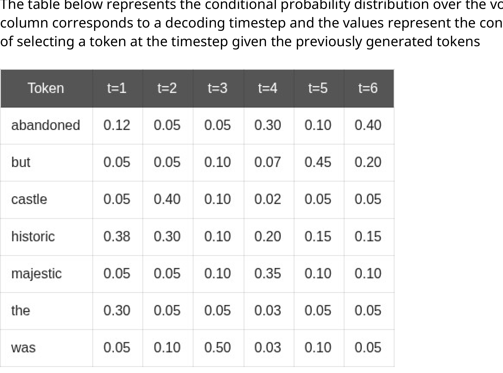

# LLM — da5004_2026T2_Q1_NA

**Source:** `da5004_2026T2_Q1_NA.pdf` · **Academic questions:** 16 · **Separately counted children:** 0
**Provenance:** `Large_Language_Models/da5004_2026T2_Q1_NA.pdf` · SHA-256 `7ca18a647a21b6dba359c95e4275ab1a3ff1ea251ef5388e72916cbc5e104049`

**Scope:** Section 1: LLM (Degree Level : Large Language Models), physical pages 1 to 10. The in-scope subject starts on physical page 1 with Section Id 640653141358 and terminates on physical page 10 after Question 17.

## Questions

### Question 2

**Question ID:** `6406532166233`

**Type:** MSQ · **Marks:** 4
**PDF pages:** 2

Which statements are true about traditional attention used in sequence-to-sequence models?

**Options**

**A.**

The decoder decides which encoder states are important.

*Source option ID:* `6406537043567`

**B.**

Attention weights are computed over all decoder hidden states.

*Source option ID:* `6406537043568`

**C.**

The context vector is a weighted sum of encoder states.

*Source option ID:* `6406537043569`

**D.**

Encoder hidden states are ignored after encoding.

*Source option ID:* `6406537043570`

**Correct answer:** A, C

**Source evidence:** [{"page": 2, "bbox": [23.62, 374.08, 119.02, 390.4], "type": "green source option", "detail": "Option 6406537043567 is marked in green with color 32768"}, {"page": 2, "bbox": [23.62, 415.72, 119.02, 432.04], "type": "green source option", "detail": "Option 6406537043569 is marked in green with color 32768"}]

### Shared context 3 to 4

**Question ID:** `6406532166234`

**Type:** COMPREHENSION
**PDF pages:** 2, 3

Consider the text "learn easy math", consisting of three tokens: {learn,easy,math}.

The token embeddings are arranged in the input matrix $X$:

$$X = \begin{bmatrix} 1 & 0 & 1 \\ 0 & 1 & 1 \end{bmatrix}$$

The query, key, and value projection matrices are given by:

$$W_Q = \begin{bmatrix} 1 & 0 \\ 0 & 1 \end{bmatrix}$$

$$W_K = \begin{bmatrix} 1 & 0 \\ 0 & 1 \end{bmatrix}$$

$$W_V = \begin{bmatrix} 0 & 1 \\ 1 & 0 \end{bmatrix}$$

$$\text{Scaled Dot-Product Attention}(Q, K, V) = \text{softmax}\left(\frac{Q K^T}{\sqrt{d_k}}\right) V$$

**Figure 1.** Input matrix X and query projection matrix W_Q for text learn easy math

**Figure 2.** Key projection matrix W_K, value projection matrix W_V, and Scaled Dot-Product Attention formulation

Based on the above data, answer the given subquestions.

### Question 3

**Question ID:** `6406532166235`

**Type:** SA · **Marks:** 3
**PDF pages:** 3

**Shared context:** [ctx-3-4](#ctx-3-4)

Compute the $(Q K^T)$ of the final scaled dot-product attention and submit the sum of the diagonal elements of $(Q K^T)$ matrix.

**Figure 3.** Question 3 prompt: Compute the (Q K^T) of the final scaled dot-product attention and sum of diagonal elements

**Correct answer:** 4

**Source evidence:** [{"page": 3, "bbox": [22.87, 506.0, 119.02, 530.0], "type": "explicit field", "detail": "Official Possible Answers: 4"}]

### Question 4

**Question ID:** `6406532166236`

**Type:** MCQ · **Marks:** 3
**PDF pages:** 3

**Shared context:** [ctx-3-4](#ctx-3-4)

Choose the token pair with the least attention score.

**Options**

**A.**

{"learn", "easy"}

*Source option ID:* `6406537043572`

**B.**

{"learn", "math"}

*Source option ID:* `6406537043573`

**C.**

{"easy", "math"}

*Source option ID:* `6406537043574`

**D.**

{"learn", "learn"}

*Source option ID:* `6406537043575`

**E.**

{"easy" , "easy"}

*Source option ID:* `6406537043576`

**Correct answer:** A

**Source evidence:** [{"page": 3, "bbox": [23.62, 643.24, 119.02, 659.56], "type": "green source option", "detail": "Option 6406537043572 is marked in green with color 32768"}]

### Question 5

**Question ID:** `6406532166237`

**Type:** SA · **Marks:** 4
**PDF pages:** 4

A Transformer model processes a sequence containing 6 tokens using Multi-Head Attention. The model initially uses 4 attention heads. If the number of attention heads is doubled to 8, while the sequence length remains unchanged, how many additional attention scores are computed across all heads?

**Correct answer:** 144

**Source evidence:** [{"page": 4, "bbox": [22.87, 240.0, 119.02, 260.0], "type": "explicit field", "detail": "Official Possible Answers: 144"}]

### Question 6

**Question ID:** `6406532166238`

**Type:** SA · **Marks:** 4
**PDF pages:** 4

A batch of 8 sentences is passed through a Transformer Encoder consisting of 6 encoder layers and 8 attention heads. After padding, each sentence has a maximum length of 32 tokens. The model uses an embedding dimension of $d_{model} = 128$. What is the total number of elements (volume) in the output tensor produced by the final encoder layer for the entire batch?

**Figure 4.** Question 6 prompt: Transformer encoder output tensor volume calculation with embedding dimension d_model = 128

**Correct answer:** 32768

**Source evidence:** [{"page": 4, "bbox": [22.87, 560.0, 119.02, 580.0], "type": "explicit field", "detail": "Official Possible Answers: 32768"}]

### Question 7

**Question ID:** `6406532166239`

**Type:** SA · **Marks:** 4
**PDF pages:** 4, 5

Consider a masked multi-head attention layer in a transformer decoder. The source vocabulary is of size $V_s = 1000$, $d_{model} = 64$ and context length $T = 128$. To enforce autoregressive generation, a causal mask is applied to the raw attention score before applying softmax. How many entries in the causal mask are set to $-\infty$ ?

**Figure 5.** Question 7 prompt: Causal mask entries set to -infinity with vocabulary size V_s = 1000, d_model = 64, and context length T = 128

**Correct answer:** 8128

**Source evidence:** [{"page": 5, "bbox": [22.87, 95.0, 119.02, 115.0], "type": "explicit field", "detail": "Official Possible Answers: 8128"}]

### Question 8

**Question ID:** `6406532166240`

**Type:** SA · **Marks:** 4
**PDF pages:** 5

Consider a Transformer model with a hidden state dimension $d_{model} = 512$. The positional encoding for a given position, $pos$ and dimension $i$ is defined by:

$$\text{PE}_{(pos, 2i)} = \sin\left(\frac{pos}{10000^{2i/d_{model}}}\right)$$

$$\text{PE}_{(pos, 2i+1)} = \cos\left(\frac{pos}{10000^{2i/d_{model}}}\right)$$

Compute the squared euclidean norm for the vector corresponding to $pos = 3$ and enter the value.

**Figure 6.** Question 8 prompt: Sinusoidal positional encoding formulation for hidden state dimension d_model = 512 and squared Euclidean norm computation

**Correct answer:** 256

**Source evidence:** [{"page": 5, "bbox": [22.87, 530.0, 119.02, 550.0], "type": "explicit field", "detail": "Official Possible Answers: 256"}]

### Question 9

**Question ID:** `6406532166241`

**Type:** MCQ · **Marks:** 4
**PDF pages:** 5, 6

Consider the following statements regarding the use of Teacher Forcing while training 
autoregressive sequence-to-sequence models and select the appropriate option: 
 
Statement 1: Teacher Forcing involves passing the input token to a larger Teacher model whose 
output is then input as the next token

Statement 2: Teacher Forcing helps to prevent compounding of early incorrect predictions that 
can destabilize training

**Options**

**A.**

Statement 1 is True but Statement 2 is False

*Source option ID:* `6406537043581`

**B.**

Statement 1 is False but Statement 2 is True

*Source option ID:* `6406537043582`

**C.**

Both the statements are True

*Source option ID:* `6406537043583`

**D.**

Both the statements are False

*Source option ID:* `6406537043584`

**Correct answer:** B

**Source evidence:** [{"page": 6, "bbox": [23.62, 93.28, 119.02, 109.6], "type": "green source option", "detail": "Option 6406537043582 is marked in green with color 32768"}]

### Shared context 10 to 12

**Question ID:** `6406532166242`

**Type:** COMPREHENSION
**PDF pages:** 6

Consider the following language model that generates a sentence of three word tokens after the special <START> token. The language model is trained on a larger vocabulary. The probability tree below shows only the probabilities of the relevant tokens required for this question.

**Figure 7.** Probability tree of three-token sentences following START token for bigram/trigram language model

Based on the above data, answer the given subquestions.

### Question 10

**Question ID:** `6406532166243`

**Type:** SA · **Marks:** 3
**PDF pages:** 6, 7

**Shared context:** [ctx-10-12](#ctx-10-12)

Compute the joint probability of the sentence : "You eat apples"

(Provide answer correct upto 2 digits after the decimal)

**Figure 8.** Question 10 prompt: Joint probability computation for the sentence You eat apples

**Correct answer:** 0.17 to 0.19

**Source evidence:** [{"page": 7, "bbox": [22.87, 130.0, 119.02, 150.0], "type": "explicit field", "detail": "Official Possible Answers: 0.17 to 0.19"}]

### Question 11

**Question ID:** `6406532166244`

**Type:** MCQ · **Marks:** 3
**PDF pages:** 7

**Shared context:** [ctx-10-12](#ctx-10-12)

Choose the option corresponding to the sentence with the highest joint probability under the given language model.

**Options**

**A.**

"i eat apples"

*Source option ID:* `6406537043586`

**B.**

"apples like You"

*Source option ID:* `6406537043587`

**C.**

"i eat bananas"

*Source option ID:* `6406537043588`

**D.**

"you like bananas

*Source option ID:* `6406537043589`

**E.**

"you like apples

*Source option ID:* `6406537043590`

**Correct answer:** C

**Source evidence:** [{"page": 7, "bbox": [23.62, 364.3, 119.02, 380.62], "type": "green source option", "detail": "Option 6406537043588 is marked in green with color 32768"}]

### Question 12

**Question ID:** `6406532166245`

**Type:** SA · **Marks:** 2
**PDF pages:** 7

**Shared context:** [ctx-10-12](#ctx-10-12)

Using the given probability tree calculate the conditional probability of predicting "apples" given "like" [i.e P(apples | like)]. (Submit -1 if the provided information is insufficient)

**Correct answer:** -1

**Source evidence:** [{"page": 7, "bbox": [22.87, 595.0, 119.02, 615.0], "type": "explicit field", "detail": "Official Possible Answers: -1"}]

### Question 13

**Question ID:** `6406532166246`

**Type:** MSQ · **Marks:** 3
**PDF pages:** 7, 8

Which of the following are components found within a GPT decoder layer?

**Options**

**A.**

Causal (Masked) Multi-Head Self-Attention

*Source option ID:* `6406537043592`

**B.**

Position-wise Feed-Forward Network

*Source option ID:* `6406537043593`

**C.**

Multi Head (Cross) Attention

*Source option ID:* `6406537043594`

**D.**

Recurrent Neural Network (RNN) Layer

*Source option ID:* `6406537043595`

**E.**

Add & Norm Layer

*Source option ID:* `6406537043596`

**Correct answer:** A, B, E

**Source evidence:** [{"page": 8, "bbox": [23.62, 75.46, 119.02, 91.78], "type": "green source option", "detail": "Option 6406537043592 is marked in green with color 32768"}, {"page": 8, "bbox": [23.62, 96.28, 119.02, 112.6], "type": "green source option", "detail": "Option 6406537043593 is marked in green with color 32768"}, {"page": 8, "bbox": [23.62, 158.74, 119.02, 175.06], "type": "green source option", "detail": "Option 6406537043596 is marked in green with color 32768"}]

### Shared context 14 to 17

**Question ID:** `6406532166247`

**Type:** COMPREHENSION
**PDF pages:** 8

The table below represents the conditional probability distribution over the vocabulary. Each column corresponds to a decoding timestep and the values represent the conditional probability of selecting a token at the timestep given the previously generated tokens

| Token | $t = 1$ | $t = 2$ | $t = 3$ | $t = 4$ | $t = 5$ | $t = 6$ |
| :--- | :--- | :--- | :--- | :--- | :--- | :--- |
| abandoned | 0.12 | 0.05 | 0.05 | 0.30 | 0.10 | 0.40 |
| but | 0.05 | 0.05 | 0.10 | 0.07 | 0.45 | 0.20 |
| castle | 0.05 | 0.40 | 0.10 | 0.02 | 0.05 | 0.05 |
| historic | 0.38 | 0.30 | 0.10 | 0.20 | 0.15 | 0.15 |
| majestic | 0.05 | 0.05 | 0.10 | 0.35 | 0.10 | 0.10 |
| the | 0.30 | 0.05 | 0.05 | 0.03 | 0.05 | 0.05 |
| was | 0.05 | 0.10 | 0.50 | 0.03 | 0.10 | 0.05 |

**Figure 9.** Table representing conditional probability distribution over 7 vocabulary tokens across timesteps t=1 to t=6

For all calculations, consider only the tokens mentioned in the first column as the Vocabulary

Based on the above data, answer the given subquestions.

### Question 14

**Question ID:** `6406532166248`

**Type:** SA · **Marks:** 2
**PDF pages:** 8, 9

**Shared context:** [ctx-14-17](#ctx-14-17)

Use greedy decoding to determine the most likely sequence of 6 tokens and compute the probability of generating that sequence. Enter the value rounded off to 3 decimal places

**Correct answer:** 0.004 to 0.0055

**Source evidence:** [{"page": 9, "bbox": [22.87, 160.0, 119.02, 180.0], "type": "explicit field", "detail": "Official Possible Answers: 0.004 to 0.0055"}]

### Question 15

**Question ID:** `6406532166249`

**Type:** SA · **Marks:** 2
**PDF pages:** 9

**Shared context:** [ctx-14-17](#ctx-14-17)

Use exhaustive search strategy to identify the most probable sequence consisting of 4 tokens. How many decoder runs are required in total to identify the most probable sequence containing 4 tokens?

**Correct answer:** 400

**Source evidence:** [{"page": 9, "bbox": [22.87, 420.0, 119.02, 440.0], "type": "explicit field", "detail": "Official Possible Answers: 400"}]

### Question 16

**Question ID:** `6406532166250`

**Type:** SA · **Marks:** 3
**PDF pages:** 9

**Shared context:** [ctx-14-17](#ctx-14-17)

Use Top-k sampling at timestep t = 4 and k = 3. Compute the renormalized probability of the most probable token from the candidate tokens and enter the value rounded off to three decimal places

**Correct answer:** 0.410 to 0.414

**Source evidence:** [{"page": 9, "bbox": [22.87, 680.0, 119.02, 700.0], "type": "explicit field", "detail": "Official Possible Answers: 0.410 to 0.414"}]

### Question 17

**Question ID:** `6406532166251`

**Type:** SA · **Marks:** 2
**PDF pages:** 9, 10

**Shared context:** [ctx-14-17](#ctx-14-17)

Consider the sequence "the castle was abandoned". What is the minimum beam width required to guarantee that this sequence is retained during beam search at timestep t = 4 ?

**Correct answer:** 5

**Source evidence:** [{"page": 10, "bbox": [22.87, 160.0, 119.02, 180.0], "type": "explicit field", "detail": "Official Possible Answers: 5"}]

## Answer key

| Source question | Source identity | Correct answer | PDF pages |
| :--- | :--- | :--- | :--- |
| 2 | 6406532166233 | A, C | 2 |
| 3 | 6406532166235 | 4 | 3 |
| 4 | 6406532166236 | A | 3 |
| 5 | 6406532166237 | 144 | 4 |
| 6 | 6406532166238 | 32768 | 4 |
| 7 | 6406532166239 | 8128 | 4, 5 |
| 8 | 6406532166240 | 256 | 5 |
| 9 | 6406532166241 | B | 5, 6 |
| 10 | 6406532166243 | 0.17 to 0.19 | 6, 7 |
| 11 | 6406532166244 | C | 7 |
| 12 | 6406532166245 | -1 | 7 |
| 13 | 6406532166246 | A, B, E | 7, 8 |
| 14 | 6406532166248 | 0.004 to 0.0055 | 8, 9 |
| 15 | 6406532166249 | 400 | 9 |
| 16 | 6406532166250 | 0.410 to 0.414 | 9 |
| 17 | 6406532166251 | 5 | 9, 10 |

## Extraction notes

**Status:** verified
**Count reconciliation:** Section 1 (LLM) declares 11 questions and 50 marks. The 11 portal containers comprise 1 administrative subject-confirmation entry (Question 1, 0 marks, excluded), 7 standalone academic questions (Question 2: 4 marks, Question 5: 4 marks, Question 6: 4 marks, Question 7: 4 marks, Question 8: 4 marks, Question 9: 4 marks, Question 13: 3 marks; total standalone = 27 marks), and 3 comprehension portal containers (Comprehension 6406532166234 covering Q3: 3 marks, Q4: 3 marks; Comprehension 6406532166242 covering Q10: 3 marks, Q11: 3 marks, Q12: 2 marks; Comprehension 6406532166247 covering Q14: 2 marks, Q15: 2 marks, Q16: 3 marks, Q17: 2 marks; total comprehension = 6 + 8 + 9 = 23 marks). The total academic questions reconcile to exactly 16 (7 standalone + 9 comprehension subquestions). The marks sum to 27 + 23 = 50 marks, exactly reconciling the declared Section Marks of 50. The 11 declared questions correspond exactly to the 11 portal containers (1 confirmation + 7 standalone + 3 comprehension blocks).

- Exam section 1 LLM runs from physical page 1 to page 10.
- Comprehension passages ctx-3-4, ctx-10-12, and ctx-14-17 provide shared context for subquestions (3 to 4), (10 to 12), and (14 to 17) respectively.
- All formulas, projection matrices, probability tree diagrams, and vocabulary decoding tables were verified against source rasters with high-resolution crops at 288 DPI.

**Excluded source entries:**

- {"classification": "subject-confirmation", "page": 1, "bbox": [22.87, 750.0, 580.0, 841.9], "reason": "Administrative subject confirmation asking candidate to confirm subject and cross check hall ticket", "identity": "1"}
