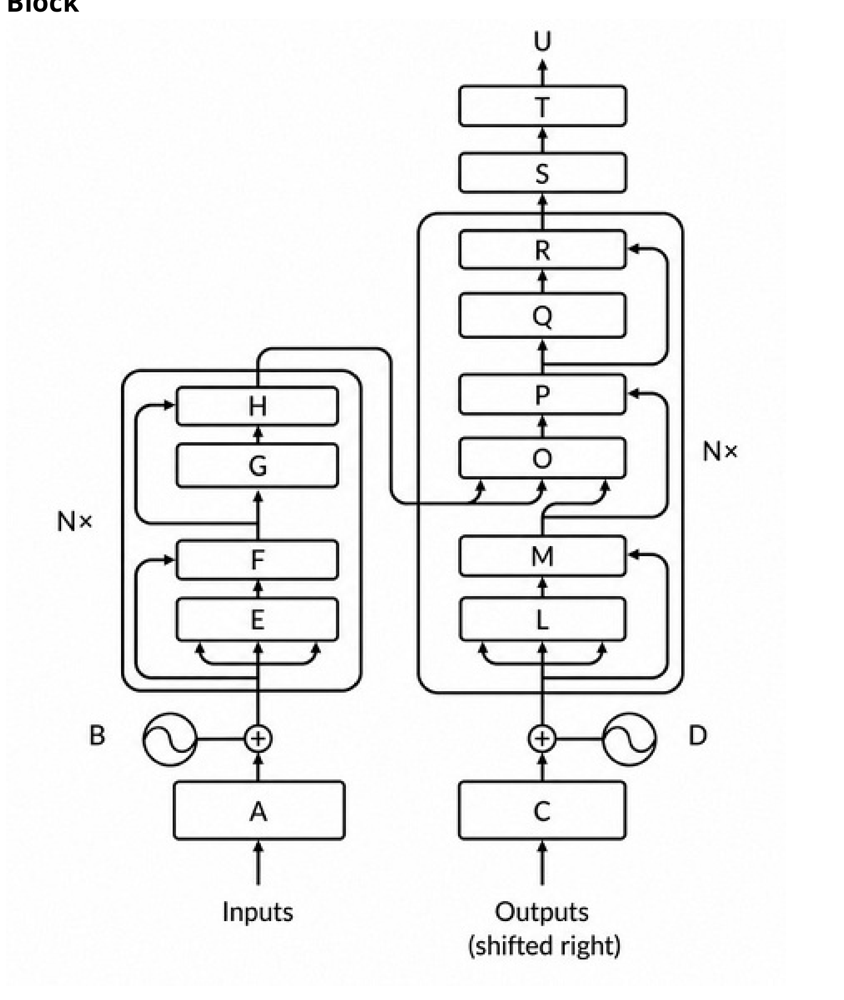
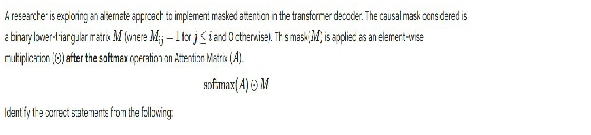
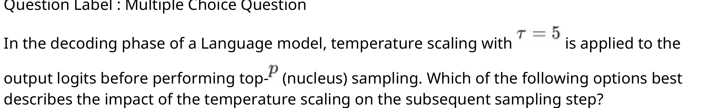
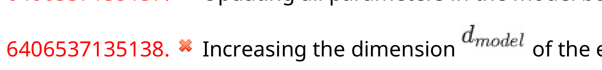
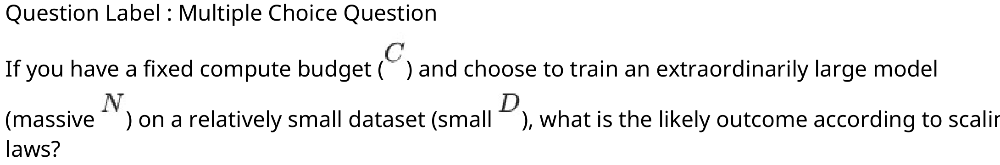

# LLM — da5004_2026T2_Q2_NA

**Source:** `da5004_2026T2_Q2_NA.pdf` · **Academic questions:** 18 · **Separately counted children:** 0
**Provenance:** `Large_Language_Models/da5004_2026T2_Q2_NA.pdf` · SHA-256 `f854547ec11886a82cb2287cf5e4c7d2b6f35b3aee3d17ad91f5cf8f48b47da0`

**Scope:** Section 1: LLM (Degree Level : Large Language Models), physical pages 1 to 9. The in-scope section starts on page 1 with Section Id 640653143422 and concludes on page 9 with Question 19 under Comprehension 18 to 19.

## Questions

### Shared context 2-4

<a id="ctx-2-4"></a>

**Question ID:** `6406532197542`

**Type:** Comprehension
**PDF pages:** 2

Answer the subquestions for the given transformer architecture for one ($N = 1$) Encoder Decoder Block



**Figure 1.** Transformer encoder-decoder architecture with labeled components for Comprehension questions 2 to 4

### Question 2

<a id="q2"></a>

**Question ID:** `6406532197543`

**Type:** Short Answer Question · **Marks:** 2
**PDF pages:** 3

**Shared context:** [ctx-2-4](#ctx-2-4)

In the given Transformer architecture for one Encoder Decoder block, identify every Add & Norm layer. Submit the corresponding component alphabets in alphabetical (ascending) order as a single uppercase string without spaces, commas, or quotation marks.

Example: If the correct components are Q, G, and S, your answer should be GQS

**Correct answer:** FHMPR

**Source evidence:** [{"page": 3, "bbox": [22.87, 335.0, 150.0, 365.0], "type": "explicit field", "detail": "Source section 'Possible Answers : FHMPR' for short answer alphanumeric response"}]

### Question 3

<a id="q3"></a>

**Question ID:** `6406532197544`

**Type:** Multiple Choice Question · **Marks:** 1
**PDF pages:** 3

**Shared context:** [ctx-2-4](#ctx-2-4)

Identify the function of component "L" in the given Transformer architecture.

**Options**

**A.**

Positional Encoding

*Source option ID:* `6406537135075`

**B.**

Feed-Forward Network

*Source option ID:* `6406537135076`

**C.**

Masked Multi-Head Self-Attention

*Source option ID:* `6406537135077`

**D.**

Multi-Head Cross-Attention

*Source option ID:* `6406537135078`

**E.**

Linear Output Projection

*Source option ID:* `6406537135079`

**Correct answer:** C

**Source evidence:** [{"page": 3, "bbox": [23.6200008392334, 532.1840209960938, 119.01998901367188, 548.5040283203125], "type": "green source option", "detail": "Source option 6406537135077 rendered in green font indicating correct option"}]

### Question 4

<a id="q4"></a>

**Question ID:** `6406532197545`

**Type:** Multiple Select Question · **Marks:** 2
**PDF pages:** 3, 4

**Shared context:** [ctx-2-4](#ctx-2-4)

Based on the architecture shown in the given image, identify all components that appear more than once. Assume the architecture contains exactly one Encoder block and one Decoder block.

**Options**

**A.**

Positional Encoding

*Source option ID:* `6406537135080`

**B.**

Feed-Forward Network

*Source option ID:* `6406537135081`

**C.**

Masked Multi-Head Self-Attention

*Source option ID:* `6406537135082`

**D.**

Multi-Head Cross-Attention

*Source option ID:* `6406537135083`

**E.**

tokenizer

*Source option ID:* `6406537135084`

**F.**

Add & Norm

*Source option ID:* `6406537135085`

**Correct answer:** A, B, F

**Source evidence:** [{"page": 3, "bbox": [23.6200008392334, 726.884033203125, 119.01998901367188, 743.2040405273438], "type": "green source option", "detail": "Source option 6406537135080 rendered in green font indicating correct option"}, {"page": 3, "bbox": [23.6200008392334, 747.7040405273438, 119.01998901367188, 764.0240478515625], "type": "green source option", "detail": "Source option 6406537135081 rendered in green font indicating correct option"}, {"page": 3, "bbox": [23.6200008392334, 38.324012756347656, 119.01998901367188, 54.64401626586914], "type": "green source option", "detail": "Source option 6406537135085 rendered in green font indicating correct option"}]

### Question 5

<a id="q5"></a>

**Question ID:** `6406532197546`

**Type:** Multiple Select Question · **Marks:** 3
**PDF pages:** 4

A researcher is exploring an alternate approach to implement masked attention in the transformer decoder. The causal mask considered is a binary lower-triangular matrix $M$ (where $M_{ij} = 1$ for $j \le i$ and $0$ otherwise). This mask ($M$) is applied as an element-wise multiplication ($\odot$) after the softmax operation on Attention Matrix ($A$).

$$\text{softmax}(A) \odot M$$

Identify the correct statements from the following:



**Figure 2.** Question 5 prompt: masked attention implementation with element-wise causal mask M after softmax operation

**Options**

**A.**

The approach violates the autoregressive property

*Source option ID:* `6406537135086`

**B.**

The approach ensures autoregressive property is not violated by ensuring that 
the final attention weights of future tokens are 0

*Source option ID:* `6406537135087`

**C.**

The final attention weights in the new approach will be greater than or equal 
to that of the original approach

*Source option ID:* `6406537135088`

**D.**

The attention weights for the final token of the sequence will always be the 
same for both the approaches

*Source option ID:* `6406537135089`

**Correct answer:** A, D

**Source evidence:** [{"page": 4, "bbox": [23.6200008392334, 338.7039794921875, 119.01998901367188, 355.02398681640625], "type": "green source option", "detail": "Source option 6406537135086 rendered in green font indicating correct option"}, {"page": 4, "bbox": [23.6200008392334, 433.8039855957031, 119.01998901367188, 450.1239929199219], "type": "green source option", "detail": "Source option 6406537135089 rendered in green font indicating correct option"}]

### Question 6

<a id="q6"></a>

**Question ID:** `6406532197550`

**Type:** Multiple Select Question · **Marks:** 3
**PDF pages:** 4

Which of the following options correctly reflect the internal state updates performed during a Byte Pair Encoding (BPE) training iteration?

**Options**

**A.**

After a pair is chosen for merging, it is permanently added to the active 
vocabulary list.

*Source option ID:* `6406537135102`

**B.**

The algorithm recalculates the log probability of the entire corpus before the 
next iteration.

*Source option ID:* `6406537135103`

**C.**

The independent frequencies of the two constituent tokens that were part of 
the merge are reduced by the frequency of the merged token.

*Source option ID:* `6406537135104`

**D.**

The original constituent tokens of the merged pair are removed from the 
vocabulary to optimize dictionary size.

*Source option ID:* `6406537135105`

**Correct answer:** A, C

**Source evidence:** [{"page": 4, "bbox": [23.6200008392334, 607.6840209960938, 119.01998901367188, 624.0040283203125], "type": "green source option", "detail": "Source option 6406537135102 rendered in green font indicating correct option"}, {"page": 4, "bbox": [23.6200008392334, 681.9640502929688, 119.01998901367188, 698.2840576171875], "type": "green source option", "detail": "Source option 6406537135104 rendered in green font indicating correct option"}]

### Question 7

<a id="q7"></a>

**Question ID:** `6406532197556`

**Type:** Multiple Select Question · **Marks:** 3
**PDF pages:** 4, 5

A baseline T5 model with denoising objective on a span of corrupted tokens is used for unsupervised pre-training. Consider the phrase "life is like a box of chocolates". If the word "life" and the span "box of chocolates" are selected for corruption, which of the following statements correctly describe the training process?

**Options**

**A.**

The input sequence replaces the corrupted spans with unique sentinal tokens 
as: "<X> is like a <Y>".

*Source option ID:* `6406537135123`

**B.**

The output sequence generated takes the form "<X> life <Y> box of chocolates 
<Z>", with the final sentinal token to indicate sequence completion.

*Source option ID:* `6406537135124`

**C.**

The loss is calculated exclusively over the generated sentinal tokens and the 
missing text.

*Source option ID:* `6406537135125`

**D.**

The decoder reconstructs the entire original sequence autoregressively to 
compute the total loss over all positions.

*Source option ID:* `6406537135126`

**Correct answer:** A, B, C

**Source evidence:** [{"page": 5, "bbox": [23.6200008392334, 124.42398834228516, 119.01998901367188, 140.74398803710938], "type": "green source option", "detail": "Source option 6406537135123 rendered in green font indicating correct option"}, {"page": 5, "bbox": [23.6200008392334, 161.5640106201172, 119.01998901367188, 177.88400268554688], "type": "green source option", "detail": "Source option 6406537135124 rendered in green font indicating correct option"}, {"page": 5, "bbox": [23.6200008392334, 198.7040252685547, 119.01998901367188, 215.02401733398438], "type": "green source option", "detail": "Source option 6406537135125 rendered in green font indicating correct option"}]

### Question 8

<a id="q8"></a>

**Question ID:** `6406532197547`

**Type:** Multiple Choice Question · **Marks:** 3
**PDF pages:** 5

During the fine-tuning of GPT-1 for Textual Entailment tasks, what is the purpose of the delimiter token ($)?

**Options**

**A.**

To trigger the softmax function.

*Source option ID:* `6406537135090`

**B.**

To separate premise and hypothesis.

*Source option ID:* `6406537135091`

**C.**

To mark the end of the sentence.

*Source option ID:* `6406537135092`

**D.**

To initialize the linear head.

*Source option ID:* `6406537135093`

**Correct answer:** B

**Source evidence:** [{"page": 5, "bbox": [23.6200008392334, 488.5039978027344, 119.01998901367188, 504.8240051269531], "type": "green source option", "detail": "Source option 6406537135091 rendered in green font indicating correct option"}]

### Question 9

<a id="q9"></a>

**Question ID:** `6406532197548`

**Type:** Multiple Choice Question · **Marks:** 3
**PDF pages:** 5, 6

During the fine-tuning of a decoder-only Transformer for sequence classification, why is the hidden representation of the final input token used as the input to the classification layer?

**Options**

**A.**

The first token's representation relies exclusively on absolute positional 
encodings and lacks semantic context for classification.

*Source option ID:* `6406537135094`

**B.**

The final token's representation is computed independently of self-attention, 
making its gradients more stable during the fine-tuning process.

*Source option ID:* `6406537135095`

**C.**

Selecting the final token aligns with the autoregressive objective, eliminating 
the need for teacher forcing during the classification forward pass.

*Source option ID:* `6406537135096`

**D.**

Causal self-attention ensures that only the final token's representation aggregates information from all preceding tokens in the sequence.

*Source option ID:* `6406537135097`

**Correct answer:** D

**Source evidence:** [{"page": 6, "bbox": [23.6200008392334, 799.1240234375, 119.01998901367188, 815.4440307617188], "type": "green source option", "detail": "Source option 6406537135097 rendered in green font indicating correct option"}]

### Question 10

<a id="q10"></a>

**Question ID:** `6406532197549`

**Type:** Multiple Choice Question · **Marks:** 3
**PDF pages:** 6

In the decoding phase of a Language model, temperature scaling with $T = 5$ is applied to the output logits before performing top-$p$ (nucleus) sampling. Which of the following options best describes the impact of the temperature scaling on the subsequent sampling step?



**Figure 3.** Question 10 prompt: temperature scaling parameter and top-p nucleus sampling effect on candidate token count

**Options**

**A.**

Increases the required number of candidate tokens thus expanding the 
nucleus.

*Source option ID:* `6406537135098`

**B.**

Decreases the required number of candidate tokens thus shrinking the 
nucleus.

*Source option ID:* `6406537135099`

**C.**

Truncates the tail of the distribution causing the sampling to behave similar to top-$k$ sampling.

*Source option ID:* `6406537135100`

**D.**

Size of the nucleus remains unaffected by the temperature scaling as it only 
depends on order of the tokens.

*Source option ID:* `6406537135101`

**Correct answer:** A

**Source evidence:** [{"page": 6, "bbox": [23.6200008392334, 213.74400329589844, 119.01998901367188, 230.06399536132812], "type": "green source option", "detail": "Source option 6406537135098 rendered in green font indicating correct option"}]

### Question 11

<a id="q11"></a>

**Question ID:** `6406532197551`

**Type:** Multiple Choice Question · **Marks:** 3
**PDF pages:** 6

In the WordPiece tokenization algorithm, how does the scoring formula prioritize token merges?

**Options**

**A.**

It evaluates the log-probability of the pair and selects the highest scoring 
transition.

*Source option ID:* `6406537135106`

**B.**

It merges the pair with the highest absolute frequency in the corpus.

*Source option ID:* `6406537135107`

**C.**

It prioritizes pairs that occur together frequently but rarely appear 
independently in the corpus.

*Source option ID:* `6406537135108`

**D.**

None of these

*Source option ID:* `6406537135109`

**Correct answer:** C

**Source evidence:** [{"page": 6, "bbox": [23.6200008392334, 568.1940307617188, 119.01998901367188, 584.5140380859375], "type": "green source option", "detail": "Source option 6406537135108 rendered in green font indicating correct option"}]

### Question 12

<a id="q12"></a>

**Question ID:** `6406532197555`

**Type:** Multiple Choice Question · **Marks:** 3
**PDF pages:** 6, 7

Consider the T5 "text-to-text" paradigm. How does the model process fundamentally different tasks such as Semantic Similarity (continuous regression) and Sentiment Analysis (discrete classification) during the fine-tuning phase?

**Options**

**A.**

The model uses the encoder to output the regression score and decoder for 
the classification tokens switching based on the input prompt.

*Source option ID:* `6406537135119`

**B.**

The decoder part of the model is appended with separate prediction heads for 
regression and classification which are updated based on Mean Squared Error and Cross-Entropy 
respectively.

*Source option ID:* `6406537135120`

**C.**

The model treats both tasks as sequence generation objectives with task-
specific prefix added in the input and all output is generated as strings.

*Source option ID:* `6406537135121`

**D.**

None of these.

*Source option ID:* `6406537135122`

**Correct answer:** C

**Source evidence:** [{"page": 7, "bbox": [23.6200008392334, 70.96402740478516, 119.01998901367188, 87.28402709960938], "type": "green source option", "detail": "Source option 6406537135121 rendered in green font indicating correct option"}]

### Question 13

<a id="q13"></a>

**Question ID:** `6406532197557`

**Type:** Multiple Choice Question · **Marks:** 3
**PDF pages:** 7

In the context of the BART (Bidirectional AutoRegressive Transformer) architecture, how does the model handle corrupted input sequences compared to its output?

**Options**

**A.**

The decoder ignores the encoder output and performs standard causal 
language modeling.

*Source option ID:* `6406537135127`

**B.**

The encoder processes the original sequence and the decoder predicts the 
corrupted tokens.

*Source option ID:* `6406537135128`

**C.**

The encoder processes the corrupted sequence and the decoder predicts the 
entire original sequence.

*Source option ID:* `6406537135129`

**D.**

Both the encoder and decoder process the corrupted sequence to calculate 
masked loss.

*Source option ID:* `6406537135130`

**Correct answer:** C

**Source evidence:** [{"page": 7, "bbox": [23.6200008392334, 339.9440002441406, 119.01998901367188, 356.2640075683594], "type": "green source option", "detail": "Source option 6406537135129 rendered in green font indicating correct option"}]

### Question 14

<a id="q14"></a>

**Question ID:** `6406532197558`

**Type:** Multiple Choice Question · **Marks:** 3
**PDF pages:** 7

When comparing the C4 dataset to an 'Unfiltered-C4' dataset that is 8 times larger, what was the observed effect on downstream task performance?

**Options**

**A.**

Performance remained identical, suggesting a saturation point in data utility.

*Source option ID:* `6406537135131`

**B.**

Performance improved only for high-resource tasks like translation.

*Source option ID:* `6406537135132`

**C.**

Performance improved significantly due to the increased diversity of data.

*Source option ID:* `6406537135133`

**D.**

Performance degraded across all tasks despite the larger scale.

*Source option ID:* `6406537135134`

**Correct answer:** D

**Source evidence:** [{"page": 7, "bbox": [23.6200008392334, 613.4240112304688, 119.01998901367188, 629.7440185546875], "type": "green source option", "detail": "Source option 6406537135134 rendered in green font indicating correct option"}]

### Question 15

<a id="q15"></a>

**Question ID:** `6406532197559`

**Type:** Multiple Choice Question · **Marks:** 3
**PDF pages:** 7, 8

Which of the following describes the 'Adapter Layers' fine-tuning strategy?

**Options**

**A.**

Randomly freezing 50% of the attention heads in each layer during training.

*Source option ID:* `6406537135135`

**B.**

Adding small dense-ReLU-dense blocks after FFN layers and updating only 
those and Layer Norm parameters.

*Source option ID:* `6406537135136`

**C.**

Updating all parameters in the model but using a much smaller learning rate.

*Source option ID:* `6406537135137`

**D.**

Increasing the dimension $d_{\text{model}}$ of the existing Feed-Forward networks.



**Figure 4.** Question 15 Option D: increasing the dimension d_model of the existing Feed-Forward networks

*Source option ID:* `6406537135138`

**Correct answer:** B

**Source evidence:** [{"page": 7, "bbox": [23.6200008392334, 775.4840087890625, 119.01998901367188, 791.8040161132812], "type": "green source option", "detail": "Source option 6406537135136 rendered in green font indicating correct option"}]

### Question 16

<a id="q16"></a>

**Question ID:** `6406532197560`

**Type:** Multiple Choice Question · **Marks:** 3
**PDF pages:** 8

Which of the following is a reported negative effect of including significantly duplicated content in LLM training data?

**Options**

**A.**

It decreases the model's overall inference speed during deployment.

*Source option ID:* `6406537135139`

**B.**

It causes the model to generate repeated sequences much more frequently.

*Source option ID:* `6406537135140`

**C.**

It permanently reduces the maximum supported context window length.

*Source option ID:* `6406537135141`

**D.**

It causes the model to lose the ability to process multilingual input.

*Source option ID:* `6406537135142`

**Correct answer:** B

**Source evidence:** [{"page": 8, "bbox": [23.6200008392334, 244.2040252685547, 119.01998901367188, 260.5240173339844], "type": "green source option", "detail": "Source option 6406537135140 rendered in green font indicating correct option"}]

### Question 17

<a id="q17"></a>

**Question ID:** `6406532197561`

**Type:** Multiple Choice Question · **Marks:** 3
**PDF pages:** 8

If you have a fixed compute budget ($C$) and choose to train an extraordinarily large model (massive $N$) on a relatively small dataset (small $D$), what is the likely outcome according to scaling laws?



**Figure 5.** Question 17 prompt: scaling laws trade-off with fixed compute budget C, massive model size N, and small dataset D

**Options**

**A.**

The model will be over-trained and memorize the dataset.

*Source option ID:* `6406537135143`

**B.**

The model will be under-trained and less capable than a smaller model trained 
on more data with the same compute budget.

*Source option ID:* `6406537135144`

**C.**

The model will perfectly memorize the small dataset and generalize flawlessly.

*Source option ID:* `6406537135145`

**D.**

The model's inference speed will increase dramatically.

*Source option ID:* `6406537135146`

**Correct answer:** B

**Source evidence:** [{"page": 8, "bbox": [23.6200008392334, 502.9139709472656, 119.01998901367188, 519.2340087890625], "type": "green source option", "detail": "Source option 6406537135144 rendered in green font indicating correct option"}]

### Shared context 18-19

<a id="ctx-18-19"></a>

**Question ID:** `6406532197552`

**Type:** Comprehension
**PDF pages:** 8, 9

Consider the following corpus consisting of 4 words (ignore spaces and punctuation).

```text
there is no spoon
```

The vocabulary is constructed using the whole words in this corpus and the individual characters in this corpus. The vocabulary should now have 13 tokens. Use this vocabulary for the given subquestions.

### Question 18

<a id="q18"></a>

**Question ID:** `6406532197553`

**Type:** Multiple Select Question · **Marks:** 3
**PDF pages:** 9

**Shared context:** [ctx-18-19](#ctx-18-19)

Using the vocabulary constructed, two new continuous strings: "prison" and "rhino" are to be segmented. Which of the following proposed segmentations are valid?

**Options**

**A.**

prison

*Source option ID:* `6406537135110`

**B.**

p, r, is, o, n

*Source option ID:* `6406537135111`

**C.**

p, r, is, on

*Source option ID:* `6406537135112`

**D.**

r, h, i, n, o

*Source option ID:* `6406537135113`

**E.**

r, h, i, no

*Source option ID:* `6406537135114`

**Correct answer:** B, D, E

**Source evidence:** [{"page": 9, "bbox": [23.6200008392334, 225.52403259277344, 119.01998901367188, 241.84402465820312], "type": "green source option", "detail": "Source option 6406537135111 rendered in green font indicating correct option"}, {"page": 9, "bbox": [23.6200008392334, 267.1639709472656, 119.01998901367188, 283.4839782714844], "type": "green source option", "detail": "Source option 6406537135113 rendered in green font indicating correct option"}, {"page": 9, "bbox": [23.6200008392334, 287.9839782714844, 119.01998901367188, 304.3039855957031], "type": "green source option", "detail": "Source option 6406537135114 rendered in green font indicating correct option"}]

### Question 19

<a id="q19"></a>

**Question ID:** `6406532197554`

**Type:** Multiple Choice Question · **Marks:** 3
**PDF pages:** 9

**Shared context:** [ctx-18-19](#ctx-18-19)

Using a unigram language model, identify the segment with the highest probability from the given options:

**Options**

**A.**

n, o, i, s, e, s

*Source option ID:* `6406537135115`

**B.**

no, is, e, s

*Source option ID:* `6406537135116`

**C.**

nois, e, s

*Source option ID:* `6406537135117`

**D.**

no, i, s, e, s

*Source option ID:* `6406537135118`

**Correct answer:** B

**Source evidence:** [{"page": 9, "bbox": [23.6200008392334, 461.8639831542969, 119.01998901367188, 478.1839904785156], "type": "green source option", "detail": "Source option 6406537135116 rendered in green font indicating correct option"}]

## Answer key

| Source question | Source identity | Correct answer | PDF pages |
| :--- | :--- | :--- | :--- |
| 2 | 6406532197543 | FHMPR | 3 |
| 3 | 6406532197544 | C | 3 |
| 4 | 6406532197545 | A, B, F | 3, 4 |
| 5 | 6406532197546 | A, D | 4 |
| 6 | 6406532197550 | A, C | 4 |
| 7 | 6406532197556 | A, B, C | 4, 5 |
| 8 | 6406532197547 | B | 5 |
| 9 | 6406532197548 | D | 5, 6 |
| 10 | 6406532197549 | A | 6 |
| 11 | 6406532197551 | C | 6 |
| 12 | 6406532197555 | C | 6, 7 |
| 13 | 6406532197557 | C | 7 |
| 14 | 6406532197558 | D | 7 |
| 15 | 6406532197559 | B | 7, 8 |
| 16 | 6406532197560 | B | 8 |
| 17 | 6406532197561 | B | 8 |
| 18 | 6406532197553 | B, D, E | 9 |
| 19 | 6406532197554 | B | 9 |

## Extraction notes

**Status:** verified
**Count reconciliation:** The portal section header declared 16 questions and 50 marks for Section 1 (LLM). The 16 declared items correspond exactly to the 16 top-level portal question units: Question 1 (administrative subject confirmation), Comprehension container (2 to 4), Questions 5, 6, 7 (Sub-Section 3), Questions 8, 9, 10, 11, 12, 13, 14, 15, 16, 17 (Sub-Section 4), and Comprehension container (18 to 19) (Sub-Section 5). Excluding Question 1 (confirmation) and unpacking the two comprehension containers yields exactly 18 top-level academic questions (Q2 to Q19). The 50 marks reconcile perfectly across all 18 academic questions: Sub-Section 2 [Q2 (2) + Q3 (1) + Q4 (2) = 5] + Sub-Section 3 [Q5 (3) + Q6 (3) + Q7 (3) = 9] + Sub-Section 4 [Q8 (3) + Q9 (3) + Q10 (3) + Q11 (3) + Q12 (3) + Q13 (3) + Q14 (3) + Q15 (3) + Q16 (3) + Q17 (3) = 30] + Sub-Section 5 [Q18 (3) + Q19 (3) = 6] = 5 + 9 + 30 + 6 = 50 marks.

- Question 1 is the administrative subject confirmation, semantically excluded from academic question count while retaining full evidence.
- Question 5 stem contains raster equation text in source PDF; high-resolution 288 DPI crop captured and formula transcribed as \text{softmax}(A) \odot M.
- Comprehension 2 to 4 references an embedded Transformer encoder-decoder diagram; high-resolution crop captured as asset assets/ctx-2-4-passage-01-p002.png.
- Questions 10, 15, and 17 contain inline mathematical symbols/parameters rendered as raster images in the source PDF; preserved high-resolution visual crops and restored mathematical notation in question text with explicit repairs.

**Excluded source entries:**

- {"classification": "subject-confirmation", "page": 1, "bbox": [22.87, 735.0, 565.0, 842.0], "reason": "Administrative subject verification asking candidate to confirm registration and cross-check hall ticket for DEGREE LEVEL : LARGE LANGUAGE MODELS.", "identity": "6406532197541"}
