# Week 1: Exam Questions and Worked Answers

**Navigation:** [[Knowledge-Map\|Knowledge Map]] · [[week-1-notes\|Week 1 notes]] · [[Knowledge-Map\|Knowledge Map]] · [[week-2-exam-questions\|Next bank]] · [[Knowledge-Map\|Previous notes]] · [[week-2-notes\|Next notes]]

**Coverage:** 73 routed occurrences; 66 distinct stems; by type MCQ 19, MSQ 11, SA 43; by exam Q1 33, Q2 5, ET 35.

**Answer provenance:** Answers were derived by the study team (Terra/Luna agents); they are not official keys. `verified_by_code: true` means a numerical/code-based check was run for that answer; `false` means no such code verification is claimed. Status and any source ambiguity are stated with each solution.

## Topic checklist

The checklist includes every topic named for this week in `sources/topics.json`. A topic without a directly routed question still links to the study notes.

| Topic | Linked questions | Evidence / revision |
| :--- | ---: | :--- |
| Seq2seq and the RNN bottleneck | 2 | [[week-1-exam-questions#da5004_2025T1_Q1_NA--q107\|2025T1 Q1 NA Q107]] · [[week-1-exam-questions#da5004_2026T1_Q2_NA--q9\|2026T1 Q2 NA Q9]] |
| Bahdanau (additive) attention | 4 | [[week-1-exam-questions#da5004_2026T1_Q1_NA--q13\|2026T1 Q1 NA Q13]] · [[week-1-exam-questions#da5004_2026T1_Q1_NA--q14\|2026T1 Q1 NA Q14]] · [[week-1-exam-questions#da5004_2026T1_Q1_NA--q15\|2026T1 Q1 NA Q15]] · [[week-1-exam-questions#da5004_2026T2_Q1_NA--q2\|2026T2 Q1 NA Q2]] |
| Self-attention and Q/K/V projections | 30 | [[week-1-exam-questions#da5004_2024T1_ET_AN--q153\|2024T1 ET AN Q153]] · [[week-1-exam-questions#da5004_2024T1_ET_AN--q154\|2024T1 ET AN Q154]] · [[week-1-exam-questions#da5004_2024T1_ET_AN--q155\|2024T1 ET AN Q155]] · [[week-1-exam-questions#da5004_2024T1_ET_AN--q156\|2024T1 ET AN Q156]] · [[week-1-exam-questions#da5004_2024T1_ET_FN--q208\|2024T1 ET FN Q208]] · [[week-1-exam-questions#da5004_2024T1_ET_FN--q209\|2024T1 ET FN Q209]] · [[week-1-exam-questions#da5004_2024T1_ET_FN--q210\|2024T1 ET FN Q210]] · [[week-1-exam-questions#da5004_2024T1_ET_FN--q211\|2024T1 ET FN Q211]] · [[week-1-exam-questions#da5004_2024T1_Q1_NA--q186\|2024T1 Q1 NA Q186]] · [[week-1-exam-questions#da5004_2024T1_Q1_NA--q187\|2024T1 Q1 NA Q187]] · [[week-1-exam-questions#da5004_2024T3_ET_AN--q176\|2024T3 ET AN Q176]] · [[week-1-exam-questions#da5004_2024T3_ET_AN--q184\|2024T3 ET AN Q184]] · [[week-1-exam-questions#da5004_2024T3_ET_FN--q189\|2024T3 ET FN Q189]] · [[week-1-exam-questions#da5004_2024T3_ET_FN--q199\|2024T3 ET FN Q199]] · [[week-1-exam-questions#da5004_2024T3_Q1_NA--q292\|2024T3 Q1 NA Q292]] · [[week-1-exam-questions#da5004_2025T2_ET_AN--q199\|2025T2 ET AN Q199]] · [[week-1-exam-questions#da5004_2025T2_ET_AN--q200\|2025T2 ET AN Q200]] · [[week-1-exam-questions#da5004_2025T2_ET_FN--q146\|2025T2 ET FN Q146]] · [[week-1-exam-questions#da5004_2025T2_ET_FN--q147\|2025T2 ET FN Q147]] · [[week-1-exam-questions#da5004_2025T3_ET_AN--q17\|2025T3 ET AN Q17]] · [[week-1-exam-questions#da5004_2025T3_ET_FN--q8\|2025T3 ET FN Q8]] · [[week-1-exam-questions#da5004_2025T3_ET_FN--q18\|2025T3 ET FN Q18]] · [[week-1-exam-questions#da5004_2025T3_ET_FN--q25\|2025T3 ET FN Q25]] · [[week-1-exam-questions#da5004_2026T1_ET_AN--q10\|2026T1 ET AN Q10]] · [[week-1-exam-questions#da5004_2026T1_Q1_NA--q2\|2026T1 Q1 NA Q2]] · [[week-1-exam-questions#da5004_2026T1_Q2_NA--q14\|2026T1 Q2 NA Q14]] · [[week-1-exam-questions#da5004_2026T2_ET_AN--q2\|2026T2 ET AN Q2]] · [[week-1-exam-questions#da5004_2026T2_ET_AN--q18\|2026T2 ET AN Q18]] · [[week-1-exam-questions#da5004_2026T2_ET_AN--q19\|2026T2 ET AN Q19]] · [[week-1-exam-questions#da5004_2026T2_Q1_NA--q4\|2026T2 Q1 NA Q4]] |
| Scaled dot-product attention and the sqrt(d_k) factor | 12 | [[week-1-exam-questions#da5004_2025T2_ET_AN--q199\|2025T2 ET AN Q199]] · [[week-1-exam-questions#da5004_2025T2_ET_AN--q200\|2025T2 ET AN Q200]] · [[week-1-exam-questions#da5004_2025T2_ET_FN--q146\|2025T2 ET FN Q146]] · [[week-1-exam-questions#da5004_2025T2_ET_FN--q147\|2025T2 ET FN Q147]] · [[week-1-exam-questions#da5004_2025T2_Q1_NA--q136\|2025T2 Q1 NA Q136]] · [[week-1-exam-questions#da5004_2025T2_Q1_NA--q146\|2025T2 Q1 NA Q146]] · [[week-1-exam-questions#da5004_2025T2_Q1_NA--q147\|2025T2 Q1 NA Q147]] · [[week-1-exam-questions#da5004_2025T2_Q1_NA--q148\|2025T2 Q1 NA Q148]] · [[week-1-exam-questions#da5004_2025T3_Q1_NA--q173\|2025T3 Q1 NA Q173]] · [[week-1-exam-questions#da5004_2026T1_Q1_NA--q3\|2026T1 Q1 NA Q3]] · [[week-1-exam-questions#da5004_2026T1_Q1_NA--q10\|2026T1 Q1 NA Q10]] · [[week-1-exam-questions#da5004_2026T2_Q1_NA--q3\|2026T2 Q1 NA Q3]] |
| Multi-head attention and W^O | 17 | [[week-1-exam-questions#da5004_2024T3_Q1_NA--q290\|2024T3 Q1 NA Q290]] · [[week-1-exam-questions#da5004_2025T1_Q1_NA--q112\|2025T1 Q1 NA Q112]] · [[week-1-exam-questions#da5004_2025T1_Q1_NA--q113\|2025T1 Q1 NA Q113]] · [[week-1-exam-questions#da5004_2025T2_ET_AN--q199\|2025T2 ET AN Q199]] · [[week-1-exam-questions#da5004_2025T2_ET_AN--q200\|2025T2 ET AN Q200]] · [[week-1-exam-questions#da5004_2025T2_ET_FN--q146\|2025T2 ET FN Q146]] · [[week-1-exam-questions#da5004_2025T2_ET_FN--q147\|2025T2 ET FN Q147]] · [[week-1-exam-questions#da5004_2025T2_Q1_NA--q147\|2025T2 Q1 NA Q147]] · [[week-1-exam-questions#da5004_2025T2_Q1_NA--q148\|2025T2 Q1 NA Q148]] · [[week-1-exam-questions#da5004_2025T2_Q1_NA--q149\|2025T2 Q1 NA Q149]] · [[week-1-exam-questions#da5004_2025T3_Q1_NA--q183\|2025T3 Q1 NA Q183]] · [[week-1-exam-questions#da5004_2025T3_Q1_NA--q186\|2025T3 Q1 NA Q186]] · [[week-1-exam-questions#da5004_2025T3_Q1_NA--q187\|2025T3 Q1 NA Q187]] · [[week-1-exam-questions#da5004_2025T3_Q1_NA--q191\|2025T3 Q1 NA Q191]] · [[week-1-exam-questions#da5004_2026T1_Q1_NA--q9\|2026T1 Q1 NA Q9]] · [[week-1-exam-questions#da5004_2026T1_Q2_NA--q2\|2026T1 Q2 NA Q2]] · [[week-1-exam-questions#da5004_2026T2_Q1_NA--q5\|2026T2 Q1 NA Q5]] |
| Position-wise FFN and the encoder layer/stack | 6 | [[week-1-exam-questions#da5004_2025T2_Q1_NA--q135\|2025T2 Q1 NA Q135]] · [[week-1-exam-questions#da5004_2026T1_ET_FN--q4\|2026T1 ET FN Q4]] · [[week-1-exam-questions#da5004_2026T1_Q1_NA--q4\|2026T1 Q1 NA Q4]] · [[week-1-exam-questions#da5004_2026T1_Q2_NA--q8\|2026T1 Q2 NA Q8]] · [[week-1-exam-questions#da5004_2026T2_ET_FN--q4\|2026T2 ET FN Q4]] · [[week-1-exam-questions#da5004_2026T2_Q1_NA--q6\|2026T2 Q1 NA Q6]] |
| Parameter counting for the encoder | 14 | [[week-1-exam-questions#da5004_2024T1_ET_AN--q151\|2024T1 ET AN Q151]] · [[week-1-exam-questions#da5004_2024T1_ET_AN--q152\|2024T1 ET AN Q152]] · [[week-1-exam-questions#da5004_2024T1_ET_FN--q206\|2024T1 ET FN Q206]] · [[week-1-exam-questions#da5004_2024T1_ET_FN--q207\|2024T1 ET FN Q207]] · [[week-1-exam-questions#da5004_2024T1_Q1_NA--q189\|2024T1 Q1 NA Q189]] · [[week-1-exam-questions#da5004_2025T1_Q1_NA--q112\|2025T1 Q1 NA Q112]] · [[week-1-exam-questions#da5004_2025T1_Q1_NA--q113\|2025T1 Q1 NA Q113]] · [[week-1-exam-questions#da5004_2025T3_ET_AN--q20\|2025T3 ET AN Q20]] · [[week-1-exam-questions#da5004_2025T3_Q1_NA--q188\|2025T3 Q1 NA Q188]] · [[week-1-exam-questions#da5004_2025T3_Q2_NA--q110\|2025T3 Q2 NA Q110]] · [[week-1-exam-questions#da5004_2026T1_ET_FN--q2\|2026T1 ET FN Q2]] · [[week-1-exam-questions#da5004_2026T1_ET_FN--q3\|2026T1 ET FN Q3]] · [[week-1-exam-questions#da5004_2026T2_ET_FN--q2\|2026T2 ET FN Q2]] · [[week-1-exam-questions#da5004_2026T2_ET_FN--q3\|2026T2 ET FN Q3]] |

## Question navigator

| Paper | Question link | Topic | Answer status |
| :--- | :--- | :--- | :--- |
| 2024T1_ET_AN | [[week-1-exam-questions#da5004_2024T1_ET_AN--q151\|2024 T1 End Term AN, Q151]] | w1-encoder-parameter-count | ambiguous |
| 2024T1_ET_AN | [[week-1-exam-questions#da5004_2024T1_ET_AN--q152\|2024 T1 End Term AN, Q152]] | w1-encoder-parameter-count | derived |
| 2024T1_ET_AN | [[week-1-exam-questions#da5004_2024T1_ET_AN--q153\|2024 T1 End Term AN, Q153]] | w1-self-attention-qkv | ambiguous |
| 2024T1_ET_AN | [[week-1-exam-questions#da5004_2024T1_ET_AN--q154\|2024 T1 End Term AN, Q154]] | w1-self-attention-qkv | derived |
| 2024T1_ET_AN | [[week-1-exam-questions#da5004_2024T1_ET_AN--q155\|2024 T1 End Term AN, Q155]] | w1-self-attention-qkv | derived |
| 2024T1_ET_AN | [[week-1-exam-questions#da5004_2024T1_ET_AN--q156\|2024 T1 End Term AN, Q156]] | w1-self-attention-qkv | derived |
| 2024T1_ET_FN | [[week-1-exam-questions#da5004_2024T1_ET_FN--q206\|2024 T1 End Term FN, Q206]] | w1-encoder-parameter-count | ambiguous |
| 2024T1_ET_FN | [[week-1-exam-questions#da5004_2024T1_ET_FN--q207\|2024 T1 End Term FN, Q207]] | w1-encoder-parameter-count | derived |
| 2024T1_ET_FN | [[week-1-exam-questions#da5004_2024T1_ET_FN--q208\|2024 T1 End Term FN, Q208]] | w1-self-attention-qkv | ambiguous |
| 2024T1_ET_FN | [[week-1-exam-questions#da5004_2024T1_ET_FN--q209\|2024 T1 End Term FN, Q209]] | w1-self-attention-qkv | derived |
| 2024T1_ET_FN | [[week-1-exam-questions#da5004_2024T1_ET_FN--q210\|2024 T1 End Term FN, Q210]] | w1-self-attention-qkv | derived |
| 2024T1_ET_FN | [[week-1-exam-questions#da5004_2024T1_ET_FN--q211\|2024 T1 End Term FN, Q211]] | w1-self-attention-qkv | derived |
| 2024T1_Q1_NA | [[week-1-exam-questions#da5004_2024T1_Q1_NA--q186\|2024 T1 Quiz 1 NA, Q186]] | w1-self-attention-qkv | derived |
| 2024T1_Q1_NA | [[week-1-exam-questions#da5004_2024T1_Q1_NA--q187\|2024 T1 Quiz 1 NA, Q187]] | w1-self-attention-qkv | derived |
| 2024T1_Q1_NA | [[week-1-exam-questions#da5004_2024T1_Q1_NA--q189\|2024 T1 Quiz 1 NA, Q189]] | w1-encoder-parameter-count | ambiguous |
| 2024T3_ET_AN | [[week-1-exam-questions#da5004_2024T3_ET_AN--q176\|2024 T3 End Term AN, Q176]] | w1-self-attention-qkv | derived |
| 2024T3_ET_AN | [[week-1-exam-questions#da5004_2024T3_ET_AN--q184\|2024 T3 End Term AN, Q184]] | w1-self-attention-qkv | derived |
| 2024T3_ET_FN | [[week-1-exam-questions#da5004_2024T3_ET_FN--q189\|2024 T3 End Term FN, Q189]] | w1-self-attention-qkv | derived |
| 2024T3_ET_FN | [[week-1-exam-questions#da5004_2024T3_ET_FN--q199\|2024 T3 End Term FN, Q199]] | w1-self-attention-qkv | derived |
| 2024T3_Q1_NA | [[week-1-exam-questions#da5004_2024T3_Q1_NA--q290\|2024 T3 Quiz 1 NA, Q290]] | w1-multi-head-attention | derived |
| 2024T3_Q1_NA | [[week-1-exam-questions#da5004_2024T3_Q1_NA--q292\|2024 T3 Quiz 1 NA, Q292]] | w1-self-attention-qkv | derived |
| 2025T1_Q1_NA | [[week-1-exam-questions#da5004_2025T1_Q1_NA--q107\|2025 T1 Quiz 1 NA, Q107]] | w1-seq2seq-bottleneck | ambiguous |
| 2025T1_Q1_NA | [[week-1-exam-questions#da5004_2025T1_Q1_NA--q112\|2025 T1 Quiz 1 NA, Q112]] | w1-encoder-parameter-count, w1-multi-head-attention | ambiguous |
| 2025T1_Q1_NA | [[week-1-exam-questions#da5004_2025T1_Q1_NA--q113\|2025 T1 Quiz 1 NA, Q113]] | w1-encoder-parameter-count, w1-multi-head-attention | ambiguous |
| 2025T2_ET_AN | [[week-1-exam-questions#da5004_2025T2_ET_AN--q199\|2025 T2 End Term AN, Q199]] | w1-self-attention-qkv, w1-scaled-dot-product, w1-multi-head-attention | derived |
| 2025T2_ET_AN | [[week-1-exam-questions#da5004_2025T2_ET_AN--q200\|2025 T2 End Term AN, Q200]] | w1-self-attention-qkv, w1-scaled-dot-product, w1-multi-head-attention | derived |
| 2025T2_ET_FN | [[week-1-exam-questions#da5004_2025T2_ET_FN--q146\|2025 T2 End Term FN, Q146]] | w1-self-attention-qkv, w1-scaled-dot-product, w1-multi-head-attention | derived |
| 2025T2_ET_FN | [[week-1-exam-questions#da5004_2025T2_ET_FN--q147\|2025 T2 End Term FN, Q147]] | w1-self-attention-qkv, w1-scaled-dot-product, w1-multi-head-attention | derived |
| 2025T2_Q1_NA | [[week-1-exam-questions#da5004_2025T2_Q1_NA--q135\|2025 T2 Quiz 1 NA, Q135]] | w1-ffn-encoder-stack | derived |
| 2025T2_Q1_NA | [[week-1-exam-questions#da5004_2025T2_Q1_NA--q136\|2025 T2 Quiz 1 NA, Q136]] | w1-scaled-dot-product | derived |
| 2025T2_Q1_NA | [[week-1-exam-questions#da5004_2025T2_Q1_NA--q146\|2025 T2 Quiz 1 NA, Q146]] | w1-scaled-dot-product | derived |
| 2025T2_Q1_NA | [[week-1-exam-questions#da5004_2025T2_Q1_NA--q147\|2025 T2 Quiz 1 NA, Q147]] | w1-scaled-dot-product, w1-multi-head-attention | ambiguous |
| 2025T2_Q1_NA | [[week-1-exam-questions#da5004_2025T2_Q1_NA--q148\|2025 T2 Quiz 1 NA, Q148]] | w1-scaled-dot-product, w1-multi-head-attention | ambiguous |
| 2025T2_Q1_NA | [[week-1-exam-questions#da5004_2025T2_Q1_NA--q149\|2025 T2 Quiz 1 NA, Q149]] | w1-multi-head-attention | ambiguous |
| 2025T3_ET_AN | [[week-1-exam-questions#da5004_2025T3_ET_AN--q17\|2025 T3 End Term AN, Q17]] | w1-self-attention-qkv | ambiguous |
| 2025T3_ET_AN | [[week-1-exam-questions#da5004_2025T3_ET_AN--q20\|2025 T3 End Term AN, Q20]] | w1-encoder-parameter-count | ambiguous |
| 2025T3_ET_FN | [[week-1-exam-questions#da5004_2025T3_ET_FN--q8\|2025 T3 End Term FN, Q8]] | w1-self-attention-qkv | ambiguous |
| 2025T3_ET_FN | [[week-1-exam-questions#da5004_2025T3_ET_FN--q18\|2025 T3 End Term FN, Q18]] | w1-self-attention-qkv | derived |
| 2025T3_ET_FN | [[week-1-exam-questions#da5004_2025T3_ET_FN--q25\|2025 T3 End Term FN, Q25]] | w1-self-attention-qkv | ambiguous |
| 2025T3_Q1_NA | [[week-1-exam-questions#da5004_2025T3_Q1_NA--q173\|2025 T3 Quiz 1 NA, Q173]] | w1-scaled-dot-product | derived |
| 2025T3_Q1_NA | [[week-1-exam-questions#da5004_2025T3_Q1_NA--q183\|2025 T3 Quiz 1 NA, Q183]] | w1-multi-head-attention | derived |
| 2025T3_Q1_NA | [[week-1-exam-questions#da5004_2025T3_Q1_NA--q186\|2025 T3 Quiz 1 NA, Q186]] | w1-multi-head-attention | derived |
| 2025T3_Q1_NA | [[week-1-exam-questions#da5004_2025T3_Q1_NA--q187\|2025 T3 Quiz 1 NA, Q187]] | w1-multi-head-attention | derived |
| 2025T3_Q1_NA | [[week-1-exam-questions#da5004_2025T3_Q1_NA--q188\|2025 T3 Quiz 1 NA, Q188]] | w1-encoder-parameter-count | derived |
| 2025T3_Q1_NA | [[week-1-exam-questions#da5004_2025T3_Q1_NA--q191\|2025 T3 Quiz 1 NA, Q191]] | w1-multi-head-attention | derived |
| 2025T3_Q2_NA | [[week-1-exam-questions#da5004_2025T3_Q2_NA--q110\|2025 T3 Quiz 2 NA, Q110]] | w1-encoder-parameter-count | derived |
| 2026T1_ET_AN | [[week-1-exam-questions#da5004_2026T1_ET_AN--q10\|2026 T1 End Term AN, Q10]] | w1-self-attention-qkv | derived |
| 2026T1_ET_FN | [[week-1-exam-questions#da5004_2026T1_ET_FN--q2\|2026 T1 End Term FN, Q2]] | w1-encoder-parameter-count | derived |
| 2026T1_ET_FN | [[week-1-exam-questions#da5004_2026T1_ET_FN--q3\|2026 T1 End Term FN, Q3]] | w1-encoder-parameter-count | derived |
| 2026T1_ET_FN | [[week-1-exam-questions#da5004_2026T1_ET_FN--q4\|2026 T1 End Term FN, Q4]] | w1-ffn-encoder-stack | derived |
| 2026T1_Q1_NA | [[week-1-exam-questions#da5004_2026T1_Q1_NA--q2\|2026 T1 Quiz 1 NA, Q2]] | w1-self-attention-qkv | derived |
| 2026T1_Q1_NA | [[week-1-exam-questions#da5004_2026T1_Q1_NA--q3\|2026 T1 Quiz 1 NA, Q3]] | w1-scaled-dot-product | derived |
| 2026T1_Q1_NA | [[week-1-exam-questions#da5004_2026T1_Q1_NA--q4\|2026 T1 Quiz 1 NA, Q4]] | w1-ffn-encoder-stack | derived |
| 2026T1_Q1_NA | [[week-1-exam-questions#da5004_2026T1_Q1_NA--q9\|2026 T1 Quiz 1 NA, Q9]] | w1-multi-head-attention | derived |
| 2026T1_Q1_NA | [[week-1-exam-questions#da5004_2026T1_Q1_NA--q10\|2026 T1 Quiz 1 NA, Q10]] | w1-scaled-dot-product | derived |
| 2026T1_Q1_NA | [[week-1-exam-questions#da5004_2026T1_Q1_NA--q13\|2026 T1 Quiz 1 NA, Q13]] | w1-bahdanau-attention | derived |
| 2026T1_Q1_NA | [[week-1-exam-questions#da5004_2026T1_Q1_NA--q14\|2026 T1 Quiz 1 NA, Q14]] | w1-bahdanau-attention | derived |
| 2026T1_Q1_NA | [[week-1-exam-questions#da5004_2026T1_Q1_NA--q15\|2026 T1 Quiz 1 NA, Q15]] | w1-bahdanau-attention | derived |
| 2026T1_Q2_NA | [[week-1-exam-questions#da5004_2026T1_Q2_NA--q2\|2026 T1 Quiz 2 NA, Q2]] | w1-multi-head-attention | derived |
| 2026T1_Q2_NA | [[week-1-exam-questions#da5004_2026T1_Q2_NA--q8\|2026 T1 Quiz 2 NA, Q8]] | w1-ffn-encoder-stack | derived |
| 2026T1_Q2_NA | [[week-1-exam-questions#da5004_2026T1_Q2_NA--q9\|2026 T1 Quiz 2 NA, Q9]] | w1-seq2seq-bottleneck | derived |
| 2026T1_Q2_NA | [[week-1-exam-questions#da5004_2026T1_Q2_NA--q14\|2026 T1 Quiz 2 NA, Q14]] | w1-self-attention-qkv | derived |
| 2026T2_ET_AN | [[week-1-exam-questions#da5004_2026T2_ET_AN--q2\|2026 T2 End Term AN, Q2]] | w1-self-attention-qkv | derived |
| 2026T2_ET_AN | [[week-1-exam-questions#da5004_2026T2_ET_AN--q18\|2026 T2 End Term AN, Q18]] | w1-self-attention-qkv | ambiguous |
| 2026T2_ET_AN | [[week-1-exam-questions#da5004_2026T2_ET_AN--q19\|2026 T2 End Term AN, Q19]] | w1-self-attention-qkv | ambiguous |
| 2026T2_ET_FN | [[week-1-exam-questions#da5004_2026T2_ET_FN--q2\|2026 T2 End Term FN, Q2]] | w1-encoder-parameter-count | derived |
| 2026T2_ET_FN | [[week-1-exam-questions#da5004_2026T2_ET_FN--q3\|2026 T2 End Term FN, Q3]] | w1-encoder-parameter-count | derived |
| 2026T2_ET_FN | [[week-1-exam-questions#da5004_2026T2_ET_FN--q4\|2026 T2 End Term FN, Q4]] | w1-ffn-encoder-stack | derived |
| 2026T2_Q1_NA | [[week-1-exam-questions#da5004_2026T2_Q1_NA--q2\|2026 T2 Quiz 1 NA, Q2]] | w1-bahdanau-attention | derived |
| 2026T2_Q1_NA | [[week-1-exam-questions#da5004_2026T2_Q1_NA--q3\|2026 T2 Quiz 1 NA, Q3]] | w1-scaled-dot-product | derived |
| 2026T2_Q1_NA | [[week-1-exam-questions#da5004_2026T2_Q1_NA--q4\|2026 T2 Quiz 1 NA, Q4]] | w1-self-attention-qkv | derived |
| 2026T2_Q1_NA | [[week-1-exam-questions#da5004_2026T2_Q1_NA--q5\|2026 T2 Quiz 1 NA, Q5]] | w1-multi-head-attention | derived |
| 2026T2_Q1_NA | [[week-1-exam-questions#da5004_2026T2_Q1_NA--q6\|2026 T2 Quiz 1 NA, Q6]] | w1-ffn-encoder-stack | derived |

## Quiz 1 questions

### 2024 T1 Quiz 1 NA, Q186

**Paper:** `2024T1_Q1_NA` · **Type:** SA · **Marks:** 3 · **Topic(s):** w1-self-attention-qkv

The bottommost encoder layer of the transformer contains the following parameter matrices:

$$W_Q = \begin{bmatrix} 1 & 0 \\ 0 & 1 \end{bmatrix}, \quad W_K = \begin{bmatrix} 1 & 0 \\ 0 & 1 \end{bmatrix}, \quad W_V = \begin{bmatrix} 0 & 1 \\ 1 & 0 \end{bmatrix}, \quad W_O = \begin{bmatrix} 1 & 1 \\ 1 & 1 \end{bmatrix}$$

given that the embeddings are row vectors, compute the attention score to produce the new representation for the token (T) at the 3-rd position in the sequence X.

What is the un-normalized attention weight given for the token (A) at the 4th position?

Note: unnormalized here implies the raw score before applying softmax. Avoid scaling the dot-product by $\sqrt{d_k}$

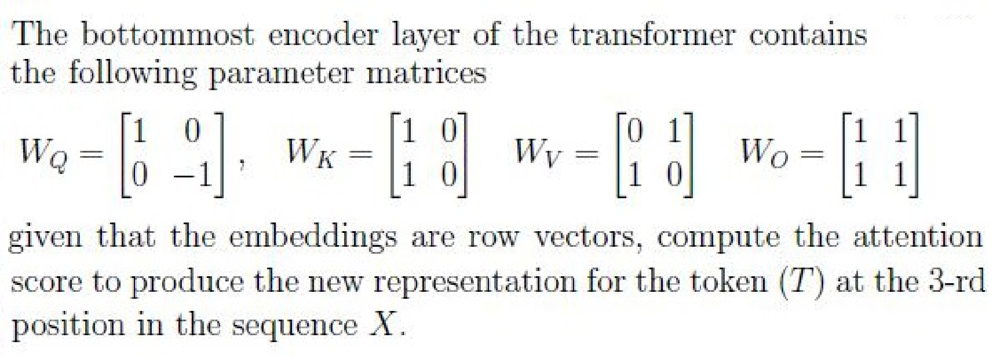
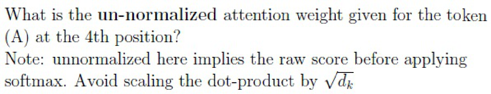

#### Worked answer

**Final answer:** Approximately -0.057922.

**Steps:** Using zero-based positions, T is at 3 and A at 4. From the image W_Q=diag(1,-1), W_K=[[1,0],[1,0]]; score = sin(3) × (1+sin(4)+cos(4)).

**Status:** derived

**verified_by_code:** `false` — depends on figure, no code path

---

### 2024 T1 Quiz 1 NA, Q187

**Paper:** `2024T1_Q1_NA` · **Type:** MCQ · **Marks:** 2 · **Topic(s):** w1-self-attention-qkv

The bottommost encoder layer of the transformer contains the following parameter matrices:

$$W_Q = \begin{bmatrix} 1 & 0 \\ 0 & 1 \end{bmatrix}, \quad W_K = \begin{bmatrix} 1 & 0 \\ 0 & 1 \end{bmatrix}, \quad W_V = \begin{bmatrix} 0 & 1 \\ 1 & 0 \end{bmatrix}, \quad W_O = \begin{bmatrix} 1 & 1 \\ 1 & 1 \end{bmatrix}$$

given that the embeddings are row vectors, compute the attention score to produce the new representation for the token (T) at the 3-rd position in the sequence X.

Which token in the sequence was given the highest score?

**A.** G

*Label added for presentation.*

**B.** C

*Label added for presentation.*

**C.** T

*Label added for presentation.*

**D.** A

*Label added for presentation.*

#### Worked answer

**Final answer:** A: G at position 0.

**Steps:** For query T at zero-based index 3 the unscaled scores are approximately [0.42336, 0.19500, 0.06959, 0.02133, -0.05792, 0.18695]. G at 0 is highest; C (B), T (C), and A (D) score lower.

**Status:** derived

**verified_by_code:** `false` — depends on figure, no code path

---

### 2024 T1 Quiz 1 NA, Q189

**Paper:** `2024T1_Q1_NA` · **Type:** SA · **Marks:** 3 · **Topic(s):** w1-encoder-parameter-count

How many parameters are there in the multi-head attention layer of the encoder (exclude the parameters in the WO matrix used for linear transformation)?

#### Worked answer

**Final answer:** 768 matrix weights, assuming the preceding question’s embedding size carries over.

**Steps:** From 1600 source embedding weights / 100 tokens, d_model=16. Two heads each have three `16 × 8` matrices: 2×3×16×8=768; W_O excluded.

**Status:** ambiguous

**Ambiguity note:** The 1600-parameter embedding is stated conditionally in the preceding subquestion, not explicitly carried over; attention biases are unspecified.

**verified_by_code:** `false` — depends on figure, no code path

---

### 2024 T3 Quiz 1 NA, Q290

**Paper:** `2024T3_Q1_NA` · **Type:** MCQ · **Marks:** 2 · **Topic(s):** w1-multi-head-attention

What will be the shape of $W_K$?

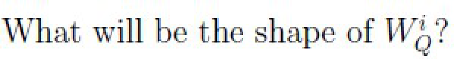

**A.** 32 × 32

*Label added for presentation.*

**B.** 64 × 32

*Label added for presentation.*

**C.** 128 × 16

*Label added for presentation.*

**D.** 128 × 32

*Label added for presentation.*

**E.** 8 × 32

*Label added for presentation.*

**F.** None of these.

*Label added for presentation.*

#### Worked answer

**Final answer:** D: `128 × 32` for one head.

**Steps:** The image asks for W_Q in one head: d_model=128 and 4 heads give d_q=32. Thus W_Q is `128 × 32`; A, B, C, E have incorrect dimensions and F is false.

**Status:** derived

**verified_by_code:** `false` — depends on figure, no code path

---

### 2024 T3 Quiz 1 NA, Q292

**Paper:** `2024T3_Q1_NA` · **Type:** SA · **Marks:** 4 · **Topic(s):** w1-self-attention-qkv

The input embeddings for the words “learning”, “brings” and “joy” are $h_1 = [0.5, 0.25, 1]$, $h_2 = [0.1, 0.25, 0]$, and $h_3 = [0.1, 0.1, 0.9]$, respectively. Note that the embeddings are row vectors. The projection matrices are as follows

$$W_Q = \begin{bmatrix} 1 & 0 \\ -1 & 1 \\ 0 & 1 \end{bmatrix} \quad W_K = \begin{bmatrix} 1 & 0 \\ 1 & 0 \\ 0 & 1 \end{bmatrix} \quad W_V = \begin{bmatrix} 0 & 0 \\ -1 & -1 \\ 1 & -1 \end{bmatrix}$$

The following quantities are computed as
$$Q = H W_Q \quad K = H W_K \quad V = H W_V$$

Let $e_{ij}$ denote the unnormalized attention score, $\alpha_{ij}$ denote the normalized attention score (ignore the scaling by $\sqrt{d_k}$) and $z_j$ denote the linear combination of the value vectors for the $j$-th word.

Suppose the gradient vector $\frac{\partial L}{\partial z_1} = [1, 2]$, then what is the gradient vector $\frac{\partial L}{\partial h_1}$? Enter the sum of gradients.

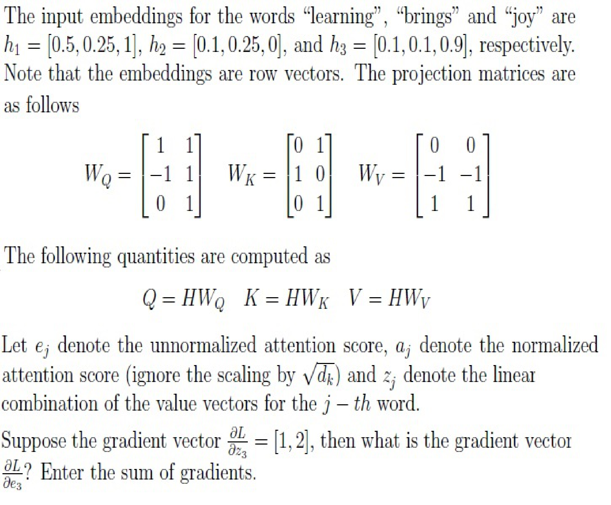

#### Worked answer

**Final answer:** 0.

**Steps:** The image asks for sum of ∂L/∂e₃, not ∂L/∂h₁. Since a₃=softmax(e₃), ∂L/∂e₃=(diag(a₃)−a₃a₃ᵀ)V[1,2]ᵀ; every column of the softmax Jacobian sums to zero, so the gradient sum is zero.

**Status:** derived

**verified_by_code:** `false` — depends on figure, no code path

---

### 2025 T1 Quiz 1 NA, Q107

**Paper:** `2025T1_Q1_NA` · **Type:** MSQ · **Marks:** 2 · **Topic(s):** w1-seq2seq-bottleneck

Which of the following models, in general, struggle to encode a context when translating long
sentences?

**A.** An RNN model

**B.** An RNN model with attention mechanism

**C.** A transformer model

#### Worked answer

**Final answer:** A is the conventional intended answer: an encoder–decoder RNN with a fixed context vector.

**Steps:** A fixed-length RNN context bottleneck makes long sentences difficult; B attention supplies access to all encoder states and C self-attention supplies direct token interactions. Neither makes long-sequence problems impossible.

**Status:** ambiguous

**Ambiguity note:** The unqualified wording “in general, struggle” is not a precise criterion: attention RNNs and transformers also have long-context limitations.

**verified_by_code:** `false` — No numeric checker path; answer remains explicitly ambiguous.

---

### 2025 T1 Quiz 1 NA, Q112

**Paper:** `2025T1_Q1_NA` · **Type:** SA · **Marks:** 3 · **Topic(s):** w1-encoder-parameter-count, w1-multi-head-attention

How many parameters are there in the multi-head attention layer of the encoder (exclude the
parameters in the WO matrix used for linear transformation and FFN layer)?

#### Worked answer

**Final answer:** 3,072 matrix weights if the previous question’s embedding size carries over.

**Steps:** The prior subquestion gives 3,200 weights for 100 source tokens, implying d_model=32 and 4 heads of width 8. Three projection matrices per head give 4×3×32×8=3,072, excluding W_O and FFN.

**Status:** ambiguous

**Ambiguity note:** The 3,200 embedding parameters are conditional in the preceding subquestion and not explicitly carried over; projection biases are unspecified.

**verified_by_code:** `false` — depends on figure, no code path

---

### 2025 T1 Quiz 1 NA, Q113

**Paper:** `2025T1_Q1_NA` · **Type:** SA · **Marks:** 3 · **Topic(s):** w1-encoder-parameter-count, w1-multi-head-attention

How many parameters does the matrix WQ have in anyone head of the encoder?

#### Worked answer

**Final answer:** 256 weights if the previous question’s embedding size carries over.

**Steps:** Assuming the preceding 3,200 source embedding weights and 100 words, d_model=32 and d_q=32/4=8, so one W_Q has `32 × 8`=256 entries.

**Status:** ambiguous

**Ambiguity note:** The 3,200 embedding parameters are conditional in an earlier subquestion and not explicitly carried over.

**verified_by_code:** `false` — depends on figure, no code path

---

### 2025 T2 Quiz 1 NA, Q135

**Paper:** `2025T2_Q1_NA` · **Type:** MCQ · **Marks:** 2 · **Topic(s):** w1-ffn-encoder-stack

Transformers process input tokens:

**A.** One at a time (sequentially)

**B.** In reverse order

**C.** All at once (in parallel)

**D.** Only after seeing the full input

#### Worked answer

**Final answer:** C: all input positions can be processed in parallel.

**Steps:** Self-attention and feed-forward operations allow parallel processing of available positions during a forward pass. A and B prescribe a recurrence or reverse order, neither required; D is not generally true for causal generation, which processes a prefix.

**Status:** derived

**verified_by_code:** `false` — Non-numeric response; no numeric checker path applies.

---

### 2025 T2 Quiz 1 NA, Q136

**Paper:** `2025T2_Q1_NA` · **Type:** MCQ · **Marks:** 2 · **Topic(s):** w1-scaled-dot-product

What is the purpose of the softmax function in the attention mechanism?

**A.** Normalize attention scores to a probability distribution

**B.** Add non-linearity to the model

**C.** To predict the correct class for the loss function

**D.** Remove redundant features from the input

#### Worked answer

**Final answer:** A: normalize attention scores into a probability distribution.

**Steps:** Row-wise softmax yields nonnegative weights summing to one, used to average values. B is a generic consequence rather than the attention-specific purpose; C concerns an output classifier; D is not what softmax does.

**Status:** derived

**verified_by_code:** `false` — Non-numeric response; no numeric checker path applies.

---

### 2025 T2 Quiz 1 NA, Q146

**Paper:** `2025T2_Q1_NA` · **Type:** SA · **Marks:** 3 · **Topic(s):** w1-scaled-dot-product

A transformer generates the following attention weights for a token over four positions: (0.1, 0.2, 0.5, 0.2). The corresponding value vectors are:

$$v_1 = [1, 0], \quad v_2 = [0, 1], \quad v_3 = [1, 1], \quad v_4 = [2, 1]$$

Compute the output vector from the attention mechanism by taking the weighted sum of the value vectors, and return the first element of the resulting vector. (Round to 2 decimal places)

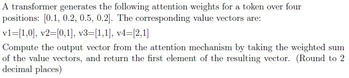

#### Worked answer

**Final answer:** 1.00.

**Steps:** The weighted vector is 0.1[1,0]+0.2[0,1]+0.5[1,1]+0.2[2,1]=[1.0,0.9]; the first component is 1.00.

**Status:** derived

**verified_by_code:** `false` — depends on figure, no code path

---

### 2025 T2 Quiz 1 NA, Q147

**Paper:** `2025T2_Q1_NA` · **Type:** MCQ · **Marks:** 3 · **Topic(s):** w1-scaled-dot-product, w1-multi-head-attention

Select the scaled dot-product attention for the first head:

**A.** $$\begin{bmatrix} 0 & 0 \\ 1 & 1 \end{bmatrix}$$
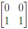

**B.** $$\begin{bmatrix} 0 & 0 \\ 6 & 12 \end{bmatrix}$$
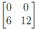

**C.** $$\begin{bmatrix} 1.46 & 2.92 \\ 4.53 & 9.08 \end{bmatrix}$$
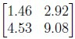

**D.** $$\begin{bmatrix} 1.98 & 3.76 \\ 4.02 & 8.31 \end{bmatrix}$$
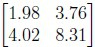

#### Worked answer

**Final answer:** No option matches the paper’s stated matrices.

**Steps:** From the image, Q=K=V=W¹X=[[2,4],[4,8]], and the printed formula gives softmax(QᵀK/√2)Vᵀ≈[[4,8],[4,8]]. A, B, C, and D differ substantially.

**Status:** ambiguous

**Ambiguity note:** No listed option matches; the inventory transcription of the matrices differs from the paper image.

**verified_by_code:** `false` — solve_numeric.py has no registered derivation for this ID; the extracted question data do not supply a complete computable input set.

---

### 2025 T2 Quiz 1 NA, Q148

**Paper:** `2025T2_Q1_NA` · **Type:** MCQ · **Marks:** 3 · **Topic(s):** w1-scaled-dot-product, w1-multi-head-attention

Select the scaled dot-product attention for the second head:

**A.** $$\begin{bmatrix} 1.34 & 2.23 \\ 0.66 & 4.77 \end{bmatrix}$$
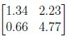

**B.** $$\begin{bmatrix} 2.33 & 1.32 \\ 2.94 & 3.76 \end{bmatrix}$$
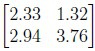

**C.** $$\begin{bmatrix} 1.96 & 1.68 \\ 3.04 & 2.32 \end{bmatrix}$$
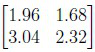

**D.** $$\begin{bmatrix} 2.65 & 2.60 \\ 2.58 & 2.32 \end{bmatrix}$$
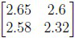

#### Worked answer

**Final answer:** No option matches the paper’s stated matrices.

**Steps:** Using the image, Q=K=V=W²X=[[2,0],[3,4]]. Row-softmax(QᵀK/√2)Vᵀ≈[[1.33952,3.33024],[0.11161,3.94419]]. A, B, C and D each differ from this result.

**Status:** ambiguous

**Ambiguity note:** No option matches; the inventory transcription differs from the paper image.

**verified_by_code:** `false` — solve_numeric.py has no registered derivation for this ID; the extracted question data do not supply a complete computable input set.

---

### 2025 T2 Quiz 1 NA, Q149

**Paper:** `2025T2_Q1_NA` · **Type:** MCQ · **Marks:** 2 · **Topic(s):** w1-multi-head-attention

Concatenate the outputs from both the attention heads, then apply the output projection matrix Wo to produce the final output of the multi-head attention mechanism. Select the correct result of this operation.

**A.** $$\begin{bmatrix} 0.73 & 1.46 \\ 2.26 & 4.54 \\ 2.33 & 1.32 \\ 2.94 & 3.76 \end{bmatrix}$$
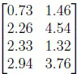

**B.** $$\begin{bmatrix} 0.99 & 1.88 \\ 2.01 & 4.16 \\ 1.96 & 1.68 \\ 3.04 & 2.32 \end{bmatrix}$$
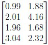

**C.** $$\begin{bmatrix} 0.00 & 0.00 \\ 0.50 & 0.50 \\ 2.65 & 2.60 \\ 2.58 & 2.32 \end{bmatrix}$$
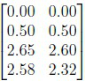

**D.** $$\begin{bmatrix} 0.00 & 0.00 \\ 3.00 & 6.00 \\ 1.34 & 2.23 \\ 0.66 & 4.77 \end{bmatrix}$$
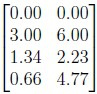

#### Worked answer

**Final answer:** No option matches the paper’s stated matrices.

**Steps:** Transpose the head outputs into feature-by-token orientation, stack them, and left-multiply the image’s diagonal W_O: approximately [[2,2],[4,4],[1.33952,0.11161],[3.33024,3.94419]]. None of A–D matches.

**Status:** ambiguous

**Ambiguity note:** No option matches the operations and matrices shown in the source image; the inventory transcription differs.

**verified_by_code:** `false` — solve_numeric.py has no registered derivation for this ID; the extracted question data do not supply a complete computable input set.

---

### 2025 T3 Quiz 1 NA, Q173

**Paper:** `2025T3_Q1_NA` · **Type:** MCQ · **Marks:** 2 · **Topic(s):** w1-scaled-dot-product

What is the primary reason for dividing the dot product of the query and key vectors by the square root of the key vector’s dimension, $\sqrt{d_k}$?

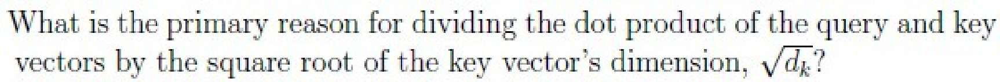

**A.** To increase the numerical precision of the attention scores.

*Label added for presentation.*

**B.** To reduce the overall computational cost of the attention mechanism.

*Label added for presentation.*

**C.** To ensure that the sum of the attention scores for each query equals 1.

*Label added for presentation.*

**D.** To avoid numerical issues and loss of gradients during training.

*Label added for presentation.*

#### Worked answer

**Final answer:** D: scaling limits softmax saturation and vanishing gradients.

**Steps:** Independent unit-variance components yield dot-product variance proportional to d_k; dividing by √d_k controls scale. A is not the main motivation; B does not reduce asymptotic cost; C is guaranteed by softmax.

**Status:** derived

**verified_by_code:** `false` — Non-numeric response; no numeric checker path applies.

---

### 2025 T3 Quiz 1 NA, Q183

**Paper:** `2025T3_Q1_NA` · **Type:** MSQ · **Marks:** 2 · **Topic(s):** w1-multi-head-attention

Which of the following statements about multiple attention heads in a Transformer are true?

**A.** They allow learning diverse local/global relations.

*Label added for presentation.*

**B.** They reduce memory usage compared to one head.

*Label added for presentation.*

**C.** Increasing the number of heads while keeping dmodel fixed, decreases the dimensionality handled by each head.

*Label added for presentation.*

**D.** All heads necessarily learn completely independent information about the input.

*Label added for presentation.*

#### Worked answer

**Final answer:** A and C.

**Steps:** A: heads can learn different relations. C: standard equal head width is d_model/h. B: more heads do not generally reduce memory and score matrices grow with head count. D: heads may overlap.

**Status:** derived

**verified_by_code:** `false` — Non-numeric response; no numeric checker path applies.

---

### 2025 T3 Quiz 1 NA, Q186

**Paper:** `2025T3_Q1_NA` · **Type:** SA · **Marks:** 3 · **Topic(s):** w1-multi-head-attention

A Transformer with single self-attention layer has batch size $B = 4$, context length (sequence length) $T = 12$, and number of heads $h = 2$. How many scalar attention scores are computed in total across two heads and all sequences for one forward pass?

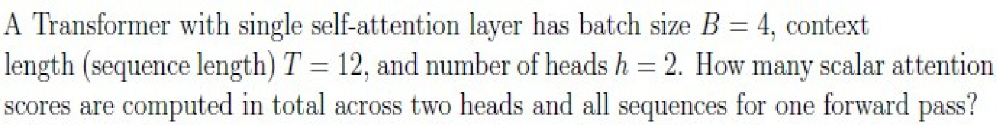

#### Worked answer

**Final answer:** 1152 scalar scores.

**Steps:** Each head produces a `[12, 12]` score matrix per sequence, hence 4×2×12² = 1152.

**Status:** derived

**verified_by_code:** `false` — depends on figure, no code path

---

### 2025 T3 Quiz 1 NA, Q187

**Paper:** `2025T3_Q1_NA` · **Type:** SA · **Marks:** 3 · **Topic(s):** w1-multi-head-attention

A Transformer model processes a sequence of $T = 1000$ tokens. Within the self-attention layer, the attention scores are stored as 32-bit floating-point numbers (float32). We compare two configurations that differ in the number of attention heads, $h$:

Model A: $h = 8$
Model B: $h = 16$

Using the given conversion factors (1 byte = 8 bits, 1 MB = $10^6$ bytes), calculate the percentage increase in memory (in MB) required to store all attention scores when moving from Model A to Model B.

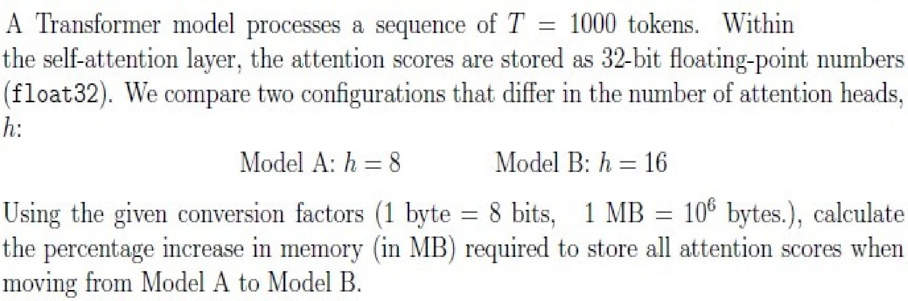

#### Worked answer

**Final answer:** 100% increase.

**Steps:** Float32 uses 4 bytes; 8×1000²×4/10⁶ = 32 MB and 16×1000²×4/10⁶ = 64 MB. The increase is (64−32)/32×100%.

**Status:** derived

**verified_by_code:** `false` — depends on figure, no code path

---

### 2025 T3 Quiz 1 NA, Q188

**Paper:** `2025T3_Q1_NA` · **Type:** SA · **Marks:** 2 · **Topic(s):** w1-encoder-parameter-count

In a Transformer model with hidden size $d_{\text{model}} = 512$, number of heads $h = 8$, and key/query dimension $d_k = 64$, how many trainable parameters are there in the projection matrix $W_Q$ for a given head?

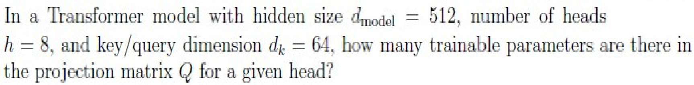

#### Worked answer

**Final answer:** 32768 parameters.

**Steps:** One head has W_Q shape `[512, 64]`, so 512×64 = 32768 matrix entries; bias is not part of the matrix.

**Status:** derived

**verified_by_code:** `false` — depends on figure, no code path

---

### 2025 T3 Quiz 1 NA, Q191

**Paper:** `2025T3_Q1_NA` · **Type:** SA · **Marks:** 2 · **Topic(s):** w1-multi-head-attention

The output projection matrix $W_O$ maps the concatenated head outputs dimension back to $d_{\text{model}}$ dimension. How many trainable parameters does $W_O$ contain?

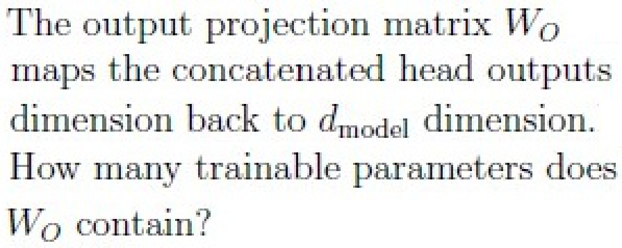

#### Worked answer

**Final answer:** 589824 matrix parameters.

**Steps:** In the shared setup d_model=768 and the conventional concatenated value width is 768. W_O has shape `[768, 768]`, hence 768²=589824; an optional bias is not part of W_O.

**Status:** derived

**verified_by_code:** `false` — depends on figure, no code path

---

### 2026 T1 Quiz 1 NA, Q2

**Paper:** `2026T1_Q1_NA` · **Type:** MCQ · **Marks:** 2 · **Topic(s):** w1-self-attention-qkv

In a self-attention mechanism, let the input be a matrix $X \in \mathbb{R}^{T \times d_{model}}$, where $T$ is the sequence length. If the dimension of the query projection matrix is $W_Q \in \mathbb{R}^{d_{model} \times d_k}$, what is the dimension of the Query matrix $Q$?

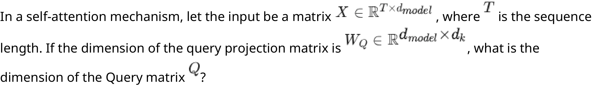

**A.** $d_{model} \times T$
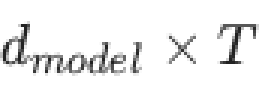

**B.** $d_k \times T$
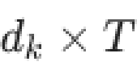

**C.** $T \times d_k$
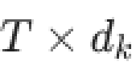

**D.** $T \times d_{model}$
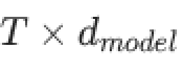

#### Worked answer

**Final answer:** C: `[T, d_k]`.

**Steps:** Q=XW_Q has shapes `[T,d_model]` × `[d_model,d_k]` = `[T,d_k]`. A and B transpose dimensions; D incorrectly retains d_model in general.

**Status:** derived

**verified_by_code:** `false` — depends on figure, no code path

---

### 2026 T1 Quiz 1 NA, Q3

**Paper:** `2026T1_Q1_NA` · **Type:** MCQ · **Marks:** 2 · **Topic(s):** w1-scaled-dot-product

In the scaled dot-product attention equation $\text{Attention}(Q, K, V) = \text{softmax}\left(\frac{QK^T}{\sqrt{d_k}}\right) V$, what is the primary reason for dividing the dot product by $\sqrt{d_k}$?

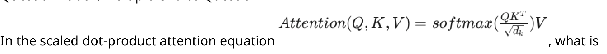

**A.** To ensure the matrix dimensions match for multiplication with $V$

**B.** To reduce the number of trainable parameters in the model

**C.** To prevent the dot product values from growing too large, which would push the softmax function into regions with extremely small gradients

**D.** To normalize the embedding vectors to have a unit length

#### Worked answer

**Final answer:** C.

**Steps:** The dot-product variance grows with d_k, and √d_k scaling prevents excessively saturated softmax and tiny gradients. A: scalar scaling changes no shape; B: adds/removes no learned parameters; D: does not normalize vector lengths.

**Status:** derived

**verified_by_code:** `false` — Non-numeric response; no numeric checker path applies.

---

### 2026 T1 Quiz 1 NA, Q4

**Paper:** `2026T1_Q1_NA` · **Type:** MCQ · **Marks:** 2 · **Topic(s):** w1-ffn-encoder-stack

Consider a Transformer Encoder stack consisting of $N = 6$ identical layers. If the input to the first layer is a sequence of word embeddings of shape $T \times d_{model}$ (where $T = 50$ and $d_{model} = 512$), what is the shape of the output of the final (6th) layer?

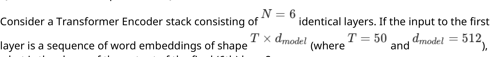

**A.** $1 \times 512$ (A single context vector)
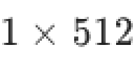

**B.** $6 \times 512$ (One vector per layer)
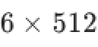

**C.** $50 \times 512$ (One vector per token, preserving sequence length)
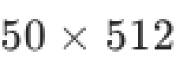

**D.** $300 \times 512$ (Concatenation of all token vectors across layers)
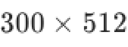

#### Worked answer

**Final answer:** C: `[50, 512]`.

**Steps:** Every standard encoder layer preserves sequence length and model width. A pools tokens, B treats layers as tokens, and D concatenates layer outputs, none of which is specified.

**Status:** derived

**verified_by_code:** `false` — depends on figure, no code path

---

### 2026 T1 Quiz 1 NA, Q9

**Paper:** `2026T1_Q1_NA` · **Type:** MSQ · **Marks:** 3 · **Topic(s):** w1-multi-head-attention

Select all statements that correctly describe the motivation and behavior of Multi-Head Attention as compared to single-head attention.

**A.** It allows the model to jointly attend to information from different representation subspaces at different positions.

**B.** It is mathematically similar to having multiple filters/kernels in a CNN to capture different features.

**C.** It reduces the total number of parameters required compared to a single head with the same total dimension.

**D.** Each head can theoretically learn to capture different linguistic relationships (e.g., one head links "it" to "animal", another links "it" to "tired").

#### Worked answer

**Final answer:** A, B and D.

**Steps:** A and D follow from separate learned head projections and attention patterns. B is a useful mathematical analogy: parallel learned transformations extract different features, although heads are dynamic attention operators rather than convolution kernels. C is false: standard fixed total width gives the same projection parameter count as one head.

**Status:** derived

**verified_by_code:** `false` — Non-numeric response; no numeric checker path applies.

---

### 2026 T1 Quiz 1 NA, Q10

**Paper:** `2026T1_Q1_NA` · **Type:** MSQ · **Marks:** 3 · **Topic(s):** w1-scaled-dot-product

Given the vectorized self-attention calculation $\text{Attention}(Q, K, V) = \text{softmax}\left(\frac{QK^T}{\sqrt{d_k}}\right) V$, select all true statements regarding the matrix dimensions and operations. Assume $Q, K, V \in \mathbb{R}^{T \times d_k}, T > d_k$.

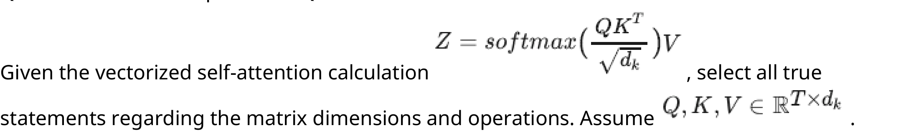

**A.** The matrix resulting from $QK^T$ has dimensions $T \times T$.

**B.** The softmax operation is applied to the entire matrix at once (globally), not row-wise.

**C.** The final output $Z$ has dimensions $T \times d_v$.

**D.** The matrix $QK^T$ represents the raw affinity/score between every pair of tokens in the sequence.

#### Worked answer

**Final answer:** A, C and D, with d_v=d_k under the given assumption.

**Steps:** A: `[T,d_k]` times `[d_k,T]` gives `[T,T]`. D: each entry is a query–key affinity. Softmax is row-wise, so B is false. C: multiplying `[T,T]` by V yields `[T,d_k]`, equivalently `[T,d_v]` here with d_v=d_k.

**Status:** derived

**verified_by_code:** `false` — depends on figure, no code path

---

### 2026 T1 Quiz 1 NA, Q13

**Paper:** `2026T1_Q1_NA` · **Type:** SA · **Marks:** 1 · **Topic(s):** w1-bahdanau-attention

Compute the attention score for hidden state $h_1$ using the given function. Enter the final answer correct to two decimal places.

#### Worked answer

**Final answer:** 1.93.

**Steps:** For h₁=(1,0), identity U and W give s+h₁=(2,2), and v=(1,1) gives score 2 tanh(2)≈1.928055, rounded to two decimals.

**Status:** derived

**verified_by_code:** `false` — depends on figure, no code path

---

### 2026 T1 Quiz 1 NA, Q14

**Paper:** `2026T1_Q1_NA` · **Type:** SA · **Marks:** 3 · **Topic(s):** w1-bahdanau-attention

Normalize the attention scores using the softmax function to obtain the attention weights $\alpha_t$:

$$\alpha_{tj} = \frac{\exp(\text{score}(s_{t-1}, h_j))}{\sum_{k=1}^n \exp(\text{score}(s_{t-1}, h_k))}$$

Submit $\alpha_{t1}$ (i.e., the first element of the $\alpha_t$ vector). Enter the final answer correct to two decimal places.

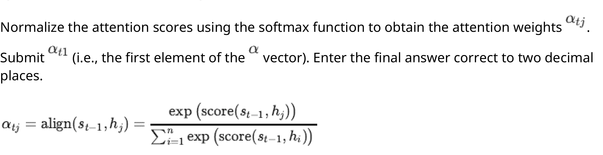

#### Worked answer

**Final answer:** 0.35.

**Steps:** The three additive scores are approximately 1.928055, 1.756649, 1.959082. Applying exp(score₁)/Σ exp(scoreⱼ) gives 0.347948, rounded only at the end.

**Status:** derived

**verified_by_code:** `false` — depends on figure, no code path

---

### 2026 T1 Quiz 1 NA, Q15

**Paper:** `2026T1_Q1_NA` · **Type:** SA · **Marks:** 2 · **Topic(s):** w1-bahdanau-attention

Calculate the context vector $c_t$:

$$c_t = \sum_{j=1}^n \alpha_{tj} h_j$$

Provide the sum of all elements of $c_t$. Enter the final answer correct to two decimal places.

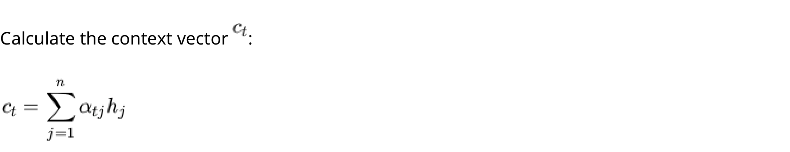

#### Worked answer

**Final answer:** 1.36.

**Steps:** With h₁=(1,0), h₂=(0,1), h₃=(1,1), c=(α₁+α₃, α₂+α₃), whose component sum is 1+α₃=1.358913.

**Status:** derived

**verified_by_code:** `false` — depends on figure, no code path

---

### 2026 T2 Quiz 1 NA, Q2

**Paper:** `2026T2_Q1_NA` · **Type:** MSQ · **Marks:** 4 · **Topic(s):** w1-bahdanau-attention

Which statements are true about traditional attention used in sequence-to-sequence models?

**A.** The decoder decides which encoder states are important.

**B.** Attention weights are computed over all decoder hidden states.

**C.** The context vector is a weighted sum of encoder states.

**D.** Encoder hidden states are ignored after encoding.

#### Worked answer

**Final answer:** A and C.

**Steps:** In Bahdanau attention the decoder state scores encoder states and the context is their weighted sum. B is false because weights run over encoder states, not all decoder states; D is false because those states are retrieved throughout decoding.

**Status:** derived

**verified_by_code:** `false` — Non-numeric response; no numeric checker path applies.

---

### 2026 T2 Quiz 1 NA, Q3

**Paper:** `2026T2_Q1_NA` · **Type:** SA · **Marks:** 3 · **Topic(s):** w1-scaled-dot-product

Compute the $(Q K^T)$ of the final scaled dot-product attention and submit the sum of the diagonal elements of $(Q K^T)$ matrix.

#### Worked answer

**Final answer:** 4.

**Steps:** The original PNG uses QᵀK, consistent with tokens as columns of X; Q=K=X because W_Q=W_K=I. Thus QᵀK=[[1,0,1],[0,1,1],[1,1,2]] and its trace is 1+1+2=4. The transcription incorrectly writes QKᵀ.

**Status:** derived

**verified_by_code:** `false` — depends on figure, no code path

---

### 2026 T2 Quiz 1 NA, Q4

**Paper:** `2026T2_Q1_NA` · **Type:** MCQ · **Marks:** 3 · **Topic(s):** w1-self-attention-qkv

Choose the token pair with the least attention score.

**A.** {"learn", "easy"}

**B.** {"learn", "math"}

**C.** {"easy", "math"}

**D.** {"learn", "learn"}

**E.** {"easy" , "easy"}

#### Worked answer

**Final answer:** A: {learn, easy}.

**Steps:** The source image specifies column-token QᵀK=[[1,0,1],[0,1,1],[1,1,2]]. The indicated pairs have scores A=0; B=C=D=E=1. Scaling by √2 does not change the ranking, and within the learn query A also has the smallest row-softmax weight.

**Status:** derived

**verified_by_code:** `false` — solve_numeric.py has no registered derivation for this ID; the extracted question data do not supply a complete computable input set.

---

### 2026 T2 Quiz 1 NA, Q5

**Paper:** `2026T2_Q1_NA` · **Type:** SA · **Marks:** 4 · **Topic(s):** w1-multi-head-attention

A Transformer model processes a sequence containing 6 tokens using Multi-Head Attention. The model initially uses 4 attention heads. If the number of attention heads is doubled to 8, while the sequence length remains unchanged, how many additional attention scores are computed across all heads?

#### Worked answer

**Final answer:** 144 additional scores.

**Steps:** Every head computes 6²=36 scores per sequence; four additional heads therefore add (8−4)×36=144.

**Status:** derived

**verified_by_code:** `true` — solve_numeric.py recomputed adjudicated inputs/conventions; all recorded values and adjudication checks MATCH.

---

### 2026 T2 Quiz 1 NA, Q6

**Paper:** `2026T2_Q1_NA` · **Type:** SA · **Marks:** 4 · **Topic(s):** w1-ffn-encoder-stack

A batch of 8 sentences is passed through a Transformer Encoder consisting of 6 encoder layers and 8 attention heads. After padding, each sentence has a maximum length of 32 tokens. The model uses an embedding dimension of $d_{model} = 128$. What is the total number of elements (volume) in the output tensor produced by the final encoder layer for the entire batch?

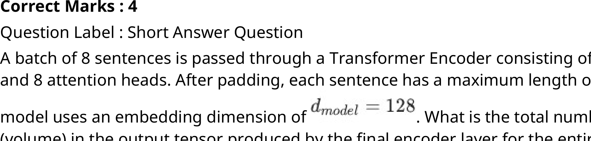

#### Worked answer

**Final answer:** 32768 elements.

**Steps:** The last encoder output retains shape `[8,32,128]`, independent of the number of layers and heads; 8×32×128=32768.

**Status:** derived

**verified_by_code:** `false` — depends on figure, no code path

---

## Quiz 2 questions

### 2025 T3 Quiz 2 NA, Q110

**Paper:** `2025T3_Q2_NA` · **Type:** SA · **Marks:** 2 · **Topic(s):** w1-encoder-parameter-count

A study is comparing three architectures, all trained with the same compute budget:

• Model A (Encoder-Decoder): A 12-layer encoder and a 12-layer decoder with separate parameters. Its total size is 220 million parameters.

• Model B (Decoder-Only): A 24-layer decoder-only model. Its total size is also approximately 220 million parameters.

• Model C (Shared Enc-Dec): A 12-layer encoder and a 12-layer decoder where the parameters are shared ($W_{\text{enc}} = W_{\text{dec}}$).

Assuming that the 12-layer encoder and 12-layer decoder in Model A have an equal number of parameters, what is the approximate total parameter count (in millions) of Model C?

#### Worked answer

**Final answer:** Approximately 110 million parameters under the stated idealized sharing assumption.

**Steps:** Equal halves of 220 million each contain 110 million; fully tying corresponding encoder and decoder parameters stores one copy. This assumes all counted parameters can actually be shared.

**Status:** derived

**verified_by_code:** `true` — solve_numeric.py recomputed adjudicated inputs/conventions; all recorded values and adjudication checks MATCH.

---

### 2026 T1 Quiz 2 NA, Q2

**Paper:** `2026T1_Q2_NA` · **Type:** MCQ · **Marks:** 2 · **Topic(s):** w1-multi-head-attention

In the context of Multi-Head Attention, if the model dimension $d_{model} = 512$ and we employ $h = 8$ heads, what is the dimension of the concatenated output of the 8 heads before it is passed through the final linear output projection $W^O$?

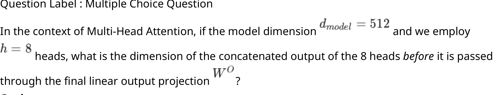

**A.** $T \times 64$
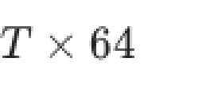

**B.** $T \times 4096$
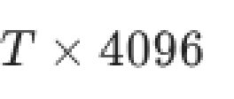

**C.** $T \times 512$
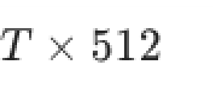

**D.** $T \times 8$
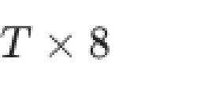

#### Worked answer

**Final answer:** C: `[T, 512]`.

**Steps:** Under standard equal-width heads d_v=512/8=64; concatenating eight `[T,64]` outputs gives `[T,512]`. A is one head, B assumes each head has width 512, and D confuses head count with concatenated width.

**Status:** derived

**verified_by_code:** `false` — depends on figure, no code path

---

### 2026 T1 Quiz 2 NA, Q8

**Paper:** `2026T1_Q2_NA` · **Type:** MSQ · **Marks:** 3 · **Topic(s):** w1-ffn-encoder-stack

Which of the following are components found within a standard Transformer Encoder layer?

**A.** Multi-Head Self-Attention mechanism

**B.** Position-wise Feed-Forward Networks

**C.** Cross-Attention mechanism (Encoder-Decoder attention)

**D.** Masked Multi-Head Self-Attention

#### Worked answer

**Final answer:** A and B.

**Steps:** The original encoder has unmasked multi-head self-attention and position-wise FFNs. C belongs to decoder cross-attention, and D describes the causal masked decoder self-attention, not the standard encoder.

**Status:** derived

**verified_by_code:** `false` — Non-numeric response; no numeric checker path applies.

---

### 2026 T1 Quiz 2 NA, Q9

**Paper:** `2026T1_Q2_NA` · **Type:** MSQ · **Marks:** 3 · **Topic(s):** w1-seq2seq-bottleneck

Select all correct statements regarding the comparison between RNNs and Transformers.

**A.** In Transformers, the path length between any two positions in the sequence is constant $O(1)$, whereas in RNNs it is $O(T)$ (where $T$ is the sequence length).

**B.** Transformers process tokens strictly sequentially during training in the same way as RNNs.

**C.** Transformers allow for significantly more parallelization during training compared to RNNs.

**D.** Attention mechanisms in Transformers utilize Query, Key, and Value vectors derived from input embeddings.

#### Worked answer

**Final answer:** A, C and D.

**Steps:** A: full self-attention connects arbitrary positions in one layer, versus O(T) maximum recurrent path. C: token operations can run in parallel at training. D: Q/K/V are projections of layer inputs, initially embeddings. B is false: teacher-forced transformer training parallelizes sequence positions.

**Status:** derived

**verified_by_code:** `false` — Non-numeric response; no numeric checker path applies.

---

### 2026 T1 Quiz 2 NA, Q14

**Paper:** `2026T1_Q2_NA` · **Type:** SA · **Marks:** 2 · **Topic(s):** w1-self-attention-qkv

At time step t = 5 (word: data), what is the attention weight assigned to the word science? (Provide exact answer)

#### Worked answer

**Final answer:** 0.2.

**Steps:** In the provided attention matrix, row t=5 (data) and column 2 (science) contain 0.2. The row sums to 0.9, so the supplied matrix is not a valid normalized attention distribution, but its stated entry is unambiguous.

**Status:** derived

**verified_by_code:** `false` — depends on figure, no code path

---

## End Term questions

### 2024 T1 End Term AN, Q151

**Paper:** `2024T1_ET_AN` · **Type:** SA · **Marks:** 4 · **Topic(s):** w1-encoder-parameter-count

Suppose the number of encoder layers N = 3. What is the total number of learnable parameters, including the parameters of the input and position embedding layers, in the model? Enter the final answer in thousands. For example, if the answer is 12,238, then enter 12 as the answer.

#### Worked answer

**Final answer:** Not uniquely determinable.

**Steps:** For vocabulary size V, fixed positions contribute zero; with bias-free attention and two affine layer norms per layer, the encoder and embedding total is 2,366,208 + 256V. Divide by 1,000 and truncate as requested.

**Status:** ambiguous

**Ambiguity note:** Vocabulary size is not specified; attention biases and normalization parameters are also not specified.

**verified_by_code:** `false` — depends on figure, no code path

---

### 2024 T1 End Term AN, Q152

**Paper:** `2024T1_ET_AN` · **Type:** SA · **Marks:** 3 · **Topic(s):** w1-encoder-parameter-count

Suppose we increase the context length from T = 256 to T = 512 keeping number of layers same (N = 3). How many parameters does the model need to learn additionally compared to the previous setting?

#### Worked answer

**Final answer:** 0 additional parameters.

**Steps:** Fixed sinusoidal positions have no learned parameters and the layer and vocabulary sizes are unchanged.

**Status:** derived

**verified_by_code:** `true` — solve_numeric.py recomputed adjudicated inputs/conventions; all recorded values and adjudication checks MATCH.

---

### 2024 T1 End Term AN, Q153

**Paper:** `2024T1_ET_AN` · **Type:** SA · **Marks:** 4 · **Topic(s):** w1-self-attention-qkv

Compute the representation for the word “often” and enter the sum of the elements in it.

#### Worked answer

**Final answer:** The sum after the output projection is 1.676.

**Steps:** From the image, use the last attention row [0.04, 0.12, 0.17, 0.67], the four embeddings in sentence order, then compute AHW_VW_O = [-0.417, 2.093]; the sum is 1.676. The displayed attention entries are rounded.

**Status:** ambiguous

**Ambiguity note:** The question does not specify whether representation is before or after W_O; before W_O the sum differs. The displayed attention entries are rounded.

**verified_by_code:** `false` — depends on figure, no code path

---

### 2024 T1 End Term AN, Q154

**Paper:** `2024T1_ET_AN` · **Type:** SA · **Marks:** 4 · **Topic(s):** w1-self-attention-qkv

Suppose the input sentence is “coffee i drink often“. What is the attention score between the word “coffee” with “often”?

#### Worked answer

**Final answer:** Approximately 0.53.

**Steps:** Without positional information, reordering permutes attention rows and columns. Coffee is row 3 and often column 4 in the original table; the entry is 0.53.

**Status:** derived

**verified_by_code:** `false` — depends on figure, no code path

---

### 2024 T1 End Term AN, Q155

**Paper:** `2024T1_ET_AN` · **Type:** SA · **Marks:** 3 · **Topic(s):** w1-self-attention-qkv

What is the input sequence length that would have generated this matrix?

#### Worked answer

**Final answer:** 8 tokens.

**Steps:** The displayed score matrix has shape `8 × 8`, one row and column per token.

**Status:** derived

**verified_by_code:** `false` — depends on figure, no code path

---

### 2024 T1 End Term AN, Q156

**Paper:** `2024T1_ET_AN` · **Type:** MSQ · **Marks:** 4 · **Topic(s):** w1-self-attention-qkv

Suppose the dimension of value vector, $d_v = 32$, then which of the following could be the dimensions of the key and query vectors $(d_k, d_q)$?

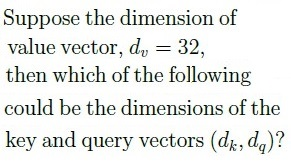

**A.** (8,8)

*Label added for presentation.*

**B.** (32,8)

*Label added for presentation.*

**C.** (32,32)

*Label added for presentation.*

**D.** (64,64)

*Label added for presentation.*

**E.** (8,32)

*Label added for presentation.*

#### Worked answer

**Final answer:** A, C and D.

**Steps:** The query–key dot product requires d_q = d_k, while d_v can differ. A, C, D have equal query and key dimensions; B and E do not.

**Status:** derived

**verified_by_code:** `false` — Non-numeric response; no numeric checker path applies.

---

### 2024 T1 End Term FN, Q206

**Paper:** `2024T1_ET_FN` · **Type:** SA · **Marks:** 4 · **Topic(s):** w1-encoder-parameter-count

Suppose the number of encoder layers N = 3. What is the total number of learnable parameters, including the parameters of the input and position embedding layers, in the model? Enter the final answer in thousands. For example, if the answer is 12,238, then enter 12 as the answer.

#### Worked answer

**Final answer:** Not uniquely determinable.

**Steps:** For vocabulary size V, fixed positions contribute zero; with bias-free attention and two affine layer norms per layer, the encoder and embedding total is 2,366,208 + 256V. Divide by 1,000 and truncate as requested.

**Status:** ambiguous

**Ambiguity note:** Vocabulary size is not specified; attention biases and normalization parameters are also not specified.

**verified_by_code:** `false` — depends on figure, no code path

---

### 2024 T1 End Term FN, Q207

**Paper:** `2024T1_ET_FN` · **Type:** SA · **Marks:** 3 · **Topic(s):** w1-encoder-parameter-count

Suppose we increase the context length from T = 256 to T = 512 keeping number of layers same (N = 3). How many parameters does the model need to learn additionally compared to the previous setting?

#### Worked answer

**Final answer:** 0 additional parameters.

**Steps:** Fixed sinusoidal positions have no learned parameters and the layer and vocabulary sizes are unchanged.

**Status:** derived

**verified_by_code:** `false` — depends on figure, no code path

---

### 2024 T1 End Term FN, Q208

**Paper:** `2024T1_ET_FN` · **Type:** SA · **Marks:** 4 · **Topic(s):** w1-self-attention-qkv

Compute the representation for the word “coffee” and enter the sum of the elements in it.

#### Worked answer

**Final answer:** The sum after output projection is 1.592.

**Steps:** Using the displayed coffee attention row [0.25, 0.06, 0.17, 0.53], the embeddings in sentence order and the image matrices gives AHW_VW_O = [-0.324, 1.916], whose sum is 1.592.

**Status:** ambiguous

**Ambiguity note:** The question does not specify whether representation is before or after W_O; before W_O the sum differs. The displayed attention entries are rounded.

**verified_by_code:** `false` — depends on figure, no code path

---

### 2024 T1 End Term FN, Q209

**Paper:** `2024T1_ET_FN` · **Type:** SA · **Marks:** 4 · **Topic(s):** w1-self-attention-qkv

Suppose the input sentence is “coffee i like much“. What is the attention score between the word “coffee” with “much”?

#### Worked answer

**Final answer:** Approximately 0.53.

**Steps:** Without positional information, reordering permutes attention rows and columns. Coffee is row 3 and much column 4 in the original table; the entry is 0.53.

**Status:** derived

**verified_by_code:** `false` — depends on figure, no code path

---

### 2024 T1 End Term FN, Q210

**Paper:** `2024T1_ET_FN` · **Type:** SA · **Marks:** 3 · **Topic(s):** w1-self-attention-qkv

What is the input sequence length that would have generated this matrix?

#### Worked answer

**Final answer:** 8 tokens.

**Steps:** The displayed score matrix has shape `8 × 8`, one row and column per token.

**Status:** derived

**verified_by_code:** `false` — depends on figure, no code path

---

### 2024 T1 End Term FN, Q211

**Paper:** `2024T1_ET_FN` · **Type:** MSQ · **Marks:** 4 · **Topic(s):** w1-self-attention-qkv

Suppose the dimension of value vector, $d_v = 16$, then which of the following could be the dimensions of the key and query vectors $(d_k, d_q)$?

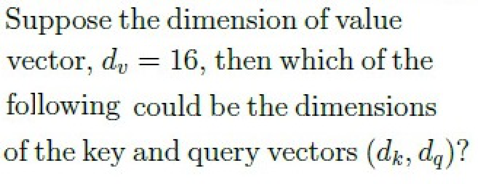

**A.** (8,8)

*Label added for presentation.*

**B.** (64,64)

*Label added for presentation.*

**C.** (32,32)

*Label added for presentation.*

**D.** (16,16)

*Label added for presentation.*

**E.** (8,16)

*Label added for presentation.*

**F.** (16,8)

*Label added for presentation.*

#### Worked answer

**Final answer:** A, B, C and D.

**Steps:** The query–key dot product requires d_q = d_k, while d_v can differ. A–D have equal dimensions; E and F do not.

**Status:** derived

**verified_by_code:** `false` — Non-numeric response; no numeric checker path applies.

---

### 2024 T3 End Term AN, Q176

**Paper:** `2024T3_ET_AN` · **Type:** SA · **Marks:** 3 · **Topic(s):** w1-self-attention-qkv

The input embeddings for the words “learning”, “brings” and “joy” are $h_1 = [1.0, 0.5, 1]$, $h_2 = [1, 0.25, 0]$, and $h_3 = [0.1, 0.1, 0.9]$, respectively. Note that the embeddings are row vectors. The projection matrices are as follows:

$$W_Q = \begin{bmatrix} 1 & 1 \\ -1 & 1 \\ 0 & 1 \end{bmatrix}, \quad W_K = \begin{bmatrix} 1 & 1 \\ 1 & 0 \\ 0 & 1 \end{bmatrix}, \quad W_V = \begin{bmatrix} 0 & 0 \\ -1 & -1 \\ 1 & 0 \end{bmatrix}$$

The following quantities are computed as:

$$Q = H W_Q, \quad K = H W_K, \quad V = H W_V$$

Let $e_{ij}$ denote the unnormalized attention score, $\alpha_{ij}$ denote the normalized attention score (ignore the scaling by $\sqrt{d_k}$) and $z_j$ denote the linear combination of the value vectors for the $j$-th word.

Enter the value of first element i.e. with index (0,0) of $z_1$.

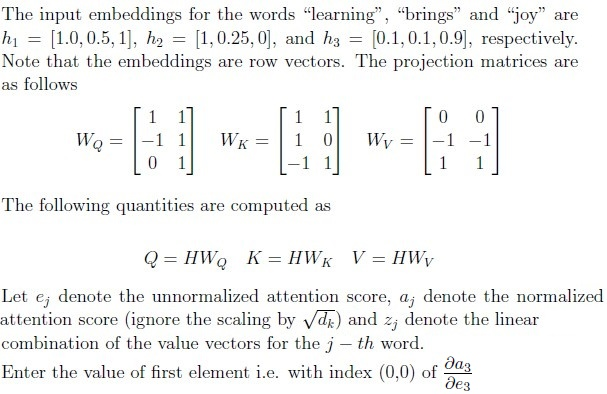

#### Worked answer

**Final answer:** Approximately 0.239933.

**Steps:** The image asks for the (0,0) element of ∂a₃/∂e₃, not z₁. For query 3, scores are [2.2, 1.1, 1.1], giving a₃,₀≈0.600333; its softmax diagonal derivative is a₃,₀(1−a₃,₀)≈0.239933.

**Status:** derived

**verified_by_code:** `false` — depends on figure, no code path

---

### 2024 T3 End Term AN, Q184

**Paper:** `2024T3_ET_AN` · **Type:** MCQ · **Marks:** 2 · **Topic(s):** w1-self-attention-qkv

Which of the following is correct expression for $q_{ij}$? The symbols have usual meaning.

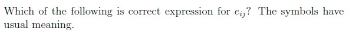

**A.** $x_i^T W_Q W_K^T x_j + x_i^T W_Q W_K^T p_j + p_i^T W_Q W_K^T x_j + p_i^T W_Q W_K^T p_j$
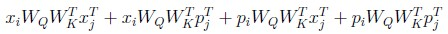

**B.** $x_i^T W_Q W_K^T x_j - x_i^T W_Q W_K^T p_j + p_i^T W_Q W_K^T x_j - p_i^T W_Q W_K^T p_j$
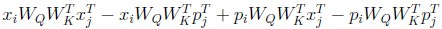

**C.** $x_i^T W_K W_Q^T x_j + x_i^T W_K W_Q^T p_j + p_i^T W_K W_Q^T x_j + p_i^T W_K W_Q^T p_j$
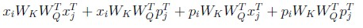

**D.** $x_i W_Q W_K x_j^T + x_i W_Q W_K p_j^T + p_i W_Q W_K x_j^T + p_i W_Q W_K p_j^T$
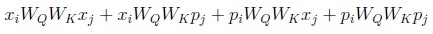

**E.** None of these

#### Worked answer

**Final answer:** A.

**Steps:** With row vectors, eᵢⱼ=(xᵢ+pᵢ)W_Q W_Kᵀ(xⱼ+pⱼ)ᵀ; expanding gives A. B has incorrect signs; C reverses query and key projections; D omits necessary transposes; E is false.

**Status:** derived

**verified_by_code:** `false` — Non-numeric response; no numeric checker path applies.

---

### 2024 T3 End Term FN, Q189

**Paper:** `2024T3_ET_FN` · **Type:** SA · **Marks:** 3 · **Topic(s):** w1-self-attention-qkv

The input embeddings for the words “learning”, “brings” and “joy” are $h_1 = [0.5, 0.25, 1]$, $h_2 = [0.1, 0.25, 0]$, and $h_3 = [0.1, 0.1, 0.9]$, respectively. Note that the embeddings are row vectors. The projection matrices are as follows

$$W_Q = \begin{bmatrix} 1 & 1 \\ -1 & 1 \\ 0 & 1 \end{bmatrix}, \quad W_K = \begin{bmatrix} 0 & 1 \\ 1 & 0 \\ 0 & 1 \end{bmatrix}, \quad W_V = \begin{bmatrix} 0 & 0 \\ -1 & -1 \\ 1 & 1 \end{bmatrix}$$

The following quantities are computed as

$$Q = H W_Q, \quad K = H W_K, \quad V = H W_V$$

Let $e_{ij}$ denote the unnormalized attention score, $a_{ij}$ denote the normalized attention score (ignore the scaling by $\sqrt{d_k}$) and $z_i$ denote the linear combination of the value vectors for the $i$-th word.

Enter the value of the first element, i.e., with index (0,0) of the matrix containing the partial derivatives, $\frac{\partial a_{ij}}{\partial e_{ij}}$

#### Worked answer

**Final answer:** Approximately 0.246608.

**Steps:** The image asks for ∂a₃/∂e₃ at (0,0). For query 3 scores are [1.65, 0.11, 1.1], so a₃,₀≈0.558244 and the corresponding softmax diagonal derivative is a₃,₀(1−a₃,₀)≈0.246608.

**Status:** derived

**verified_by_code:** `false` — depends on figure, no code path

---

### 2024 T3 End Term FN, Q199

**Paper:** `2024T3_ET_FN` · **Type:** MCQ · **Marks:** 2 · **Topic(s):** w1-self-attention-qkv

What is the time complexity of the computing attention score matrix A with a batch size of one? The symbols have usual meaning.

**A.** $O(T^2 d)$

*Label added for presentation.*

**B.** $O(T d^2)$

*Label added for presentation.*

**C.** $O(T d)$

*Label added for presentation.*

**D.** $O(T + d)$

*Label added for presentation.*

**E.** None of these.

*Label added for presentation.*

#### Worked answer

**Final answer:** A: O(T²d).

**Steps:** Multiplying `Q [T,d]` by `Kᵀ [d,T]` produces `T²` dot products of length d. B is projection cost, C and D omit pairwise work, E is false.

**Status:** derived

**verified_by_code:** `false` — Non-numeric response; no numeric checker path applies.

---

### 2025 T2 End Term AN, Q199

**Paper:** `2025T2_ET_AN` · **Type:** SA · **Marks:** 3 · **Topic(s):** w1-self-attention-qkv, w1-scaled-dot-product, w1-multi-head-attention

For the input “you enjoy tea often”, compute the final representation of the word “enjoy” after the
attention layer (i.e., after applying WQ, WK, WV , attention weights, and WO). Enter the sum of the
elements in the resulting vector.

#### Worked answer

**Final answer:** Approximately 0.950 using the supplied rounded attention matrix.

**Steps:** The enjoy row is [0.43,0.25,0.21,0.10]. Multiply this row by H W_V W_O to get [1.331,−0.381], summing to 0.950. Recomputing full precision from the matrices gives approximately 0.95216.

**Status:** derived

**verified_by_code:** `false` — depends on figure, no code path

---

### 2025 T2 End Term AN, Q200

**Paper:** `2025T2_ET_AN` · **Type:** SA · **Marks:** 2 · **Topic(s):** w1-self-attention-qkv, w1-scaled-dot-product, w1-multi-head-attention

Suppose the input sentence is “tea you enjoy often”. Using the same matrices and processing
method, what is the attention score (i.e., softmax entry from A) for the query word “tea” attending
to key word “often”?

#### Worked answer

**Final answer:** Approximately 0.07 from the supplied table.

**Steps:** Without positional encodings, reordering permutes attention rows and columns; tea is row 3 and often column 4 of the supplied original matrix, so the entry is 0.07. Recomputing from the matrices gives approximately 0.06607.

**Status:** derived

**verified_by_code:** `false` — depends on figure, no code path

---

### 2025 T2 End Term FN, Q146

**Paper:** `2025T2_ET_FN` · **Type:** SA · **Marks:** 3 · **Topic(s):** w1-self-attention-qkv, w1-scaled-dot-product, w1-multi-head-attention

For the input “you enjoy tea often”, compute the final representation of the word “tea” after the
attention layer (i.e., after applying WQ, WK, WV , attention weights, and WO). Enter the sum of the
elements in the resulting vector.

#### Worked answer

**Final answer:** Approximately 1.020 using the supplied rounded attention matrix.

**Steps:** The tea row is [0.39,0.39,0.16,0.07]. Multiplication by H W_V W_O yields [1.272,−0.252] with sum 1.020. Recomputing full precision from the stated matrices gives approximately 1.01445.

**Status:** derived

**verified_by_code:** `false` — depends on figure, no code path

---

### 2025 T2 End Term FN, Q147

**Paper:** `2025T2_ET_FN` · **Type:** SA · **Marks:** 2 · **Topic(s):** w1-self-attention-qkv, w1-scaled-dot-product, w1-multi-head-attention

Suppose the input sentence is “tea you enjoy often”. Using the same matrices and processing
method, what is the attention score (i.e., softmax entry from A) for the query word “tea” attending
to key word “often”?

#### Worked answer

**Final answer:** Approximately 0.07 from the supplied table.

**Steps:** With no positional encodings reordering permutes rows and columns; the original tea-query, often-key table entry is 0.07. Recomputing the matrices gives approximately 0.06607.

**Status:** derived

**verified_by_code:** `false` — depends on figure, no code path

---

### 2025 T3 End Term AN, Q17

**Paper:** `2025T3_ET_AN` · **Type:** MSQ · **Marks:** 3 · **Topic(s):** w1-self-attention-qkv

Consider a BART encoder with sequence length $L$ and hidden size $d_{model}$ (fixed).
Now suppose the sequence length is doubled from $L$ to $2L$, keeping all other parameters unchanged.
Which of the following statements are true?

**A.** Self-attention FLOPs increase by a factor of 2.

**B.** Self-attention FLOPs increase by a factor of 4.

**C.** FFN FLOPs increase by a factor of 2.

**D.** FFN FLOPs increase by a factor of 4.

#### Worked answer

**Final answer:** C; B holds for the quadratic attention products only.

**Steps:** FFN work is proportional to L, so C is true and D false. QKᵀ and AV are proportional to L² and quadruple, supporting B for those products; Q/K/V/output projections are linear in L. Thus the complete self-attention sublayer has both linear and quadratic work and neither factor 2 nor 4 is exact.

**Status:** ambiguous

**Ambiguity note:** The question does not specify whether self-attention FLOPs include projection layers. If included, neither A nor B is exactly correct; if restricted to attention products, B is correct.

**verified_by_code:** `false` — No numeric checker path; answer remains explicitly ambiguous.

---

### 2025 T3 End Term AN, Q20

**Paper:** `2025T3_ET_AN` · **Type:** SA · **Marks:** 2 · **Topic(s):** w1-encoder-parameter-count

In the standard Transformer with 6 Encoder Layers, how many distinct sets of transformation weight matrices ($W_Q, W_K, W_V$) are learned in the entire Encoder stack, assuming 8 heads per layer?

#### Worked answer

**Final answer:** 48 sets of three matrices, or 144 individual matrices.

**Steps:** There are 6×8=48 head-specific (W_Q,W_K,W_V) triples, comprising 48×3=144 individual projection matrices.

**Status:** ambiguous

**Ambiguity note:** “Sets of ... matrices” ordinarily means 48 triples, while the question may intend the number 144 of individual matrices.

**verified_by_code:** `false` — depends on figure, no code path

---

### 2025 T3 End Term FN, Q8

**Paper:** `2025T3_ET_FN` · **Type:** MCQ · **Marks:** 1 · **Topic(s):** w1-self-attention-qkv

Computing the full self-attention matrix has a time complexity of
$$\mathcal{O}(T^2 d)$$
where $T$ is the sequence length and $d$ is the embedding dimension.

Which step in the self-attention mechanism is primarily responsible for this quadratic scaling?

**A.** Computing the softmax for each row

**B.** Computing the matrix product $QK^T$

**C.** Multiplying the attention matrix $A$ with the value matrix $V$

**D.** Performing layer normalization

#### Worked answer

**Final answer:** B and C both perform quadratic-in-T, linear-in-d matrix multiplications.

**Steps:** QKᵀ costs O(T²d) and AV costs O(T²d), so both B and C qualify. A row-wise softmax is O(T²), not O(T²d); D is O(Td).

**Status:** ambiguous

**Ambiguity note:** Single-answer MCQ has two valid choices B and C under the stated complexity.

**verified_by_code:** `false` — No numeric checker path; answer remains explicitly ambiguous.

---

### 2025 T3 End Term FN, Q18

**Paper:** `2025T3_ET_FN` · **Type:** SA · **Marks:** 3 · **Topic(s):** w1-self-attention-qkv

A mini-batch has 10 sentences, each padded to a length 100. Self-attention (single head) computes one score matrix per sentence. How many scalar scores are computed in total for a single head across the batch?

#### Worked answer

**Final answer:** 100,000 scalar scores.

**Steps:** Each of 10 sentences has a `100 × 100` score matrix, so 10×100×100=100,000 scores before masking.

**Status:** derived

**verified_by_code:** `false` — depends on figure, no code path

---

### 2025 T3 End Term FN, Q25

**Paper:** `2025T3_ET_FN` · **Type:** MSQ · **Marks:** 2 · **Topic(s):** w1-self-attention-qkv

Consider a BART encoder with sequence length $L$ and hidden size $d_{\text{model}}$ (fixed).
Now suppose the sequence length is doubled from $L$ to $2L$, keeping all other parameters unchanged.
Which of the following statements are true?

**A.** Self-attention FLOPs increase by a factor of 2

**B.** Self-attention FLOPs increase by a factor of 4

**C.** FFN FLOPs increase by a factor of 2

**D.** FFN FLOPs increase by a factor of 4

#### Worked answer

**Final answer:** C is true; B holds for the quadratic attention products, but the total self-attention sublayer does not exactly quadruple.

**Steps:** Score and weighted-value products scale as L²d, whereas Q/K/V/output projections scale as Ld². FFN scales linearly in L: C true, D false. A is false for the quadratic products; B is true only if self-attention FLOPs means those products alone.

**Status:** ambiguous

**Ambiguity note:** The phrase self-attention FLOPs is underspecified: including projection FLOPs gives neither an exact factor of 2 nor 4.

**verified_by_code:** `false` — depends on figure, no code path

---

### 2026 T1 End Term AN, Q10

**Paper:** `2026T1_ET_AN` · **Type:** SA · **Marks:** 2 · **Topic(s):** w1-self-attention-qkv

The computational complexity and memory requirement of the Self-Attention mechanism is quadratic with respect to the sequence length $T$.

Specifically, the Attention Score matrix has a size of $T \times T$.

If you double the input sequence length $T$ (e.g., from 512 to 1024) while keeping the embedding dimension ($d_{model}$) constant, by what factor does the memory required to store the Attention Score matrix increase? Enter the integer value.

#### Worked answer

**Final answer:** Factor 4.

**Steps:** A score matrix has T² elements, so (2T)²/T²=4 at fixed element size and head count.

**Status:** derived

**verified_by_code:** `true` — solve_numeric.py recomputed adjudicated inputs/conventions; all recorded values and adjudication checks MATCH.

---

### 2026 T1 End Term FN, Q2

**Paper:** `2026T1_ET_FN` · **Type:** SA · **Marks:** 2 · **Topic(s):** w1-encoder-parameter-count

Consider a Multi-Head Attention sub-layer with the following hyper-parameters:

• Embedding dimension ($d_{model}$) = 256
• Number of heads ($h$) = 4
• key/value dimension per head ($d_k = d_v$) = $d_{model} / h = 64$.

Calculate the total number of trainable parameters contained only in the projection matrices $W_i^Q$, $W_i^K$, $W_i^V$ and $W^O$. (Ignore biases). Enter the integer value.

#### Worked answer

**Final answer:** 262144 parameters.

**Steps:** For Q, K and V, 3×4×256×64 = 196608 entries; W_O has 256×256 = 65536. Total 262144; biases are excluded.

**Status:** derived

**verified_by_code:** `false` — depends on figure, no code path

---

### 2026 T1 End Term FN, Q3

**Paper:** `2026T1_ET_FN` · **Type:** SA · **Marks:** 2 · **Topic(s):** w1-encoder-parameter-count

For T5-Base, the model dimension is 768 and FFN dimension is 3072. Ignore bias. Find the number of parameters in the FFN of one encoder layer.

#### Worked answer

**Final answer:** 4718592 parameters.

**Steps:** The original T5 feed-forward block has two matrices `[768, 3072]` and `[3072, 768]`; 2×768×3072=4718592 without biases.

**Status:** derived

**verified_by_code:** `true` — solve_numeric.py recomputed adjudicated inputs/conventions; all recorded values and adjudication checks MATCH.

---

### 2026 T1 End Term FN, Q4

**Paper:** `2026T1_ET_FN` · **Type:** SA · **Marks:** 3 · **Topic(s):** w1-ffn-encoder-stack

A batch of 5 sentences is passed through a Transformer Encoder. The sequences are padded to a maximum length of 20 tokens. The embedding dimension ($d_{model}$) is 64. What is the total number of elements (volume) in the output tensor produced by the final layer of the encoder for this batch?

#### Worked answer

**Final answer:** 6400 elements.

**Steps:** The final encoder tensor retains padded shape `[5, 20, 64]`; 5×20×64 = 6400.

**Status:** derived

**verified_by_code:** `false` — depends on figure, no code path

---

### 2026 T2 End Term AN, Q2

**Paper:** `2026T2_ET_AN` · **Type:** MCQ · **Marks:** 2 · **Topic(s):** w1-self-attention-qkv

Consider the following Assertion (A) and Reason (R) about the Transformer encoder.

Assertion (A): In a Transformer encoder, each token can attend to every other token in the input sequence through self-attention.
Reason (R): The encoder's self-attention mechanism uses a causal mask to prevent each token from attending to tokens that appear later in the sequence.

Choose the correct option:

**A.** Both Assertion (A) and Reason (R) are true, and Reason (R) is the correct explanation of Assertion (A).

**B.** Both Assertion (A) and Reason (R) are true, but Reason (R) is not the correct explanation of Assertion (A).

**C.** Assertion (A) is true, but Reason (R) is false.

**D.** Assertion (A) is false, but Reason (R) is true

**E.** Both Assertion (A) and Reason (R) are false.

#### Worked answer

**Final answer:** C.

**Steps:** In an original Transformer encoder, each unpadded position can attend bidirectionally, while causal masking is used in the decoder. Thus assertion true, reason false; A and B require true reason, and D and E falsely reject the assertion.

**Status:** derived

**verified_by_code:** `false` — Non-numeric response; no numeric checker path applies.

---

### 2026 T2 End Term AN, Q18

**Paper:** `2026T2_ET_AN` · **Type:** MCQ · **Marks:** 1 · **Topic(s):** w1-self-attention-qkv

Compute $W_Q x_m$ and select the correct option

**A.** $[4, 13, 1, -1]^T$

![Option A vector [4, 13, 1, -1]^T](assets/da5004_2026T2_ET_AN/q18-q18-option-a-01-p012.png)

**B.** $[5, 4, -1, 2]^T$

![Option B vector [5, 4, -1, 2]^T](assets/da5004_2026T2_ET_AN/q18-q18-option-b-01-p012.png)

**C.** $[5, 13, -1, -1]^T$

![Option C vector [5, 13, -1, -1]^T](assets/da5004_2026T2_ET_AN/q18-q18-option-c-01-p012.png)

**D.** $[3, 15, -2, 1]^T$

![Option D vector [3, 15, -2, 1]^T](assets/da5004_2026T2_ET_AN/q18-q18-option-d-01-p012.png)

#### Worked answer

**Final answer:** No option matches: W_Q x_m = [5, 3, −1, −1]ᵀ.

**Steps:** The displayed x₁=(2,1,3,2) and W_Q rows yield (2+3, 1+2, 2−3, 1−2)=(5,3,−1,−1). A, B, C and D all differ, including C with 13 rather than 3.

**Status:** ambiguous

**Ambiguity note:** No correct option: C incorrectly uses 13 for the second component.

**verified_by_code:** `false` — solve_numeric.py has no registered derivation for this ID; the extracted question data do not supply a complete computable input set.

---

### 2026 T2 End Term AN, Q19

**Paper:** `2026T2_ET_AN` · **Type:** MCQ · **Marks:** 1 · **Topic(s):** w1-self-attention-qkv

Compute $W_K x_n$ and select the correct option

**A.** $[3, 16, -1, -2]^T$

![Option A vector [3, 16, -1, -2]^T](assets/da5004_2026T2_ET_AN/q19-q19-option-a-01-p013.png)

**B.** $[4, 16, -2, -2]^T$

![Option B vector [4, 16, -2, -2]^T](assets/da5004_2026T2_ET_AN/q19-q19-option-b-01-p013.png)

**C.** $[5, 4, 2, -1]^T$

![Option C vector [5, 4, 2, -1]^T](assets/da5004_2026T2_ET_AN/q19-q19-option-c-01-p013.png)

**D.** $[2, 16, -2, 2]^T$

![Option D vector [2, 16, -2, 2]^T](assets/da5004_2026T2_ET_AN/q19-q19-option-d-01-p013.png)

#### Worked answer

**Final answer:** No option matches: W_K x_n = [4, 6, −2, −2]ᵀ.

**Steps:** The displayed x₃=(1,3,2,4) yields (1+3, 2+4, 1−3, 2−4)=(4,6,−2,−2). Each of A, B, C and D differs; B incorrectly has 16 in its second component.

**Status:** ambiguous

**Ambiguity note:** No correct option: B incorrectly uses 16 for the second component.

**verified_by_code:** `false` — solve_numeric.py has no registered derivation for this ID; the extracted question data do not supply a complete computable input set.

---

### 2026 T2 End Term FN, Q2

**Paper:** `2026T2_ET_FN` · **Type:** SA · **Marks:** 2 · **Topic(s):** w1-encoder-parameter-count

Consider a Multi-Head Attention sub-layer with the following hyper-parameters:

• Embedding dimension ($d_{model}$) = 256
• Number of heads ($h$) = 4
• key/value dimension per head ($d_k = d_v$) = $d_{model} / h = 64$.

Calculate the total number of trainable parameters contained only in the projection matrices $W_i^Q$, $W_i^K$, $W_i^V$ and $W^O$. (Ignore biases). Enter the integer value.

#### Worked answer

**Final answer:** 262144 parameters.

**Steps:** For Q, K and V, 3×4×256×64 = 196608 entries; W_O has 256×256 = 65536. Total 262144; biases excluded.

**Status:** derived

**verified_by_code:** `false` — depends on figure, no code path

---

### 2026 T2 End Term FN, Q3

**Paper:** `2026T2_ET_FN` · **Type:** SA · **Marks:** 2 · **Topic(s):** w1-encoder-parameter-count

For T5-Base, the model dimension is 768 and FFN dimension is 3072. Ignore bias. Find the number of parameters in the FFN of one encoder layer.

#### Worked answer

**Final answer:** 4718592 parameters.

**Steps:** Original T5 uses two FFN matrices `[768,3072]` and `[3072,768]`: 2×768×3072=4718592, ignoring bias.

**Status:** derived

**verified_by_code:** `true` — solve_numeric.py recomputed adjudicated inputs/conventions; all recorded values and adjudication checks MATCH.

---

### 2026 T2 End Term FN, Q4

**Paper:** `2026T2_ET_FN` · **Type:** SA · **Marks:** 3 · **Topic(s):** w1-ffn-encoder-stack

A batch of 5 sentences is passed through a Transformer Encoder. The sequences are padded to a maximum length of 20 tokens. The embedding dimension ($d_{model}$) is 64. What is the total number of elements (volume) in the output tensor produced by the final layer of the encoder for this batch?

#### Worked answer

**Final answer:** 6400 elements.

**Steps:** The encoder output is `[5,20,64]`, preserving batch, padded sequence length and hidden width: 5×20×64=6400.

**Status:** derived

**verified_by_code:** `false` — depends on figure, no code path

---

## Source and reproducibility

Questions preserve each routed paper occurrence, including repeated stems from different papers or sessions. Images are linked from the archived extraction assets. Rebuild with `uv run python scripts/build_exam_question_banks.py`; run `uv run python scripts/build_exam_study_priorities.py` for the ranked study guide.
