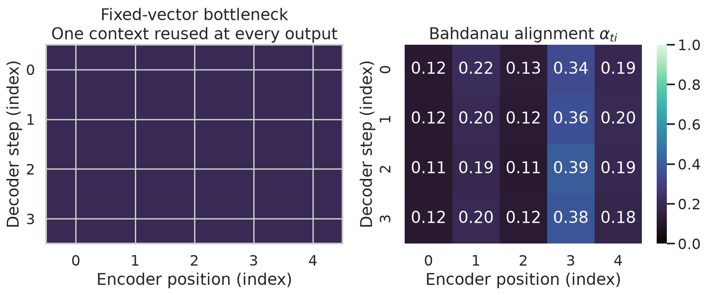
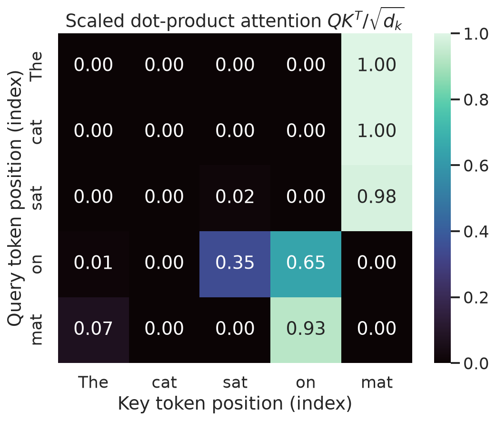
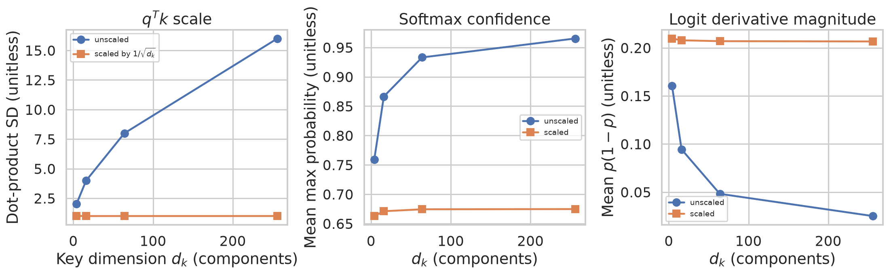
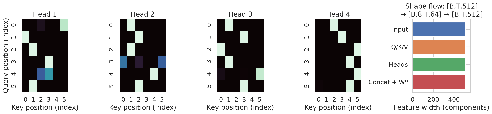
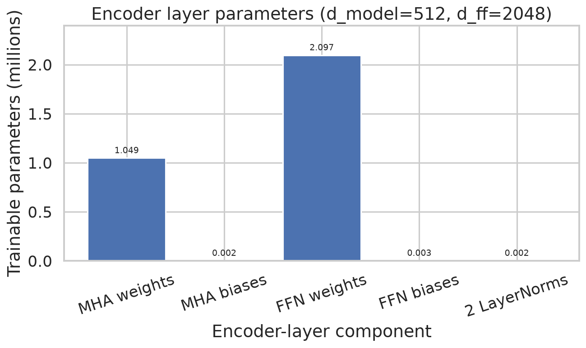

# Week 1: From Sequence Models to Transformer Encoders

**Learn and revise for the exam:** [[week-1-exam-focused-notes|Week 1 exam guide]] · [[week-1-exam-questions|Routed questions and worked answers]]

**Navigation:** [[Knowledge-Map|Knowledge Map]] · [[week-2-notes|Week 2 Notes]] →

## Abstract

Fixed-context recurrent encoder–decoders compress a source sequence into one representation, creating an information bottleneck and sequential computation. Additive attention replaces that single source summary with a decoder-step-dependent weighted combination of encoder states. Transformer self-attention constructs contextual representations by learned query, key and value projections, scaled dot products, and normalized value aggregation. Multiple heads apply distinct projections before concatenation and an output projection; a position-wise feed-forward network and post-normalized residual connections complete the original encoder layer. A parameter audit distinguishes weights, optional biases and normalization from sequence-length-dependent activations.

## Lecture map and question routing

The ebook transcript covers PDF pp. 4–20 (printed pp. 3–19). Page references below identify both numbering systems. The following table lists *every* record routed to Week 1; records with multiple topic IDs appear in each applicable row. Question bank anchors identify source records, rather than substituting generated examples for examination questions.

| Canonical topic | Routed questions |
|---|---|
| Seq2seq and the RNN bottleneck | [[week-1-exam-questions#da5004_2025T1_Q1_NA--q107\|2025T1 Q1 NA Q107]] · [[week-1-exam-questions#da5004_2026T1_Q2_NA--q9\|2026T1 Q2 NA Q9]] |
| Bahdanau (additive) attention | [[week-1-exam-questions#da5004_2026T1_Q1_NA--q13\|2026T1 Q1 NA Q13]] · [[week-1-exam-questions#da5004_2026T1_Q1_NA--q14\|2026T1 Q1 NA Q14]] · [[week-1-exam-questions#da5004_2026T1_Q1_NA--q15\|2026T1 Q1 NA Q15]] · [[week-1-exam-questions#da5004_2026T2_Q1_NA--q2\|2026T2 Q1 NA Q2]] |
| Self-attention and Q/K/V projections | [[week-1-exam-questions#da5004_2024T1_ET_AN--q153\|2024T1 ET AN Q153]] · [[week-1-exam-questions#da5004_2024T1_ET_AN--q154\|2024T1 ET AN Q154]] · [[week-1-exam-questions#da5004_2024T1_ET_AN--q155\|2024T1 ET AN Q155]] · [[week-1-exam-questions#da5004_2024T1_ET_AN--q156\|2024T1 ET AN Q156]] · [[week-1-exam-questions#da5004_2024T1_ET_FN--q208\|2024T1 ET FN Q208]] · [[week-1-exam-questions#da5004_2024T1_ET_FN--q209\|2024T1 ET FN Q209]] · [[week-1-exam-questions#da5004_2024T1_ET_FN--q210\|2024T1 ET FN Q210]] · [[week-1-exam-questions#da5004_2024T1_ET_FN--q211\|2024T1 ET FN Q211]] · [[week-1-exam-questions#da5004_2024T1_Q1_NA--q186\|2024T1 Q1 NA Q186]] · [[week-1-exam-questions#da5004_2024T1_Q1_NA--q187\|2024T1 Q1 NA Q187]] · [[week-1-exam-questions#da5004_2024T3_ET_AN--q176\|2024T3 ET AN Q176]] · [[week-1-exam-questions#da5004_2024T3_ET_AN--q184\|2024T3 ET AN Q184]] · [[week-1-exam-questions#da5004_2024T3_ET_FN--q189\|2024T3 ET FN Q189]] · [[week-1-exam-questions#da5004_2024T3_ET_FN--q199\|2024T3 ET FN Q199]] · [[week-1-exam-questions#da5004_2024T3_Q1_NA--q292\|2024T3 Q1 NA Q292]] · [[week-1-exam-questions#da5004_2025T2_ET_AN--q199\|2025T2 ET AN Q199]] · [[week-1-exam-questions#da5004_2025T2_ET_AN--q200\|2025T2 ET AN Q200]] · [[week-1-exam-questions#da5004_2025T2_ET_FN--q146\|2025T2 ET FN Q146]] · [[week-1-exam-questions#da5004_2025T2_ET_FN--q147\|2025T2 ET FN Q147]] · [[week-1-exam-questions#da5004_2025T3_ET_AN--q17\|2025T3 ET AN Q17]] · [[week-1-exam-questions#da5004_2025T3_ET_FN--q8\|2025T3 ET FN Q8]] · [[week-1-exam-questions#da5004_2025T3_ET_FN--q18\|2025T3 ET FN Q18]] · [[week-1-exam-questions#da5004_2025T3_ET_FN--q25\|2025T3 ET FN Q25]] · [[week-1-exam-questions#da5004_2026T1_ET_AN--q10\|2026T1 ET AN Q10]] · [[week-1-exam-questions#da5004_2026T1_Q1_NA--q2\|2026T1 Q1 NA Q2]] · [[week-1-exam-questions#da5004_2026T1_Q2_NA--q14\|2026T1 Q2 NA Q14]] · [[week-1-exam-questions#da5004_2026T2_ET_AN--q2\|2026T2 ET AN Q2]] · [[week-1-exam-questions#da5004_2026T2_ET_AN--q18\|2026T2 ET AN Q18]] · [[week-1-exam-questions#da5004_2026T2_ET_AN--q19\|2026T2 ET AN Q19]] · [[week-1-exam-questions#da5004_2026T2_Q1_NA--q4\|2026T2 Q1 NA Q4]] |
| Scaled dot-product attention and the sqrt(d_k) factor | [[week-1-exam-questions#da5004_2025T2_ET_AN--q199\|2025T2 ET AN Q199]] · [[week-1-exam-questions#da5004_2025T2_ET_AN--q200\|2025T2 ET AN Q200]] · [[week-1-exam-questions#da5004_2025T2_ET_FN--q146\|2025T2 ET FN Q146]] · [[week-1-exam-questions#da5004_2025T2_ET_FN--q147\|2025T2 ET FN Q147]] · [[week-1-exam-questions#da5004_2025T2_Q1_NA--q136\|2025T2 Q1 NA Q136]] · [[week-1-exam-questions#da5004_2025T2_Q1_NA--q146\|2025T2 Q1 NA Q146]] · [[week-1-exam-questions#da5004_2025T2_Q1_NA--q147\|2025T2 Q1 NA Q147]] · [[week-1-exam-questions#da5004_2025T2_Q1_NA--q148\|2025T2 Q1 NA Q148]] · [[week-1-exam-questions#da5004_2025T3_ET_AN--q17\|2025T3 ET AN Q17]] · [[week-1-exam-questions#da5004_2025T3_ET_FN--q25\|2025T3 ET FN Q25]] · [[week-1-exam-questions#da5004_2025T3_Q1_NA--q173\|2025T3 Q1 NA Q173]] · [[week-1-exam-questions#da5004_2026T1_Q1_NA--q3\|2026T1 Q1 NA Q3]] · [[week-1-exam-questions#da5004_2026T1_Q1_NA--q10\|2026T1 Q1 NA Q10]] · [[week-1-exam-questions#da5004_2026T2_Q1_NA--q3\|2026T2 Q1 NA Q3]] |
| Multi-head attention and W^O | [[week-1-exam-questions#da5004_2024T3_Q1_NA--q290\|2024T3 Q1 NA Q290]] · [[week-1-exam-questions#da5004_2025T1_Q1_NA--q112\|2025T1 Q1 NA Q112]] · [[week-1-exam-questions#da5004_2025T1_Q1_NA--q113\|2025T1 Q1 NA Q113]] · [[week-1-exam-questions#da5004_2025T2_ET_AN--q199\|2025T2 ET AN Q199]] · [[week-1-exam-questions#da5004_2025T2_ET_AN--q200\|2025T2 ET AN Q200]] · [[week-1-exam-questions#da5004_2025T2_ET_FN--q146\|2025T2 ET FN Q146]] · [[week-1-exam-questions#da5004_2025T2_ET_FN--q147\|2025T2 ET FN Q147]] · [[week-1-exam-questions#da5004_2025T2_Q1_NA--q147\|2025T2 Q1 NA Q147]] · [[week-1-exam-questions#da5004_2025T2_Q1_NA--q148\|2025T2 Q1 NA Q148]] · [[week-1-exam-questions#da5004_2025T2_Q1_NA--q149\|2025T2 Q1 NA Q149]] · [[week-1-exam-questions#da5004_2025T3_Q1_NA--q183\|2025T3 Q1 NA Q183]] · [[week-1-exam-questions#da5004_2025T3_Q1_NA--q186\|2025T3 Q1 NA Q186]] · [[week-1-exam-questions#da5004_2025T3_Q1_NA--q187\|2025T3 Q1 NA Q187]] · [[week-1-exam-questions#da5004_2025T3_Q1_NA--q191\|2025T3 Q1 NA Q191]] · [[week-1-exam-questions#da5004_2026T1_Q1_NA--q9\|2026T1 Q1 NA Q9]] · [[week-1-exam-questions#da5004_2026T1_Q2_NA--q2\|2026T1 Q2 NA Q2]] · [[week-1-exam-questions#da5004_2026T2_Q1_NA--q5\|2026T2 Q1 NA Q5]] |
| Position-wise FFN and the encoder layer/stack | [[week-1-exam-questions#da5004_2025T2_Q1_NA--q135\|2025T2 Q1 NA Q135]] · [[week-1-exam-questions#da5004_2025T3_ET_AN--q17\|2025T3 ET AN Q17]] · [[week-1-exam-questions#da5004_2025T3_ET_FN--q25\|2025T3 ET FN Q25]] · [[week-1-exam-questions#da5004_2026T1_ET_FN--q4\|2026T1 ET FN Q4]] · [[week-1-exam-questions#da5004_2026T1_Q1_NA--q4\|2026T1 Q1 NA Q4]] · [[week-1-exam-questions#da5004_2026T1_Q2_NA--q8\|2026T1 Q2 NA Q8]] · [[week-1-exam-questions#da5004_2026T2_ET_FN--q4\|2026T2 ET FN Q4]] · [[week-1-exam-questions#da5004_2026T2_Q1_NA--q6\|2026T2 Q1 NA Q6]] |
| Parameter counting for the encoder | [[week-1-exam-questions#da5004_2024T1_ET_AN--q151\|2024T1 ET AN Q151]] · [[week-1-exam-questions#da5004_2024T1_ET_AN--q152\|2024T1 ET AN Q152]] · [[week-1-exam-questions#da5004_2024T1_ET_FN--q206\|2024T1 ET FN Q206]] · [[week-1-exam-questions#da5004_2024T1_ET_FN--q207\|2024T1 ET FN Q207]] · [[week-1-exam-questions#da5004_2024T1_Q1_NA--q189\|2024T1 Q1 NA Q189]] · [[week-1-exam-questions#da5004_2025T1_Q1_NA--q112\|2025T1 Q1 NA Q112]] · [[week-1-exam-questions#da5004_2025T1_Q1_NA--q113\|2025T1 Q1 NA Q113]] · [[week-1-exam-questions#da5004_2025T3_ET_AN--q20\|2025T3 ET AN Q20]] · [[week-1-exam-questions#da5004_2025T3_Q1_NA--q188\|2025T3 Q1 NA Q188]] · [[week-1-exam-questions#da5004_2025T3_Q2_NA--q110\|2025T3 Q2 NA Q110]] · [[week-1-exam-questions#da5004_2026T1_ET_FN--q2\|2026T1 ET FN Q2]] · [[week-1-exam-questions#da5004_2026T1_ET_FN--q3\|2026T1 ET FN Q3]] · [[week-1-exam-questions#da5004_2026T2_ET_FN--q2\|2026T2 ET FN Q2]] · [[week-1-exam-questions#da5004_2026T2_ET_FN--q3\|2026T2 ET FN Q3]] |

## 1. From fixed context to attention

A sequence transducer estimates $p(y\mid x)=\prod_t p(y_t\mid y_{<t},x)$. An early recurrent encoder–decoder replaces source access with a fixed-width $c$, yielding $p(y\mid x)=\prod_t p(y_t\mid y_{<t},c)$. The final state must transmit information relevant to all target positions. Long or information-rich inputs can therefore stress this channel; degradation is not inevitable at a particular length. Recurrent states also depend on their predecessors, limiting parallelism along time and making long gradient paths difficult (ebook PDF pp. 4–5 / printed pp. 3–4; [[seq2seq-bottleneck]]).

**The Dangerous Misconception:** Seq2seq means exactly two RNNs and a fixed vector. **Why this is false:** Seq2seq describes an input-to-output sequence mapping; attention-based recurrent models and Transformer encoder–decoders are also sequence-to-sequence models. The ebook's definition is narrower than the architecture family.

### Bahdanau alignment

Given bidirectional encoder annotations $h_i$ and previous decoder state $s_{t-1}$, the learned additive score, normalized alignment and context are

$$e_{ti}=v_a^\top\tanh(W_a s_{t-1}+U_a h_i),\quad
\alpha_{ti}=\frac{e^{e_{ti}}}{\sum_j e^{e_{tj}}},\quad c_t=\sum_i\alpha_{ti}h_i.$$

The alignment matrix is `[T_target, T_source]`; every row sums to one over source positions. Its entries can be computed in parallel for a fixed decoder step, but the recurrent state makes successive decoder steps dependent. Different rows may favor different source positions; a diagonal pattern is not required when word order changes. A weight is a learned soft alignment, not a guaranteed causal explanation (PDF pp. 5–6 / printed pp. 4–5; [[bahdanau-attention]]).



**Figure 1.** *The left panel reuses a uniform context distribution at each output step; the right panel computes a separate additive alignment per decoder step using randomly sampled weights. These are illustrative distributions, not trained alignments or translation accuracy measurements.*

## 2. Self-attention and scaled dot products

For row-oriented input $X$ of shape `[B, T, d_model]`, shared projections within a head give $Q=XW^Q$, $K=XW^K$, $V=XW^V$. Their shapes are `[B, T, d_k]`, `[B, T, d_k]`, `[B, T, d_v]`, with projection shapes `[d_model, d_k]`, `[d_model, d_k]`, `[d_model, d_v]`. The query requests information, a key determines compatibility, and a value supplies the content aggregated. Self-attention uses the same sequence for all three inputs; cross-attention uses a different source for keys and values. Learned matrices are distinct in the standard architecture (PDF pp. 6–8 / printed pp. 5–7; [[self-attention]]).

$$A=\operatorname{softmax}_{\mathrm{keys}}\!\left(\frac{QK^\top}{\sqrt{d_k}}+M\right),\qquad Z=AV.$$

In the general case `Q [B, T_q, d_k]`, `K [B, T_k, d_k]`, `V [B, T_k, d_v]`, $A$ is `[B, T_q, T_k]` and $Z$ is `[B, T_q, d_v]`. A mask $M$ adds $-\infty$ to forbidden logits before softmax; each query must retain an eligible key. Encoder self-attention normally permits all non-padding positions, including the query position itself. Without positional information or an order-dependent mask, self-attention is permutation equivariant, so content alone cannot encode order.

For a worked example, let $d_k=1$, $q=1$, $k_1=k_2=0$, $v_1=[1,0]$, $v_2=[0,2]$. The two scaled scores are $[0,0]$, softmax gives $[1/2,1/2]$, and $z=\frac12[1,0]+\frac12[0,2]=[0.5,1]$. The sum is over **values**, not keys.

**Mathematical formulation:** If the coordinates $q_i,k_i$ are independent zero-mean, unit-variance variables, then $\operatorname{Var}(q_i k_i)=1$ and independent products give $\operatorname{Var}(q\cdot k)=d_k$. Dividing by $\sqrt{d_k}$ gives variance one under these assumptions. This reduces growth of logit spread and mitigates softmax saturation; trained projections need not satisfy the assumptions, so scaling does not guarantee unsaturated gradients (PDF pp. 8–9 / printed pp. 7–8; [[scaled-dot-product-attention]]).

**The Dangerous Misconception:** Scaling makes every attention row uniform. **Why this is false:** Scaling changes the logit magnitudes, not their order; unequal logits generally give unequal weights. It is not a normalization across keys; softmax performs that step.

**The Dangerous Misconception:** The ebook's two displayed row and column input conventions produce transposed outputs. **Why this is false:** Transposing the input matrices in its PDF p. 8 / printed p. 7 expressions gives the same row-oriented output $AV$; transposing the *output* would produce a column-oriented output. The paper's row convention is used throughout these notes.



**Figure 2.** *Each query row sums to one after softmax; cells show the normalized weight assigned to each key token in the five-token toy example.*



**Figure 3.** *In the plotted random-vector experiment, unscaled dot-product spread grows with $d_k$, whereas division by $\sqrt{d_k}$ keeps its standard deviation near one and delays softmax saturation.*

## 3. Multi-head attention and encoder architecture

Each head has independent projections. For self-attention,

$$H_i=\operatorname{Attention}(XW_i^Q,XW_i^K,XW_i^V),\qquad
\operatorname{MHA}(X)=\operatorname{Concat}(H_1,\ldots,H_h)W^O.$$

For the original base model $d_{\rm model}=512$, $h=8$, $d_k=d_v=64$. Each head is `[B, T, 64]`, their concatenation is `[B, T, 512]`, and $W^O$ is `[512, 512]`. More generally the concatenation width is $h d_v$ and $W^O$ maps `[h*d_v, d_model]`, mixing head features and restoring the residual width. The heads can learn different relations, but distinct or interpretable specializations are not guaranteed (PDF pp. 9–10 / printed pp. 8–9; [[multi-head-attention]]).

**The Dangerous Misconception:** With row-oriented head outputs the paper applies $W^O$ on the left. **Why this is false:** It multiplies the concatenated row vectors on the right. The ebook's PDF p. 9 / printed p. 8 expression mixes conventions; its left multiplication requires a consistently transposed column-oriented representation.



**Figure 4.** *Four random attention patterns illustrate distinct heads; in the separate base-width schematic, eight 64-wide heads concatenate to 512 features. The four displayed patterns are illustrative, not a claim that four 64-wide heads yield 512 features.*

### Position-wise FFN and post-norm residuals

For each row $x$, the original position-wise network is

$$\operatorname{FFN}(x)=\operatorname{ReLU}(xW_1+b_1)W_2+b_2,$$

where $W_1$ is `[d_model, d_ff]` and $W_2$ is `[d_ff, d_model]`. The same weights apply independently at every position in a layer, but different layers have separate parameters. Attention exchanges information between positions; the FFN mixes features at each position. Its ReLU makes the two affine maps more expressive than one affine map (PDF p. 10 / printed p. 9; [[position-wise-feed-forward]]).

The original paper uses **post-LayerNorm** (dropout omitted here for clarity):

$$U=\operatorname{LN}_1(X+\operatorname{MHA}(X)),\qquad Y=\operatorname{LN}_2(U+\operatorname{FFN}(U)).$$

The residual additions require matching widths. LayerNorm operates over the feature dimension at each position. Six separately parameterized base encoder layers preserve `[B, T, 512]`; positions are processed in parallel within a layer, but successive layers depend on the previous output. Original encoder input includes embeddings plus positional encodings; decoder cross-attention and positional details are developed in [[week-2-notes]].

**The Dangerous Misconception:** The FFN directly attends to neighboring tokens. **Why this is false:** It is applied independently at each position; cross-token interaction comes from attention. The ebook's displayed $W_1x$ is incompatible with its stated row-oriented `[d_model, d_ff]` matrix: the correct expression is $xW_1$.

## 4. Encoder parameter accounting and computational cost

Set $d=d_{\rm model}$ and $f=d_{\rm ff}$, with $hd_k=hd_v=d$. Q, K and V weights each total $d^2$ over heads; output projection adds $d^2$. The FFN contributes $df+fd$ weights and $f+d$ biases. Therefore

$$P_{\rm weights}=4d^2+2df,\quad P_{\rm with\ FFN\ bias}=4d^2+2df+f+d.$$

If all four attention projections have biases, add $4d$; two affine LayerNorms add $4d$. Thus the executable PyTorch convention is $4d^2+2df+f+9d$. With $d=512,f=2048$, its MHA has $1{,}050{,}624$ parameters, FFN $2{,}099{,}712$, two norms $2{,}048$, and layer total $3{,}152{,}384$. This excludes embeddings, position representations and task heads. A six-layer stack of independently parameterized layers contains $6\times3{,}152{,}384=18{,}914{,}304$ under these assumptions. Fixed sinusoidal positions add no learned table; learned positional embeddings do. The ebook's “1M + 2M ≈ 3M” is a mnemonic, not an exact count (PDF pp. 10–11, 19–20 / printed pp. 9–10, 18–19; [[encoder-layer-parameter-count]]).

**The Dangerous Misconception:** Increasing $h$ at fixed $d$ necessarily adds projection weights. **Why this is false:** With standard head widths $d/h$, $h(d\cdot d/h)=d^2$ per projection. $W^O$ is not inherently an extra cost relative to a single-head layer: a single head may also have one. Count precisely what a question includes. The ebook's PDF p. 12 / printed p. 11 comparison omits this qualification.

Dense self-attention stores `[B, h, T, T]` scores, and score formation and value aggregation each require quadratic work in $T$ at fixed width. FFN computation grows linearly in $T$ at fixed dimensions. Doubling $T$ quadruples score entries but does not alter shared layer weights. The projections themselves also cost computation; attention is parallel across positions but not free of quadratic memory or work.



**Figure 5.** *For $d_{\rm model}=512$ and $d_{\rm ff}=2048$, the plotted FFN parameter group exceeds the MHA group, while the two normalization groups are comparatively small.*

## 5. Concept → Code → Output → Interpretation

The following complete scripts and outputs are reproduced verbatim from the executed Week 1 materials. Run each from `LLM/` with `uv run python 'week 1/codeblocks/<file>.py'`; the recorded outputs describe the supplied environment and floating-point results can vary across environments.

### 5.1 01 Attention From Scratch

#### Concept

Scaled attention computes normalized rows and a value mixture.

#### Code

```python
import numpy as np
import torch
import torch.nn.functional as F

rng = np.random.default_rng(42)
torch.manual_seed(42)
q = rng.normal(size=(1, 2, 3, 4)).astype(np.float32)
k = rng.normal(size=(1, 2, 5, 4)).astype(np.float32)
v = rng.normal(size=(1, 2, 5, 4)).astype(np.float32)
scores = q @ np.swapaxes(k, -1, -2) / np.sqrt(q.shape[-1])
z = scores - scores.max(axis=-1, keepdims=True)
a = np.exp(z) / np.exp(z).sum(axis=-1, keepdims=True)
y = a @ v
yt = F.scaled_dot_product_attention(torch.tensor(q), torch.tensor(k), torch.tensor(v))
print(f"attention shape={y.shape}; row-sum range={a.sum(-1).min():.6f}..{a.sum(-1).max():.6f}")
print(f"max |NumPy - torch SDPA|={np.max(np.abs(y-yt.numpy())):.8f}")
```

#### Output

```text
attention shape=(1, 2, 3, 4); row-sum range=1.000000..1.000000
max |NumPy - torch SDPA|=0.00000011
```

#### Interpretation

The row sums are one to the shown precision and the NumPy result agrees with PyTorch SDPA to the reported floating-point tolerance.

### 5.2 02 Dot Product Variance

#### Concept

Independent random coordinates test the variance argument.

#### Code

```python
import numpy as np
rng = np.random.default_rng(42)
for d in (4, 16, 64, 256):
    q = rng.normal(size=(20000, d))
    k = rng.normal(size=(20000, d))
    dot = np.sum(q*k, axis=1)
    print(f"d_k={d:3d} Var(q.k)={np.var(dot):8.2f} target={d:3d} scaled_var={np.var(dot/np.sqrt(d)):.3f}")
```

#### Output

```text
d_k=  4 Var(q.k)=    4.04 target=  4 scaled_var=1.011
d_k= 16 Var(q.k)=   15.87 target= 16 scaled_var=0.992
d_k= 64 Var(q.k)=   63.83 target= 64 scaled_var=0.997
d_k=256 Var(q.k)=  253.99 target=256 scaled_var=0.992
```

#### Interpretation

The unscaled empirical variance increases with width; the scaled estimates remain close to one for this seeded sample.

### 5.3 03 Multihead Shape Check

#### Concept

Head splitting and output projection are checked against a standard module.

#### Code

```python
import torch
import torch.nn as nn

torch.manual_seed(42)
B, T, D, H = 2, 5, 16, 4
x = torch.randn(B, T, D)
layer = nn.MultiheadAttention(D, H, dropout=0.0, batch_first=True)
q, k, v = [x @ layer.in_proj_weight[i*D:(i+1)*D].T + layer.in_proj_bias[i*D:(i+1)*D] for i in range(3)]
dh = D // H
split = lambda a: a.reshape(B, T, H, dh).transpose(1, 2)
qh, kh, vh = map(split, (q, k, v))
weights = torch.softmax(qh @ kh.transpose(-2, -1) / dh**0.5, dim=-1)
heads = (weights @ vh).transpose(1, 2).reshape(B, T, D)
y_manual = heads @ layer.out_proj.weight.T + layer.out_proj.bias
y_torch, _ = layer(x, x, x, need_weights=False)
print(f"input [B,T,d_model]=[{B},{T},{D}]")
print(f"heads [B,h,T,d_k]=[{B},{H},{T},{dh}]; concat={list(heads.shape)}")
print(f"max |manual - torch.nn.MultiheadAttention|={(y_manual-y_torch).abs().max().item():.8f}")
```

#### Output

```text
input [B,T,d_model]=[2,5,16]
heads [B,h,T,d_k]=[2,4,5,4]; concat=[2, 5, 16]
max |manual - torch.nn.MultiheadAttention|=0.00000009
```

#### Interpretation

Four heads of width four concatenate to width sixteen; the reported discrepancy is a floating-point comparison, not an exact symbolic identity.

### 5.4 04 Encoder Parameter Count

#### Concept

An explicit formula includes attention biases and affine normalization.

#### Code

```python
import torch.nn as nn

d, h, ff = 512, 8, 2048
# Formula matches PyTorch's combined QKV projection, biases, output projection,
# two FFN biases, and two affine LayerNorms (eps=1e-5, post-norm).
mha = 4*d*d + 4*d
ffn = 2*d*ff + ff + d
norms = 4*d
formula = mha + ffn + norms
layer = nn.TransformerEncoderLayer(d_model=d, nhead=h, dim_feedforward=ff, dropout=0.0, batch_first=True, norm_first=False, bias=True)
torch_count = sum(p.numel() for p in layer.parameters())
print(f"MHA formula={mha:,}; FFN formula={ffn:,}; two LayerNorms={norms:,}")
print(f"encoder-layer formula={formula:,}; torch count={torch_count:,}; equal={formula == torch_count}")
print("Course shorthand: about 3.15M with FFN biases; original paper's base layer count is approximate.")
```

#### Output

```text
MHA formula=1,050,624; FFN formula=2,099,712; two LayerNorms=2,048
encoder-layer formula=3,152,384; torch count=3,152,384; equal=True
Course shorthand: about 3.15M with FFN biases; original paper's base layer count is approximate.
```

#### Interpretation

The formula and module counts agree under these stated implementation assumptions.

### 5.5 05 Additive Attention

#### Concept

A decoder query scores encoder states and forms a normalized context.

#### Code

```python
import numpy as np
rng = np.random.default_rng(42)
enc = rng.normal(size=(4, 3))
dec = rng.normal(size=3)
W, U, v = rng.normal(size=(3, 5)), rng.normal(size=(3, 5)), rng.normal(size=5)
score = np.tanh(enc @ W + dec @ U) @ v
z = score - score.max()
alpha = np.exp(z) / np.exp(z).sum()
context = alpha @ enc
print("alignment scores=" + np.array2string(score, precision=3))
print("alpha=" + np.array2string(alpha, precision=3) + f"; sum={alpha.sum():.6f}")
print("context=" + np.array2string(context, precision=3))
```

#### Output

```text
alignment scores=[ 0.699  0.539 -0.081 -0.522]
alpha=[0.384 0.327 0.176 0.113]; sum=1.000000
context=[ 0.351 -0.993 -0.053]
```

#### Interpretation

The alignment weights sum to one at the printed precision, producing the displayed weighted context.

## 6. Worked checks and failure modes

1. **Projection shape.** For `[B, 10, 512]` and one `[512, 64]` query matrix, $Q$ is `[B, 10, 64]`. Keys must share the query dot-product width; values need not.
2. **Scores.** For $B=4,h=2,T=12$, the dense score tensor has $4\cdot2\cdot12^2=1{,}152$ scalar entries. This counts all pairs, including padding unless a compact implementation removes them.
3. **Per-head weights.** A `[512, 64]` projection has $512\cdot64=32{,}768$ weights. The transcript's slide value 32,178 is an arithmetic typo (PDF p. 19 / printed p. 18).
4. **Output projection.** If two head outputs for one token are $[1,2]$ and $[3,4]$, then concatenation gives $[1,2,3,4]$. For $W^O$ with columns $[1,0,1,0]^\top$ and $[0,1,0,1]^\top$, the projected row is $[4,6]$.

**The Dangerous Misconception:** Self-attention is linear in sequence length for the whole layer because one query inspects $T$ keys. **Why this is false:** There are $T$ queries, so dense query–key pairs number $T^2$ per head. Both score formation and value aggregation carry quadratic sequence dependence; a question that singles out only one as the unique quadratic step is ambiguous.

**The Dangerous Misconception:** Attention exists only in the decoder, or $W^Q=W^K=W^V$. **Why this is false:** Encoder self-attention also uses attention, and standard projections are separately learned. Sharing is a separate architectural choice (ebook common-mistake boxes, PDF p. 12 / printed p. 11).

The ebook's worked two-head example on PDF p. 17 / printed p. 16 contains a value-matrix transpose and output inconsistency. The result must be recomputed from the stated matrices, row-wise softmax and $AV$; it is not used as numerical evidence here. Large logit differences may cause saturation; subtracting the maximum logit before exponentiation improves numerical stability without changing softmax.

## 7. References and formula sheet

- Dzmitry Bahdanau, Kyunghyun Cho and Yoshua Bengio (2015), “Neural Machine Translation by Jointly Learning to Align and Translate,” *International Conference on Learning Representations*. [DOI: 10.48550/arXiv.1409.0473](https://doi.org/10.48550/arXiv.1409.0473). Contribution: learned soft source alignment for recurrent translation.
- Ashish Vaswani et al. (2017), “Attention Is All You Need,” *Advances in Neural Information Processing Systems 30*. [DOI: 10.48550/arXiv.1706.03762](https://doi.org/10.48550/arXiv.1706.03762). Contribution: the Transformer, scaled dot-product multi-head attention, and the original post-norm encoder.

| Quantity | Formula or shape |
|---|---|
| Additive alignment | $e_{ti}=v_a^\top\tanh(W_as_{t-1}+U_ah_i)$; $c_t=\sum_i\alpha_{ti}h_i$ |
| Attention | $\operatorname{softmax}(QK^\top/\sqrt{d_k}+M)V$ |
| Multi-head | $\operatorname{Concat}(H_1,\ldots,H_h)W^O$ |
| FFN | $\operatorname{ReLU}(xW_1+b_1)W_2+b_2$ |
| Layer count, weights only | $4d^2+2df$ |
| Score tensor | `[B, h, T, T]` |

**Pedagogical handoff:** [[week-2-notes]] develops the decoder, causal and cross-attention, positions and normalization. The exam guide [[week-1-exam-focused-notes]] gives compact revision and worked checks.
