# Week 2: Exam Questions and Worked Answers

**Navigation:** [[week-1-exam-questions\|Previous bank]] · [[week-2-notes\|Week 2 notes]] · [[Knowledge-Map\|Knowledge Map]] · [[week-3-exam-questions\|Next bank]] · [[week-1-notes\|Previous notes]] · [[week-3-notes\|Next notes]]

**Coverage:** 65 routed occurrences; 64 distinct stems; by type MCQ 26, MSQ 8, SA 31; by exam Q1 43, Q2 8, ET 14.

**Answer provenance:** Answers were derived by the study team (Terra/Luna agents); they are not official keys. `verified_by_code: true` means a numerical/code-based check was run for that answer; `false` means no such code verification is claimed. Status and any source ambiguity are stated with each solution.

## Topic checklist

The checklist includes every topic named for this week in `sources/topics.json`. A topic without a directly routed question still links to the study notes.

| Topic | Linked questions | Evidence / revision |
| :--- | ---: | :--- |
| Teacher forcing | 8 | [[week-2-exam-questions#da5004_2024T1_Q1_NA--q192\|2024T1 Q1 NA Q192]] · [[week-2-exam-questions#da5004_2024T3_ET_FN--q190\|2024T3 ET FN Q190]] · [[week-2-exam-questions#da5004_2024T3_Q1_NA--q275\|2024T3 Q1 NA Q275]] · [[week-2-exam-questions#da5004_2025T1_Q1_NA--q105\|2025T1 Q1 NA Q105]] · [[week-2-exam-questions#da5004_2025T3_ET_AN--q25\|2025T3 ET AN Q25]] · [[week-2-exam-questions#da5004_2025T3_Q1_NA--q175\|2025T3 Q1 NA Q175]] · [[week-2-exam-questions#da5004_2025T3_Q1_NA--q177\|2025T3 Q1 NA Q177]] · [[week-2-exam-questions#da5004_2026T2_Q1_NA--q9\|2026T2 Q1 NA Q9]] |
| Masked (causal) self-attention | 15 | [[week-2-exam-questions#da5004_2024T1_ET_AN--q157\|2024T1 ET AN Q157]] · [[week-2-exam-questions#da5004_2024T1_ET_FN--q212\|2024T1 ET FN Q212]] · [[week-2-exam-questions#da5004_2024T1_Q1_NA--q196\|2024T1 Q1 NA Q196]] · [[week-2-exam-questions#da5004_2024T1_Q1_NA--q197\|2024T1 Q1 NA Q197]] · [[week-2-exam-questions#da5004_2024T3_ET_AN--q191\|2024T3 ET AN Q191]] · [[week-2-exam-questions#da5004_2024T3_Q1_NA--q291\|2024T3 Q1 NA Q291]] · [[week-2-exam-questions#da5004_2025T2_ET_AN--q193\|2025T2 ET AN Q193]] · [[week-2-exam-questions#da5004_2025T3_ET_AN--q26\|2025T3 ET AN Q26]] · [[week-2-exam-questions#da5004_2025T3_Q1_NA--q176\|2025T3 Q1 NA Q176]] · [[week-2-exam-questions#da5004_2025T3_Q1_NA--q190\|2025T3 Q1 NA Q190]] · [[week-2-exam-questions#da5004_2025T3_Q2_NA--q113\|2025T3 Q2 NA Q113]] · [[week-2-exam-questions#da5004_2026T1_ET_AN--q2\|2026T1 ET AN Q2]] · [[week-2-exam-questions#da5004_2026T2_Q1_NA--q7\|2026T2 Q1 NA Q7]] · [[week-2-exam-questions#da5004_2026T2_Q2_NA--q3\|2026T2 Q2 NA Q3]] · [[week-2-exam-questions#da5004_2026T2_Q2_NA--q5\|2026T2 Q2 NA Q5]] |
| Cross-attention (encoder-decoder attention) | 5 | [[week-2-exam-questions#da5004_2024T1_Q1_NA--q190\|2024T1 Q1 NA Q190]] · [[week-2-exam-questions#da5004_2025T1_Q1_NA--q104\|2025T1 Q1 NA Q104]] · [[week-2-exam-questions#da5004_2025T3_Q2_NA--q128\|2025T3 Q2 NA Q128]] · [[week-2-exam-questions#da5004_2026T1_Q1_NA--q5\|2026T1 Q1 NA Q5]] · [[week-2-exam-questions#da5004_2026T1_Q1_NA--q11\|2026T1 Q1 NA Q11]] |
| Decoder output layer and decoder parameter counts | 4 | [[week-2-exam-questions#da5004_2024T3_Q1_NA--q277\|2024T3 Q1 NA Q277]] · [[week-2-exam-questions#da5004_2024T3_Q1_NA--q278\|2024T3 Q1 NA Q278]] · [[week-2-exam-questions#da5004_2024T3_Q1_NA--q279\|2024T3 Q1 NA Q279]] · [[week-2-exam-questions#da5004_2024T3_Q1_NA--q280\|2024T3 Q1 NA Q280]] |
| Sinusoidal positional encoding | 11 | [[week-2-exam-questions#da5004_2024T1_Q1_NA--q184\|2024T1 Q1 NA Q184]] · [[week-2-exam-questions#da5004_2024T1_Q1_NA--q185\|2024T1 Q1 NA Q185]] · [[week-2-exam-questions#da5004_2024T3_Q1_NA--q276\|2024T3 Q1 NA Q276]] · [[week-2-exam-questions#da5004_2024T3_Q1_NA--q293\|2024T3 Q1 NA Q293]] · [[week-2-exam-questions#da5004_2025T1_Q1_NA--q111\|2025T1 Q1 NA Q111]] · [[week-2-exam-questions#da5004_2025T2_Q1_NA--q144\|2025T2 Q1 NA Q144]] · [[week-2-exam-questions#da5004_2025T3_Q1_NA--q174\|2025T3 Q1 NA Q174]] · [[week-2-exam-questions#da5004_2026T1_ET_AN--q14\|2026T1 ET AN Q14]] · [[week-2-exam-questions#da5004_2026T1_Q1_NA--q12\|2026T1 Q1 NA Q12]] · [[week-2-exam-questions#da5004_2026T2_ET_AN--q3\|2026T2 ET AN Q3]] · [[week-2-exam-questions#da5004_2026T2_Q1_NA--q8\|2026T2 Q1 NA Q8]] |
| Residual connections, LayerNorm vs BatchNorm | 21 | [[week-2-exam-questions#da5004_2024T3_Q1_NA--q276\|2024T3 Q1 NA Q276]] · [[week-2-exam-questions#da5004_2024T3_Q1_NA--q281\|2024T3 Q1 NA Q281]] · [[week-2-exam-questions#da5004_2024T3_Q1_NA--q282\|2024T3 Q1 NA Q282]] · [[week-2-exam-questions#da5004_2024T3_Q1_NA--q283\|2024T3 Q1 NA Q283]] · [[week-2-exam-questions#da5004_2024T3_Q1_NA--q284\|2024T3 Q1 NA Q284]] · [[week-2-exam-questions#da5004_2025T1_Q1_NA--q114\|2025T1 Q1 NA Q114]] · [[week-2-exam-questions#da5004_2025T1_Q1_NA--q115\|2025T1 Q1 NA Q115]] · [[week-2-exam-questions#da5004_2025T1_Q1_NA--q116\|2025T1 Q1 NA Q116]] · [[week-2-exam-questions#da5004_2025T1_Q1_NA--q117\|2025T1 Q1 NA Q117]] · [[week-2-exam-questions#da5004_2025T2_ET_FN--q142\|2025T2 ET FN Q142]] · [[week-2-exam-questions#da5004_2025T2_Q1_NA--q139\|2025T2 Q1 NA Q139]] · [[week-2-exam-questions#da5004_2025T2_Q1_NA--q150\|2025T2 Q1 NA Q150]] · [[week-2-exam-questions#da5004_2025T2_Q1_NA--q151\|2025T2 Q1 NA Q151]] · [[week-2-exam-questions#da5004_2025T2_Q1_NA--q152\|2025T2 Q1 NA Q152]] · [[week-2-exam-questions#da5004_2025T3_ET_AN--q3\|2025T3 ET AN Q3]] · [[week-2-exam-questions#da5004_2025T3_ET_FN--q2\|2025T3 ET FN Q2]] · [[week-2-exam-questions#da5004_2025T3_Q1_NA--q179\|2025T3 Q1 NA Q179]] · [[week-2-exam-questions#da5004_2025T3_Q2_NA--q127\|2025T3 Q2 NA Q127]] · [[week-2-exam-questions#da5004_2026T1_Q2_NA--q12\|2026T1 Q2 NA Q12]] · [[week-2-exam-questions#da5004_2026T2_ET_AN--q6\|2026T2 ET AN Q6]] · [[week-2-exam-questions#da5004_2026T2_Q2_NA--q2\|2026T2 Q2 NA Q2]] |
| Training tricks: label smoothing, warm-up schedule, dropout | 1 | [[week-2-exam-questions#da5004_2025T2_ET_FN--q142\|2025T2 ET FN Q142]] |
| The full Transformer data flow | 4 | [[week-2-exam-questions#da5004_2024T3_ET_AN--q191\|2024T3 ET AN Q191]] · [[week-2-exam-questions#da5004_2024T3_ET_FN--q190\|2024T3 ET FN Q190]] · [[week-2-exam-questions#da5004_2025T3_Q1_NA--q184\|2025T3 Q1 NA Q184]] · [[week-2-exam-questions#da5004_2026T2_Q2_NA--q4\|2026T2 Q2 NA Q4]] |

## Question navigator

| Paper | Question link | Topic | Answer status |
| :--- | :--- | :--- | :--- |
| 2024T1_ET_AN | [[week-2-exam-questions#da5004_2024T1_ET_AN--q157\|2024 T1 End Term AN, Q157]] | w2-masked-self-attention | derived |
| 2024T1_ET_FN | [[week-2-exam-questions#da5004_2024T1_ET_FN--q212\|2024 T1 End Term FN, Q212]] | w2-masked-self-attention | derived |
| 2024T1_Q1_NA | [[week-2-exam-questions#da5004_2024T1_Q1_NA--q184\|2024 T1 Quiz 1 NA, Q184]] | w2-positional-encoding | derived |
| 2024T1_Q1_NA | [[week-2-exam-questions#da5004_2024T1_Q1_NA--q185\|2024 T1 Quiz 1 NA, Q185]] | w2-positional-encoding | derived |
| 2024T1_Q1_NA | [[week-2-exam-questions#da5004_2024T1_Q1_NA--q190\|2024 T1 Quiz 1 NA, Q190]] | w2-cross-attention | derived |
| 2024T1_Q1_NA | [[week-2-exam-questions#da5004_2024T1_Q1_NA--q192\|2024 T1 Quiz 1 NA, Q192]] | w2-teacher-forcing | ambiguous |
| 2024T1_Q1_NA | [[week-2-exam-questions#da5004_2024T1_Q1_NA--q196\|2024 T1 Quiz 1 NA, Q196]] | w2-masked-self-attention | derived |
| 2024T1_Q1_NA | [[week-2-exam-questions#da5004_2024T1_Q1_NA--q197\|2024 T1 Quiz 1 NA, Q197]] | w2-masked-self-attention | derived |
| 2024T3_ET_AN | [[week-2-exam-questions#da5004_2024T3_ET_AN--q191\|2024 T3 End Term AN, Q191]] | w2-full-transformer, w2-masked-self-attention | derived |
| 2024T3_ET_FN | [[week-2-exam-questions#da5004_2024T3_ET_FN--q190\|2024 T3 End Term FN, Q190]] | w2-full-transformer, w2-teacher-forcing | ambiguous |
| 2024T3_Q1_NA | [[week-2-exam-questions#da5004_2024T3_Q1_NA--q275\|2024 T3 Quiz 1 NA, Q275]] | w2-teacher-forcing | derived |
| 2024T3_Q1_NA | [[week-2-exam-questions#da5004_2024T3_Q1_NA--q276\|2024 T3 Quiz 1 NA, Q276]] | w2-residual-layernorm, w2-positional-encoding | ambiguous |
| 2024T3_Q1_NA | [[week-2-exam-questions#da5004_2024T3_Q1_NA--q277\|2024 T3 Quiz 1 NA, Q277]] | w2-decoder-output-and-params | ambiguous |
| 2024T3_Q1_NA | [[week-2-exam-questions#da5004_2024T3_Q1_NA--q278\|2024 T3 Quiz 1 NA, Q278]] | w2-decoder-output-and-params | ambiguous |
| 2024T3_Q1_NA | [[week-2-exam-questions#da5004_2024T3_Q1_NA--q279\|2024 T3 Quiz 1 NA, Q279]] | w2-decoder-output-and-params | ambiguous |
| 2024T3_Q1_NA | [[week-2-exam-questions#da5004_2024T3_Q1_NA--q280\|2024 T3 Quiz 1 NA, Q280]] | w2-decoder-output-and-params | derived |
| 2024T3_Q1_NA | [[week-2-exam-questions#da5004_2024T3_Q1_NA--q281\|2024 T3 Quiz 1 NA, Q281]] | w2-residual-layernorm | derived |
| 2024T3_Q1_NA | [[week-2-exam-questions#da5004_2024T3_Q1_NA--q282\|2024 T3 Quiz 1 NA, Q282]] | w2-residual-layernorm | derived |
| 2024T3_Q1_NA | [[week-2-exam-questions#da5004_2024T3_Q1_NA--q283\|2024 T3 Quiz 1 NA, Q283]] | w2-residual-layernorm | derived |
| 2024T3_Q1_NA | [[week-2-exam-questions#da5004_2024T3_Q1_NA--q284\|2024 T3 Quiz 1 NA, Q284]] | w2-residual-layernorm | derived |
| 2024T3_Q1_NA | [[week-2-exam-questions#da5004_2024T3_Q1_NA--q291\|2024 T3 Quiz 1 NA, Q291]] | w2-masked-self-attention | derived |
| 2024T3_Q1_NA | [[week-2-exam-questions#da5004_2024T3_Q1_NA--q293\|2024 T3 Quiz 1 NA, Q293]] | w2-positional-encoding | derived |
| 2025T1_Q1_NA | [[week-2-exam-questions#da5004_2025T1_Q1_NA--q104\|2025 T1 Quiz 1 NA, Q104]] | w2-cross-attention | derived |
| 2025T1_Q1_NA | [[week-2-exam-questions#da5004_2025T1_Q1_NA--q105\|2025 T1 Quiz 1 NA, Q105]] | w2-teacher-forcing | ambiguous |
| 2025T1_Q1_NA | [[week-2-exam-questions#da5004_2025T1_Q1_NA--q111\|2025 T1 Quiz 1 NA, Q111]] | w2-positional-encoding | ambiguous |
| 2025T1_Q1_NA | [[week-2-exam-questions#da5004_2025T1_Q1_NA--q114\|2025 T1 Quiz 1 NA, Q114]] | w2-residual-layernorm | derived |
| 2025T1_Q1_NA | [[week-2-exam-questions#da5004_2025T1_Q1_NA--q115\|2025 T1 Quiz 1 NA, Q115]] | w2-residual-layernorm | derived |
| 2025T1_Q1_NA | [[week-2-exam-questions#da5004_2025T1_Q1_NA--q116\|2025 T1 Quiz 1 NA, Q116]] | w2-residual-layernorm | derived |
| 2025T1_Q1_NA | [[week-2-exam-questions#da5004_2025T1_Q1_NA--q117\|2025 T1 Quiz 1 NA, Q117]] | w2-residual-layernorm | derived |
| 2025T2_ET_AN | [[week-2-exam-questions#da5004_2025T2_ET_AN--q193\|2025 T2 End Term AN, Q193]] | w2-masked-self-attention | derived |
| 2025T2_ET_FN | [[week-2-exam-questions#da5004_2025T2_ET_FN--q142\|2025 T2 End Term FN, Q142]] | w2-residual-layernorm, w2-training-tricks | derived |
| 2025T2_Q1_NA | [[week-2-exam-questions#da5004_2025T2_Q1_NA--q139\|2025 T2 Quiz 1 NA, Q139]] | w2-residual-layernorm | derived |
| 2025T2_Q1_NA | [[week-2-exam-questions#da5004_2025T2_Q1_NA--q144\|2025 T2 Quiz 1 NA, Q144]] | w2-positional-encoding | derived |
| 2025T2_Q1_NA | [[week-2-exam-questions#da5004_2025T2_Q1_NA--q150\|2025 T2 Quiz 1 NA, Q150]] | w2-residual-layernorm | ambiguous |
| 2025T2_Q1_NA | [[week-2-exam-questions#da5004_2025T2_Q1_NA--q151\|2025 T2 Quiz 1 NA, Q151]] | w2-residual-layernorm | derived |
| 2025T2_Q1_NA | [[week-2-exam-questions#da5004_2025T2_Q1_NA--q152\|2025 T2 Quiz 1 NA, Q152]] | w2-residual-layernorm | derived |
| 2025T3_ET_AN | [[week-2-exam-questions#da5004_2025T3_ET_AN--q3\|2025 T3 End Term AN, Q3]] | w2-residual-layernorm | derived |
| 2025T3_ET_AN | [[week-2-exam-questions#da5004_2025T3_ET_AN--q25\|2025 T3 End Term AN, Q25]] | w2-teacher-forcing | derived |
| 2025T3_ET_AN | [[week-2-exam-questions#da5004_2025T3_ET_AN--q26\|2025 T3 End Term AN, Q26]] | w2-masked-self-attention | derived |
| 2025T3_ET_FN | [[week-2-exam-questions#da5004_2025T3_ET_FN--q2\|2025 T3 End Term FN, Q2]] | w2-residual-layernorm | ambiguous |
| 2025T3_Q1_NA | [[week-2-exam-questions#da5004_2025T3_Q1_NA--q174\|2025 T3 Quiz 1 NA, Q174]] | w2-positional-encoding | derived |
| 2025T3_Q1_NA | [[week-2-exam-questions#da5004_2025T3_Q1_NA--q175\|2025 T3 Quiz 1 NA, Q175]] | w2-teacher-forcing | derived |
| 2025T3_Q1_NA | [[week-2-exam-questions#da5004_2025T3_Q1_NA--q176\|2025 T3 Quiz 1 NA, Q176]] | w2-masked-self-attention | derived |
| 2025T3_Q1_NA | [[week-2-exam-questions#da5004_2025T3_Q1_NA--q177\|2025 T3 Quiz 1 NA, Q177]] | w2-teacher-forcing | derived |
| 2025T3_Q1_NA | [[week-2-exam-questions#da5004_2025T3_Q1_NA--q179\|2025 T3 Quiz 1 NA, Q179]] | w2-residual-layernorm | derived |
| 2025T3_Q1_NA | [[week-2-exam-questions#da5004_2025T3_Q1_NA--q184\|2025 T3 Quiz 1 NA, Q184]] | w2-full-transformer | derived |
| 2025T3_Q1_NA | [[week-2-exam-questions#da5004_2025T3_Q1_NA--q190\|2025 T3 Quiz 1 NA, Q190]] | w2-masked-self-attention | ambiguous |
| 2025T3_Q2_NA | [[week-2-exam-questions#da5004_2025T3_Q2_NA--q113\|2025 T3 Quiz 2 NA, Q113]] | w2-masked-self-attention | derived |
| 2025T3_Q2_NA | [[week-2-exam-questions#da5004_2025T3_Q2_NA--q127\|2025 T3 Quiz 2 NA, Q127]] | w2-residual-layernorm | derived |
| 2025T3_Q2_NA | [[week-2-exam-questions#da5004_2025T3_Q2_NA--q128\|2025 T3 Quiz 2 NA, Q128]] | w2-cross-attention | derived |
| 2026T1_ET_AN | [[week-2-exam-questions#da5004_2026T1_ET_AN--q2\|2026 T1 End Term AN, Q2]] | w2-masked-self-attention | derived |
| 2026T1_ET_AN | [[week-2-exam-questions#da5004_2026T1_ET_AN--q14\|2026 T1 End Term AN, Q14]] | w2-positional-encoding | derived |
| 2026T1_Q1_NA | [[week-2-exam-questions#da5004_2026T1_Q1_NA--q5\|2026 T1 Quiz 1 NA, Q5]] | w2-cross-attention | derived |
| 2026T1_Q1_NA | [[week-2-exam-questions#da5004_2026T1_Q1_NA--q11\|2026 T1 Quiz 1 NA, Q11]] | w2-cross-attention | derived |
| 2026T1_Q1_NA | [[week-2-exam-questions#da5004_2026T1_Q1_NA--q12\|2026 T1 Quiz 1 NA, Q12]] | w2-positional-encoding | ambiguous |
| 2026T1_Q2_NA | [[week-2-exam-questions#da5004_2026T1_Q2_NA--q12\|2026 T1 Quiz 2 NA, Q12]] | w2-residual-layernorm | derived |
| 2026T2_ET_AN | [[week-2-exam-questions#da5004_2026T2_ET_AN--q3\|2026 T2 End Term AN, Q3]] | w2-positional-encoding | ambiguous |
| 2026T2_ET_AN | [[week-2-exam-questions#da5004_2026T2_ET_AN--q6\|2026 T2 End Term AN, Q6]] | w2-residual-layernorm | ambiguous |
| 2026T2_Q1_NA | [[week-2-exam-questions#da5004_2026T2_Q1_NA--q7\|2026 T2 Quiz 1 NA, Q7]] | w2-masked-self-attention | derived |
| 2026T2_Q1_NA | [[week-2-exam-questions#da5004_2026T2_Q1_NA--q8\|2026 T2 Quiz 1 NA, Q8]] | w2-positional-encoding | derived |
| 2026T2_Q1_NA | [[week-2-exam-questions#da5004_2026T2_Q1_NA--q9\|2026 T2 Quiz 1 NA, Q9]] | w2-teacher-forcing | derived |
| 2026T2_Q2_NA | [[week-2-exam-questions#da5004_2026T2_Q2_NA--q2\|2026 T2 Quiz 2 NA, Q2]] | w2-residual-layernorm | derived |
| 2026T2_Q2_NA | [[week-2-exam-questions#da5004_2026T2_Q2_NA--q3\|2026 T2 Quiz 2 NA, Q3]] | w2-masked-self-attention | derived |
| 2026T2_Q2_NA | [[week-2-exam-questions#da5004_2026T2_Q2_NA--q4\|2026 T2 Quiz 2 NA, Q4]] | w2-full-transformer | derived |
| 2026T2_Q2_NA | [[week-2-exam-questions#da5004_2026T2_Q2_NA--q5\|2026 T2 Quiz 2 NA, Q5]] | w2-masked-self-attention | derived |

## Quiz 1 questions

### 2024 T1 Quiz 1 NA, Q184

**Paper:** `2024T1_Q1_NA` · **Type:** SA · **Marks:** 3 · **Topic(s):** w2-positional-encoding

What is the sum of the elements in the embedding vector $P_3$?

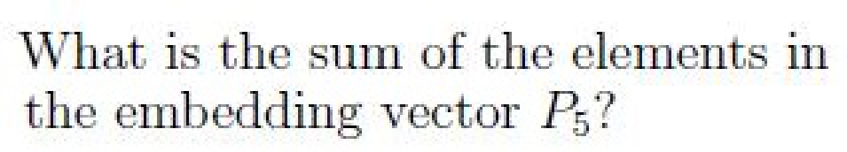

#### Worked answer

**Final answer:** −0.675262 approximately.

**Steps:** The original image asks for P_5, despite the inventory transcription P_3. With dimension 2, P_5 = [sin(5), cos(5)], whose sum is sin(5)+cos(5).

**Status:** derived

**verified_by_code:** `false` — depends on figure, no code path

---

### 2024 T1 Quiz 1 NA, Q185

**Paper:** `2024T1_Q1_NA` · **Type:** SA · **Marks:** 2 · **Topic(s):** w2-positional-encoding

What is the sum of the elements in the 3-rd token, $h_3 \in H$

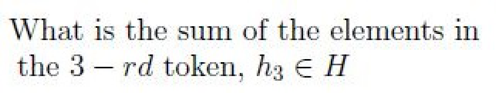

#### Worked answer

**Final answer:** 0.151128 approximately.

**Steps:** Zero-based position 3 is T, whose embedding is [0, 1]; add [sin(3), cos(3)]. The components sum to 1+sin(3)+cos(3).

**Status:** derived

**verified_by_code:** `false` — depends on figure, no code path

---

### 2024 T1 Quiz 1 NA, Q190

**Paper:** `2024T1_Q1_NA` · **Type:** MCQ · **Marks:** 4 · **Topic(s):** w2-cross-attention

Let $R_E \in \mathbb{R}^{T_1 \times d_{model}}$ be the representation from the topmost encoder layer of the encoder and $Z_D \in \mathbb{R}^{T_2 \times d_{model}}$ be the output of Multi-head Masked Attention layer of one of the decoder layers. What will be the size of the attention matrix in the Multi-head Cross Attention layer of the same decoder layer? Assume $d_q = d_k = d_v = d$ if required.

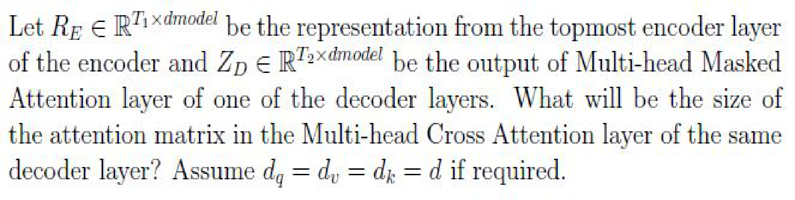

**A.** $T_1 \times T_2$

*Label added for presentation.*
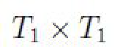

**B.** $T_2 \times T_2$

*Label added for presentation.*
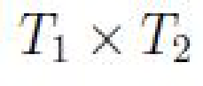

**C.** $T_1 \times T_1$

*Label added for presentation.*
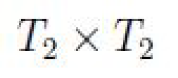

**D.** $T_2 \times T_1$

*Label added for presentation.*
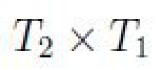

#### Worked answer

**Final answer:** D: T₂ × T₁.

**Steps:** Decoder queries have `T₂` rows and encoder keys `T₁` rows, hence QKᵀ has shape `[T₂, T₁]` per head. A reverses query/key axes; B and C are self-attention sizes.

**Status:** derived

**verified_by_code:** `false` — depends on figure, no code path

---

### 2024 T1 Quiz 1 NA, Q192

**Paper:** `2024T1_Q1_NA` · **Type:** MSQ · **Marks:** 3 · **Topic(s):** w2-teacher-forcing

Suppose we have a dataset for machine translation tasks with thousands of samples. Suppose a team considers training the transformer model. The model could be trained in two approaches

A  Autoregressive training
B  Teacher forcing

Choose the correct statements

**A.** Approach A helps the model to converge faster than approach B

*Label added for presentation.*

**B.** Approach B helps the model converge faster than approach A

*Label added for presentation.*

**C.** One can start the training with approach B first and then switch to approach A after some training steps

*Label added for presentation.*

**D.** Once the training starts with approach B and then switching to approach A after some training steps can not be done

*Label added for presentation.*

#### Worked answer

**Final answer:** B and C are the intended choices, but B is not guaranteed.

**Steps:** Teacher forcing makes target positions parallel and supplies clean prefixes; switching to model-generated prefixes is possible (C), so D is false. Faster convergence (B) is empirical, not a theorem; A is likewise not guaranteed. Autoregressive factorization itself also includes teacher forcing.

**Status:** ambiguous

**Ambiguity note:** B asserts faster convergence without conditions, and autoregressive training is not defined separately from teacher forcing.

**verified_by_code:** `false` — No numeric checker path; answer remains explicitly ambiguous.

---

### 2024 T1 Quiz 1 NA, Q196

**Paper:** `2024T1_Q1_NA` · **Type:** MCQ · **Marks:** 4 · **Topic(s):** w2-masked-self-attention

The attention score matrix given in Table 1 is appropriate for the causal language modelling task

**A.** True

*Label added for presentation.*

**B.** False

*Label added for presentation.*

**C.** Insufficient information

*Label added for presentation.*

#### Worked answer

**Final answer:** A: True.

**Steps:** The source table is lower triangular with nonnegative rows summing to 1, so no future key receives weight. B incorrectly claims incompatibility; C overlooks the supplied matrix. Exact zeros for allowed entries can arise as rounded values.

**Status:** derived

**verified_by_code:** `false` — Non-numeric response; no numeric checker path applies.

---

### 2024 T1 Quiz 1 NA, Q197

**Paper:** `2024T1_Q1_NA` · **Type:** SA · **Marks:** 4 · **Topic(s):** w2-masked-self-attention

Assume the time step starts from t = 0 and ends at t = 6. Suppose the model is at time step t = 4, what is the attention value assigned for the word “is”?

#### Worked answer

**Final answer:** 0.

**Steps:** The sequence indexes [BOS], This, is, a, cool, idea, [EOS] from 0; the source table entry at row 4, column 2 is 0.

**Status:** derived

**verified_by_code:** `false` — depends on figure, no code path

---

### 2024 T3 Quiz 1 NA, Q275

**Paper:** `2024T3_Q1_NA` · **Type:** MCQ · **Marks:** 2 · **Topic(s):** w2-teacher-forcing

Teacher forcing for training an transformer model is:

**A.** mandatory.

*Label added for presentation.*

**B.** optional.

*Label added for presentation.*

#### Worked answer

**Final answer:** B: optional.

**Steps:** Teacher forcing is a training choice; generated-prefix training is possible. A incorrectly makes it mandatory.

**Status:** derived

**verified_by_code:** `false` — Non-numeric response; no numeric checker path applies.

---

### 2024 T3 Quiz 1 NA, Q276

**Paper:** `2024T3_Q1_NA` · **Type:** MCQ · **Marks:** 2 · **Topic(s):** w2-residual-layernorm, w2-positional-encoding

Choose the correct statements regarding transformer architecture:

**A.** Residual connections are practically optional in a transformer model with 10 encoder layers and 10 decoder layers.

*Label added for presentation.*

**B.** Having multiple heads helps in capturing different relationships between input tokens.

*Label added for presentation.*

**C.** One hot encoding is a good choice for position encoding.

*Label added for presentation.*

**D.** Batch normalization can be used instead of layer normalization.

*Label added for presentation.*

**E.** None of these.

*Label added for presentation.*

#### Worked answer

**Final answer:** B and D are both defensible.

**Steps:** B: heads can attend in different representation subspaces. D: batch normalization can replace layer normalization in Transformer variants, although it has different batch and padding behavior. A dismisses important optimization aids; C is a poor general choice because fixed one-hot positions do not naturally extrapolate; E is false.

**Status:** ambiguous

**Ambiguity note:** Single-answer MCQ has at least two defensible choices: multi-head diversity and the possibility of using batch normalization.

**verified_by_code:** `false` — No numeric checker path; answer remains explicitly ambiguous.

---

### 2024 T3 Quiz 1 NA, Q277

**Paper:** `2024T3_Q1_NA` · **Type:** SA · **Marks:** 2 · **Topic(s):** w2-decoder-output-and-params

Assume the model has two layers (N = 2). Calculate the total number of parameters in the model (excluding the embedding layer and output layer). Moreover, no bias was added to the neuron in the FFNN layers.

#### Worked answer

**Final answer:** 230,656 under standard bias-free attention and two layers per stack.

**Steps:** Each attention block has 4×64²=16,384 weights; two encoder and two decoder layers contain 6 blocks. Four FFNs contribute 4×2×64×256; ten layer norms contribute 10×2×64. Total 98,304+131,072+1,280=230,656.

**Status:** ambiguous

**Ambiguity note:** Attention projection biases and whether N=2 applies independently to encoder and decoder are not specified; allowing projection biases changes the count.

**verified_by_code:** `false` — depends on figure, no code path

---

### 2024 T3 Quiz 1 NA, Q278

**Paper:** `2024T3_Q1_NA` · **Type:** SA · **Marks:** 2 · **Topic(s):** w2-decoder-output-and-params

How many parameters does the output layer have?

#### Worked answer

**Final answer:** 48,000 weights if the output projection has no bias.

**Steps:** The target projection has `64 × 750` weights, giving 48,000. A 750-element output bias would increase this to 48,750; tied weights alter independent parameter accounting.

**Status:** ambiguous

**Ambiguity note:** Output bias and weight tying are not specified.

**verified_by_code:** `false` — depends on figure, no code path

---

### 2024 T3 Quiz 1 NA, Q279

**Paper:** `2024T3_Q1_NA` · **Type:** SA · **Marks:** 2 · **Topic(s):** w2-decoder-output-and-params

How many parameters does the embedding layer have?

#### Worked answer

**Final answer:** 32,000 for the source table; 80,000 for both source and target tables.

**Steps:** Source embeddings use `500 × 64`=32,000 weights; target embeddings use `750 × 64`=48,000. Both tables together contain 80,000 when untied.

**Status:** ambiguous

**Ambiguity note:** The question does not identify which of the two embedding layers to count or specify tying.

**verified_by_code:** `false` — depends on figure, no code path

---

### 2024 T3 Quiz 1 NA, Q280

**Paper:** `2024T3_Q1_NA` · **Type:** SA · **Marks:** 2 · **Topic(s):** w2-decoder-output-and-params

At time step t = 1, the prediction probability for the words “Naan”, “transformer” and “padaththai” are 0.55,0.15 and 0.2, respectively. What is the probability for the word “rasithen”? If you think, the given information is insufficient enter -1

#### Worked answer

**Final answer:** −1: insufficient information.

**Steps:** The named three probabilities sum to 0.90. The remaining 0.10 is distributed among rasithen and the other target vocabulary entries, so its individual probability cannot be inferred.

**Status:** derived

**verified_by_code:** `true` — solve_numeric.py recomputed adjudicated inputs/conventions; all recorded values and adjudication checks MATCH.

---

### 2024 T3 Quiz 1 NA, Q281

**Paper:** `2024T3_Q1_NA` · **Type:** SA · **Marks:** 2 · **Topic(s):** w2-residual-layernorm

Say matrix F is computed by applying batch normalization on X, what will be sum of every element in first/topmost row of F?

#### Worked answer

**Final answer:** 0.

**Steps:** Batch normalization centers each feature across its sample row. Therefore the centered first row sums to zero, and division by its common standard deviation preserves the zero sum.

**Status:** derived

**verified_by_code:** `false` — depends on figure, no code path

---

### 2024 T3 Quiz 1 NA, Q282

**Paper:** `2024T3_Q1_NA` · **Type:** SA · **Marks:** 2 · **Topic(s):** w2-residual-layernorm

Say matrix F is computed by applying layer normalization on X, what will be sum of every element in first/leftmost column of F?

#### Worked answer

**Final answer:** 0.

**Steps:** Layer normalization centers each sample across its feature column; the common denominator preserves the zero sum of its centered first column.

**Status:** derived

**verified_by_code:** `false` — depends on figure, no code path

---

### 2024 T3 Quiz 1 NA, Q283

**Paper:** `2024T3_Q1_NA` · **Type:** SA · **Marks:** 2 · **Topic(s):** w2-residual-layernorm

Say $\sigma_1, \sigma_2$ and $\sigma_3$ were the standard deviations used to compute batch normalization of X. What is $\sum_{i=1}^3 \sigma_i^2$?

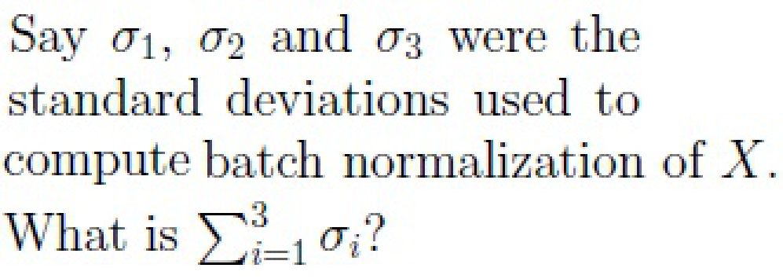

#### Worked answer

**Final answer:** Approximately 7.243 using population standard deviations.

**Steps:** The image asks for the sum of standard deviations, not their squares. For the three feature rows, population variances are 2/3, 74/9 and 38/3; their square roots sum to 7.242964. Epsilon 10⁻⁶ affects normalization denominators negligibly.

**Status:** derived

**verified_by_code:** `false` — depends on figure, no code path

---

### 2024 T3 Quiz 1 NA, Q284

**Paper:** `2024T3_Q1_NA` · **Type:** SA · **Marks:** 2 · **Topic(s):** w2-residual-layernorm

Say $\sigma_1, \sigma_2$ and $\sigma_3$ were the standard deviations used to compute layer normalization of X. What is $\sum_{i=1}^3 \sigma_i^2$?

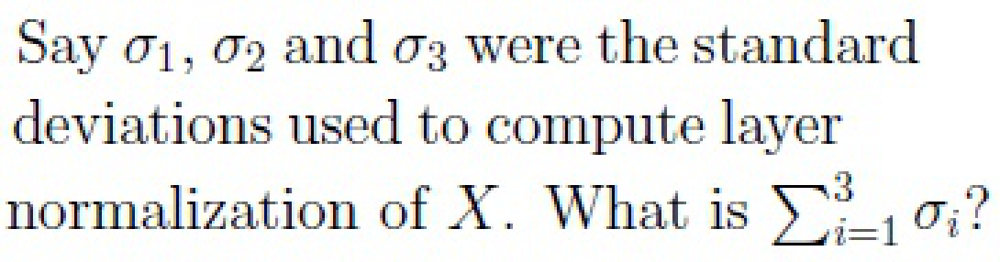

#### Worked answer

**Final answer:** Approximately 10.276 using population standard deviations.

**Steps:** The image asks for the sum of standard deviations, not their squares. Across the three sample columns the population variances are 74/9, 38/9 and 86/3, whose square roots sum to 10.276373.

**Status:** derived

**verified_by_code:** `false` — depends on figure, no code path

---

### 2024 T3 Quiz 1 NA, Q291

**Paper:** `2024T3_Q1_NA` · **Type:** MCQ · **Marks:** 2 · **Topic(s):** w2-masked-self-attention

What will be shape of the mask M?

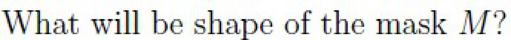

**A.** 16 × 16

*Label added for presentation.*

**B.** 32 × 32

*Label added for presentation.*

**C.** 64 × 64

*Label added for presentation.*

**D.** 128 × 128

*Label added for presentation.*

**E.** None of these.

*Label added for presentation.*

#### Worked answer

**Final answer:** C: 64 × 64.

**Steps:** The causal mask has one row per query and one column per key; the sequence length is 64. A, B and D use incorrect sequence lengths; E is false since C fits.

**Status:** derived

**verified_by_code:** `false` — depends on figure, no code path

---

### 2024 T3 Quiz 1 NA, Q293

**Paper:** `2024T3_Q1_NA` · **Type:** SA · **Marks:** 3 · **Topic(s):** w2-positional-encoding

Consider the embedding vector for a word, $x = [0.1, 0.2, -0.3, 0.4]$. Suppose the word is at position 2 in the given sentence. Add the corresponding position embedding $p$ to the word embedding to get $h$, i.e. the sum of the elements in $h = x + p$. Use the fixed-sinusoidal position embedding vector calculated using the formula given below

$$PE(pos, 2i) = \sin\left(\frac{pos}{10000^{2i/d_{model}}}\right)$$

$$PE(pos, 2i+1) = \cos\left(\frac{pos}{10000^{2i/d_{model}}}\right)$$

What is $h[0] + h[1]$ i.e. sum of first two elements of $h$?

![Question 293 prompt: sinusoidal positional embedding formula and sum of elements h[0] + h[1]](assets/da5004_2024T3_Q1_NA/q293-q293-stem-01-p013.png)

## Answer key

| Source question | Source identity | Correct answer | PDF pages |
| :--- | :--- | :--- | :--- |
| 275 | 640653993604 | optional. | 3 |
| 276 | 640653993616 | Having multiple heads helps in capturing different relationships between input tokens. | 3 |
| 277 | 640653993600 | 230656 | 4, 5 |
| 278 | 640653993601 | 48000 | 5 |
| 279 | 640653993602 | 32000 | 5 |
| 280 | 640653993603 | -1 | 5, 6 |
| 281 | 640653993618 | 0 to 0.01 | 6 |
| 282 | 640653993619 | 0 to 0.01 | 6, 7 |
| 283 | 640653993620 | 8.95 to 9.05 | 7 |
| 284 | 640653993621 | 12.45 to 12.55 | 7, 8 |
| 285 | 640653993612 | 0.41 | 9 |
| 286 | 640653993613 | 1.6 | 9 |
| 287 | 640653993614 | -1 | 9, 10 |
| 288 | 640653993615 | -1 | 10 |
| 289 | 640653993608 | 64 × 128 | 11 |
| 290 | 640653993609 | 128 × 32 | 11 |
| 291 | 640653993610 | 64 × 64 | 12 |
| 292 | 640653993605 | 0 | 12, 13 |
| 293 | 640653993606 | 0.75 to 0.85 | 13 |

## Extraction notes

**Status:** verified-source-limitation
**Count reconciliation:** The portal header declares 10 questions and 40 marks for Section 14 (LLM). The 40 marks reconcile exactly across the 19 academic questions: Q275 (2) + Q276 (2) + Comprehension 277-280 subquestions Q277 (2) + Q278 (2) + Q279 (2) + Q280 (2) + Comprehension 281-284 subquestions Q281 (2) + Q282 (2) + Q283 (2) + Q284 (2) + Comprehension 285-288 subquestions Q285 (1) + Q286 (2) + Q287 (2) + Q288 (2) + Comprehension 289-291 subquestions Q289 (2) + Q290 (2) + Q291 (2) + Q292 (4) + Q293 (3) = 40 marks. The source PDF contains 7 portal sub-sections (Sub-sections 1 to 7), 1 administrative subject confirmation entry (Q273, 0 marks), 1 shared-context calculation note entry (ctx-274, 0 marks), 4 comprehension passages (ctx-277-280, ctx-281-284, ctx-285-288, ctx-289-291), and 19 academic questions (Q275-Q293). The declared count of 10 questions in the portal header corresponds to the portal container groupings / sub-sections rather than the 19 individual academic items; this portal-count relationship is preserved as an observed factual reconciliation with source limitation.

- The LLM exam paper is delivered via an online computer-based portal. Section 14 (LLM) begins at physical page 1 (y=672.4) and ends on physical page 13 (y=603.3) immediately preceding Section 15 (DLP).
- Official answers for all MCQ items are uniquely identified by green option markers (color 32768, xref 19) in the source PDF.
- Official answers for all Short Answer items are specified by explicit Possible Answers fields in the source PDF.
- Passages for comprehension questions (277-280, 281-284, 285-288, 289-291) and the General Note are modeled as shared-context entries with appropriate cross-references.
- All visual raster mathematical expressions, formulas, matrices, and comprehension passages have been extracted as high-fidelity PNG assets and transcribed into LaTeX.
- Section 14 (LLM) portal header declares Number of Questions: 10 and Number of Questions to be attempted: 10 (with Section Marks: 40). However, the section contains 7 portal sub-sections and 19 academic questions totaling exactly 40 marks. The declared count of 10 differs from the observed 19 academic questions and 7 sub-sections. The source does not establish an explanation for this discrepancy; no portal aggregation interpretation is inferred.

**Excluded source entries:**

- {"classification": "preceding-subject-questions", "page": 1, "bbox": [22.87, 0.0, 560.0, 660.0], "reason": "Out-of-scope finance / project evaluation questions (Q271, Q272 and unnumbered fragment) belonging to preceding section prior to LLM Section 14 start", "identity": "271-272"}
- {"classification": "subject-confirmation", "page": 2, "bbox": [22.87, 303.6, 569.03, 560.0], "reason": "Administrative subject confirmation asking candidate to confirm subject and cross check hall ticket", "identity": "273"}
- {"classification": "administrative-acknowledgment-options", "page": 2, "bbox": [23.62, 775.12, 560.0, 812.26], "reason": "Administrative acknowledgment options (Instructions has been mentioned above / This Instructions is just for a reference & not for an evaluation) excluded semantically while preserving calculation note as shared context", "identity": "274"}
- {"classification": "following-subject-heading", "page": 13, "bbox": [20.62, 603.3, 405.42, 821.0], "reason": "Out-of-scope heading for subsequent Section 15 DLP (Section Id 64065369324)", "identity": "Section 15"}

#### Worked answer

**Final answer:** Approximately 0.79315.

**Steps:** For the first sine/cosine pair at position 2, p₀=sin(2), p₁=cos(2), hence h₀+h₁=0.1+0.2+sin(2)+cos(2).

**Status:** derived

**verified_by_code:** `true` — solve_numeric.py recomputed adjudicated inputs/conventions; all recorded values and adjudication checks MATCH.

---

### 2025 T1 Quiz 1 NA, Q104

**Paper:** `2025T1_Q1_NA` · **Type:** MCQ · **Marks:** 2 · **Topic(s):** w2-cross-attention

Let $H_e \in \mathbb{R}^{T_1 \times d_{model}}$ be the representation from the topmost encoder layer of the encoder and $Z_d \in \mathbb{R}^{T_2 \times d_{model}}$ be the output of Multihead Masked Attention layer of one of the decoder layers. What will be the size of the attention matrix in the Multi-head Cross Attention layer of the same decoder layer? Assume $d_k = d_q = d_v = d$ if required.

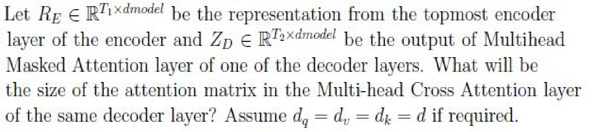

**A.** $T_1 \times T_1$
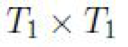

**B.** $T_1 \times T_2$
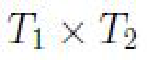

**C.** $T_2 \times T_2$
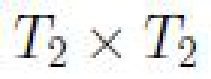

**D.** $T_2 \times T_1$
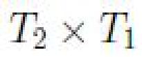

#### Worked answer

**Final answer:** D: T₂ × T₁.

**Steps:** Decoder query length is T₂; encoder key length is T₁. Therefore QKᵀ is `[T₂, T₁]` per head. A and C are square self-attention sizes; B reverses axes.

**Status:** derived

**verified_by_code:** `false` — depends on figure, no code path

---

### 2025 T1 Quiz 1 NA, Q105

**Paper:** `2025T1_Q1_NA` · **Type:** MCQ · **Marks:** 2 · **Topic(s):** w2-teacher-forcing

Consider following assertion and reason pair:

Assertion: A transformer model cannot be trained in autogregressive mode for machine
translation task.
Reason: Teacher forcing improves the convergence rate.

Choose the correct statements

**A.** Assertion and Reason are both true and Reason is a correct explanation of
Assertion.

**B.** Assertion and Reason are both true and Reason is not a correct explanation of
Assertion.

**C.** Assertion is true but Reason is false.

**D.** Assertion is false but Reason is true.

#### Worked answer

**Final answer:** D is the intended answer.

**Steps:** Autoregressive translation training is possible, so the assertion is false. Teacher forcing often accelerates training by parallelizing known target prefixes. A–C incorrectly label the assertion true.

**Status:** ambiguous

**Ambiguity note:** The reason asserts a universal convergence-rate improvement; the training speed benefit does not guarantee faster convergence in every setting.

**verified_by_code:** `false` — No numeric checker path; answer remains explicitly ambiguous.

---

### 2025 T1 Quiz 1 NA, Q111

**Paper:** `2025T1_Q1_NA` · **Type:** SA · **Marks:** 2 · **Topic(s):** w2-positional-encoding

Suppose the number of learnable parameters in the source input-embedding layer is 3200, how
many parameters are there in the positional embedding layer of the source language?

#### Worked answer

**Final answer:** 0 for fixed sinusoidal positions; 1,024 for a learned position table.

**Steps:** Source word embeddings have 100d=3,200, so d=32. A learned table for 32 positions has 32×32=1,024 parameters, whereas the original vanilla Transformer uses fixed sinusoidal encodings with no learnable positional parameters.

**Status:** ambiguous

**Ambiguity note:** The question calls the architecture vanilla but does not specify whether position encodings are learned; Vaswani et al. use fixed sinusoids.

**verified_by_code:** `false` — depends on figure, no code path

---

### 2025 T1 Quiz 1 NA, Q114

**Paper:** `2025T1_Q1_NA` · **Type:** SA · **Marks:** 1 · **Topic(s):** w2-residual-layernorm

Say matrix F is computed by applying batch normalization on X, what will be sum of every element
in first / topmost row of F?

#### Worked answer

**Final answer:** 0.

**Steps:** Batch normalization centers each feature row over four samples; all entries have the same denominator and their sum is zero.

**Status:** derived

**verified_by_code:** `false` — depends on figure, no code path

---

### 2025 T1 Quiz 1 NA, Q115

**Paper:** `2025T1_Q1_NA` · **Type:** SA · **Marks:** 1 · **Topic(s):** w2-residual-layernorm

Say matrix F is computed by applying layer normalization on X, what will be sum of every element
in first / leftmost column of F?

#### Worked answer

**Final answer:** 0.

**Steps:** Layer normalization centers the two features within the first sample; their normalized values sum to zero.

**Status:** derived

**verified_by_code:** `false` — depends on figure, no code path

---

### 2025 T1 Quiz 1 NA, Q116

**Paper:** `2025T1_Q1_NA` · **Type:** SA · **Marks:** 2 · **Topic(s):** w2-residual-layernorm

Say $\sigma_i$'s were the standard deviations used to compute batch normalization of $X$. What is $\sum_{i=1}^2 \sigma_i$?

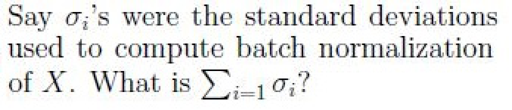

#### Worked answer

**Final answer:** Approximately 6.50047.

**Steps:** Standard population variances of the two feature rows are 7.25 and 14.5; the sum of their standard deviations is √7.25+√14.5. The paper image specifies epsilon 10⁻⁶.

**Status:** derived

**verified_by_code:** `false` — depends on figure, no code path

---

### 2025 T1 Quiz 1 NA, Q117

**Paper:** `2025T1_Q1_NA` · **Type:** SA · **Marks:** 2 · **Topic(s):** w2-residual-layernorm

Say $\sigma_i$'s were the standard deviations used to compute layer normalization of $X$. What is $\sum_{i=1}^4 \sigma_i$?

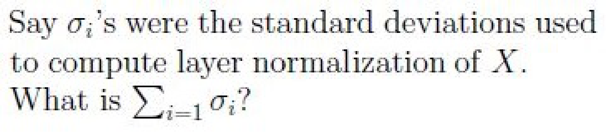

#### Worked answer

**Final answer:** 11.

**Steps:** For each two-feature sample, population standard deviation is half the absolute feature difference: 1.5, 2.5, 4 and 3. Their sum is 11.

**Status:** derived

**verified_by_code:** `false` — depends on figure, no code path

---

### 2025 T2 Quiz 1 NA, Q139

**Paper:** `2025T2_Q1_NA` · **Type:** MCQ · **Marks:** 2 · **Topic(s):** w2-residual-layernorm

Why are residual connections important in transformer architectures?

**A.** They reduce memory consumption.

**B.** They add extra cost of compute by adding batch normalization.

**C.** They help in training deep networks by enabling gradient flow.

**D.** They remove the need for layer normalization.

#### Worked answer

**Final answer:** C.

**Steps:** The identity path in a residual connection facilitates gradient propagation through deep networks. A is not its general effect; B confuses residuals with batch normalization; D is false because residuals do not eliminate the role of layer normalization.

**Status:** derived

**verified_by_code:** `false` — Non-numeric response; no numeric checker path applies.

---

### 2025 T2 Quiz 1 NA, Q144

**Paper:** `2025T2_Q1_NA` · **Type:** SA · **Marks:** 3 · **Topic(s):** w2-positional-encoding

Consider the embedding vector for a word, $x = [0.5, -0.4, 0.3, -0.2]^T$. Suppose the word is at position 3 in the given sentence. Add the corresponding position embedding $p$ to the word embedding to get $h$, i.e. the sum of the elements in $h = x + p$. Use the fixed sinusoidal position embedding vector calculated using the formula given below:

$$\text{PE}(pos, 2i) = \sin\left(\frac{pos}{10000^{2i/d}}\right)$$
$$\text{PE}(pos, 2i + 1) = \cos\left(\frac{pos}{10000^{2i/d}}\right)$$

What is the value of $h[0] - h[1]$ i.e. substract second element from the first element of $h$ vector ? (Answer correct up to 2 values after the decimal)

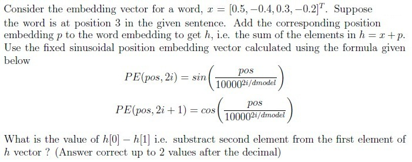

#### Worked answer

**Final answer:** 2.03.

**Steps:** At position 3, p₀=sin(3), p₁=cos(3), so h₀−h₁=(0.5−(−0.4))+sin(3)−cos(3)=2.0311125, rounded to two decimals.

**Status:** derived

**verified_by_code:** `false` — depends on figure, no code path

---

### 2025 T2 Quiz 1 NA, Q150

**Paper:** `2025T2_Q1_NA` · **Type:** SA · **Marks:** 1 · **Topic(s):** w2-residual-layernorm

For the given input matrix X and multihead attention output MHA(X), apply a residual connection and store the result in matrix R, and finally compute the sum of all elements in matrix R.

#### Worked answer

**Final answer:** 32

**Steps:** The passage image gives X=[[1,1],[2,3],[1,2],[3,1]] and MHA(X)=[[1,2],[3,3],[2,3],[3,1]], with tokens in columns. Thus R=[[2,3],[5,6],[3,5],[6,2]], whose entries sum to 32. The transcription and printed key differ from the image.

**Status:** ambiguous

**Ambiguity note:** The source image matrices conflict with the transcription and official key; 32 follows the visible matrices.

**verified_by_code:** `false` — depends on figure, no code path

---

### 2025 T2 Quiz 1 NA, Q151

**Paper:** `2025T2_Q1_NA` · **Type:** SA · **Marks:** 2 · **Topic(s):** w2-residual-layernorm

To apply the layer normalization on the matrix R. How many learning parameters ($\theta$) will be required ?

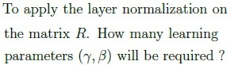

#### Worked answer

**Final answer:** 8 trainable parameters

**Steps:** The passage states d_model=4, and its `4 × 2` image represents two tokens with four features each. LayerNorm has one gain and one bias per feature, shared across tokens: 4+4=8.

**Status:** derived

**verified_by_code:** `false` — depends on figure, no code path

---

### 2025 T2 Quiz 1 NA, Q152

**Paper:** `2025T2_Q1_NA` · **Type:** SA · **Marks:** 3 · **Topic(s):** w2-residual-layernorm

Initialize $\gamma = 2, \beta = 1$ and use $\epsilon = 0$ and apply the layer normalization on the matrix R and sum of all the elements of the final output.

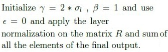

#### Worked answer

**Final answer:** 8

**Steps:** The image specifies gamma=2σ_l, beta=1, epsilon=0, not gamma=2. For either token column, centering makes the four normalized features sum to zero; multiplying all by the same gamma for that column preserves this. Adding 1 to each of 8 entries yields sum 8.

**Status:** derived

**verified_by_code:** `false` — depends on figure, no code path

---

### 2025 T3 Quiz 1 NA, Q174

**Paper:** `2025T3_Q1_NA` · **Type:** MCQ · **Marks:** 2 · **Topic(s):** w2-positional-encoding

Which of the following is true regarding sinusoidal encoding?

**A.** The encoding vector of words present at even positions in the given text sequence uses sine, and the encoding vector of words present at odd positions uses cosine.

*Label added for presentation.*

**B.** The encoding vector of words present at odd positions in the given text sequence uses sine, and the encoding vector of words present at even positions uses cosine.

*Label added for presentation.*

**C.** The encoding vector for each word position contains values computed using both sine (for even dimensions) and cosine (for odd dimensions).

*Label added for presentation.*

#### Worked answer

**Final answer:** C — each position uses sine in even dimensions and cosine in odd dimensions

**Steps:** The original encoding alternates the trigonometric function by dimension, not by token-position parity. Therefore A and B incorrectly assign a single function by word position.

**Status:** derived

**verified_by_code:** `false` — Non-numeric response; no numeric checker path applies.

---

### 2025 T3 Quiz 1 NA, Q175

**Paper:** `2025T3_Q1_NA` · **Type:** MCQ · **Marks:** 2 · **Topic(s):** w2-teacher-forcing

We have a transformer model translating English to French. Suppose the target sequence is:

Target (French): ['je', 'suis', 'heureux']

Suppose the model predicted at time step $t$:
$t = 1$: 'je'
$t = 2$: 'content'
$t = 3$: 'heureux'

If teacher forcing is used, what will be the decoder input at time step 3?

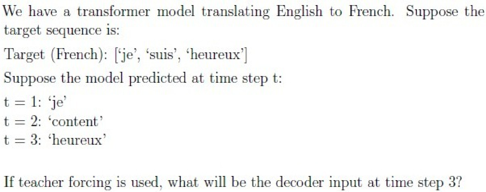

**A.** ‘content’

*Label added for presentation.*

**B.** ‘je’

*Label added for presentation.*

**C.** ‘suis’

*Label added for presentation.*

**D.** ‘heureux’

*Label added for presentation.*

#### Worked answer

**Final answer:** C — suis

**Steps:** At step 3 teacher forcing supplies the ground-truth token at step 2, suis. A is the wrong model prediction at step 2; B is the step-1 target; D is the step-3 target rather than the preceding input.

**Status:** derived

**verified_by_code:** `false` — Non-numeric response; no numeric checker path applies.

---

### 2025 T3 Quiz 1 NA, Q176

**Paper:** `2025T3_Q1_NA` · **Type:** MCQ · **Marks:** 2 · **Topic(s):** w2-masked-self-attention

We have a decoder input of length 4 tokens: [x1, x2, x3, x4].
We use masked self-attention with the following pre-softmax attention scores:

$$\begin{bmatrix} 2 & 1 & 3 & 4 \\ 3 & 2 & 1 & 4 \\ 1 & 2 & 0 & 2 \\ 0 & 1 & 1 & 2 \end{bmatrix}$$

For token x3, the pre-softmax row is [1, 2, 0, 2]. After masking, what does it become?

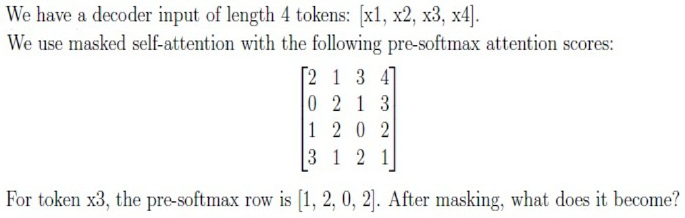

**A.** [1, 2, 0, 2]

![Option A: [1, 2, 0, 2]](assets/da5004_2025T3_Q1_NA/q176-q176-option-a-01-p003.png)

*Label added for presentation.*

**B.** [1, 2, 0, 0]

![Option B: [1, 2, 0, 0]](assets/da5004_2025T3_Q1_NA/q176-q176-option-b-01-p003.png)

*Label added for presentation.*

**C.** [1, 2, 0, -\infty]

![Option C: [1, 2, 0, -inf]](assets/da5004_2025T3_Q1_NA/q176-q176-option-c-01-p003.png)

*Label added for presentation.*

**D.** [-\infty, 2, 0, 2]

![Option D: [-inf, 2, 0, 2]](assets/da5004_2025T3_Q1_NA/q176-q176-option-d-01-p003.png)

*Label added for presentation.*

**E.** [-\infty, -\infty, -\infty, 2]

![Option E: [-inf, -inf, -inf, 2]](assets/da5004_2025T3_Q1_NA/q176-q176-option-e-01-p003.png)

*Label added for presentation.*

#### Worked answer

**Final answer:** C — [1, 2, 0, −∞]

**Steps:** Query x3 can attend to positions 1, 2 and 3; future x4 receives −∞ before softmax. A leaves the future visible; B sets its logit to 0, which still has positive softmax weight; D masks a past token; E masks the allowed prefix and retains the future.

**Status:** derived

**verified_by_code:** `false` — Non-numeric response; no numeric checker path applies.

---

### 2025 T3 Quiz 1 NA, Q177

**Paper:** `2025T3_Q1_NA` · **Type:** MCQ · **Marks:** 2 · **Topic(s):** w2-teacher-forcing

In the context of language model training, teacher forcing is a technique where:

**A.** The correct target tokens from the training data are used as input for the next time step, regardless of the model’s prediction.

*Label added for presentation.*

**B.** The model’s predictions are used as the input for the next time step, even if they are incorrect.

*Label added for presentation.*

**C.** The model is forced to learn without any pre-trained weights.

*Label added for presentation.*

**D.** The model is forced to correct the input data.

*Label added for presentation.*

#### Worked answer

**Final answer:** A — feed the correct preceding target token

**Steps:** Teacher forcing conditions on the reference prefix, independent of predicted tokens. B instead feeds predictions; C concerns initialization; D is not the procedure.

**Status:** derived

**verified_by_code:** `false` — Non-numeric response; no numeric checker path applies.

---

### 2025 T3 Quiz 1 NA, Q179

**Paper:** `2025T3_Q1_NA` · **Type:** MCQ · **Marks:** 3 · **Topic(s):** w2-residual-layernorm

You have a mini-batch of 2 samples, each with 2 features:

$$X = \begin{bmatrix} 1 & 2 \\ 3 & 4 \end{bmatrix}$$

• Rows represent samples
• Columns represent features

If Batch Normalization is applied across the batch for each feature (assume $\gamma = 1, \beta = 0$ and $\epsilon = 0$), what is the resulting normalized mini-batch?

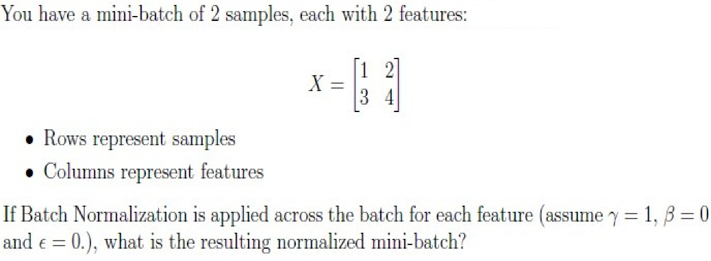

**A.** $\begin{bmatrix} -1 & -1 \\ 1 & 1 \end{bmatrix}$

![Option A: [[-1, -1], [1, 1]]](assets/da5004_2025T3_Q1_NA/q179-q179-option-a-01-p005.png)

*Label added for presentation.*

**B.** $\begin{bmatrix} -0.707 & -0.707 \\ 0.707 & 0.707 \end{bmatrix}$

![Option B: [[-0.707, -0.707], [0.707, 0.707]]](assets/da5004_2025T3_Q1_NA/q179-q179-option-b-01-p005.png)

*Label added for presentation.*

**C.** $\begin{bmatrix} -0.707 & 0.707 \\ -0.707 & 0.707 \end{bmatrix}$

![Option C: [[-0.707, 0.707], [-0.707, 0.707]]](assets/da5004_2025T3_Q1_NA/q179-q179-option-c-01-p005.png)

*Label added for presentation.*

**D.** $\begin{bmatrix} 1 & 1 \\ -1 & -1 \end{bmatrix}$

![Option D: [[1, 1], [-1, -1]]](assets/da5004_2025T3_Q1_NA/q179-q179-option-d-01-p005.png)

*Label added for presentation.*

#### Worked answer

**Final answer:** A — [[−1, −1], [1, 1]]

**Steps:** Per-feature batch means are [2,3] and population variances are [1,1], so standardizing each column gives A. B uses a sample-variance convention instead of the standard BN batch variance; C normalizes along the wrong axis and also uses that convention; D reverses the signs.

**Status:** derived

**verified_by_code:** `false` — depends on figure, no code path

---

### 2025 T3 Quiz 1 NA, Q184

**Paper:** `2025T3_Q1_NA` · **Type:** MSQ · **Marks:** 4 · **Topic(s):** w2-full-transformer

Which of the following statements about the Transformer architecture are true?

**A.** Masking (look-ahead mask) is applied in every decoder self-attention layer, not just the first one.

*Label added for presentation.*

**B.** Token embeddings are used in the encoder but not in the decoder.

*Label added for presentation.*

**C.** Positional encoding is required only in the encoder, not in the decoder.

*Label added for presentation.*

**D.** Token embeddings are used in both the encoder and the decoder.

*Label added for presentation.*

**E.** Positional encodings are added to the input embeddings in both the encoder and the decoder.

*Label added for presentation.*

#### Worked answer

**Final answer:** A, D and E

**Steps:** Every decoder self-attention layer is causally masked (A); original encoder and decoder both use token embeddings (D) and positional encodings (E). B denies decoder embeddings, while C denies decoder positional encoding.

**Status:** derived

**verified_by_code:** `false` — Non-numeric response; no numeric checker path applies.

---

### 2025 T3 Quiz 1 NA, Q190

**Paper:** `2025T3_Q1_NA` · **Type:** SA · **Marks:** 2 · **Topic(s):** w2-masked-self-attention

For one sequence, how many non-zero attention scores remain in the masked attention score matrix (per head)?

#### Worked answer

**Final answer:** At most 524,800 unmasked entries per head; the number of nonzero raw scores is not determined.

**Steps:** For T=1024 the diagonal-inclusive lower triangle has T(T+1)/2=524800 permitted entries. Finite logits can themselves be zero, and an additive mask sets forbidden logits to −∞, not zero. If the question means post-softmax weights for finite logits, all allowed weights are positive and the count is 524800.

**Status:** ambiguous

**Ambiguity note:** Nonzero attention scores are not determined from sequence length alone; the question does not specify post-softmax weights or assume nonzero permitted scores.

**verified_by_code:** `false` — depends on figure, no code path

---

### 2026 T1 Quiz 1 NA, Q5

**Paper:** `2026T1_Q1_NA` · **Type:** MCQ · **Marks:** 2 · **Topic(s):** w2-cross-attention

In a standard Transformer encoder-decoder architecture, is masking typically applied in the cross-attention layer?

**A.** Yes, both causal masking and padding masking are applied to prevent the decoder from attending to future encoder positions

**B.** Yes, only causal masking is applied to maintain the autoregressive property

**C.** No causal masking is needed, but padding masking may be applied to ignore padded positions in the source sequence

**D.** No masking is ever applied in cross-attention since the encoder processes the complete input sequence

#### Worked answer

**Final answer:** C — no source causal mask; source padding may be masked

**Steps:** The complete source is available to cross-attention, but padding keys can be excluded. A and B incorrectly impose target-style causality on source positions; D ignores source padding masks.

**Status:** derived

**verified_by_code:** `false` — Non-numeric response; no numeric checker path applies.

---

### 2026 T1 Quiz 1 NA, Q11

**Paper:** `2026T1_Q1_NA` · **Type:** MSQ · **Marks:** 2 · **Topic(s):** w2-cross-attention

In the context of the Transformer architecture, which of the following statements correctly describe the source of the Query ($Q$), Key ($K$), and Value ($V$) vectors during the Cross-Attention (Encoder-Decoder Attention) mechanism?

**A.** The Keys ($K$) and Values ($V$) are derived from the output of the Decoder.

**B.** The Queries ($Q$) are generated from the previous hidden states of the Decoder.

**C.** The Queries ($Q$), Keys ($K$), and Values ($V$) all originate from the same input sequence.

**D.** This mechanism allows the Decoder to focus on relevant parts of the input sequence processed by the Encoder.

#### Worked answer

**Final answer:** B and D

**Steps:** Decoder hidden states provide Q (B), and decoder queries use encoder keys/values to select source information (D). A incorrectly sources K and V from the decoder; C describes self-attention rather than encoder–decoder attention.

**Status:** derived

**verified_by_code:** `false` — Non-numeric response; no numeric checker path applies.

---

### 2026 T1 Quiz 1 NA, Q12

**Paper:** `2026T1_Q1_NA` · **Type:** SA · **Marks:** 2 · **Topic(s):** w2-positional-encoding

Consider the positional encoding for a given position $pos$ and dimension $i$ is defined by:

$$PE_{(pos, 2i)} = \sin\left(\frac{pos}{10000^{2i/d_{model}}}\right)$$
$$PE_{(pos, 2i+1)} = \cos\left(\frac{pos}{10000^{2i/d_{model}}}\right)$$

Consider a Transformer model with a hidden state dimension $d_{model} = 128$. You are calculating the positional embedding for the 4th word in a sequence (index $pos = 3$, using 0-based indexing). Calculate the value of the 6th element (index $i = 5$) of the positional embedding vector for this word. (use radians for angle)

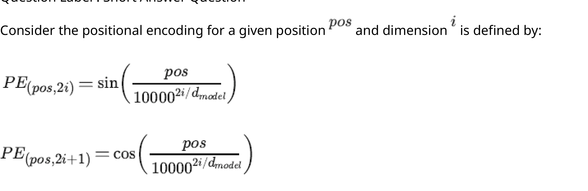

#### Worked answer

**Final answer:** cos(3/10000^(4/128)) ≈ −0.627927

**Steps:** The sixth element has zero-based coordinate 5=2×2+1, so the cosine formula uses pair index 2 and exponent 4/128. The wording calls the coordinate i=5 although i denotes the pair index in the formula; interpreting i=5 as the pair index would instead address coordinate 11.

**Status:** ambiguous

**Ambiguity note:** The question uses i=5 for a vector coordinate although the equations use i as the sine/cosine pair index; the sixth-element interpretation is given.

**verified_by_code:** `false` — depends on figure, no code path

---

### 2026 T2 Quiz 1 NA, Q7

**Paper:** `2026T2_Q1_NA` · **Type:** SA · **Marks:** 4 · **Topic(s):** w2-masked-self-attention

Consider a masked multi-head attention layer in a transformer decoder. The source vocabulary is of size $V_s = 1000$, $d_{model} = 64$ and context length $T = 128$. To enforce autoregressive generation, a causal mask is applied to the raw attention score before applying softmax. How many entries in the causal mask are set to $-\infty$ ?

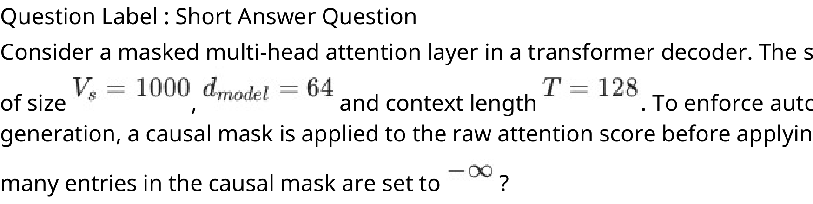

#### Worked answer

**Final answer:** 8,128 entries per `128 × 128` causal mask

**Steps:** Only the strict upper triangle is masked, giving T(T−1)/2=128×127/2=8128; vocabulary size and hidden width do not change this count. A shared mask is counted once, not once per head.

**Status:** derived

**verified_by_code:** `false` — depends on figure, no code path

---

### 2026 T2 Quiz 1 NA, Q8

**Paper:** `2026T2_Q1_NA` · **Type:** SA · **Marks:** 4 · **Topic(s):** w2-positional-encoding

Consider a Transformer model with a hidden state dimension $d_{model} = 512$. The positional encoding for a given position, $pos$ and dimension $i$ is defined by:

$$\text{PE}_{(pos, 2i)} = \sin\left(\frac{pos}{10000^{2i/d_{model}}}\right)$$

$$\text{PE}_{(pos, 2i+1)} = \cos\left(\frac{pos}{10000^{2i/d_{model}}}\right)$$

Compute the squared euclidean norm for the vector corresponding to $pos = 3$ and enter the value.

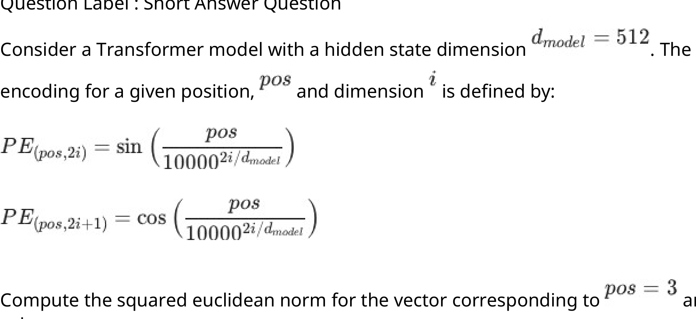

#### Worked answer

**Final answer:** 256

**Steps:** There are 512/2=256 sine–cosine pairs, each with squared norm sin²θ+cos²θ=1. Their total squared Euclidean norm is 256, independent of position.

**Status:** derived

**verified_by_code:** `false` — depends on figure, no code path

---

### 2026 T2 Quiz 1 NA, Q9

**Paper:** `2026T2_Q1_NA` · **Type:** MCQ · **Marks:** 4 · **Topic(s):** w2-teacher-forcing

Consider the following statements regarding the use of Teacher Forcing while training
autoregressive sequence-to-sequence models and select the appropriate option:

Statement 1: Teacher Forcing involves passing the input token to a larger Teacher model whose
output is then input as the next token

Statement 2: Teacher Forcing helps to prevent compounding of early incorrect predictions that
can destabilize training

**A.** Statement 1 is True but Statement 2 is False

**B.** Statement 1 is False but Statement 2 is True

**C.** Both the statements are True

**D.** Both the statements are False

#### Worked answer

**Final answer:** B — statement 1 false; statement 2 true

**Steps:** Teacher forcing feeds preceding ground-truth target tokens, not output from a larger teacher model. It prevents feeding a wrong prediction into the next training step, reducing within-prefix compounding. Thus A, C and D all misclassify at least one statement.

**Status:** derived

**verified_by_code:** `false` — Non-numeric response; no numeric checker path applies.

---

## Quiz 2 questions

### 2025 T3 Quiz 2 NA, Q113

**Paper:** `2025T3_Q2_NA` · **Type:** SA · **Marks:** 2 · **Topic(s):** w2-masked-self-attention

In a 4-token sequence, a Transformer is calculating the attention for the third Token. Its Query vector ($q_3$) must be compared against the Key vectors ($k_1, k_2, k_3, k_4$) of all tokens. The Causal LM mask is applied to the raw scores before the softmax function. The raw dot-product scores are:

• $q_3 \cdot k_1 = 1.8$
• $q_3 \cdot k_2 = 0.5$
• $q_3 \cdot k_3 = 2.0$
• $q_3 \cdot k_4 = 1.2$

After the Causal LM mask and the subsequent softmax function are applied, what will be the final attention probability assigned to Token 4?

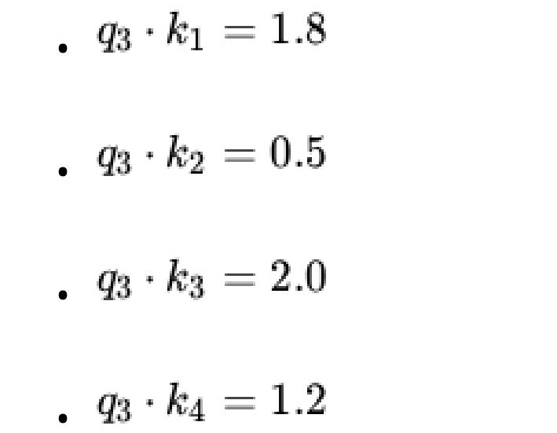

#### Worked answer

**Final answer:** 0

**Steps:** Token 4 is future relative to query 3. The causal mask changes its logit to −∞ and exp(−∞)=0, so the softmax probability is exactly 0 regardless of the other finite scores.

**Status:** derived

**verified_by_code:** `false` — depends on figure, no code path

---

### 2025 T3 Quiz 2 NA, Q127

**Paper:** `2025T3_Q2_NA` · **Type:** MCQ · **Marks:** 2 · **Topic(s):** w2-residual-layernorm

For a layer with 512 features, how many learnable parameters do BatchNorm and LayerNorm have?

**A.** BatchNorm: 512, LayerNorm: 512

**B.** BatchNorm: 1024, LayerNorm: 512

**C.** BatchNorm: 512, LayerNorm: 1024

**D.** BatchNorm: 1024, LayerNorm: 1024

#### Worked answer

**Final answer:** D — BatchNorm 1,024 and LayerNorm 1,024

**Steps:** Each standard affine normalization has 512 learned scale and 512 learned shift values, totaling 1024. A omits one set for each; B omits LayerNorm bias or scale; C omits the corresponding BatchNorm set.

**Status:** derived

**verified_by_code:** `true` — solve_numeric.py recomputed adjudicated inputs/conventions; all recorded values and adjudication checks MATCH.

---

### 2025 T3 Quiz 2 NA, Q128

**Paper:** `2025T3_Q2_NA` · **Type:** MCQ · **Marks:** 2 · **Topic(s):** w2-cross-attention

In a standard Encoder-Decoder Transformer, where do the Query $Q$, Key $K$, and Value $V$ inputs for the Decoder's Cross-Attention sub-layer come from?

**A.** $Q$ comes from the decoder's previous sub-layer; $K$ and $V$ come from the final hidden states of the encoder.

**B.** $Q$ comes from the final hidden states of the encoder; $K$ and $V$ come from the decoder's previous sub-layer.

#### Worked answer

**Final answer:** A — Q from decoder, K and V from encoder

**Steps:** The decoder sublayer produces queries, while the final encoder representations supply keys and values. B reverses these origins.

**Status:** derived

**verified_by_code:** `false` — Non-numeric response; no numeric checker path applies.

---

### 2026 T1 Quiz 2 NA, Q12

**Paper:** `2026T1_Q2_NA` · **Type:** SA · **Marks:** 2 · **Topic(s):** w2-residual-layernorm

Let $x_{ij}$ denote the activation of the $j$-th neuron for the $i$-th training sample.

In Layer Normalization, normalization is performed across features for each individual sample.

Let $H$ be the number of neurons (features) in the hidden layer.

For a given sample, the layer normalization statistics are computed as:
$$\mu_i = \frac{1}{H} \sum_{j=1}^H x_{ij}$$
$$\sigma_i^2 = \frac{1}{H} \sum_{j=1}^H (x_{ij} - \mu_i)^2$$
$$\hat{x}_{ij} = \frac{x_{ij} - \mu_i}{\sqrt{\sigma_i^2 + \epsilon}}$$
where $\epsilon$ is a small constant for numerical stability.

| Sample | Feature 1 | Feature 2 | Feature 3 | Feature 4 |
| :--- | :--- | :--- | :--- | :--- |
| 1 | 2 | 4 | 4 | 6 |
| 2 | 1 | 3 | 5 | 7 |
| 3 | 3 | 3 | 3 | 3 |

Layer Normalization is applied independently to each sample in the given data above.

For Sample 2, after applying Layer Normalization, what is the maximum value in the normalized output vector?

(ignore the learnable parameters $\gamma$ and $\beta$, and assume $\epsilon = 0$):

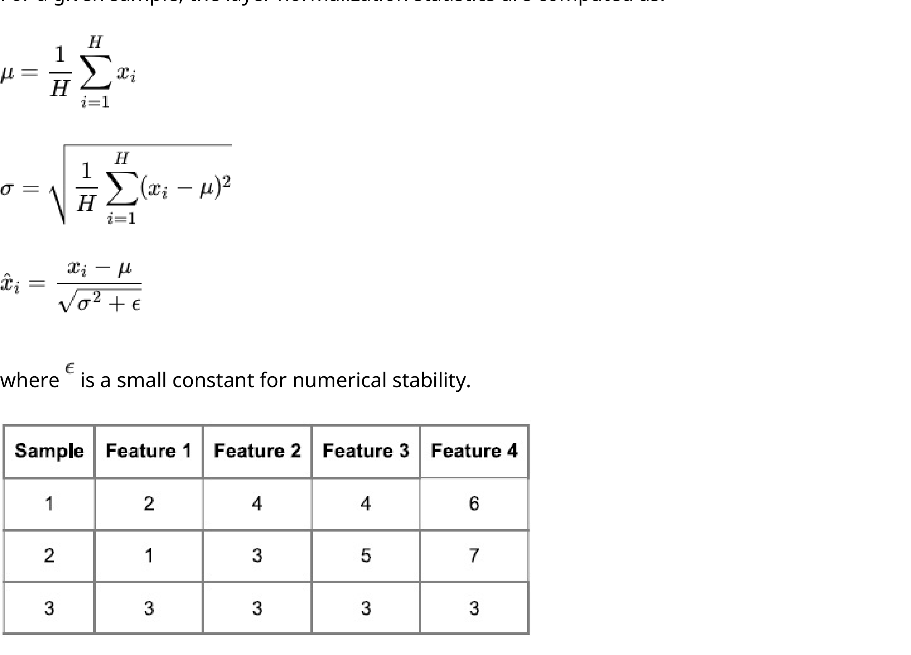

#### Worked answer

**Final answer:** 3/√5 ≈ 1.341641

**Steps:** Sample 2 is [1,3,5,7], with mean 4 and population variance (9+1+1+9)/4=5. Its largest centered value is 3, so its maximum normalized value is 3/√5. The zero variance of sample 3 is irrelevant to this question.

**Status:** derived

**verified_by_code:** `false` — depends on figure, no code path

---

### 2026 T2 Quiz 2 NA, Q2

**Paper:** `2026T2_Q2_NA` · **Type:** SA · **Marks:** 2 · **Topic(s):** w2-residual-layernorm

In the given Transformer architecture for one Encoder Decoder block, identify every Add & Norm layer. Submit the corresponding component alphabets in alphabetical (ascending) order as a single uppercase string without spaces, commas, or quotation marks.

Example: If the correct components are Q, G, and S, your answer should be GQS

#### Worked answer

**Final answer:** FHMPR

**Steps:** In the diagram, F and H are the two encoder residual-plus-normalization blocks; M, P and R follow the decoder masked-attention, cross-attention and feed-forward blocks respectively. Sorting gives FHMPR.

**Status:** derived

**verified_by_code:** `false` — Non-numeric response; no numeric checker path applies.

---

### 2026 T2 Quiz 2 NA, Q3

**Paper:** `2026T2_Q2_NA` · **Type:** MCQ · **Marks:** 1 · **Topic(s):** w2-masked-self-attention

Identify the function of component "L" in the given Transformer architecture.

**A.** Positional Encoding

**B.** Feed-Forward Network

**C.** Masked Multi-Head Self-Attention

**D.** Multi-Head Cross-Attention

**E.** Linear Output Projection

#### Worked answer

**Final answer:** C — masked multi-head self-attention

**Steps:** L is the first decoder sublayer receiving shifted target representations as Q, K and V; its residual path joins M. A is positional encoding at D, B is the later feed-forward block Q, D is cross-attention O, and E is the output projection S.

**Status:** derived

**verified_by_code:** `false` — Non-numeric response; no numeric checker path applies.

---

### 2026 T2 Quiz 2 NA, Q4

**Paper:** `2026T2_Q2_NA` · **Type:** MSQ · **Marks:** 2 · **Topic(s):** w2-full-transformer

Based on the architecture shown in the given image, identify all components that appear more than once. Assume the architecture contains exactly one Encoder block and one Decoder block.

**A.** Positional Encoding

**B.** Feed-Forward Network

**C.** Masked Multi-Head Self-Attention

**D.** Multi-Head Cross-Attention

**E.** tokenizer

**F.** Add & Norm

#### Worked answer

**Final answer:** A, B and F

**Steps:** The diagram has two positional encodings B and D, two feed-forward blocks G and Q, and five Add & Norm blocks F,H,M,P,R. C appears once at L; D once at O. E is not depicted as a tokenizer (A and C are embedding blocks).

**Status:** derived

**verified_by_code:** `false` — Non-numeric response; no numeric checker path applies.

---

### 2026 T2 Quiz 2 NA, Q5

**Paper:** `2026T2_Q2_NA` · **Type:** MSQ · **Marks:** 3 · **Topic(s):** w2-masked-self-attention

A researcher is exploring an alternate approach to implement masked attention in the transformer decoder. The causal mask considered is a binary lower-triangular matrix $M$ (where $M_{ij} = 1$ for $j \le i$ and $0$ otherwise). This mask ($M$) is applied as an element-wise multiplication ($\odot$) after the softmax operation on Attention Matrix ($A$).

$$\text{softmax}(A) \odot M$$

Identify the correct statements from the following:

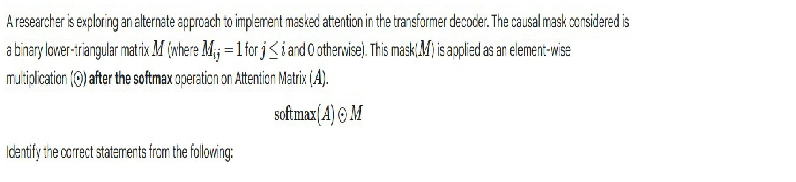

**A.** The approach violates the autoregressive property

**B.** The approach ensures autoregressive property is not violated by ensuring that
the final attention weights of future tokens are 0

**C.** The final attention weights in the new approach will be greater than or equal
to that of the original approach

**D.** The attention weights for the final token of the sequence will always be the
same for both the approaches

#### Worked answer

**Final answer:** A and D

**Steps:** Post-softmax multiplication zeros future weights but leaves allowed weights divided by the sum over all logits, including future logits. Changing future keys therefore changes earlier outputs, violating autoregressive independence (A); B overlooks this indirect dependence. Allowed weights are at most, not at least, their pre-softmax-masked counterparts, so C is false. In the final row all positions are allowed, so both methods coincide (D).

**Status:** derived

**verified_by_code:** `false` — Non-numeric response; no numeric checker path applies.

---

## End Term questions

### 2024 T1 End Term AN, Q157

**Paper:** `2024T1_ET_AN` · **Type:** SA · **Marks:** 4 · **Topic(s):** w2-masked-self-attention

Suppose we pass this $QK^T$ through the softmax function to compute the final attention score. Following zero-based indexing, at time step $t_3$, the attention score for the query $q_3$ is highest for the $i$-th key $k_i$. Enter the value of $i$.

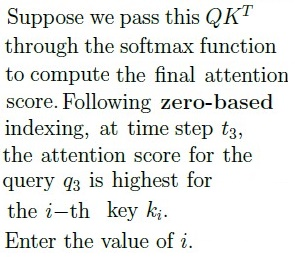

#### Worked answer

**Final answer:** 3

**Steps:** For query 3 the causal mask admits keys 0–3, with source-image scores 0.94, 0.41, 2.26, 2.29. Softmax preserves their order; the largest is key 3.

**Status:** derived

**verified_by_code:** `true` — solve_numeric.py recomputed adjudicated inputs/conventions; all recorded values and adjudication checks MATCH.

---

### 2024 T1 End Term FN, Q212

**Paper:** `2024T1_ET_FN` · **Type:** SA · **Marks:** 4 · **Topic(s):** w2-masked-self-attention

Suppose we pass this $QK^T$ through the softmax function to compute the final attention score. Following zero-based indexing, at time step $t_3$, the attention score for the query $q_3$ is highest for the $i$-th key $k_i$. Enter the value of $i$.

## Answer key

| Source question | Source identity | Correct answer | PDF pages |
| :--- | :--- | :--- | :--- |
| 198 | 640653820866 | B. Bidirectional Encoder Representation from Transformer | 3 |
| 199 | 640653820882 | A. TRUE | 3 |
| 200 | 640653820881 | D. $O(T^2)$ | 3, 4 |
| 201 | 640653820877 | somewhere something incredible is waiting be | 4, 5 |
| 202 | 640653820875 | A. 256, B. 16 | 6 |
| 203 | 640653820876 | A. Greedy decoding strategy, B. Beam search with beam size K > 2 | 6, 7 |
| 204 | 640653820879 | 6 | 7, 8 |
| 205 | 640653820880 | 6 | 8 |
| 206 | 640653820868 | 2566 | 9, 10 |
| 207 | 640653820869 | 0 | 10 |
| 208 | 640653820864 | 1.75 to 1.95 | 11 |
| 209 | 640653820865 | 0.53 | 12 |
| 210 | 640653820871 | 8 | 13 |
| 211 | 640653820872 | A. (8,8), B. (64,64), C. (32,32), D. (16,16) | 13, 14 |
| 212 | 640653820873 | 3 | 14, 15 |

## Extraction notes

**Status:** verified-source-limitation
**Count reconciliation:** The portal declared 11 questions and 50 marks for Section 9 (LLM). The 50 marks reconcile exactly across the 15 academic questions: Q198 (2) + Q199 (2) + Q200 (4) + Q201 (4) + Q202 (3) + Q203 (3) + Q204 (3) + Q205 (3) + Q206 (4) + Q207 (3) + Q208 (4) + Q209 (4) + Q210 (3) + Q211 (4) + Q212 (4) = 50 marks. The source PDF contains 8 portal sub-sections for Section 9, 1 administrative confirmation entry (Q196, 0 marks), 1 shared-context calculation note entry (Q197, 0 marks), 5 comprehension passages (shared context), and 15 academic questions (Q198-Q212). The declared count of 11 questions in the portal header does not match the observed count of 15 academic questions or 8 sub-sections; this portal-count mismatch is an unexplained source discrepancy and is preserved as a verified source limitation.

- Section 9 LLM is in-scope from page 1 (y=115.0) to page 15 (y=134.7). Preceding content on page 1 belongs to Section 8, and succeeding content on page 15 belongs to Section 10 (Stat computing).
- All math formulas in image-only comprehension contexts and questions (ctx-197, q200, q201, ctx-204-205, ctx-206-207, ctx-208-209, ctx-210-212, q211, q212) have been verified against 288 DPI source crops.
- Portal header declared count of 11 questions does not match observed count of 15 academic questions or 8 sub-sections, though 50 section marks reconcile exactly.
- Question 197 General Note raster contains administrative acknowledgment options which were excluded semantically, leaving no independent evaluation answer.

**Excluded source entries:**

- {"classification": "subject-confirmation", "page": 1, "bbox": [22.87, 750.0, 580.0, 840.0], "reason": "Administrative subject confirmation asking candidate to confirm subject and cross check hall ticket", "identity": "196"}
- {"classification": "administrative-acknowledgment-options", "page": 2, "bbox": [22.87, 579.6, 510.76, 670.0], "reason": "Administrative acknowledgment options (Instruction has been mentioned above / This Instruction is just for a reference & not for an evaluation) excluded semantically while preserving calculation note as shared context", "identity": "197"}

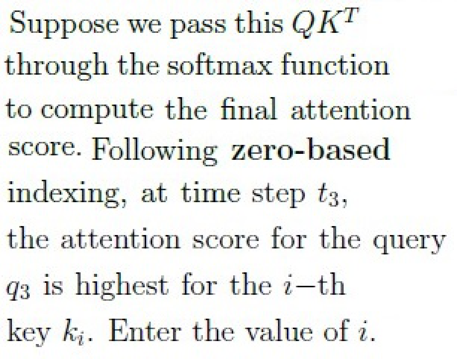

#### Worked answer

**Final answer:** 3

**Steps:** For query 3 the causal mask admits keys 0–3, with source-image scores 0.94, 0.41, 2.26, 2.29. Softmax preserves their order; the largest is key 3.

**Status:** derived

**verified_by_code:** `true` — solve_numeric.py recomputed adjudicated inputs/conventions; all recorded values and adjudication checks MATCH.

---

### 2024 T3 End Term AN, Q191

**Paper:** `2024T3_ET_AN` · **Type:** MSQ · **Marks:** 2 · **Topic(s):** w2-full-transformer, w2-masked-self-attention

Choose the correct statements regarding an encoder-decoder transformer model:

**A.** Multi head masked attention block in decoder makes use of a mask.

**B.** Transformer model is an improvement over its RNN based predecessor for
machine translation.

**C.** For machine tranlation task the input and output embedding layers have to be
identical.

**D.** None of these.

#### Worked answer

**Final answer:** A and B.

**Steps:** A: causal decoder self-attention masks future positions. B: the Transformer replaces recurrent sequence computation and improved translation benchmarks. C is false: source and target embeddings need not be identical. D is false because A and B hold.

**Status:** derived

**verified_by_code:** `false` — Non-numeric response; no numeric checker path applies.

---

### 2024 T3 End Term FN, Q190

**Paper:** `2024T3_ET_FN` · **Type:** MSQ · **Marks:** 2 · **Topic(s):** w2-full-transformer, w2-teacher-forcing

Choose the correct statements regarding an encoder-decoder transformer model:

**A.** A self attention block makes use of a mask matrix.

*Label added for presentation.*

**B.** Multi head self attention block is part of the encoder.

*Label added for presentation.*

**C.** Teacher forcing can help speed up the training process for tasks such as machine translation.

*Label added for presentation.*

**D.** None of these.

*Label added for presentation.*

#### Worked answer

**Final answer:** A, B and C, with A dependent on interpretation.

**Steps:** Decoder self-attention uses a causal mask (A); the encoder includes multi-head self-attention (B); teacher forcing permits parallel training (C). D is false. Encoder self-attention need not use a causal mask, so A is not universal.

**Status:** ambiguous

**Ambiguity note:** A does not specify decoder versus encoder self-attention or whether a padding mask is present.

**verified_by_code:** `false` — No numeric checker path; answer remains explicitly ambiguous.

---

### 2025 T2 End Term AN, Q193

**Paper:** `2025T2_ET_AN` · **Type:** MCQ · **Marks:** 2 · **Topic(s):** w2-masked-self-attention

A GPT model is trained using causal language modeling. During training, for a sequence of T = 4
tokens, which of the following correctly represents the attention mask matrix applied to the
attention logits?

**A.** $$\begin{bmatrix} 0 & -\infty & -\infty & -\infty \\ 0 & 0 & -\infty & -\infty \\ 0 & 0 & 0 & -\infty \\ 0 & 0 & 0 & 0 \end{bmatrix}$$

*Label added for presentation.*
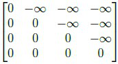

**B.** $$\begin{bmatrix} 0 & \infty & \infty & \infty \\ 0 & 0 & \infty & \infty \\ 0 & 0 & 0 & \infty \\ 0 & 0 & 0 & 0 \end{bmatrix}$$

*Label added for presentation.*
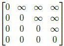

**C.** $$\begin{bmatrix} 1 & 0 & 0 & 0 \\ 1 & 1 & 0 & 0 \\ 1 & 1 & 1 & 0 \\ 1 & 1 & 1 & 1 \end{bmatrix}$$

*Label added for presentation.*
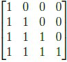

**D.** $$\begin{bmatrix} 0 & 1 & 1 & 1 \\ 0 & 0 & 1 & 1 \\ 0 & 0 & 0 & 1 \\ 0 & 0 & 0 & 0 \end{bmatrix}$$

*Label added for presentation.*
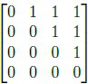

#### Worked answer

**Final answer:** A.

**Steps:** An additive causal logit mask is 0 at allowed positions and −∞ above the diagonal, making future softmax weights zero. B favors future positions; C and D are finite and cannot suppress logits when added.

**Status:** derived

**verified_by_code:** `false` — Non-numeric response; no numeric checker path applies.

---

### 2025 T2 End Term FN, Q142

**Paper:** `2025T2_ET_FN` · **Type:** MSQ · **Marks:** 3 · **Topic(s):** w2-residual-layernorm, w2-training-tricks

Which of the following are valid design choices when building a transformer-based language
model?

**A.** Number of transformer layers

*Label added for presentation.*

**B.** Learning rate schedule

*Label added for presentation.*

**C.** Font style of the source code

*Label added for presentation.*

**D.** Vocabulary size

*Label added for presentation.*

**E.** Type of normalization (e.g., LayerNorm)

*Label added for presentation.*

#### Worked answer

**Final answer:** A, B, D and E.

**Steps:** Depth, learning-rate schedule, vocabulary size and normalization are model or training design choices. C, source-code font, does not change the model or learning rule.

**Status:** derived

**verified_by_code:** `false` — Non-numeric response; no numeric checker path applies.

---

### 2025 T3 End Term AN, Q3

**Paper:** `2025T3_ET_AN` · **Type:** MCQ · **Marks:** 2 · **Topic(s):** w2-residual-layernorm

A neural network layer produces activations of hidden dimension $H = 512$.
You consider two normalization strategies:
1. Batch Normalization
2. Layer Normalization
Which option correctly states the number of trainable parameters added by each normalization method?

**A.** BatchNorm adds 512 parameters, LayerNorm adds 512 parameters

**B.** BatchNorm adds 1024 parameters, LayerNorm adds 1024 parameters

**C.** BatchNorm adds 1024 parameters, LayerNorm adds 512 parameters

**D.** BatchNorm adds 512 parameters, LayerNorm adds 1024 parameters

**E.** Both add 0 trainable parameters

#### Worked answer

**Final answer:** B — 1,024 parameters for each

**Steps:** Standard affine BatchNorm and LayerNorm each have 512 scales and 512 biases, so 2×512=1024. A omits one set for both; C and D omit one set for one layer; E assumes no affine parameters.

**Status:** derived

**verified_by_code:** `true` — solve_numeric.py recomputed adjudicated inputs/conventions; all recorded values and adjudication checks MATCH.

---

### 2025 T3 End Term AN, Q25

**Paper:** `2025T3_ET_AN` · **Type:** MCQ · **Marks:** 1 · **Topic(s):** w2-teacher-forcing

In the inference phase (when the model is used for generation), why is the teacher forcing
technique not used, and what is the primary challenge this introduces?

**A.** Teacher forcing is used, but only with a small probability.

**B.** It's not used because the ground-truth sequence is unknown; this introduces
the exposure bias problem, where the model is unfamiliar with its own prediction errors.

**C.** It's not used because it drastically slows down the inference speed.

**D.** It's not used; the challenge is the need for a separate encoder-decoder
architecture.

#### Worked answer

**Final answer:** B — ground truth is unavailable during generation, producing exposure bias

**Steps:** B describes the train/inference prefix mismatch. A incorrectly claims ordinary teacher forcing remains; C gives an unsupported speed reason; D confuses the mismatch with an architecture requirement.

**Status:** derived

**verified_by_code:** `false` — Non-numeric response; no numeric checker path applies.

---

### 2025 T3 End Term AN, Q26

**Paper:** `2025T3_ET_AN` · **Type:** MCQ · **Marks:** 1 · **Topic(s):** w2-masked-self-attention

Which component of the Transformer decoder is essential for enforcing the Causal Language
Modeling constraint?

**A.** The Feed-Forward Network layer.

**B.** The Positional Encoding layer.

**C.** The masked Self-Attention layer.

**D.** The Cross-Attention layer.

#### Worked answer

**Final answer:** C — masked self-attention

**Steps:** C suppresses attention to future decoder positions. A is a pointwise feed-forward layer, B encodes positions without forbidding future access, and D attends to source states rather than enforcing target causality.

**Status:** derived

**verified_by_code:** `false` — Non-numeric response; no numeric checker path applies.

---

### 2025 T3 End Term FN, Q2

**Paper:** `2025T3_ET_FN` · **Type:** MCQ · **Marks:** 1 · **Topic(s):** w2-residual-layernorm

What happens when you use Batch Normalization with a batch size of 1?

**A.** It works perfectly fine

**B.** The statistics become meaningless (mean=0, std=0)

**C.** It automatically switches to Layer Normalization

**D.** It uses the running statistics from training

#### Worked answer

**Final answer:** No option is universally correct; D holds in standard evaluation mode.

**Steps:** With a single value per feature in training, the batch mean equals that activation, not necessarily 0, and variance is 0. B falsely says mean=0. A ignores degenerate training statistics, C does not occur automatically, and D describes evaluation with tracked running statistics, not training generally. Spatial dimensions can supply additional observations.

**Status:** ambiguous

**Ambiguity note:** Training/evaluation mode and reduction dimensions are unspecified; B states a false mean, while D is conditional on evaluation and tracked statistics.

**verified_by_code:** `false` — No numeric checker path; answer remains explicitly ambiguous.

---

### 2026 T1 End Term AN, Q2

**Paper:** `2026T1_ET_AN` · **Type:** MCQ · **Marks:** 2 · **Topic(s):** w2-masked-self-attention

In the standard Transformer Decoder, the Multi-Head Attention layer is "Masked". What is the specific purpose of this mask during training?

**A.** To filter out padding tokens to save computation.

**B.** To prevent the model from attending to the [CLS] and [SEP] special tokens.

**C.** To preserve the auto-regressive property by ensuring that the prediction for position $t$ can only depend on known outputs at positions less than $t$ (preventing "peeking" into the future).

**D.** To force the model to focus on the Encoder output rather than the Decoder input.

#### Worked answer

**Final answer:** C — prevent target-future leakage

**Steps:** The causal mask permits the current shifted decoder input and earlier ones; when predicting target y_t those inputs contain only y_<t. A describes padding masking, B special-token exclusion, and D is unrelated to the causal constraint.

**Status:** derived

**verified_by_code:** `false` — Non-numeric response; no numeric checker path applies.

---

### 2026 T1 End Term AN, Q14

**Paper:** `2026T1_ET_AN` · **Type:** MCQ · **Marks:** 3 · **Topic(s):** w2-positional-encoding

Why do standard LLM architectures include explicit Positional Encodings (like RoPE or Sinusoidal) despite the causal mask providing some implicit order?

**A.** To reduce the memory footprint of the $K$ and $V$ matrices.

**B.** To ensure that the model can only attend to future tokens.

**C.** To provide a strong inductive bias that allows the model to learn structural and distance-based relationships more efficiently than relying on masking alone.

**D.** To fix a mathematical error in the original Dot-Product Attention formula.

#### Worked answer

**Final answer:** C — position provides a structural and distance-sensitive inductive bias

**Steps:** C is the intended rationale: explicit encodings make relative and absolute position information accessible. A is unrelated to KV memory reduction; B reverses causality; D invents an error in dot-product attention.

**Status:** derived

**verified_by_code:** `false` — Non-numeric response; no numeric checker path applies.

---

### 2026 T2 End Term AN, Q3

**Paper:** `2026T2_ET_AN` · **Type:** MCQ · **Marks:** 2 · **Topic(s):** w2-positional-encoding

Which of the following statements regarding one-hot positional encoding and sinusoidal positional encoding is incorrect?

**A.** The dot product between two sinusoidal positional encoding vectors strictly increases as the relative distance between their positions increases, taking values in the range $[0, \infty)$

**B.** The squared Euclidean norm of a sinusoidal positional encoding vector is a constant value independent of the position index

**C.** For any two distinct positions, the dot product of their corresponding one-hot encoded vectors is zero, and the Euclidean distance between them is strictly constant

**D.** One-hot positional encoding is incapable of mathematically representing relative distance between tokens

#### Worked answer

**Final answer:** A is incorrect under the usual geometric interpretation; D is also false if read literally.

**Steps:** For sinusoidal encodings the dot product is a sum of cosines of relative offsets, oscillatory and potentially negative, so A is false. B follows from sin²+cos²=1 per pair and C from orthogonal one-hot vectors. D is true only in the restricted sense that raw one-hot distances or dot products do not encode separation: the indices can be decoded and subtracted, so the absolute claim of mathematical incapacity is false.

**Status:** ambiguous

**Ambiguity note:** This single-answer MCQ has two false statements under a literal reading: one-hot indices can represent and recover relative distance even though their raw pairwise geometry does not.

**verified_by_code:** `false` — No numeric checker path; answer remains explicitly ambiguous.

---

### 2026 T2 End Term AN, Q6

**Paper:** `2026T2_ET_AN` · **Type:** SA · **Marks:** 3 · **Topic(s):** w2-residual-layernorm

Consider a mini-batch of 3 samples, each with 2 features. The input matrix X is given below, where

rows represent individual samples and columns represent features:

Layer Normalization is applied on this with a learned scale parameter $\gamma = 2$ and a shift parameter $\beta = 1$.

What is the final output value of the first feature for the third sample?

Shift parameter $\beta = 1$:

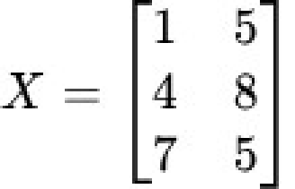
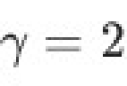
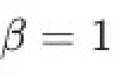

#### Worked answer

**Final answer:** 3 if ε=0; otherwise 1+2/√(1+ε)

**Steps:** The image gives sample 3 as [7,5]. Its mean is 6 and population variance is 1; its first normalized entry is 1/√(1+ε), followed by gain 2 and bias 1. The standard ε=0 simplification gives 3.

**Status:** ambiguous

**Ambiguity note:** The question does not specify epsilon; its exact output depends on epsilon in standard LayerNorm.

**verified_by_code:** `false` — depends on figure, no code path

---

## Source and reproducibility

Questions preserve each routed paper occurrence, including repeated stems from different papers or sessions. Images are linked from the archived extraction assets. Rebuild with `uv run python scripts/build_exam_question_banks.py`; run `uv run python scripts/build_exam_study_priorities.py` for the ranked study guide.
