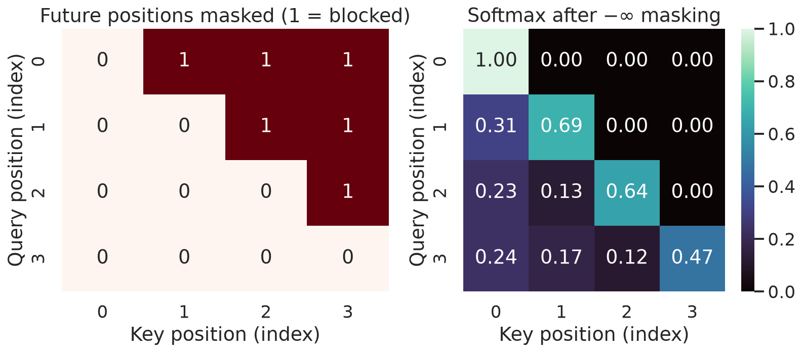
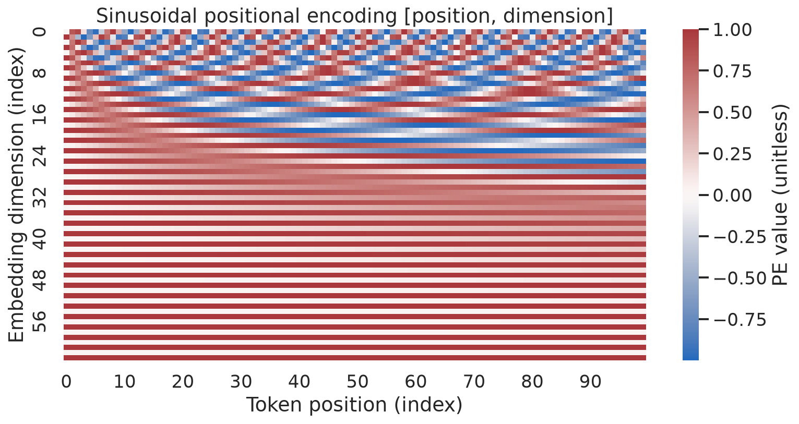
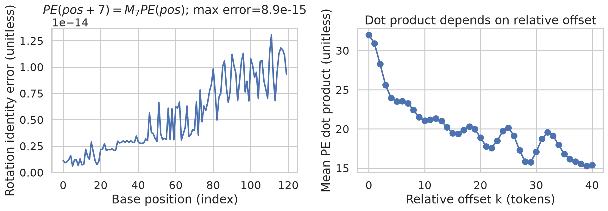
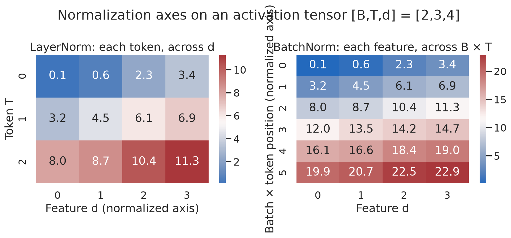
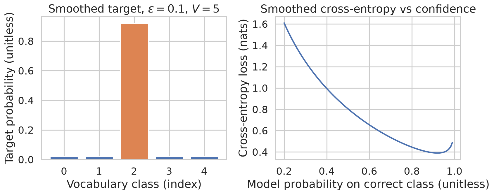
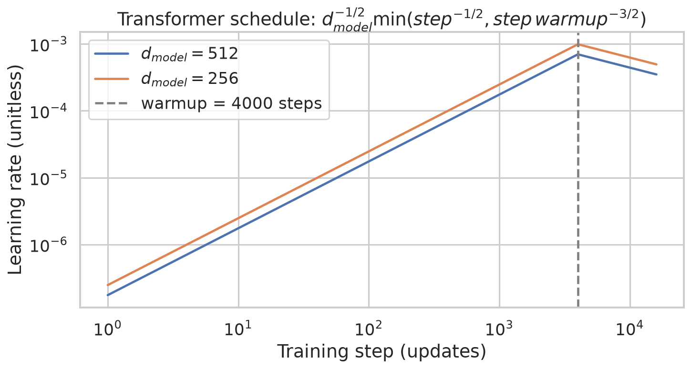

# Week 2: Transformer Decoding, Position, Normalization, and Training

**Learn and revise:** [[week-2-exam-focused-notes|Week 2 exam guide]] · [[week-2-exam-questions|Routed examination questions]]

**Navigation:** ← [[week-1-notes|Week 1]] · [[Knowledge-Map|Knowledge Map]] · [[week-3-notes|Week 3]] →

> **Scope:** Ebook chapter 2, PDF pp. 21–33 (printed pp. 20–32). Page numbers below refer to PDF pages, as marked in the transcript. Shapes use row-oriented vectors; $B$ is batch size, $S$ source length, $T$ target length, $d$ model width, $f$ FFN width, $h$ heads, and $V$ vocabulary size.

## Abstract

An encoder–decoder Transformer models a target sequence as a product of conditional next-token probabilities given a source and the preceding target tokens. Causal self-attention enforces the target information boundary during parallel teacher-forced training, while cross-attention makes source representations available to each decoder position. Sinusoidal position vectors introduce order and admit an exact linear transformation for any fixed positional offset. Residual additions, per-token layer normalization, a position-wise feed-forward network, label smoothing and a warm-up schedule specify the original model's computation and training. A standard biased base decoder layer contains 4,204,032 parameters under the explicitly stated PyTorch configuration, while its output projection depends on vocabulary size and weight sharing.

## 1. Topic map and authentic questions

The links below preserve the routing records' IDs, including records assigned to multiple topics; question pages are planned artifacts. Topic association follows the supplied routing, not a claim that all questions are independent or equally difficult.

| Canonical topic | Routed questions |
|---|---|
| Teacher forcing | [[week-2-exam-questions#da5004_2024T1_Q1_NA--q192\|2024T1_Q1_NA Q192]] · [[week-2-exam-questions#da5004_2024T3_ET_FN--q190\|2024T3_ET_FN Q190]] · [[week-2-exam-questions#da5004_2024T3_Q1_NA--q275\|2024T3_Q1_NA Q275]] · [[week-2-exam-questions#da5004_2025T1_Q1_NA--q105\|2025T1_Q1_NA Q105]] · [[week-2-exam-questions#da5004_2025T3_ET_AN--q25\|2025T3_ET_AN Q25]] · [[week-2-exam-questions#da5004_2025T3_Q1_NA--q175\|2025T3_Q1_NA Q175]] · [[week-2-exam-questions#da5004_2025T3_Q1_NA--q177\|2025T3_Q1_NA Q177]] · [[week-2-exam-questions#da5004_2026T2_Q1_NA--q9\|2026T2_Q1_NA Q9]] |
| Masked (causal) self-attention | [[week-2-exam-questions#da5004_2024T1_ET_AN--q157\|2024T1_ET_AN Q157]] · [[week-2-exam-questions#da5004_2024T1_ET_FN--q212\|2024T1_ET_FN Q212]] · [[week-2-exam-questions#da5004_2024T1_Q1_NA--q196\|2024T1_Q1_NA Q196]] · [[week-2-exam-questions#da5004_2024T1_Q1_NA--q197\|2024T1_Q1_NA Q197]] · [[week-2-exam-questions#da5004_2024T3_ET_AN--q191\|2024T3_ET_AN Q191]] · [[week-2-exam-questions#da5004_2024T3_Q1_NA--q291\|2024T3_Q1_NA Q291]] · [[week-2-exam-questions#da5004_2025T2_ET_AN--q193\|2025T2_ET_AN Q193]] · [[week-2-exam-questions#da5004_2025T3_ET_AN--q26\|2025T3_ET_AN Q26]] · [[week-2-exam-questions#da5004_2025T3_Q1_NA--q176\|2025T3_Q1_NA Q176]] · [[week-2-exam-questions#da5004_2025T3_Q1_NA--q190\|2025T3_Q1_NA Q190]] · [[week-2-exam-questions#da5004_2025T3_Q2_NA--q113\|2025T3_Q2_NA Q113]] · [[week-2-exam-questions#da5004_2026T1_ET_AN--q2\|2026T1_ET_AN Q2]] · [[week-2-exam-questions#da5004_2026T2_Q1_NA--q7\|2026T2_Q1_NA Q7]] · [[week-2-exam-questions#da5004_2026T2_Q2_NA--q3\|2026T2_Q2_NA Q3]] · [[week-2-exam-questions#da5004_2026T2_Q2_NA--q5\|2026T2_Q2_NA Q5]] |
| Cross-attention (encoder-decoder attention) | [[week-2-exam-questions#da5004_2024T1_Q1_NA--q190\|2024T1_Q1_NA Q190]] · [[week-2-exam-questions#da5004_2025T1_Q1_NA--q104\|2025T1_Q1_NA Q104]] · [[week-2-exam-questions#da5004_2025T3_Q2_NA--q128\|2025T3_Q2_NA Q128]] · [[week-2-exam-questions#da5004_2026T1_Q1_NA--q5\|2026T1_Q1_NA Q5]] · [[week-2-exam-questions#da5004_2026T1_Q1_NA--q11\|2026T1_Q1_NA Q11]] |
| Decoder output layer and decoder parameter counts | [[week-2-exam-questions#da5004_2024T3_Q1_NA--q277\|2024T3_Q1_NA Q277]] · [[week-2-exam-questions#da5004_2024T3_Q1_NA--q278\|2024T3_Q1_NA Q278]] · [[week-2-exam-questions#da5004_2024T3_Q1_NA--q279\|2024T3_Q1_NA Q279]] · [[week-2-exam-questions#da5004_2024T3_Q1_NA--q280\|2024T3_Q1_NA Q280]] |
| Sinusoidal positional encoding | [[week-2-exam-questions#da5004_2024T1_Q1_NA--q184\|2024T1_Q1_NA Q184]] · [[week-2-exam-questions#da5004_2024T1_Q1_NA--q185\|2024T1_Q1_NA Q185]] · [[week-2-exam-questions#da5004_2024T3_Q1_NA--q276\|2024T3_Q1_NA Q276]] · [[week-2-exam-questions#da5004_2024T3_Q1_NA--q293\|2024T3_Q1_NA Q293]] · [[week-2-exam-questions#da5004_2025T1_Q1_NA--q111\|2025T1_Q1_NA Q111]] · [[week-2-exam-questions#da5004_2025T2_Q1_NA--q144\|2025T2_Q1_NA Q144]] · [[week-2-exam-questions#da5004_2025T3_Q1_NA--q174\|2025T3_Q1_NA Q174]] · [[week-2-exam-questions#da5004_2026T1_ET_AN--q14\|2026T1_ET_AN Q14]] · [[week-2-exam-questions#da5004_2026T1_Q1_NA--q12\|2026T1_Q1_NA Q12]] · [[week-2-exam-questions#da5004_2026T2_ET_AN--q3\|2026T2_ET_AN Q3]] · [[week-2-exam-questions#da5004_2026T2_Q1_NA--q8\|2026T2_Q1_NA Q8]] |
| Residual connections, LayerNorm vs BatchNorm | [[week-2-exam-questions#da5004_2024T3_Q1_NA--q276\|2024T3_Q1_NA Q276]] · [[week-2-exam-questions#da5004_2024T3_Q1_NA--q281\|2024T3_Q1_NA Q281]] · [[week-2-exam-questions#da5004_2024T3_Q1_NA--q282\|2024T3_Q1_NA Q282]] · [[week-2-exam-questions#da5004_2024T3_Q1_NA--q283\|2024T3_Q1_NA Q283]] · [[week-2-exam-questions#da5004_2024T3_Q1_NA--q284\|2024T3_Q1_NA Q284]] · [[week-2-exam-questions#da5004_2025T1_Q1_NA--q114\|2025T1_Q1_NA Q114]] · [[week-2-exam-questions#da5004_2025T1_Q1_NA--q115\|2025T1_Q1_NA Q115]] · [[week-2-exam-questions#da5004_2025T1_Q1_NA--q116\|2025T1_Q1_NA Q116]] · [[week-2-exam-questions#da5004_2025T1_Q1_NA--q117\|2025T1_Q1_NA Q117]] · [[week-2-exam-questions#da5004_2025T2_ET_FN--q142\|2025T2_ET_FN Q142]] · [[week-2-exam-questions#da5004_2025T2_Q1_NA--q139\|2025T2_Q1_NA Q139]] · [[week-2-exam-questions#da5004_2025T2_Q1_NA--q150\|2025T2_Q1_NA Q150]] · [[week-2-exam-questions#da5004_2025T2_Q1_NA--q151\|2025T2_Q1_NA Q151]] · [[week-2-exam-questions#da5004_2025T2_Q1_NA--q152\|2025T2_Q1_NA Q152]] · [[week-2-exam-questions#da5004_2025T3_ET_AN--q3\|2025T3_ET_AN Q3]] · [[week-2-exam-questions#da5004_2025T3_ET_FN--q2\|2025T3_ET_FN Q2]] · [[week-2-exam-questions#da5004_2025T3_Q1_NA--q179\|2025T3_Q1_NA Q179]] · [[week-2-exam-questions#da5004_2025T3_Q2_NA--q127\|2025T3_Q2_NA Q127]] · [[week-2-exam-questions#da5004_2026T1_Q2_NA--q12\|2026T1_Q2_NA Q12]] · [[week-2-exam-questions#da5004_2026T2_ET_AN--q6\|2026T2_ET_AN Q6]] · [[week-2-exam-questions#da5004_2026T2_Q2_NA--q2\|2026T2_Q2_NA Q2]] |
| Training tricks: label smoothing, warm-up schedule, dropout | [[week-2-exam-questions#da5004_2025T2_ET_FN--q142\|2025T2_ET_FN Q142]] |
| The full Transformer data flow | [[week-2-exam-questions#da5004_2024T3_ET_AN--q191\|2024T3_ET_AN Q191]] · [[week-2-exam-questions#da5004_2024T3_ET_FN--q190\|2024T3_ET_FN Q190]] · [[week-2-exam-questions#da5004_2025T3_Q1_NA--q184\|2025T3_Q1_NA Q184]] · [[week-2-exam-questions#da5004_2026T2_Q2_NA--q4\|2026T2_Q2_NA Q4]] |

## 2. Teacher forcing and causal self-attention

For source $x$ and target $y_1,\ldots,y_T$, the autoregressive likelihood is

$$p_\theta(y_{1:T}\mid x)=\prod_{t=1}^{T}p_\theta(y_t\mid y_{<t},x),\qquad L=-\sum_{t=1}^{T}\log p_\theta(y_t\mid y_{<t},x).$$

[[teacher-forcing|Teacher forcing]] uses the known target prefix in training: decoder inputs are `[BOS, y1, ..., y(T-1)]` and labels are `[y1, ..., yT]`. The shift ensures that position $t$ does not receive its own label. All target positions can then be processed together under the causal mask; at inference generated tokens replace the unavailable gold prefix. A generated error can alter later contexts, a training–inference mismatch; teacher forcing does not eliminate this problem (PDF p. 22).

For one head of [[masked-self-attention]], $Q,K$ are `[B, T, d_k]`, $V$ is `[B, T, d_v]`, and

$$A=\frac{QK^\top}{\sqrt{d_k}},\quad M_{ij}=\begin{cases}0&j\le i,\\-\infty&j>i,\end{cases}\quad Z=\operatorname{softmax}_{j}(A+M)V.$$

The score matrix is `[B, T, T]`; each query row is normalized across keys. For scores $(2,1,5,3)$ with only the first two keys visible, the masked row is $(2,1,-\infty,-\infty)$ and its weights are $(e^2/(e^2+e),e/(e^2+e),0,0)\approx(0.7311,0.2689,0,0)$. Padding needs a separate key mask. Each valid query must have at least one unmasked key: a completely masked row has undefined softmax. A finite large negative value is an approximation whose behavior depends on dtype; literal $-\infty$ gives exact zero for a valid row (PDF pp. 22–24).

**The Dangerous Misconception:** Zeroing future value vectors implements a causal mask. **Why this is false:** Their scores still enter the softmax denominator, changing the weights of visible values; masking scores before softmax removes those keys from normalization.



**Figure 1.** *The upper-triangular blocked positions receive zero probability after score masking; the visible probabilities are normalized within each row.*

## 3. Cross-attention and the decoder output

In [[cross-attention]], the decoder representation $D$ is `[B, T, d]` and the final encoder output $E$ is `[B, S, d]`. Per head $Q=DW_Q$, $K=EW_K$, $V_h=EW_V$; thus $Q$ is `[B, T, d_k]`, $K$ is `[B, S, d_k]`, $V_h$ is `[B, S, d_v]`, and $QK^\top$ is `[B, T, S]`. Each query can weight every valid source key in ordinary offline translation. A source padding mask remains necessary; streaming variants may impose additional source restrictions. All decoder layers read the final encoder output through their own learned projections (PDF p. 24).

Concatenate $h$ head outputs and project to `[B, T, d]`. The decoder's [[residual-connections|residual]] and normalization then precede the position-wise feed-forward network

$$\operatorname{FFN}(x)=\max(0,xW_1+b_1)W_2+b_2,\qquad W_1\in\mathbb R^{d\times f},\ W_2\in\mathbb R^{f\times d}.$$

The same FFN parameters act independently at every position; attention, not the FFN alone, mixes positions. For $d=512$, $f=2048$, this has $2df+f+d=2,099,712$ parameters with biases. Top-layer states $H$ `[B, T, d]` map to logits $L=HW_D+b$ `[B, T, V]`, $W_D$ `[d, V]`; softmax across vocabulary yields next-token probabilities. At $V=37,000$, the matrix has $512\times37,000=18,944,000$ parameters, plus $37,000$ if a bias is present. Transposed tying to an embedding matrix can share the weights; count shared parameters once and state vocabulary assumptions. The paper's shared embedding setup and approximate 65M base total are configuration-dependent (PDF pp. 24–25).

With standard biased full-width attention, one module has $4d^2+4d$ parameters; two attention modules, FFN, and three affine layer norms give

$$N_{\rm layer}=2(4d^2+4d)+(2df+f+d)+6d.$$

At $d=512,f=2048$, attention contributes 2,101,248, FFN 2,099,712, and norms 3,072, totaling **4,204,032**. Six such layers have 25,224,192 parameters, excluding embeddings and output. The ebook's ~4M per layer is a rounded estimate, not an exact count; other bias, tying and normalization choices change totals. Encoder layers have one rather than two attention modules (PDF p. 25, Exam Tip).

**The Dangerous Misconception:** A decoder is an encoder with only an added mask. **Why this is false:** The original decoder also has a separate cross-attention sublayer and therefore another set of projections.

## 4. Sinusoidal position and relative offsets

Unmasked self-attention without positional signals is permutation equivariant: permuting input rows permutes output rows. In the original model, token embeddings are scaled by $\sqrt d$ and added to fixed [[sinusoidal-positional-encoding]] vectors before the first block. For even $d$, with $\omega_i=10000^{-2i/d}$,

$$PE(p,2i)=\sin(p\omega_i),\qquad PE(p,2i+1)=\cos(p\omega_i),\quad 0\le i<d/2.$$

At $p=0$, all even channels are 0 and odd channels are 1; every component lies in $[-1,1]$ and $\lVert PE(p)\rVert_2^2=d/2$. Lower-index pairs change faster across positions. For a fixed offset $k$, the angle-addition identities give

$$\begin{bmatrix}\sin((p+k)\omega_i)\\\cos((p+k)\omega_i)\end{bmatrix}=\begin{bmatrix}\cos(k\omega_i)&\sin(k\omega_i)\\-\sin(k\omega_i)&\cos(k\omega_i)\end{bmatrix}\begin{bmatrix}\sin(p\omega_i)\\\cos(p\omega_i)\end{bmatrix}.$$

Thus a block-diagonal linear map represents any fixed offset; learned attention is not guaranteed to exploit it. Furthermore $PE(p)\cdot PE(p+k)=\sum_i\cos(k\omega_i)$ and squared distance is $2\sum_i(1-\cos(k\omega_i))$. Distance is oscillatory, not generally monotonic in $k$. The encoding can be evaluated at unseen positions, but this does not guarantee length extrapolation (PDF pp. 25–27).



**Figure 2.** *Across 100 positions and 64 channels, low-index sine–cosine pairs vary rapidly while higher-index pairs vary more slowly.*



**Figure 3.** *A fixed offset of 7 is represented by a two-dimensional rotation per frequency, up to floating-point error; encoding dot products vary with offset and need not decrease monotonically.*

## 5. Residual connections and normalization

The original Transformer uses post-normalization at each of its three decoder sublayers:

$$z=\operatorname{LN}(x+\operatorname{Sublayer}(x)),$$

with dropout on the sublayer output before addition during training. The operands have the same `[B, T, d]` shape. A bare residual $x+F(x)$ has Jacobian $I+J_F$, giving an additive gradient path, but the complete post-LN block also includes the LayerNorm Jacobian. A residual need not be small and does not guarantee nonvanishing gradients. Pre-LN instead uses $x+F(\operatorname{LN}(x))$; it is a different wiring (PDF pp. 27–29).

For each token vector $x\in\mathbb R^d$, [[layer-normalization]] computes

$$\mu=\frac1d\sum_i x_i,\quad \sigma^2=\frac1d\sum_i(x_i-\mu)^2,\quad y_i=\gamma_i\frac{x_i-\mu}{\sqrt{\sigma^2+\epsilon}}+\beta_i.$$

The $2d$ learned affine parameters are shared across tokens, whereas statistics are computed independently for each token and example. Ignoring $\epsilon$, $x=(1,2,3)$ has mean 2, variance $2/3$, and normalized values $(-\sqrt{3/2},0,\sqrt{3/2})$. LayerNorm uses the same computation at training and evaluation. BatchNorm instead typically computes per-channel training statistics over batch and, for sequence BatchNorm, time; evaluation commonly uses running statistics. Padding can contaminate those statistics unless handled. Batch size 1 can still have multiple time observations.

**Ebook correction (PDF p. 28):** A single value in a BatchNorm training normalization set gives normalized activation zero and affine output $\beta$, not the input; some implementations reject that case. This follows directly from the normalization equation and Ba et al.'s distinction between within-case and batch statistics. **Ebook correction (PDF p. 29):** Original BERT uses post-LN, not pre-LN; its original implementation applies LayerNorm after the residual addition. Neither post-LN instability without warmup nor pre-LN superiority is universal.



**Figure 4.** *For `[B,T,d]=[2,3,4]`, LayerNorm aggregates the four features of each token; BatchNorm pools batch and sequence observations for each feature.*

## 6. Training objective and full data flow

For [[label-smoothing]] under the uniform-mixture convention, $q_i=(1-\varepsilon)\mathbf1[i=y]+\varepsilon/V$ and $L=-\sum_i q_i\log p_i$. At $V=5$, $\varepsilon=0.1$, $q_y=0.92$ and each other class receives 0.02. Another convention allocates $\varepsilon$ exclusively to non-gold classes, giving $q_y=0.9$; quote the convention. The original paper used $\varepsilon=0.1$ and reported better accuracy and BLEU but worse perplexity; outcomes are empirical. Smoothed cross-entropy is not ordinary unsmoothed negative log-likelihood (PDF pp. 29–30).



**Figure 5.** *With five classes and smoothing 0.1, the gold class has target mass 0.92 and each alternative 0.02; the loss curve shows the effect of varying predicted confidence in the plotted example.*

The original [[learning-rate-warmup]] schedule is

$$\eta(s)=d^{-1/2}\min(s^{-1/2},s\,w^{-3/2}),\quad s\ge1,\quad w=4000.$$

The two terms meet at $s=w$: rate rises linearly to $d^{-1/2}w^{-1/2}$ and then falls as $s^{-1/2}$. For $d=512$, the peak is approximately $0.0006987712$. Adam applies adaptive parameter-wise scaling, so this schedule is not the actual magnitude of every update. The paper uses Adam $(\beta_1,\beta_2,\epsilon)=(0.9,0.98,10^{-9})$, and base dropout 0.1. Warmup is a training choice, not a universal stability proof.



**Figure 6.** *For widths 256 and 512, rates peak at step 4000 and decay thereafter; width 512 gives lower rates by a factor of $1/\sqrt2$ at the same step.*

The complete original data flow (PDF p. 29) is: source tokens → scaled embeddings plus positions → six encoder blocks of self-attention and FFN → final source memory; shifted target tokens → scaled embeddings plus positions → six decoder blocks, each with masked self-attention, source cross-attention, and FFN → vocabulary projection → softmax. Each sublayer is surrounded by residual addition and post-LN. Source and target may have different lengths. Training computes masked target positions in parallel; inference repeatedly appends a selected generated token until EOS or a length limit. Encoder–decoder attention is relevant to translation, summarization, speech transcription and image captioning when a model has source representations; decoder-only models omit the encoder and cross-attention.

## 7. Reproducible computational examples

The following source and stdout are reproduced verbatim from the supplied executed artifacts. Run from `LLM/` with `uv run python 'week 2/codeblocks/<filename>.py'`. The examples are independent demonstrations rather than a trained translation system; outputs reflect the supplied execution environment.

### Causal attention

**Concept.** A triangular score mask excludes future keys.

**Code — `01_causal_mask.py`.**

```python
import torch

torch.manual_seed(42)
scores = torch.tensor([[1.2,.5,2.1,-.3],[.2,1.,.8,1.1],[.4,-.2,1.4,.7],[.6,.3,-.1,1.3]])
mask = torch.triu(torch.ones(4,4,dtype=torch.bool), diagonal=1)
weights = torch.softmax(scores.masked_fill(mask, float("-inf")), dim=-1)
assert torch.all(weights.masked_select(mask) == 0)
print("causal mask (1=blocked):\n", mask.int())
print("masked attention weights:\n", weights)
print(f"future weight sum={weights.masked_select(mask).sum().item():.1f}")
```

**Output.**

```text
causal mask (1=blocked):
 tensor([[0, 1, 1, 1],
        [0, 0, 1, 1],
        [0, 0, 0, 1],
        [0, 0, 0, 0]], dtype=torch.int32)
masked attention weights:
 tensor([[1.0000, 0.0000, 0.0000, 0.0000],
        [0.3100, 0.6900, 0.0000, 0.0000],
        [0.2344, 0.1286, 0.6370, 0.0000],
        [0.2352, 0.1743, 0.1168, 0.4737]])
future weight sum=0.0
```

**Interpretation.** The printed upper triangle sums to zero; remaining weights are row-normalized.

### Cross-attention shapes

**Concept.** Different source and target lengths determine the rectangular attention matrix.

**Code — `02_cross_attention_shapes.py`.**

```python
import torch
import torch.nn as nn

torch.manual_seed(42)
B, Tdec, Tenc, D, H = 2, 3, 5, 16, 4
q, kv = torch.randn(B,Tdec,D), torch.randn(B,Tenc,D)
layer = nn.MultiheadAttention(D,H,batch_first=True,dropout=0.0)
y, a = layer(q,kv,kv,need_weights=True,average_attn_weights=False)
print(f"Q=[B,T_dec,d]=[{B},{Tdec},{D}], K=V=[B,T_enc,d]=[{B},{Tenc},{D}]")
print(f"weights [B,h,T_dec,T_enc]={list(a.shape)}; output={list(y.shape)}")
print("cross-attention has no causal mask over source positions")
```

**Output.**

```text
Q=[B,T_dec,d]=[2,3,16], K=V=[B,T_enc,d]=[2,5,16]
weights [B,h,T_dec,T_enc]=[2, 4, 3, 5]; output=[2, 3, 16]
cross-attention has no causal mask over source positions
```

**Interpretation.** Four heads each connect three target queries to five source keys.

### Sinusoidal encoding

**Concept.** The independent implementation is compared with the same mathematical formula.

**Code — `03_sinusoidal_pe.py`.**

```python
import numpy as np
import torch

def numpy_pe(pos, d):
    p = np.asarray(pos)[:,None]
    inv = 10000 ** (-2*np.arange(d//2)/d)
    phase = p*inv[None,:]
    out = np.empty((len(p),d)); out[:,0::2]=np.sin(phase); out[:,1::2]=np.cos(phase)
    return out

torch.manual_seed(42)
pos, d = np.arange(10), 16
manual = numpy_pe(pos,d)
pt = torch.zeros(10,d); p=torch.arange(10,dtype=torch.float32)[:,None]
i=torch.arange(0,d,2,dtype=torch.float32); phase=p*torch.exp(-np.log(10000)*i/d)
pt[:,0::2]=phase.sin(); pt[:,1::2]=phase.cos()
print(f"shape={manual.shape}; max |from scratch - formula implementation|={np.max(np.abs(manual-pt.numpy())):.8f}")
print(f"entry range=[{manual.min():.6f},{manual.max():.6f}]")
```

**Output.**

```text
shape=(10, 16); max |from scratch - formula implementation|=0.00000011
entry range=[-0.989992,1.000000]
```

**Interpretation.** The maximum discrepancy is floating-point scale for this example.

### Normalization axes

**Concept.** LayerNorm and BatchNorm aggregate different axes.

**Code — `04_norm_axes.py`.**

```python
import torch
import torch.nn as nn

torch.manual_seed(42)
x=torch.tensor([[[1.,2.,3.],[4.,5.,6.]],[[7.,8.,9.],[10.,11.,12.]]]) # [B,T,d]
ln=nn.LayerNorm(3,elementwise_affine=False)(x)
# BatchNorm1d on [B,C,T] normalizes each feature across B and T.
bn=nn.BatchNorm1d(3,affine=False,track_running_stats=False)(x.transpose(1,2)).transpose(1,2)
short=x[:1,:1,:]
print(f"[B,T,d]={list(x.shape)}; LN per-token means={ln.mean(-1)}")
print(f"BN changes with batch/padding population: feature-0 normalized values={bn[:,:,0]}")
print(f"single token LN output={nn.LayerNorm(3,elementwise_affine=False)(short).flatten()}")
# With one value per channel, training BatchNorm cannot estimate variance.
try:
    nn.BatchNorm1d(3)(torch.ones(1,3,1))
except ValueError as exc:
    print(f"BN on [1,3,1]: {str(exc).split('.')[0]}.")
```

**Output.**

```text
[B,T,d]=[2, 2, 3]; LN per-token means=tensor([[0., 0.],
        [0., 0.]])
BN changes with batch/padding population: feature-0 normalized values=tensor([[-1.3416, -0.4472],
        [ 0.4472,  1.3416]])
single token LN output=tensor([-1.2247,  0.0000,  1.2247])
BN on [1,3,1]: Expected more than 1 value per channel when training, got input size torch.
```

**Interpretation.** The displayed per-token LayerNorm means vanish; the implementation rejects one BatchNorm observation.

### Label smoothing

**Concept.** Uniform-mixture targets are evaluated by two cross-entropy calculations.

**Code — `05_label_smoothing.py`.**

```python
import torch
import torch.nn.functional as F

torch.manual_seed(42)
logits=torch.tensor([[0.2,-0.3,1.4,0.1]])
target=torch.tensor([2]); eps=.1; classes=4
prob=torch.softmax(logits,dim=-1)
y=torch.full_like(logits,eps/classes); y[0,target.item()]+=1-eps
manual=-(y*torch.log_softmax(logits,dim=-1)).sum(-1).mean()
torch_loss=F.cross_entropy(logits,target,label_smoothing=eps)
print(f"smoothed target={y.flatten().tolist()}")
print(f"manual loss={manual.item():.8f}; torch loss={torch_loss.item():.8f}; equal={torch.allclose(manual,torch_loss)}")
```

**Output.**

```text
smoothed target=[0.02500000037252903, 0.02500000037252903, 0.9249999523162842, 0.02500000037252903]
manual loss=0.66827178; torch loss=0.66827178; equal=True
```

**Interpretation.** The two losses agree; the four-class gold target is 0.925 under this convention.

### Warmup schedule

**Concept.** The original schedule varies with step and model width.

**Code — `06_warmup_schedule.py`.**

```python
for d in (512,256):
    warmup=4000
    print(f"d_model={d}")
    for step in (1,1000,4000,8000):
        lr=d**-0.5*min(step**-0.5,step*warmup**-1.5)
        print(f"  step={step:4d} lr={lr:.10f}")
```

**Output.**

```text
d_model=512
  step=   1 lr=0.0000001747
  step=1000 lr=0.0001746928
  step=4000 lr=0.0006987712
  step=8000 lr=0.0004941059
d_model=256
  step=   1 lr=0.0000002471
  step=1000 lr=0.0002470529
  step=4000 lr=0.0009882118
  step=8000 lr=0.0006987712
```

**Interpretation.** The printed values peak at step 4000 and decline at 8000.

### Decoder parameters

**Concept.** A biased decoder-layer formula is checked against the corresponding PyTorch module.

**Code — `07_decoder_parameter_count.py`.**

```python
import torch.nn as nn

d, ff, h = 512, 2048, 8
# Two attention modules (self + cross), FFN, and three affine LayerNorms.
attention = 2*(4*d*d+4*d)
feedforward = 2*d*ff+ff+d
norms = 6*d
formula=attention+feedforward+norms
layer=nn.TransformerDecoderLayer(d_model=d,nhead=h,dim_feedforward=ff,dropout=0.0,batch_first=True,norm_first=False,bias=True)
torch_count=sum(p.numel() for p in layer.parameters())
print(f"self+cross attention={attention:,}; FFN={feedforward:,}; 3 LayerNorms={norms:,}")
print(f"decoder layer formula={formula:,}; torch count={torch_count:,}; equal={formula==torch_count}")
print("Course shorthand ~4M; exact biased PyTorch module is 4.204M.")
```

**Output.**

```text
self+cross attention=2,101,248; FFN=2,099,712; 3 LayerNorms=3,072
decoder layer formula=4,204,032; torch count=4,204,032; equal=True
Course shorthand ~4M; exact biased PyTorch module is 4.204M.
```

**Interpretation.** Both counts equal 4,204,032 under these settings.

### Teacher forcing

**Concept.** The decoder receives shifted gold labels in teacher-forced training.

**Code — `08_teacher_forcing.py`.**

```python
import torch

torch.manual_seed(42)
truth=torch.tensor([1,2,3,4])
pred=torch.tensor([1,7,6,4])
# At each training step the next input is the gold previous token.
teacher_input=torch.cat([torch.tensor([0]),truth[:-1]])
# Free-running inference consumes the model's previous prediction.
free_input=torch.cat([torch.tensor([0]),pred[:-1]])
print(f"gold target={truth.tolist()}")
print(f"teacher-forced decoder input={teacher_input.tolist()}")
print(f"free-running decoder input={free_input.tolist()}")
print("teacher forcing exposes gold prefix; free-running errors can enter later inputs")
```

**Output.**

```text
gold target=[1, 2, 3, 4]
teacher-forced decoder input=[0, 1, 2, 3]
free-running decoder input=[0, 1, 7, 6]
teacher forcing exposes gold prefix; free-running errors can enter later inputs
```

**Interpretation.** The free-running prefix contains generated errors rather than the gold prefix.

## 8. Failure modes and handoff

Masking only padding does not enforce causality; masking only future target keys does not remove source padding. Misaligned targets leak labels even with a triangular mask. A source attention matrix has $T$ query rows and $S$ key columns, so confusing the two silently produces wrong dimension calculations. A PE defined for arbitrary positions does not establish out-of-distribution generalization. Distinguish normalization statistics from learnable affine parameters, and count shared matrices once. Week 3 continues from this architecture to decoder-only language modelling and its input and prediction conventions: [[week-3-notes]].

## 9. References and source notes

- Vaswani, A., Shazeer, N., Parmar, N., Uszkoreit, J., Jones, L., Gomez, A. N., Kaiser, Ł., and Polosukhin, I. (2017). “Attention Is All You Need.” *Advances in Neural Information Processing Systems 30*. [doi:10.48550/arXiv.1706.03762](https://doi.org/10.48550/arXiv.1706.03762). Contribution: original architecture, positional encoding, training and base configuration.
- Ba, J. L., Kiros, J. R., and Hinton, G. E. (2016). “Layer Normalization.” *arXiv preprint*. [doi:10.48550/arXiv.1607.06450](https://doi.org/10.48550/arXiv.1607.06450). Contribution: within-example normalization and affine parameters.
- Devlin, J., Chang, M.-W., Lee, K., and Toutanova, K. (2019). “BERT: Pre-training of Deep Bidirectional Transformers for Language Understanding.” *NAACL-HLT*, 4171–4186. [doi:10.18653/v1/N19-1423](https://doi.org/10.18653/v1/N19-1423). Contribution: BERT architecture; the [original implementation](https://github.com/google-research/bert/blob/master/modeling.py) shows post-residual normalization.
- Local course transcript `../sources/ebook/week-2-transcript.md` and `../sources/ebook-discrepancies.md`: page references, exam tips, and flagged claims. Executed artifacts and captions follow `codeblocks/MANIFEST.md`.
