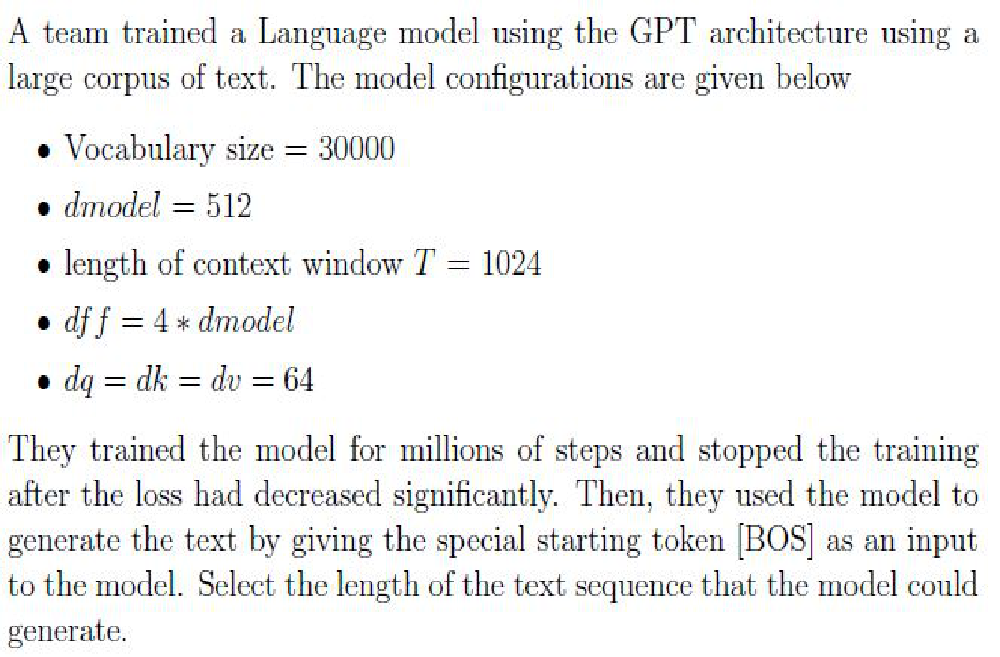
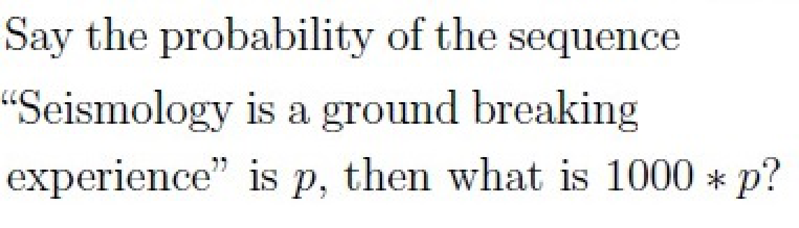
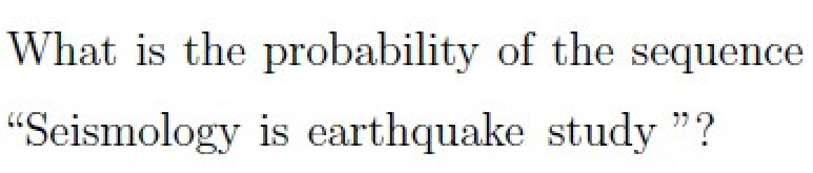
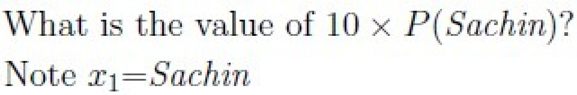
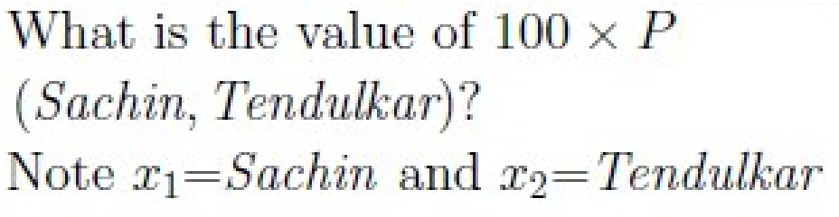
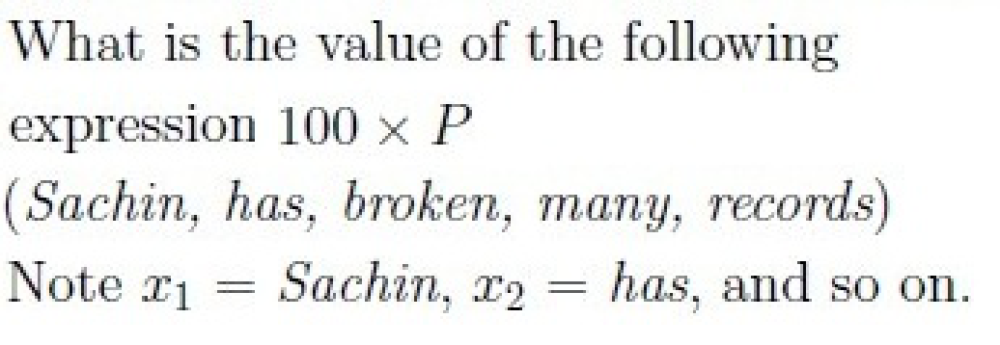
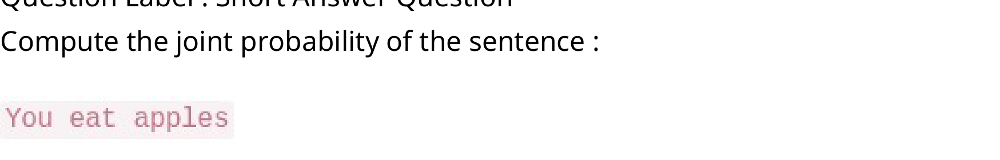
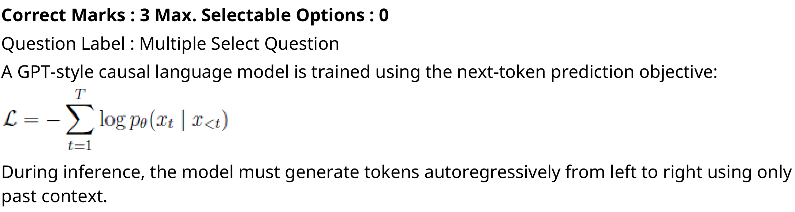
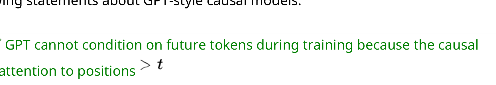

# Week 3: Exam Questions and Worked Answers

**Navigation:** [[week-2-exam-questions\|Previous bank]] · [[week-3-notes\|Week 3 notes]] · [[Knowledge-Map\|Knowledge Map]] · [[week-4-exam-questions\|Next bank]] · [[week-2-notes\|Previous notes]] · [[week-4-notes\|Next notes]]

**Coverage:** 36 routed occurrences; 34 distinct stems; by type MCQ 15, MSQ 12, SA 9; by exam Q1 23, Q2 4, ET 9.

**Answer provenance:** Answers were derived by the study team (Terra/Luna agents); they are not official keys. `verified_by_code: true` means a numerical/code-based check was run for that answer; `false` means no such code verification is claimed. Status and any source ambiguity are stated with each solution.

## Topic checklist

The checklist includes every topic named for this week in `sources/topics.json`. A topic without a directly routed question still links to the study notes.

| Topic | Linked questions | Evidence / revision |
| :--- | ---: | :--- |
| Language-modelling objective, chain rule and perplexity | 10 | [[week-3-exam-questions#da5004_2024T3_Q1_NA--q285\|2024T3 Q1 NA Q285]] · [[week-3-exam-questions#da5004_2024T3_Q1_NA--q286\|2024T3 Q1 NA Q286]] · [[week-3-exam-questions#da5004_2024T3_Q1_NA--q287\|2024T3 Q1 NA Q287]] · [[week-3-exam-questions#da5004_2025T1_Q1_NA--q118\|2025T1 Q1 NA Q118]] · [[week-3-exam-questions#da5004_2025T1_Q1_NA--q119\|2025T1 Q1 NA Q119]] · [[week-3-exam-questions#da5004_2025T1_Q1_NA--q120\|2025T1 Q1 NA Q120]] · [[week-3-exam-questions#da5004_2025T1_Q1_NA--q121\|2025T1 Q1 NA Q121]] · [[week-3-exam-questions#da5004_2026T2_Q1_NA--q10\|2026T2 Q1 NA Q10]] · [[week-3-exam-questions#da5004_2026T2_Q1_NA--q11\|2026T2 Q1 NA Q11]] · [[week-3-exam-questions#da5004_2026T2_Q1_NA--q12\|2026T2 Q1 NA Q12]] |
| Ways to parameterise a language model | 0 | No direct question found; revise the linked study notes. [[week-3-notes\|Week notes]] |
| Causal language modelling with a decoder-only stack | 8 | [[week-3-exam-questions#da5004_2024T1_ET_AN--q149\|2024T1 ET AN Q149]] · [[week-3-exam-questions#da5004_2024T1_ET_FN--q202\|2024T1 ET FN Q202]] · [[week-3-exam-questions#da5004_2024T1_Q1_NA--q193\|2024T1 Q1 NA Q193]] · [[week-3-exam-questions#da5004_2025T2_Q1_NA--q140\|2025T2 Q1 NA Q140]] · [[week-3-exam-questions#da5004_2025T3_ET_AN--q23\|2025T3 ET AN Q23]] · [[week-3-exam-questions#da5004_2025T3_ET_FN--q23\|2025T3 ET FN Q23]] · [[week-3-exam-questions#da5004_2026T1_Q2_NA--q13\|2026T1 Q2 NA Q13]] · [[week-3-exam-questions#da5004_2026T2_Q1_NA--q13\|2026T2 Q1 NA Q13]] |
| GPT-1 architecture and pre-train/fine-tune paradigm | 4 | [[week-3-exam-questions#da5004_2024T1_ET_AN--q144\|2024T1 ET AN Q144]] · [[week-3-exam-questions#da5004_2024T3_ET_AN--q193\|2024T3 ET AN Q193]] · [[week-3-exam-questions#da5004_2025T1_Q1_NA--q108\|2025T1 Q1 NA Q108]] · [[week-3-exam-questions#da5004_2025T2_Q1_NA--q141\|2025T2 Q1 NA Q141]] |
| GPT-1 parameter count (117M) | 7 | [[week-3-exam-questions#da5004_2024T1_Q2_NA--q135\|2024T1 Q2 NA Q135]] · [[week-3-exam-questions#da5004_2024T3_Q1_NA--q289\|2024T3 Q1 NA Q289]] · [[week-3-exam-questions#da5004_2026T1_Q1_NA--q16\|2026T1 Q1 NA Q16]] · [[week-3-exam-questions#da5004_2026T1_Q1_NA--q17\|2026T1 Q1 NA Q17]] · [[week-3-exam-questions#da5004_2026T1_Q1_NA--q18\|2026T1 Q1 NA Q18]] · [[week-3-exam-questions#da5004_2026T1_Q1_NA--q19\|2026T1 Q1 NA Q19]] · [[week-3-exam-questions#da5004_2026T1_Q1_NA--q20\|2026T1 Q1 NA Q20]] |
| Pre-training objective and teacher forcing | 5 | [[week-3-exam-questions#da5004_2024T1_Q1_NA--q194\|2024T1 Q1 NA Q194]] · [[week-3-exam-questions#da5004_2024T3_ET_AN--q177\|2024T3 ET AN Q177]] · [[week-3-exam-questions#da5004_2024T3_ET_FN--q194\|2024T3 ET FN Q194]] · [[week-3-exam-questions#da5004_2025T3_ET_AN--q24\|2025T3 ET AN Q24]] · [[week-3-exam-questions#da5004_2025T3_Q1_NA--q189\|2025T3 Q1 NA Q189]] |
| Fine-tuning GPT and the fine-tuning loss | 4 | [[week-3-exam-questions#da5004_2024T1_Q1_NA--q194\|2024T1 Q1 NA Q194]] · [[week-3-exam-questions#da5004_2024T3_ET_FN--q194\|2024T3 ET FN Q194]] · [[week-3-exam-questions#da5004_2025T1_Q1_NA--q108\|2025T1 Q1 NA Q108]] · [[week-3-exam-questions#da5004_2026T2_Q2_NA--q9\|2026T2 Q2 NA Q9]] |
| Task-specific input transformations | 1 | [[week-3-exam-questions#da5004_2026T2_Q2_NA--q8\|2026T2 Q2 NA Q8]] |

## Question navigator

| Paper | Question link | Topic | Answer status |
| :--- | :--- | :--- | :--- |
| 2024T1_ET_AN | [[week-3-exam-questions#da5004_2024T1_ET_AN--q144\|2024 T1 End Term AN, Q144]] | w3-gpt1-architecture | derived |
| 2024T1_ET_AN | [[week-3-exam-questions#da5004_2024T1_ET_AN--q149\|2024 T1 End Term AN, Q149]] | w3-causal-lm | ambiguous |
| 2024T1_ET_FN | [[week-3-exam-questions#da5004_2024T1_ET_FN--q202\|2024 T1 End Term FN, Q202]] | w3-causal-lm | ambiguous |
| 2024T1_Q1_NA | [[week-3-exam-questions#da5004_2024T1_Q1_NA--q193\|2024 T1 Quiz 1 NA, Q193]] | w3-causal-lm | ambiguous |
| 2024T1_Q1_NA | [[week-3-exam-questions#da5004_2024T1_Q1_NA--q194\|2024 T1 Quiz 1 NA, Q194]] | w3-finetuning, w3-pretraining-objective | ambiguous |
| 2024T1_Q2_NA | [[week-3-exam-questions#da5004_2024T1_Q2_NA--q135\|2024 T1 Quiz 2 NA, Q135]] | w3-gpt1-parameter-count | derived |
| 2024T3_ET_AN | [[week-3-exam-questions#da5004_2024T3_ET_AN--q177\|2024 T3 End Term AN, Q177]] | w3-pretraining-objective | derived |
| 2024T3_ET_AN | [[week-3-exam-questions#da5004_2024T3_ET_AN--q193\|2024 T3 End Term AN, Q193]] | w3-gpt1-architecture | derived |
| 2024T3_ET_FN | [[week-3-exam-questions#da5004_2024T3_ET_FN--q194\|2024 T3 End Term FN, Q194]] | w3-finetuning, w3-pretraining-objective | ambiguous |
| 2024T3_Q1_NA | [[week-3-exam-questions#da5004_2024T3_Q1_NA--q285\|2024 T3 Quiz 1 NA, Q285]] | w3-language-modelling | derived |
| 2024T3_Q1_NA | [[week-3-exam-questions#da5004_2024T3_Q1_NA--q286\|2024 T3 Quiz 1 NA, Q286]] | w3-language-modelling | derived |
| 2024T3_Q1_NA | [[week-3-exam-questions#da5004_2024T3_Q1_NA--q287\|2024 T3 Quiz 1 NA, Q287]] | w3-language-modelling | ambiguous |
| 2024T3_Q1_NA | [[week-3-exam-questions#da5004_2024T3_Q1_NA--q289\|2024 T3 Quiz 1 NA, Q289]] | w3-gpt1-parameter-count | derived |
| 2025T1_Q1_NA | [[week-3-exam-questions#da5004_2025T1_Q1_NA--q108\|2025 T1 Quiz 1 NA, Q108]] | w3-finetuning, w3-gpt1-architecture | ambiguous |
| 2025T1_Q1_NA | [[week-3-exam-questions#da5004_2025T1_Q1_NA--q118\|2025 T1 Quiz 1 NA, Q118]] | w3-language-modelling | ambiguous |
| 2025T1_Q1_NA | [[week-3-exam-questions#da5004_2025T1_Q1_NA--q119\|2025 T1 Quiz 1 NA, Q119]] | w3-language-modelling | ambiguous |
| 2025T1_Q1_NA | [[week-3-exam-questions#da5004_2025T1_Q1_NA--q120\|2025 T1 Quiz 1 NA, Q120]] | w3-language-modelling | ambiguous |
| 2025T1_Q1_NA | [[week-3-exam-questions#da5004_2025T1_Q1_NA--q121\|2025 T1 Quiz 1 NA, Q121]] | w3-language-modelling | ambiguous |
| 2025T2_Q1_NA | [[week-3-exam-questions#da5004_2025T2_Q1_NA--q140\|2025 T2 Quiz 1 NA, Q140]] | w3-causal-lm | derived |
| 2025T2_Q1_NA | [[week-3-exam-questions#da5004_2025T2_Q1_NA--q141\|2025 T2 Quiz 1 NA, Q141]] | w3-gpt1-architecture | derived |
| 2025T3_ET_AN | [[week-3-exam-questions#da5004_2025T3_ET_AN--q23\|2025 T3 End Term AN, Q23]] | w3-causal-lm | derived |
| 2025T3_ET_AN | [[week-3-exam-questions#da5004_2025T3_ET_AN--q24\|2025 T3 End Term AN, Q24]] | w3-pretraining-objective | derived |
| 2025T3_ET_FN | [[week-3-exam-questions#da5004_2025T3_ET_FN--q23\|2025 T3 End Term FN, Q23]] | w3-causal-lm | derived |
| 2025T3_Q1_NA | [[week-3-exam-questions#da5004_2025T3_Q1_NA--q189\|2025 T3 Quiz 1 NA, Q189]] | w3-pretraining-objective | derived |
| 2026T1_Q1_NA | [[week-3-exam-questions#da5004_2026T1_Q1_NA--q16\|2026 T1 Quiz 1 NA, Q16]] | w3-gpt1-parameter-count | derived |
| 2026T1_Q1_NA | [[week-3-exam-questions#da5004_2026T1_Q1_NA--q17\|2026 T1 Quiz 1 NA, Q17]] | w3-gpt1-parameter-count | derived |
| 2026T1_Q1_NA | [[week-3-exam-questions#da5004_2026T1_Q1_NA--q18\|2026 T1 Quiz 1 NA, Q18]] | w3-gpt1-parameter-count | ambiguous |
| 2026T1_Q1_NA | [[week-3-exam-questions#da5004_2026T1_Q1_NA--q19\|2026 T1 Quiz 1 NA, Q19]] | w3-gpt1-parameter-count | derived |
| 2026T1_Q1_NA | [[week-3-exam-questions#da5004_2026T1_Q1_NA--q20\|2026 T1 Quiz 1 NA, Q20]] | w3-gpt1-parameter-count | derived |
| 2026T1_Q2_NA | [[week-3-exam-questions#da5004_2026T1_Q2_NA--q13\|2026 T1 Quiz 2 NA, Q13]] | w3-causal-lm | derived |
| 2026T2_Q1_NA | [[week-3-exam-questions#da5004_2026T2_Q1_NA--q10\|2026 T2 Quiz 1 NA, Q10]] | w3-language-modelling | derived |
| 2026T2_Q1_NA | [[week-3-exam-questions#da5004_2026T2_Q1_NA--q11\|2026 T2 Quiz 1 NA, Q11]] | w3-language-modelling | ambiguous |
| 2026T2_Q1_NA | [[week-3-exam-questions#da5004_2026T2_Q1_NA--q12\|2026 T2 Quiz 1 NA, Q12]] | w3-language-modelling | ambiguous |
| 2026T2_Q1_NA | [[week-3-exam-questions#da5004_2026T2_Q1_NA--q13\|2026 T2 Quiz 1 NA, Q13]] | w3-causal-lm | derived |
| 2026T2_Q2_NA | [[week-3-exam-questions#da5004_2026T2_Q2_NA--q8\|2026 T2 Quiz 2 NA, Q8]] | w3-task-input-formats | derived |
| 2026T2_Q2_NA | [[week-3-exam-questions#da5004_2026T2_Q2_NA--q9\|2026 T2 Quiz 2 NA, Q9]] | w3-finetuning | derived |

## Quiz 1 questions

### 2024 T1 Quiz 1 NA, Q193

**Paper:** `2024T1_Q1_NA` · **Type:** MSQ · **Marks:** 4 · **Topic(s):** w3-causal-lm

A team trained a Language model using the GPT architecture using a large corpus of text. The model configurations are given below:

- Vocabulary size = 30000
- $d_{model} = 512$
- length of context window $T = 1024$
- $d_{ff} = 4 * d_{model}$
- $d_q = d_k = d_v = 64$

They trained the model for millions of steps and stopped the training after the loss had decreased significantly. Then, they used the model to generate the text by giving the special starting token [BOS] as an input to the model. Select the length of the text sequence that the model could generate.

**A.** 512

*Label added for presentation.*

**B.** 1024

*Label added for presentation.*

**C.** 1536

*Label added for presentation.*

**D.** 2048

*Label added for presentation.*

#### Worked answer

**Final answer:** A under a capped complete sequence; A and B if the final prediction need not be fed back; A–D with a sliding window.

**Steps:** With BOS occupying one of 1024 full-sequence slots, at most 1023 new tokens fit, so only 512 is eligible. A model can predict one further token from a full input window, allowing 1024 generated tokens, while sliding with position IDs reset permits all offered lengths.

**Status:** ambiguous

**Ambiguity note:** Full-sequence cap including BOS yields A; counting the final prediction without feeding it back yields A and B; sliding and resetting position IDs yields A–D.

**verified_by_code:** `true` — solve_numeric.py recomputed adjudicated inputs/conventions; all recorded values and adjudication checks MATCH.

---

### 2024 T1 Quiz 1 NA, Q194

**Paper:** `2024T1_Q1_NA` · **Type:** MSQ · **Marks:** 4 · **Topic(s):** w3-finetuning, w3-pretraining-objective

Choose the correct statements

**A.** All the parameters of the GPT model are randomly initialized during pre-training

*Label added for presentation.*

**B.** The model minimizes the CLM objective during fine-tuning to improve the performance

*Label added for presentation.*

**C.** All parameters of the GPT model are randomly initialized during fine-tuning

*Label added for presentation.*

**D.** In general, fine-tuning requires a dataset with labels

*Label added for presentation.*

#### Worked answer

**Final answer:** A, B, D in the GPT-1 supervised-task setting.

**Steps:** A: pretraining starts from random model parameters. B: Radford et al. use supervised loss plus an auxiliary CLM loss; CLM is not mandatory for every fine-tuning task. C: pretrained weights are reused, not reinitialized. D: supervised downstream fine-tuning generally uses labels; unsupervised adaptation is also possible.

**Status:** ambiguous

**Ambiguity note:** B is task-dependent: GPT-1 used auxiliary CLM in its experiments, but fine-tuning need not minimize CLM; D concerns supervised fine-tuning rather than all fine-tuning.

**verified_by_code:** `false` — No numeric checker path; answer remains explicitly ambiguous.

---

### 2024 T3 Quiz 1 NA, Q285

**Paper:** `2024T3_Q1_NA` · **Type:** SA · **Marks:** 1 · **Topic(s):** w3-language-modelling

What is the probability of the predicted word equal to “Seismology” given the “[Start]” token as the initial input $P(y_1 = \text{Seismology} \mid y_0 = \text{[Start]})$?

![Question 285 prompt: probability of predicted word Seismology given [Start] token](assets/da5004_2024T3_Q1_NA/q285-q285-stem-01-p009.png)

#### Worked answer

**Final answer:** 0.41.

**Steps:** The initial row gives P(seismology|[start])=0.41.

**Status:** derived

**verified_by_code:** `false` — depends on figure, no code path

---

### 2024 T3 Quiz 1 NA, Q286

**Paper:** `2024T3_Q1_NA` · **Type:** SA · **Marks:** 2 · **Topic(s):** w3-language-modelling

Say the probability of the sequence “Seismology is a ground breaking experience” is p, then what is $1000 \times p$?

#### Worked answer

**Final answer:** Approximately 1.637.

**Steps:** The six successive tokens follow the greedy path, so 1000 × 0.41 × 0.43 × 0.29 × 0.48 × 0.29 × 0.23 = 1.636882032.

**Status:** derived

**verified_by_code:** `false` — depends on figure, no code path

---

### 2024 T3 Quiz 1 NA, Q287

**Paper:** `2024T3_Q1_NA` · **Type:** SA · **Marks:** 2 · **Topic(s):** w3-language-modelling

What is the probability of the sequence “Seismology is earthquake study ”?

#### Worked answer

**Final answer:** Insufficient information; enter −1.

**Steps:** The row following “seismology is” is supplied only along the greedy prefix, which continues with “a”; the conditional distribution after the non-greedy “earth quake” is missing.

**Status:** ambiguous

**Ambiguity note:** The conditional probability of study after the non-greedy earthquake prefix is absent: choosing that factor as 0 gives sequence probability 0, and choosing 1 gives 0.007052. The prescribed insufficient-information response is −1; this treats the listed “earth quake” as earthquake.

**verified_by_code:** `true` — solve_numeric.py recomputed adjudicated inputs/conventions; all recorded values and adjudication checks MATCH.

---

### 2024 T3 Quiz 1 NA, Q289

**Paper:** `2024T3_Q1_NA` · **Type:** MCQ · **Marks:** 2 · **Topic(s):** w3-gpt1-parameter-count

What will be the shape of positional embedding?

**A.** 64 × 128

*Label added for presentation.*

**B.** 64 × 4

*Label added for presentation.*

**C.** 12 × 128

*Label added for presentation.*

**D.** 512 × 768

*Label added for presentation.*

**E.** None of these.

*Label added for presentation.*

#### Worked answer

**Final answer:** A: 64 × 128.

**Steps:** Learned positional embeddings have one 128-dimensional row per position, giving `64 × 128`. B uses head count as width, C uses 12 positions, and D is an unrelated configuration. E is false.

**Status:** derived

**verified_by_code:** `true` — solve_numeric.py recomputed adjudicated inputs/conventions; all recorded values and adjudication checks MATCH.

---

### 2025 T1 Quiz 1 NA, Q108

**Paper:** `2025T1_Q1_NA` · **Type:** MSQ · **Marks:** 2 · **Topic(s):** w3-finetuning, w3-gpt1-architecture

Choose the correct statements

**A.** All the parameters of the GPT model are randomly initialized during pre-
training

**B.** The model minimizes the CLM objective during fine-tuning to improve the
performance

**C.** All parameters of the GPT model are randomly initialized during fine-tuning

**D.** In general, fine-tuning requires a dataset with labels

#### Worked answer

**Final answer:** A, B, D in the GPT-1 supervised-task setting.

**Steps:** A: pretraining starts from random model parameters. B: Radford et al. use supervised loss plus an auxiliary CLM loss; CLM is not mandatory for every fine-tuning task. C: pretrained weights are reused, not reinitialized. D: supervised downstream fine-tuning generally uses labels; unsupervised adaptation is also possible.

**Status:** ambiguous

**Ambiguity note:** B is task-dependent: GPT-1 used auxiliary CLM in its experiments, but fine-tuning need not minimize CLM; D concerns supervised fine-tuning rather than all fine-tuning.

**verified_by_code:** `false` — No numeric checker path; answer remains explicitly ambiguous.

---

### 2025 T1 Quiz 1 NA, Q118

**Paper:** `2025T1_Q1_NA` · **Type:** SA · **Marks:** 2 · **Topic(s):** w3-language-modelling

What is the value of $10 \times P(\text{Sachin})$?

Note: $x_1 = \text{Sachin}$

#### Worked answer

**Final answer:** 60/41 ≈ 1.4634

**Steps:** Under an empirical random-token-start distribution, the corpus contains 41 tokens and the requested phrase occurs 6 time(s); chain-rule conditionals telescope to occurrence count / 41.

**Status:** ambiguous

**Ambiguity note:** The sampling distribution over starting positions is unspecified; the estimate assumes uniformly sampled corpus token positions.

**verified_by_code:** `false` — depends on figure, no code path

---

### 2025 T1 Quiz 1 NA, Q119

**Paper:** `2025T1_Q1_NA` · **Type:** SA · **Marks:** 2 · **Topic(s):** w3-language-modelling

What is the value of $100 \times P(\text{Sachin}, \text{Tendulkar})$?

Note: $x_1 = \text{Sachin}$ and $x_2 = \text{Tendulkar}$

#### Worked answer

**Final answer:** 100/41 ≈ 2.4390

**Steps:** Under an empirical random-token-start distribution, the corpus contains 41 tokens and the requested phrase occurs 1 time(s); chain-rule conditionals telescope to occurrence count / 41.

**Status:** ambiguous

**Ambiguity note:** The sampling distribution over starting positions is unspecified; the estimate assumes uniformly sampled corpus token positions.

**verified_by_code:** `false` — depends on figure, no code path

---

### 2025 T1 Quiz 1 NA, Q120

**Paper:** `2025T1_Q1_NA` · **Type:** SA · **Marks:** 3 · **Topic(s):** w3-language-modelling

What is the value of the following expression $100 \times P(\text{Sachin}, \text{has}, \text{broken}, \text{many}, \text{records})$?

Note: $x_1 = \text{Sachin}$, $x_2 = \text{has}$, and so on.

#### Worked answer

**Final answer:** 100/41 ≈ 2.4390

**Steps:** Under an empirical random-token-start distribution, the corpus contains 41 tokens and the requested phrase occurs 1 time(s); chain-rule conditionals telescope to occurrence count / 41.

**Status:** ambiguous

**Ambiguity note:** The sampling distribution over starting positions is unspecified; the estimate assumes uniformly sampled corpus token positions.

**verified_by_code:** `false` — depends on figure, no code path

---

### 2025 T1 Quiz 1 NA, Q121

**Paper:** `2025T1_Q1_NA` · **Type:** MCQ · **Marks:** 2 · **Topic(s):** w3-language-modelling

Once the model is sufficiently trained, which of the following tokens will have the highest
probability to be the next token, if the input is “Sachin has”:

**A.** broken

**B.** acted

**C.** highest

**D.** None of these

#### Worked answer

**Final answer:** A: broken, under the empirical-frequency approximation.

**Steps:** After “Sachin has”, broken occurs twice, acted once, highest once; A has the highest empirical conditional frequency. B and C are less frequent; D disregards A. Training does not guarantee this learned ranking.

**Status:** ambiguous

**Ambiguity note:** Model training and generalization are unspecified; corpus counts alone do not guarantee a trained model’s next-token ranking.

**verified_by_code:** `false` — No numeric checker path; answer remains explicitly ambiguous.

---

### 2025 T2 Quiz 1 NA, Q140

**Paper:** `2025T2_Q1_NA` · **Type:** MSQ · **Marks:** 3 · **Topic(s):** w3-causal-lm

Which of the following statements are true regarding causal language modeling (CLM)?

**A.** The model only attends to past and current tokens during training.

**B.** The model is trained by predicting the next token in a sequence.

**C.** The model uses bidirectional context.

**D.** The CLM objective is commonly used for encoder-only models.

#### Worked answer

**Final answer:** A and B.

**Steps:** Causal attention admits current and earlier positions (A), and predicts the next token (B). C requires future context and D describes the usual encoder-only MLM setting.

**Status:** derived

**verified_by_code:** `false` — Non-numeric response; no numeric checker path applies.

---

### 2025 T2 Quiz 1 NA, Q141

**Paper:** `2025T2_Q1_NA` · **Type:** MSQ · **Marks:** 3 · **Topic(s):** w3-gpt1-architecture

Which of the following are valid reasons why transformer-based large language models are widely used in natural language processing?

**A.** Transformers process input sequences in parallel, enabling faster training.

**B.** They use recurrence to remember long-term dependencies more effectively than LSTMs.

**C.** Transformers are limited to short text inputs due to their architecture.

**D.** Large transformer models can be fine-tuned for various NLP tasks using a single pre-trained model.

#### Worked answer

**Final answer:** A and D.

**Steps:** A: masked attention parallelizes training across positions; D: pretrained weights transfer to many tasks. B incorrectly introduces recurrence; C overstates the finite context limit.

**Status:** derived

**verified_by_code:** `false` — Non-numeric response; no numeric checker path applies.

---

### 2025 T3 Quiz 1 NA, Q189

**Paper:** `2025T3_Q1_NA` · **Type:** SA · **Marks:** 3 · **Topic(s):** w3-pretraining-objective

How many next-token prediction targets are generated during training a full batch?

#### Worked answer

**Final answer:** 32736 targets.

**Steps:** Without BOS, each length-1024 sequence supplies 1023 next-token labels; 32 × 1023 = 32736.

**Status:** derived

**verified_by_code:** `true` — solve_numeric.py recomputed adjudicated inputs/conventions; all recorded values and adjudication checks MATCH.

---

### 2026 T1 Quiz 1 NA, Q16

**Paper:** `2026T1_Q1_NA` · **Type:** MCQ · **Marks:** 2 · **Topic(s):** w3-gpt1-parameter-count

What is the number of parameters in the token embedding matrix?

**A.** 30,720,000

**B.** 40,768

**C.** 393,216

**D.** 15,728,640,000

#### Worked answer

**Final answer:** A

**Steps:** Token matrix `[40000, 768]`: 40000 × 768 = 30720000; B adds dimensions, C is position count and D multiplies unrelated dimensions.

**Status:** derived

**verified_by_code:** `true` — solve_numeric.py recomputed adjudicated inputs/conventions; all recorded values and adjudication checks MATCH.

---

### 2026 T1 Quiz 1 NA, Q17

**Paper:** `2026T1_Q1_NA` · **Type:** MCQ · **Marks:** 2 · **Topic(s):** w3-gpt1-parameter-count

What is the total number of parameters in the positional embedding matrix?

**A.** 512,768

**B.** 393,216

**C.** 3,932,160

**D.** 39,321

#### Worked answer

**Final answer:** B

**Steps:** Position matrix `[512, 768]`: 512 × 768 = 393216; A adds dimensions, C and D have incorrect decimal scale.

**Status:** derived

**verified_by_code:** `true` — solve_numeric.py recomputed adjudicated inputs/conventions; all recorded values and adjudication checks MATCH.

---

### 2026 T1 Quiz 1 NA, Q18

**Paper:** `2026T1_Q1_NA` · **Type:** MCQ · **Marks:** 2 · **Topic(s):** w3-gpt1-parameter-count

For ONE complete attention head, what is the total number of parameters (Q + K + V projections combined)?

**A.** 49,152

**B.** 196,608

**C.** 589,824

**D.** 147,456

#### Worked answer

**Final answer:** D (147,456) without Q/K/V biases; 147,648 with biases, absent from the options.

**Steps:** Each of Q, K and V has a 768×64 weight matrix. Their 147,456 weights become 147,648 parameters if three 64-element bias vectors are included.

**Status:** ambiguous

**Ambiguity note:** Bias-free Q/K/V projections yield D, 147,456; biased Q/K/V projections yield 147,648, which is not listed. The prompt does not specify the bias convention.

**verified_by_code:** `true` — solve_numeric.py recomputed adjudicated inputs/conventions; all recorded values and adjudication checks MATCH.

---

### 2026 T1 Quiz 1 NA, Q19

**Paper:** `2026T1_Q1_NA` · **Type:** MCQ · **Marks:** 2 · **Topic(s):** w3-gpt1-parameter-count

After the multi-head attention computation, all head outputs are concatenated and projected back to the model dimension.

How many parameters are in the output projection matrix (weights only, excluding bias)?

**A.** 768

**B.** 49,152

**C.** 589,824

**D.** 294,912

#### Worked answer

**Final answer:** C

**Steps:** The concatenated heads have width 768; output weights `[768, 768]` contain 589824. A, B and D use smaller incorrect dimensions.

**Status:** derived

**verified_by_code:** `true` — solve_numeric.py recomputed adjudicated inputs/conventions; all recorded values and adjudication checks MATCH.

---

### 2026 T1 Quiz 1 NA, Q20

**Paper:** `2026T1_Q1_NA` · **Type:** MCQ · **Marks:** 2 · **Topic(s):** w3-gpt1-parameter-count

What is the total number of parameters in the complete FFN (including both weight matrices and bias vectors)?

**A.** 2,359,296

**B.** 4,718,592

**C.** 4,722,432

**D.** 9,437,184

#### Worked answer

**Final answer:** C

**Steps:** Two weight matrices plus biases: 2 × 768 × 3072 + 3072 + 768 = 4722432. A omits a matrix; B omits biases; D doubles the count.

**Status:** derived

**verified_by_code:** `true` — solve_numeric.py recomputed adjudicated inputs/conventions; all recorded values and adjudication checks MATCH.

---

### 2026 T2 Quiz 1 NA, Q10

**Paper:** `2026T2_Q1_NA` · **Type:** SA · **Marks:** 3 · **Topic(s):** w3-language-modelling

Compute the joint probability of the sentence : "You eat apples"

(Provide answer correct upto 2 digits after the decimal)

#### Worked answer

**Final answer:** 0.18.

**Steps:** From the tree: P(you)P(eat|you)P(apples|you,eat)=0.4×0.5×0.9=0.18.

**Status:** derived

**verified_by_code:** `true` — solve_numeric.py recomputed adjudicated inputs/conventions; all recorded values and adjudication checks MATCH.

---

### 2026 T2 Quiz 1 NA, Q11

**Paper:** `2026T2_Q1_NA` · **Type:** MCQ · **Marks:** 3 · **Topic(s):** w3-language-modelling

Choose the option corresponding to the sentence with the highest joint probability under the given language model.

**A.** "i eat apples"

**B.** "apples like You"

**C.** "i eat bananas"

**D.** "you like bananas

**E.** "you like apples

#### Worked answer

**Final answer:** C if the unshown B path has probability below 0.09; B if its probability exceeds 0.09.

**Steps:** The displayed paths give A=.5×.3×.4=.06, C=.5×.3×.6=.09, D=.4×.4×.5=.08, E=.4×.4×.4=.064. B begins with an unshown apples branch whose start mass can be up to .1; its later conditionals are unspecified.

**Status:** ambiguous

**Ambiguity note:** If the omitted B path has probability 0, C wins at 0.09; if P(apples first)=0.1 and both subsequent B conditionals are 1, B wins at 0.1. The partial tree permits both completions.

**verified_by_code:** `true` — solve_numeric.py recomputed adjudicated inputs/conventions; all recorded values and adjudication checks MATCH.

---

### 2026 T2 Quiz 1 NA, Q12

**Paper:** `2026T2_Q1_NA` · **Type:** SA · **Marks:** 2 · **Topic(s):** w3-language-modelling

Using the given probability tree calculate the conditional probability of predicting "apples" given "like" [i.e P(apples | like)]. (Submit -1 if the provided information is insufficient)

#### Worked answer

**Final answer:** Insufficient information; enter −1.

**Steps:** P(apples|like) marginalizes over all preceding first tokens; the tree is partial and omits possible contexts and their probabilities.

**Status:** ambiguous

**Ambiguity note:** If no omitted first token can precede like, P(apples|like)=0.274/0.46≈0.595652; if an omitted first token has mass 0.1 and both relevant conditionals are 1, the ratio is 0.374/0.56≈0.667857. The prescribed answer for missing information is −1.

**verified_by_code:** `true` — solve_numeric.py recomputed adjudicated inputs/conventions; all recorded values and adjudication checks MATCH.

---

### 2026 T2 Quiz 1 NA, Q13

**Paper:** `2026T2_Q1_NA` · **Type:** MSQ · **Marks:** 3 · **Topic(s):** w3-causal-lm

Which of the following are components found within a GPT decoder layer?

**A.** Causal (Masked) Multi-Head Self-Attention

**B.** Position-wise Feed-Forward Network

**C.** Multi Head (Cross) Attention

**D.** Recurrent Neural Network (RNN) Layer

**E.** Add & Norm Layer

#### Worked answer

**Final answer:** A, B and E.

**Steps:** GPT decoder blocks contain causal self-attention, positionwise FFN, residual additions and layer normalization. C is encoder–decoder cross-attention, absent in GPT-1; D is recurrent, not a GPT block.

**Status:** derived

**verified_by_code:** `false` — Non-numeric response; no numeric checker path applies.

---

## Quiz 2 questions

### 2024 T1 Quiz 2 NA, Q135

**Paper:** `2024T1_Q2_NA` · **Type:** MSQ · **Marks:** 4 · **Topic(s):** w3-gpt1-parameter-count

Choose the correct statements about the number of parameters in the model (excluding the
embedding and output layer parameters)

**A.** Team A model has less number of parameters than the team B

**B.** Team B model has less number of parameters than the team C

**C.** Team C model has more number of parameters than the team A

**D.** All models have the same number of parameters

#### Worked answer

**Final answer:** D: all have the same decoder parameter count.

**Steps:** All share two layers and identical widths, heads and FFN dimensions; vocabulary changes only excluded embedding/output parameters. Thus A, B and C are false.

**Status:** derived

**verified_by_code:** `false` — Non-numeric response; no numeric checker path applies.

---

### 2026 T1 Quiz 2 NA, Q13

**Paper:** `2026T1_Q2_NA` · **Type:** MCQ · **Marks:** 2 · **Topic(s):** w3-causal-lm

Is the given attention matrix valid for a causal language modelling task?

**A.** True

**B.** False

**C.** Insufficient information

#### Worked answer

**Final answer:** B: false.

**Steps:** All future entries are zero, but row t=5 sums to 0.90, not 1. A is false for an attention probability matrix; C is false because the supplied entries suffice.

**Status:** derived

**verified_by_code:** `true` — solve_numeric.py recomputed adjudicated inputs/conventions; all recorded values and adjudication checks MATCH.

---

### 2026 T2 Quiz 2 NA, Q8

**Paper:** `2026T2_Q2_NA` · **Type:** MCQ · **Marks:** 3 · **Topic(s):** w3-task-input-formats

During the fine-tuning of GPT-1 for Textual Entailment tasks, what is the purpose of the delimiter token ($)?

**A.** To trigger the softmax function.

**B.** To separate premise and hypothesis.

**C.** To mark the end of the sentence.

**D.** To initialize the linear head.

#### Worked answer

**Final answer:** B: separate premise and hypothesis.

**Steps:** GPT-1 places a delimiter between the two text segments. A softmax is applied by the classification head; C uses a separate end token; D the delimiter does not initialize parameters.

**Status:** derived

**verified_by_code:** `false` — Non-numeric response; no numeric checker path applies.

---

### 2026 T2 Quiz 2 NA, Q9

**Paper:** `2026T2_Q2_NA` · **Type:** MCQ · **Marks:** 3 · **Topic(s):** w3-finetuning

During the fine-tuning of a decoder-only Transformer for sequence classification, why is the hidden representation of the final input token used as the input to the classification layer?

**A.** The first token's representation relies exclusively on absolute positional
encodings and lacks semantic context for classification.

**B.** The final token's representation is computed independently of self-attention,
making its gradients more stable during the fine-tuning process.

**C.** Selecting the final token aligns with the autoregressive objective, eliminating
the need for teacher forcing during the classification forward pass.

**D.** Causal self-attention ensures that only the final token's representation aggregates information from all preceding tokens in the sequence.

#### Worked answer

**Final answer:** D.

**Steps:** Causal attention permits the final representation to incorporate all earlier tokens. A overstates positional embeddings, B denies attention, and C confuses classification with teacher forcing.

**Status:** derived

**verified_by_code:** `false` — Non-numeric response; no numeric checker path applies.

---

## End Term questions

### 2024 T1 End Term AN, Q144

**Paper:** `2024T1_ET_AN` · **Type:** MCQ · **Marks:** 2 · **Topic(s):** w3-gpt1-architecture

GPT stands for

**A.** Generative Pre-trained Transformer

*Label added for presentation.*

**B.** Generative Pre-trained Text

*Label added for presentation.*

**C.** Generalized Pre-trained Transformer

*Label added for presentation.*

**D.** Generative Pre-trained Transfer-text

*Label added for presentation.*

#### Worked answer

**Final answer:** A: Generative Pre-trained Transformer.

**Steps:** GPT abbreviates Generative Pre-trained Transformer. B substitutes Text, C Generalized, and D Transfer-text.

**Status:** derived

**verified_by_code:** `false` — Non-numeric response; no numeric checker path applies.

---

### 2024 T1 End Term AN, Q149

**Paper:** `2024T1_ET_AN` · **Type:** MSQ · **Marks:** 3 · **Topic(s):** w3-causal-lm

A user runs inference on the model N times with an input text that contains 712 tokens (including the special [start] token), then which of the following could be the possible length of summarized text

**A.** 256

*Label added for presentation.*

**B.** 16

*Label added for presentation.*

**C.** 1024

*Label added for presentation.*

**D.** 512

*Label added for presentation.*

**E.** 2048

*Label added for presentation.*

#### Worked answer

**Final answer:** A–D with a fixed window; A–E with a sliding window.

**Steps:** 2048−712=1336 positions remain when the complete sequence is capped; 256, 16, 1024 and 512 fit, but 2048 does not. Sliding the window and resetting position IDs permits longer output; if the last sampled token need not be fed back, one extra token can be emitted without sliding.

**Status:** ambiguous

**Ambiguity note:** Fixed full-sequence window: A–D; sliding context with position IDs reset: A–E. Counting a final prediction beyond the last input adds one token but does not change these choices.

**verified_by_code:** `true` — solve_numeric.py recomputed adjudicated inputs/conventions; all recorded values and adjudication checks MATCH.

---

### 2024 T1 End Term FN, Q202

**Paper:** `2024T1_ET_FN` · **Type:** MSQ · **Marks:** 3 · **Topic(s):** w3-causal-lm

A user runs inference on the model N times with an input text that contains 712 tokens (including the special [start] token), then which of the following could be the possible length of summarized text

**A.** 256

*Label added for presentation.*

**B.** 16

*Label added for presentation.*

**C.** 1024

*Label added for presentation.*

**D.** 512

*Label added for presentation.*

#### Worked answer

**Final answer:** A and B with a fixed window; A–D with a sliding window.

**Steps:** 1024−712=312 positions remain when the complete sequence is capped; 256 and 16 fit but 1024 and 512 do not. A sliding context with position IDs reset permits all four; a final prediction without feedback adds one token without altering the choices.

**Status:** ambiguous

**Ambiguity note:** Fixed full-sequence window: A and B; sliding context with position IDs reset: A–D. Counting a final prediction beyond the last input adds one token but does not change these choices.

**verified_by_code:** `true` — solve_numeric.py recomputed adjudicated inputs/conventions; all recorded values and adjudication checks MATCH.

---

### 2024 T3 End Term AN, Q177

**Paper:** `2024T3_ET_AN` · **Type:** MCQ · **Marks:** 3 · **Topic(s):** w3-pretraining-objective

Assume that we have a large corpus of text. The vocabulary constructed from the text contains
10000 words. Of these, 100 words occurred only once in the entire corpus of text. The parameters
of the embedding layer and the output layer of the model are shared. Suppose we create a batch
of 256 samples (each sample is a sentence from the corpus). None of these samples contains any
of the 100 rare words. Suppose we pre-train the model for one iteration using the batch of
samples, then:

**A.** it is certain that the embeddings of none of these 100 rare words will get
updated.

**B.** there is a chance that the embeddings of all or some of these 100 rare words
will get updated

**C.** the embeddings of all these 100 rare words will defintely get updated

**D.** None of these

#### Worked answer

**Final answer:** B: rare embeddings can be updated.

**Steps:** Tied output weights receive softmax gradients even for absent targets. A is false; C is not guaranteed since gradients may cancel or learning rates may be zero; D ignores this mechanism.

**Status:** derived

**verified_by_code:** `false` — Non-numeric response; no numeric checker path applies.

---

### 2024 T3 End Term AN, Q193

**Paper:** `2024T3_ET_AN` · **Type:** MSQ · **Marks:** 2 · **Topic(s):** w3-gpt1-architecture

Which of the following are correct about GPT-1 model:

**A.** It is a decoder only model.

**B.** It uses absolute positional encoding.

**C.** It uses a composite dataset for pre-training.

**D.** None of these.

#### Worked answer

**Final answer:** A and B.

**Steps:** GPT-1 uses a causal decoder and learned absolute positions. C is false: Radford et al. pretrained on BooksCorpus, rather than the later composite WebText-style mixtures; D is false.

**Status:** derived

**verified_by_code:** `false` — Non-numeric response; no numeric checker path applies.

---

### 2024 T3 End Term FN, Q194

**Paper:** `2024T3_ET_FN` · **Type:** MSQ · **Marks:** 3 · **Topic(s):** w3-finetuning, w3-pretraining-objective

Choose all the correct statements about the GPT model:

**A.** All the parameters of are randomly initialized during pre-training

*Label added for presentation.*

**B.** The model minimizes the CLM objective during fine-tuning for downstream tasks like sentiment classification to improve the performance

*Label added for presentation.*

**C.** All parameters are randomly initialized during fine-tuning

*Label added for presentation.*

**D.** In general, fine-tuning requires a dataset with labels

*Label added for presentation.*

**E.** None of these

*Label added for presentation.*

#### Worked answer

**Final answer:** A, B, D in the GPT-1 supervised-task setting.

**Steps:** A: pretraining starts from random model parameters. B: Radford et al. use supervised loss plus an auxiliary CLM loss; CLM is not mandatory for every fine-tuning task. C: pretrained weights are reused, not reinitialized. D: supervised downstream fine-tuning generally uses labels; unsupervised adaptation is also possible. E is false because A and D hold.

**Status:** ambiguous

**Ambiguity note:** B is task-dependent: GPT-1 used auxiliary CLM in its experiments, but fine-tuning need not minimize CLM; D concerns supervised fine-tuning rather than all fine-tuning.

**verified_by_code:** `false` — No numeric checker path; answer remains explicitly ambiguous.

---

### 2025 T3 End Term AN, Q23

**Paper:** `2025T3_ET_AN` · **Type:** MCQ · **Marks:** 1 · **Topic(s):** w3-causal-lm

Which of the following describes the fundamental training mechanism of this model?

**A.** The model predicts the entire sequence $x$ simultaneously without considering dependencies.

**B.** The model predicts the token $x_{t+1}$ based only on the tokens $x_1$ up to $x_t$.

**C.** The model predicts a masked token $x_t$ based on both the left and right context tokens.

#### Worked answer

**Final answer:** B.

**Steps:** Autoregressive training models P(x[t+1]|x[1:t]). A denies dependencies; C describes bidirectional masked-token prediction.

**Status:** derived

**verified_by_code:** `false` — Non-numeric response; no numeric checker path applies.

---

### 2025 T3 End Term AN, Q24

**Paper:** `2025T3_ET_AN` · **Type:** MCQ · **Marks:** 1 · **Topic(s):** w3-pretraining-objective

During the training phase on a sequence $x$ of length $T$, how does the teacher forcing mechanism specifically relate to the calculation of the loss function $\mathcal{L}(\theta)$?

**A.** It means the model uses its own previous predictions $(\hat{x}_1, \dots, \hat{x}_t)$ as input to predict $x_{t+1}$.

**B.** It dictates that the loss is only calculated for tokens that were incorrectly
predicted.

**C.** It ensures that for every prediction $P(x_{t+1} \mid \dots)$, the model is conditioned on the ground-truth sequence $(x_1, \dots, x_t)$.

**D.** It allows the model to see future tokens $(x_{t+2}, \dots, x_T)$ when predicting $x_{t+1}$.

#### Worked answer

**Final answer:** C.

**Steps:** Teacher forcing conditions each prediction on the observed prefix. A instead feeds generated tokens; B ignores correctly predicted tokens; D violates causal masking.

**Status:** derived

**verified_by_code:** `false` — Non-numeric response; no numeric checker path applies.

---

### 2025 T3 End Term FN, Q23

**Paper:** `2025T3_ET_FN` · **Type:** MSQ · **Marks:** 3 · **Topic(s):** w3-causal-lm

A GPT-style causal language model is trained using the next-token prediction objective:
$$\mathcal{L} = -\sum_{t=1}^T \log p_\theta(x_t \mid x_{<t})$$
During inference, the model must generate tokens autoregressively from left to right using only past context.
Consider the following statements about GPT-style causal models.

**A.** GPT cannot condition on future tokens during training because the causal mask zeros out all attention to positions $> t$

**B.** If two prefixes $x_{<t}$ and $x'_{<t}$ have identical embeddings at all positions, GPT must assign identical next-token distributions for both contexts

**C.** Removing positional encodings would force GPT to treat all permutations of the same set of tokens as equivalent contexts

**D.** Causal masking ensures that the computational cost of training scales linearly with sequence length

#### Worked answer

**Final answer:** A and B.

**Steps:** A: the mask blocks future keys; B: identical position-wise input embeddings and deterministic computation give identical distributions. C is false: the triangular mask itself conveys order through prefix structure across layers. D is false: dense attention remains quadratic.

**Status:** derived

**verified_by_code:** `false` — Non-numeric response; no numeric checker path applies.

---

## Source and reproducibility

Questions preserve each routed paper occurrence, including repeated stems from different papers or sessions. Images are linked from the archived extraction assets. Rebuild with `uv run python scripts/build_exam_question_banks.py`; run `uv run python scripts/build_exam_study_priorities.py` for the ranked study guide.
