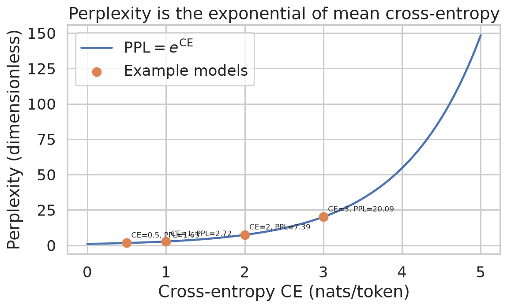
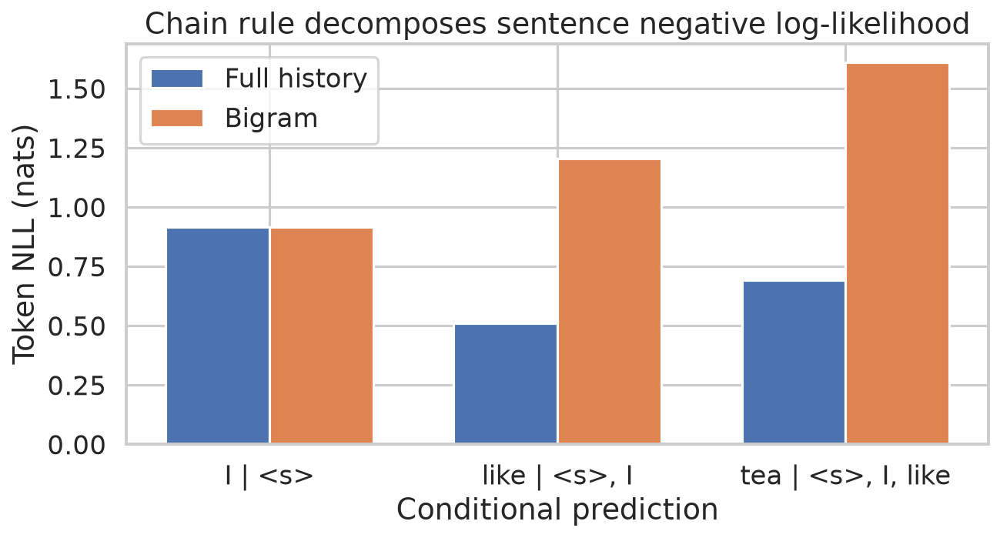
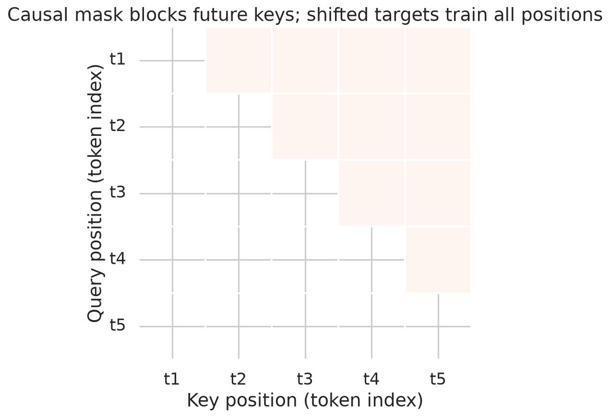
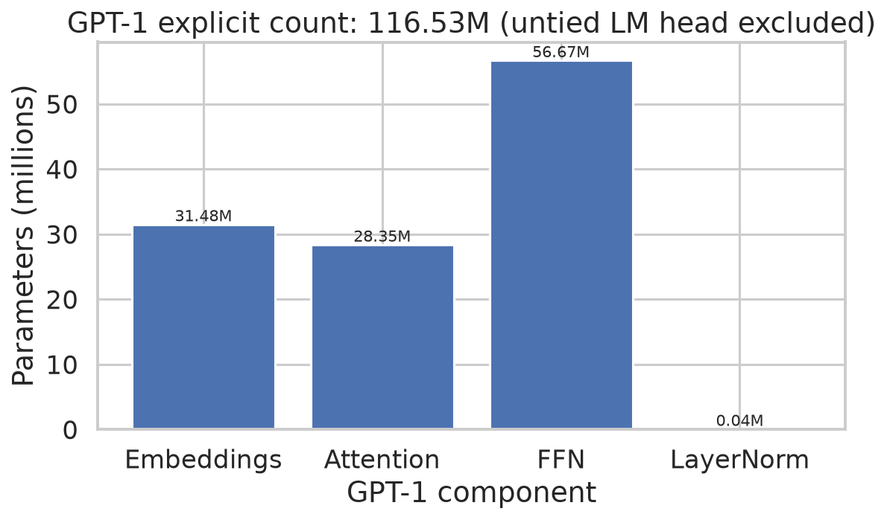
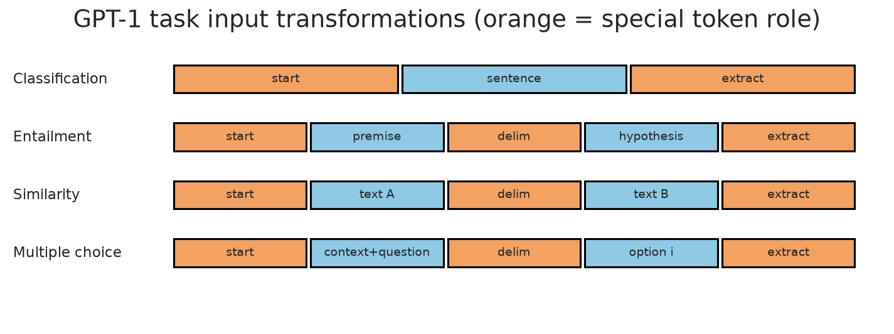

# Week 3: Language Modelling, GPT-1, and Transfer

**Study and practise:** [[week-3-exam-focused-notes|Exam-focused notes]] · [[week-3-exam-questions|Routed exam questions]]

**Navigation:** ← [[week-2-notes|Week 2]] · [[Knowledge-Map|Knowledge Map]] · [[week-4-notes|Week 4]] →

## Abstract

A language model assigns a distribution to sequences by multiplying normalized next-token conditionals. The chain rule is exact, while a finite context or an n-gram restriction is a modelling approximation. GPT-1 learns these conditionals with a masked decoder-only Transformer and transfers its parameters to supervised tasks. Under the explicitly stated tied-weight counting convention its GPT-1-shaped model has 116,534,784 parameters; the FFN accounts for 56,669,184. Teacher forcing evaluates shifted next-token predictions in parallel, while generation proceeds sequentially. Perplexity connects held-out mean negative log-likelihood to a geometric-mean probability but depends on the scoring protocol.

## Lecture map and boundaries

The ebook transcript spans PDF pages 34–44 (printed pages 33–43). The following links use the actual Week 3 routing; an item can appear under multiple topics. Question labels identify paper and question, not independent templates.

| Canonical topic | Routed questions |
| :--- | :--- |
| Language-modelling objective, chain rule and perplexity | [[week-3-exam-questions#da5004_2024T3_Q1_NA--q285\|2024T3 Q1 NA Q285]] · [[week-3-exam-questions#da5004_2024T3_Q1_NA--q286\|2024T3 Q1 NA Q286]] · [[week-3-exam-questions#da5004_2024T3_Q1_NA--q287\|2024T3 Q1 NA Q287]] · [[week-3-exam-questions#da5004_2025T1_Q1_NA--q118\|2025T1 Q1 NA Q118]] · [[week-3-exam-questions#da5004_2025T1_Q1_NA--q119\|2025T1 Q1 NA Q119]] · [[week-3-exam-questions#da5004_2025T1_Q1_NA--q120\|2025T1 Q1 NA Q120]] · [[week-3-exam-questions#da5004_2025T1_Q1_NA--q121\|2025T1 Q1 NA Q121]] · [[week-3-exam-questions#da5004_2026T2_Q1_NA--q10\|2026T2 Q1 NA Q10]] · [[week-3-exam-questions#da5004_2026T2_Q1_NA--q11\|2026T2 Q1 NA Q11]] · [[week-3-exam-questions#da5004_2026T2_Q1_NA--q12\|2026T2 Q1 NA Q12]] |
| Ways to parameterise a language model | — |
| Causal language modelling with a decoder-only stack | [[week-3-exam-questions#da5004_2024T1_ET_AN--q149\|2024T1 ET AN Q149]] · [[week-3-exam-questions#da5004_2024T1_ET_FN--q202\|2024T1 ET FN Q202]] · [[week-3-exam-questions#da5004_2024T1_Q1_NA--q193\|2024T1 Q1 NA Q193]] · [[week-3-exam-questions#da5004_2025T2_Q1_NA--q140\|2025T2 Q1 NA Q140]] · [[week-3-exam-questions#da5004_2025T3_ET_AN--q23\|2025T3 ET AN Q23]] · [[week-3-exam-questions#da5004_2025T3_ET_FN--q23\|2025T3 ET FN Q23]] · [[week-3-exam-questions#da5004_2026T1_Q2_NA--q13\|2026T1 Q2 NA Q13]] · [[week-3-exam-questions#da5004_2026T2_Q1_NA--q13\|2026T2 Q1 NA Q13]] |
| GPT-1 architecture and pre-train/fine-tune paradigm | [[week-3-exam-questions#da5004_2024T1_ET_AN--q144\|2024T1 ET AN Q144]] · [[week-3-exam-questions#da5004_2024T3_ET_AN--q193\|2024T3 ET AN Q193]] · [[week-3-exam-questions#da5004_2025T1_Q1_NA--q108\|2025T1 Q1 NA Q108]] · [[week-3-exam-questions#da5004_2025T2_Q1_NA--q141\|2025T2 Q1 NA Q141]] |
| GPT-1 parameter count (117M) | [[week-3-exam-questions#da5004_2024T1_Q2_NA--q135\|2024T1 Q2 NA Q135]] · [[week-3-exam-questions#da5004_2024T3_Q1_NA--q289\|2024T3 Q1 NA Q289]] · [[week-3-exam-questions#da5004_2026T1_Q1_NA--q16\|2026T1 Q1 NA Q16]] · [[week-3-exam-questions#da5004_2026T1_Q1_NA--q17\|2026T1 Q1 NA Q17]] · [[week-3-exam-questions#da5004_2026T1_Q1_NA--q18\|2026T1 Q1 NA Q18]] · [[week-3-exam-questions#da5004_2026T1_Q1_NA--q19\|2026T1 Q1 NA Q19]] · [[week-3-exam-questions#da5004_2026T1_Q1_NA--q20\|2026T1 Q1 NA Q20]] |
| Pre-training objective and teacher forcing | [[week-3-exam-questions#da5004_2024T1_Q1_NA--q194\|2024T1 Q1 NA Q194]] · [[week-3-exam-questions#da5004_2024T3_ET_AN--q177\|2024T3 ET AN Q177]] · [[week-3-exam-questions#da5004_2024T3_ET_FN--q194\|2024T3 ET FN Q194]] · [[week-3-exam-questions#da5004_2025T3_ET_AN--q24\|2025T3 ET AN Q24]] · [[week-3-exam-questions#da5004_2025T3_Q1_NA--q189\|2025T3 Q1 NA Q189]] |
| Fine-tuning GPT and the fine-tuning loss | [[week-3-exam-questions#da5004_2024T1_Q1_NA--q194\|2024T1 Q1 NA Q194]] · [[week-3-exam-questions#da5004_2024T3_ET_FN--q194\|2024T3 ET FN Q194]] · [[week-3-exam-questions#da5004_2025T1_Q1_NA--q108\|2025T1 Q1 NA Q108]] · [[week-3-exam-questions#da5004_2026T2_Q2_NA--q9\|2026T2 Q2 NA Q9]] |
| Task-specific input transformations | [[week-3-exam-questions#da5004_2026T2_Q2_NA--q8\|2026T2 Q2 NA Q8]] |

## 1. Language modelling and the chain rule

A language model assigns a normalized probability to token sequences, with a specified beginning and termination convention. For $w_{1:T}$ the exact probability identity is

$$p_\theta(w_{1:T})=\prod_{i=1}^{T}p_\theta(w_i\mid w_{<i}),\qquad \log p_\theta(w_{1:T})=\sum_i\log p_\theta(w_i\mid w_{<i}).$$

The first conditional uses an empty or explicit start context. An end token matters when comparing complete sequences of different lengths. In the executed toy example, factors $0.4,0.6,0.5$ give $0.12$; restricting the latter two conditionals to the displayed bigram approximation gives $0.024$. These are conditional probabilities of particular sequences, not necessarily probabilities of all possible continuations (ebook PDF p. 35). See [[language-modelling-objective]].

**The Dangerous Misconception:** The chain rule assumes independent words. **Why this is false:** The identity follows from conditional probability; replacing $p(w_i\mid w_{<i})$ by $p(w_i)$ is a separate independence assumption.

### 1.1 Parameterisations of conditional distributions

An $n$-gram model approximates $p(w_i\mid w_{<i})$ by $p(w_i\mid w_{i-n+1:i-1})$, typically estimated with smoothing to address unseen contexts. An RNN updates $h_i=f_\theta(h_{i-1},e(w_i))$ and maps $h_i$ to a distribution for $w_{i+1}$; its state compresses the prefix and its recurrence is sequential. A causal Transformer uses attention over the permitted prefix and positional information; its finite input window bounds accessible context. All three parameterise next-token distributions; neither a network nor a chain-rule factorisation requires a particular architecture. The ebook also classifies encoder-only masked prediction, decoder-only causal prediction, and encoder–decoder sequence-to-sequence systems (PDF pp. 35–36); masked-token prediction is a different conditional objective, not the same left-to-right factorisation.

### 1.2 Perplexity

Perplexity is **not defined in the ebook**; the standard definition is added here, using natural logs and $N$ scored tokens:

$$\operatorname{PPL}=\exp\!\left(-\frac1N\sum_{i=1}^{N}\log p_\theta(w_i\mid w_{<i})\right)=\exp(\text{mean NLL}).$$

It is the reciprocal geometric mean of assigned probabilities. A uniform distribution on four tokens has NLL $-\log(1/4)$ and perplexity $4$. Lower is better on the same held-out text, tokenization, boundary treatment and context protocol; comparisons across tokenizers are not directly comparable. Zero assigned probability makes perplexity infinite. Perplexity does not establish factual accuracy. See [[perplexity]].



**Figure 1.** *Cross-entropies 0.5, 1, 2 and 3 nats/token correspond to perplexities approximately 1.65, 2.72, 7.39 and 20.09.*



**Figure 2.** *Full-history probabilities 0.4, 0.6 and 0.5 yield token losses 0.916, 0.511 and 0.693 nats; the toy bigram's later probabilities 0.3 and 0.2 produce larger losses.*

## 2. Causal language modelling and the decoder stack

A GPT block applies masked self-attention and a position-wise FFN, with residual connections and layer normalization. It has no encoder cross-attention. For a sequence of length $T$, each query at position $j$ can attend to keys $k\leq j$; future scores receive $-\infty$ before softmax:

$$\operatorname{Attention}(Q,K,V)=\operatorname{softmax}\left(\frac{QK^\top}{\sqrt{d_k}}+M\right)V,\quad M_{jk}=\begin{cases}0&k\le j,\\-\infty&k>j.\end{cases}$$

With token embeddings `[T, d]`, final hidden states `[T, d]`, and token matrix $E$ `[V, d]`, the tied output projection produces logits $HE^\top$ `[T, V]`; softmax normalizes each row. The state at input position $j$ predicts $w_{j+1}$, not the token already present there. To score $w_1$, prepend a start token. The ebook equation on PDF p. 37 uses $h[i]$ to predict $w_i$ although its prose uses $h[i-1]$; following Radford et al. (2018), the preceding-context alignment is used here. The mask by itself does not prevent leakage if labels are incorrectly aligned, because the current token enters the residual stream. See [[causal-language-modelling]].



**Figure 3.** *For five positions, the upper triangle blocks 10 future query–key pairs; the diagonal and earlier positions remain accessible.*

**The Dangerous Misconception:** A decoder-only network cannot classify. **Why this is false:** A final-position representation can attend to all preceding input positions and feed a supervised classifier; accessibility does not guarantee a perfect summary.

## 3. GPT-1 and pre-training

The paper's GPT-1 uses 12 blocks, hidden width 768, 12 heads of width 64, FFN width 3,072, learned position embeddings and GELU. The context length is 512. BookCorpus supplies contiguous unlabeled passages for self-supervised pre-training, followed by supervised adaptation (ebook PDF pp. 37–39). Input token and position embeddings are added, the shared stack transforms them, and the output uses the transpose of the token embedding matrix. See [[gpt-1-architecture]] and [[pretrain-finetune-paradigm]].

For corpus sequences $U$, the paper maximizes $L_1(U)=\sum_i\log P(u_i\mid u_{i-k},\ldots,u_{i-1};\theta)$ for finite context $k$. One-hot cross-entropy gives the equivalent minimized loss $-L_1$:

$$-\sum_i\sum_{v\in\mathcal V}y_{iv}\log \hat p_{iv}=-\sum_i\log\hat p_i(u_i).$$

Teacher forcing supplies observed input tokens and shifted next-token labels. A masked parallel pass scores all eligible positions; an unscored beginning token and padding must be excluded from the denominator. At generation, each chosen output becomes input to the next step. This train–inference distinction does not imply that transformer training is sequential. See [[teacher-forcing]].

### 3.1 Parameter accounting

Let $V=40{,}478$, $T=512$, $d=768$, $f=3{,}072$ and $L=12$. The 40,478-entry vocabulary used in this executed configuration is distinct from the paper's 40,000 BPE merge operations: merge count and final vocabulary size are different quantities. Count token and learned position tables, attention and FFN biases, and two affine LayerNorms per block; tie the output weight and omit a separate output bias:

$$\begin{aligned}
N_{\rm emb}&=(V+T)d=31{,}480{,}320,\\
N_{\rm attn}&=L(4d^2+4d)=28{,}348{,}416,\\
N_{\rm FFN}&=L(2df+f+d)=56{,}669{,}184,\\
N_{\rm LN}&=L(4d)=36{,}864,\\
N_{\rm total}&=116{,}534{,}784.\end{aligned}$$

The total rounds to 117M. Per block, the FFN has 4,722,432 weights plus 3,840 biases, or 4,726,272. Untying the output adds $Vd=31{,}087{,}104$ parameters under this convention. The ebook's PDF pp. 38, 42 and 44 have inconsistent rounded subtotals and omit FFN biases in one answer; its 31+27+56 mnemonic totals 114M. The executed model and the paper's tied-output formulation take precedence over those arithmetic claims. Different implementations may add parameters, so the exact total is convention-dependent.



**Figure 4.** *The tied convention gives 31,480,320 embedding, 28,348,416 attention, 56,669,184 FFN and 36,864 LayerNorm parameters, totalling 116,534,784.*

## 4. Fine-tuning and task input transformations

The pretrained parameters initialize the downstream model; a task head and supervised labels adapt the full network. In the paper's notation $L_2$ is the supervised **log-likelihood**, $L_1$ is the auxiliary LM **log-likelihood**, and the maximized objective is

$$L_3=L_2+\lambda L_1. $$

Equivalently minimize $-L_2+\lambda(-L_1)$. These symbols do **not** denote L2 and L1 norm penalties. The paper reports that the auxiliary objective improves generalization and accelerates convergence; a claim that it specifically prevents catastrophic forgetting is not established by that result. A classification head acts on the final position, with logits `[B, C]` for batch size $B$ and $C$ classes. See [[task-specific-input-transformations]].

| Task | Serialization and scoring |
| :--- | :--- |
| Classification | Start, text, end; classify the end-position representation. |
| Entailment | Start, premise, delimiter, hypothesis, end; classify their ordered relation. |
| Similarity | Process both sentence orders and combine representations for the symmetric task. |
| Question answering / multiple choice | Combine document or context, question and each candidate; score each independently with shared parameters and softmax over candidate scores. |
| Generation | Continue a prefix autoregressively with an LM distribution. |

The ebook's question–choice shorthand omits the document/context present in the paper's QA transformation (PDF p. 40); the paper's formulation is used here. A delimiter marks a boundary, not the answer. Candidate scores are logits; normalize over choices rather than vocabulary entries.



**Figure 5.** *The four diagrams locate start and delimiter markers and the extracted representation for classification, entailment, similarity and multiple-choice inputs.*

## 5. Reproducible computational lab

The following are verbatim executed artifacts in `codeblocks/`; their corresponding outputs are retained exactly. The toy regularization example uses L1/L2 norms and is deliberately distinct from the paper's $L_1,L_2$ likelihood notation.

### 5.1 Perplexity from token probabilities

**Concept:** Perplexity from token probabilities is evaluated on the stated finite example.

**Code:**

```python
import numpy as np
probs = np.array([0.8, 0.5, 0.25])
ce = -np.log(probs).mean()
ppl_ce = np.exp(ce)
ppl_probs = np.exp(-np.log(probs).mean())
print(f"Mean cross-entropy: {ce:.6f} nats/token")
print(f"PPL from CE: {ppl_ce:.6f}")
print(f"PPL from per-token probabilities: {ppl_probs:.6f}")
print(f"exp(mean NLL) identity: {np.isclose(ppl_ce, ppl_probs)}")
```

**Output:**

```text
Mean cross-entropy: 0.767528 nats/token
PPL from CE: 2.154435
PPL from per-token probabilities: 2.154435
exp(mean NLL) identity: True
```

**Interpretation:** The equality checks the exponential of mean NLL; the calculation uses the same scored tokens in both forms.

### 5.2 Joint probability and context

**Concept:** Joint probability and context is evaluated on the stated finite example.

**Code:**

```python
import numpy as np
p = {("<s>", "I"): .4, ("I", "like"): .6, ("like", "tea"): .5}
sentence = ["<s>", "I", "like", "tea"]
full = [p[(sentence[i-1], sentence[i])] for i in range(1, len(sentence))]
bigram = [.4, .3, .2]
for name, factors in (("full-history toy conditionals", full), ("bigram approximation", bigram)):
    joint = float(np.prod(factors))
    print(f"{name}: factors={factors}, P={joint:.6f}, logP={np.log(joint):.6f}")
```

**Output:**

```text
full-history toy conditionals: factors=[0.4, 0.6, 0.5], P=0.120000, logP=-2.120264
bigram approximation: factors=[0.4, 0.3, 0.2], P=0.024000, logP=-3.729701
```

**Interpretation:** The probability product differs because the toy conditional distributions differ; this does not show that full history always wins empirically.

### 5.3 Causal mask and shifted targets

**Concept:** Causal mask and shifted targets is evaluated on the stated finite example.

**Code:**

```python
import torch
import torch.nn as nn
import torch.nn.functional as F
torch.manual_seed(42)
class Causal(nn.Module):
    def __init__(self):
        super().__init__(); self.emb=nn.Embedding(20,8); self.out=nn.Linear(8,20)
    def forward(self,x):
        h=self.emb(x); n=x.size(1); mask=torch.triu(torch.ones(n,n,dtype=torch.bool),1)
        a=h @ h.transpose(1,2) / 8**.5; a=a.masked_fill(mask,-torch.inf)
        return self.out(torch.softmax(a,dim=-1) @ h)
m=Causal().eval(); a=torch.tensor([[1,2,3,4]]); b=torch.tensor([[1,2,9,8]])
la,lb=m(a),m(b); print(f"future-change max |logit diff| at t=1: {(la[:,0]-lb[:,0]).abs().max().item():.8f}")
logits=torch.tensor([[[2.,0.,-1.],[0.,1.,2.],[1.,0.,2.]]]); target=torch.tensor([[0,1,2]])
loss=F.cross_entropy(logits[:,:-1].reshape(-1,3),target[:,1:].reshape(-1))
print(f"shifted next-token CE over positions 1..2: {loss.item():.6f}")
```

**Output:**

```text
future-change max |logit diff| at t=1: 0.00000000
shifted next-token CE over positions 1..2: 1.288726
```

**Interpretation:** Changing future tokens leaves the tested earlier logits unchanged; the cross-entropy uses shifted targets.

### 5.4 GPT-1-shaped parameter count

**Concept:** GPT-1-shaped parameter count is evaluated on the stated finite example.

**Code:**

```python
import torch.nn as nn
V,D,P,L,F=40478,768,512,12,3072
class Block(nn.Module):
    def __init__(self):
        super().__init__(); self.qkv=nn.Linear(D,3*D); self.proj=nn.Linear(D,D); self.fc1=nn.Linear(D,F); self.fc2=nn.Linear(F,D); self.n1=nn.LayerNorm(D); self.n2=nn.LayerNorm(D)
class GPT(nn.Module):
    def __init__(self):
        super().__init__(); self.tok=nn.Embedding(V,D); self.pos=nn.Embedding(P,D); self.blocks=nn.ModuleList([Block() for _ in range(L)])
        self.lm=nn.Linear(D,V,bias=False); self.lm.weight=self.tok.weight
m=GPT(); total=sum(p.numel() for p in m.parameters())
emb=V*D+P*D; att=L*(4*D*D+4*D); ffn=L*(2*D*F+F+D); ln=L*4*D
print(f"formula tied total={emb+att+ffn+ln:,}; torch tied total={total:,}")
print(f"embeddings={emb:,}; attention={att:,}; FFN={ffn:,}; LayerNorm={ln:,}")
print("Convention: tied token/LM weights, QKV/output and FFN biases, two affine LayerNorms per block; no LM-head bias.")
```

**Output:**

```text
formula tied total=116,534,784; torch tied total=116,534,784
embeddings=31,480,320; attention=28,348,416; FFN=56,669,184; LayerNorm=36,864
Convention: tied token/LM weights, QKV/output and FFN biases, two affine LayerNorms per block; no LM-head bias.
```

**Interpretation:** The independent formula and module agree under the explicit conventions shown; neither count establishes every historical implementation detail.

### 5.5 Separate regularization example

**Concept:** Separate regularization example is evaluated on the stated finite example.

**Code:**

```python
import torch
import torch.nn.functional as F
weights=torch.tensor([1.0,-2.0,0.5]); task_loss=torch.tensor(0.7); lam=0.1
l2=(weights**2).sum(); l1=weights.abs().sum(); total=task_loss+0.5*l2+lam*l1
print(f"task={task_loss.item():.3f}; L2 sumsq={l2.item():.3f}; L1={l1.item():.3f}")
print(f"composed loss task + 0.5*L2 + {lam}*L1 = {total.item():.3f}")
```

**Output:**

```text
task=0.700; L2 sumsq=5.250; L1=3.500
composed loss task + 0.5*L2 + 0.1*L1 = 3.675
```

**Interpretation:** The result is a toy norm-penalized task loss, not GPT-1’s auxiliary language-model objective.

### 5.6 Token-level loss decomposition

**Concept:** Token-level loss decomposition is evaluated on the stated finite example.

**Code:**

```python
import numpy as np
# A tiny corpus: <s> I like tea. P(sentence)=product of conditionals.
conditionals=[.4,.6,.5]; bigram=[.4,.3,.2]
for label,p in (("full history",conditionals),("bigram",bigram)):
    print(f"{label}: P={np.prod(p):.6f}, token NLL={-np.log(p).round(4)}")
```

**Output:**

```text
full history: P=0.120000, token NLL=[0.9163 0.5108 0.6931]
bigram: P=0.024000, token NLL=[0.9163 1.204  1.6094]
```

**Interpretation:** Adding token NLLs gives sequence NLL; the factors here reproduce the two toy products.

## 6. Worked revision problems and mastery check

1. **Joint probability:** For conditionals $0.4$, $0.6$, $0.5$, multiply to obtain $0.12$. The sequence NLL is $-\log(0.12)\approx2.120264$ nats.
2. **Shape:** For `[B, T, 768]` hidden states and a tied token matrix `[40478, 768]`, the transpose gives `[768, 40478]`, producing logits `[B, T, 40478]`.
3. **Objective:** Maximizing a sum of log probabilities is equivalent to minimizing its negative; averaging changes scale, not the optimum for a fixed dataset and weighting.
4. **Causality:** A triangular mask plus shifted labels prevents direct future-token access. A padding mask and appropriate document boundaries are separate requirements.

## 7. Numerical cautions and common errors

**The Dangerous Misconception:** A high probability means a sentence is true. **Why this is false:** Probability measures fit to the model's learned distribution, not factual verification. **The Dangerous Misconception:** The rounded 117M implies adding an independent vocabulary-sized output matrix. **Why this is false:** The paper ties this matrix to the token embedding; count it once. **The Dangerous Misconception:** The last state has seen future text. **Why this is false:** It can access earlier inputs, but no input after its position. The ebook's exam tip to memorize roughly one quarter embeddings, one quarter attention and one half FFN is useful as a mnemonic, not exact arithmetic.

## 8. Summary and handoff

The chain rule converts sequence likelihood into conditional prediction; masking and shifted teacher forcing implement it without exposing targets. GPT-1 combines transferable pretrained weights with task-specific inputs and supervised losses. [[week-4-notes|Week 4]] studies how next-token distributions are turned into generated sequences and contrasts causal modelling with masked language modelling.

## 9. References

- Radford, A., Narasimhan, K., Salimans, T., and Sutskever, I. (2018). *Improving Language Understanding by Generative Pre-Training*. OpenAI technical report. [Original paper](https://cdn.openai.com/research-covers/language-unsupervised/language_understanding_paper.pdf). **Contribution:** GPT-1 architecture, tied output, language-model pre-training and supervised task transformations.
- Course ebook transcript, PDF pp. 34–44: `../sources/ebook/week-3-transcript.md`; discrepancies are recorded in `../sources/ebook-discrepancies.md`.

## Appendix A — Reproduction

From `LLM/`, run `uv run python 'week 3/codeblocks/01_perplexity.py'`, substituting each filename from `01_perplexity.py` through `06_chain_summary.py`. Their archived text outputs and figure manifest are in `week 3/codeblocks/`. The existing plot script is `generate_week3_plots.py`.

## Appendix B — Knowledge graph connections

**Upstream:** [[week-2-notes]] · [[teacher-forcing]] · [[masked-self-attention]]. **Core:** [[language-modelling-objective]] · [[perplexity]] · [[causal-language-modelling]] · [[gpt-1-architecture]] · [[pretrain-finetune-paradigm]] · [[task-specific-input-transformations]]. **Downstream:** [[week-4-notes]] · [[Knowledge-Map]].
