# Week 4: Exam Questions and Worked Answers

**Navigation:** [[week-3-exam-questions\|Previous bank]] · [[week-4-notes\|Week 4 notes]] · [[Knowledge-Map\|Knowledge Map]] · [[Knowledge-Map\|Knowledge Map]] · [[week-3-notes\|Previous notes]] · [[Knowledge-Map\|Next notes]]

**Coverage:** 67 routed occurrences; 61 distinct stems; by type MCQ 28, MSQ 20, SA 19; by exam Q1 26, Q2 6, ET 35.

**Answer provenance:** Answers were derived by the study team (Terra/Luna agents); they are not official keys. `verified_by_code: true` means a numerical/code-based check was run for that answer; `false` means no such code verification is claimed. Status and any source ambiguity are stated with each solution.

## Topic checklist

The checklist includes every topic named for this week in `sources/topics.json`. A topic without a directly routed question still links to the study notes.

| Topic | Linked questions | Evidence / revision |
| :--- | ---: | :--- |
| Exhaustive and greedy search | 15 | [[week-4-exam-questions#da5004_2024T1_ET_AN--q148\|2024T1 ET AN Q148]] · [[week-4-exam-questions#da5004_2024T1_ET_AN--q150\|2024T1 ET AN Q150]] · [[week-4-exam-questions#da5004_2024T1_ET_FN--q201\|2024T1 ET FN Q201]] · [[week-4-exam-questions#da5004_2024T1_ET_FN--q203\|2024T1 ET FN Q203]] · [[week-4-exam-questions#da5004_2024T1_Q1_NA--q195\|2024T1 Q1 NA Q195]] · [[week-4-exam-questions#da5004_2024T3_ET_AN--q178\|2024T3 ET AN Q178]] · [[week-4-exam-questions#da5004_2025T1_Q1_NA--q109\|2025T1 Q1 NA Q109]] · [[week-4-exam-questions#da5004_2025T1_Q1_NA--q110\|2025T1 Q1 NA Q110]] · [[week-4-exam-questions#da5004_2025T2_ET_FN--q141\|2025T2 ET FN Q141]] · [[week-4-exam-questions#da5004_2025T2_Q1_NA--q153\|2025T2 Q1 NA Q153]] · [[week-4-exam-questions#da5004_2025T2_Q1_NA--q154\|2025T2 Q1 NA Q154]] · [[week-4-exam-questions#da5004_2025T3_Q1_NA--q178\|2025T3 Q1 NA Q178]] · [[week-4-exam-questions#da5004_2025T3_Q1_NA--q180\|2025T3 Q1 NA Q180]] · [[week-4-exam-questions#da5004_2026T2_Q1_NA--q14\|2026T2 Q1 NA Q14]] · [[week-4-exam-questions#da5004_2026T2_Q1_NA--q15\|2026T2 Q1 NA Q15]] |
| Beam search and length normalisation | 13 | [[week-4-exam-questions#da5004_2024T1_ET_AN--q150\|2024T1 ET AN Q150]] · [[week-4-exam-questions#da5004_2024T1_ET_FN--q203\|2024T1 ET FN Q203]] · [[week-4-exam-questions#da5004_2024T1_Q1_NA--q195\|2024T1 Q1 NA Q195]] · [[week-4-exam-questions#da5004_2024T3_ET_AN--q178\|2024T3 ET AN Q178]] · [[week-4-exam-questions#da5004_2025T1_Q1_NA--q110\|2025T1 Q1 NA Q110]] · [[week-4-exam-questions#da5004_2025T2_ET_FN--q141\|2025T2 ET FN Q141]] · [[week-4-exam-questions#da5004_2025T3_Q1_NA--q181\|2025T3 Q1 NA Q181]] · [[week-4-exam-questions#da5004_2025T3_Q1_NA--q185\|2025T3 Q1 NA Q185]] · [[week-4-exam-questions#da5004_2025T3_Q2_NA--q115\|2025T3 Q2 NA Q115]] · [[week-4-exam-questions#da5004_2026T1_ET_FN--q15\|2026T1 ET FN Q15]] · [[week-4-exam-questions#da5004_2026T2_ET_AN--q4\|2026T2 ET AN Q4]] · [[week-4-exam-questions#da5004_2026T2_ET_FN--q15\|2026T2 ET FN Q15]] · [[week-4-exam-questions#da5004_2026T2_Q1_NA--q17\|2026T2 Q1 NA Q17]] |
| Top-k sampling and temperature | 22 | [[week-4-exam-questions#da5004_2024T1_ET_AN--q150\|2024T1 ET AN Q150]] · [[week-4-exam-questions#da5004_2024T1_ET_FN--q203\|2024T1 ET FN Q203]] · [[week-4-exam-questions#da5004_2024T1_Q1_NA--q195\|2024T1 Q1 NA Q195]] · [[week-4-exam-questions#da5004_2024T3_ET_AN--q178\|2024T3 ET AN Q178]] · [[week-4-exam-questions#da5004_2024T3_ET_FN--q196\|2024T3 ET FN Q196]] · [[week-4-exam-questions#da5004_2024T3_Q1_NA--q288\|2024T3 Q1 NA Q288]] · [[week-4-exam-questions#da5004_2025T1_Q1_NA--q106\|2025T1 Q1 NA Q106]] · [[week-4-exam-questions#da5004_2025T1_Q1_NA--q110\|2025T1 Q1 NA Q110]] · [[week-4-exam-questions#da5004_2025T2_ET_FN--q141\|2025T2 ET FN Q141]] · [[week-4-exam-questions#da5004_2025T2_ET_FN--q143\|2025T2 ET FN Q143]] · [[week-4-exam-questions#da5004_2025T2_ET_FN--q145\|2025T2 ET FN Q145]] · [[week-4-exam-questions#da5004_2025T2_Q1_NA--q138\|2025T2 Q1 NA Q138]] · [[week-4-exam-questions#da5004_2025T2_Q1_NA--q143\|2025T2 Q1 NA Q143]] · [[week-4-exam-questions#da5004_2025T2_Q1_NA--q145\|2025T2 Q1 NA Q145]] · [[week-4-exam-questions#da5004_2025T2_Q1_NA--q155\|2025T2 Q1 NA Q155]] · [[week-4-exam-questions#da5004_2025T3_ET_AN--q2\|2025T3 ET AN Q2]] · [[week-4-exam-questions#da5004_2025T3_ET_FN--q3\|2025T3 ET FN Q3]] · [[week-4-exam-questions#da5004_2025T3_ET_FN--q24\|2025T3 ET FN Q24]] · [[week-4-exam-questions#da5004_2026T1_ET_AN--q11\|2026T1 ET AN Q11]] · [[week-4-exam-questions#da5004_2026T1_Q1_NA--q7\|2026T1 Q1 NA Q7]] · [[week-4-exam-questions#da5004_2026T1_Q2_NA--q17\|2026T1 Q2 NA Q17]] · [[week-4-exam-questions#da5004_2026T2_Q1_NA--q16\|2026T2 Q1 NA Q16]] |
| Top-p (nucleus) sampling and repetition issues | 15 | [[week-4-exam-questions#da5004_2024T1_ET_AN--q150\|2024T1 ET AN Q150]] · [[week-4-exam-questions#da5004_2024T1_ET_FN--q203\|2024T1 ET FN Q203]] · [[week-4-exam-questions#da5004_2024T1_Q1_NA--q195\|2024T1 Q1 NA Q195]] · [[week-4-exam-questions#da5004_2025T1_Q1_NA--q110\|2025T1 Q1 NA Q110]] · [[week-4-exam-questions#da5004_2025T2_ET_AN--q198\|2025T2 ET AN Q198]] · [[week-4-exam-questions#da5004_2025T2_ET_FN--q141\|2025T2 ET FN Q141]] · [[week-4-exam-questions#da5004_2025T2_ET_FN--q143\|2025T2 ET FN Q143]] · [[week-4-exam-questions#da5004_2025T2_Q1_NA--q143\|2025T2 Q1 NA Q143]] · [[week-4-exam-questions#da5004_2025T3_ET_AN--q15\|2025T3 ET AN Q15]] · [[week-4-exam-questions#da5004_2025T3_ET_FN--q4\|2025T3 ET FN Q4]] · [[week-4-exam-questions#da5004_2025T3_Q1_NA--q182\|2025T3 Q1 NA Q182]] · [[week-4-exam-questions#da5004_2026T1_ET_AN--q8\|2026T1 ET AN Q8]] · [[week-4-exam-questions#da5004_2026T2_ET_AN--q9\|2026T2 ET AN Q9]] · [[week-4-exam-questions#da5004_2026T2_ET_AN--q10\|2026T2 ET AN Q10]] · [[week-4-exam-questions#da5004_2026T2_Q2_NA--q10\|2026T2 Q2 NA Q10]] |
| BERT masked language modelling (80/10/10) | 3 | [[week-4-exam-questions#da5004_2025T2_Q1_NA--q137\|2025T2 Q1 NA Q137]] · [[week-4-exam-questions#da5004_2026T1_Q2_NA--q3\|2026T1 Q2 NA Q3]] · [[week-4-exam-questions#da5004_2026T1_Q2_NA--q4\|2026T1 Q2 NA Q4]] |
| NSP, [CLS]/[SEP] and the three input embeddings | 6 | [[week-4-exam-questions#da5004_2024T1_Q1_NA--q198\|2024T1 Q1 NA Q198]] · [[week-4-exam-questions#da5004_2025T2_Q1_NA--q142\|2025T2 Q1 NA Q142]] · [[week-4-exam-questions#da5004_2026T1_ET_FN--q6\|2026T1 ET FN Q6]] · [[week-4-exam-questions#da5004_2026T1_Q1_NA--q6\|2026T1 Q1 NA Q6]] · [[week-4-exam-questions#da5004_2026T2_ET_AN--q5\|2026T2 ET AN Q5]] · [[week-4-exam-questions#da5004_2026T2_ET_FN--q6\|2026T2 ET FN Q6]] |
| BERT sizes and parameter counts | 2 | [[week-4-exam-questions#da5004_2024T1_ET_FN--q198\|2024T1 ET FN Q198]] · [[week-4-exam-questions#da5004_2026T1_Q2_NA--q18\|2026T1 Q2 NA Q18]] |
| BERT fine-tuning heads and GPT vs BERT | 11 | [[week-4-exam-questions#da5004_2025T2_Q1_NA--q137\|2025T2 Q1 NA Q137]] · [[week-4-exam-questions#da5004_2025T3_ET_AN--q5\|2025T3 ET AN Q5]] · [[week-4-exam-questions#da5004_2025T3_ET_AN--q6\|2025T3 ET AN Q6]] · [[week-4-exam-questions#da5004_2025T3_ET_FN--q6\|2025T3 ET FN Q6]] · [[week-4-exam-questions#da5004_2026T1_ET_FN--q12\|2026T1 ET FN Q12]] · [[week-4-exam-questions#da5004_2026T1_ET_FN--q16\|2026T1 ET FN Q16]] · [[week-4-exam-questions#da5004_2026T1_ET_FN--q17\|2026T1 ET FN Q17]] · [[week-4-exam-questions#da5004_2026T1_Q1_NA--q8\|2026T1 Q1 NA Q8]] · [[week-4-exam-questions#da5004_2026T2_ET_FN--q12\|2026T2 ET FN Q12]] · [[week-4-exam-questions#da5004_2026T2_ET_FN--q16\|2026T2 ET FN Q16]] · [[week-4-exam-questions#da5004_2026T2_ET_FN--q17\|2026T2 ET FN Q17]] |

## Question navigator

| Paper | Question link | Topic | Answer status |
| :--- | :--- | :--- | :--- |
| 2024T1_ET_AN | [[week-4-exam-questions#da5004_2024T1_ET_AN--q148\|2024 T1 End Term AN, Q148]] | w4-exhaustive-greedy | derived |
| 2024T1_ET_AN | [[week-4-exam-questions#da5004_2024T1_ET_AN--q150\|2024 T1 End Term AN, Q150]] | w4-exhaustive-greedy, w4-beam-search, w4-topk-temperature, w4-topp-nucleus | ambiguous |
| 2024T1_ET_FN | [[week-4-exam-questions#da5004_2024T1_ET_FN--q198\|2024 T1 End Term FN, Q198]] | w4-bert-architecture-params | ambiguous |
| 2024T1_ET_FN | [[week-4-exam-questions#da5004_2024T1_ET_FN--q201\|2024 T1 End Term FN, Q201]] | w4-exhaustive-greedy | derived |
| 2024T1_ET_FN | [[week-4-exam-questions#da5004_2024T1_ET_FN--q203\|2024 T1 End Term FN, Q203]] | w4-exhaustive-greedy, w4-beam-search, w4-topk-temperature, w4-topp-nucleus | ambiguous |
| 2024T1_Q1_NA | [[week-4-exam-questions#da5004_2024T1_Q1_NA--q195\|2024 T1 Quiz 1 NA, Q195]] | w4-exhaustive-greedy, w4-beam-search, w4-topk-temperature, w4-topp-nucleus | ambiguous |
| 2024T1_Q1_NA | [[week-4-exam-questions#da5004_2024T1_Q1_NA--q198\|2024 T1 Quiz 1 NA, Q198]] | w4-bert-nsp-inputs | derived |
| 2024T3_ET_AN | [[week-4-exam-questions#da5004_2024T3_ET_AN--q178\|2024 T3 End Term AN, Q178]] | w4-exhaustive-greedy, w4-beam-search, w4-topk-temperature | ambiguous |
| 2024T3_ET_FN | [[week-4-exam-questions#da5004_2024T3_ET_FN--q196\|2024 T3 End Term FN, Q196]] | w4-topk-temperature | ambiguous |
| 2024T3_Q1_NA | [[week-4-exam-questions#da5004_2024T3_Q1_NA--q288\|2024 T3 Quiz 1 NA, Q288]] | w4-topk-temperature | derived |
| 2025T1_Q1_NA | [[week-4-exam-questions#da5004_2025T1_Q1_NA--q106\|2025 T1 Quiz 1 NA, Q106]] | w4-topk-temperature | ambiguous |
| 2025T1_Q1_NA | [[week-4-exam-questions#da5004_2025T1_Q1_NA--q109\|2025 T1 Quiz 1 NA, Q109]] | w4-exhaustive-greedy | derived |
| 2025T1_Q1_NA | [[week-4-exam-questions#da5004_2025T1_Q1_NA--q110\|2025 T1 Quiz 1 NA, Q110]] | w4-beam-search, w4-topk-temperature, w4-topp-nucleus, w4-exhaustive-greedy | ambiguous |
| 2025T2_ET_AN | [[week-4-exam-questions#da5004_2025T2_ET_AN--q198\|2025 T2 End Term AN, Q198]] | w4-topp-nucleus | derived |
| 2025T2_ET_FN | [[week-4-exam-questions#da5004_2025T2_ET_FN--q141\|2025 T2 End Term FN, Q141]] | w4-exhaustive-greedy, w4-beam-search, w4-topk-temperature, w4-topp-nucleus | ambiguous |
| 2025T2_ET_FN | [[week-4-exam-questions#da5004_2025T2_ET_FN--q143\|2025 T2 End Term FN, Q143]] | w4-topk-temperature, w4-topp-nucleus | derived |
| 2025T2_ET_FN | [[week-4-exam-questions#da5004_2025T2_ET_FN--q145\|2025 T2 End Term FN, Q145]] | w4-topk-temperature | ambiguous |
| 2025T2_Q1_NA | [[week-4-exam-questions#da5004_2025T2_Q1_NA--q137\|2025 T2 Quiz 1 NA, Q137]] | w4-bert-finetuning, w4-bert-mlm | derived |
| 2025T2_Q1_NA | [[week-4-exam-questions#da5004_2025T2_Q1_NA--q138\|2025 T2 Quiz 1 NA, Q138]] | w4-topk-temperature | derived |
| 2025T2_Q1_NA | [[week-4-exam-questions#da5004_2025T2_Q1_NA--q142\|2025 T2 Quiz 1 NA, Q142]] | w4-bert-nsp-inputs | derived |
| 2025T2_Q1_NA | [[week-4-exam-questions#da5004_2025T2_Q1_NA--q143\|2025 T2 Quiz 1 NA, Q143]] | w4-topp-nucleus, w4-topk-temperature | derived |
| 2025T2_Q1_NA | [[week-4-exam-questions#da5004_2025T2_Q1_NA--q145\|2025 T2 Quiz 1 NA, Q145]] | w4-topk-temperature | derived |
| 2025T2_Q1_NA | [[week-4-exam-questions#da5004_2025T2_Q1_NA--q153\|2025 T2 Quiz 1 NA, Q153]] | w4-exhaustive-greedy | derived |
| 2025T2_Q1_NA | [[week-4-exam-questions#da5004_2025T2_Q1_NA--q154\|2025 T2 Quiz 1 NA, Q154]] | w4-exhaustive-greedy | derived |
| 2025T2_Q1_NA | [[week-4-exam-questions#da5004_2025T2_Q1_NA--q155\|2025 T2 Quiz 1 NA, Q155]] | w4-topk-temperature | derived |
| 2025T3_ET_AN | [[week-4-exam-questions#da5004_2025T3_ET_AN--q2\|2025 T3 End Term AN, Q2]] | w4-topk-temperature | derived |
| 2025T3_ET_AN | [[week-4-exam-questions#da5004_2025T3_ET_AN--q5\|2025 T3 End Term AN, Q5]] | w4-bert-finetuning | derived |
| 2025T3_ET_AN | [[week-4-exam-questions#da5004_2025T3_ET_AN--q6\|2025 T3 End Term AN, Q6]] | w4-bert-finetuning | derived |
| 2025T3_ET_AN | [[week-4-exam-questions#da5004_2025T3_ET_AN--q15\|2025 T3 End Term AN, Q15]] | w4-topp-nucleus | derived |
| 2025T3_ET_FN | [[week-4-exam-questions#da5004_2025T3_ET_FN--q3\|2025 T3 End Term FN, Q3]] | w4-topk-temperature | derived |
| 2025T3_ET_FN | [[week-4-exam-questions#da5004_2025T3_ET_FN--q4\|2025 T3 End Term FN, Q4]] | w4-topp-nucleus | derived |
| 2025T3_ET_FN | [[week-4-exam-questions#da5004_2025T3_ET_FN--q6\|2025 T3 End Term FN, Q6]] | w4-bert-finetuning | derived |
| 2025T3_ET_FN | [[week-4-exam-questions#da5004_2025T3_ET_FN--q24\|2025 T3 End Term FN, Q24]] | w4-topk-temperature | derived |
| 2025T3_Q1_NA | [[week-4-exam-questions#da5004_2025T3_Q1_NA--q178\|2025 T3 Quiz 1 NA, Q178]] | w4-exhaustive-greedy | derived |
| 2025T3_Q1_NA | [[week-4-exam-questions#da5004_2025T3_Q1_NA--q180\|2025 T3 Quiz 1 NA, Q180]] | w4-exhaustive-greedy | ambiguous |
| 2025T3_Q1_NA | [[week-4-exam-questions#da5004_2025T3_Q1_NA--q181\|2025 T3 Quiz 1 NA, Q181]] | w4-beam-search | derived |
| 2025T3_Q1_NA | [[week-4-exam-questions#da5004_2025T3_Q1_NA--q182\|2025 T3 Quiz 1 NA, Q182]] | w4-topp-nucleus | derived |
| 2025T3_Q1_NA | [[week-4-exam-questions#da5004_2025T3_Q1_NA--q185\|2025 T3 Quiz 1 NA, Q185]] | w4-beam-search | derived |
| 2025T3_Q2_NA | [[week-4-exam-questions#da5004_2025T3_Q2_NA--q115\|2025 T3 Quiz 2 NA, Q115]] | w4-beam-search | derived |
| 2026T1_ET_AN | [[week-4-exam-questions#da5004_2026T1_ET_AN--q8\|2026 T1 End Term AN, Q8]] | w4-topp-nucleus | derived |
| 2026T1_ET_AN | [[week-4-exam-questions#da5004_2026T1_ET_AN--q11\|2026 T1 End Term AN, Q11]] | w4-topk-temperature | derived |
| 2026T1_ET_FN | [[week-4-exam-questions#da5004_2026T1_ET_FN--q6\|2026 T1 End Term FN, Q6]] | w4-bert-nsp-inputs | derived |
| 2026T1_ET_FN | [[week-4-exam-questions#da5004_2026T1_ET_FN--q12\|2026 T1 End Term FN, Q12]] | w4-bert-finetuning | ambiguous |
| 2026T1_ET_FN | [[week-4-exam-questions#da5004_2026T1_ET_FN--q15\|2026 T1 End Term FN, Q15]] | w4-beam-search | derived |
| 2026T1_ET_FN | [[week-4-exam-questions#da5004_2026T1_ET_FN--q16\|2026 T1 End Term FN, Q16]] | w4-bert-finetuning | ambiguous |
| 2026T1_ET_FN | [[week-4-exam-questions#da5004_2026T1_ET_FN--q17\|2026 T1 End Term FN, Q17]] | w4-bert-finetuning | derived |
| 2026T1_Q1_NA | [[week-4-exam-questions#da5004_2026T1_Q1_NA--q6\|2026 T1 Quiz 1 NA, Q6]] | w4-bert-nsp-inputs | derived |
| 2026T1_Q1_NA | [[week-4-exam-questions#da5004_2026T1_Q1_NA--q7\|2026 T1 Quiz 1 NA, Q7]] | w4-topk-temperature | derived |
| 2026T1_Q1_NA | [[week-4-exam-questions#da5004_2026T1_Q1_NA--q8\|2026 T1 Quiz 1 NA, Q8]] | w4-bert-finetuning | derived |
| 2026T1_Q2_NA | [[week-4-exam-questions#da5004_2026T1_Q2_NA--q3\|2026 T1 Quiz 2 NA, Q3]] | w4-bert-mlm | derived |
| 2026T1_Q2_NA | [[week-4-exam-questions#da5004_2026T1_Q2_NA--q4\|2026 T1 Quiz 2 NA, Q4]] | w4-bert-mlm | derived |
| 2026T1_Q2_NA | [[week-4-exam-questions#da5004_2026T1_Q2_NA--q17\|2026 T1 Quiz 2 NA, Q17]] | w4-topk-temperature | derived |
| 2026T1_Q2_NA | [[week-4-exam-questions#da5004_2026T1_Q2_NA--q18\|2026 T1 Quiz 2 NA, Q18]] | w4-bert-architecture-params | derived |
| 2026T2_ET_AN | [[week-4-exam-questions#da5004_2026T2_ET_AN--q4\|2026 T2 End Term AN, Q4]] | w4-beam-search | derived |
| 2026T2_ET_AN | [[week-4-exam-questions#da5004_2026T2_ET_AN--q5\|2026 T2 End Term AN, Q5]] | w4-bert-nsp-inputs | derived |
| 2026T2_ET_AN | [[week-4-exam-questions#da5004_2026T2_ET_AN--q9\|2026 T2 End Term AN, Q9]] | w4-topp-nucleus | derived |
| 2026T2_ET_AN | [[week-4-exam-questions#da5004_2026T2_ET_AN--q10\|2026 T2 End Term AN, Q10]] | w4-topp-nucleus | derived |
| 2026T2_ET_FN | [[week-4-exam-questions#da5004_2026T2_ET_FN--q6\|2026 T2 End Term FN, Q6]] | w4-bert-nsp-inputs | derived |
| 2026T2_ET_FN | [[week-4-exam-questions#da5004_2026T2_ET_FN--q12\|2026 T2 End Term FN, Q12]] | w4-bert-finetuning | ambiguous |
| 2026T2_ET_FN | [[week-4-exam-questions#da5004_2026T2_ET_FN--q15\|2026 T2 End Term FN, Q15]] | w4-beam-search | derived |
| 2026T2_ET_FN | [[week-4-exam-questions#da5004_2026T2_ET_FN--q16\|2026 T2 End Term FN, Q16]] | w4-bert-finetuning | ambiguous |
| 2026T2_ET_FN | [[week-4-exam-questions#da5004_2026T2_ET_FN--q17\|2026 T2 End Term FN, Q17]] | w4-bert-finetuning | derived |
| 2026T2_Q1_NA | [[week-4-exam-questions#da5004_2026T2_Q1_NA--q14\|2026 T2 Quiz 1 NA, Q14]] | w4-exhaustive-greedy | derived |
| 2026T2_Q1_NA | [[week-4-exam-questions#da5004_2026T2_Q1_NA--q15\|2026 T2 Quiz 1 NA, Q15]] | w4-exhaustive-greedy | ambiguous |
| 2026T2_Q1_NA | [[week-4-exam-questions#da5004_2026T2_Q1_NA--q16\|2026 T2 Quiz 1 NA, Q16]] | w4-topk-temperature | derived |
| 2026T2_Q1_NA | [[week-4-exam-questions#da5004_2026T2_Q1_NA--q17\|2026 T2 Quiz 1 NA, Q17]] | w4-beam-search | derived |
| 2026T2_Q2_NA | [[week-4-exam-questions#da5004_2026T2_Q2_NA--q10\|2026 T2 Quiz 2 NA, Q10]] | w4-topp-nucleus | ambiguous |

## Quiz 1 questions

### 2024 T1 Quiz 1 NA, Q195

**Paper:** `2024T1_Q1_NA` · **Type:** MSQ · **Marks:** 4 · **Topic(s):** w4-exhaustive-greedy, w4-beam-search, w4-topk-temperature, w4-topp-nucleus

Which of the following decoding strategies is (are) appropriate for machine translation tasks? Assume we have infinite compute and the values for $k > 3, p > 0.35$ where required.

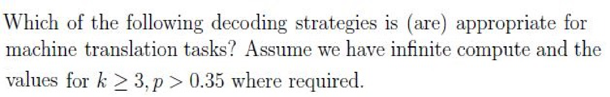

**A.** Top-k sampling

*Label added for presentation.*

**B.** Beam search with the beam size K = 2

*Label added for presentation.*

**C.** Top-p sampling

*Label added for presentation.*

**D.** Exhaustive search

*Label added for presentation.*

**E.** None of these

*Label added for presentation.*

#### Worked answer

**Final answer:** A, B, C and D can all be applied to translation.

**Steps:** Top-k and top-p are stochastic but can generate translations; beam search searches a few candidates, and exhaustive search is feasible under the stated infinite compute assumption. E is therefore false.

**Status:** ambiguous

**Ambiguity note:** “Appropriate” is subjective and no quality or optimality criterion is specified; a conventional quality-oriented answer could prefer B and D.

**verified_by_code:** `false` — No numeric checker path; answer remains explicitly ambiguous.

---

### 2024 T1 Quiz 1 NA, Q198

**Paper:** `2024T1_Q1_NA` · **Type:** MCQ · **Marks:** 3 · **Topic(s):** w4-bert-nsp-inputs

The statement that “the Next Sentence Prediction (NSP) task requires the BERT model to run autoregressively given the first sentence( or segment)” is

**A.** TRUE

*Label added for presentation.*

**B.** FALSE

*Label added for presentation.*

#### Worked answer

**Final answer:** B: false.

**Steps:** BERT NSP classifies a jointly encoded sentence pair, not autoregressively generates the second sentence. A asserts that incorrect mechanism.

**Status:** derived

**verified_by_code:** `false` — Non-numeric response; no numeric checker path applies.

---

### 2024 T3 Quiz 1 NA, Q288

**Paper:** `2024T3_Q1_NA` · **Type:** SA · **Marks:** 2 · **Topic(s):** w4-topk-temperature

Suppose we use Top—k sampling, with k = 3, what is the probability of the predicted word equal to “Seismology” given the “[Start]” token as the initial input $P(y_1 = \text{Seismology} \mid y_0 = \text{[Start]})$?

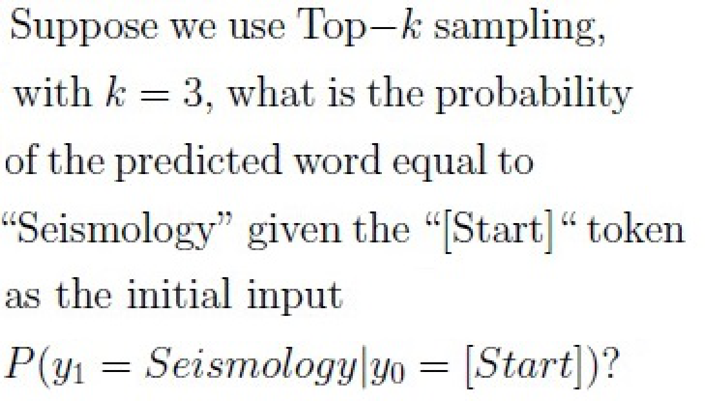

#### Worked answer

**Final answer:** 0.41/0.64 ≈ 0.640625.

**Steps:** The three largest first-row entries are 0.41, 0.14 and 0.09; renormalize 0.41/(0.41+0.14+0.09).

**Status:** derived

**verified_by_code:** `false` — depends on figure, no code path

---

### 2025 T1 Quiz 1 NA, Q106

**Paper:** `2025T1_Q1_NA` · **Type:** MCQ · **Marks:** 3 · **Topic(s):** w4-topk-temperature

Suppose we use a pre-trained model for text generation with the given prompt “I am going to”.
Which of the following decoding strategies can be used such that the pre-trained model generates
different text completion each time it is executed

**A.** Beam search with beam size 1

**B.** Greedy approach

**C.** Top-K with k = 2

**D.** None of these

#### Worked answer

**Final answer:** C: top-k sampling with k=2.

**Steps:** C can sample alternative tokens on different runs. A is width-one beam search and B is greedy, both deterministic under fixed tie-breaking; D ignores C. Different outputs are possible, not guaranteed on every run.

**Status:** ambiguous

**Ambiguity note:** Literal “different each time” is not guaranteed by sampling, which can repeat; C is interpreted as allowing different outputs.

**verified_by_code:** `false` — No numeric checker path; answer remains explicitly ambiguous.

---

### 2025 T1 Quiz 1 NA, Q109

**Paper:** `2025T1_Q1_NA` · **Type:** MSQ · **Marks:** 3 · **Topic(s):** w4-exhaustive-greedy

Which of the following are correct statements regarding exhaustive decoding strategy? Note: $V$ represents the vocabulary.

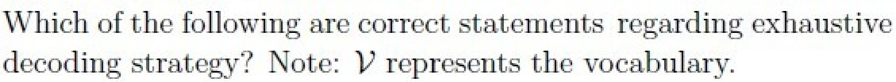

**A.** To generate a 10 token output, $|V|^{10}$ possibilities will be considered.
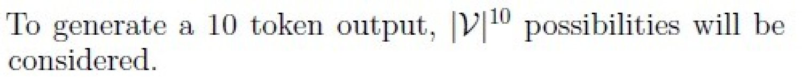

**B.** To generate a 10 token output, $|V|^{12}$ possibilities will be considered.
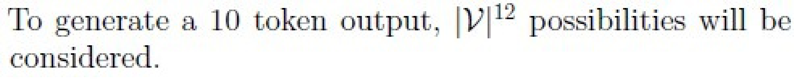

**C.** It is a deterministic approach.

**D.** It is a stochastic approach

#### Worked answer

**Final answer:** A and C.

**Steps:** There are |V| choices at each of 10 positions, giving |V|^10 complete sequences; exhaustive maximization is deterministic with fixed tie-breaking. B uses the wrong exponent and D confuses search with sampling.

**Status:** derived

**verified_by_code:** `false` — Non-numeric response; no numeric checker path applies.

---

### 2025 T1 Quiz 1 NA, Q110

**Paper:** `2025T1_Q1_NA` · **Type:** MSQ · **Marks:** 3 · **Topic(s):** w4-beam-search, w4-topk-temperature, w4-topp-nucleus, w4-exhaustive-greedy

Which of the following decoding strategies is (are) appropriate for machine translation tasks?
Assume we have infinite compute and the values for k ≥ 3, p > 0.35 where required.

**A.** Top-k sampling

**B.** Beam search with the beam size K = 2

**C.** Top-p sampling

**D.** Exhaustive search

**E.** None of these

#### Worked answer

**Final answer:** A, B, C and D can all be applied to translation.

**Steps:** Top-k and top-p are stochastic but can generate translations; beam search searches a few candidates, and exhaustive search is feasible under the stated infinite compute assumption. E is therefore false.

**Status:** ambiguous

**Ambiguity note:** “Appropriate” is subjective and no quality or optimality criterion is specified; a conventional quality-oriented answer could prefer B and D.

**verified_by_code:** `false` — No numeric checker path; answer remains explicitly ambiguous.

---

### 2025 T2 Quiz 1 NA, Q137

**Paper:** `2025T2_Q1_NA` · **Type:** MCQ · **Marks:** 2 · **Topic(s):** w4-bert-finetuning, w4-bert-mlm

What is the main difference between GPT and BERT pre-training objectives?

**A.** GPT uses Masked Language Modeling, BERT uses Causal Language Modeling

**B.** GPT uses Causal Language Modeling, BERT uses Masked Language Modeling

**C.** Both use Masked Language Modeling

**D.** Both use Causal Language Modeling

#### Worked answer

**Final answer:** B.

**Steps:** GPT predicts next tokens causally; BERT uses masked-token prediction (plus NSP in original pretraining). A reverses them; C and D make both objectives identical.

**Status:** derived

**verified_by_code:** `false` — Non-numeric response; no numeric checker path applies.

---

### 2025 T2 Quiz 1 NA, Q138

**Paper:** `2025T2_Q1_NA` · **Type:** MCQ · **Marks:** 2 · **Topic(s):** w4-topk-temperature

In Top-K sampling for language generation, increasing the value of K typically has which of the following effects?

**A.** It makes the output more deterministic and repetitive.

**B.** It reduces the probability of selecting high-frequency words.

**C.** It increases the diversity of the generated text but may reduce coherence if K is too large.

**D.** It guarantees grammatical correctness by focusing on top-ranked tokens only.

#### Worked answer

**Final answer:** C.

**Steps:** Increasing k allows more low-ranked options and potentially greater diversity and incoherence. A reverses the trend, B is not guaranteed, and D is an unsupported guarantee.

**Status:** derived

**verified_by_code:** `false` — Non-numeric response; no numeric checker path applies.

---

### 2025 T2 Quiz 1 NA, Q142

**Paper:** `2025T2_Q1_NA` · **Type:** MSQ · **Marks:** 3 · **Topic(s):** w4-bert-nsp-inputs

Which elements are included in BERT’s input representation for Next Sentence Prediction?

**A.** [CLS] token at the beginning of input.

![[CLS] token at the beginning of input option block](assets/da5004_2025T2_Q1_NA/q142-q142-option-a-01-p005.png)

**B.** [SEP] token to separate sentence A and sentence B.

![[SEP] token to separate sentence A and sentence B option block](assets/da5004_2025T2_Q1_NA/q142-q142-option-b-01-p005.png)

**C.** Segment embeddings to distinguish sentence A and sentence B.
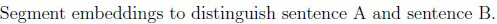

**D.** Position embeddings are not required for Next Sentence Prediction.
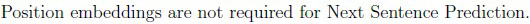

#### Worked answer

**Final answer:** A, B, C.

**Steps:** BERT’s paired input begins with [CLS], separates sentences with [SEP], and adds segment embeddings. D is false: position embeddings are part of the input representation.

**Status:** derived

**verified_by_code:** `false` — Non-numeric response; no numeric checker path applies.

---

### 2025 T2 Quiz 1 NA, Q143

**Paper:** `2025T2_Q1_NA` · **Type:** MSQ · **Marks:** 3 · **Topic(s):** w4-topp-nucleus, w4-topk-temperature

How does Top-p (nucleus) sampling differ from Top-K sampling in language generation?

**A.** It samples only from a fixed number of tokens at each step.

**B.** It samples from the smallest set of tokens whose cumulative probability exceeds p.

**C.** It always selects the top-p tokens with equal probability.

**D.** It guarantees diversity by selecting all low-probability tokens.

#### Worked answer

**Final answer:** B.

**Steps:** Top-p retains the smallest high-probability prefix reaching p. A describes top-k, C incorrectly makes probabilities uniform, and D does not ensure diversity or include all tail tokens.

**Status:** derived

**verified_by_code:** `false` — Non-numeric response; no numeric checker path applies.

---

### 2025 T2 Quiz 1 NA, Q145

**Paper:** `2025T2_Q1_NA` · **Type:** SA · **Marks:** 3 · **Topic(s):** w4-topk-temperature

Suppose a language model outputs the following logits for a vocabulary of size 4:

| Token | Logit |
| :--- | :--- |
| the | 2.0 |
| sky | 1.0 |
| is | 0.5 |
| blue | -1.0 |

You apply temperature scaling with temperature $T = 0.5$. After applying the softmax on the temperature-scaled logits, what is the probability assigned to the token “the”? (Give your answer up to 2 decimal places)

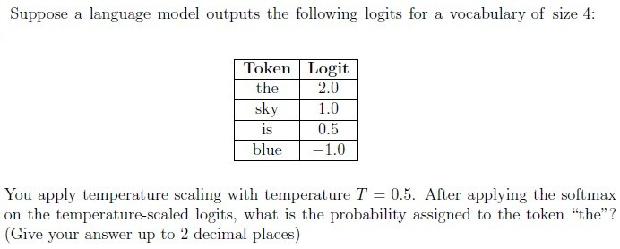

#### Worked answer

**Final answer:** Approximately 0.84.

**Steps:** Scale logits by 1/0.5, yielding [4,2,1,−2]; exp(4)/sum(exp([4,2,1,−2])) ≈ 0.842.

**Status:** derived

**verified_by_code:** `false` — depends on figure, no code path

---

### 2025 T2 Quiz 1 NA, Q153

**Paper:** `2025T2_Q1_NA` · **Type:** SA · **Marks:** 2 · **Topic(s):** w4-exhaustive-greedy

In exhaustive search, at timestep t=1, we run the decoder once to obtain probability distributions over all tokens in the vocabulary. Given the 6 tokens available in the table in the main question, how many times must we run the decoder at timestep t=4?

#### Worked answer

**Final answer:** 216 decoder evaluations.

**Steps:** At t=4 exhaustive search expands 6^3=216 distinct length-3 prefixes, requiring one evaluation each absent batching.

**Status:** derived

**verified_by_code:** `true` — solve_numeric.py recomputed adjudicated inputs/conventions; all recorded values and adjudication checks MATCH.

---

### 2025 T2 Quiz 1 NA, Q154

**Paper:** `2025T2_Q1_NA` · **Type:** SA · **Marks:** 1 · **Topic(s):** w4-exhaustive-greedy

How many total sequences of exactly length 5 are possible according to exhaustive search?

#### Worked answer

**Final answer:** 7776 sequences.

**Steps:** Six possible tokens at each of five positions give 6^5=7776 length-5 sequences.

**Status:** derived

**verified_by_code:** `true` — solve_numeric.py recomputed adjudicated inputs/conventions; all recorded values and adjudication checks MATCH.

---

### 2025 T2 Quiz 1 NA, Q155

**Paper:** `2025T2_Q1_NA` · **Type:** SA · **Marks:** 2 · **Topic(s):** w4-topk-temperature

If we use top-k sampling with k=2 at timestep 1, what is the normalized probability of selecting token “sky” at the timestep=1?

## Answer key

| Source question | Source identity | Correct answer | PDF pages |
| :--- | :--- | :--- | :--- |
| 135 | 6406531279474 | All at once (in parallel) | 2 |
| 136 | 6406531279475 | Normalize attention scores to a probability distribution | 3 |
| 137 | 6406531279476 | GPT uses Causal Language Modeling, BERT uses Masked Language Modeling | 3 |
| 138 | 6406531279477 | It increases the diversity of the generated text but may reduce coherence if K is too large. | 3 |
| 139 | 6406531279478 | They help in training deep networks by enabling gradient flow. | 4 |
| 140 | 6406531279479 | The model only attends to past and current tokens during training.; The model is trained by predicting the next token in a sequence. | 4 |
| 141 | 6406531279480 | Transformers process input sequences in parallel, enabling faster training.; Large transformer models can be fine-tuned for various NLP tasks using a single pre-trained model. | 4 |
| 142 | 6406531279481 | [CLS] token at the beginning of input.; [SEP] token to separate sentence A and sentence B.; Segment embeddings to distinguish sentence A and sentence B. | 5 |
| 143 | 6406531279482 | It samples from the smallest set of tokens whose cumulative probability exceeds p. | 5 |
| 144 | 6406531279483 | 1.98 to 2.08 | 6 |
| 145 | 6406531279484 | 0.81 to 0.87 | 7 |
| 146 | 6406531279485 | 0.9 to 1.1 | 7 |
| 147 | 6406531279487 | $$\begin{bmatrix} 0 & 0 \\ 6 & 12 \end{bmatrix}$$ | 9, 10 |
| 148 | 6406531279488 | $$\begin{bmatrix} 1.34 & 2.23 \\ 0.66 & 4.77 \end{bmatrix}$$ | 10 |
| 149 | 6406531279489 | $$\begin{bmatrix} 0.00 & 0.00 \\ 3.00 & 6.00 \\ 1.34 & 2.23 \\ 0.66 & 4.77 \end{bmatrix}$$ | 10, 11 |
| 150 | 6406531279491 | 36 | 12, 13 |
| 151 | 6406531279492 | 8 | 13 |
| 152 | 6406531279493 | 8 | 13 |
| 153 | 6406531279495 | 216 | 14 |
| 154 | 6406531279496 | 7776 | 14, 15 |
| 155 | 6406531279497 | 0.41 | 15 |

## Extraction notes

**Status:** verified
**Count reconciliation:** Section 8 declares 16 questions and 50 marks. The 16 portal question units correspond to 1 administrative subject-confirmation question (Question 134, 0 marks), 12 standalone academic questions (Questions 135-139 [5 MCQs x 2 = 10 marks], Questions 140-143 [4 MSQs x 3 = 12 marks], Questions 144-146 [3 SAs x 3 = 9 marks]), and 3 comprehension blocks (Questions 147-149 [3+3+2 = 8 marks], Questions 150-152 [1+2+3 = 6 marks], and Questions 153-155 [2+1+2 = 5 marks]). Total academic questions reconcile to exactly 21 (12 standalone + 9 comprehension subquestions). Marks sum to 10 + 12 + 9 + 8 + 6 + 5 = 50, matching the declared Section Marks of 50.

**Excluded source entries:**

- {"classification": "out-of-scope-section", "page": 1, "bbox": [0.0, 0.0, 595.3, 491.39], "reason": "Preceding section exam content (options 6406534313773 to 6406534313775, and Question 133) prior to Section 8 LLM header", "identity": "preceding-section"}
- {"classification": "subject-confirmation", "page": 2, "bbox": [22.87, 80.0, 580.0, 280.0], "reason": "Administrative subject confirmation asking candidate to confirm subject and cross check hall ticket", "identity": "134"}
- {"classification": "out-of-scope-section", "page": 15, "bbox": [0.0, 406.5, 595.3, 841.9], "reason": "Subsequent Section 9 DL(CV) exam header terminating LLM section", "identity": "following-section-9"}

#### Worked answer

**Final answer:** 0.23/(0.33+0.23) ≈ 0.411.

**Steps:** The first column gives blue 0.33 and sky 0.23 as the top two; sky renormalizes to 0.23/(0.33+0.23)=0.410714. The column totals 0.92, but any omitted mass totals only 0.08 and cannot displace either token.

**Status:** derived

**verified_by_code:** `true` — solve_numeric.py recomputed adjudicated inputs/conventions; all recorded values and adjudication checks MATCH.

---

### 2025 T3 Quiz 1 NA, Q178

**Paper:** `2025T3_Q1_NA` · **Type:** MCQ · **Marks:** 2 · **Topic(s):** w4-exhaustive-greedy

Given a vocabulary of size $|V|$, how many sequences of maximum length 5 are possible?

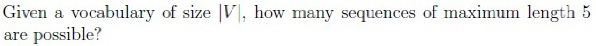

**A.** $|V|^5$

*Label added for presentation.*

**B.** $5 \cdot |V|$

*Label added for presentation.*

**C.** $\sum_{k=1}^5 |V|^k$

*Label added for presentation.*
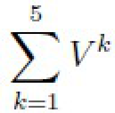

**D.** $\frac{|V|^5 - 1}{|V| - 1}$

*Label added for presentation.*
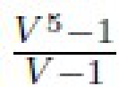

#### Worked answer

**Final answer:** C: Σ(k=1..5) |V|^k.

**Steps:** Count all nonempty lengths 1 through 5. A counts only length 5; B is linear instead of exponential; D sums lengths 0 through 4.

**Status:** derived

**verified_by_code:** `false` — Non-numeric response; no numeric checker path applies.

---

### 2025 T3 Quiz 1 NA, Q180

**Paper:** `2025T3_Q1_NA` · **Type:** MCQ · **Marks:** 3 · **Topic(s):** w4-exhaustive-greedy

For a vocabulary of size $V$ and a fixed sequence length $L$, exhaustive decoding evaluates all possible sequences of length $L$. If we increase the sequence length to $L + 1$, how many additional sequences will need to be evaluated?

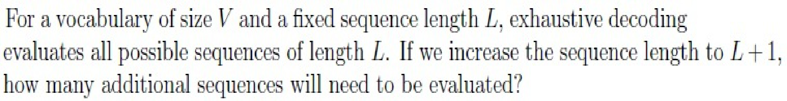

**A.** Same, no change

*Label added for presentation.*

**B.** $V^L$ more sequences

*Label added for presentation.*

**C.** $(V - 1) \cdot V^L$ more sequences

*Label added for presentation.*

**D.** $V$ more sequences

*Label added for presentation.*

**E.** One more sequence

*Label added for presentation.*

#### Worked answer

**Final answer:** C: (V−1)V^L.

**Steps:** Comparing total leaf counts, V^(L+1)−V^L=(V−1)V^L. A, B, D, E do not generally equal that difference.

**Status:** ambiguous

**Ambiguity note:** If “additional sequences evaluated” means all new length-(L+1) strings after already evaluating length L, the number is V^(L+1), absent from the options; C assumes a difference in total leaf counts.

**verified_by_code:** `false` — No numeric checker path; answer remains explicitly ambiguous.

---

### 2025 T3 Quiz 1 NA, Q181

**Paper:** `2025T3_Q1_NA` · **Type:** MCQ · **Marks:** 3 · **Topic(s):** w4-beam-search

For a vocabulary size of 10, how many beams will there be in greedy search, beam search with beam size 3, and exhaustive search at step 1 and step 3, respectively?

**A.** Step 1:
Greedy: 1, Beam: 1, Exhaustive: 1
Step 3:
Greedy: 1, Beam: 1, Exhaustive: 1

*Label added for presentation.*

**B.** Step 1:
Greedy: 1, Beam: 3, Exhaustive: 10
Step 3:
Greedy: 1, Beam: 3, Exhaustive: 10

*Label added for presentation.*

**C.** Step 1:
Greedy: 1, Beam: 3, Exhaustive: 1
Step 3:
Greedy: 1, Beam: 3, Exhaustive: 100

*Label added for presentation.*

**D.** Step 1:
Greedy: 1, Beam: 3, Exhaustive: 10
Step 3:
Greedy: 1, Beam: 3, Exhaustive: 1000

*Label added for presentation.*

#### Worked answer

**Final answer:** D.

**Steps:** After one token the retained counts are 1, 3, 10; after three, 1, 3, 10^3. A, B and C incorrectly count beam or exhaustive prefixes.

**Status:** derived

**verified_by_code:** `true` — solve_numeric.py recomputed adjudicated inputs/conventions; all recorded values and adjudication checks MATCH.

---

### 2025 T3 Quiz 1 NA, Q182

**Paper:** `2025T3_Q1_NA` · **Type:** MSQ · **Marks:** 2 · **Topic(s):** w4-topp-nucleus

Which of the following decoding strategies is/are inherently non-deterministic?

**A.** Beam

*Label added for presentation.*

**B.** Greedy

*Label added for presentation.*

**C.** Nucleus

*Label added for presentation.*

**D.** Exhaustive

*Label added for presentation.*

#### Worked answer

**Final answer:** C: nucleus sampling.

**Steps:** Sampling draws randomly from the nucleus. A beam, B greedy, and D exhaustive search are deterministic under fixed tie-breaking.

**Status:** derived

**verified_by_code:** `false` — Non-numeric response; no numeric checker path applies.

---

### 2025 T3 Quiz 1 NA, Q185

**Paper:** `2025T3_Q1_NA` · **Type:** MSQ · **Marks:** 4 · **Topic(s):** w4-beam-search

A transformer decoder uses a vocabulary of size 5. At step 1, the predicted token probabilities are:

| Token | Probability |
| :--- | :--- |
| A | 0.40 |
| B | 0.30 |
| C | 0.20 |
| D | 0.05 |
| E | 0.05 |

Which statement(s) is/are correct?

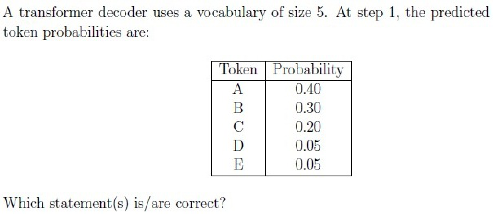

**A.** Beam search with beam size 2 will keep either A or B as per probability whereas Top-2 sampling will keep both A and B.

*Label added for presentation.*

**B.** Beam search with beam size 2 will keep both A and B whereas Top-2 sampling will keep either A or B.

*Label added for presentation.*

**C.** Beam search with beam size 2 will randomly choose any two tokens, whereas Top-2 sampling will always pick the two least probable tokens.

*Label added for presentation.*

**D.** Beam search with beam size 2 will always keep the top-2 most probable tokens, whereas Top-2 sampling will restrict choices to top-2 tokens and then sample one probabilistically.

*Label added for presentation.*

#### Worked answer

**Final answer:** B and D.

**Steps:** Beam width 2 retains both A and B; top-2 filters to both then draws one. A reverses the two roles; C claims random beam selection and least-probable filtering.

**Status:** derived

**verified_by_code:** `false` — Non-numeric response; no numeric checker path applies.

---

### 2026 T1 Quiz 1 NA, Q6

**Paper:** `2026T1_Q1_NA` · **Type:** MCQ · **Marks:** 2 · **Topic(s):** w4-bert-nsp-inputs

Consider the BERT architecture. During pre-training, it uses segment embeddings ($E_A, E_B$) to distinguish between sentences. However, during fine-tuning for a single-sentence classification task (e.g., Sentiment Analysis), how are these segment embeddings typically utilized?

**A.** Segment embeddings are not used; the embedding layer is disabled for single-sentence tasks.

**B.** All tokens in the input sequence are assigned the same segment embedding (e.g., $E_A$).

**C.** The first half of the sentence gets $E_A$ and the second half gets $E_B$ to maintain symmetry.

**D.** Segment embeddings are randomly initialized for every new single-sentence input.

#### Worked answer

**Final answer:** B.

**Steps:** Single-sentence input normally assigns the same learned segment-A embedding to every token. A disables an active embedding, C invents a split, and D incorrectly reinitializes parameters.

**Status:** derived

**verified_by_code:** `false` — Non-numeric response; no numeric checker path applies.

---

### 2026 T1 Quiz 1 NA, Q7

**Paper:** `2026T1_Q1_NA` · **Type:** MCQ · **Marks:** 2 · **Topic(s):** w4-topk-temperature

Consider a decoding step in a language model where the logits for the next token are $z = [2.0, 1.0, 0.5]$. We apply a temperature scaling $z/T$ before the softmax. As $T \to 0$ (approaches zero), what does the resulting probability distribution $P(x)$ look like?

**A.** It approaches a uniform distribution where all tokens have equal probability.

**B.** It approaches a "one-hot" distribution where the token with the highest logit has probability 1.0 (Greedy Search).

**C.** It remains unchanged from the original softmax distribution.

**D.** It causes numerical instability and results in NaNs.

#### Worked answer

**Final answer:** B.

**Steps:** For a unique maximum, softmax(z/T) converges to [1,0,0] as T→0+. A is the high-temperature limit, C is false, D confuses numerical implementation with the mathematical limit.

**Status:** derived

**verified_by_code:** `false` — Non-numeric response; no numeric checker path applies.

---

### 2026 T1 Quiz 1 NA, Q8

**Paper:** `2026T1_Q1_NA` · **Type:** MCQ · **Marks:** 2 · **Topic(s):** w4-bert-finetuning

You are fine-tuning a pre-trained BERT model for a spam classification task. The input sequence is: `[CLS] Win a free iPhone now [SEP]`. Which vector from the final layer output is typically passed to the classification head ($W_v$)?

**A.** The average pooling of all token vectors.

**B.** The final hidden state vector corresponding to the `[SEP]` token ($h_{sep}$).

**C.** The final hidden state vector corresponding to the `[CLS]` token ($h_{cls}$).

**D.** The concatenation of all hidden state vectors.

#### Worked answer

**Final answer:** C: final [CLS] hidden state.

**Steps:** BERT’s standard sequence classification head uses [CLS]. A is alternative pooling, B uses [SEP], D concatenates variable numbers of vectors.

**Status:** derived

**verified_by_code:** `false` — Non-numeric response; no numeric checker path applies.

---

### 2026 T2 Quiz 1 NA, Q14

**Paper:** `2026T2_Q1_NA` · **Type:** SA · **Marks:** 2 · **Topic(s):** w4-exhaustive-greedy

Use greedy decoding to determine the most likely sequence of 6 tokens and compute the probability of generating that sequence. Enter the value rounded off to 3 decimal places

#### Worked answer

**Final answer:** historic castle was majestic but abandoned; probability 0.005.

**Steps:** Select column maxima 0.38, 0.40, 0.50, 0.35, 0.45, 0.40; their product is 0.004788, rounded to 0.005.

**Status:** derived

**verified_by_code:** `true` — solve_numeric.py recomputed adjudicated inputs/conventions; all recorded values and adjudication checks MATCH.

---

### 2026 T2 Quiz 1 NA, Q15

**Paper:** `2026T2_Q1_NA` · **Type:** SA · **Marks:** 2 · **Topic(s):** w4-exhaustive-greedy

Use exhaustive search strategy to identify the most probable sequence consisting of 4 tokens. How many decoder runs are required in total to identify the most probable sequence containing 4 tokens?

#### Worked answer

**Final answer:** 400 decoder evaluations.

**Steps:** Under general prefix-conditioned exhaustive decoding, evaluate each prefix of lengths 0–3: 1+7+49+343=400; a batched or prefix-independent implementation can use fewer calls.

**Status:** ambiguous

**Ambiguity note:** One unbatched model call per prefix gives 400; batching by depth gives 4 forward calls, and reusing the supplied prefix-invariant table requires 0 model calls. The question does not define a decoder run or whether the table may be reused.

**verified_by_code:** `true` — solve_numeric.py recomputed adjudicated inputs/conventions; all recorded values and adjudication checks MATCH.

---

### 2026 T2 Quiz 1 NA, Q16

**Paper:** `2026T2_Q1_NA` · **Type:** SA · **Marks:** 3 · **Topic(s):** w4-topk-temperature

Use Top-k sampling at timestep t = 4 and k = 3. Compute the renormalized probability of the most probable token from the candidate tokens and enter the value rounded off to three decimal places

#### Worked answer

**Final answer:** 0.412.

**Steps:** At t=4 the top three are 0.35, 0.30, 0.20; normalize 0.35/0.85≈0.411765.

**Status:** derived

**verified_by_code:** `true` — solve_numeric.py recomputed adjudicated inputs/conventions; all recorded values and adjudication checks MATCH.

---

### 2026 T2 Quiz 1 NA, Q17

**Paper:** `2026T2_Q1_NA` · **Type:** SA · **Marks:** 2 · **Topic(s):** w4-beam-search

Consider the sequence "the castle was abandoned". What is the minimum beam width required to guarantee that this sequence is retained during beam search at timestep t = 4 ?

## Answer key

| Source question | Source identity | Correct answer | PDF pages |
| :--- | :--- | :--- | :--- |
| 2 | 6406532166233 | A, C | 2 |
| 3 | 6406532166235 | 4 | 3 |
| 4 | 6406532166236 | A | 3 |
| 5 | 6406532166237 | 144 | 4 |
| 6 | 6406532166238 | 32768 | 4 |
| 7 | 6406532166239 | 8128 | 4, 5 |
| 8 | 6406532166240 | 256 | 5 |
| 9 | 6406532166241 | B | 5, 6 |
| 10 | 6406532166243 | 0.17 to 0.19 | 6, 7 |
| 11 | 6406532166244 | C | 7 |
| 12 | 6406532166245 | -1 | 7 |
| 13 | 6406532166246 | A, B, E | 7, 8 |
| 14 | 6406532166248 | 0.004 to 0.0055 | 8, 9 |
| 15 | 6406532166249 | 400 | 9 |
| 16 | 6406532166250 | 0.410 to 0.414 | 9 |
| 17 | 6406532166251 | 5 | 9, 10 |

## Extraction notes

**Status:** verified
**Count reconciliation:** Section 1 (LLM) declares 11 questions and 50 marks. The 11 portal containers comprise 1 administrative subject-confirmation entry (Question 1, 0 marks, excluded), 7 standalone academic questions (Question 2: 4 marks, Question 5: 4 marks, Question 6: 4 marks, Question 7: 4 marks, Question 8: 4 marks, Question 9: 4 marks, Question 13: 3 marks; total standalone = 27 marks), and 3 comprehension portal containers (Comprehension 6406532166234 covering Q3: 3 marks, Q4: 3 marks; Comprehension 6406532166242 covering Q10: 3 marks, Q11: 3 marks, Q12: 2 marks; Comprehension 6406532166247 covering Q14: 2 marks, Q15: 2 marks, Q16: 3 marks, Q17: 2 marks; total comprehension = 6 + 8 + 9 = 23 marks). The total academic questions reconcile to exactly 16 (7 standalone + 9 comprehension subquestions). The marks sum to 27 + 23 = 50 marks, exactly reconciling the declared Section Marks of 50. The 11 declared questions correspond exactly to the 11 portal containers (1 confirmation + 7 standalone + 3 comprehension blocks).

- Exam section 1 LLM runs from physical page 1 to page 10.
- Comprehension passages ctx-3-4, ctx-10-12, and ctx-14-17 provide shared context for subquestions (3 to 4), (10 to 12), and (14 to 17) respectively.
- All formulas, projection matrices, probability tree diagrams, and vocabulary decoding tables were verified against source rasters with high-resolution crops at 288 DPI.

**Excluded source entries:**

- {"classification": "subject-confirmation", "page": 1, "bbox": [22.87, 750.0, 580.0, 841.9], "reason": "Administrative subject confirmation asking candidate to confirm subject and cross check hall ticket", "identity": "1"}

#### Worked answer

**Final answer:** 5 beams.

**Steps:** The target prefix products through t=4 are 0.30, 0.12, 0.06, 0.018. Under the given prefix-invariant table, its global ranks are 2, 2, 2, 5, so width 5 retains it at each step.

**Status:** derived

**verified_by_code:** `true` — solve_numeric.py recomputed adjudicated inputs/conventions; all recorded values and adjudication checks MATCH.

---

## Quiz 2 questions

### 2025 T3 Quiz 2 NA, Q115

**Paper:** `2025T3_Q2_NA` · **Type:** MSQ · **Marks:** 2 · **Topic(s):** w4-beam-search

Which decoding method ensures the same response every time for a given prompt (assuming no randomness in model weights)? Select all that apply.

**A.** Top-k with k = 3, temperature > 1

**B.** Top-k with k = 3, temperature = 1

**C.** Top-p with p = 0.2, Temperature > 1

**D.** Top-p with p = 0.2, Temperature = 1

**E.** Beam Search with beam-size = 5

**F.** Beam Search with beam-size = 1

#### Worked answer

**Final answer:** E and F.

**Steps:** Ordinary beam search is deterministic with fixed tie-breaking; width one reduces to greedy. A–D sample and need not repeat when the candidate set has multiple tokens.

**Status:** derived

**verified_by_code:** `false` — Non-numeric response; no numeric checker path applies.

---

### 2026 T1 Quiz 2 NA, Q3

**Paper:** `2026T1_Q2_NA` · **Type:** MCQ · **Marks:** 2 · **Topic(s):** w4-bert-mlm

In the Masked Language Modeling (MLM) objective of BERT, 15% of tokens are chosen for prediction. Of these chosen tokens, 80% are replaced with [MASK], 10% are replaced with a random word, and 10% are left unchanged. What is the primary theoretical motivation for keeping 10% of the tokens unchanged?

**A.** To reduce the computational cost of the softmax layer during training.

**B.** To prevent the network from overfitting to the [MASK] token.

**C.** To mitigate the mismatch between pre-training (where [MASK] appears) and fine-tuning (where [MASK] does not appear), ensuring the model creates meaningful representations for non-masked words.

**D.** To act as a regularizer similar to Dropout.

#### Worked answer

**Final answer:** C.

**Steps:** Unchanged selected tokens reduce pretraining/fine-tuning input mismatch and encourage contextual representations of ordinary tokens. A has no softmax saving; B is related but less complete; D is not the stated motivation.

**Status:** derived

**verified_by_code:** `false` — Non-numeric response; no numeric checker path applies.

---

### 2026 T1 Quiz 2 NA, Q4

**Paper:** `2026T1_Q2_NA` · **Type:** MCQ · **Marks:** 2 · **Topic(s):** w4-bert-mlm

Why is the standard GPT architecture (Decoder-only with causal masking) generally unsuitable for the Masked Language Modeling (MLM) objective as implemented in BERT?

**A.** GPT models are too small to learn bidirectional contexts.

**B.** The causal mask in GPT prevents the model from attending to future tokens, making it impossible to use right-side context to predict a masked token.

**C.** GPT does not have positional embeddings, which are required for MLM.

**D.** GPT uses ReLU activation, while BERT uses GELU, which is required for MLM.

#### Worked answer

**Final answer:** B.

**Steps:** GPT’s causal mask blocks right-hand context, unlike BERT MLM. A cites size, C incorrectly denies positional embeddings, and D incorrectly makes activation choice decisive.

**Status:** derived

**verified_by_code:** `false` — Non-numeric response; no numeric checker path applies.

---

### 2026 T1 Quiz 2 NA, Q17

**Paper:** `2026T1_Q2_NA` · **Type:** SA · **Marks:** 3 · **Topic(s):** w4-topk-temperature

Consider a vocabulary $\mathcal{V} = \{A, B, C, D, E\}$.
At a specific time step $t$, the model outputs the following probability distribution:
$$P = \{A : 0.1, B : 0.4, C : 0.05, D : 0.25, E : 0.2\}$$
If we use Top-$k$ sampling with $k = 2$, what is the probability of selecting token B?
(Calculate the re-normalized probability. Enter the value correct to 2 decimal places).

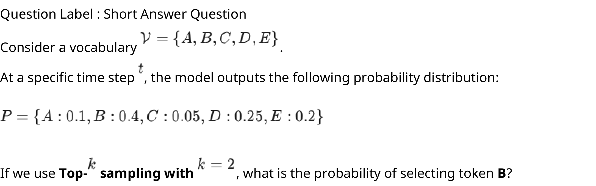

#### Worked answer

**Final answer:** 0.62.

**Steps:** Top two are B=0.4 and D=0.25; normalize P(B)=0.4/0.65≈0.61538.

**Status:** derived

**verified_by_code:** `false` — depends on figure, no code path

---

### 2026 T1 Quiz 2 NA, Q18

**Paper:** `2026T1_Q2_NA` · **Type:** SA · **Marks:** 3 · **Topic(s):** w4-bert-architecture-params

Consider a small BERT-like model with the following configuration:

• Embedding dimension ($d_{model}$) = 128
• Vocabulary size ($|V|$) = 5000
• Maximum sequence length ($T$) = 64
• Number of segment types = 2

Calculate the total number of parameters in the Embedding Layer (sum of Token embeddings, Position embeddings, and Segment embeddings).
Enter the exact integer value.

#### Worked answer

**Final answer:** 648448 parameters.

**Steps:** Token, position and segment tables contribute 5000×128 + 64×128 + 2×128 = 640000+8192+256=648448.

**Status:** derived

**verified_by_code:** `true` — solve_numeric.py recomputed adjudicated inputs/conventions; all recorded values and adjudication checks MATCH.

---

### 2026 T2 Quiz 2 NA, Q10

**Paper:** `2026T2_Q2_NA` · **Type:** MCQ · **Marks:** 3 · **Topic(s):** w4-topp-nucleus

In the decoding phase of a Language model, temperature scaling with $T = 5$ is applied to the output logits before performing top-$p$ (nucleus) sampling. Which of the following options best describes the impact of the temperature scaling on the subsequent sampling step?

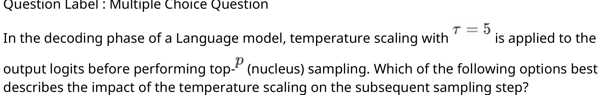

**A.** Increases the required number of candidate tokens thus expanding the
nucleus.

**B.** Decreases the required number of candidate tokens thus shrinking the
nucleus.

**C.** Truncates the tail of the distribution causing the sampling to behave similar to top-$k$ sampling.

**D.** Size of the nucleus remains unaffected by the temperature scaling as it only
depends on order of the tokens.

#### Worked answer

**Final answer:** A is the intended general trend.

**Steps:** T=5 flattens softmax compared with T=1, so cumulative mass is less concentrated and the nucleus cannot shrink; B reverses the effect, C describes truncation rather than scaling, and D ignores the changed cumulative mass.

**Status:** ambiguous

**Ambiguity note:** The nucleus need not strictly expand: for some p and logits its size remains unchanged; no distribution or p is specified, so A is not universally true.

**verified_by_code:** `false` — No numeric checker path; answer remains explicitly ambiguous.

---

## End Term questions

### 2024 T1 End Term AN, Q148

**Paper:** `2024T1_ET_AN` · **Type:** SA · **Marks:** 4 · **Topic(s):** w4-exhaustive-greedy

Consider a vocabulary $V$,

$$V = (\text{[start]}, \text{waiting}, \text{is}, \text{incredible}, \text{something}, \text{somewhere}, \text{to}, \text{be}, \text{known}, \text{[end]})$$

Assume that we have a pre-trained GPT model for text generation and the first input token to the model is always the special token [start]. The prediction probabilities output by the model are given below.

$$\begin{bmatrix}
0.05 & 0.02 & 0.14 & 0.07 & 0.41 & 0.09 & 0.08 & 0.05 & 0.08 & 0.01 \\
0.10 & 0.04 & 0.06 & 0.16 & 0.01 & 0.43 & 0.06 & 0.09 & 0.01 & 0.04 \\
0.05 & 0.07 & 0.28 & 0.29 & 0.03 & 0.08 & 0.04 & 0.08 & 0.04 & 0.04 \\
0.10 & 0.02 & 0.48 & 0.02 & 0.01 & 0.07 & 0.06 & 0.14 & 0.07 & 0.01 \\
0.08 & 0.29 & 0.04 & 0.01 & 0.04 & 0.03 & 0.25 & 0.05 & 0.15 & 0.06 \\
0.14 & 0.03 & 0.13 & 0.08 & 0.01 & 0.03 & 0.06 & 0.23 & 0.08 & 0.22
\end{bmatrix}$$

The zeroth row of the matrix is the output probability distribution by the model given the special [start] token as input. Following the Greedy Search decoding strategy, the subsequent rows give the conditional probability distribution conditioned over the previous tokens. Enter the generated text.

Note, enter the predicted tokens as in the vocabulary. Give a single space between predicted tokens. Leave no space before/after the first /last tokens.

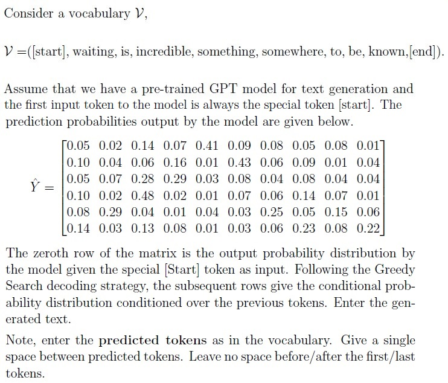

#### Worked answer

**Final answer:** something somewhere incredible is waiting be

**Steps:** Take each row maximum: 0.41, 0.43, 0.29, 0.48, 0.29, 0.23. No [end] is selected in these six rows.

**Status:** derived

**verified_by_code:** `false` — depends on figure, no code path

---

### 2024 T1 End Term AN, Q150

**Paper:** `2024T1_ET_AN` · **Type:** MSQ · **Marks:** 3 · **Topic(s):** w4-exhaustive-greedy, w4-beam-search, w4-topk-temperature, w4-topp-nucleus

A user runs inference on the model N times with an input text that contains 712 tokens (including the special [start] token). However, the user observed that in each run the model generated the exact same summary. Based on this observation, select the decoding strategy that the model might be using

**A.** Greedy decoding strategy

*Label added for presentation.*

**B.** Beam search with beam size K > 2

*Label added for presentation.*

**C.** Top-k sampling with k > 3

*Label added for presentation.*

**D.** Top-p sampling with p = 0.25

*Label added for presentation.*

**E.** Greedy decoding by varying the temperature parameter T in the softmax function for each run

*Label added for presentation.*

#### Worked answer

**Final answer:** A, B, C, D and E could all produce the observed runs.

**Steps:** A and B are deterministic given fixed tie-breaking. E preserves the logit argmax for every positive temperature. C and D can randomly repeat a sequence, and D can even have a one-token nucleus; repetition alone cannot identify the decoder.

**Status:** ambiguous

**Ambiguity note:** “Might” allows chance repetition under sampling; if the intended question asks for guaranteed repeatability, only A, B, E follow with deterministic tie-breaking and positive temperatures.

**verified_by_code:** `false` — No numeric checker path; answer remains explicitly ambiguous.

---

### 2024 T1 End Term FN, Q198

**Paper:** `2024T1_ET_FN` · **Type:** MCQ · **Marks:** 2 · **Topic(s):** w4-bert-architecture-params

BERT stands for

**A.** Bidirectional Encoder Representation for Text

*Label added for presentation.*

**B.** Bidirectional Encoder Representation from Transformer

*Label added for presentation.*

**C.** Bidirectionaly Extracted Representation from Transformer

*Label added for presentation.*

**D.** Bidirectionaly Extracted Representation of Text

*Label added for presentation.*

#### Worked answer

**Final answer:** B is the intended closest answer.

**Steps:** The original expansion is Bidirectional Encoder Representations from Transformers. B approximates it but drops both plurals; A changes “from Transformers” to “for Text”; C and D expand different words.

**Status:** ambiguous

**Ambiguity note:** No option exactly spells the expansion: B uses singular Representation and Transformer.

**verified_by_code:** `false` — No numeric checker path; answer remains explicitly ambiguous.

---

### 2024 T1 End Term FN, Q201

**Paper:** `2024T1_ET_FN` · **Type:** SA · **Marks:** 4 · **Topic(s):** w4-exhaustive-greedy

Consider a vocabulary $V$,

$$V = ([\text{start}], \text{waiting}, \text{is}, \text{incredible}, \text{something}, \text{somewhere}, \text{to}, \text{be}, \text{known}, [\text{end}])$$

Assume that we have a pre-trained GPT model for text generation and the first input token to the model is always the special token $[\text{start}]$. The prediction probabilities output by the model are given below.

$$\begin{bmatrix}
0.05 & 0.02 & 0.14 & 0.07 & 0.09 & 0.41 & 0.08 & 0.05 & 0.08 & 0.01 \\
0.10 & 0.04 & 0.06 & 0.16 & 0.43 & 0.01 & 0.06 & 0.09 & 0.01 & 0.04 \\
0.05 & 0.07 & 0.28 & 0.29 & 0.03 & 0.08 & 0.04 & 0.08 & 0.04 & 0.04 \\
0.10 & 0.02 & 0.48 & 0.02 & 0.01 & 0.07 & 0.06 & 0.14 & 0.07 & 0.01 \\
0.08 & 0.29 & 0.04 & 0.01 & 0.04 & 0.03 & 0.25 & 0.05 & 0.15 & 0.06 \\
0.14 & 0.03 & 0.13 & 0.08 & 0.01 & 0.03 & 0.06 & 0.23 & 0.08 & 0.22
\end{bmatrix}$$

The zeroth row of the matrix is the output probability distribution by the model given the special $[\text{Start}]$ token as input. Following the Greedy Search decoding strategy, the subsequent rows give the conditional probability distribution conditioned over the previous tokens. Enter the generated text.

Note, enter the predicted tokens as in the vocabulary. Give a single space between predicted tokens. Leave no space before/after the first/last tokens.

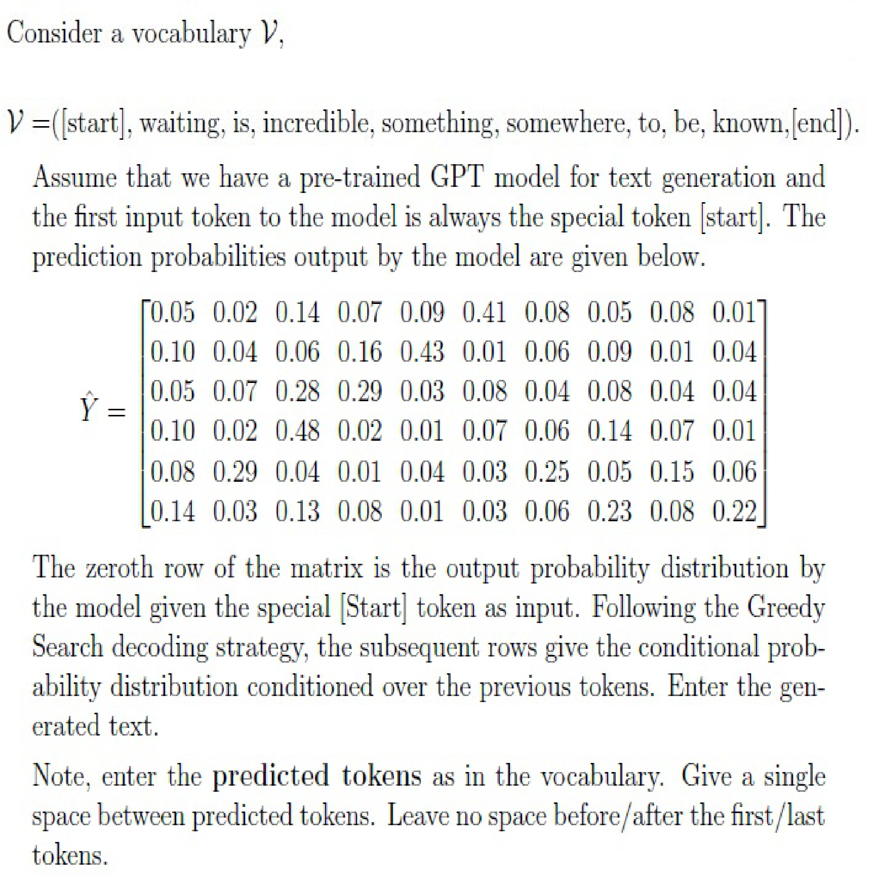

#### Worked answer

**Final answer:** somewhere something incredible is waiting be

**Steps:** Select the largest entry in each row: 0.41, 0.43, 0.29, 0.48, 0.29, 0.23; no [end] appears.

**Status:** derived

**verified_by_code:** `false` — depends on figure, no code path

---

### 2024 T1 End Term FN, Q203

**Paper:** `2024T1_ET_FN` · **Type:** MSQ · **Marks:** 3 · **Topic(s):** w4-exhaustive-greedy, w4-beam-search, w4-topk-temperature, w4-topp-nucleus

A user runs inference on the model N times with an input text that contains 712 tokens (including the special [start] token). However, the user observed that in each run the model generated the exact same summary. Based on this observation, select the decoding strategy that the model might be using

**A.** Greedy decoding strategy

*Label added for presentation.*

**B.** Beam search with beam size K > 2

*Label added for presentation.*

**C.** Top-k sampling with K > 3

*Label added for presentation.*

**D.** Top-P sampling with p = 0.25

*Label added for presentation.*

**E.** Greedy decoding by varying the temperature parameter T in the softmax function for each run

*Label added for presentation.*

#### Worked answer

**Final answer:** A, B, C, D and E could all produce the observed runs.

**Steps:** A and B are deterministic given fixed tie-breaking. E preserves the logit argmax for every positive temperature. C and D can randomly repeat a sequence, and D can even have a one-token nucleus; repetition alone cannot identify the decoder.

**Status:** ambiguous

**Ambiguity note:** “Might” allows chance repetition under sampling; if the intended question asks for guaranteed repeatability, only A, B, E follow with deterministic tie-breaking and positive temperatures.

**verified_by_code:** `false` — No numeric checker path; answer remains explicitly ambiguous.

---

### 2024 T3 End Term AN, Q178

**Paper:** `2024T3_ET_AN` · **Type:** MCQ · **Marks:** 3 · **Topic(s):** w4-exhaustive-greedy, w4-beam-search, w4-topk-temperature

Suppose we use a pre-trained model for text generation with the given prompt “I am going to”.
Which of the following decoding strategies can be used such that the pre-trained model generates
same text completion each time it is executed

**A.** Beam search with beam size 4

**B.** Greedy approach

**C.** Top-K with k = 2

**D.** None of these

#### Worked answer

**Final answer:** A and B are both deterministic.

**Steps:** Both fixed-width beam search and greedy decoding return the same output with fixed model and tie-breaking; C samples and D ignores A and B.

**Status:** ambiguous

**Ambiguity note:** This is marked single-answer MCQ but both A and B are correct.

**verified_by_code:** `false` — No numeric checker path; answer remains explicitly ambiguous.

---

### 2024 T3 End Term FN, Q196

**Paper:** `2024T3_ET_FN` · **Type:** MCQ · **Marks:** 3 · **Topic(s):** w4-topk-temperature

Suppose we use a pre-trained model for text generation with the given prompt “I am going to”. Which of the following decoding strategies can be used such that the pre-trained model generates different text completion each time it is executed

**A.** Beam search with beam size 1

*Label added for presentation.*

**B.** Greedy approach

*Label added for presentation.*

**C.** Top-K with k = 2

*Label added for presentation.*

**D.** None of these

*Label added for presentation.*

#### Worked answer

**Final answer:** C: top-k sampling with k=2.

**Steps:** C can sample alternative tokens on different runs. A is width-one beam search and B is greedy, both deterministic under fixed tie-breaking; D ignores C. Different outputs are possible, not guaranteed on every run.

**Status:** ambiguous

**Ambiguity note:** Literal “different each time” is not guaranteed by sampling, which can repeat; C is interpreted as allowing different outputs.

**verified_by_code:** `false` — No numeric checker path; answer remains explicitly ambiguous.

---

### 2025 T2 End Term AN, Q198

**Paper:** `2025T2_ET_AN` · **Type:** SA · **Marks:** 2 · **Topic(s):** w4-topp-nucleus

Consider the following probability distribution over a vocabulary of 10 tokens:
[0.06, 0.20, 0.14, 0.06, 0.09, 0.08, 0.05, 0.15, 0.06, 0.11]

You apply top-p (nucleus) sampling with p = 0.7. How many tokens are included in the sampling pool?

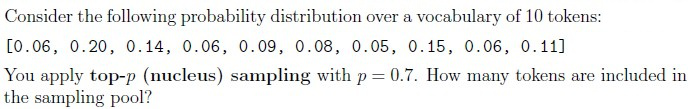

#### Worked answer

**Final answer:** 6 tokens.

**Steps:** Sorted probabilities accumulate 0.20+0.15+0.14+0.11=0.60; adding 0.09 reaches 0.69 and the sixth, 0.08, reaches 0.77.

**Status:** derived

**verified_by_code:** `false` — depends on figure, no code path

---

### 2025 T2 End Term FN, Q141

**Paper:** `2025T2_ET_FN` · **Type:** MSQ · **Marks:** 3 · **Topic(s):** w4-exhaustive-greedy, w4-beam-search, w4-topk-temperature, w4-topp-nucleus

A GPT-based model is fine-tuned for story generation. During evaluation, you test different
decoding strategies on the same prompt:

1. Method A: Every run produces the exact same story, even when executed multiple times.
2. Method B: The story changes slightly in each run, but overall structure and key events remain
similar.
3. Method C: The story is wildly different each time, sometimes even changing the genre.

Based on the observations, select the most likely decoding strategies for each method:

**A.** Method A: Greedy decoding

*Label added for presentation.*

**B.** Method A: Top-K sampling with K = 50

*Label added for presentation.*

**C.** Method B: Top-P sampling with p = 0.9

*Label added for presentation.*

**D.** Method C: Top-P sampling with p = 0.5 and high temperature T = 1.5

*Label added for presentation.*

**E.** Method C: Beam search with K = 5

*Label added for presentation.*

#### Worked answer

**Final answer:** A, B, C and D are possible; the observations do not uniquely identify the methods.

**Steps:** Greedy A explains repeated text; top-p C can yield modest variation, and high-temperature top-p D can produce large variation. B is also capable of accidental repetition; E is normally deterministic. Observed semantic variation is not a reliable decoder identifier.

**Status:** ambiguous

**Ambiguity note:** “Most likely” is underdetermined without the model distribution, sample counts and priors; B can repeat by chance. D’s low p does not guarantee high diversity.

**verified_by_code:** `false` — No numeric checker path; answer remains explicitly ambiguous.

---

### 2025 T2 End Term FN, Q143

**Paper:** `2025T2_ET_FN` · **Type:** MSQ · **Marks:** 3 · **Topic(s):** w4-topk-temperature, w4-topp-nucleus

Which of the following statements about Top-k and Nucleus (Top-p) sampling are correct?

**A.** Top-k keeps only the k most probable tokens before sampling.

*Label added for presentation.*

**B.** Top-p dynamically chooses the smallest set of tokens whose cumulative
probability exceeds p.

*Label added for presentation.*

**C.** Top-k is always a subset of Top-p.

*Label added for presentation.*

**D.** Top-p always has a fixed number of candidate tokens.

*Label added for presentation.*

#### Worked answer

**Final answer:** A and B.

**Steps:** A retains k largest probabilities. B retains the smallest prefix reaching p (the question says exceeds). C is false because their candidate sets vary independently; D is false since nucleus size varies.

**Status:** derived

**verified_by_code:** `false` — Non-numeric response; no numeric checker path applies.

---

### 2025 T2 End Term FN, Q145

**Paper:** `2025T2_ET_FN` · **Type:** SA · **Marks:** 3 · **Topic(s):** w4-topk-temperature

Suppose a language model outputs the following logits for a vocabulary of size 4:

| Token | Logit |
| :--- | :--- |
| cat | 1.5 |
| sat | 0.5 |
| on | 0.0 |
| mat | -0.5 |

You apply Low Temperature Sampling with temperature $T = 2.0$. After applying the softmax on the temperature-scaled logits, what is the probability assigned to the token “cat”? (Give your answer up to 2 decimal places)

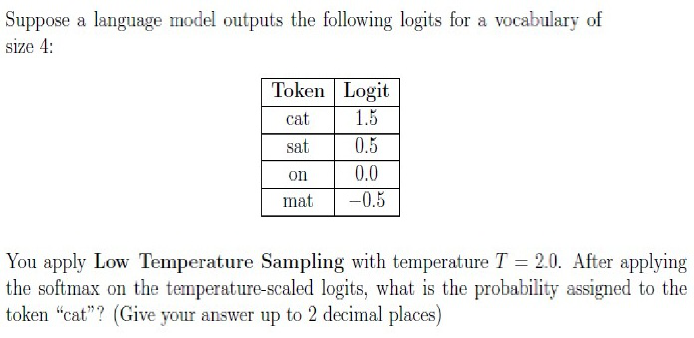

#### Worked answer

**Final answer:** Approximately 0.41.

**Steps:** For T=2, logits become [0.75, 0.25, 0, −0.25]; exp(0.75)/sum(exp([0.75, 0.25, 0, −0.25])) ≈ 0.408701, or 0.41.

**Status:** ambiguous

**Ambiguity note:** The prompt calls T=2 low temperature, but relative to T=1 it is high; calculation uses the stated T.

**verified_by_code:** `false` — depends on figure, no code path

---

### 2025 T3 End Term AN, Q2

**Paper:** `2025T3_ET_AN` · **Type:** MCQ · **Marks:** 2 · **Topic(s):** w4-topk-temperature

A language model produces the following logits for the next token:

`{apple : 2.1, banana : 1.8, grape : 0.4, orange : 0.3, melon : -1.0}`

Before sampling, the model applies:
• Temperature scaling with $T = 0.5$
• Top-K sampling with $K = 2$

Which tokens are eligible to be sampled?

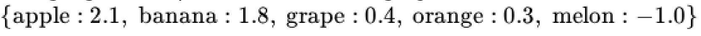

**A.** Only ''apple''

**B.** "apple'' or ''banana''

**C.** "apple'', ''banana'' or ''grape''

**D.** "apple''or ''grape''

#### Worked answer

**Final answer:** B: apple or banana.

**Steps:** Dividing by positive T preserves ranking; the two largest logits are 2.1 and 1.8. A omits banana, C includes a third token, D replaces banana with grape.

**Status:** derived

**verified_by_code:** `false` — Non-numeric response; no numeric checker path applies.

---

### 2025 T3 End Term AN, Q5

**Paper:** `2025T3_ET_AN` · **Type:** MCQ · **Marks:** 2 · **Topic(s):** w4-bert-finetuning

For a 4-category classification task, how would you use BERT's output?

**A.** Use all token embeddings and average them.

**B.** Use the [CLS] token embedding as input to a classification layer.

**C.** Use only the [SEP] token

**D.** Use the [MASK] token predictions.

#### Worked answer

**Final answer:** B: use [CLS] for a classification head.

**Steps:** Original BERT uses final [CLS] representation and a classifier. A is a possible alternative pooling method, not the canonical BERT design; C and D do not specify the standard sequence classifier.

**Status:** derived

**verified_by_code:** `false` — Non-numeric response; no numeric checker path applies.

---

### 2025 T3 End Term AN, Q6

**Paper:** `2025T3_ET_AN` · **Type:** MCQ · **Marks:** 2 · **Topic(s):** w4-bert-finetuning

A hospital wants to extract disease mentions and treatment plans from unstructured clinical
notes. Notes use heavy abbreviations like ``pt dx w/ CAD, rx aspirin''
For extracting specific disease names from text, which task should you fine-tune BERT for?

**A.** Masked Language Modeling

**B.** Next Sentence Prediction

**C.** Named Entity Recognition

**D.** Text generation

#### Worked answer

**Final answer:** C: named entity recognition.

**Steps:** NER labels spans such as disease names. A is a pretraining objective, B is sentence-pair classification, and D generates text instead of tagging spans.

**Status:** derived

**verified_by_code:** `false` — Non-numeric response; no numeric checker path applies.

---

### 2025 T3 End Term AN, Q15

**Paper:** `2025T3_ET_AN` · **Type:** MSQ · **Marks:** 3 · **Topic(s):** w4-topp-nucleus

Which of the following decoding method(s) can generate a different output every time you run the
model with the same prompt?

**A.** Greedy decoding

**B.** Beam search with beam width = 1

**C.** Top-p sampling with temperature T = 1

**D.** Top-p sampling with temperature T > 1

**E.** Beam search with beam width < 1

#### Worked answer

**Final answer:** C and D.

**Steps:** Top-p can sample different continuations at positive T. Greedy A and width-one beam B are deterministic with fixed tie-breaking; E is not a valid positive integer beam width.

**Status:** derived

**verified_by_code:** `false` — Non-numeric response; no numeric checker path applies.

---

### 2025 T3 End Term FN, Q3

**Paper:** `2025T3_ET_FN` · **Type:** MCQ · **Marks:** 2 · **Topic(s):** w4-topk-temperature

A language model outputs the following logits for the next token:
{cat: 3.2, dog: 2.9, bird: 1.1, fish: 0.5, snake: -0.4}
Before sampling, the decoding pipeline performs:
• Temperature scaling with T = 2.0
• Top-K filtering with K = 3
After applying both steps, which tokens remain eligible for sampling?

**A.** Only ''cat''

**B.** 'cat'' or ''dog''

**C.** 'cat'', ''dog'' or ''bird''

**D.** 'dog'', ''bird'' or ''fish''

#### Worked answer

**Final answer:** C: cat, dog and bird.

**Steps:** Positive temperature preserves ranking 3.2 > 2.9 > 1.1 > 0.5 > −0.4. A and B omit eligible tokens; D includes fish and omits cat.

**Status:** derived

**verified_by_code:** `false` — Non-numeric response; no numeric checker path applies.

---

### 2025 T3 End Term FN, Q4

**Paper:** `2025T3_ET_FN` · **Type:** MCQ · **Marks:** 2 · **Topic(s):** w4-topp-nucleus

If a model's next-token probabilities are $P(A) = 0.5$, $P(B) = 0.2$, $P(C) = 0.15$, $P(D) = 0.1$, and $P(E) = 0.05$, and Top-P is set to $p = 0.8$. Which set of tokens will be included in the nucleus for sampling?

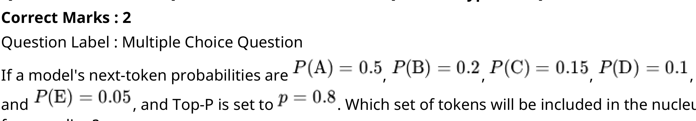

**A.** Tokens A, B, C, D, E

**B.** Tokens A, B

**C.** Tokens A, B, C

**D.** Tokens A, B, C, D

**E.** Tokens A, B, D

#### Worked answer

**Final answer:** C: A, B and C.

**Steps:** Cumulative 0.5+0.2=0.7 < 0.8; adding C reaches 0.85. A and D include unnecessary tokens; B omits C; E skips a higher-probability token.

**Status:** derived

**verified_by_code:** `false` — depends on figure, no code path

---

### 2025 T3 End Term FN, Q6

**Paper:** `2025T3_ET_FN` · **Type:** MCQ · **Marks:** 2 · **Topic(s):** w4-bert-finetuning

A research team wants to classify scientific abstracts into multiple topics simultaneously (e.g.,
''ML'', ''biology'', ''statistics''), where each abstract may belong to more than one topic. They fine-
tune BERT for this task. Which modification is MOST appropriate?

**A.** Replace the [CLS] vector with an average of the top-4 attention heads

**B.** Feed the [CLS] embedding into a linear layer with a sigmoid activation per
label

**C.** Use token embeddings individually and classify each token

**D.** Use the [SEP] token embedding for multi-label prediction

#### Worked answer

**Final answer:** B: sigmoid for each label.

**Steps:** Independent sigmoid outputs allow several topics at once. A changes pooling, C is token labeling, and D does not specify the required multi-label activation.

**Status:** derived

**verified_by_code:** `false` — Non-numeric response; no numeric checker path applies.

---

### 2025 T3 End Term FN, Q24

**Paper:** `2025T3_ET_FN` · **Type:** MSQ · **Marks:** 3 · **Topic(s):** w4-topk-temperature

Under which of the following decoding settings can the model produce different outputs across
multiple runs on the same prompt?

**A.** Top-K sampling with $K = 1$ and temperature $T = 0$

**B.** Top-K sampling with $K = 50$ and temperature $T = 1$

**C.** Nucleus (Top-p) sampling with $p = 0.9$ and temperature $T = 0.7$

**D.** Greedy decoding after applying a temperature $T = 2$ to the logits

**E.** Beam search with beam width = 5

#### Worked answer

**Final answer:** B and C.

**Steps:** Sampling from nontrivial top-k or top-p sets may vary. A has one candidate and T=0 is undefined as division but has a greedy limit; D retains the argmax under positive temperature; E is deterministic with fixed ties.

**Status:** derived

**verified_by_code:** `false` — Non-numeric response; no numeric checker path applies.

---

### 2026 T1 End Term AN, Q8

**Paper:** `2026T1_ET_AN` · **Type:** SA · **Marks:** 2 · **Topic(s):** w4-topp-nucleus

You are using Top-$p$ (Nucleus) Sampling with $p = 0.80$. The model outputs the following sorted probability distribution for the next token:

• "apple": 0.40

• "banana": 0.25
• "cherry": 0.15
• "date": 0.10
• "elderberry": 0.10

How many tokens will be included in the candidate pool from which the final token is sampled? Enter the integer count.

#### Worked answer

**Final answer:** 3 tokens.

**Steps:** Cumulative mass reaches 0.40+0.25+0.15=0.80 with three tokens, using the standard threshold ≥ p.

**Status:** derived

**verified_by_code:** `true` — solve_numeric.py recomputed adjudicated inputs/conventions; all recorded values and adjudication checks MATCH.

---

### 2026 T1 End Term AN, Q11

**Paper:** `2026T1_ET_AN` · **Type:** SA · **Marks:** 3 · **Topic(s):** w4-topk-temperature

Suppose a language model outputs the following logits for a vocabulary of size 4:

| Token | Logit |
| :--- | :--- |
| apple | 2 |
| banana | 1 |
| cherry | 0 |
| date | -1 |

You apply High Temperature Sampling with temperature $T = 2.0$. After applying the softmax on the temperature-scaled logits, what is the probability assigned to the token "apple"? (Give your answer up to 2 decimal places).

First, apply temperature scaling with $T = 2.0$:

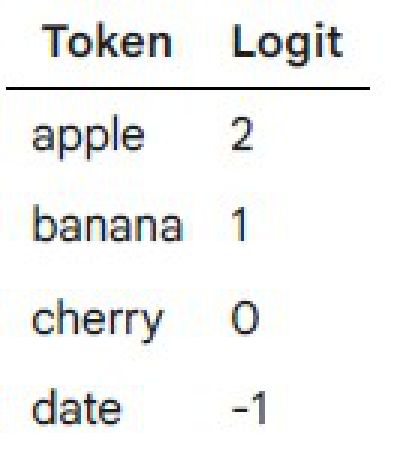

#### Worked answer

**Final answer:** 0.46.

**Steps:** Scale logits to [1,0.5,0,−0.5], then exp(1)/sum(exp([1,0.5,0,−0.5])) ≈ 0.4551.

**Status:** derived

**verified_by_code:** `false` — depends on figure, no code path

---

### 2026 T1 End Term FN, Q6

**Paper:** `2026T1_ET_FN` · **Type:** MCQ · **Marks:** 2 · **Topic(s):** w4-bert-nsp-inputs

In BERT's Next Sentence Prediction task, how are the negative (NotNext) examples created?

**A.** By taking the sentence that immediately precedes the current sentence.

**B.** By reversing the word order of the actual next sentence.

**C.** By picking a random sentence from the corpus (50% of the time).

**D.** By masking all verbs in the actual next sentence.

#### Worked answer

**Final answer:** C: randomly sample another corpus sentence.

**Steps:** Original BERT uses actual next sentences for half the pairs and random corpus sentences for the other half. A uses the preceding sentence, B reverses order, D masks verbs.

**Status:** derived

**verified_by_code:** `false` — Non-numeric response; no numeric checker path applies.

---

### 2026 T1 End Term FN, Q12

**Paper:** `2026T1_ET_FN` · **Type:** MSQ · **Marks:** 3 · **Topic(s):** w4-bert-finetuning

Comparing the architectures of BERT and GPT, select all the structural differences that are true.

**A.** BERT uses bidirectional self-attention, allowing tokens to attend to both left and right contexts.

**B.** GPT uses masked (causal) self-attention, allowing tokens to attend only to previous tokens.

**C.** BERT is an autoregressive model, while GPT is an autoencoding model.

**D.** During pre-training, BERT predicts masked tokens, whereas GPT predicts the next token in the sequence.

#### Worked answer

**Final answer:** A, B, D with the usual inclusive causal convention.

**Steps:** BERT attention is bidirectional and MLM predicts masked tokens; GPT uses causal next-token prediction. B is understood to include the current position. C reverses the model types.

**Status:** ambiguous

**Ambiguity note:** B says “only to previous tokens” literally excludes the current position, although standard GPT causal self-attention includes it; B is accepted in the conventional intended sense.

**verified_by_code:** `false` — No numeric checker path; answer remains explicitly ambiguous.

---

### 2026 T1 End Term FN, Q15

**Paper:** `2026T1_ET_FN` · **Type:** MSQ · **Marks:** 2 · **Topic(s):** w4-beam-search

Select all correct statements regarding Decoding Strategies in language generation.

**A.** Beam Search with a beam width $k = 1$ is mathematically equivalent to Greedy Search.

**B.** Greedy search is deterministic and often leads to repetitive or degenerative text loops.

**C.** Top-$k$ sampling guarantees that the generated text will always be grammatically correct.

**D.** Top-$p$ (Nucleus) sampling allows for a dynamic vocabulary size at each step, whereas Top-$k$ uses a fixed number of candidates.

#### Worked answer

**Final answer:** A, B and D.

**Steps:** With identical scoring and stopping, width-one beam equals greedy; greedy can degenerate into repetition; nucleus size adapts to the distribution while k is fixed. C falsely guarantees grammar.

**Status:** derived

**verified_by_code:** `false` — Non-numeric response; no numeric checker path applies.

---

### 2026 T1 End Term FN, Q16

**Paper:** `2026T1_ET_FN` · **Type:** MSQ · **Marks:** 2 · **Topic(s):** w4-bert-finetuning

In a feature-based approach using a pretrained transformer (like BERT) for a Multiple-Choice QA task, which of the following statements regarding the methodology are correct? (Select all that apply)

**A.** The weights of the pretrained transformer are updated via backpropagation during the training phase.

**B.** The input must be formatted as multiple pairs, such as [CLS] Question [SEP] Choice_n, creating a distinct representation for each candidate answer.

**C.** The final prediction is determined by passing the fixed output representations through a trainable linear layer and applying a Softmax function.

**D.** The model generates the correct answer string token-by-token using an autoregressive decoding strategy like Greedy Search.

#### Worked answer

**Final answer:** C, and B under the intended conventional formatting.

**Steps:** Frozen BERT supplies fixed features to a trainable linear/softmax head (C). Pairing question with each candidate (B) is a standard construction, but not the only possible format. A updates the pretrained model, contradicting feature-based freezing; D describes generation.

**Status:** ambiguous

**Ambiguity note:** B says the input “must” use this pair format, but feature-based multiple-choice systems can use other representations; C alone is strictly necessary among these choices.

**verified_by_code:** `false` — No numeric checker path; answer remains explicitly ambiguous.

---

### 2026 T1 End Term FN, Q17

**Paper:** `2026T1_ET_FN` · **Type:** MCQ · **Marks:** 3 · **Topic(s):** w4-bert-finetuning

A Transformer processes a sequence of length 5 using 6 identical self-attention layers. Count the total number of allowed attention links across all layers and Choose the option representing the correct pair

(A) BERT
(B) GPT

**A.** BERT: 150, GPT: 90

**B.** BERT: 90, GPT: 150

**C.** BERT: 150, GPT: 150

**D.** BERT: 90, GPT: 90

**E.** BERT: 30, GPT: 36

**F.** BERT: 36, GPT: 30

#### Worked answer

**Final answer:** A: BERT 150, GPT 90.

**Steps:** Per layer, unrestricted attention has 5²=25 links and causal attention has 5×6/2=15. Across six layers these are 150 and 90. B swaps totals; C and D equate masks; E and F omit pairwise links.

**Status:** derived

**verified_by_code:** `true` — solve_numeric.py recomputed adjudicated inputs/conventions; all recorded values and adjudication checks MATCH.

---

### 2026 T2 End Term AN, Q4

**Paper:** `2026T2_ET_AN` · **Type:** MCQ · **Marks:** 2 · **Topic(s):** w4-beam-search

You are designing an LLM to translate a sentence from English to Spanish with low computational complexity. The system has to consider a few possible sequences of words rather than committing to the single highest-probability word at every step. Which of the following decoding strategies is the most appropriate?

**A.** Beam search

**B.** Exhaustive search

**C.** Top-p sampling with p = 0.85

**D.** Greedy decoding

#### Worked answer

**Final answer:** A: beam search.

**Steps:** A retains a small set of high-scoring partial sequences. B expands exponentially, C samples a token at a time instead of explicitly tracking competing sequences, and D commits to one.

**Status:** derived

**verified_by_code:** `false` — Non-numeric response; no numeric checker path applies.

---

### 2026 T2 End Term AN, Q5

**Paper:** `2026T2_ET_AN` · **Type:** MCQ · **Marks:** 2 · **Topic(s):** w4-bert-nsp-inputs

In the Next Sentence Prediction task, how are the two input sentences distinguished by the BERT architecture?

**A.** By utilizing separate transformer encoders for each sentence and concatenating the outputs.

**B.** By adding learnable segment embeddings to the token and positional embeddings of the respective sentences.

**C.** By inserting a [MASK] token between the two sentences.

**D.** By ensuring two different heads in the Multi-Head Attention setup attend to the specific sentences.

#### Worked answer

**Final answer:** B.

**Steps:** BERT adds learned segment/type embeddings to token and positional embeddings. A invents separate encoders, C confuses [MASK] with [SEP], D wrongly assigns attention heads by segment.

**Status:** derived

**verified_by_code:** `false` — Non-numeric response; no numeric checker path applies.

---

### 2026 T2 End Term AN, Q9

**Paper:** `2026T2_ET_AN` · **Type:** SA · **Marks:** 2 · **Topic(s):** w4-topp-nucleus

How many tokens are selected as candidate tokens?

#### Worked answer

**Final answer:** 3 tokens.

**Steps:** Softmax logits give approximately [0.5072, 0.2519, 0.1382, 0.0686, 0.0341]; first two total 0.7590 < 0.8, first three 0.8973 ≥ 0.8.

**Status:** derived

**verified_by_code:** `true` — solve_numeric.py recomputed adjudicated inputs/conventions; all recorded values and adjudication checks MATCH.

---

### 2026 T2 End Term AN, Q10

**Paper:** `2026T2_ET_AN` · **Type:** SA · **Marks:** 2 · **Topic(s):** w4-topp-nucleus

After renormalization of the probabilities, what is the highest probability value among those? (Round off to three decimal places)

#### Worked answer

**Final answer:** 0.565.

**Steps:** Three candidates survive top-p. The largest renormalized probability is exp(2.5)/(exp(2.5)+exp(1.8)+exp(1.2))≈0.565254.

**Status:** derived

**verified_by_code:** `true` — solve_numeric.py recomputed adjudicated inputs/conventions; all recorded values and adjudication checks MATCH.

---

### 2026 T2 End Term FN, Q6

**Paper:** `2026T2_ET_FN` · **Type:** MCQ · **Marks:** 2 · **Topic(s):** w4-bert-nsp-inputs

In BERT's Next Sentence Prediction task, how are the negative (NotNext) examples created?

**A.** By taking the sentence that immediately precedes the current sentence.

**B.** By reversing the word order of the actual next sentence.

**C.** By picking a random sentence from the corpus (50% of the time).

**D.** By masking all verbs in the actual next sentence.

#### Worked answer

**Final answer:** C: randomly sample another corpus sentence.

**Steps:** Original BERT uses actual next sentences for half the pairs and random corpus sentences for the other half. A uses the preceding sentence, B reverses order, D masks verbs.

**Status:** derived

**verified_by_code:** `false` — Non-numeric response; no numeric checker path applies.

---

### 2026 T2 End Term FN, Q12

**Paper:** `2026T2_ET_FN` · **Type:** MSQ · **Marks:** 3 · **Topic(s):** w4-bert-finetuning

Comparing the architectures of BERT and GPT, select all the structural differences that are true.

**A.** BERT uses bidirectional self-attention, allowing tokens to attend to both left and right contexts.

**B.** GPT uses masked (causal) self-attention, allowing tokens to attend only to previous tokens.

**C.** BERT is an autoregressive model, while GPT is an autoencoding model.

**D.** During pre-training, BERT predicts masked tokens, whereas GPT predicts the next token in the sequence.

#### Worked answer

**Final answer:** A, B, D with the usual inclusive causal convention.

**Steps:** BERT attention is bidirectional and MLM predicts masked tokens; GPT uses causal next-token prediction. B is understood to include the current position. C reverses the model types.

**Status:** ambiguous

**Ambiguity note:** B says “only to previous tokens” literally excludes the current position, although standard GPT causal self-attention includes it; B is accepted in the conventional intended sense.

**verified_by_code:** `false` — No numeric checker path; answer remains explicitly ambiguous.

---

### 2026 T2 End Term FN, Q15

**Paper:** `2026T2_ET_FN` · **Type:** MSQ · **Marks:** 2 · **Topic(s):** w4-beam-search

Select all correct statements regarding Decoding Strategies in language generation.

**A.** Beam Search with a beam width $k = 1$ is mathematically equivalent to Greedy Search.

**B.** Greedy search is deterministic and often leads to repetitive or degenerative text loops.

**C.** Top-$k$ sampling guarantees that the generated text will always be grammatically correct.

**D.** Top-$p$ (Nucleus) sampling allows for a dynamic vocabulary size at each step, whereas Top-$k$ uses a fixed number of candidates.

#### Worked answer

**Final answer:** A, B and D.

**Steps:** With identical scoring and stopping, width-one beam equals greedy; greedy can degenerate into repetition; nucleus size adapts to the distribution while k is fixed. C falsely guarantees grammar.

**Status:** derived

**verified_by_code:** `false` — Non-numeric response; no numeric checker path applies.

---

### 2026 T2 End Term FN, Q16

**Paper:** `2026T2_ET_FN` · **Type:** MSQ · **Marks:** 2 · **Topic(s):** w4-bert-finetuning

In a feature-based approach using a pretrained transformer (like BERT) for a Multiple-Choice QA task, which of the following statements regarding the methodology are correct? (Select all that apply)

**A.** The weights of the pretrained transformer are updated via backpropagation during the training phase.

**B.** The input must be formatted as multiple pairs, such as [CLS] Question [SEP] Choice_n, creating a distinct representation for each candidate answer.

**C.** The final prediction is determined by passing the fixed output representations through a trainable linear layer and applying a Softmax function.

**D.** The model generates the correct answer string token-by-token using an autoregressive decoding strategy like Greedy Search.

#### Worked answer

**Final answer:** C, and B under the intended conventional formatting.

**Steps:** Frozen BERT supplies fixed features to a trainable linear/softmax head (C). Pairing question with each candidate (B) is a standard construction, but not the only possible format. A updates the pretrained model, contradicting feature-based freezing; D describes generation.

**Status:** ambiguous

**Ambiguity note:** B says the input “must” use this pair format, but feature-based multiple-choice systems can use other representations; C alone is strictly necessary among these choices.

**verified_by_code:** `false` — No numeric checker path; answer remains explicitly ambiguous.

---

### 2026 T2 End Term FN, Q17

**Paper:** `2026T2_ET_FN` · **Type:** MCQ · **Marks:** 3 · **Topic(s):** w4-bert-finetuning

A Transformer processes a sequence of length 5 using 6 identical self-attention layers. Count the total number of allowed attention links across all layers and Choose the option representing the correct pair

(A) BERT
(B) GPT

**A.** BERT: 150, GPT: 90

**B.** BERT: 90, GPT: 150

**C.** BERT: 150, GPT: 150

**D.** BERT: 90, GPT: 90

**E.** BERT: 30, GPT: 36

**F.** BERT: 36, GPT: 30

#### Worked answer

**Final answer:** A: BERT 150, GPT 90.

**Steps:** Per layer, unrestricted attention has 5²=25 links and causal attention has 5×6/2=15. Across six layers these are 150 and 90. B swaps totals; C and D equate masks; E and F omit pairwise links.

**Status:** derived

**verified_by_code:** `true` — solve_numeric.py recomputed adjudicated inputs/conventions; all recorded values and adjudication checks MATCH.

---

## Source and reproducibility

Questions preserve each routed paper occurrence, including repeated stems from different papers or sessions. Images are linked from the archived extraction assets. Rebuild with `uv run python scripts/build_exam_question_banks.py`; run `uv run python scripts/build_exam_study_priorities.py` for the ranked study guide.
