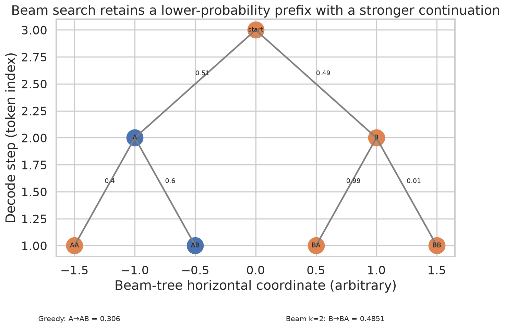
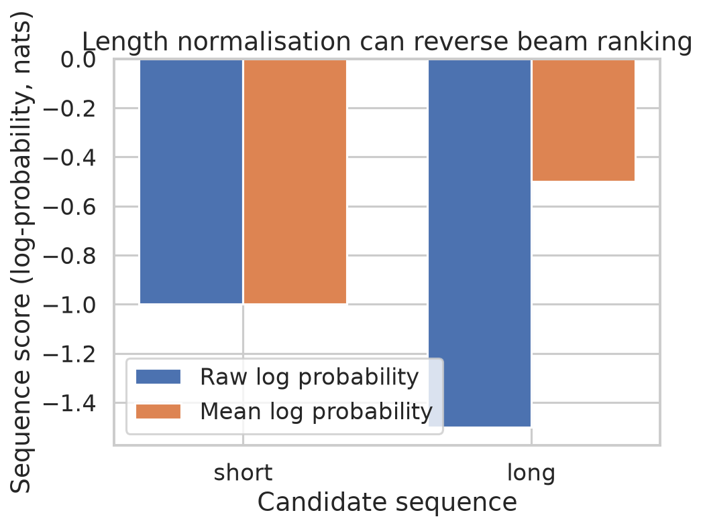
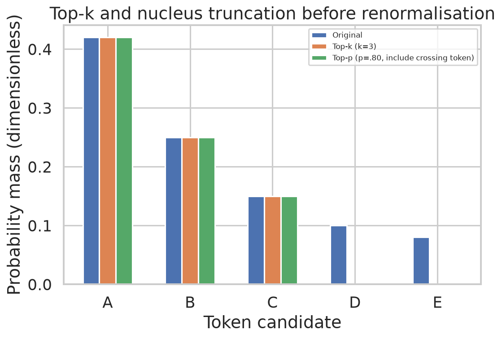
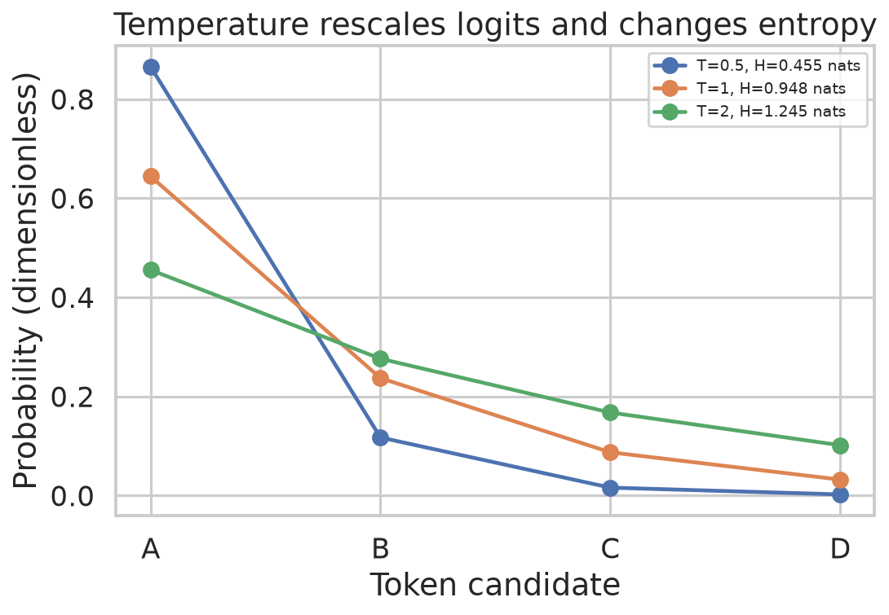
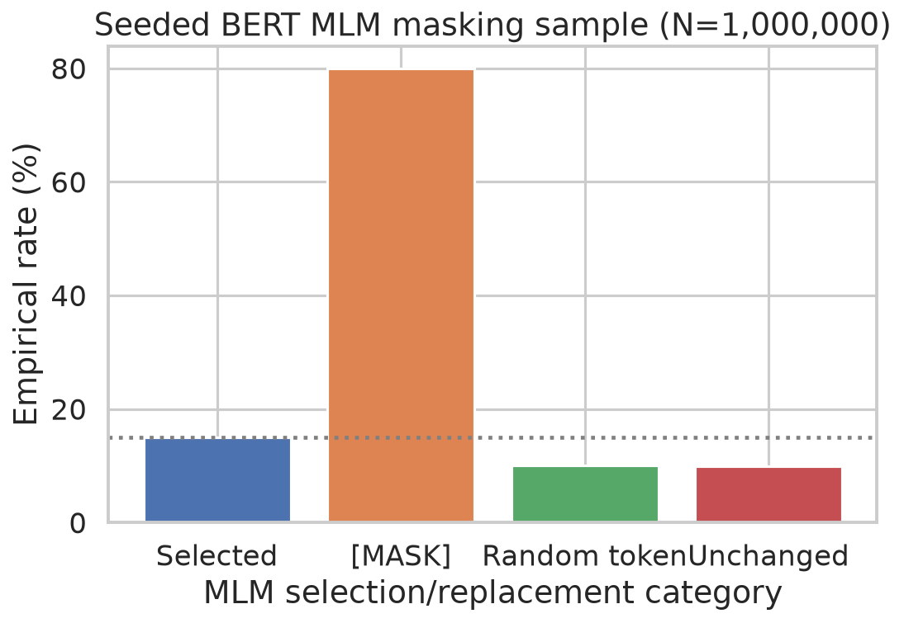
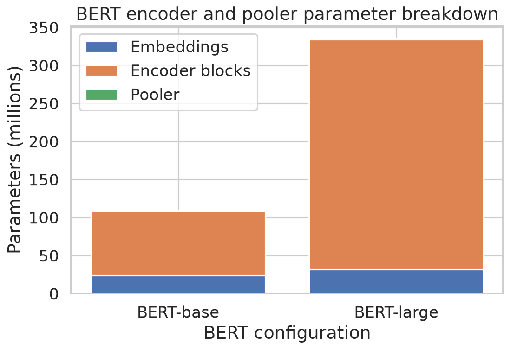

# Week 4: Decoding Strategies and Bidirectional Language Representation

**Navigation:** ← [[week-3-notes|Week 3 Notes]] · [[Knowledge-Map|Knowledge Map]] · [[week-4-exam-focused-notes|Exam-Focused Notes]] · [[week-4-exam-questions|Exam Questions]]

## Abstract
An autoregressive model defines probabilities, but a decoding rule decides how to traverse or sample the exponentially large sequence space. Greedy and beam search approximate maximum-probability search, whereas temperature and truncated sampling reshape or restrict a next-token distribution. Their behavior depends on prefix conditioning, termination, and scoring, and higher model probability need not yield better open-ended text. BERT instead learns bidirectional contextual representations through masked token prediction and next sentence prediction. Its input construction, parameter accounting, and downstream heads make the distinction between a pre-training objective and a task-specific prediction explicit. The numerical examples below use the supplied, executed Week 4 artifacts.

## Lecture map and boundaries

The page references below are **PDF** page numbers in the supplied ebook transcript; printed page numbers are one lower. This week inherits the causal language model from [[week-3-notes]]. Question links use the routing manifest; a question assigned to several topics appears in each relevant row. Question labels identify paper and question number; the inventory supplies the wording. The destination question bank is planned.

| Canonical topic | Routed questions |
|---|---|
| Exhaustive and greedy search | [[week-4-exam-questions#da5004_2024T1_ET_AN--q148\|2024T1_ET_AN Q148]] · [[week-4-exam-questions#da5004_2024T1_ET_AN--q150\|2024T1_ET_AN Q150]] · [[week-4-exam-questions#da5004_2024T1_ET_FN--q201\|2024T1_ET_FN Q201]] · [[week-4-exam-questions#da5004_2024T1_ET_FN--q203\|2024T1_ET_FN Q203]] · [[week-4-exam-questions#da5004_2024T1_Q1_NA--q195\|2024T1_Q1_NA Q195]] · [[week-4-exam-questions#da5004_2024T3_ET_AN--q178\|2024T3_ET_AN Q178]] · [[week-4-exam-questions#da5004_2025T1_Q1_NA--q109\|2025T1_Q1_NA Q109]] · [[week-4-exam-questions#da5004_2025T1_Q1_NA--q110\|2025T1_Q1_NA Q110]] · [[week-4-exam-questions#da5004_2025T2_ET_FN--q141\|2025T2_ET_FN Q141]] · [[week-4-exam-questions#da5004_2025T2_Q1_NA--q153\|2025T2_Q1_NA Q153]] · [[week-4-exam-questions#da5004_2025T2_Q1_NA--q154\|2025T2_Q1_NA Q154]] · [[week-4-exam-questions#da5004_2025T3_Q1_NA--q178\|2025T3_Q1_NA Q178]] · [[week-4-exam-questions#da5004_2025T3_Q1_NA--q180\|2025T3_Q1_NA Q180]] · [[week-4-exam-questions#da5004_2026T2_Q1_NA--q14\|2026T2_Q1_NA Q14]] · [[week-4-exam-questions#da5004_2026T2_Q1_NA--q15\|2026T2_Q1_NA Q15]] |
| Beam search and length normalisation | [[week-4-exam-questions#da5004_2024T1_ET_AN--q150\|2024T1_ET_AN Q150]] · [[week-4-exam-questions#da5004_2024T1_ET_FN--q203\|2024T1_ET_FN Q203]] · [[week-4-exam-questions#da5004_2024T1_Q1_NA--q195\|2024T1_Q1_NA Q195]] · [[week-4-exam-questions#da5004_2024T3_ET_AN--q178\|2024T3_ET_AN Q178]] · [[week-4-exam-questions#da5004_2025T1_Q1_NA--q110\|2025T1_Q1_NA Q110]] · [[week-4-exam-questions#da5004_2025T2_ET_FN--q141\|2025T2_ET_FN Q141]] · [[week-4-exam-questions#da5004_2025T3_Q1_NA--q181\|2025T3_Q1_NA Q181]] · [[week-4-exam-questions#da5004_2025T3_Q1_NA--q185\|2025T3_Q1_NA Q185]] · [[week-4-exam-questions#da5004_2025T3_Q2_NA--q115\|2025T3_Q2_NA Q115]] · [[week-4-exam-questions#da5004_2026T1_ET_FN--q15\|2026T1_ET_FN Q15]] · [[week-4-exam-questions#da5004_2026T2_ET_AN--q4\|2026T2_ET_AN Q4]] · [[week-4-exam-questions#da5004_2026T2_ET_FN--q15\|2026T2_ET_FN Q15]] · [[week-4-exam-questions#da5004_2026T2_Q1_NA--q17\|2026T2_Q1_NA Q17]] |
| Top-k sampling and temperature | [[week-4-exam-questions#da5004_2024T1_ET_AN--q150\|2024T1_ET_AN Q150]] · [[week-4-exam-questions#da5004_2024T1_ET_FN--q203\|2024T1_ET_FN Q203]] · [[week-4-exam-questions#da5004_2024T1_Q1_NA--q195\|2024T1_Q1_NA Q195]] · [[week-4-exam-questions#da5004_2024T3_ET_AN--q178\|2024T3_ET_AN Q178]] · [[week-4-exam-questions#da5004_2024T3_ET_FN--q196\|2024T3_ET_FN Q196]] · [[week-4-exam-questions#da5004_2024T3_Q1_NA--q288\|2024T3_Q1_NA Q288]] · [[week-4-exam-questions#da5004_2025T1_Q1_NA--q106\|2025T1_Q1_NA Q106]] · [[week-4-exam-questions#da5004_2025T1_Q1_NA--q110\|2025T1_Q1_NA Q110]] · [[week-4-exam-questions#da5004_2025T2_ET_FN--q141\|2025T2_ET_FN Q141]] · [[week-4-exam-questions#da5004_2025T2_ET_FN--q143\|2025T2_ET_FN Q143]] · [[week-4-exam-questions#da5004_2025T2_ET_FN--q145\|2025T2_ET_FN Q145]] · [[week-4-exam-questions#da5004_2025T2_Q1_NA--q138\|2025T2_Q1_NA Q138]] · [[week-4-exam-questions#da5004_2025T2_Q1_NA--q143\|2025T2_Q1_NA Q143]] · [[week-4-exam-questions#da5004_2025T2_Q1_NA--q145\|2025T2_Q1_NA Q145]] · [[week-4-exam-questions#da5004_2025T2_Q1_NA--q155\|2025T2_Q1_NA Q155]] · [[week-4-exam-questions#da5004_2025T3_ET_AN--q2\|2025T3_ET_AN Q2]] · [[week-4-exam-questions#da5004_2025T3_ET_FN--q3\|2025T3_ET_FN Q3]] · [[week-4-exam-questions#da5004_2025T3_ET_FN--q24\|2025T3_ET_FN Q24]] · [[week-4-exam-questions#da5004_2026T1_ET_AN--q11\|2026T1_ET_AN Q11]] · [[week-4-exam-questions#da5004_2026T1_Q1_NA--q7\|2026T1_Q1_NA Q7]] · [[week-4-exam-questions#da5004_2026T1_Q2_NA--q17\|2026T1_Q2_NA Q17]] · [[week-4-exam-questions#da5004_2026T2_Q1_NA--q16\|2026T2_Q1_NA Q16]] |
| Top-p (nucleus) sampling and repetition issues | [[week-4-exam-questions#da5004_2024T1_ET_AN--q150\|2024T1_ET_AN Q150]] · [[week-4-exam-questions#da5004_2024T1_ET_FN--q203\|2024T1_ET_FN Q203]] · [[week-4-exam-questions#da5004_2024T1_Q1_NA--q195\|2024T1_Q1_NA Q195]] · [[week-4-exam-questions#da5004_2025T1_Q1_NA--q110\|2025T1_Q1_NA Q110]] · [[week-4-exam-questions#da5004_2025T2_ET_AN--q198\|2025T2_ET_AN Q198]] · [[week-4-exam-questions#da5004_2025T2_ET_FN--q141\|2025T2_ET_FN Q141]] · [[week-4-exam-questions#da5004_2025T2_ET_FN--q143\|2025T2_ET_FN Q143]] · [[week-4-exam-questions#da5004_2025T2_Q1_NA--q143\|2025T2_Q1_NA Q143]] · [[week-4-exam-questions#da5004_2025T3_ET_AN--q15\|2025T3_ET_AN Q15]] · [[week-4-exam-questions#da5004_2025T3_ET_FN--q4\|2025T3_ET_FN Q4]] · [[week-4-exam-questions#da5004_2025T3_Q1_NA--q182\|2025T3_Q1_NA Q182]] · [[week-4-exam-questions#da5004_2026T1_ET_AN--q8\|2026T1_ET_AN Q8]] · [[week-4-exam-questions#da5004_2026T2_ET_AN--q9\|2026T2_ET_AN Q9]] · [[week-4-exam-questions#da5004_2026T2_ET_AN--q10\|2026T2_ET_AN Q10]] · [[week-4-exam-questions#da5004_2026T2_Q2_NA--q10\|2026T2_Q2_NA Q10]] |
| BERT masked language modelling (80/10/10) | [[week-4-exam-questions#da5004_2025T2_Q1_NA--q137\|2025T2_Q1_NA Q137]] · [[week-4-exam-questions#da5004_2026T1_Q2_NA--q3\|2026T1_Q2_NA Q3]] · [[week-4-exam-questions#da5004_2026T1_Q2_NA--q4\|2026T1_Q2_NA Q4]] |
| NSP, [CLS]/[SEP] and the three input embeddings | [[week-4-exam-questions#da5004_2024T1_Q1_NA--q198\|2024T1_Q1_NA Q198]] · [[week-4-exam-questions#da5004_2025T2_Q1_NA--q142\|2025T2_Q1_NA Q142]] · [[week-4-exam-questions#da5004_2026T1_ET_FN--q6\|2026T1_ET_FN Q6]] · [[week-4-exam-questions#da5004_2026T1_Q1_NA--q6\|2026T1_Q1_NA Q6]] · [[week-4-exam-questions#da5004_2026T2_ET_AN--q5\|2026T2_ET_AN Q5]] · [[week-4-exam-questions#da5004_2026T2_ET_FN--q6\|2026T2_ET_FN Q6]] |
| BERT sizes and parameter counts | [[week-4-exam-questions#da5004_2024T1_ET_FN--q198\|2024T1_ET_FN Q198]] · [[week-4-exam-questions#da5004_2026T1_Q2_NA--q18\|2026T1_Q2_NA Q18]] |
| BERT fine-tuning heads and GPT vs BERT | [[week-4-exam-questions#da5004_2025T2_Q1_NA--q137\|2025T2_Q1_NA Q137]] · [[week-4-exam-questions#da5004_2025T3_ET_AN--q5\|2025T3_ET_AN Q5]] · [[week-4-exam-questions#da5004_2025T3_ET_AN--q6\|2025T3_ET_AN Q6]] · [[week-4-exam-questions#da5004_2025T3_ET_FN--q6\|2025T3_ET_FN Q6]] · [[week-4-exam-questions#da5004_2026T1_ET_FN--q12\|2026T1_ET_FN Q12]] · [[week-4-exam-questions#da5004_2026T1_ET_FN--q16\|2026T1_ET_FN Q16]] · [[week-4-exam-questions#da5004_2026T1_ET_FN--q17\|2026T1_ET_FN Q17]] · [[week-4-exam-questions#da5004_2026T1_Q1_NA--q8\|2026T1_Q1_NA Q8]] · [[week-4-exam-questions#da5004_2026T2_ET_FN--q12\|2026T2_ET_FN Q12]] · [[week-4-exam-questions#da5004_2026T2_ET_FN--q16\|2026T2_ET_FN Q16]] · [[week-4-exam-questions#da5004_2026T2_ET_FN--q17\|2026T2_ET_FN Q17]] |

## 1. Sequence search: exhaustive, greedy, and beam

**Mathematical formulation.** Given a prompt $x$ and a fixed length $T$, the model assigns
$$P(y_{1:T}\mid x)=\prod_{t=1}^{T}P(y_t\mid x,y_{<t}),\qquad \log P(y_{1:T}\mid x)=\sum_{t=1}^{T}\log P(y_t\mid x,y_{<t}).$$
Exhaustive decoding compares all $V^T$ token sequences, subject to the specified termination convention. For lengths 1 through $T$, without early termination, the count is $\sum_{t=1}^T V^t$. A decoder call for each distinct prefix supplies a whole next-token vector: at step $t$ there are $V^{t-1}$ prefix evaluations and $\sum_{j=0}^{T-1}V^j$ over the full tree, assuming no batching or caching. Candidate expansions and model calls are different counts. PDF p.46 conflates these; for $V=3,T=2$ there are nine length-two candidates but one plus three prefix evaluations, not twelve calls. For $40{,}000^5=1.024\times10^{23}$ sequences, one billion sequences/s requires about $3.24$ million years, ignoring implementation overhead.

Greedy decoding selects $\arg\max_v P(v\mid x,y_{<t})$ and commits irreversibly. Beam search retains up to $b$ partial sequences, extends each by the vocabulary, and ranks all extensions by cumulative log probability. At each step it scores up to $bV$ extensions from up to $b$ contexts; neural forward-pass cost is model dependent. Finished hypotheses and end tokens need explicit treatment. Width one matches greedy only under the same scoring, tie, and stopping rules. Even width $V$ prunes at depth two for longer sequences and cannot in general guarantee exhaustive search (correcting PDF p.47). The ebook's illustrative three-token conditional summing to 0.8 is not a valid distribution over the stated vocabulary; use the normalized executable example below instead. See [[greedy-and-beam-search]].

**The Dangerous Misconception:** Greedy's best next token gives the most probable complete sequence. **Why this is false:** the next distribution depends on the selected prefix. In the supplied example greedy takes $A$ with $0.51$, then $b$ with $0.6$, giving $0.3060$; beam width two retains $B$, then finds $B,a$ with $0.49\cdot0.99=0.4851$.



**Figure 1.** *Greedy selects $A,b$ with probability 0.3060; width-two beam retains $B$ and finds $B,a$ with probability 0.4851.*

### 1.1 Length and termination

Raw log probability adds nonpositive terms, so extending a **given prefix** cannot increase its probability; comparisons between completed candidates of different lengths often favor short ones. It does not follow that every longer sequence is less probable than every shorter one. A common alternative is
$$s_\alpha(y)=\frac{\sum_{t=1}^{\ell(y)}\log P(y_t\mid x,y_{<t})}{\ell(y)^\alpha},$$
with $\alpha=1$ giving mean log probability. State whether EOS counts in $\ell$ and how finished beams compete. Normalization changes the objective; it is a heuristic, not a proof that the result has the appropriate length (PDF p.48).



**Figure 2.** *Raw scores rank the one-token candidate $-1.0$ over the three-token candidate $-1.5$; mean scores instead rank $-0.5$ over $-1.0$.*

## 2. Sampling and degeneration

For logits $z_i$, temperature $\tau>0$ transforms the distribution as
$$p_\tau(i)=\frac{e^{z_i/\tau}}{\sum_j e^{z_j/\tau}},\qquad \frac{p_\tau(i)}{p_\tau(j)}=e^{(z_i-z_j)/\tau}.$$
$\tau<1$ sharpens; $\tau>1$ flattens; positive scaling preserves logit rank. As $\tau\to0^+$ a unique maximum receives all mass; tied maxima share it uniformly. As $\tau\to\infty$ finite logits approach uniformity. Temperature is a transformation, with sampling or argmax applied afterwards. PDF p.49 incorrectly identifies a token with its logit and omits the tie case. See [[temperature-scaling]].

Top-$k$ keeps the $k$ most probable tokens. Top-$p$ sorts probabilities and keeps the smallest prefix with cumulative mass **at least** $p$, including the threshold-crossing token, then renormalizes. For $(.42,.25,.15,.10,.08)$, top-3 and top-$p=.80$ retain the first three, mass $.82$, giving $(.5122,.3049,.1829)$ to four decimals. State a tie rule. Top-$p=1$ retains all positive-probability support; the PDF p.56 calls this a mistake but its own correction agrees with it. Applying temperature before top-$p$ can change nucleus membership; positive temperature alone does not change top-$k$ membership except tie handling. See [[top-k-top-p-sampling]].



**Figure 3.** *Both top-3 and top-$p=0.80$ retain original probability mass $0.42+0.25+0.15=0.82$ before renormalization.*



**Figure 4.** *For logits $(2,1,0,-1)$, entropy rises from 0.455 nats at $\tau=0.5$ to 0.948 at $\tau=1$ and 1.245 at $\tau=2$.*

**The Dangerous Misconception:** A more probable sequence must be better open-ended text. **Why this is false:** [Holtzman et al. (2020)](https://openreview.net/forum?id=rygGQyrFvH) found that likelihood maximization can produce repetitive, generic text and that unrestricted sampling can enter an unreliable tail. Nucleus sampling controls the tail adaptively, but does not guarantee truth, non-repetition, or superior output on every task. A fixed random seed can repeat a sampled output; observed repetition alone does not identify a decoding algorithm (PDF pp.48–50).

The ebook also briefly describes contrastive decoding (PDF p.50): a strong model's candidates are contrasted with a weaker reference model, rather than merely taking the largest probability. This is a distinct decoding family; its score and constraints must be specified before comparison.

## 3. BERT pre-training: MLM and NSP

BERT uses bidirectional encoder self-attention: a non-padding position may use both left and right context. Original BERT selects 15% of eligible WordPiece positions for prediction. Conditional on selection, it substitutes `[MASK]` 80%, a random token 10%, and leaves the input unchanged 10%; all selected positions contribute loss against the original token. Thus expected overall category rates are 12%, 1.5%, and 1.5%, respectively, not 80%, 10%, and 10% of all tokens. Random replacement may coincidentally equal the original token. The unchanged and random categories reduce reliance on the special mask symbol, while unchanged inputs can reveal the target. With corrupted input $\tilde{x}$ and selected set $M$,
$$\mathcal L_{\mathrm{MLM}}=-\frac1{|M|}\sum_{i\in M}\log P_\theta(x_i\mid\tilde{x}).$$
This is a loss over selected positions, not only those visibly replaced by `[MASK]`. The 15% recipe is an original experimental design, not a universal optimum. [[bert-masked-language-modelling]] records the objective (PDF pp.51–52; [Devlin et al., 2019](https://doi.org/10.18653/v1/N19-1423)).



**Figure 5.** *The seeded million-position simulation selects 14.989% of positions; selected positions are approximately 79.93% mask, 10.13% random, and 9.94% unchanged.*

**The Dangerous Misconception:** Masking a position's self-attention alone removes its input identity. **Why this is false:** residual connections pass the original representation forward; other positions and subsequent layers can also propagate information. Original BERT corrupts the input instead. The PDF p.51 assertion overlooks the residual path. BERT also uses attention masks for padding; `[MASK]` is an input token, not its only kind of mask (correcting PDF p.56).

Original [[next-sentence-prediction|NSP]] builds 50% actual next segments and 50% randomly sampled segments, and predicts `IsNext` versus `NotNext` using the final `[CLS]` representation. A random segment can coincidentally be a plausible or actual continuation: the label describes the construction. With a binary classifier, $\mathcal L=\mathcal L_{\rm MLM}+\mathcal L_{\rm NSP}$, subject to the implementation's reduction conventions. NSP is not autoregressive generation. The ebook's categorical claim that NSP is always harmful or redundant is stronger than its evidence: changes to training data and duration confound cross-model comparisons (PDF p.52).

## 4. Inputs, configuration, and parameter count

For a pair the layout is `[CLS] A [SEP] B [SEP]`; for one segment use `[CLS] A [SEP]`. `[CLS]` is a learned structural token whose contextual output is used for sequence classification; `[SEP]` marks boundaries, while `[MASK]` serves the corruption objective. Segment IDs distinguish A and B, not individual sentences inside each segment. At position $i$,
$$e_i=E_{\mathrm{token}}[w_i]+E_{\mathrm{position}}[i]+E_{\mathrm{segment}}[s_i].$$
Each summand has shape `[H]`, the batch input is `[B, T, H]`, and embedding LayerNorm and dropout follow the sum. Position and segment embeddings are learned; padding is excluded with an attention mask, not merely a segment ID. A single sentence typically uses segment 0 throughout. See [[bert-input-embeddings]] (PDF p.53).

| Configuration | Layers $L$ | Hidden $H$ | Heads | FFN $I$ | Positions | Paper approximate total |
|---|---:|---:|---:|---:|---:|---:|
| BERT-base | 12 | 768 | 12 | 3072 | 512 | 110M |
| BERT-large | 24 | 1024 | 16 | 4096 | 512 | 340M |

For vocabulary $V$, positions $P$, segment types $S$, and intermediate width $I$, count distinct weights and biases. Embedding tables and embedding LayerNorm contribute $(V+P+S)H+2H$. Each layer contains four attention matrices $4H^2$, FFN matrices $2HI$, linear biases $5H+I$, and two affine LayerNorms $4H$:
$$N=(V+P+S)H+2H+L(4H^2+2HI+9H+I)+(H^2+H).$$
The final term is the dense pooler. With $V=30{,}522$, $P=512$, $S=2$, this yields **109,482,240** base and **335,141,888** large, including embeddings, encoder, and pooler but excluding separate MLM/NSP heads. The paper describes a 30,000-token WordPiece vocabulary and reports approximately 110M/340M; the configured vocabulary has 30,522 entries. With 30,000, the same count is 109,081,344 / 334,607,360. The 522 added rows contribute 400,896 / 534,528 parameters. The ebook's 107.4M estimate prematurely rounds each layer to 7M: attention plus FFN alone is about 7.08M per base layer; attributing the whole gap to LayerNorm or the MLM head is misleading (PDF pp.53–54). These are approximate headline model sizes, not claims that rounding to the nearest million gives 110 or 340. See [[bert-parameter-count]].



**Figure 6.** *The configured embedding, encoder, and pooler counts total 109,482,240 for base and 335,141,888 for large; the paper reports approximate 110M and 340M.*

## 5. Fine-tuning and GPT versus BERT

Let final encoder output be `[B, T, H]`. A sequence classifier applies $W h_{\rm CLS}+b$ to obtain `[B, C]` class logits; softmax cross-entropy suits mutually exclusive labels, while independent sigmoid outputs and binary cross-entropy suit multilabel classification. A token classifier applies the same head to each $h_i$, yielding `[B, T, C]` for tagging; padding and alignment to WordPieces must be handled in the loss. Frozen feature extraction trains a head on fixed representations; end-to-end fine-tuning also updates encoder weights. Neither procedure guarantees superiority or requires a GPU in principle (PDF pp.54–55).

For extractive QA, encode `[CLS] question [SEP] passage [SEP]`, then compute start and end logits $a_i=w_s^\top h_i+b_s$, $b_i=w_e^\top h_i+b_e$, each of shape `[B, T]`. Train using labeled start/end positions; at inference select a valid passage span maximizing $a_i+b_j$ subject to $i\le j$ and optional length constraints. Independent argmaxes may violate order. PDF p.55 first constrains $j\ge i$ and then claims $j<i$ can occur: those statements conflict. Unanswerable questions require an explicit no-answer score or rule; an invalid pair alone does not establish no answer.

| Property | GPT-style causal decoder | Original BERT |
|---|---|---|
| Attention | causal, prefix only | bidirectional over unmasked non-padding positions |
| Pre-training | next-token prediction | MLM plus NSP |
| Typical output | continuation generated autoregressively | contextual vectors for classification, tagging, spans |
| Classification | chosen summary position/head | usually final `[CLS]` plus task head |

For length $T=5$, unrestricted attention has $25$ directed position pairs per layer and causal attention including the diagonal has $15$; over six layers these are 150 and 90. Counts assume no padding and count per head only if multiplied by head count. The exam-tip comparison is GPT-1 roughly 117M versus BERT-base roughly 110M: a comparable headline size does not imply the same objective or attention pattern (PDF p.54). Decoder-only systems can also classify and encoder-based systems can be adapted to generation; these are common uses, not exclusive capabilities.

## 6. Reproducible computational labs

The following scripts and terminal output are reproduced verbatim from the supplied executed artifacts. Run from the LLM root with `uv run --locked python 'week 4/codeblocks/NN_name.py'`; each seed and numerical convention is in its script. The first lab compares search scores, the second filters and samples, the third estimates corruption proportions, the fourth counts the specified encoder plus pooler, and the fifth constructs NSP layout. Stochastic outputs are reproducible under the locked environment.

### 6.1 01 Decoding — Concept → Code → Output → Interpretation

**Concept.** Beam width two retains a globally better two-token path in this particular tree. Both candidates have equal length, so dividing the log score by two changes neither ranking nor the underlying sequence probability.

**Code.**

```python
import numpy as np
T={():{'A':.51,'B':.49},('A',):{'a':.4,'b':.6},('B',):{'a':.99,'b':.01}}
def greedy():
    s=(); out=[]
    for _ in range(2):
        t=max(T[s],key=T[s].get);out.append(t);s+= (t,)
    return out

def beam(k=2,alpha=0):
    beams=[((),0.)]
    for _ in range(2):
        cand=[(s+(t,),lp+np.log(p)) for s,lp in beams for t,p in T[s].items()]
        beams=sorted(cand,key=lambda z:z[1]/len(z[0])**alpha,reverse=True)[:k]
    return [(s,round(lp,4),round(lp/len(s)**alpha,4)) for s,lp in beams]
print(f"greedy={greedy()}, probability=.51*.6={.51*.6:.4f}")
print(f"beam k=2 (seq, logP, normalised alpha=0): {beam(2)}")
print(f"beam k=2, alpha=1: {beam(2,1)}")
```

**Output.**

```text
greedy=['A', 'b'], probability=.51*.6=0.3060
beam k=2 (seq, logP, normalised alpha=0): [(('B', 'a'), np.float64(-0.7234), np.float64(-0.7234)), (('A', 'b'), np.float64(-1.1842), np.float64(-1.1842))]
beam k=2, alpha=1: [(('B', 'a'), np.float64(-0.7234), np.float64(-0.3617)), (('A', 'b'), np.float64(-1.1842), np.float64(-0.5921))]
```

**Interpretation.** Beam width two retains a globally better two-token path in this particular tree. Both candidates have equal length, so dividing the log score by two changes neither ranking nor the underlying sequence probability.

### 6.2 02 Sampling — Concept → Code → Output → Interpretation

**Concept.** Top-k and top-p retain the same prefix here. The printed entropies use this script’s five logits; Figure 4 uses a different four-logit vector, so their values should not be interchanged.

**Code.**

```python
import numpy as np
rng=np.random.default_rng(42); p=np.array([.42,.25,.15,.10,.08]); names=np.array(list("ABCDE"))
def truncated_topk(p,k):
    ix=np.argsort(p)[::-1][:k]; q=np.zeros_like(p);q[ix]=p[ix];return q/q.sum()
def top_p(p,threshold):
    ix=np.argsort(p)[::-1]; cum=np.cumsum(p[ix]); keep=ix[:np.searchsorted(cum,threshold,side='left')+1]
    q=np.zeros_like(p);q[keep]=p[keep];return q/q.sum()
def temperature(logits,t):
    z=logits/t; q=np.exp(z-z.max());return q/q.sum()
print(f"top-k k=3: {truncated_topk(p,3).round(4)}")
print(f"top-p p=.80 (include crossing token): {top_p(p,.8).round(4)}")
for t in (.5,1.,2.):
    q=temperature(np.log(p),t); print(f"T={t:g}: entropy={-(q*np.log(q)).sum():.4f}, sample={rng.choice(names,p=q)}")
```

**Output.**

```text
top-k k=3: [0.5122 0.3049 0.1829 0.     0.    ]
top-p p=.80 (include crossing token): [0.5122 0.3049 0.1829 0.     0.    ]
T=0.5: entropy=1.0341, sample=B
T=1: entropy=1.4278, sample=B
T=2: entropy=1.5623, sample=D
```

**Interpretation.** Top-k and top-p retain the same prefix here. The printed entropies use this script’s five logits; Figure 4 uses a different four-logit vector, so their values should not be interchanged.

### 6.3 03 Mlm — Concept → Code → Output → Interpretation

**Concept.** The finite-sample percentages fluctuate around the selection and conditional replacement targets. These are category draws, not counts of distinct observed changes after accidental identity matches.

**Code.**

```python
import numpy as np
rng=np.random.default_rng(42)
def apply_mlm(ids,vocab_size,rng):
    selected=rng.random(len(ids))<.15; draw=rng.random(len(ids)); corrupted=ids.copy(); action=np.full(len(ids),"unselected",dtype=object)
    mask=selected & (draw<.8); rand=selected & (draw>=.8)&(draw<.9); same=selected & (draw>=.9)
    corrupted[mask]=vocab_size; corrupted[rand]=rng.integers(0,vocab_size,size=rand.sum()); action[mask]="mask"; action[rand]="random"; action[same]="unchanged"
    return corrupted,ids.copy(),selected,action
n=1_000_000; ids=np.arange(n)%30522; _,_,selected,action=apply_mlm(ids,30522,rng)
print(f"selected={selected.mean():.4%} (target 15%)")
for k in ("mask","random","unchanged"):
    print(f"{k} among selected={(action==k).sum()/selected.sum():.4%}")
```

**Output.**

```text
selected=14.9892% (target 15%)
mask among selected=79.9322%
random among selected=10.1320%
unchanged among selected=9.9358%
```

**Interpretation.** The finite-sample percentages fluctuate around the selection and conditional replacement targets. These are category draws, not counts of distinct observed changes after accidental identity matches.

### 6.4 04 Bert Parameters — Concept → Code → Output → Interpretation

**Concept.** The formula and instantiated PyTorch modules agree for both configured model sizes. The totals describe the explicitly stated encoder-plus-pooler convention, not additional pre-training heads.

**Code.**

```python
import torch.nn as nn
class Bert(nn.Module):
    def __init__(self,V,H,L,F,maxlen=512):
        super().__init__(); self.word=nn.Embedding(V,H); self.pos=nn.Embedding(maxlen,H); self.seg=nn.Embedding(2,H); self.embed_norm=nn.LayerNorm(H)
        self.blocks=nn.ModuleList([nn.ModuleDict({'q':nn.Linear(H,H),'k':nn.Linear(H,H),'v':nn.Linear(H,H),'o':nn.Linear(H,H),'ff1':nn.Linear(H,F),'ff2':nn.Linear(F,H),'n1':nn.LayerNorm(H),'n2':nn.LayerNorm(H)}) for _ in range(L)])
        self.pool=nn.Linear(H,H)
def formula(V,H,L,F):
    emb=V*H+512*H+2*H+2*H; block=L*(4*H*H+4*H+2*H*F+F+H+4*H); pool=H*H+H
    return emb+block+pool
for name,H,L,A,F in (("base",768,12,12,3072),("large",1024,24,16,4096)):
    configured=Bert(30522,H,L,F); paper_vocab=Bert(30000,H,L,F)
    count=sum(p.numel() for p in configured.parameters())
    print(f"BERT-{name}: paper-vocab-30000={formula(30000,H,L,F):,}; configured-vocab-30522 formula={formula(30522,H,L,F):,}; torch={count:,}; paper~{110 if name=='base' else 340}M")
```

**Output.**

```text
BERT-base: paper-vocab-30000=109,081,344; configured-vocab-30522 formula=109,482,240; torch=109,482,240; paper~110M
BERT-large: paper-vocab-30000=334,607,360; configured-vocab-30522 formula=335,141,888; torch=335,141,888; paper~340M
```

**Interpretation.** The formula and instantiated PyTorch modules agree for both configured model sizes. The totals describe the explicitly stated encoder-plus-pooler convention, not additional pre-training heads.

### 6.5 05 Nsp Layout — Concept → Code → Output → Interpretation

**Concept.** The generated batch has balanced construction labels, and `[SEP]` terminating A carries segment 0 while the B segment and its final separator carry segment 1.

**Code.**

```python
import numpy as np
rng=np.random.default_rng(42); sentences=[f"sentence-{i}" for i in range(10001)]; labels=np.array([1]*5000+[0]*5000); rng.shuffle(labels); pairs=[]
for i,label in enumerate(labels):
    if label: pairs.append((sentences[i],sentences[i+1]))
    else:
        j=int(rng.integers(0,len(sentences)))
        while j in (i,i+1): j=int(rng.integers(0,len(sentences)))
        pairs.append((sentences[i],sentences[j]))
print(f"constructed consecutive={np.mean(labels==1):.1%}; random-next={np.mean(labels==0):.1%}")
tokens=['[CLS]','A1','A2','[SEP]','B1','B2','[SEP]']; segments=[0,0,0,0,1,1,1]
print('tokens: '+ ' '.join(tokens));print('segment ids: '+ ' '.join(map(str,segments)))
```

**Output.**

```text
constructed consecutive=50.0%; random-next=50.0%
tokens: [CLS] A1 A2 [SEP] B1 B2 [SEP]
segment ids: 0 0 0 0 1 1 1
```

**Interpretation.** The generated batch has balanced construction labels, and `[SEP]` terminating A carries segment 0 while the B segment and its final separator carry segment 1.

## 7. Worked revision and common errors

1. With $V=6$, exactly five generated tokens give $6^5=7{,}776$ candidates; the number of prefix evaluations at step four is $6^3=216$. Count the initial context separately from generated tokens.
2. With $p=(.5,.2,.15,.1,.05)$ and nucleus threshold $.8$, the cumulative masses are $.5,.7,.85$: keep three and renormalize to $(10/17,4/17,3/17)$.
3. For 1,000 eligible tokens, expected selected, mask-category, random-category, and unchanged-category counts are 150, 120, 15, and 15; realized numbers vary.
4. For $V=5000,P=64,S=2,H=128$, embedding **tables** have $(5000+64+2)128=648{,}448$ weights. Including affine embedding LayerNorm adds $256$, giving 648,704.

**The Dangerous Misconception:** The ebook's phrase “top-$p$ exceeds the threshold” requires discarding a token that takes the cumulative mass exactly to $p$. **Why this is false:** the adopted nucleus convention is “at least”; exact equality stops the prefix. Always check a question's stated convention.

## 8. Summary and handoff

1. Search compares complete or partial sequences; probabilities multiply and log probabilities add. Finite beam width can prune the optimum.
2. Temperature rescales logits; top-$k$ fixes candidate count, while top-$p$ fixes a minimum retained probability mass.
3. BERT's bidirectional MLM and NSP construct contextual features; masking categories and loss positions must not be conflated.
4. Configuration, vocabulary size, biases, pooler, and included heads determine an exact parameter count.
5. Downstream heads match output structure: sequence, token, or span. Later curriculum topics can build on these ideas; no subsequent week is assumed here.

## 9. References

- Jacob Devlin, Ming-Wei Chang, Kenton Lee, and Kristina Toutanova (2019). “BERT: Pre-training of Deep Bidirectional Transformers for Language Understanding.” *Proceedings of NAACL-HLT*, 4171–4186. [DOI: 10.18653/v1/N19-1423](https://doi.org/10.18653/v1/N19-1423). Contribution: original BERT architecture, MLM, NSP, and downstream fine-tuning.
- Ari Holtzman, Jan Buys, Li Du, Maxwell Forbes, and Yejin Choi (2020). “The Curious Case of Neural Text Degeneration.” *International Conference on Learning Representations*. [OpenReview paper](https://openreview.net/forum?id=rygGQyrFvH). Contribution: studies degeneration in open-ended generation and introduces nucleus sampling.

## Appendix A — Reproduction and source integrity

From the `LLM/` directory, run `uv run --locked python 'week 4/codeblocks/01_decoding.py'` and replace the filename with each of the other four scripts. Their archived stdout is beside each script. Figures are supplied in `week 4/assets/`; their generation source is `generate_week4_plots.py`. Source locations: `sources/ebook/week-4-transcript.md`, `sources/ebook-discrepancies.md`, `sources/topics.json`, and `sources/exam-papers/{routing,question-inventory}.json`.

## Appendix B — Knowledge graph connections

**Upstream:** [[week-3-notes]] · [[Knowledge-Map]].
**Sibling concepts:** [[greedy-and-beam-search]] · [[top-k-top-p-sampling]] · [[temperature-scaling]] · [[bert-masked-language-modelling]] · [[next-sentence-prediction]] · [[bert-input-embeddings]] · [[bert-parameter-count]].
**Practice:** [[week-4-exam-focused-notes]] · [[week-4-exam-questions]].
