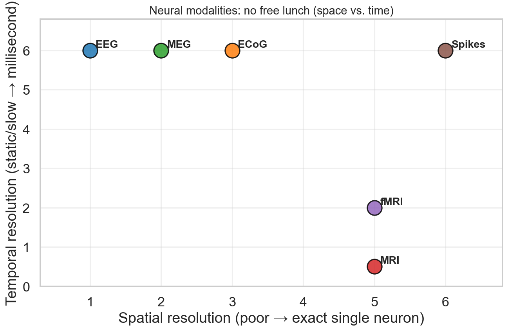
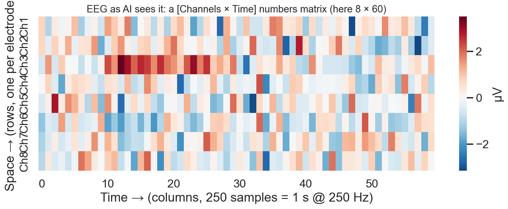
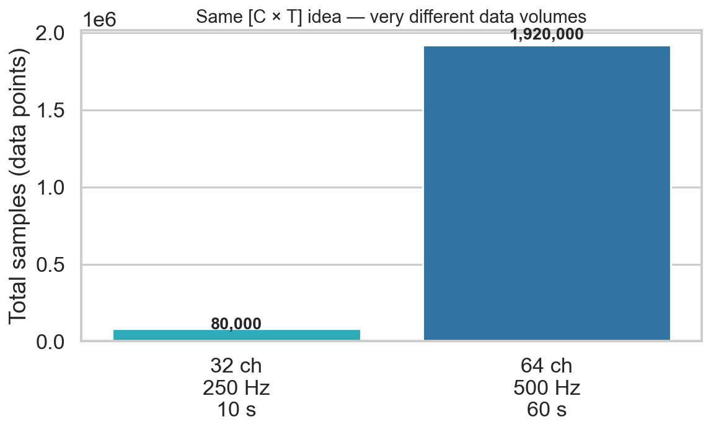
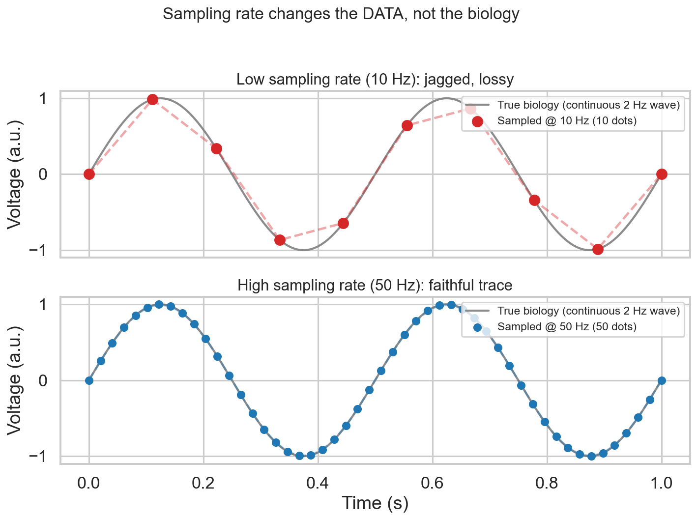
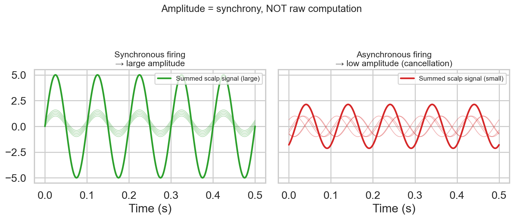
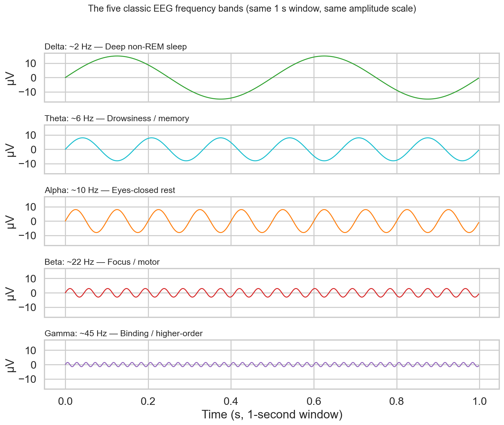
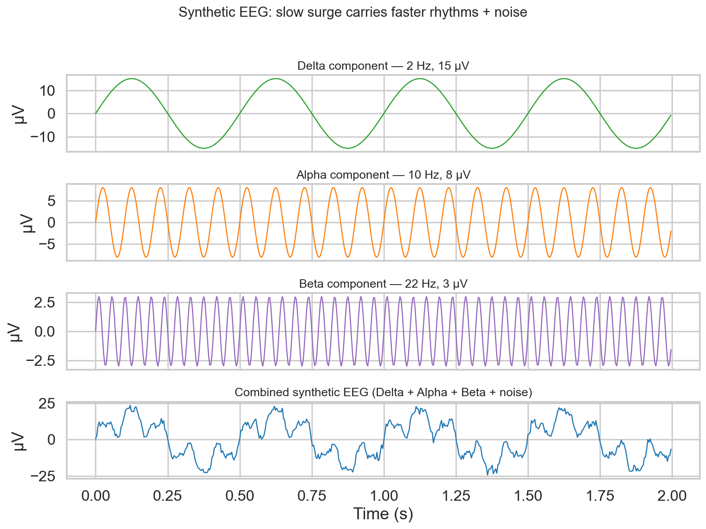
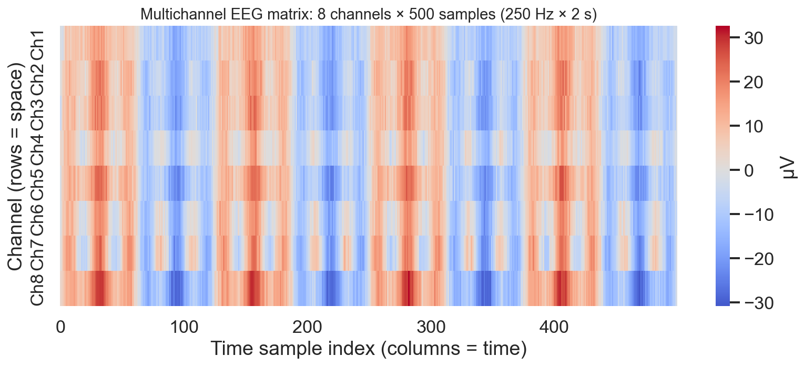
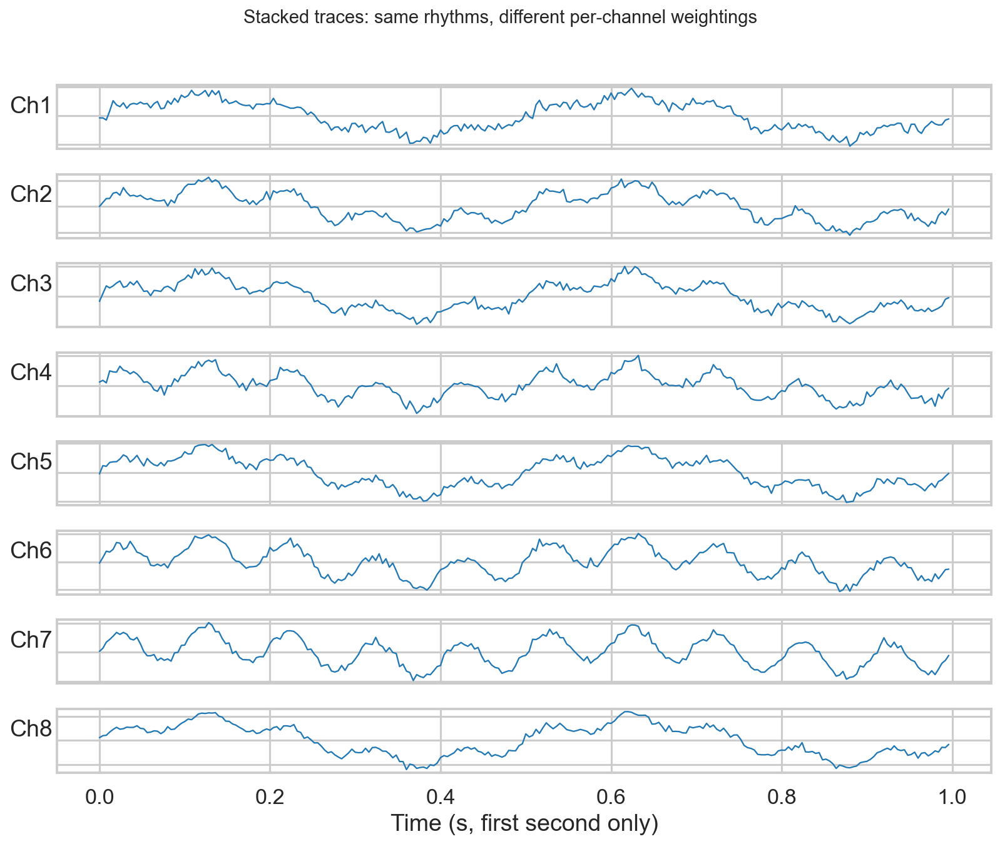

# Introduction to Artificial Intelligence in Neuroscience: Neural Data and EEG Fundamentals

> **Week 1 Review Article — Month 1 / Week 1**
> Foundation learning phase: strong fundamentals before research.
> Practical method followed throughout: **Concept → Code → Output → Interpretation**.

## Abstract

Week 1 answers a single question: **what is neural data, and why can AI learn from it?**
We start from biology — neurons as electrically active cells, neural activity as population firing, and electro-chemical transmission — and cross the bridge to data: EEG, ECoG, MEG, MRI, fMRI, and spike recordings as matrices of numbers with very different shapes.
We then focus on EEG fundamentals (electrodes vs. channels, time, sampling rate, amplitude, frequency), the five classic frequency bands (Delta, Theta, Alpha, Beta, Gamma), and close with the central AI + Neuroscience problem formulation:

**Brain → Neural Activity → Neural Data → AI → Prediction / Interpretation**

with four canonical examples: motor imagery, seizure detection, sleep-stage classification, and disease classification from MRI. All concepts are grounded with runnable NumPy code and Seaborn visualizations generated with `uv`.

## Keywords

Neuroscience, neuron, neural activity, neural data, EEG, ECoG, MEG, MRI, fMRI, spike recordings, sampling rate, amplitude, frequency, EEG bands, brain-computer interface, seizure detection, sleep staging, `Channels × Time`

## 1. Introduction

Neuroscience is the scientific study of the nervous system. For our purposes, it is the study of **how the brain processes information**.

**The AI Connection:** We care about neuroscience because information processing in the brain generates physical, measurable changes (electrical and chemical). If an entity generates physical changes while processing information, we can capture those changes as data, and we can train AI to find patterns in that data.

This report synthesizes the Week 1 syllabus:

1. What neuroscience studies
2. What neural data is (six modalities)
3. EEG fundamentals
4. EEG frequency bands
5. AI + Neuroscience problem formulation

No detailed brain anatomy is required — only what an AI practitioner must know to avoid overclaiming and to shape tensors correctly.

## 2. Fundamental Concepts

### 2.1 What neuroscience studies

Neuroscience studies the nervous system. For AI work, the key idea is:

> Brain information processing → physical change → sensor measurement → data matrix → pattern learning.

### 2.2 What is a neuron?

The neuron is the basic information-processing cell of the nervous system.

**Intuition:** Think of a neuron as a biological wire that can decide whether or not to pass a signal forward.

**The Science:** Neurons maintain a tiny electrical charge. When excited, they fire an electrical impulse.

**Why we care:** We do not care about the cellular anatomy (mitochondria, nucleus) for this course. We care that neurons are **electrically active**. This electrical activity is the ultimate source of the data we will be feeding into our AI models.

```python
# Mental model for AI practitioners:
# neuron(input currents) -> threshold decision -> output spike (or silence)
# Population of such decisions = the signal our electrodes pick up
```

### 2.3 What is neural activity?

Neural activity is the actual biological event occurring in the brain.

**Crucial Distinction: Neural activity is not the same thing as neural data.**

- **Neural activity** = biological reality (e.g., a million neurons firing in the motor cortex).
- **Neural data** = our imperfect, noisy measurement of that reality using a machine.

**Single-neuron vs. Population:**

One neuron firing is single-neuron activity. Millions of neurons firing together in synchronized rhythms create **population activity**. For techniques like EEG, we are entirely dependent on population activity, because a single neuron's electrical pulse is too weak to be measured through the skull.

> Our sensors provide a narrow, imperfect window into the brain. If we confuse that narrow measurement with the "entirety of brain activity," we will overclaim what our AI is actually learning.

### 2.4 How information is transmitted between neurons

Information transmission happens in two main steps:

1. **Electrical (within the neuron):** An electrical signal travels down the length of the neuron.
2. **Chemical (between neurons):** The neuron releases chemicals (neurotransmitters) into the tiny gap (synapse) between it and the next neuron. This triggers the next neuron to fire its own electrical signal.

**The Takeaway:** The brain is an electro-chemical network. Because it is highly electrical, we can place sensors (electrodes) on the scalp to measure the aggregate electrical echoes of this communication. While chemical reactions facilitate communication *between* neurons, it is the **electrical voltage changes** that our sensors actually measure.

## 3. Neural Data Modalities — What Kind of Numbers Does Each Produce?

We are now crossing the bridge from biology to data. The main focus here is understanding **what kind of data each modality produces**. For an AI, data is just a matrix of numbers. Your job is to understand what those numbers physically represent.

### 3.1 The six major modalities

**1. EEG (Electroencephalography)**

- **What it measures:** Aggregate electrical activity of millions of neurons.
- **How:** Sensors (electrodes) placed externally on the scalp.
- **The Data:** A continuous time-varying signal.
- **Unit of measurement:** Voltage (usually microvolts, µV).
- **AI Input Shape:** `[Channels × Time]` (e.g., 64 sensors recorded over thousands of time points).

**2. ECoG (Electrocorticography)**

- **What it measures:** Aggregate electrical activity.
- **How:** Electrodes placed *directly on the exposed surface of the brain* (invasive, usually for surgery patients).
- **The Data:** Time-varying signal, just like EEG, but much clearer and less noisy because the skull isn't blocking the signal.
- **AI Input Shape:** `[Channels × Time]`.

**3. MEG (Magnetoencephalography)**

- **What it measures:** The tiny *magnetic fields* produced by the brain's electrical activity.
- **How:** A massive, super-cooled helmet of magnetic sensors over the head.
- **The Data:** Time-varying signal.
- **AI Input Shape:** `[Sensors × Time]`.

**4. MRI (Magnetic Resonance Imaging)**

- **What it measures:** Brain structure and anatomy (specifically, how protons in water molecules react to a massive magnetic field).
- **How:** A large magnetic tube scanner.
- **The Data:** A static 3D image. There is **no time dimension** in a standard anatomical MRI.
- **Unit:** Voxels (3D pixels).
- **AI Input Shape:** `[Height × Width × Depth]` (a 3D volume).

**5. fMRI (Functional MRI)**

- **What it measures:** Blood oxygen level-dependent (BOLD) changes. When a brain area is active, it consumes more oxygen, so blood flows there.
- **How:** The same scanner as MRI, but taking repeated scans over time to watch blood flow changes. fMRI measures *function*, not just structure.
- **The Data:** A sequence of 3D images over time (a 4D tensor).
- **AI Input Shape:** `[Height × Width × Depth × Time]`.

**6. Neural Spike Recordings**

- **What it measures:** The exact, discrete electrical "firings" (action potentials) of individual neurons.
- **How:** Microelectrodes physically inserted into the brain tissue.
- **The Data:** A train of discrete events (timestamps of when a neuron fired), rather than a continuous wave.
- **AI Input Shape:** Discrete arrays of timestamps or binned spike counts over time.

### 3.2 Comparison summary

| Modality | Physical Target | Spatial Resolution | Temporal Resolution | AI Data Representation |
| --- | --- | --- | --- | --- |
| **EEG** | Electrical | Poor (blurred by skull) | Excellent (milliseconds) | 2D Array: `[Channels, Time]` |
| **ECoG** | Electrical | Good (on brain surface) | Excellent (milliseconds) | 2D Array: `[Channels, Time]` |
| **MEG** | Magnetic | Moderate | Excellent (milliseconds) | 2D Array: `[Sensors, Time]` |
| **MRI** | Anatomy | Excellent | N/A (Static image) | 3D Volume: `[X, Y, Z]` |
| **fMRI** | Blood Flow | Excellent | Very Poor (seconds) | 4D Tensor: `[X, Y, Z, Time]` |
| **Spikes** | Single Neurons | Exact (individual cells) | Exact (milliseconds) | 1D/2D Arrays of Timestamps |

Key conceptual checks built into this table:

- A shape like `[256, 256, 256]` is MRI (3D spatial volume), not EEG.
- MRI = structure; fMRI = blood-oxygen function over time. Do not mix them.
- ECoG and EEG share shape `[Channels, Time]`, but ECoG is clearer because the skull (which blurs/dampens electrical fields) is bypassed.
- For millisecond *when*, choose electrical measurements (EEG/ECoG/MEG). fMRI tracks sluggish blood flow (seconds lag), so it has excellent space but terrible time resolution.



**Figure 1.** No free lunch: electrical methods (EEG/ECoG/MEG, spikes) win on time; MRI/fMRI win on space; fMRI is slow because hemodynamics take seconds.

### 3.3 Concept → Code → Output → Interpretation: data shapes

To follow our practical working method, let's look at how an AI researcher actually instantiates these data shapes in Python using NumPy. Do not worry about predicting anything yet; just look at the shapes.

```python
import numpy as np

# 1. EEG/ECoG/MEG (Time-series Data)
# Concept: 64 electrodes recording 1000 time points
eeg_data = np.zeros((64, 1000))
print(f"EEG Data Shape: {eeg_data.shape} -> (Channels, Time)")

# 2. MRI (Static 3D Image)
# Concept: A 3D anatomical scan composed of voxels (3D pixels)
mri_data = np.zeros((256, 256, 128))
print(f"MRI Data Shape: {mri_data.shape} -> (Width, Height, Depth)")

# 3. fMRI (4D Spatiotemporal Data)
# Concept: The same 3D scan, but captured 200 times over an hour
fmri_data = np.zeros((256, 256, 128, 200))
print(f"fMRI Data Shape: {fmri_data.shape} -> (Width, Height, Depth, Time)")
```

**Expected output:**

```text
EEG Data Shape: (64, 1000) -> (Channels, Time)
MRI Data Shape: (256, 256, 128) -> (Width, Height, Depth)
fMRI Data Shape: (256, 256, 128, 200) -> (Width, Height, Depth, Time)
```

**Interpretation:** If you pass `eeg_data` into a machine learning model, the model is looking for patterns across time (waves). If you pass `mri_data` into a model, the model is looking for spatial patterns (shapes, tumors, atrophy). They require entirely different AI architectures because the fundamental dimensions of the data are different.



**Figure 2.** EEG as a `[Channels × Time]` matrix. Rows = space (electrode location), columns = time. This geometry dictates model choice (temporal/sequence models, spatial filters).

## 4. EEG Fundamentals — Electrodes, Channels, Time, and Sampling Rate

We need to define exactly what makes up an EEG dataset so you can safely manipulate it in Python. Do not let these terms blur together.

### 4.1 Electrode vs. Channel

- **Electrode:** The physical metal sensor placed on a specific location on the scalp. It detects the tiny electrical voltage changes.
- **Channel:** The logical stream of data resulting from an electrode. If you have a 64-channel EEG, you have 64 distinct time-series arrays. The spatial information in EEG is entirely determined by *which* channel you are looking at, because electrodes are placed at specific, standardized coordinates on the head.

### 4.2 Time and sampling rate

Because the brain's voltage is continuously changing, we cannot record it continuously in a computer. We have to take discrete snapshots.

- **Sampling:** The act of measuring a continuous signal at discrete intervals.
- **Sampling Rate (Frequency):** How many measurements (samples) the system takes per second. It is measured in Hertz (Hz).
- **Example:** A sampling rate of 250 Hz means the EEG hardware records the voltage 250 times every single second.

If we have a 32-channel EEG recorded at 250 Hz for 10 seconds, our resulting data matrix shape is exactly `[32, 2500]`.

Mathematical foundation:

- Samples per channel = `sampling_rate_hz × duration_s`
- Total data points = `n_channels × sampling_rate_hz × duration_s`
- Time between samples = `1 / sampling_rate_hz`
- Example: 64 channels @ 500 Hz × 60 s = `64 × 30,000 = 1,920,000` points, shape `(64, 30000)`.
- Example: at 250 Hz, sample index `0 → 250` = `250 / 250 = 1.0` second of biology.



**Figure 3.** Same `[C × T]` idea, very different scale: 32ch/250Hz/10s = 80k points vs. 64ch/500Hz/60s = 1.92M points. Sampling choices directly set memory, compute, and temporal fidelity.

### 4.3 Concept → Code → Output → Interpretation: sampling rate

Following our required active learning methodology, let's look at how sampling rate visually changes the data we feed to our AI.

```python
import numpy as np
import matplotlib.pyplot as plt

# 1. Define time and biological reality (a continuous 2 Hz wave)
duration = 1.0  # 1 second of data
true_time = np.linspace(0, duration, 1000)
true_signal = np.sin(2 * np.pi * 2 * true_time)  # 2 full oscillations per second

# 2. Simulate a Low Sampling Rate (10 Hz)
sampling_rate_low = 10
time_low = np.linspace(0, duration, sampling_rate_low)
signal_low = np.sin(2 * np.pi * 2 * time_low)

# 3. Simulate a High Sampling Rate (50 Hz)
sampling_rate_high = 50
time_high = np.linspace(0, duration, sampling_rate_high)
signal_high = np.sin(2 * np.pi * 2 * time_high)

# Output Plotting:
# The true_signal looks like a perfectly smooth wave.
# The signal_low (10 Hz) looks jagged and blocky, consisting of just 10 dots.
# The signal_high (50 Hz) closely traces the smooth wave with 50 dots.
```



**Figure 4.** Same 2 Hz biology, different data. 10 Hz sampling is jagged/blocky and loses fine temporal detail; 50 Hz faithfully traces the wave. Real EEG uses 250–1000 Hz for the same reason.

**Interpretation:** The biological activity (the underlying continuous wave) did not change. But the *neural data* changed drastically based on our hardware's sampling rate. If you give an AI the 10 Hz data, it loses almost all the fine-grained temporal information. If you use 50 Hz or 250 Hz, the AI has a much more faithful representation of the actual electrical wave. For very fast millisecond spikes (e.g., pre-seizure discharges), a low sampling rate can miss the event entirely — the model fails not because the biology was absent, but because the data never captured it.

## 5. Amplitude and Frequency in EEG

### 5.1 Amplitude

Amplitude represents the magnitude of the electrical potential difference measured at an electrode relative to a reference point.

- **Units:** EEG signals are tiny — measured in microvolts (µV), typically ranging from ±10 µV to ±100 µV.
- **The Dangerous Misconception:** *"Higher amplitude means more brain activity."*
- **Why this is false:** EEG amplitude reflects **synchrony**, not raw metabolic effort or raw computation.
  - If 100,000 neurons fire in complete synchrony (all depolarizing at the exact same millisecond), their tiny voltages sum together constructively, creating a massive scalp waveform (e.g., in deep sleep or generalized seizures).
  - If those same 100,000 neurons are processing complex, diverse information asynchronously, their electrical fields cancel each other out, resulting in a very low-amplitude, high-frequency signal.



**Figure 5.** Amplitude = synchrony. Left: in-phase neurons sum to a large wave. Right: out-of-phase neurons cancel to a small wave — even though the same number of neurons fired. High amplitude during deep sleep therefore does *not* mean "more cognition" than low-amplitude awake problem-solving.

### 5.2 Frequency

Frequency measures how rapidly the voltage oscillates per unit of time.

- **Definition:** The number of complete oscillatory cycles occurring in one second.
- **Unit:** Hertz (Hz), where 1 Hz = 1 cycle per second.
- **Period (T):** The duration of one single cycle: `T = 1/f`. For example, a 10 Hz wave completes one full oscillation every 0.1 seconds (100 ms).

## 6. Introductory EEG Frequency Bands

Neuroscience groups brain oscillations into five classic bands. These boundaries are standard conventions rather than absolute biological divides:

| Band | Typical Frequency Range | Typical Appearance | Common Contexts / States | AI Context & Interpretation Pitfall |
| --- | --- | --- | --- | --- |
| **Delta** | 0.5 – 4 Hz | Very slow, large amplitude | Deep non-REM sleep, continuous slow-wave states. | **Pitfall:** Assuming Delta only appears during sleep. It also appears pathologically around brain lesions. |
| **Theta** | 4 – 8 Hz | Slow, rhythmic | Drowsiness, memory encoding, working memory tasks. | **Pitfall:** Believing Theta indicates only sleepiness; it plays a major functional role in cognitive control and hippocampal navigation. |
| **Alpha** | 8 – 12 Hz | Prominent, rhythmic sinusoidal oscillation | Quiet wakefulness with eyes closed (especially over occipital cortex). | **Pitfall:** Treating Alpha as pure "relaxation." Alpha reflects active cortical inhibition (gating irrelevant sensory streams). |
| **Beta** | 13 – 30 Hz | Fast, smaller amplitude, irregular | Active thinking, focus, motor execution/planning. | **Pitfall:** Labeling Beta as pure "stress." It suppresses during movement preparation and rebounds after movement execution. |
| **Gamma** | > 30 Hz (often 30 – 80+ Hz) | Very fast, tiny amplitude | Multisensory binding, higher-order information processing. | **Pitfall:** Over-interpreting raw Gamma. Muscle tension (EMG) from jaw or neck clenching easily bleeds into this range and masquerades as brain activity. |



**Figure 6.** The five bands on a common 1 s / µV scale: slower bands look large, faster bands look tiny. A ~10 Hz oscillation (10 cycles/s) = Alpha, most prominent with eyes closed over occipital cortex.

### 6.1 Concept → Code → Output → Interpretation: synthetic multi-band EEG

Let's generate a synthetic EEG signal that mimics multi-frequency biological activity combined with noise, followed by an 8-channel matrix representation.

```python
import numpy as np
import matplotlib.pyplot as plt

# 1. Define Temporal Baseline
sampling_rate = 250  # 250 Hz (250 samples per second)
duration = 2.0       # 2 seconds
total_samples = int(sampling_rate * duration)
time = np.linspace(0, duration, total_samples, endpoint=False)

# 2. Synthesize Frequency Components
delta_wave = 15.0 * np.sin(2 * np.pi * 2 * time)     # 2 Hz (Delta), high amplitude (15 uV)
alpha_wave = 8.0 * np.sin(2 * np.pi * 10 * time)     # 10 Hz (Alpha), moderate amplitude (8 uV)
beta_wave = 3.0 * np.sin(2 * np.pi * 22 * time)      # 22 Hz (Beta), low amplitude (3 uV)
noise = np.random.normal(0, 1.5, total_samples)      # Background sensor noise

# Combine components into a single synthetic EEG trace
single_channel_eeg = delta_wave + alpha_wave + beta_wave + noise

# 3. Scale to Multichannel: 8 Channels x Total Samples
np.random.seed(42)
multichannel_eeg = np.zeros((8, total_samples))
for ch in range(8):
    # Each channel has unique relative weightings of these frequency rhythms
    weight_delta = np.random.uniform(0.5, 1.5)
    weight_alpha = np.random.uniform(0.2, 1.8)
    ch_noise = np.random.normal(0, 2.0, total_samples)
    multichannel_eeg[ch, :] = (weight_delta * delta_wave) + (weight_alpha * alpha_wave) + ch_noise

print(f"Multichannel Array Shape: {multichannel_eeg.shape} -> (Channels, Samples)")
```

**Expected output:**

```text
Multichannel Array Shape: (8, 500) -> (Channels, Samples)
```



**Figure 7.** Decomposition: 2 Hz Delta surge + 10 Hz Alpha + 22 Hz Beta + noise = realistic single-channel trace. Real EEG never looks like a textbook sine — it is layered rhythms.



**Figure 8.** 8 × 500 matrix as heatmap. Color = µV. Vertical structure = spatial correlation across channels; horizontal structure = temporal rhythm.



**Figure 9.** Same 8 channels as stacked traces (first second). Each channel weights Delta/Alpha differently plus independent noise — exactly why models must learn both spatial and temporal patterns.

**Output & Interpretation:**

- **Signal Structure:** The trace does not look like a pure textbook sine wave. It shows a slow 2 Hz rolling surge (Delta) that carries a rhythmic 10 Hz wave (Alpha) along its crests, textured by high-frequency ripples (Beta and noise).
- **Array Geometry:** `multichannel_eeg.shape` is `(8, 500)`. In Python, the standard convention is rows as channels and columns as time samples. An AI model ingests this 2D tensor to identify spatial correlations across rows and temporal patterns across columns.

## 7. AI + Neuroscience Problem Formulation

Our central paradigm is:

**Brain → Neural Activity → Neural Data → AI → Prediction / Interpretation**

Here is how real-world neuroscience problems fit this pipeline:

### 7.1 EEG → Motor Imagery (Brain-Computer Interfaces)

- **Biological Event:** The user imagines moving their right hand without physically moving muscles.
- **Neural Activity:** Neurons in the contralateral motor cortex alter their firing rates and oscillatory rhythms.
- **Neural Data:** Multichannel EEG (`C × T`), typically centered over motor electrodes.
- **Target / Label:** Discrete classification label (e.g., `0 = Rest`, `1 = Left Hand`, `2 = Right Hand`).
- **AI Task:** Supervised classification mapping temporal-spatial EEG features to an intended movement.

### 7.2 EEG → Seizure Detection

- **Biological Event:** Sudden, excessive, hypersynchronous discharges of a large population of cerebral neurons.
- **Neural Data:** Continuous multichannel scalp or intracranial EEG.
- **Target / Label:** Binary detection (`0 = Normal / Interictal`, `1 = Seizure / Ictal`) or onset timestamp.
- **AI Task:** Anomaly detection or binary sequence classification flagging high-amplitude, highly synchronized discharge patterns.

### 7.3 EEG → Sleep-Stage Classification

- **Biological Event:** Brain transitions through cyclical stages (Wake, N1, N2, N3/Slow-Wave, REM).
- **Neural Data:** EEG recorded over 8 hours, chunked into consecutive 30-second windows ("epochs").
- **Target / Label:** Categorical output for each epoch (`W, N1, N2, N3, R`).
- **AI Task:** Many-to-one sequence classification mapping each 30-second window of signals to a sleep stage.

### 7.4 Brain Image → Disease Classification

- **Biological Event:** Structural atrophy, neurodegeneration, or tissue damage (e.g., Alzheimer's disease).
- **Neural Data:** Structural **MRI** 3D volume (`H × W × D`), capturing anatomical voxel intensities.
- **Target / Label:** Diagnostic class (`0 = Healthy Control`, `1 = Mild Cognitive Impairment`, `2 = Alzheimer's`).
- **AI Task:** 3D computer vision classification identifying morphological patterns (e.g., enlarged ventricles or hippocampal shrinking).

Design rule of thumb:

- Structural atrophy question → **MRI**, input `[H, W, D]`.
- Seizure-onset timing question → **EEG**, input `[Channels, Time]`.

## 8. Comparison / Discussion

- **Time vs. space is the core trade-off.** Electrical methods give milliseconds but blurred space; MRI gives anatomy but no time; fMRI gives space + slow time; spikes give both but invasively.
- **Shape dictates architecture.** `[C, T]` invites temporal CNNs/RNNs/Transformers + spatial filters; `[H, W, D]` invites 3D CNNs; `[H, W, D, T]` invites 4D/spatiotemporal models.
- **Amplitude misleads.** Treat amplitude as synchrony evidence, not intelligence meter.
- **Bands are conventions.** Delta/Theta/Alpha/Beta/Gamma boundaries are useful shorthands, not hard biological walls. Always check context + pitfalls (lesion Delta, cognitive Theta, inhibitory Alpha, movement Beta rebound, EMG-contaminated Gamma).
- **Sampling sets the ceiling.** No model can recover millisecond detail the hardware never recorded.

## 9. Applications

- Brain-computer interfaces (motor imagery → device control)
- Clinical monitoring (seizure detection, sleep staging)
- Neuroimaging diagnostics (MRI → atrophy/disease classification)
- Future weeks: emotion recognition, neural decoding, neuroimaging analysis with ML/DL

## 10. Challenges / Limitations

- EEG is noisy, skull-blurred, and artifact-prone (eye, muscle, electrode, line noise — Week 2 topic).
- Population signal only; single-neuron detail is invisible non-invasively.
- Inter-subject generalization is hard (Week 3 topic).
- Gamma is easily confounded by muscle; Delta/Theta/Alpha/Beta labels are over-interpreted without context.
- fMRI cannot answer millisecond questions; EEG cannot answer fine-grained where questions.

## 11. Conclusion

Week 1 establishes the full chain from cell to tensor to task:

1. Neurons are electrically active; populations create measurable fields.
2. Sensors capture narrow, noisy windows — data ≠ activity.
3. Each modality yields a distinct tensor shape with a distinct space/time trade-off.
4. EEG is `[Channels × Time]` voltage; its fidelity hinges on sampling rate; its content is described by amplitude (synchrony) and frequency (bands).
5. AI maps these tensors to labels: movement intent, seizure state, sleep stage, or diagnosis.

With this foundation, Week 2 can ask: *what happens to a neural signal before an AI model uses it?* (sampling theory, noise/artifacts, filtering, basic features).

## 12. References

Week 1 syllabus briefs: `NS.docx` (Week 1 — Introduction to AI + Neural Data) and `GI.docx` (4-week foundation learning phase, weekly review-article structure, Concept → Code → Output → Interpretation, documentation and referencing standards).

Suggested further sources (verify before citing formally):

- Niedermeyer, E., & Lopes da Silva, F. — *Electroencephalography: Basic Principles, Clinical Applications, and Related Fields.*
- Luck, S. J. — *An Introduction to the Event-Related Potential Technique.*
- Cohen, M. X. — *Analyzing Neural Time Series Data.*
- Poldrack, R. A., Mumford, J. A., & Nichols, T. E. — *Handbook of Functional MRI Data Analysis.*
- MNE-Python documentation; MOABB (Mother of All BCI Benchmarks) dataset docs.

## Appendix A — Reproducibility (UV + Seaborn)

All figures in this report were generated locally with `uv` from the project root (`NeuroScience/`):

```bash
# init (already done in this repo)
uv init --name neuroscience --no-readme
uv add numpy matplotlib seaborn

# regenerate all Week 1 figures
uv run python generate_week1_plots.py
# outputs -> "month 1/week 1/assets/*.png"
```

Plotting stack: `seaborn` theme (`whitegrid`, `talk` context) over `matplotlib`, `numpy` for synthesis. Random seed `42` where noise is used. Figures:

- `sampling_rate_comparison.png` — §4.3
- `synthetic_eeg_trace.png`, `multichannel_eeg_heatmap.png`, `multichannel_eeg_traces.png` — §6.1
- `frequency_bands.png` — §6
- `amplitude_synchrony.png` — §5.1
- `modality_resolution_tradeoff.png`, `eeg_matrix_shape.png` — §3
- `eeg_data_volume.png` — §4.2
