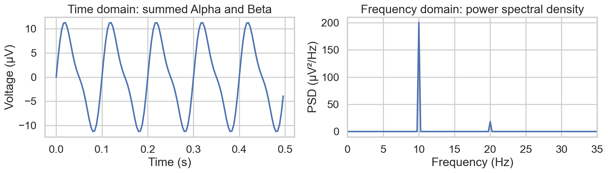
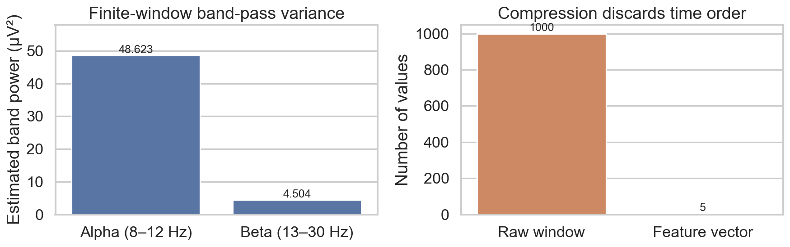

# W2D4: Feature Extraction — From Matrices to Meaning

> **Week 2 Foundation Learning — W2D4 Working Notes**
> How do we compress high-dimensional raw time series into informative representations for machine learning?
> Transition: **Cleaned Time Series $\longrightarrow$ Feature Vectors $\longrightarrow$ AI-Ready Representation**.
> Method: **Concept → Code → Output → Interpretation**.

**Navigation:** ← [[w2d3|Day 3: Basic Filtering]] · [[week-2-report|Week 2 Report]] · [[w2d5|Day 5: Pipeline & Review]] →  
**Associated Concepts:** [[time-domain-features]] · [[band-power-features]] · [[Knowledge-Map|Knowledge Map]]

---

## 1. Day 4 Overview & Motivation

Up to this point, our pipeline has progressed from raw biological signals to cleaned discrete arrays:
$$\text{Raw Physical Potential} \longrightarrow \text{Contaminated Digitized Array} \longrightarrow \text{Filtered Time Series}$$

However, raw cleaned EEG is massive in dimensionality. A typical 64-channel recording sampled at 250 Hz generates:
$$64 \text{ channels} \times 250 \text{ samples/sec} \times 60 \text{ seconds} = 960,000 \text{ values per minute}$$

Feeding a million raw time points directly into standard machine learning models causes severe **overfitting, the curse of dimensionality, and excessive computational latency**. 

Day 4 addresses this by compressing high-dimensional time series into compact, highly informative **features**, spanning both the **time domain** and the **frequency domain**.

---

## 2. Topic 1: What is a Feature?

A **feature** is an informative, mathematically derived summary statistic computed over an observation window. It transforms an input matrix of shape $\text{[Channels} \times \text{TimeSamples]}$ into a feature vector of shape $\text{[Features]}$ (or an observation row in $\text{[Samples} \times \text{Features]}$).

### The Inherent Trade-Off of Compression
> [!IMPORTANT]
> **Compression is inherently destructive.** Reducing 1,000 raw time points into a single variance or band-power metric permanently erases precise temporal sequence information. The AI model loses the ability to determine the exact millisecond when an oscillation crested or an event occurred, but gains an information-dense representation that isolates biological state differences.

---

## 3. Topic 2: Basic Time-Domain Features

Time-domain features capture statistical properties of the amplitude distribution across the observation window:

### 1. Mean ($\mu$)
The arithmetic average voltage across $N$ samples in the window:
$$\mu = \frac{1}{N}\sum_{i=1}^{N}x_i \quad [\mu\text{V}]$$
- **Physical Meaning:** Represents the direct current (**DC offset**) or baseline level of the signal.
- **The Preprocessing Connection:** In properly preprocessed EEG, a high-pass filter ($0.5\text{–}1.0\text{ Hz}$) removes slow drift and DC components. Consequently, the mean of filtered EEG hovers near $0.0\mu\text{V}$ and provides negligible discriminative utility for classification.

### 2. Variance ($\sigma^2$)
The mean squared deviation of sample voltages around the mean:
$$\sigma^2 = \frac{1}{N}\sum_{i=1}^{N}(x_i - \mu)^2 \quad [\mu\text{V}^2]$$
- **Physical Meaning:** Quantifies total instantaneous power and fluctuation spread. High variance indicates large-amplitude deflections (e.g., high-voltage slow waves, epileptic spikes, or artifacts). Low variance indicates a suppressed or quiescent signal.
- **Sinusoidal Identity:** For an ideal zero-mean sine wave $x(t) = A \sin(\omega t)$, the population variance is exactly:
  $$\sigma^2 = \frac{A^2}{2}$$

### 3. Peak-to-Peak Amplitude ($A_{p-p}$)
The absolute span between the maximal peak and minimal trough:
$$A_{p-p} = \max(x) - \min(x) \quad [\mu\text{V}]$$
- **Physical Meaning:** Identifies extreme dynamic range excursions. Highly sensitive to ocular blinks, movement spikes, or paroxysmal epileptic discharges.

---

## 4. Topic 3: Frequency-Domain Intuition & Band Power

While time-domain features describe *how much* a signal fluctuates, frequency-domain features describe *how rapidly* it oscillates.

- **Time Domain:** Abscissa is Time (seconds); Ordinate is Voltage ($\mu\text{V}$).
- **Frequency Domain (Power Spectral Density - PSD):** Abscissa is Frequency ($\text{Hz}$); Ordinate is Power Spectral Density ($\mu\text{V}^2/\text{Hz}$).


**Figure 1.** Comparison of a compound time-domain waveform containing 10 Hz Alpha ($A = 10\mu\text{V}$) and 20 Hz Beta ($A = 3\mu\text{V}$) alongside its Welch Power Spectral Density. The PSD decomposes the complex trace into distinct spectral peaks at 10 Hz and 20 Hz.

### Understanding Band Power
**Band Power** represents the mean-squared signal strength contained within a specific frequency band $[f_{\text{low}}, f_{\text{high}}]$. It is the definite integral of the Power Spectral Density:

$$P_{\text{band}} = \int_{f_{\text{low}}}^{f_{\text{high}}} \text{PSD}(f) \, df \quad [\mu\text{V}^2]$$

### The Filtering Variance Equivalence
Without executing complex Fourier or Wavelet transforms, Parseval's theorem guarantees a powerful relationship:
> **For any zero-mean band-limited signal, the total average power within that band equals the sample variance ($\sigma^2$) of the band-pass filtered signal.**

$$\text{Power}(f_{\text{low}}\text{–}f_{\text{high}}) = \text{Var}\Big(\text{BandPass}(x, f_{\text{low}}, f_{\text{high}})\Big)$$

---

## 5. Python Laboratory: Feature Extraction Pipeline

### Code Implementation (`feature_extraction.py`)

```python
import numpy as np
from scipy.signal import butter, filtfilt

# 1. Synthesize 4 seconds of clean EEG at 250 Hz (1,000 samples)
fs = 250
duration = 4.0
t = np.linspace(0, duration, int(fs * duration), endpoint=False)

# Signal contains dominant Alpha (10 Hz, A=10 uV) and subordinate Beta (20 Hz, A=3 uV)
clean_signal = 10.0 * np.sin(2 * np.pi * 10.0 * t) + 3.0 * np.sin(2 * np.pi * 20.0 * t)

# ==========================================
# 2. TIME-DOMAIN FEATURE EXTRACTION
# ==========================================
feature_mean = np.mean(clean_signal)
feature_variance = np.var(clean_signal)
feature_p2p_amp = np.max(clean_signal) - np.min(clean_signal)

# ==========================================
# 3. FREQUENCY-DOMAIN (BAND POWER) EXTRACTION
# ==========================================
def get_band_power(signal, sfreq, low_cut, high_cut, order=4):
    """Calculates band power via variance of a zero-phase band-pass filtered signal."""
    nyq = 0.5 * sfreq
    b, a = butter(order, [low_cut / nyq, high_cut / nyq], btype='bandpass')
    band_passed = filtfilt(b, a, signal)
    return np.var(band_passed)

# Extract Alpha (8-12 Hz) and Beta (13-30 Hz) Band Powers
power_alpha = get_band_power(clean_signal, fs, 8.0, 12.0)
power_beta = get_band_power(clean_signal, fs, 13.0, 30.0)

# ==========================================
# 4. FINAL AI-READY FEATURE VECTOR
# ==========================================
ai_feature_vector = np.array([
    feature_mean, 
    feature_variance, 
    feature_p2p_amp, 
    power_alpha, 
    power_beta
])

# Diagnostics & Output Verification
print(f"Raw array shape: {clean_signal.shape} (1,000 time points)")
print(f"AI feature vector shape: {ai_feature_vector.shape} (5 summary features)")
print("\nExtracted Features [Mean, Variance, Peak-to-Peak, Alpha Power, Beta Power]:")
print(np.array2string(ai_feature_vector, precision=3, suppress_small=True))
print(f"\nTheoretical Alpha Power: {10**2 / 2:.2f} uV^2 | Measured: {power_alpha:.3f} uV^2")
print(f"Theoretical Beta Power:  {3**2 / 2:.2f} uV^2  | Measured: {power_beta:.3f} uV^2")
print(f"Theoretical Total Var:   {10**2 / 2 + 3**2 / 2:.2f} uV^2 | Measured: {feature_variance:.3f} uV^2")
```

### Quantitative Output & Interpretation

```text
Raw array shape: (1000,) (1,000 time points)
AI feature vector shape: (5,) (5 summary features)

Extracted Features [Mean, Variance, Peak-to-Peak, Alpha Power, Beta Power]:
[ 0.     54.5    22.548 48.623  4.504]

Theoretical Alpha Power: 50.00 uV^2 | Measured: 48.623 uV^2
Theoretical Beta Power:  4.50 uV^2  | Measured: 4.504 uV^2
Theoretical Total Var:   54.50 uV^2 | Measured: 54.500 uV^2
```

1. **Dimensionality Reduction:** 1,000 continuous time samples are compressed into **5 informative numbers**—a $200\times$ compression factor.
2. **Mean ($0.000\mu\text{V}$):** Perfect balance above and below zero.
3. **Variance ($54.500\mu\text{V}^2$):** Matches the theoretical sum of independent orthogonal sinusoids: $\sigma^2 = \frac{10^2}{2} + \frac{3^2}{2} = 50 + 4.5 = 54.5\mu\text{V}^2$.
4. **Peak-to-Peak Amplitude ($22.548\mu\text{V}$):** The theoretical upper bound is $2 \times (10 + 3) = 26\mu\text{V}$. However, because the 10 Hz and 20 Hz waves do not peak at the exact same millisecond, the true observed extrema span $22.548\mu\text{V}$.
5. **Band Power Disparity:** Alpha Power ($48.623\mu\text{V}^2$) is more than $10\times$ larger than Beta Power ($4.504\mu\text{V}^2$), capturing the underlying biological state. The machine learning model reads these ratios directly.


**Figure 2.** Left: Estimated Alpha vs Beta band power distribution. Right: Compression of 1,000 continuous voltage measurements into a 5-element AI feature vector.

---

## 6. Day 4 Knowledge Checkpoint & Worked Solutions

### Question 1: The Cost of Compression & Seizure Timing
> *I have a 10-second EEG recording showing an epileptic seizure that occurred at exactly second 8. I extract the overall Variance and overall Mean of the entire 10-second window. Why will the AI model be completely unable to predict when the seizure started?*

**Authoritative Solution:**
- **Information Eradication:** Computing the mean and variance integrates over all $N$ time samples in the 10-second window:
  $$\sigma^2 = \frac{1}{N}\sum_{t=1}^{N}(x(t) - \mu)^2$$
- This collapses the temporal coordinate index $t$. The calculation treats sample order as commutative:
  $$\text{Var}([x_1, \dots, x_{\text{seizure}}, \dots, x_N]) \equiv \text{Var}([x_{\text{seizure}}, \dots, x_1, \dots, x_N])$$
- An identical seizure burst occurring at $t=2.0\text{ s}$ versus $t=8.0\text{ s}$ yields the exact same overall scalar variance. Summary statistics quantify **distribution spread**, not **temporal latency**. To retain event onset timing, the recording must be divided into smaller timestamped sliding windows (e.g., 1-second epochs).

### Question 2: The Mean Pitfall After High-Pass Filtering
> *You apply a 1 Hz High-pass filter to a raw EEG signal to remove sweat artifacts. Then, you extract the Mean of the filtered signal as a feature for your AI model. Why is this feature mathematically useless for the AI?*

**Authoritative Solution:**
- **Mathematical Reality:** The mean of any time series corresponds precisely to its **0 Hz direct-current (DC) spectral component**:
  $$\mu = X(f=0)$$
- A 1 Hz high-pass filter attenuates all frequencies below $1\text{ Hz}$. Because $0\text{ Hz} < 1\text{ Hz}$, the filter mathematically eliminates the DC component.
- **Consequence for ML:** Across all windows and all classes, the filtered mean will be identically zero (subject only to minor floating-point edge residuals: $\mu \approx 0.000\mu\text{V}$). A feature that exhibits zero variance across all training instances conveys zero mutual information and is completely useless to an AI classifier.

### Question 3: Biological Interpretation — Gaming vs. Meditation
> *You extract features from a subject playing a highly complex, fast-paced video game, and then again while they meditate with their eyes closed. Based on Week 1 and Week 2 knowledge, which band-power feature (Alpha or Beta) do you expect to be dominant in the video game state, and which in the meditation state?*

**Authoritative Solution:**
- **Fast-Paced Video Game:** **Beta Band Power ($13\text{–}30\text{ Hz}$)** will be dominant. Active visual search, rapid decision-making, motor planning, and sensorimotor engagement desynchronize lower frequencies and induce robust Beta oscillations across frontal and motor cortices.
- **Eyes-Closed Meditation:** **Alpha Band Power ($8\text{–}12\text{ Hz}$)** will be dominant. Quiet, non-drowsy relaxation with sensory visual input occluded generates high-amplitude synchronized Alpha rhythms over posterior/occipital regions ($O_1, O_2$).
- **Scientific Caveat:** These are probabilistic physiological tendencies, not deterministic diagnostic labels. Beta power can be heavily corrupted by cranial EMG from jaw clenching during intense gaming, while high Alpha can be contaminated by slow eye wandering during meditation.

### Question 4: Student Task — Delta Band Power Integration Code
> *If I wanted to extract the power of the Delta band (0.5 Hz to 4 Hz) as an additional feature, what exact line of Python code would you add?*

**Authoritative Solution:**
Using the filter-variance helper established in today's lab:
```python
power_delta = get_band_power(clean_signal, fs, 0.5, 4.0)
```
Alternatively, if using numerical integration of a pre-computed Power Spectral Density (`psd`) across frequency vector `freqs` via the trapezoidal rule:
```python
delta_mask = (freqs >= 0.5) & (freqs <= 4.0)
power_delta = np.trapezoid(psd[delta_mask], freqs[delta_mask])  # SciPy / modern NumPy standard
# (or np.trapz(psd[delta_mask], freqs[delta_mask]) in legacy NumPy)
```
Conceptually, both evaluate the integral of energy over the Delta range:
$$P_{\Delta} = \int_{0.5}^{4.0} \text{PSD}(f) \, df$$

---

## 7. Day 4 Review & Senior Researcher Feedback

> **Evaluator Assessment:** Exceptional scientific reasoning. 
> 1. Connecting the 1 Hz high-pass filter directly to the eradication of the 0 Hz DC mean demonstrates deep signal-processing intuition.
> 2. Recognizing that dimensionality compression sacrifices temporal latency proves an understanding of the trade-offs in machine learning representation.
> 3. Framing Alpha/Beta biomarkers with explicit physiological caveats (EMG contamination, electrode topography) confirms transition to research-grade thinking.
