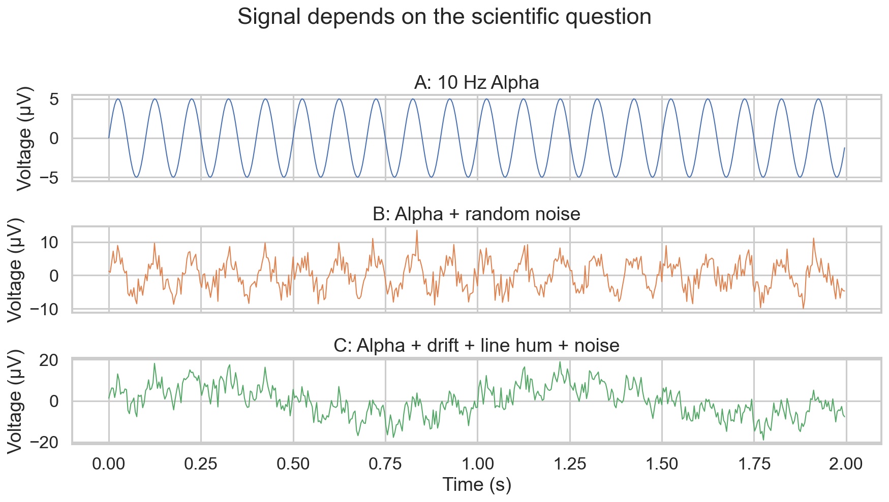
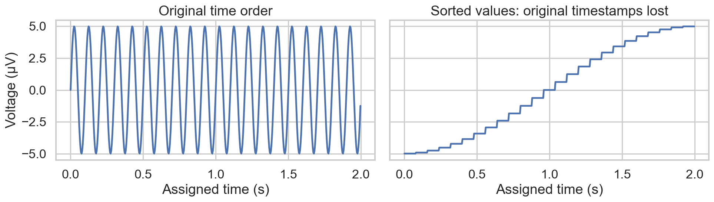
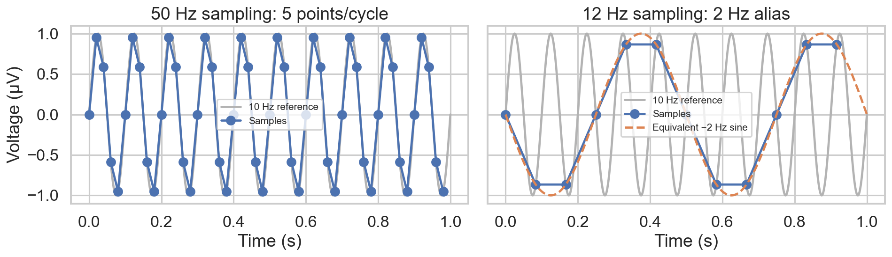
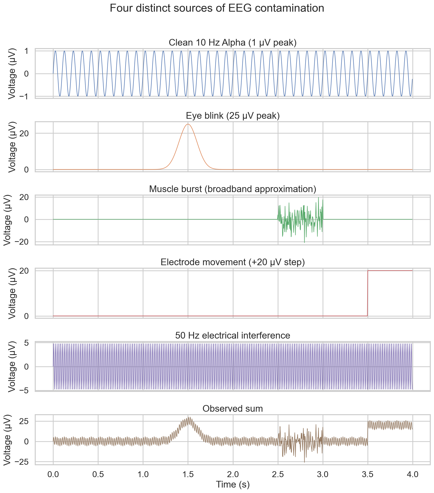
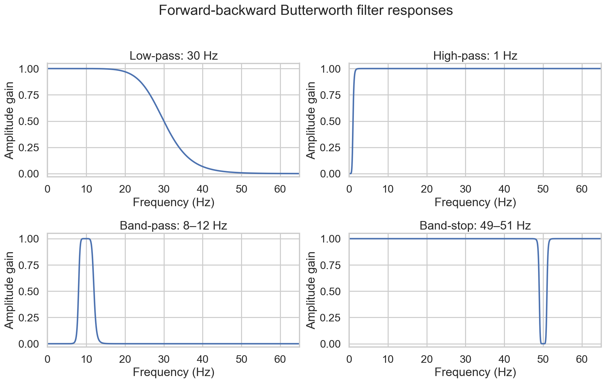
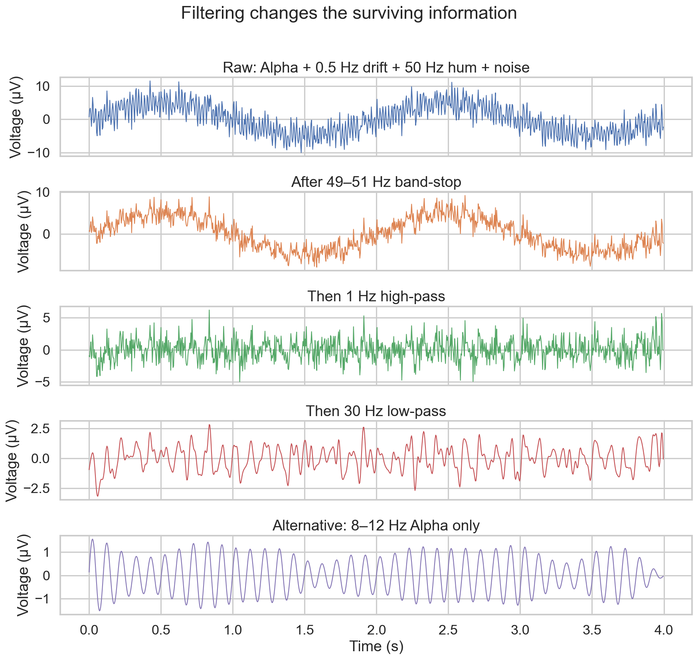
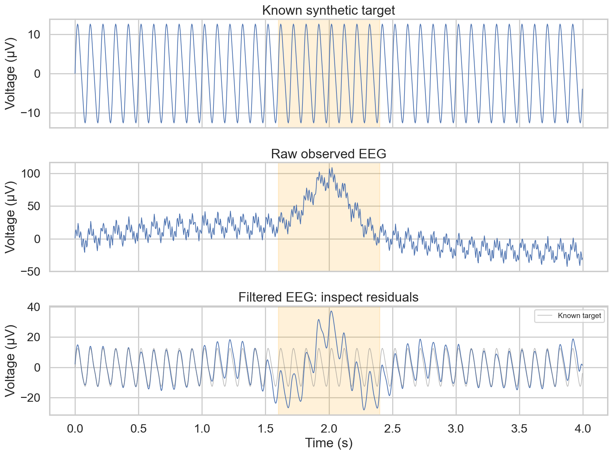
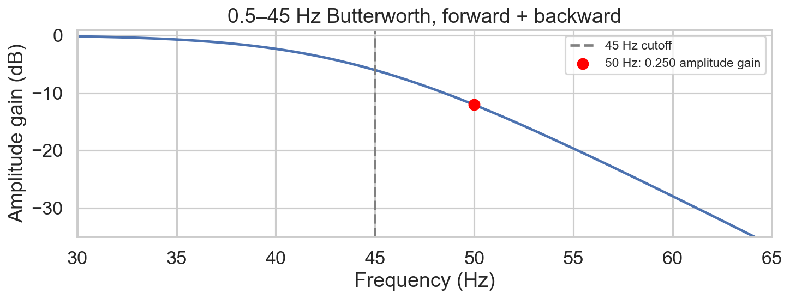

# Fundamentals of Neural Signal Processing for Artificial Intelligence

> **Week 2 Review Article — Month 1 / Week 2**
> Foundation learning phase: strong fundamentals before research.
> Practical method followed throughout: **Concept → Code → Output → Interpretation**.

## Abstract

Week 2 answers a single question: **what happens to a neural signal before an AI model uses it?** Week 1 established the `[Channels × Time]` EEG matrix; this week examines which information survives measurement, sampling, contamination, filtering, and feature extraction. Synthetic experiments show how inadequate sampling creates false frequencies, how ocular and muscle activity enter recorded voltages, and how real filters suppress both unwanted and useful components. Mean, variance, peak-to-peak amplitude, and band-power estimates compress a time series into a feature vector, at the cost of temporal detail. An end-to-end example shows that filtering improves a representation without proving artifact removal or validating a mental-state label. 

## 1. Introduction

Week 1 established EEG as a `[Channels × Time]` voltage matrix and showed that the sampling rate determines the spacing between its columns. Week 2 inherits that geometry and its sampling-rate argument: an AI model can use only the information the measurement retained. We now ask how to transform that recorded matrix into features without confusing artifacts with neural activity.

**The AI Connection:** Artificial intelligence reads numerical representations. A large amplitude can reflect synchronized neural fields, an eye blink, a contact change, or interference; the matrix does not label its own physical sources. Preprocessing therefore belongs to the scientific problem formulation, rather than serving as cosmetic cleanup.

This report synthesizes the five-day Week 2 learning sequence. Each day follows a 4-hour active working session plus a 30-minute documentation window; the article consolidates the learning dialogue and its worked answers into technical discussion:

| Day | Core Focus | Laboratory / Practical Tasks |
| --- | --- | --- |
| **Day 1** | Signals, time series, sampling | Synthesize pure and contaminated oscillations; distinguish voltage values from temporal order. |
| **Day 2** | Nyquist intuition and artifacts | Visualize aliasing; simulate eye blinks, muscle activity, electrode movement, and mains interference. |
| **Day 3** | Basic filtering | Apply low-pass, high-pass, band-pass, and notch filters; inspect what survives. |
| **Day 4** | Feature extraction | Compute mean, variance, peak-to-peak amplitude, and band power; compare time and frequency domains. |
| **Day 5** | End-to-end pipeline and review | Assemble preprocessing and features; interpret a methods pipeline and document reproducible results. |

The scope is fundamentals: no pretrained models, advanced architectures, or claims of a validated brain-computer interface.

## 2. Fundamental Concepts

### 2.1 What is a signal?

A signal describes how a measured quantity changes with an independent variable. For EEG, time `t` is the independent variable in s, and voltage `x(t)` is the dependent variable in µV. The signal is a measured potential difference relative to a reference, not the complete electrical state of the brain.

**Intuition:** A microphone records pressure over time; an electrode records voltage over time. Both produce ordered measurements, but the interpretation depends on the sensor and the physical source.

A continuous-time signal is defined at every time within its interval. A discrete-time signal contains measurements at selected times: `x[n] = x(n / sampling_rate)`. An analog-to-digital converter also quantizes amplitudes into finite numerical levels; sampling time and quantizing voltage are different operations.

**Crucial Distinction:** A densely drawn NumPy sine wave is still a discrete approximation. Calling it “continuous biological reality” is a teaching shorthand, not a property of the array.

### 2.2 A time series requires temporal order

A time series associates each value with a timestamp or a known sample index and sampling rate. A list of voltage values without timing metadata cannot determine a frequency in Hz.

Sorting 5,000 measurements preserves their mean, variance, minimum, and maximum, but destroys their original sequence unless an index map was retained. Oscillation frequency, phase, event timing, and waveform shape depend on that sequence. The sorted line in Figure 2 is assigned new horizontal positions; it no longer describes the original recording.

### 2.3 Signal, noise, and artifact depend on the question

**Signal** is the information relevant to the scientific question. **Noise** is unwanted variation or measurement uncertainty. **Artifact** is contamination arising from non-neural physiology, movement, equipment, or the environment. Randomness is not a strict boundary between these categories: mains interference is structured, and muscle contamination can be irregular.

A 10 Hz Alpha oscillation is useful when studying posterior eyes-closed activity. If the question instead concerns a 1 Hz component in the same recording, the Alpha oscillation becomes unwanted variation for that analysis. Frequency alone does not establish that the 1 Hz component is gastric, neural, or movement-related; the source requires appropriate measurements and experimental evidence.

### 2.4 The governing pipeline

We are now crossing the bridge from biology to data, and from data to an AI representation:

> **Physical neural phenomenon → Measurement (sensors/electrodes) → Analog voltage containing neural and non-neural sources → Digital sampling and quantization → Observed neural time series → Quality inspection and preprocessing → Cleaned representation → Feature extraction → AI-ready input matrix.**

Contamination often enters **before digitization**. We add artifact arrays after constructing the time axis in code only to make their contributions visible. Clipping, saturation, and aliasing can already have damaged the recording before software filtering begins.

### 2.5 Concept → Code → Output → Interpretation: signal contamination

A pure 10 Hz oscillation, random variation, and structured contamination can occupy the same voltage trace. To evaluate how noise and interference alter an observed signal without changing the underlying neural oscillation, let us evaluate the signal and compute its variance across stages:

```python
import numpy as np
import matplotlib.pyplot as plt

# 1. Define the time axis: 2 seconds at 250 Hz
fs = 250
t = np.linspace(0, 2, 2 * fs, endpoint=False)

# 2. Signal A: 10 Hz Alpha, 5 uV peak
signal_a = 5 * np.sin(2 * np.pi * 10 * t)

# 3. Signal B: add random measurement noise (2.5 uV SD)
np.random.seed(42)
random_noise = np.random.normal(0, 2.5, len(t))
signal_b = signal_a + random_noise

# 4. Signal C: add 1 Hz drift and 50 Hz electrical interference
slow_drift = 8 * np.sin(2 * np.pi * 1 * t)
line_noise = 3 * np.sin(2 * np.pi * 50 * t)
signal_c = signal_a + slow_drift + line_noise + random_noise
print(f"Shape: {signal_c.shape}; sample interval: {1000/fs:.1f} ms")
print(f"Variance A/B/C (uV^2): {np.var(signal_a):.2f}, {np.var(signal_b):.2f}, {np.var(signal_c):.2f}")
```

**Expected output:**

```text
Shape: (500,); sample interval: 4.0 ms
Variance A/B/C (uV^2): 12.50, 18.79, 54.55
```

**Interpretation:** Signal A has a 5 µV peak amplitude, a 10 Hz frequency, and a period `T = 1/f = 1/10 = 0.1 s = 100 ms`. Adding contamination increases total variance from 12.50 µV² to 54.55 µV² without increasing the target Alpha amplitude. A model may exploit dominant artifacts when they correlate with labels; failure is a risk, not a guaranteed outcome.



**Figure 1.** The same 10 Hz target is present in all three traces, but random noise and structured interference change the observed waveform. Large variance does not identify a neural source.



**Figure 2.** Sorting preserves the voltage distribution while erasing the original voltage–time relationship. Distribution summaries cannot recover oscillation timing from reordered measurements.

## 3. Sampling and Digitization

### 3.1 Sampling rate is not signal frequency

Sampling rate answers **how often do we measure?** Signal frequency answers **how fast does a component oscillate?** A recording at 250 Hz can contain a 10 Hz Alpha component, a 20 Hz Beta component, and 50 Hz interference simultaneously.

The inherited Week 1 math now constrains preprocessing:

- Sample interval: `Δt = 1 / sampling_rate = 1 / 250 = 0.004 s = 4 ms`. Sample indices `10` and `11` are separated by 4 ms.
- Samples per channel: `N = sampling_rate × duration`.
- Four seconds at 250 Hz: `N = 250 × 4 = 1,000`, so one channel has shape `(1000,)`.
- Sixty-four channels at 250 Hz for 60 s: `64 × 250 × 60 = 960,000` voltage values, shape `(64, 15000)`.
- A 128-channel recording for 5 minutes at 200 Hz: `duration = 5 × 60 = 300 s`; `N = 200 × 300 = 60,000`; shape `(128, 60000)`; total `128 × 60,000 = 7,680,000` values.

The time axis uses `endpoint=False`: a 4 s window at 250 Hz has samples from 0 s through 3.996 s. The last timestamp is not an extra sample at 4 s.

### 3.2 Nyquist intuition and aliasing

The Nyquist criterion requires the retained analog spectrum to lie below half the sampling rate: `f_max < sampling_rate / 2`, or `sampling_rate > 2 × f_max`. This condition assumes a band-limited signal and appropriate reconstruction; it does not imply that a line connecting a few samples perfectly reproduces a waveform.

**The Dangerous Misconception:** “Two snapshots per cycle always capture the peak and trough.”

**Why this is false:** Sample phase matters. A 10 Hz sine sampled at exactly 20 Hz can land on zero crossings at every sample. At the boundary, the observations can lose amplitude information entirely. Practical acquisition leaves a transition margin for an analog anti-aliasing filter.

For Gamma up to 70 Hz, the Nyquist **boundary** is `2 × 70 = 140 Hz`; choose a rate above 140 Hz, such as 250 Hz or 500 Hz, while attenuating components above the new Nyquist limit. For 80 Hz at 200 Hz sampling, the Nyquist frequency is 100 Hz: only 20 Hz of frequency margin remains. Suitability depends on the acquisition filter, not that arithmetic alone.

At 12 Hz sampling, a 10 Hz component has the same samples as a phase-reversed 2 Hz sine: `alias frequency = |10 − 12| = 2 Hz`. A model cannot decide from those samples alone which analog frequency generated them.

### 3.3 Concept → Code → Output → Interpretation: Nyquist sampling and aliasing

Keeping the biological oscillation fixed while changing the recording rate reveals how inadequate sampling distorts recorded frequencies. The following experiment evaluates a 10 Hz Alpha wave sampled at adequate (50 Hz) and inadequate (12 Hz) rates:

```python
import numpy as np
import matplotlib.pyplot as plt

# 1. Dense approximation of continuous reality: 10 Hz Alpha
f_signal = 10
duration = 1.0
t_continuous = np.linspace(0, duration, 1000)
signal_continuous = np.sin(2 * np.pi * f_signal * t_continuous)

# 2. Adequate sampling: 50 Hz, above 20 Hz
fs_good = 50
t_good = np.linspace(0, duration, int(fs_good * duration), endpoint=False)
signal_good = np.sin(2 * np.pi * f_signal * t_good)

# 3. Inadequate sampling: 12 Hz, below 20 Hz
fs_bad = 12
t_bad = np.linspace(0, duration, int(fs_bad * duration), endpoint=False)
signal_bad = np.sin(2 * np.pi * f_signal * t_bad)
print(f"Good/bad samples: {len(t_good)}/{len(t_bad)}")
print(f"Good samples per cycle: {fs_good/f_signal:.1f}")
print(f"Alias frequency: {abs(f_signal - fs_bad)} Hz")
print(f"Gamma to 70 Hz: Nyquist boundary = {2*70} Hz")
print(f"128 channels, 300 s, 200 Hz: {(128, 300*200)}")
```

**Expected output:**

```text
Good/bad samples: 50/12
Good samples per cycle: 5.0
Alias frequency: 2 Hz
Gamma to 70 Hz: Nyquist boundary = 140 Hz
128 channels, 300 s, 200 Hz: (128, 60000)
```

**Interpretation:** Fifty samples per second provide 5 points per 10 Hz cycle. Twelve samples per second provide only 1.2 points per cycle and represent the false 2 Hz rhythm shown below. The dense reference curve is evaluated from the known formula; it is not recovered from the low-rate samples.



**Figure 3.** The 12 Hz sample dots also lie on a phase-reversed 2 Hz sine, so inadequate sampling makes two physical frequencies indistinguishable. More sophisticated AI cannot resolve this acquisition ambiguity without additional information.

### 3.4 Downsampling requires another anti-aliasing step

Downsampling from 1000 Hz to 250 Hz changes the Nyquist limit from 500 Hz to 125 Hz. Components above 125 Hz must be attenuated **before** reducing the sample count. Selecting every fourth sample without that step can fold unwanted frequencies into the retained spectrum. MNE's resampling routines include anti-aliasing filtering; event timing and edge effects still need attention ([MNE filtering and resampling documentation](https://mne.tools/stable/auto_tutorials/preprocessing/30_filtering_resampling.html)).

> Filtering after aliasing cannot reliably identify and remove the original out-of-band source. Prevent the ambiguity during acquisition or resampling.

## 4. Noise and EEG Artifacts

### 4.1 Four artifact mechanisms

Electrodes measure potential differences regardless of whether their sources are neural. Channel location, reference choice, contact quality, and the recording environment affect the mixture.

| Artifact | Physical Origin | Typical Trace / Spatial Clue | AI Context & Interpretation Pitfall |
| --- | --- | --- | --- |
| **Eye blink / ocular** | Corneo-retinal dipole, eye movement, and eyelid effects change measured potentials. | Large transient with substantial low-frequency content, often strongest frontally near Fp1/Fp2. | A blink is not a Delta brain wave; its spectrum can overlap the target band. |
| **Muscle / EMG** | Action potentials in facial, jaw, scalp, and neck muscles. | Irregular broadband bursts; temporal and peripheral electrodes are vulnerable. | EMG-contaminated Gamma and Beta can become an easy label shortcut. |
| **Electrode movement / contact** | Mechanical movement changes the electrode–skin interface or reference. | Sudden step, electrode pop, slow recovery, or drift. | A sustained baseline change is not evidence of stronger cognition. |
| **Electrical interference** | Mains fields couple into leads and recording equipment. | Narrow spectral peak near local mains frequency, nominally 50 Hz or 60 Hz; harmonics may occur. | A model can learn the laboratory's electrical environment. |

Muscle contamination is not confined above 30 Hz. Experimental scalp recordings show contamination within frequencies often interpreted as neural Beta/Gamma (Whitham et al., 2007). Low-pass filtering cannot establish a source's biological identity.

**Design rule of thumb:** A sudden shift from an approximately ±10 µV trace to oscillation around +50 µV suggests a contact or reference change. A waveform alone cannot prove the cause; inspect channels, impedance information, and recording annotations.

### 4.2 Concept → Code → Output → Interpretation: EEG artifact components

To understand how diverse non-neural sources sum into a single recorded trace, we simulate four common artifact types—ocular blink, jaw-muscle burst, electrode movement step, and 50 Hz line hum—and examine their compound waveform:

```python
import numpy as np
import matplotlib.pyplot as plt

# 1. Underlying EEG: 4 seconds, 250 Hz; 10 Hz Alpha, 1 uV peak
np.random.seed(42)
fs = 250
t = np.linspace(0, 4, fs * 4, endpoint=False)
clean_eeg = np.sin(2 * np.pi * 10 * t)

# 2. Blink: low-frequency surge centered at 1.5 s
blink_artifact = np.zeros_like(t)
blink_artifact += 25 * np.exp(-((t - 1.5)**2) / 0.02)

# 3. Jaw-muscle contamination: broadband random burst, 2.5-3.0 s
muscle_artifact = np.zeros_like(t)
jaw_clench_indices = (t >= 2.5) & (t <= 3.0)
muscle_artifact[jaw_clench_indices] = np.random.normal(0, 8, np.sum(jaw_clench_indices))

# 4. Electrode movement: +20 uV baseline step at 3.5 s
movement_artifact = np.zeros_like(t)
movement_artifact[t >= 3.5] = 20

# 5. Electrical interference: 50 Hz, 5 uV peak
line_noise = 5 * np.sin(2 * np.pi * 50 * t)
observed_eeg = clean_eeg + blink_artifact + muscle_artifact + movement_artifact + line_noise
print(f"Blink peak (uV): {blink_artifact.max():.2f}")
print(f"Movement offset (uV): {movement_artifact[-1]:.2f}")
print(f"Observed shape: {observed_eeg.shape}")
```

**Expected output:**

```text
Blink peak (uV): 25.00
Movement offset (uV): 20.00
Observed shape: (1000,)
```

**Interpretation:** The simulated blink is 25 times the 1 µV neural peak, and the movement step persists at +20 µV. These are deliberately chosen teaching amplitudes, not universal artifact ratios. The 10 Hz oscillation remains mathematically present, but estimating it from a contaminated recording requires quality control.



**Figure 4.** Each source contributes a different trace signature, yet all enter the same recorded voltage array. Identifying an artifact requires source reasoning rather than interpreting every fluctuation as brain activity.

### 4.3 Artifact shortcuts and environmental shifts

A “Stressed” versus “Relaxed” classifier with 99% accuracy may rely on jaw or neck tension if those artifacts correlate with its labels. High-frequency, irregular activity over temporal and neck electrodes is a reason to investigate EMG; accuracy alone cannot validate neural stress decoding.

A New Delhi dataset may contain 50 Hz mains interference, whereas a New York recording may contain 60 Hz interference. If the classifier used that environmental fingerprint, a change of site can alter its predictions. This is a possible distribution-shift mechanism, not a complete explanation of any observed accuracy drop. Equipment, montage, task design, and participant differences can also change.

**The Takeaway:** Filtering and evaluation must test the proposed biological relationship. A predictive artifact can survive a technically correct machine-learning workflow.

## 5. Basic Filtering — What Survives?

### 5.1 Passbands, stopbands, and transitions

A filter changes the signal by frequency-dependent weighting. Its **passband** largely retains selected frequencies; its **stopband** attenuates unwanted ranges; its **transition band** connects them. A cutoff is not an infinitely sharp dividing wall.

For the Butterworth design used here, the single-pass cutoff has amplitude gain `1/√2 ≈ 0.707` (about −3 dB). Applying the filter forward and backward squares that amplitude response, giving approximately 0.5 gain (−6 dB) at the cutoff. Thus a component sitting exactly at a stated cutoff is already attenuated ([SciPy Butterworth documentation](https://docs.scipy.org/doc/scipy/reference/generated/scipy.signal.butter.html)).

| Filter | What It Largely Keeps | What It Attenuates | Example Choice | AI Context & Interpretation Pitfall |
| --- | --- | --- | --- | --- |
| **Low-pass** | Frequencies below a cutoff | Higher frequencies | 30 Hz for a restricted Alpha/Beta example | A 40 Hz cutoff suppresses 70 Hz oscillatory content the model might need. |
| **High-pass** | Frequencies above a cutoff | DC and slower variation | 0.5 Hz for a task preserving 1–4 Hz Delta | A 3 Hz cutoff removes much of 0.5–4 Hz Delta; it also distorts nearby frequencies. |
| **Band-pass** | A range between two cutoffs | Slower and faster components | 8–12 Hz for Alpha representation | Other bands are excluded, including genuine neural information. |
| **Notch / narrow band-stop** | Frequencies outside a narrow rejected band | A selected neighborhood | 49–51 Hz around 50 Hz interference | Nearby genuine neural activity is attenuated too; notch width matters. |

A band-pass conceptually combines a high-pass goal and a low-pass goal. A separately cascaded pair need not have the exact same response as a single band-pass design.



**Figure 5.** Real filters have gradual transitions, and forward-backward application changes the overall gain. A 49–51 Hz band-stop does not preserve everything at 49 Hz and 51 Hz unchanged.

### 5.2 Concept → Code → Output → Interpretation: filter stages and Alpha recovery

Applying successive filter stages suppresses unwanted frequency components, but alters waveform dynamics. Here, we apply a band-stop (49–51 Hz) → high-pass (1 Hz) → low-pass (30 Hz) cascade to a contaminated signal, compare it with an Alpha-only (8–12 Hz) band-pass filter, and quantify error reduction relative to the uncontaminated Alpha wave:

```python
import numpy as np
import matplotlib.pyplot as plt
from scipy.signal import butter, filtfilt

# 1. Contaminated teaching signal: Alpha + drift + line hum + noise
np.random.seed(42)
fs = 250
t = np.linspace(0, 4, fs * 4, endpoint=False)
clean_alpha = np.sin(2 * np.pi * 10 * t)
slow_drift = 5 * np.sin(2 * np.pi * 0.5 * t)
line_noise = 3 * np.sin(2 * np.pi * 50 * t)
high_freq_noise = np.random.normal(0, 1.5, len(t))
observed_eeg = clean_alpha + slow_drift + line_noise + high_freq_noise

# 2. Butterworth band-stop: 49-51 Hz (finite-width notch)
b_notch, a_notch = butter(4, [49/(fs/2), 51/(fs/2)], btype='bandstop')
eeg_notch = filtfilt(b_notch, a_notch, observed_eeg)

# 3. High-pass at 1 Hz: suppress the 0.5 Hz drift
b_hp, a_hp = butter(4, 1/(fs/2), btype='high')
eeg_hp = filtfilt(b_hp, a_hp, eeg_notch)

# 4. Low-pass at 30 Hz: suppress faster fluctuations
b_lp, a_lp = butter(4, 30/(fs/2), btype='low')
eeg_clean = filtfilt(b_lp, a_lp, eeg_hp)

# 5. Alternative: retain only Alpha, 8-12 Hz
b_bp, a_bp = butter(4, [8/(fs/2), 12/(fs/2)], btype='bandpass')
eeg_bandpass = filtfilt(b_bp, a_bp, observed_eeg)

# 6. Quantify recovery in the interior, 1-3 s; edges excluded
interior = (t >= 1) & (t < 3)
for name, data in [('Raw', observed_eeg), ('Notch', eeg_notch),
                   ('High-pass', eeg_hp), ('Low-pass', eeg_clean),
                   ('Alpha-only', eeg_bandpass)]:
    rmse = np.sqrt(np.mean((data[interior] - clean_alpha[interior])**2))
    print(f"{name} interior RMSE (uV): {rmse:.3f}")
```

**Expected output:**

```text
Raw interior RMSE (uV): 4.298
Notch interior RMSE (uV): 3.792
High-pass interior RMSE (uV): 1.475
Low-pass interior RMSE (uV): 0.696
Alpha-only interior RMSE (uV): 0.230
```

**Interpretation:** The chain reduces error relative to the known Alpha target in the central 1–3 s interval, from 4.298 µV to 0.696 µV. The narrow Alpha representation reduces it further to 0.230 µV because this synthetic target contains only a 10 Hz oscillation. That advantage would not imply a better representation for a task requiring Delta or Beta.



**Figure 6.** The stages suppress interference and drift, but recovery is incomplete and edge transients remain. The Alpha-only alternative looks smoother because it retains a narrower set of frequencies.

### 5.3 Filtering is not artifact identification

**The Dangerous Misconception:** “A smooth trace means the neural signal has been rescued.”

**Why this is false:** Filters do not know the source of a voltage. A blink and neural Delta can share low frequencies; EMG and neural Gamma can share high frequencies. Filtering cannot separate sources occupying the same passband. Severe transients can also create ringing around the event.

A high-pass near 0.5 Hz may attenuate a 0.2 Hz drift, but the required attenuation depends on filter order and the drift's amplitude. A 3 Hz high-pass compromises slow-wave analysis because most of the 0.5–4 Hz band lies below its cutoff. A 40 Hz low-pass suppresses 70 Hz activity; a neural spike itself is a transient with a broad spectrum, not a single 70 Hz sinusoid.

**The Takeaway:** Select cutoffs from the information the task needs to preserve. Increasing smoothness can remove the phenomenon under study.

### 5.4 Offline implementation and numerical limits

The report retains the supplied `butter` coefficient form and `filtfilt` computations for continuity. Fixed seeds and prints were added; the values are in µV throughout. The repeated Day 5 blocks are consolidated into one laboratory.

`filtfilt` uses forward and backward passes, which cancel phase delay but require future samples. It is an **offline** operation; a streaming BCI needs causal filtering with measured delay. Padding affects short-window boundaries, and the overall filter order differs from a single pass ([SciPy forward-backward filtering documentation](https://docs.scipy.org/doc/scipy/reference/generated/scipy.signal.filtfilt.html)).

For real workflows, SciPy recommends second-order sections (`output='sos'` with `sosfiltfilt`) to reduce numerical problems, particularly for narrow or higher-order filters. The teaching code's successful execution does not certify every possible cutoff, duration, or dataset. Validate its response and edge behavior before interpreting measurements.

## 6. Feature Extraction — From Matrices to Meaning

### 6.1 Compression creates a representation

A feature summarizes a chosen property of the data. Features can be scalars such as variance, or structured representations built from multiple channels and windows. A five-number vector is useful only if its selected properties carry information about the intended target.

**The AI Connection:** Sixty-four channels recorded at 250 Hz for one minute contain 960,000 values. Five features per channel per window give `64 × 5 = 320` feature columns. This reduces dimensionality while retaining channel identity through a fixed column order; averaging all channels together would discard much of that spatial structure.

A 10 s seizure recording summarized by overall mean and variance contains no explicit onset timestamp. Moving an identical event from second 2 to second 8 by reordering the samples preserves those statistics. Use timestamped windows or a temporal representation when the target is event timing.

### 6.2 Mean, variance, and peak-to-peak amplitude

For `N` voltage samples `xᵢ`, these teaching features use population normalization:

- **Mean:** `µ = (1/N) × Σ xᵢ`, in µV. It describes the average level; for uniformly sampled data it corresponds to the DC component.
- **Variance:** `σ² = (1/N) × Σ (xᵢ − µ)²`, in µV². `np.var` uses this normalization by default (`ddof=0`).
- **Peak-to-peak amplitude:** `A_p-p = max(x) − min(x)`, in µV. This is different from a sine wave's peak amplitude.

For a complete-cycle zero-mean sine with peak amplitude `A`, `variance = A²/2`. For uncorrelated or orthogonal zero-mean components, variances add; covariance prevents that shortcut in the general case.

**The Dangerous Misconception:** “High variance means stronger neural activity; zero mean means inactivity.”

**Why this is false:** Artifacts raise variance too, and an active oscillation can have mean zero. High-pass filtering suppresses DC, making mean often weak as a discriminating feature. A finite filtered window can still have a nonzero mean because of transient structure and edge effects; the pipeline in §7 provides an example.

If all 1,000 window means are exactly `0.0001`, inspect units, rounding, detrending, explicit centering, and preprocessing. That observation cannot establish either inactivity or one unique filtering step.

### 6.3 Time domain, frequency domain, and power

The time domain shows voltage in µV against time in s. A frequency-domain representation shows the contribution of different oscillatory speeds. For a power spectral density (PSD), the vertical units are **µV²/Hz**; integrating over frequency in Hz yields **µV²**.

**Crucial Distinction:** Band power is mean-square signal strength in a band, not total energy accumulated over the recording. For a zero-mean signal, `mean(x²) = variance(x)`. More generally, `mean(x²) = variance(x) + mean(x)²`.

Band power can be estimated by integrating PSD: `P_band = ∫ from f_low to f_high PSD(f) df`. For example, `P_Delta = ∫ from 0.5 to 4 Hz PSD(f) df`. The conceptual FFT mathematics is outside this week's scope; Figure 7 uses SciPy's Welch estimator to display the spectrum ([SciPy Welch documentation](https://docs.scipy.org/doc/scipy/reference/generated/scipy.signal.welch.html)).


**Figure 7.** The summed waveform has peaks at 10 Hz and 20 Hz in its PSD. PSD height is measured per Hz; band power is the area over a selected frequency range, not the height of one spectral bin.

### 6.4 Concept → Code → Output → Interpretation: feature extraction and compression

To transform a raw time series into inputs suitable for machine learning, we compress 1,000 voltage samples into five informative features: mean, variance, peak-to-peak amplitude, and estimated band powers for Alpha and Beta:

```python
import numpy as np
from scipy.signal import butter, filtfilt

# 1. Four seconds of synthetic EEG: 10 Hz Alpha + 20 Hz Beta
fs = 250
t = np.linspace(0, 4, fs * 4, endpoint=False)
clean_signal = 10 * np.sin(2 * np.pi * 10 * t) + 3 * np.sin(2 * np.pi * 20 * t)

# 2. Time-domain features; voltage in uV, variance in uV^2
feature_mean = np.mean(clean_signal)
feature_variance = np.var(clean_signal)
feature_p2p_amp = np.max(clean_signal) - np.min(clean_signal)

# 3. Estimate band power using variance after band-pass filtering
# Finite-window estimate: filter response and edges affect the result
def get_band_power(signal, sfreq, low_cut, high_cut):
    b, a = butter(4, [low_cut/(sfreq/2), high_cut/(sfreq/2)], btype='bandpass')
    band_passed_signal = filtfilt(b, a, signal)
    return np.var(band_passed_signal)

power_alpha = get_band_power(clean_signal, fs, 8, 12)
power_beta = get_band_power(clean_signal, fs, 13, 30)

# 4. Compress 1000 samples into 5 ordered features
ai_feature_vector = np.array([
    feature_mean, feature_variance, feature_p2p_amp, power_alpha, power_beta
])
print("Features [mean, variance, peak-to-peak, Alpha power, Beta power]:")
print(np.array2string(ai_feature_vector, precision=3, suppress_small=True))
print(f"Raw/vector shapes: {clean_signal.shape} -> {ai_feature_vector.shape}")
```

**Expected output:**

```text
Features [mean, variance, peak-to-peak, Alpha power, Beta power]:
[ 0.    54.5   22.548 48.623  4.504]
Raw/vector shapes: (1000,) -> (5,)
```

**Interpretation:** The ideal component powers are `10²/2 = 50 µV²` for Alpha and `3²/2 = 4.5 µV²` for Beta. Their frequencies complete integer cycles over the 4 s window, so the total variance is `50 + 4.5 = 54.5 µV²`. The filtered estimates are 48.623 µV² and 4.504 µV², rather than exactly the ideal powers.

The measured peak-to-peak amplitude is **22.548 µV**, not the 26 µV upper bound `2 × (10 + 3)`. The two sine components do not attain their maximum at the same time, and discrete sampling also determines the measured extrema. The supplied approximate vector therefore cannot be used as an actual output.


**Figure 8.** Alpha dominates this constructed signal, but the finite-window estimate differs from ideal Alpha power. Reducing 1,000 values to five features preserves selected properties while discarding detailed waveform timing.

### 6.5 Extending the representation carefully

To add Delta using the helper above, the matching computation is `power_delta = get_band_power(clean_signal, fs, 0.5, 4)`. The supplied Alpha/Beta signal contains no intentional Delta component; a finite filtered output may still show edge-related low-frequency content. A 4 s window contains only two cycles of 0.5 Hz activity, so very-low-frequency estimates need longer windows and attention to boundaries.

The alternative using `np.trapz(psd[mask], freqs[mask])` assumes PSD arrays that the earlier example never computed. For this NumPy version, use `np.trapezoid` after estimating a density with known scaling and defining the band mask. Do not substitute that line into the filter-based laboratory without its missing PSD calculation. The two approaches differ because filters weight the band and its transition regions.

**Design rule of thumb:** Keep feature definitions, band boundaries, units, window lengths, and channel order fixed. A representation such as `[mean, variance, Delta power, Alpha power, Beta power]` is meaningful only with that metadata.

## 7. The End-to-End Pipeline

### 7.1 Concept → Code → Output → Interpretation: end-to-end preprocessing pipeline

We now assemble an end-to-end signal processing and feature extraction pipeline: simulating an Alpha-dominant recording contaminated by sweat drift, line hum, a blink, and sensor noise, filtering it offline, and producing an AI-ready feature matrix:

```python
import numpy as np
import matplotlib.pyplot as plt
from scipy.signal import butter, filtfilt

# 1. Biological simulation and digitization: 4 s at 250 Hz
np.random.seed(42)
fs = 250
duration = 4.0
t = np.linspace(0, duration, int(fs * duration), endpoint=False)
# Alpha-dominant simulation, not a validated mental-state label
true_neural_signal = 12 * np.sin(2 * np.pi * 10 * t) + 2 * np.sin(2 * np.pi * 20 * t)

# 2. Contamination: drift, line hum, blink, and sensor noise
sweat_drift = 20 * np.sin(2 * np.pi * 0.2 * t)
line_noise = 8 * np.sin(2 * np.pi * 50 * t)
blink = 80 * np.exp(-((t - 2.0)**2) / 0.05)
sensor_noise = np.random.normal(0, 2, len(t))
raw_observed_eeg = true_neural_signal + sweat_drift + line_noise + blink + sensor_noise

# 3. Offline Butterworth filters from the supplied laboratory
def apply_bandpass(data, low_cut, high_cut, fs, order=4):
    nyq = 0.5 * fs
    b, a = butter(order, [low_cut/nyq, high_cut/nyq], btype='band')
    return filtfilt(b, a, data)

def apply_notch(data, freq, fs):
    nyq = 0.5 * fs
    b, a = butter(4, [(freq-1)/nyq, (freq+1)/nyq], btype='bandstop')
    return filtfilt(b, a, data)

eeg_notch = apply_notch(raw_observed_eeg, 50, fs)
eeg_clean = apply_bandpass(eeg_notch, 1, 30, fs)

# 4. Time-domain features and estimated band powers
feat_mean = np.mean(eeg_clean)
feat_var = np.var(eeg_clean)
feat_amp = np.max(eeg_clean) - np.min(eeg_clean)
alpha_band = apply_bandpass(eeg_clean, 8, 12, fs)
feat_alpha_power = np.var(alpha_band)
beta_band = apply_bandpass(eeg_clean, 13, 30, fs)
feat_beta_power = np.var(beta_band)
ai_input_vector = np.array([feat_mean, feat_var, feat_amp, feat_alpha_power, feat_beta_power])

# 5. One window is one training row, not five training examples
ai_input_matrix = ai_input_vector.reshape(1, -1)
print("Features [mean, variance, peak-to-peak, Alpha power, Beta power]:")
print(np.array2string(ai_input_vector, precision=3, suppress_small=True))
print(f"Vector/matrix shapes: {ai_input_vector.shape}/{ai_input_matrix.shape}")
print(f"Filtered mean (uV): {feat_mean:.3f}")
```

**Expected output:**

```text
Features [mean, variance, peak-to-peak, Alpha power, Beta power]:
[  0.161 130.636  65.337  70.142   2.457]
Vector/matrix shapes: (5,)/(1, 5)
Filtered mean (uV): 0.161
```

**Interpretation:** The vector has shape `(5,)`; reshaping produces one observation with five columns, `(1, 5)`. The cleaned signal's mean is 0.161 µV, demonstrating that high-pass filtering does not force every finite-window mean to exactly zero.

The intended uncontaminated variance is `12²/2 + 2²/2 = 72 + 2 = 74 µV²`. The filtered result is 130.636 µV² with peak-to-peak amplitude 65.337 µV: this remains substantially affected by artifacts and boundaries. Alpha still dominates the estimated band powers, but dominance does not prove that the representation is artifact-free or that the person is relaxed.



**Figure 9.** Filtering reduces drift and line interference but leaves substantial blink-related distortion and boundary effects. The shaded interval around 2 s makes the limits of frequency filtering visible.

### 7.2 From one vector to an input matrix

For `W` retained windows and `C` channels, five channel-wise features yield a matrix of shape `(W, C × 5)`. For one channel and 1,000 windows, the shape is `(1000, 5)`. Rows represent observations/windows, not electrodes; columns represent fixed feature definitions.

The experiment supplies labels `y`, such as `EYES_CLOSED` or `EYES_OPEN`. EEG does not generate those labels automatically. A classifier learns a relationship between `X` and the experimental labels; the proposed interpretation requires held-out evaluation (Week 3 topic).

A defensible pipeline is: inspect signal quality and metadata → identify severe artifacts → apply justified filtering → inspect residuals → create timestamped windows → reject contaminated windows → extract fixed features → align rows with labels. Whether specific artifact handling occurs before or after filtering depends on the method; it must be documented. Preserve annotations for breaks so filtering does not silently bridge discontinuities.

### 7.3 Reading a methods pipeline

Consider the supplied hypothetical method: 32 Ag/AgCl electrodes; acquisition at 1000 Hz; downsampling to 250 Hz; a fourth-order Butterworth 0.5–45 Hz band-pass; rejection beyond ±100 µV; Alpha power for classification.

- **Shape:** For duration `D` s, the initial channel matrix is `(32, 1000 × D)` when sample counts are integral. After proper resampling it is approximately `(32, 250 × D)`. The excerpt supplies no duration, so an absolute time dimension cannot be computed. Channel count also assumes those 32 streams are retained EEG channels rather than including auxiliaries.
- **Downsampling:** Anti-aliasing must be part of resampling before the rate drops. A later 45 Hz filter cannot repair earlier aliasing.
- **Line noise:** A 45 Hz upper cutoff places 50 Hz outside the intended passband, but does not prove negligible residual interference. The excerpt does not specify whether filtering was single-pass or forward-backward, so its exact attenuation is unknown.
- **Ocular handling:** Discarding epochs with voltage beyond ±100 µV is **epoch rejection**, not blink removal by a frequency filter. It can miss smaller blinks and reject genuine large neural events; the threshold is a screening choice, not a source diagnosis.

For an illustrative fourth-order 0.5–45 Hz filter at 250 Hz using forward-backward application, the measured 50 Hz amplitude gain is **0.249531**, or **−12.058 dB**. An input hum of 8 µV peak would retain approximately `8 × 0.249531 ≈ 2.00 µV` in steady state. Single-pass attenuation would be smaller. Inspect the actual response and the data spectrum before omitting a notch.



**Figure 10.** A 45 Hz cutoff is not a wall: this specified forward-backward design retains about one-quarter of the 50 Hz amplitude. A notch decision requires evidence of acceptable residual interference.

### 7.4 Real EEG files and metadata

Real recordings commonly arrive as `.edf` or BrainVision files, where `.vhdr` is a header linked to data and marker files. MNE-Python has dedicated readers for [EDF](https://mne.tools/stable/generated/mne.io.read_raw_edf.html) and [BrainVision](https://mne.tools/stable/generated/mne.io.read_raw_brainvision.html); generic SciPy is not a substitute EEG file reader.

The numerical core remains `[Channels × Time]`, but the surrounding metadata is essential: sampling rate, channel names and types, units, electrode locations, reference, annotations, event times, and recording discontinuities. MNE commonly represents EEG numerically in volts; convert deliberately with `µV = V × 1,000,000`. Our synthetic arrays already use µV. Confusing those scales corrupts both amplitude thresholds and power features.

No clinical data or MNE package is required for these foundation laboratories. Their synthetic known target lets us measure error directly, a comparison usually unavailable in real recordings.

## 8. Comparison / Discussion

| Representation / Operation | What It Preserves | What It Loses or Changes | AI Context & Interpretation Pitfall |
| --- | --- | --- | --- |
| **Raw time series** | Recorded timing, waveform, and channel relationships | Cannot recover information already lost in acquisition | Neural and non-neural sources coexist; raw does not mean biologically pure. |
| **Filtered time series** | Selected frequency ranges and channel identity | Frequency content, amplitudes near cutoffs, and transient shape | Smoothness can hide removal of the target phenomenon. |
| **Time-domain summaries** | Average level, spread, and extrema | Original ordering and within-window event timing | Identical mean/variance can describe different event positions. |
| **Band-power features** | Strength in defined frequency ranges | Phase and detailed within-window timing | A band is not a unique mental-state label; artifacts can contribute. |
| **Epoch rejection** | Retained segments satisfying quality criteria | Entire rejected observations, including useful information | Unequal rejection across classes or subjects can bias the dataset. |

**The Science:** The distinction inherited from Week 1 remains intact: scalp EEG is a spatial mixture of population fields, not a direct measurement of individual neuronal firing. Feature extraction cannot restore precise source locations simply by producing more numbers.

The Week 1 interpretation pitfalls also survive preprocessing: lesion-associated Delta is not automatically sleep; cognitive Theta is not automatically drowsiness; inhibitory Alpha is not simply relaxation; movement-related Beta can decrease and rebound; EMG-contaminated Gamma is not proof of cognition. A model's input representation must respect these limits.

**The Takeaway:** The representation is part of the hypothesis. Raw waveforms, channel-wise band powers, and whole-window statistics permit different questions and discard different evidence.

## 9. Applications

### 9.1 EEG → Eyes-closed versus eyes-open classification

- **Biological Event:** A participant closes or opens their eyes under controlled instructions.
- **Neural Activity:** Posterior Alpha often changes with visual input and sensory gating.
- **Neural Data:** Timestamped multichannel EEG with ocular artifact checks and fixed preprocessing.
- **Target / Label:** Experimental condition, such as `EYES_CLOSED` or `EYES_OPEN`.
- **AI Task:** Classify labeled windows from channel-wise Alpha and other justified features.

**Interpretation:** Posterior Alpha supports a specific experimental comparison. “Alpha high → relaxed” is too broad; neither meditation nor a video game guarantees one dominant band. Beta depends on task and motor context and can be contaminated by muscle activity.

### 9.2 EEG → Driver-fatigue detection

- **Biological Event:** A driver becomes drowsy during a controlled simulator session.
- **Neural Activity:** Under the supplied hypothesis, 1–4 Hz Delta increases and 15–30 Hz Beta decreases; real fatigue patterns require validation.
- **Neural Data:** EEG plus event timestamps and artifact annotations; blinking, eye movements, jaw/neck tension, motion, cable movement, mains interference, and possible ECG contamination are expected.
- **Target / Label:** Independently assigned alertness or fatigue labels from the study design.
- **AI Task:** Classify time windows from features reflecting the hypothesis.

**Design rule of thumb:** A candidate 0.5–40 Hz band-pass can preserve much of 1–4 Hz Delta and 15–30 Hz Beta; validate attenuation at the low end. Apply a 50 Hz or 60 Hz notch if the measured residual warrants it. Reject or correct major blink/motion segments because their spectrum overlaps Delta. ICA is a possible later artifact-separation method, not an implemented foundation requirement.

Use `P_Delta = ∫ from 1 to 4 Hz PSD(f) df` and `P_Beta = ∫ from 15 to 30 Hz PSD(f) df`, in µV². Optional relative powers divide by a stated total-power range. A Delta/Beta ratio is `P_Delta / (P_Beta + ε)`, with `ε` specified in µV²; it prevents division by zero but can be unstable when Beta is small. Relative power may reduce overall scale variation without eliminating subject or artifact differences.

### 9.3 EEG → Event timing and sleep-stage representation

- **Biological Event:** A seizure begins, or a participant transitions between sleep stages.
- **Neural Activity:** Time-dependent changes in oscillations and transient population activity.
- **Neural Data:** Multichannel EEG divided into timestamped windows, with cutoffs appropriate to the target.
- **Target / Label:** Event onset or a stage label aligned to each window.
- **AI Task:** Predict labels over time using features that retain the required temporal granularity.

**Why we care:** A single pair of statistics over 10 s cannot locate an event within that window. Smaller windows improve localization but provide fewer slow-wave cycles for power estimation. A 3 Hz high-pass is unsuitable when the question depends on much of the 0.5–4 Hz Delta band.

## 10. Challenges / Limitations

- **Acquisition limits are irreversible from the recording alone.** Aliasing, saturation, and missing metadata can defeat later interpretation even when code executes correctly.
- **Filtering is selective, not source-aware.** Blink and neural slow-wave spectra overlap; muscle and neural high-frequency spectra overlap. Frequency selection cannot prove artifact removal.
- **Edges and short windows matter.** The 4 s demonstrations show boundary and residual effects. Longer continuous segments help, but breaks and extreme artifacts still require handling. Filtering can distort waveform time courses ([MNE filtering background](https://mne.tools/stable/auto_tutorials/preprocessing/25_background_filtering.html)).
- **Features carry units and assumptions.** Band-pass variance is a filtered-power estimate; PSD integration depends on density scaling, frequency resolution, and band boundaries. Peak-to-peak values are sensitive to outliers.
- **Band names do not identify mental states.** The Alpha/Beta simulations demonstrate known frequency mixtures, not validated relaxation, focus, seizure prediction, or fatigue biomarkers.
- **Compression limits questions.** Whole-window summaries discard event positions; cross-channel averaging can discard spatial patterns. Keep timestamp and channel metadata when the target requires them.
- **Evaluation must match deployment.** Separate subjects or sessions appropriately, and fit data-dependent scaling on training data only (Week 3 topic). Nearby overlapping windows and shared artifacts can inflate apparent performance.

> Cleaner-looking data is not automatically better neuroscience. Ask what information survived, what was suppressed, and whether the surviving feature supports the claimed biological interpretation.

## 11. Conclusion

Week 2 turns the Week 1 matrix into a defensible representation:

1. A time series is voltage **with order and timing**; its mean alone cannot describe an oscillation.
2. Sampling must exceed the Nyquist boundary for the retained spectrum, with anti-aliasing protection at acquisition and resampling.
3. Eye blinks, muscle activity, electrode changes, and mains interference enter the same voltage measurements as neural activity.
4. Filters attenuate selected frequencies; they can suppress artifacts and useful neural information together.
5. Features compress each window into fixed numerical properties, trading waveform detail for a simpler learning input.
6. The end-to-end laboratory produces a `(1, 5)` input matrix while exposing residual contamination rather than certifying a mental-state decoder.

With these feature vectors, Week 3 can ask: *how does machine learning turn neural data into predictions, and how do we test whether those predictions generalize beyond artifacts, sessions, and subjects?*

## 12. References

Week 2 syllabus briefs: `NS.docx` (Week 2 signal-processing topics) and `GI.docx` (foundation learning phase, weekly review-article structure, Concept → Code → Output → Interpretation, documentation and referencing standards).

Suggested further sources (verify before citing formally):

1. Kandel, E. R., Koester, J. D., Mack, S. H., & Siegelbaum, S. A. (2021). *Principles of Neural Science*, 6th ed. McGraw Hill. [Publisher record](https://www.mheducation.com/highered/mhp/product/principles-neural-science-sixth-edition.html). Biological foundation inherited from Week 1.
2. Nunez, P. L., & Srinivasan, R. (2006). *Electric Fields of the Brain: The Neurophysics of EEG*, 2nd ed. Oxford University Press. [DOI: 10.1093/acprof:oso/9780195050387.001.0001](https://doi.org/10.1093/acprof:oso/9780195050387.001.0001). Scalp measurement and spatial mixing.
3. Cohen, M. X. (2014). *Analyzing Neural Time Series Data: Theory and Practice*. MIT Press. [Publisher record](https://mitpress.mit.edu/9780262019873/analyzing-neural-time-series-data/). [DOI: 10.7551/mitpress/9609.001.0001](https://doi.org/10.7551/mitpress/9609.001.0001). Time/frequency analysis background; band boundaries remain conventions.
4. Craik, A., He, Y., & Contreras-Vidal, J. L. (2019). Deep learning for electroencephalogram (EEG) classification tasks: a review. *Journal of Neural Engineering*, 16(3), 031001. [DOI: 10.1088/1741-2552/ab0ab5](https://doi.org/10.1088/1741-2552/ab0ab5). [Bibliographic record and abstract](https://pubmed.ncbi.nlm.nih.gov/30808014/). Context review of 90 EEG deep learning studies.
5. Whitham, E. M., et al. (2007). Scalp electrical recording during paralysis: quantitative evidence that EEG frequencies above 20 Hz are contaminated by EMG. *Clinical Neurophysiology*, 118(8), 1877–1888. [DOI: 10.1016/j.clinph.2007.04.027](https://doi.org/10.1016/j.clinph.2007.04.027). [Study record](https://pubmed.ncbi.nlm.nih.gov/17574912/). Experimental evidence for muscle contamination.
6. SciPy contributors. *SciPy signal-processing documentation*: [Butterworth design](https://docs.scipy.org/doc/scipy/reference/generated/scipy.signal.butter.html), [forward-backward filtering](https://docs.scipy.org/doc/scipy/reference/generated/scipy.signal.filtfilt.html), and [Welch PSD estimation](https://docs.scipy.org/doc/scipy/reference/generated/scipy.signal.welch.html). Accessed 2026-10-02; local computation uses SciPy 1.14.1.
7. MNE-Python contributors. *MNE-Python documentation*: [filtering background](https://mne.tools/stable/auto_tutorials/preprocessing/25_background_filtering.html), [filtering and resampling](https://mne.tools/stable/auto_tutorials/preprocessing/30_filtering_resampling.html), [EDF reader](https://mne.tools/stable/generated/mne.io.read_raw_edf.html), and [BrainVision reader](https://mne.tools/stable/generated/mne.io.read_raw_brainvision.html). Accessed 2026-10-02.

## Appendix A — Reproducibility (UV + Seaborn)

All figures and printed laboratory outputs in this report were generated locally with `uv` from the project root (`NeuroScience/`):

```bash
# restore the project environment from the lockfile
uv sync --locked

# regenerate all Week 2 figures and print laboratory outputs
uv run python generate_week2_plots.py
# outputs -> "month 1/week 2/assets/*.png"
```

Plotting stack: `seaborn` theme (`whitegrid`, `talk` context) over `matplotlib`, `numpy` and `scipy` for synthesis and filtering. Random seed `42` where noise is used. All voltages are synthetic µV values; variance and power in µV². Figures:

- `signal_contamination.png` — §2.5
- `temporal_order.png` — §2.5
- `aliasing.png` — §3.3
- `artifact_components.png` — §4.2
- `filter_responses.png` — §5.1
- `filter_stages.png` — §5.2
- `time_frequency.png` — §6.3
- `feature_compression.png` — §6.4
- `end_to_end.png` — §7.1
- `mains_attenuation.png` — §7.3
