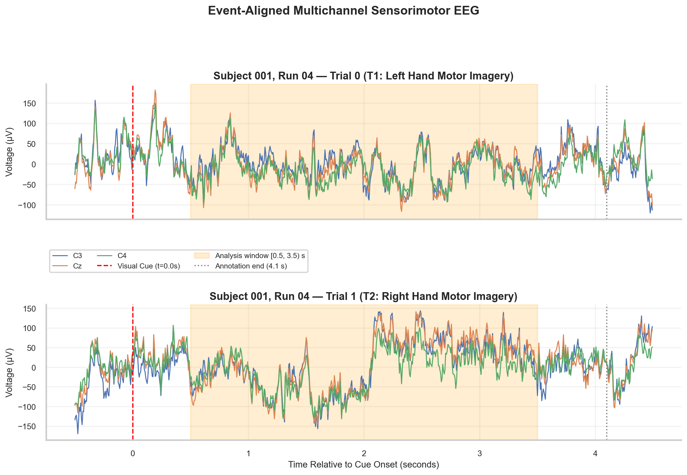
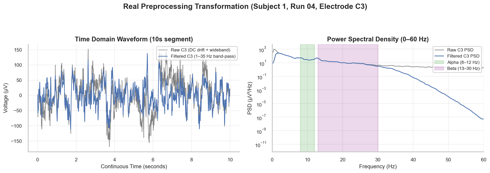
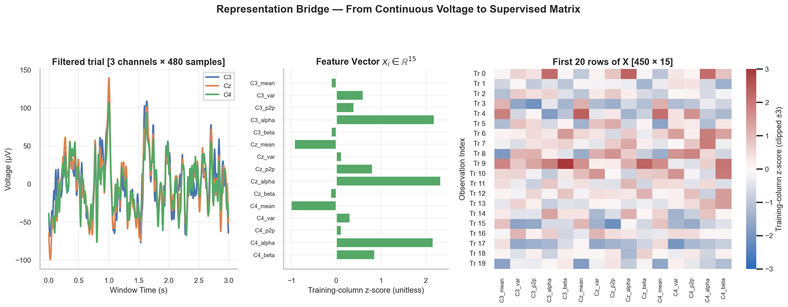

# W3D1: From Neural Features to Supervised Datasets

> **Week 3 Foundation Learning — W3D1 Working Notes**
> The Supervised Bridge: From continuous voltage traces to row-aligned feature matrices.
> Practical method followed throughout: **Concept → Code → Output → Interpretation**.

**Navigation:** ← [[week-2-report|Week 2 Report]] · [[week-3-report|Week 3 Report]] · [[w3d2|Day 2: Logistic Regression]] →  
**Associated Concepts:** [[supervised-learning]] · [[feature-matrix]] · [[experimental-labels]] · [[Knowledge-Map|Knowledge Map]]

---

## 1. Day 1 Overview & Daily Goals

Week 2 demonstrated how raw multichannel electroencephalography (EEG) is filtered, windowed, and compressed into numerical features. However, a set of feature calculations does not constitute a machine learning dataset. Machine learning algorithms do not operate on unindexed continuous time series; they require discrete, row-aligned observations paired with ground-truth experimental labels.

The primary objective of Day 1 is to construct the **supervised representation bridge**:
1. Validate prerequisite concepts from Week 2 through diagnostic checkpoints.
2. Define the formal mathematics of supervised learning ($X \in \mathbb{R}^{N \times P}$ and $y \in \{0, 1\}^N$).
3. Distinguish between classification, detection, continuous prediction, and neural decoding.
4. Epoch real human EEG from the PhysioNet EEG Motor Movement/Imagery Dataset across sensorimotor electrodes ($C_3, C_z, C_4$).
5. Extract 15 physiological features per trial and verify feature schema, physical units, and row alignment.

---

## 2. Week 2 Diagnostic Verification

Before building predictive models, we must verify that signal processing fundamentals are intact.

### Diagnostic Checkpoints & Authoritative Solutions

#### Checkpoint 1: Recording Matrix vs. Supervised Matrix
*Question:* Why is an EEG recording matrix $V \in \mathbb{R}^{C \times T}$ fundamentally different from a supervised machine learning feature matrix $X \in \mathbb{R}^{N \times P}$?  
*Solution:* The recording matrix $V$ represents continuous voltage measurements where rows correspond to physical electrode sensors ($C$) and columns represent sequential time samples ($T$). Columns are strictly autocorrelated in time. In contrast, the feature matrix $X$ represents discrete, statistically isolated experimental trials or epochs ($N$ rows), where each column represents a summarized physiological descriptor ($P$ features, such as alpha band power or signal variance). In $X$, rows represent independent instances of an experimental condition, allowing statistical modeling of class conditional distributions.

#### Checkpoint 2: Physical Units of Extracted Features
*Question:* What are the exact physical units of mean amplitude, signal variance, peak-to-peak amplitude, and Welch band power in calibrated EEG?  
*Solution:*
- Mean amplitude: Microvolts ($\mu\text{V}$).
- Signal variance: Microvolts squared ($\mu\text{V}^2$).
- Peak-to-peak amplitude: Microvolts ($\mu\text{V}$).
- Welch band power (spectral density integrated across a frequency interval $[f_1, f_2]$): Microvolts squared ($\mu\text{V}^2$), derived from $\frac{\mu\text{V}^2}{\text{Hz}} \times \text{Hz} = \mu\text{V}^2$.

#### Checkpoint 3: Inability of Filters to Discriminate Semantic Sources
*Question:* If an ocular blink artifact and an epileptic cortical spike both contain spectral power between 1 Hz and 15 Hz, can a linear Butterworth filter isolate the neural spike from the blink?  
*Solution:* No. Linear frequency filters operate exclusively on frequency components; they possess no semantic awareness of biological origin. If unwanted artifactual voltage and neural signals overlap within the pass-band, both are transmitted identically. Filters attenuate out-of-band energy; they cannot disentangle in-band mixtures.

#### Checkpoint 4: Information Loss in Temporal Compression
*Question:* Why does compressing a 3.0-second epoch (480 time samples) into a single scalar variance value discard phase and waveform morphology?  
*Solution:* The variance formula $\sigma^2 = \frac{1}{M}\sum (v[m] - \mu)^2$ is invariant to temporal permutations. If the 480 voltage samples within the window are randomly shuffled in time, the sample variance remains completely identical, but the temporal waveform, phase trajectory, and rhythmic oscillation are entirely destroyed. Compression summaries trade temporal detail for dimensionality reduction.

#### Checkpoint 5: The Hazard of Overlapping Sliding Windows
*Question:* If continuous EEG is segmented into 2-second windows with an 80% overlap (1.6-second overlap), what happens if windows are randomly assigned to training and test sets?  
*Solution:* Catastrophic data leakage occurs. Two windows sharing an 80% temporal overlap share identical underlying voltages, baseline drifts, and ongoing oscillatory phases. The classifier will easily "predict" the test window simply because it already memorized 80% of its samples in the training set. Windows derived from continuous data must be partitioned by discrete, non-overlapping recording runs.

---

## 3. Core Technical Exposition

### 3.1 Taxonomy: AI vs. Machine Learning vs. Classical Decoding

In neuroscience, terminology is frequently conflated:
- **Artificial Intelligence (AI):** The broad computational discipline focused on building systems that perform tasks typically requiring human intelligence (e.g., perceiving stimuli, diagnosing pathology, controlling neuroprosthetics).
- **Machine Learning (ML):** A specific mathematical subfield of AI where algorithms learn mapping functions directly from empirical data without being explicitly programmed with deterministic symbolic rules.
- **Supervised Learning:** The branch of ML where every training observation $x_i$ is explicitly paired with a verified ground-truth target label $y_i$.
- **Neural Decoding:** The operational practice of reading out cognitive states, motor plans, or external stimuli directly from neural recordings. If an ML model predicts behavioral states from neural signals with accuracy significantly exceeding chance on held-out data, we infer that the neural tissue reliably encodes that behavioral variable.

### 3.2 Problem Formulations in Electrophysiology

Neural decoding takes several canonical forms:
1. **Discrete Classification:** Mapping an epoch into one of $K$ discrete behavioral states ($y \in \{0, 1\}$ for binary motor imagery: Left Fist vs. Right Fist).
2. **Transient Detection:** Identifying the temporal onset of rare events ($y \in \{0, 1\}$ where positive cases comprise $< 1\%$ of time windows, such as interictal epileptic spikes).
3. **Continuous Tracking (Regression):** Mapping neural population activity onto continuous kinematics ($y \in \mathbb{R}^2$ representing the $x, y$ coordinates of a cursor).

### 3.3 The Real Motor Imagery Dataset

We utilize the gold-standard **PhysioNet EEG Motor Movement/Imagery Dataset (v1.0.0)**. We analyze 10 subjects ($S001$ to $S010$) performing sustained motor imagery:
- **Run 04, Run 08, Run 12:** Motor imagery runs where subjects imagine opening and closing either the left fist (annotated as target cue $T_1$, assigned class $y = 0$) or the right fist (annotated as target cue $T_2$, assigned class $y = 1$).
- **Electrodes of Interest:** Sensorimotor strip electrodes according to the international 10-20 system:
  - $C_3$: Overlying the left motor cortex (hand area).
  - $C_z$: Overlying the vertex (supplementary motor area / foot area).
  - $C_4$: Overlying the right motor cortex (hand area).
- **Sampling Rate:** $f_s = 160.0\text{ Hz}$.

### 3.4 Principled Epoching Window

Each trial begins with a visual cue appearing on a screen at $t = 0.0\text{ s}$ and lasts for $4.10\text{ s}$. 
We extract an analysis window over:
$$t \in [t_{\text{onset}} + 0.5\text{ s}, t_{\text{onset}} + 3.5\text{ s}]$$
This window spans exactly $3.0\text{ seconds}$ ($M = 480\text{ samples}$ at 160 Hz). Waiting 500 ms post-cue eliminates transient visual evoked potentials elicited by the flash of the visual prompt, isolating the sustained sensorimotor rhythm modulation.



**Figure 1.** Event-aligned raw EEG from S001, Run 04 for the first left- and right-hand cues. The dashed cue line anchors time; the shaded `[0.5, 3.5)` s window contains 480 samples at 160 Hz. The dotted line marks the annotation end for each displayed trial. Delaying the window reduces early cue exposure without proving artifact removal or successful imagery.



**Figure 2.** Raw and offline 1–35 Hz filtered C3 voltage from S001, Run 04, with full-run Welch spectra. Filtering attenuates out-of-band components rather than creating a sharp spectral wall. Alpha and Beta shading identifies the feature ranges; in-band artifacts can remain.

### 3.5 Assembling the Supervised Feature Matrix

For each 3-second window, we extract 5 features across 3 channels ($C_3, C_z, C_4$), producing a 15-dimensional observation vector $x_i \in \mathbb{R}^{15}$:
- Features 0–4: $C_3$ Mean, $C_3$ Variance, $C_3$ Peak-to-Peak, $C_3$ Alpha Power (8–12 Hz), $C_3$ Beta Power (13–30 Hz).
- Features 5–9: $C_z$ Mean, $C_z$ Variance, $C_z$ Peak-to-Peak, $C_z$ Alpha Power, $C_z$ Beta Power.
- Features 10–14: $C_4$ Mean, $C_4$ Variance, $C_4$ Peak-to-Peak, $C_4$ Alpha Power, $C_4$ Beta Power.

Stacking $N$ trials produces the dataset feature matrix $X \in \mathbb{R}^{N \times 15}$ paired with the binary label vector $y \in \{0, 1\}^N$.



**Figure 3.** A filtered `(3, 480)` epoch becomes one `(15,)` feature vector and one row of X. The middle panel and first 20 matrix rows use per-column means and SDs fitted only to S001 Runs 04/08. Heatmap color saturates at ±3 z-scores for display. Standardization across observations respects feature units; taking a mean across the 15 mixed-unit entries would not.

---

## 4. Runnable Laboratory: Epoching and Feature Extraction

The following self-contained script extracts event annotations from Subject 001, Run 04, applies a zero-phase 1.0–35.0 Hz Butterworth filter, windows the trials, extracts the 15 features, and outputs the resulting matrix shapes.

```python
import mne
import numpy as np
import pandas as pd
from pathlib import Path
from scipy.signal import butter, filtfilt, welch

ROOT = Path.cwd()
edf_path = ROOT / 'data/cache/MNE-eegbci-data/files/eegmmidb/1.0.0/S001/S001R04.edf'
raw = mne.io.read_raw_edf(edf_path, preload=True, verbose=False)
mne.datasets.eegbci.standardize(raw)
raw.pick(['C3', 'Cz', 'C4'])
fs = raw.info['sfreq']

# Zero-phase Butterworth 1.0-35.0 Hz filter applied to continuous run
nyq = 0.5 * fs
b, a = butter(4, [1.0/nyq, 35.0/nyq], btype='band')
data_filt = filtfilt(b, a, raw.get_data() * 1e6, axis=-1)

# Extract event annotations
events, event_id = mne.events_from_annotations(raw, verbose=False)
t1_id, t2_id = event_id['T1'], event_id['T2']

rows = []
for onset, _, eid in events:
    if eid in [t1_id, t2_id]:
        lbl = 'LEFT_HAND' if eid == t1_id else 'RIGHT_HAND'
        target = 0 if eid == t1_id else 1
        # Window: 0.5s to 3.5s post-onset (3.0s, 480 samples)
        start_samp = int(onset + 0.5 * fs)
        end_samp = int(onset + 3.5 * fs)
        epoch = data_filt[:, start_samp:end_samp]
        
        row = {'label': lbl, 'target': target}
        for ch_idx, ch_name in enumerate(['C3', 'Cz', 'C4']):
            sig = epoch[ch_idx]
            row[f'{ch_name}_mean'] = float(np.mean(sig))
            row[f'{ch_name}_var'] = float(np.var(sig))
            row[f'{ch_name}_p2p'] = float(np.ptp(sig))
            f, psd = welch(sig, fs=fs, nperseg=int(1.5*fs), noverlap=int(0.75*fs))
            df = f[1] - f[0]
            row[f'{ch_name}_alpha'] = float(np.sum(psd[(f >= 8) & (f <= 12)]) * df)
            row[f'{ch_name}_beta'] = float(np.sum(psd[(f >= 13) & (f <= 30)]) * df)
        rows.append(row)

df_run4 = pd.DataFrame(rows)
feat_cols = [c for c in df_run4.columns if c not in ['label', 'target']]
X = df_run4[feat_cols].values
y = df_run4['target'].values
print(f"Extracted Run 4 trials: {len(df_run4)}")
print(f"Feature matrix X shape: {X.shape}; Label vector y shape: {y.shape}")
print(f"Class counts: Left={np.sum(y == 0)}, Right={np.sum(y == 1)}")
print(f"First trial C3 features [mean, var, p2p, alpha, beta]: {X[0, :5].round(2)}")
```

### Verifiable Laboratory Output
```text
Extracted Run 4 trials: 15
Feature matrix X shape: (15, 15); Label vector y shape: (15,)
Class counts: Left=8, Right=7
First trial C3 features [mean, var, p2p, alpha, beta]: [-2.90000e-01  1.39778e+03  2.14830e+02  2.30190e+02  1.59220e+02]
```

### Technical Interpretation of Results
1. **Trial Extraction:** In Run 04, exactly 15 motor imagery trials were extracted (8 Left Hand, 7 Right Hand).
2. **Matrix Dimensionality:** Feature matrix $X$ has shape $(15, 15)$, matching 15 observation rows and 15 physiological columns. Vector $y$ has shape $(15,)$.
3. **Magnitude Range Discrepancy:** The first trial's $C_3$ features reveal massive numerical disparity:
   - Mean voltage: $-0.29\ \mu\text{V}$
   - Variance: $1,397.78\ \mu\text{V}^2$
   - Peak-to-peak amplitude: $214.83\ \mu\text{V}$
   - Alpha power: $230.19\ \mu\text{V}^2$
   - Beta power: $159.22\ \mu\text{V}^2$
   Variance is nearly 5,000 times larger in magnitude than mean voltage. This empirical observation proves why feature standardization is mandatory before training distance-based or regularized linear models in Day 2.

---

## 5. Daily Mastery Evaluation

### Question 1: Mathematical Shape of the Dataset
*Question:* If we analyze 10 subjects, each completing 3 runs containing 15 trials per run, and extract 5 features across 3 channels, what is the exact dimensionality of the full feature matrix $X$ and label vector $y$?  
*Solution:*
- Total subjects: 10
- Total runs per subject: 3
- Total trials per subject: $3 \times 15 = 45$
- Total observations across cohort: $N = 10 \times 45 = 450$ trials.
- Features per channel: 5
- Channels: 3 ($C_3, C_z, C_4$)
- Total features per trial: $P = 3 \times 5 = 15$.
- Matrix $X \in \mathbb{R}^{450 \times 15}$.
- Vector $y \in \{0, 1\}^{450}$.

### Question 2: The Logic of the Post-Cue Delay
*Question:* Why do we extract the analysis window from $t = 0.5\text{ s}$ to $3.5\text{ s}$ rather than immediately at cue onset $t = 0.0\text{ s}$ to $3.0\text{ s}$?  
*Solution:* At $t = 0.0\text{ s}$, a visual cue appears on the display monitor. This abrupt sensory transition elicits an involuntary visual evoked potential (VEP) over occipital and parietal areas that volume-conducts to central electrodes within the first 100–300 ms. By delaying window onset to $t = 0.5\text{ s}$, we exclude the stimulus-locked sensory transient and isolate sustained endogenous sensorimotor rhythm modulation corresponding to intentional motor imagery.

### Question 3: Contralateral Sensorimotor Dynamics
*Question:* In motor physiology, what specific spectral pattern is expected in electrode $C_3$ versus $C_4$ during imagined right-hand movement?  
*Solution:* Voluntary movement or motor imagery of the right hand engages the contralateral (left) primary motor cortex beneath electrode $C_3$. Increased cortical excitation causes local neural desynchronization (event-related desynchronization, ERD), reducing alpha (8–12 Hz) and beta (13–30 Hz) oscillatory power at $C_3$. In contrast, the ipsilateral cortex beneath $C_4$ remains idle or experiences relative synchronization (ERS). Thus, right-hand imagery is theoretically characterized by lower alpha power at $C_3$ relative to $C_4$.

### Question 4: Confounding in Unfiltered Features
*Question:* What would happen if we computed mean amplitude on raw EEG without applying a 1.0 Hz high-pass filter?  
*Solution:* Without a high-pass filter, slow galvanic skin potential drifts, sweat artifacts, and half-cell potential fluctuations at the electrode-gel interface introduce massive baseline offsets spanning tens or hundreds of microvolts. The mean amplitude feature would simply measure the arbitrary DC drift of that particular electrode during that run, creating a spurious non-neural feature that corrupts machine learning models.

### Question 5: Supervised vs. Unsupervised Representation
*Question:* Can a machine learning model discover the difference between left-hand and right-hand motor imagery if the label vector $y$ is withheld during training?  
*Solution:* In general, no. As demonstrated in Figure 5, the subtle sensorimotor power differences between left and right hand imagery are dwarfed by background physiological noise, alpha rhythm fluctuations, and movement artifacts. Without ground-truth labels $y$ to supervise the optimization objective toward task-relevant variance, unsupervised algorithms will primarily cluster trials according to dominant non-task variance (such as eye blinks, overall signal amplitude, or recording drift).

---

## 6. Daily Synthesis & Tomorrow's Bridge

Today we established the representation bridge:
- We grounded the transformation from continuous multichannel voltages $V \in \mathbb{R}^{C \times T}$ into a structured supervised matrix $X \in \mathbb{R}^{N \times P}$ and label vector $y \in \{0, 1\}^N$.
- We confirmed the physical units and identified the massive numerical range disparities among raw physiological features.
- We verified the full cohort trial balance ($N = 450$ trials across 10 subjects).

**Tomorrow's Challenge ([[w3d2|W3D2]]):** Now that $X$ and $y$ are constructed, how do we fit our first linear probabilistic decoder? Tomorrow, we will implement **Logistic Regression**, analyze the role of the sigmoid activation function and $L_2$ regularization, build a strict training-only standardization pipeline, and evaluate held-out predictions against a dummy baseline.
