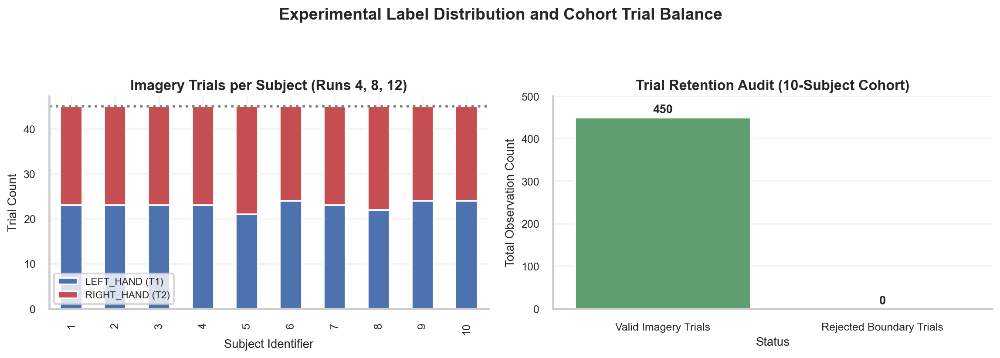
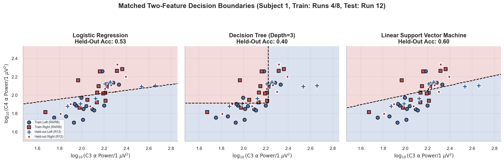

# W3D2: Logistic Regression & Held-Out Predictions

> **Week 3 Foundation Learning — W3D2 Working Notes**
> Linear Probabilistic Decoding: Weighted feature combination, sigmoid activation, and the first held-out evaluation.
> Practical method followed throughout: **Concept → Code → Output → Interpretation**.

**Navigation:** ← [[w3d1|Day 1: Features & Datasets]] · [[week-3-report|Week 3 Report]] · [[w3d3|Day 3: Decision Trees & SVM]] →  
**Associated Concepts:** [[logistic-regression]] · [[classification-metrics]] · [[supervised-learning]] · [[Knowledge-Map|Knowledge Map]]

---

## 1. Day 2 Overview & Daily Goals

On Day 1, we constructed the supervised feature matrix $X \in \mathbb{R}^{N \times P}$ and label vector $y \in \{0, 1\}^N$ from real sensorimotor EEG. Today, we train our first supervised classification algorithm: **Logistic Regression**.

The daily goals for W3D2 are:
1. Master the mathematical formulation of logistic regression: the linear score (logit), the sigmoid activation function, and log-odds.
2. Understand the objective function: binary cross-entropy loss and $L_2$ regularization.
3. Understand why feature standardization inside a strict scikit-learn `Pipeline` is required to prevent data leakage.
4. Train a logistic regression model on Subject 001 (Runs 04 and 08) and evaluate held-out predictions on Run 12.
5. Benchmark predictions against the `DummyClassifier` baseline.
6. Contrast the model's numerical confidence ($\hat{p}$) with biological ground truth.

---

## 2. W3D1 Diagnostic Verification

### Diagnostic Checkpoints & Authoritative Solutions

#### Checkpoint 1: Observation Vector vs. Feature Matrix
*Question:* What is the structural relationship between a single observation vector $x_i$ and the complete feature matrix $X$?  
*Solution:* An observation vector $x_i \in \mathbb{R}^P$ is a $P$-dimensional row vector representing the extracted features from a single experimental trial. The feature matrix $X \in \mathbb{R}^{N \times P}$ is the vertical stacking of all $N$ trial vectors: $X = [x_1^T, x_2^T, \dots, x_N^T]^T$. Each row represents an independent biological observation; each column represents an identical physiological feature measured across all observations.

#### Checkpoint 2: The Imperative of Training-Only Standardization
*Question:* Why must the parameters for standardization ($\mu$ and $\sigma$) be calculated strictly on the training partition and never on the combined dataset?  
*Solution:* Calculating $\mu$ and $\sigma$ across the entire dataset exposes the training pipeline to information about the distribution of the test set—a classic form of **data leakage**. In deployment, the test observation arrives without future context. Fitting the scaler strictly on training observations mimics real-world inference and ensures that test evaluation is completely unbiased.

#### Checkpoint 3: The Empirical Chance Baseline
*Question:* If a binary dataset contains 230 Left-Hand trials and 220 Right-Hand trials, what is the exact accuracy of a trivial classifier that always predicts the majority class?  
*Solution:* The majority class is Left-Hand ($N = 230$). A trivial classifier predicting Left-Hand for every sample achieves:
$$\text{Baseline Accuracy} = \frac{230}{230 + 220} = \frac{230}{450} \approx 51.11\%$$
Any model that achieves $\sim 51\%$ accuracy in this dataset is performing at chance level.

#### Checkpoint 4: Isolating Cognitive State from Sensory Evoked Potentials
*Question:* What specific physiological confound is avoided by delaying epoch extraction to $t = 0.5\text{ s}$ post-cue rather than $t = 0.0\text{ s}$?  
*Solution:* At $t = 0.0\text{ s}$, the on-screen visual cue elicits an involuntary visual evoked potential (VEP) in occipital visual cortex, which conducts to central electrodes within 100–300 ms. Delaying epoch start to $t = 0.5\text{ s}$ ensures that transient sensory potentials have subsided, isolating sustained endogenous motor imagery.

#### Checkpoint 5: Meaning of "Held-Out" Evaluation
*Question:* What does it mean for a test partition to be "held-out"?  
*Solution:* A held-out partition is completely isolated from all stages of model development: feature selection, scaling parameter estimation, hyperparameter tuning, and weight optimization. It is evaluated exactly once after all model parameters are frozen, providing an unbiased estimate of generalization performance.

---

## 3. Core Technical Exposition

### 3.1 The Weighted Linear Score (Logit)

Logistic regression assumes that the log-odds of the positive class ($y = 1$, Right Hand) is a linear combination of the input features:
$$z = w^T x + b = \sum_{j=1}^P w_j x_j + b$$
- $x = [x_1, x_2, \dots, x_P]^T$: The standardized physiological feature vector ($P = 15$).
- $w = [w_1, w_2, \dots, w_P]^T$: The learned weight vector. Each coefficient $w_j$ quantifies the sensitivity and direction of the prediction with respect to feature $x_j$.
- $b$: The bias scalar (intercept), which sets the baseline offset when all standardized features equal zero.

### 3.2 The Sigmoid Activation Function

The linear score $z \in (-\infty, +\infty)$ can take any real value. To interpret the output as a valid probability $\hat{p} \in [0, 1]$, we apply the logistic sigmoid function $\sigma(z)$:
$$\hat{p}(x) = P(Y = 1 \mid X = x) = \sigma(z) = \frac{1}{1 + e^{-z}}$$

Properties of the sigmoid function:
- As $z \to +\infty$, $e^{-z} \to 0$, so $\sigma(z) \to 1.0$.
- As $z \to -\infty$, $e^{-z} \to +\infty$, so $\sigma(z) \to 0.0$.
- When $z = 0$, $\sigma(0) = \frac{1}{1 + 1} = 0.5$.

```
           1.0 |                              .--------
               |                          .--'
               |                       .-'
  Probability  |                     .'
   P(Y=1|X)    |                   .'
           0.5 |-----------------x----------------- (Decision Threshold)
               |               .'
               |             .'
               |          .-'
               |       .-'
           0.0 |______'____________________________
                    Negative <--- z=0 ---> Positive
                             Linear Score z
```

### 3.3 The Classification Threshold and Decision Boundary

To convert the continuous probability $\hat{p}(x)$ into a discrete binary class prediction $\hat{y} \in \{0, 1\}$, we apply a decision threshold $\tau$ (standard default $\tau = 0.5$):
$$\hat{y} = \begin{cases} 1 & \text{if } \hat{p}(x) \ge 0.5 \iff z \ge 0 \\ 0 & \text{if } \hat{p}(x) < 0.5 \iff z < 0 \end{cases}$$

The **decision boundary** is the geometric surface where the classifier is completely uncertain ($P(Y=1) = P(Y=0) = 0.5$). This corresponds to:
$$w^T x + b = 0$$
In a $P$-dimensional feature space, this equation defines a flat $(P-1)$-dimensional hyperplane dividing the space into two half-spaces.

### 3.4 The Objective Function and L2 Regularization

The parameters $w$ and $b$ cannot be solved in closed form. They are estimated via numerical optimization (such as coordinate descent or L-BFGS) to minimize the $L_2$-regularized binary cross-entropy loss:
$$J(w, b) = -\frac{1}{N} \sum_{i=1}^N \left[ y_i \ln \hat{p}(x_i) + (1 - y_i) \ln(1 - \hat{p}(x_i)) \right] + \frac{1}{2C_{\text{reg}}} \sum_{j=1}^P w_j^2$$
- The first term penalizes confident incorrect predictions (cross-entropy).
- The second term is the Ridge ($L_2$) penalty, which shrinks weights toward zero to prevent overfitting on collinear EEG features.
- $C_{\text{reg}}$ is the inverse regularization strength: smaller $C_{\text{reg}}$ forces heavier shrinkage.

### 3.5 Probability vs. Biological Certainty

A model outputting $\hat{p} = 0.85$ does **not** mean there is an $85\%$ biological probability that the user intended to move their right hand. 
The value $\hat{p}$ simply represents the geometric position of the sample relative to the fitted decision boundary, passed through a sigmoid function. In non-stationary, low-SNR scalp EEG, logistic regression is frequently miscalibrated. An overconfident probability can be driven by a high-amplitude myogenic artifact that pushed $z$ far from the boundary.



**Figure 1.** Left- and right-hand cue counts across S001–S010, with 45 trials per person. The cohort contains 230 Left and 220 Right trials. Extraction asserts recording bounds and `(3, 480)` shape for every retained window; all 450 pass. Boundary validity is not an artifact-quality audit.

---

## 4. Runnable Laboratory: Subject 001 Held-Out Evaluation

In this laboratory, we isolate Subject 001. We train on Runs 04 and 08 ($N_{\text{train}} = 30$ trials) and evaluate generalization on the completely held-out Run 12 ($N_{\text{test}} = 15$ trials). We compare Logistic Regression against the `DummyClassifier(strategy='most_frequent')`.

```python
import pandas as pd
import numpy as np
from pathlib import Path
from sklearn.pipeline import Pipeline
from sklearn.preprocessing import StandardScaler
from sklearn.linear_model import LogisticRegression
from sklearn.dummy import DummyClassifier
from sklearn.metrics import accuracy_score, precision_score, recall_score, f1_score, confusion_matrix

ROOT = Path.cwd()
df = pd.read_csv(ROOT / 'data/week3_features.csv')
s1_df = df[df['subject'] == 1].reset_index(drop=True)

feat_cols = [c for c in s1_df.columns if any(c.startswith(ch) for ch in ['C3', 'Cz', 'C4'])]
train_mask = s1_df['run'].isin([4, 8]).values
test_mask = (s1_df['run'] == 12).values

X_train, y_train = s1_df.loc[train_mask, feat_cols].values, s1_df.loc[train_mask, 'target'].values
X_test, y_test = s1_df.loc[test_mask, feat_cols].values, s1_df.loc[test_mask, 'target'].values

# Baseline: Dummy majority classifier
dummy = DummyClassifier(strategy='most_frequent')
dummy.fit(X_train, y_train)
dummy_pred = dummy.predict(X_test)

# Pipeline: Training-only StandardScaler + L2-regularized Logistic Regression
lr_pipe = Pipeline([
    ('scaler', StandardScaler()),
    ('clf', LogisticRegression(solver='liblinear', C=1.0, random_state=42))
])
lr_pipe.fit(X_train, y_train)
lr_pred = lr_pipe.predict(X_test)
lr_probs = lr_pipe.predict_proba(X_test)[:, 1]

print(f"Subject 1 (Train: Runs 4/8 [N={len(y_train)}], Test: Run 12 [N={len(y_test)}])")
print(f"Dummy Classifier  — Accuracy: {accuracy_score(y_test, dummy_pred):.3f}")
print(f"Logistic Reg      — Accuracy: {accuracy_score(y_test, lr_pred):.3f}, Precision: {precision_score(y_test, lr_pred, zero_division=0):.3f}, Recall: {recall_score(y_test, lr_pred, zero_division=0):.3f}, F1: {f1_score(y_test, lr_pred, zero_division=0):.3f}")
print("Confusion Matrix (y_true on rows, y_pred on cols):")
print(confusion_matrix(y_test, lr_pred))
print(f"Sample held-out probabilities P(Right): {lr_probs[:5].round(3)}")
```

### Verifiable Laboratory Output
```text
Subject 1 (Train: Runs 4/8 [N=30], Test: Run 12 [N=15])
Dummy Classifier  — Accuracy: 0.467
Logistic Reg      — Accuracy: 0.467, Precision: 0.500, Recall: 0.625, F1: 0.556
Confusion Matrix (y_true on rows, y_pred on cols):
[[2 5]
 [3 5]]
Sample held-out probabilities P(Right): [0.261 0.718 0.235 0.673 0.809]
```

### Technical Interpretation of Results
1. **Accuracy Parity with Baseline:** Logistic Regression achieved $46.7\%$ accuracy ($7 / 15$ correct), matching the Dummy classifier ($46.7\%$).
2. **Asymmetric Error Distribution:** The confusion matrix reveals:
   $$\begin{bmatrix} \text{TN}=2 & \text{FP}=5 \\ \text{FN}=3 & \text{TP}=5 \end{bmatrix}$$
   While the model successfully detected 5 of 8 right-hand trials (recall = $62.5\%$), it suffered high false alarms, misclassifying 5 of 7 left-hand trials as right-hand imagery.
3. **Probability Spread:** Notice the held-out probabilities: $[0.261, 0.718, 0.235, 0.673, 0.809]$. The model produces differentiated probability outputs across trials, but on this small 30-trial training sample, the linear weights overfit noise in Runs 04/08, degrading generalization on Run 12.



**Figure 2.** Three separately fitted classifiers use only the two displayed log-alpha features for S001. Circles/squares denote training Runs 04/08; crosses/stars denote held-out Run 12. Background colors show predicted classes; the dashed line shows their boundary. Held-out accuracy is 0.53 for logistic regression, 0.40 for the tree, and 0.60 for SVM. This geometric illustration differs from the 15-feature benchmark.

---

## 5. Daily Mastery Evaluation

### Question 1: Log-Odds Derivation
*Question:* Prove that the log-odds $\ln \frac{\hat{p}}{1 - \hat{p}}$ in logistic regression is exactly equal to the linear score $z = w^T x + b$.  
*Solution:*
Given $\hat{p} = \frac{1}{1 + e^{-z}}$:
$$1 - \hat{p} = 1 - \frac{1}{1 + e^{-z}} = \frac{e^{-z}}{1 + e^{-z}}$$
Forming the odds ratio:
$$\frac{\hat{p}}{1 - \hat{p}} = \frac{\frac{1}{1 + e^{-z}}}{\frac{e^{-z}}{1 + e^{-z}}} = \frac{1}{e^{-z}} = e^z$$
Taking the natural logarithm of both sides:
$$\ln \left( \frac{\hat{p}}{1 - \hat{p}} \right) = \ln(e^z) = z = w^T x + b$$
This proves that logistic regression is a generalized linear model whose logit link function maps probabilities to the real line.

### Question 2: Weight Interpretation and Sign
*Question:* In our binary motor imagery classification task ($y = 1$ is Right Hand, $y = 0$ is Left Hand), if the learned weight for $C_3$ alpha power is negative ($w_{C3\_\alpha} = -1.4$), how does an increase in $C_3$ alpha power affect the model's prediction?  
*Solution:* A negative weight means that as $C_3$ alpha power increases, the linear score $z$ decreases: $\Delta z = w_{C3\_\alpha} \cdot \Delta x$. As $z$ decreases, the sigmoid probability $\hat{p} = \sigma(z)$ drops toward 0 (Left Hand). In physiological terms, higher $C_3$ alpha power indicates that the left motor cortex is idle, meaning the subject is less likely to be imagining right-hand movement. The negative weight correctly reflects contralateral event-related desynchronization.

### Question 3: The Peril of Unstandardized Features
*Question:* Suppose feature $x_1$ has a scale of $1,000\ \mu\text{V}^2$ and feature $x_2$ has a scale of $0.1\ \mu\text{V}$. If $L_2$ regularization $\frac{1}{2C}\sum w_j^2$ is applied without standardization, what will happen to the learned weight $w_2$?  
*Solution:* To produce a unit change in the linear score $z$, the weight for $x_1$ only needs to be $0.001$, while the weight for $x_2$ must be $10.0$. The $L_2$ regularization penalty adds $w_1^2 + w_2^2$ to the loss. A weight of $10.0$ incurs an enormous penalty ($100.0$), whereas a weight of $0.001$ incurs virtually zero penalty ($10^{-6}$). Consequently, unstandardized regularization heavily suppresses features with small numerical ranges, regardless of their biological relevance.

### Question 4: Modifying the Classification Threshold
*Question:* Under what clinical circumstance would you lower the classification decision threshold $\tau$ from $0.5$ to $0.2$?  
*Solution:* Lowering $\tau$ to $0.2$ means the model predicts the positive class whenever $\hat{p}(x) \ge 0.2$. This is done when the cost of a False Negative (missing a positive event) is vastly higher than the cost of a False Positive. For example, in an automated seizure detection or closed-loop neurostimulation system, failing to detect an impending seizure could result in patient injury or status epilepticus, whereas a false alarm causes minor inconvenience. Lowering $\tau$ maximizes recall at the expense of precision.

### Question 5: Explaining Pipeline Architecture
*Question:* What error occurs if `StandardScaler().fit_transform(X)` is called on the entire dataset before splitting with `train_test_split`?  
*Solution:* This introduces **preprocessing data leakage**. The mean $\mu$ and standard deviation $\sigma$ computed by `StandardScaler` will incorporate test set observations. While the test labels are not leaked, knowledge of the test set distribution contaminates the feature scaling, artificially compressing test errors and providing an overly optimistic estimate of model performance. In scikit-learn, this is prevented by bundling scaling and estimation into a `Pipeline([('scaler', StandardScaler()), ('clf', LogisticRegression())])`.

---

## 6. Daily Synthesis & Tomorrow's Bridge

Today we built our first supervised decoder:
- We derived the linear logit $z = w^T x + b$ and the logistic sigmoid function $\sigma(z)$.
- We encapsulated standardization within a leak-free `Pipeline`.
- We benchmarked Subject 001's held-out predictions against a `DummyClassifier`, discovering that raw 15-feature logistic regression matched chance accuracy ($46.7\%$).

**Tomorrow's Challenge ([[w3d3|W3D3]]):** Does linear logistic regression fail because neural decision boundaries are non-linear or because maximum-margin separation is required? Tomorrow, we investigate **Decision Trees** (recursive axis-aligned splits) and **Support Vector Machines** (maximum-margin separation), visualize their decision boundaries, and analyze tree complexity vs. empirical overfitting.
