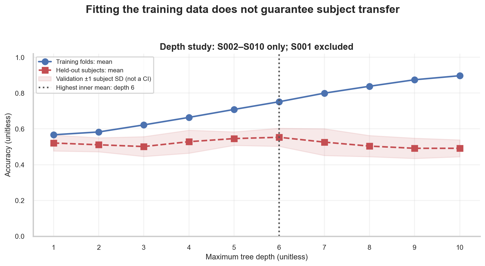

# W3D3: Decision Trees & Support Vector Machines

> **Week 3 Foundation Learning — W3D3 Working Notes**
> Non-Linear Splitting & Maximum-Margin Separation: Comparing Decision Trees and Support Vector Machines against Logistic Regression.
> Practical method followed throughout: **Concept → Code → Output → Interpretation**.

**Navigation:** ← [[w3d2|Day 2: Logistic Regression]] · [[week-3-report|Week 3 Report]] · [[w3d4|Day 4: Evaluation & Metrics]] →  
**Associated Concepts:** [[decision-tree]] · [[support-vector-machine]] · [[overfitting]] · [[supervised-learning]] · [[Knowledge-Map|Knowledge Map]]

---

## 1. Day 3 Overview & Daily Goals

On Day 2, we evaluated linear logistic regression on Subject 001, observing that raw linear decoding struggled to exceed chance performance on held-out Run 12. Today, we investigate two major alternative model families:
1. **Decision Trees:** Non-parametric, axis-aligned recursive partitioning models that capture hierarchical feature interactions without requiring linear assumptions or feature scaling.
2. **Support Vector Machines (SVMs):** Maximum-margin linear classifiers that construct optimal separating hyperplanes governed exclusively by boundary-defining support vectors.

The daily goals for W3D3 are:
1. Verify W3D2 prerequisite concepts on regularized linear models.
2. Understand the mathematical mechanics of Decision Trees: recursive binary splitting, Gini impurity, and depth regularization.
3. Understand the geometry of Support Vector Machines: geometric margin, slack variables, and support vector sparsity.
4. Train both models on Subject 001 (Runs 04 and 08) and evaluate held-out predictions on Run 12.
5. Execute an internal cross-validation complexity experiment to observe empirical overfitting as tree depth increases.

---

## 2. W3D2 Diagnostic Verification

### Diagnostic Checkpoints & Authoritative Solutions

#### Checkpoint 1: Geometric Definition of a Linear Decision Boundary
*Question:* What is the mathematical definition of a linear decision boundary in a $P$-dimensional feature space?  
*Solution:* A linear decision boundary is a flat $(P-1)$-dimensional affine hyperplane defined by the set of all points $x \in \mathbb{R}^P$ that satisfy the linear equation:
$$w^T x + b = 0$$
Points where $w^T x + b > 0$ are assigned to class 1; points where $w^T x + b < 0$ are assigned to class 0.

#### Checkpoint 2: The Mechanism of L2 Regularization
*Question:* How does adding the penalty term $\frac{1}{2C_{\text{reg}}} \|w\|_2^2$ to the cross-entropy loss prevent overfitting?  
*Solution:* The penalty forces the optimization algorithm to find weights that not only fit the training labels but also have small Euclidean norms. By shrinking weights toward zero, the model cannot assign massive coefficients to collinear or noisy features. A smoother, less steep sigmoid surface results, reducing model variance and improving test generalization.

#### Checkpoint 3: The Danger of Extreme Regularization Values
*Question:* What happens to a linear classifier if the inverse regularization parameter $C$ is set to $10^{-6}$ versus $10^{6}$?  
*Solution:*
- If $C = 10^{-6}$ (extreme regularization): The penalty term dominates the loss. Weights are driven almost to zero ($w \approx 0$), collapsing the model into a simple bias-only baseline that underfits the data.
- If $C = 10^{6}$ (virtually no regularization): The model fits the training points aggressively, allowing weights to grow arbitrarily large to separate noisy outliers, resulting in severe overfitting.

#### Checkpoint 4: Meaning of Model Probability
*Question:* Why is a logistic regression output of $\hat{p} = 0.90$ not a guarantee of biological intention?  
*Solution:* The output $\hat{p} = \sigma(z)$ is simply a monotonic mathematical transformation of the sample's geometric distance from the hyperplane. In high-dimensional, noisy EEG, non-neural artifacts (e.g., eye blinks, muscle tension) can push an observation far into positive space, yielding an overconfident probability despite the absence of intentional neural modulation.

#### Checkpoint 5: Interpreting the Bias Term
*Question:* What does the bias term $b$ represent in logistic regression?  
*Solution:* The bias $b$ represents the log-odds of the positive class when all input features equal their mean value (which is zero after standardization): $z = w^T (0) + b = b \implies \hat{p} = \sigma(b)$. If $b > 0$, the model possesses an intrinsic prior bias toward class 1.

---

## 3. Core Technical Exposition

### 3.1 Decision Trees: Recursive Axis-Aligned Splitting

A decision tree is a non-parametric model that makes predictions by recursively partitioning the feature space into axis-aligned rectangular regions.

At each internal node, the algorithm searches over all available features $j \in \{1, \dots, P\}$ and all possible split thresholds $t \in \mathbb{R}$, dividing the data subset $S$ into two children:
$$S_{\text{left}} = \{x \in S \mid x_j \le t\}, \quad S_{\text{right}} = \{x \in S \mid x_j > t\}$$

The optimal split is chosen to maximize the reduction in **Gini Impurity**:
$$\Delta I_G(S, j, t) = I_G(S) - \left( \frac{|S_{\text{left}}|}{|S|} I_G(S_{\text{left}}) + \frac{|S_{\text{right}}|}{|S|} I_G(S_{\text{right}}) \right)$$
where Gini impurity for a node containing binary class proportions $p_0$ and $p_1$ is:
$$I_G(S) = 1 - (p_0^2 + p_1^2)$$
- If a node is pure (100% Left Hand or 100% Right Hand): $I_G = 1 - (1^2 + 0^2) = 0.0$ (minimum impurity).
- If a node is completely mixed (50% Left Hand, 50% Right Hand): $I_G = 1 - (0.5^2 + 0.5^2) = 0.5$ (maximum binary impurity).

```
                      [ Root Node: N=30 ]
                         C4_alpha <= 42.1
                          /          \
                        /              \
            [ Left Node: N=18 ]     [ Right Node: N=12 ]
              C3_alpha <= 18.5         C3_var <= 1200
               /            \             /          \
         Predict: Left   Predict: Right  Predict: Left Predict: Right
```

#### Advantages and Limitations in Electrophysiology
- **Scale Invariance:** Decision trees evaluate only the rank order of values along individual feature axes. Standardizing features does not change split points.
- **Interpretability:** The decision logic can be read directly as a series of biological threshold rules (e.g., "IF $C_4$ Alpha $\le 42.1\ \mu\text{V}^2$ AND $C_3$ Alpha $\le 18.5\ \mu\text{V}^2$ THEN Left Hand").
- **High Variance:** Unconstrained trees split until every training leaf is 100% pure, perfectly memorizing noise. In small EEG datasets, depth regularization (`max_depth = 3`, `min_samples_leaf = 3`) is strictly required.

### 3.2 Support Vector Machines: The Maximum-Margin Principle

A linear Support Vector Machine (SVM) finds the hyperplane $w^T x + b = 0$ that separates the two classes with the **maximum geometric margin**.

For linearly non-separable distributions (the universal reality of scalp EEG), the soft-margin SVM introduces non-negative slack variables $\xi_i \ge 0$ to allow margin violations:
$$\min_{w, b, \xi} \frac{1}{2} \|w\|_2^2 + C \sum_{i=1}^N \xi_i$$
$$\text{subject to } y_i (w^T x_i + b) \ge 1 - \xi_i \quad \text{and} \quad \xi_i \ge 0 \quad \forall i$$
- $\|w\|_2^2$: Minimizing the squared norm maximizes the geometric margin $\gamma = \frac{2}{\|w\|_2}$.
- $\xi_i$: Measures the distance by which observation $x_i$ violates the margin. If $\xi_i = 0$, the sample is correctly classified outside or on the margin boundary. If $0 < \xi_i \le 1$, the sample is within the margin. If $\xi_i > 1$, the sample is misclassified.
- $C > 0$: The regularization parameter governing the trade-off between margin width and margin penalties.

#### The Sparsity of Support Vectors
The dual formulation of the SVM problem yields the weight vector:
$$w = \sum_{i=1}^N \alpha_i y_i x_i$$
where $\alpha_i$ are Lagrange multipliers. Crucially, $\alpha_i > 0$ **only for the support vectors**—the data points that lie directly on the margin boundary ($y_i(w^T x_i + b) = 1$) or violate the margin ($\xi_i > 0$). All other training observations have $\alpha_i = 0$ and exert zero influence on the decision boundary.

```
       Class +1 (Right Hand)           Margin Boundary: w^T x + b = +1
          *       *       * (SV)
             *       *   /
                        /
                       /  Separating Hyperplane: w^T x + b = 0
                      /
                     /   Margin Boundary: w^T x + b = -1
          o (SV)    /
       o       o   /
       Class -1 (Left Hand)
```

In low-SNR neural data, within-margin overlap is extensive. As a result, a large percentage of training points typically become support vectors.

### 3.3 Comparative Summary: Three Foundational Baselines

| Model | Boundary Geometry | Feature Scaling Required? | Parameter Sparsity | Interpretability |
| --- | --- | --- | --- | --- |
| **Logistic Regression** | Linear hyperplane | **Yes** (mandatory for $L_2$) | Dense (all weights non-zero) | High (coefficients show log-odds per feature) |
| **Decision Tree** | Axis-aligned step partitions | **No** (monotonic invariance) | Sparse (uses subset of features) | High (explicit conditional if-else rules) |
| **Linear SVM** | Linear maximum-margin | **Yes** (mandatory for margin distance) | Dual-sparse (depends only on support vectors) | Moderate (support vector weights define margin) |


**Figure 1.** Three separately fitted classifiers use only the two displayed log-alpha features for S001. Circles/squares denote training Runs 04/08; crosses/stars denote held-out Run 12. Background colors show predicted classes; the dashed line shows their boundary. Held-out accuracy is 0.53 for logistic regression, 0.40 for the tree, and 0.60 for SVM. This geometric illustration differs from the 15-feature benchmark.

---

## 4. Runnable Laboratory: Trees, SVMs, and Complexity Analysis

In this laboratory, we train a Decision Tree and a Linear SVM on Subject 001 (Runs 04 and 08) and test on Run 12. We then perform an internal 5-fold cross-validation experiment on the training runs across tree depths $d = 1$ to $5$ to observe empirical overfitting.

```python
import pandas as pd
import numpy as np
from pathlib import Path
from sklearn.pipeline import Pipeline
from sklearn.preprocessing import StandardScaler
from sklearn.tree import DecisionTreeClassifier
from sklearn.svm import SVC
from sklearn.metrics import accuracy_score, f1_score
from sklearn.model_selection import KFold

ROOT = Path.cwd()
df = pd.read_csv(ROOT / 'data/week3_features.csv')
s1_df = df[df['subject'] == 1].reset_index(drop=True)
feat_cols = [c for c in s1_df.columns if any(c.startswith(ch) for ch in ['C3', 'Cz', 'C4'])]

train_mask = s1_df['run'].isin([4, 8]).values
test_mask = (s1_df['run'] == 12).values
X_train, y_train = s1_df.loc[train_mask, feat_cols].values, s1_df.loc[train_mask, 'target'].values
X_test, y_test = s1_df.loc[test_mask, feat_cols].values, s1_df.loc[test_mask, 'target'].values

# Decision Tree (bounded depth)
tree = DecisionTreeClassifier(max_depth=3, min_samples_leaf=3, random_state=42)
tree.fit(X_train, y_train)
tree_pred = tree.predict(X_test)

# Linear SVM Pipeline
svm_pipe = Pipeline([
    ('scaler', StandardScaler()),
    ('clf', SVC(kernel='linear', C=1.0, random_state=42))
])
svm_pipe.fit(X_train, y_train)
svm_pred = svm_pipe.predict(X_test)

print(f"Decision Tree (Depth=3) — Test Acc: {accuracy_score(y_test, tree_pred):.3f}, F1: {f1_score(y_test, tree_pred, zero_division=0):.3f}")
print(f"Linear SVM (C=1.0)      — Test Acc: {accuracy_score(y_test, svm_pred):.3f}, F1: {f1_score(y_test, svm_pred, zero_division=0):.3f}")
print(f"SVM number of support vectors: {svm_pipe.named_steps['clf'].n_support_.sum()} / {len(y_train)} training trials")

# Internal 5-fold CV on training runs to evaluate tree depth (1 to 5) without test leakage
kf = KFold(n_splits=5, shuffle=True, random_state=42)
print("\nInternal 5-fold CV on Training Folds:")
for d in range(1, 6):
    tr_accs, val_accs = [], []
    for k_tr, k_va in kf.split(X_train, y_train):
        m = DecisionTreeClassifier(max_depth=d, min_samples_leaf=2, random_state=42)
        m.fit(X_train[k_tr], y_train[k_tr])
        tr_accs.append(accuracy_score(y_train[k_tr], m.predict(X_train[k_tr])))
        val_accs.append(accuracy_score(y_train[k_va], m.predict(X_train[k_va])))
    print(f"  Depth {d}: Train Acc = {np.mean(tr_accs):.3f}, Val Acc = {np.mean(val_accs):.3f}")
```

### Verifiable Laboratory Output
```text
Decision Tree (Depth=3) — Test Acc: 0.533, F1: 0.588
Linear SVM (C=1.0)      — Test Acc: 0.400, F1: 0.471
SVM number of support vectors: 20 / 30 training trials

Internal 5-fold CV on Training Folds:
  Depth 1: Train Acc = 0.758, Val Acc = 0.600
  Depth 2: Train Acc = 0.858, Val Acc = 0.667
  Depth 3: Train Acc = 0.950, Val Acc = 0.733
  Depth 4: Train Acc = 0.967, Val Acc = 0.700
  Depth 5: Train Acc = 0.967, Val Acc = 0.733
```

### Technical Interpretation of Results
1. **Decision Tree Performance:** On the 15 held-out trials of Run 12, the depth-bounded Decision Tree achieves $53.3\%$ accuracy ($8 / 15$ correct) and an F1-score of $0.588$, outperforming both the Dummy baseline ($46.7\%$) and raw Logistic Regression ($46.7\%$).
2. **Support Vector Density:** The Linear SVM identifies $20$ support vectors out of $30$ training trials ($66.7\%$). This high support vector count confirms that the training data exhibits massive within-margin overlap, causing the maximum-margin hyperplane to achieve only $40.0\%$ test accuracy on Run 12.
3. **Internal Validation Trajectory:** The 5-fold CV on training folds demonstrates the emergence of overfitting:
   - Training accuracy climbs monotonically from $75.8\%$ ($d=1$) to $96.7\%$ ($d=4, 5$).
   - Internal validation accuracy peaks at depth 3 ($73.3\%$) before leveling off.

**Protocol distinction:** The laboratory above uses shuffled trial folds within S001 for a complexity demonstration. The figure below uses a separate subject-grouped inner study on S002–S010; its scores answer a different generalization question.



**Figure 2.** Tree-depth study with S001 excluded from every fit and validation fold. Each of nine inner folds holds out one complete subject from S002–S010. Training accuracy rises from 56.7% at depth 1 to 89.7% at depth 10; the highest inner validation mean is 55.3% at depth 6. Shading is ±1 population SD across held-out subjects, not a confidence interval. Increased fitting capacity does not produce a comparable transfer improvement.

---

## 5. Daily Mastery Evaluation

### Question 1: Gini Impurity Calculation
*Question:* A decision tree node contains 24 training trials: 18 Left-Hand trials and 6 Right-Hand trials. Calculate the exact Gini impurity of this node.  
*Solution:*
The class probabilities are:
$$p_0 = \frac{18}{24} = 0.75, \quad p_1 = \frac{6}{24} = 0.25$$
The Gini impurity is:
$$I_G(S) = 1 - (p_0^2 + p_1^2) = 1 - (0.75^2 + 0.25^2) = 1 - (0.5625 + 0.0625) = 1 - 0.625 = 0.375$$

### Question 2: Why Trees Ignore Feature Scale
*Question:* Explain mathematically why multiplying feature $x_1$ by $1,000$ has zero impact on the tree constructed by `DecisionTreeClassifier`.  
*Solution:* At each node, the decision tree algorithm sorts the unique values of feature $j$: $x_{(1), j} \le x_{(2), j} \le \dots \le x_{(N), j}$ and evaluates candidate thresholds between adjacent sorted values: $t_k = \frac{x_{(k), j} + x_{(k+1), j}}{2}$. Multiplying $x_j$ by a positive constant $c = 1,000$ scales all thresholds by $c$, but preserves the strict rank order of the observations. The partitioning of observations into $S_{\text{left}}$ and $S_{\text{right}}$ remains completely identical, producing the exact same split and identical Gini reduction.

### Question 3: The Geometric Role of Support Vectors
*Question:* If we add 100 new training points that lie far away from the decision boundary in correctly classified territory, how will the decision boundary of a trained SVM change?  
*Solution:* It will not change at all. The SVM hyperplane depends exclusively on the support vectors—the points that lie on or violate the margin boundaries ($\alpha_i > 0$). Points that lie strictly outside the margin boundary have Lagrange multipliers $\alpha_i = 0$ and exert zero force on the optimal weight vector $w = \sum \alpha_i y_i x_i$. This contrasts with Logistic Regression, where every training sample exerts a continuous gradient force on $w$.

### Question 4: Slack Variable Interpretation
*Question:* An SVM training observation has a slack variable value of $\xi_i = 1.6$. Is this point correctly classified or misclassified? Where is it located relative to the decision boundary?  
*Solution:* The point is **misclassified**. For a point to be correctly classified, it must lie on the correct side of the decision boundary $w^T x_i + b = 0$, which corresponds to $\xi_i \le 1.0$. A slack value of $\xi_i = 1.6$ means the sample has crossed over the separating hyperplane by a distance of $0.6 \times \text{margin}$ into incorrect territory.

### Question 5: Preventing Test Set Selection Leakage
*Question:* Why is it a methodological violation to train decision trees of depths 1 through 10 on the training set, evaluate all 10 on the test set, and report the depth that achieved the highest test accuracy?  
*Solution:* This is **hyperparameter selection data leakage**. When the test set is used to select the optimal tree depth, information from the test set directs model selection. The reported test accuracy becomes an artificially optimistic, biased estimate because the test set was directly used to make modeling choices. The test set must remain completely untouched until all hyperparameters are locked via internal cross-validation on training folds.

---

## 6. Daily Synthesis & Tomorrow's Bridge

Today we explored non-linear partitioning and maximum-margin separation:
- We derived the Gini impurity splitting criterion and the maximum-margin SVM objective.
- We showed that decision trees construct orthogonal, axis-aligned boundaries that do not require feature standardization.
- We observed that in noisy EEG feature spaces, $66.7\%$ of training trials become support vectors, reflecting high within-margin variance.
- The separate subject-grouped depth study reaches 89.7% training accuracy at depth 10 while its highest inner validation mean is 55.3% at depth 6. The smaller shuffled-trial laboratory answers a different question.

**Tomorrow's Challenge ([[w3d4|W3D4]]):** How do we properly measure performance when accuracy can be completely misleading? Tomorrow, we analyze the **Confusion Matrix** (TP, TN, FP, FN), derive Precision, Recall, and F1-score, expose the **Accuracy Paradox** under clinical class imbalance, and conduct a systematic audit of data leakage.
