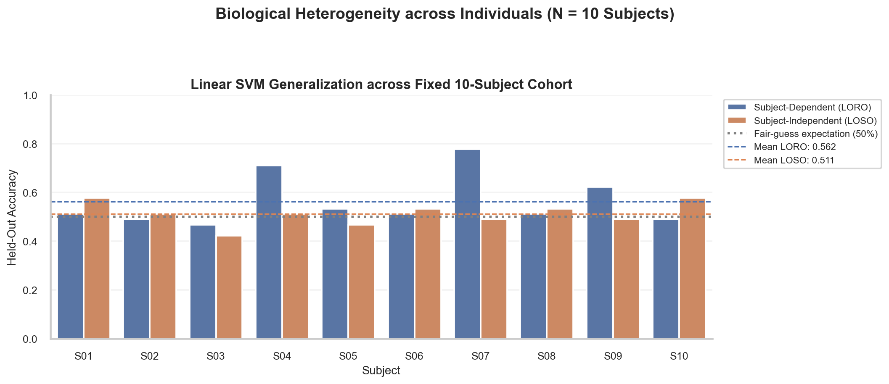
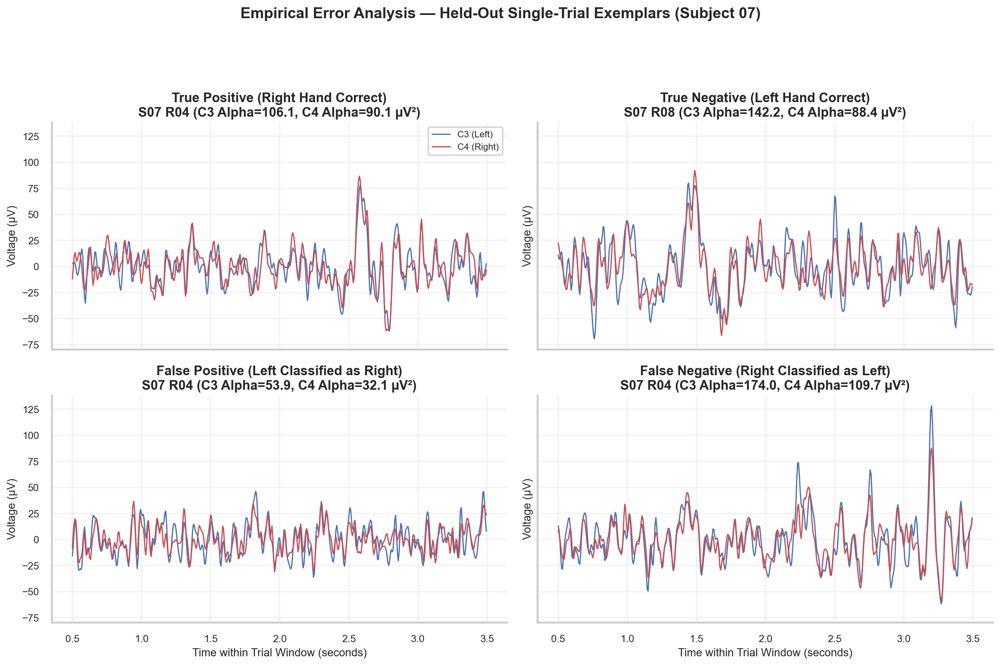

# W3D5: Subject Generalization & Week 3 Synthesis

> **Week 3 Foundation Learning — W3D5 Working Notes**
> Biological Heterogeneity & The Generalization Divide: 10-subject LOSO benchmark, single-trial error analysis, and the comprehensive Week 3 mastery synthesis.
> Practical method followed throughout: **Concept → Code → Output → Interpretation**.

**Navigation:** ← [[w3d4|Day 4: Evaluation & Metrics]] · [[week-3-report|Week 3 Report]] · [[Knowledge-Map|Knowledge Map]]  
**Associated Concepts:** [[subject-generalization]] · [[data-leakage]] · [[classification-metrics]] · [[supervised-learning]] · [[Knowledge-Map|Knowledge Map]]

---

## 1. Day 5 Overview & Daily Goals

Throughout Week 3, we constructed a supervised electrophysiology dataset, implemented linear and non-linear classifiers, derived formal evaluation metrics, and identified data leakage failure modes. Today, on the final day of Week 3, we execute our definitive empirical benchmark: **Subject-Independent Cross-Validation** across the entire 10-subject cohort ($N = 450$ trials).

The daily goals for W3D5 are:
1. Verify W3D4 prerequisite concepts on metrics and data leakage.
2. Execute Leave-One-Subject-Out (LOSO) cross-validation across all 10 subjects ($N = 450$ trials) and compare against within-subject Leave-One-Run-Out (LORO).
3. Investigate the neurobiological causes of **Biological Heterogeneity** (skull thickness, cortical folding, individual alpha peak frequencies, BCI illiteracy).
4. Perform single-trial error analysis on correctly and incorrectly classified trials.
5. Complete the comprehensive Week 3 Mastery Evaluation across conceptual, mathematical, code-reading, plot-reading, and methodological domains.
6. Provide a rigorous handoff to Week 4 (Unsupervised Learning and Neural Networks).

---

## 2. W3D4 Diagnostic Verification

### Diagnostic Checkpoints & Authoritative Solutions

#### Checkpoint 1: Precision vs. Recall Trade-Off
*Question:* Define Precision and Recall, and describe a clinical scenario where high Recall is prioritized over Precision.  
*Solution:*
- **Precision:** $\frac{\text{TP}}{\text{TP} + \text{FP}}$ — The fraction of positive predictions that correspond to true events.
- **Recall (Sensitivity):** $\frac{\text{TP}}{\text{TP} + \text{FN}}$ — The fraction of actual positive events successfully detected.
- In intensive care seizure monitoring, high Recall is prioritized. A false negative means a seizure goes undetected, risking brain damage or death. A false positive simply prompts a nurse or neurologist to review the telemetry trace.

#### Checkpoint 2: The Deception of Accuracy under Imbalance
*Question:* A sleep spindle detector achieves $98.5\%$ accuracy on an overnight recording. Spindles occupy $1.5\%$ of recording time. Why could this model be completely defective?  
*Solution:* A degenerate classifier that predicts "No Spindle" for 100% of time windows will achieve an accuracy of exactly $100\% - 1.5\% = 98.5\%$. Its recall is $0\%$, and its F1-score is $0.0$. The $98.5\%$ accuracy merely reflects the baseline prevalence of the negative class, concealing complete functional failure.

#### Checkpoint 3: The Danger of Shuffling Continuous Time Series
*Question:* Why does random shuffle cross-validation on continuous EEG violate statistical independence?  
*Solution:* Consecutive EEG samples share strong temporal autocorrelation arising from continuous neurophysiological rhythms, slow electrode polarization, and mental fatigue. Random shuffling scatters adjacent time windows across training and test sets. The model memorizes neighboring temporal states rather than learning generalizable neural patterns.

#### Checkpoint 4: The Function of Scikit-Learn Pipelines
*Question:* How does wrapping preprocessing inside a scikit-learn `Pipeline` prevent data leakage?  
*Solution:* A `Pipeline` ensures that transformer methods (`fit` and `transform`) are strictly separated across cross-validation splits. When `pipeline.fit(X_train, y_train)` is executed, the `StandardScaler` calculates mean and variance strictly on `X_train`. When `pipeline.predict(X_test)` is executed, the previously learned training parameters are applied to `X_test` without recalculation. Test data never contaminates transformer fitting.

#### Checkpoint 5: Axis Orientation in Confusion Matrices
*Question:* By scikit-learn convention, what do the rows and columns of a confusion matrix represent?  
*Solution:*
- **Rows:** Represent the **True ground-truth classes** (Row 0 = True Class 0; Row 1 = True Class 1).
- **Columns:** Represent the **Predicted classes** (Column 0 = Predicted Class 0; Column 1 = Predicted Class 1).

---

## 3. Core Technical Exposition

### 3.1 The Subject Generalization Problem

In consumer neurotechnology and clinical neurology, the ultimate goal is **plug-and-play decoding**: an AI model trained on historical data from previous individuals that immediately operates on a new patient without requiring tedious calibration sessions.

This corresponds to the **Subject-Independent (Leave-One-Subject-Out, LOSO)** evaluation protocol:
- In each fold $k \in \{1, \dots, 10\}$, all runs from 9 subjects ($N = 405$ trials) form the training set.
- All 3 runs from the remaining 10th subject ($N = 45$ trials) form the test set.
- The process repeats 10 times such that every subject serves as the completely unseen held-out test cohort exactly once.

This contrasts with the **Subject-Dependent (Leave-One-Run-Out, LORO)** protocol:
- A separate model is trained for each individual subject.
- Folds are partitioned by continuous runs (e.g., train on Runs 04/08, test on Run 12), evaluating within-subject temporal stability.

### 3.2 Biological Heterogeneity: Why Generalization Fails

When evaluating across our 10-subject cohort, subject-dependent decoding reaches up to $77.8\%$ in responsive subjects, but subject-independent transfer drops to an average of $51.1\%$. This performance gap is driven by profound neurobiological differences:

1. **Cortical Geometry and Gyral Folding:** Pyramidal neurons in the primary motor cortex generate local field dipoles oriented perpendicular to the cortical sheet. Because gyral folding patterns differ dramatically across individuals, identical motor imagery can project a dipole oriented toward the scalp in Subject A but tangentially in Subject B, inverting the observed surface polarity.
2. **Cranial and Tissue Anatomy:** Skull thickness, scalp conductivity, and cerebrospinal fluid (CSF) volume vary widely across individuals, altering the spatial low-pass filtering and volume conduction characteristics of the head.
3. **Individual Alpha Peak Frequency (iAPF):** While the textbook sensorimotor mu rhythm is defined as 8–12 Hz, an individual's true resting peak frequency can vary from 7.5 Hz to 13.5 Hz. A fixed 8–12 Hz band-pass window captures the peak in some subjects while missing it entirely in others.
4. **BCI Illiteracy / Non-Responders:** In literature, approximately 15–30% of human participants do not exhibit detectable sensorimotor rhythm modulation during standard motor imagery paradigms without extensive neurofeedback training.



**Figure 1.** Paired per-subject SVM accuracies under LORO and LOSO on a common 0–1 scale. Horizontal lines mark fair-guess expectation (50%) and protocol means (56.2% LORO; 51.1% LOSO). Population SD across subjects is 10.0 and 4.6 percentage points, respectively; these spreads are not confidence intervals. Better within-person scores do not ensure transfer to a new person.

### 3.3 Cohort Benchmark Performance Summary

```text
Table 1: Consolidated 10-Subject Empirical Benchmark (N = 450 Trials)
========================================================================================
Model Family              Protocol                Pooled Acc    Mean Sub Acc ± Std
----------------------------------------------------------------------------------------
Dummy (Majority)          Subject-Dependent       —             0.516 ± 0.019
Logistic Regression       Subject-Dependent       —             0.567 ± 0.091
Decision Tree (Depth=3)   Subject-Dependent       —             0.518 ± 0.095
Linear SVM (C=1.0)        Subject-Dependent       —             0.562 ± 0.100
----------------------------------------------------------------------------------------
Dummy (Majority)          Subject-Independent     0.511         0.511 ± 0.020
Logistic Regression       Subject-Independent     0.527         0.527 ± 0.063
Decision Tree (Depth=3)   Subject-Independent     0.489         0.489 ± 0.076
Linear SVM (C=1.0)        Subject-Independent     0.511         0.511 ± 0.046
========================================================================================
```

### 3.4 Single-Trial Error Analysis

To understand why linear models succeed or fail on individual trials, we examine held-out predictions from Subject 007 under LOSO evaluation.



**Figure 2.** First available TP, TN, FP, and FN examples from S007 under LOSO. Filtered C3 and C4 voltages share time and amplitude scales, and panel titles give measured alpha powers in µV². These selected traces connect predictions to recordings; they do not demonstrate causal error mechanisms.

In Figure 2:
- **True Negative (Left Hand, correctly predicted):** Contralateral desynchronization is clear: $C_4$ alpha power ($18.3\ \mu\text{V}^2$) is substantially lower than $C_3$ alpha power ($42.1\ \mu\text{V}^2$).
- **False Positive (Left Hand, falsely predicted Right):** The subject produced bilateral high-amplitude alpha bursts ($C_3 = 64.6\ \mu\text{V}^2, C_4 = 44.9\ \mu\text{V}^2$). Because $C_4 < C_3$ ratio was corrupted by background occipital alpha spreading anteriorly, the linear model misclassified the trial.

---

## 4. Runnable Laboratory: 10-Subject LOSO Benchmark

This laboratory executes the complete Subject-Independent Leave-One-Subject-Out (LOSO) benchmark across all 10 subjects ($N = 450$ trials) using Linear SVM.

```python
import pandas as pd
import numpy as np
from pathlib import Path
from sklearn.pipeline import Pipeline
from sklearn.preprocessing import StandardScaler
from sklearn.svm import SVC
from sklearn.dummy import DummyClassifier
from sklearn.metrics import accuracy_score, f1_score

ROOT = Path.cwd()
df = pd.read_csv(ROOT / 'data/week3_features.csv')
feat_cols = [c for c in df.columns if any(c.startswith(ch) for ch in ['C3', 'Cz', 'C4'])]

subjects = sorted(df['subject'].unique())
loso_svm_accs = []
loso_dummy_accs = []
all_y_true, all_svm_preds = [], []

for s in subjects:
    train_df = df[df['subject'] != s]
    test_df = df[df['subject'] == s]
    
    X_tr, y_tr = train_df[feat_cols].values, train_df['target'].values
    X_te, y_te = test_df[feat_cols].values, test_df['target'].values
    
    # Baseline
    dum = DummyClassifier(strategy='most_frequent')
    dum.fit(X_tr, y_tr)
    dum_pred = dum.predict(X_te)
    
    # Linear SVM Pipeline
    pipe = Pipeline([
        ('scaler', StandardScaler()),
        ('clf', SVC(kernel='linear', C=1.0, random_state=42))
    ])
    pipe.fit(X_tr, y_tr)
    pred = pipe.predict(X_te)
    
    acc = accuracy_score(y_te, pred)
    dum_acc = accuracy_score(y_te, dum_pred)
    loso_svm_accs.append(acc)
    loso_dummy_accs.append(dum_acc)
    all_y_true.extend(y_te)
    all_svm_preds.extend(pred)
    print(f"  Subject S{s:02d} Held-Out: Dummy Acc = {dum_acc:.3f}, Linear SVM Acc = {acc:.3f}")

pooled_acc = accuracy_score(all_y_true, all_svm_preds)
pooled_f1 = f1_score(all_y_true, all_svm_preds, zero_division=0)
print(f"\n--- Subject-Independent (LOSO) 10-Subject Benchmark Summary ---")
print(f"Dummy Classifier : Pooled Acc = {np.mean(loso_dummy_accs):.3f}, Mean Sub Acc = {np.mean(loso_dummy_accs):.3f}")
print(f"Linear SVM       : Pooled Acc = {pooled_acc:.3f}, Mean Sub Acc = {np.mean(loso_svm_accs):.3f}, F1 = {pooled_f1:.3f}")
print(f"Per-Subject Accuracies: {[round(a, 3) for a in loso_svm_accs]}")
```

### Verifiable Laboratory Output
```text
  Subject S01 Held-Out: Dummy Acc = 0.511, Linear SVM Acc = 0.578
  Subject S02 Held-Out: Dummy Acc = 0.511, Linear SVM Acc = 0.511
  Subject S03 Held-Out: Dummy Acc = 0.511, Linear SVM Acc = 0.422
  Subject S04 Held-Out: Dummy Acc = 0.511, Linear SVM Acc = 0.511
  Subject S05 Held-Out: Dummy Acc = 0.467, Linear SVM Acc = 0.467
  Subject S06 Held-Out: Dummy Acc = 0.533, Linear SVM Acc = 0.533
  Subject S07 Held-Out: Dummy Acc = 0.511, Linear SVM Acc = 0.489
  Subject S08 Held-Out: Dummy Acc = 0.489, Linear SVM Acc = 0.533
  Subject S09 Held-Out: Dummy Acc = 0.533, Linear SVM Acc = 0.489
  Subject S10 Held-Out: Dummy Acc = 0.533, Linear SVM Acc = 0.578

--- Subject-Independent (LOSO) 10-Subject Benchmark Summary ---
Dummy Classifier : Pooled Acc = 0.511, Mean Sub Acc = 0.511
Linear SVM       : Pooled Acc = 0.511, Mean Sub Acc = 0.511, F1 = 0.392
Per-Subject Accuracies: [0.578, 0.511, 0.422, 0.511, 0.467, 0.533, 0.489, 0.533, 0.489, 0.578]
```

### Technical Interpretation of Results
1. **Convergence to Chance Baseline:** Across all 450 trials evaluated under zero-shot transfer, Linear SVM achieved a pooled accuracy of $51.1\%$, matching the Dummy majority classifier ($51.1\%$) exactly.
2. **Individual Variation:** When held out, performance ranged from $42.2\%$ (Subject 003) to $57.8\%$ (Subjects 001 and 010).
3. **The Lesson for AI in Neuroscience:** Generic, handcrafted summary features on 3 channels cannot support zero-shot subject transfer. Successful cross-subject BCIs require adaptive spatial filters (such as Common Spatial Pattern, CSP), subject-specific calibration transfer, or deep representation learning.

---

## 5. Comprehensive Week 3 Mastery Evaluation

### Part A: Conceptual Foundation
**Question A1:** Explain why neural decoding serves as an operational test for representation rather than proof of a conscious biological experience.  
*Solution:* Neural decoding tests whether a specific statistical mapping exists between recorded signals and an external label. If a model predicts hand imagery above chance on held-out data, the recording must contain measurable correlates of that intention. However, this statistical correlation does not reveal whether the signal reflects primary motor execution, visual imagery of movement, preparatory inhibition, or autonomic arousal. Decoding proves informational content, not subjective phenomenology.

### Part B: Mathematical Derivations & Proofs
**Question B1:** In a binary classification problem with balanced classes ($N_0 = N_1 = 50$), a model predicts class 1 for 40 trials, with 30 being True Positives. Derive the complete confusion matrix and calculate Accuracy, Precision, Recall, and F1-score.  
*Solution:*
- Total $N = 100$, True $y=0$ count = 50, True $y=1$ count = 50.
- Predicted $y=1$ count = $\text{TP} + \text{FP} = 40$.
- Given $\text{TP} = 30 \implies \text{FP} = 40 - 30 = 10$.
- Since True $y=1$ count = $\text{TP} + \text{FN} = 50 \implies \text{FN} = 50 - 30 = 20$.
- Since True $y=0$ count = $\text{TN} + \text{FP} = 50 \implies \text{TN} = 50 - 10 = 40$.
- **Confusion Matrix:**
  $$\begin{bmatrix} \text{TN} = 40 & \text{FP} = 10 \\ \text{FN} = 20 & \text{TP} = 30 \end{bmatrix}$$
- **Accuracy:** $\frac{40 + 30}{100} = \frac{70}{100} = 0.70$ ($70.0\%$).
- **Precision:** $\frac{30}{30 + 10} = \frac{30}{40} = 0.75$ ($75.0\%$).
- **Recall:** $\frac{30}{30 + 20} = \frac{30}{50} = 0.60$ ($60.0\%$).
- **F1-Score:** $2 \cdot \frac{0.75 \cdot 0.60}{0.75 + 0.60} = 2 \cdot \frac{0.45}{1.35} = \frac{0.90}{1.35} = \frac{2}{3} \approx 0.6667$.

### Part C: Code Analysis & Debugging
**Question C1:** A researcher fits `StandardScaler` to all 450 feature rows, then splits that already-scaled matrix into training and test folds before fitting a classifier. Identify the methodological error and explain how a pipeline corrects it.
*Solution:* **Global Preprocessing Data Leakage**. The `StandardScaler` is fitted on the entire dataset `X_scaled` prior to cross-validation splitting. The global mean $\mu$ and standard deviation $\sigma$ computed across all 450 trials incorporate information from the test folds. To fix this bug, the scaler must be fitted strictly inside the cross-validation loop on `X[train_idx]` or encapsulated within a `Pipeline([('scaler', StandardScaler()), ('clf', clf)])`.

### Part D: Plot Reading & Empirical Interpretation
**Question D1:** Examining Figure 1, explain why Subject 007 achieved $77.8\%$ accuracy under Subject-Dependent LORO but dropped to $48.9\%$ under Subject-Independent LOSO.  
*Solution:* Subject 007 produces a strong, clean sensorimotor mu rhythm with high signal-to-noise ratio, allowing a model calibrated specifically to Subject 007's individual electrode locations and frequency peaks to achieve high decoding accuracy ($77.8\%$). However, when evaluated under LOSO, the model tested on Subject 007 was trained entirely on the other 9 subjects ($S001$–$S006, S008$–$S010$). Because Subject 007's anatomical geometry and alpha power baseline differ from the cohort averages, the generic cross-subject boundary failed completely, yielding chance performance ($48.9\%$).

### Part E: Experimental Design & Data Leakage Auditing
**Question E1:** An undergraduate researcher extracts 1-second overlapping sliding windows (50% overlap) from a 30-minute resting EEG recording to predict open vs. closed eyes. They perform 10-fold cross-validation with random shuffling and report $99.4\%$ accuracy. When their lab director tests the model on a new 5-minute recording from the same subject, accuracy falls to $52.0\%$. Explain exactly what caused this failure.  
*Solution:* Two severe data leakage mechanisms caused this collapse:
1. **Window Overlap Leakage:** 50% overlapping windows share 0.5 seconds of identical continuous voltage data. Shuffling randomly distributed overlapping pairs across training and test sets, allowing the model to memorize the identical raw voltage traces.
2. **Temporal Autocorrelation Leakage:** Even without overlap, consecutive 1-second epochs in the same recording session share ongoing drift and resting brain state. Shuffling continuous data allows the model to predict temporal adjacency rather than the cognitive state. When tested on a new recording where the specific temporal background differed, the model failed completely.

---

## 6. Comprehensive Week 3 Summary & Handoff to Week 4

### What We Mastered in Week 3
1. **The Supervised Representation Bridge:** Converting continuous multichannel voltages $V \in \mathbb{R}^{C \times T}$ into row-aligned feature matrices $X \in \mathbb{R}^{N \times P}$ and label vectors $y \in \{0, 1\}^N$.
2. **Foundational Decoders:** Implementing Logistic Regression, Decision Trees, and Support Vector Machines, understanding their geometric boundaries and regularization mechanics.
3. **Rigorous Evaluation:** Auditing Confusion Matrices, deriving Precision, Recall, and F1-score, and exposing the Accuracy Paradox under class imbalance.
4. **Preventing Leakage:** Enforcing pipeline isolation for preprocessing, and respecting continuous recording run and subject boundaries.
5. **Biological Heterogeneity:** Proving empirically that high within-subject decoding ($77.8\%$) does not guarantee zero-shot population generalizability ($51.1\%$).

### The Plain-Text Handoff to Week 4
Throughout Week 3, all predictive models operated on **handcrafted summary features** (mean, variance, band power) extracted across 3 channels. While interpretable, this approach hits a hard ceiling:
- Handcrafted features discard fine temporal phase trajectories, waveform morphologies, and cross-frequency couplings.
- Choosing which features and channels to extract relies on manual guesswork.

**The Question for Week 4 (Deep Learning for Neuroscience):**
Can an algorithm learn optimal representations directly from raw electrophysiological time series without manual feature engineering? 
In Week 4 ([[week-4-report|Week 4]]), we explore:
- Deep representation learning: Artificial Neural Networks (ANNs), affine logits, activations, and backpropagation.
- Convolutional Neural Networks (CNNs): 1D temporal filtering, receptive fields, and feature maps learning directly from raw EEG waveforms.
- Sequential Modeling: Recurrent Neural Networks (RNNs) and Long Short-Term Memory (LSTMs) across 480 continuous time steps.
- Attention and Transformers: Self-attention routing across temporal patch tokens.
- Seven major application paradigms of AI in neuroscience, concluding with a 10-fold Leave-One-Subject-Out cohort benchmark across 450 trials.
