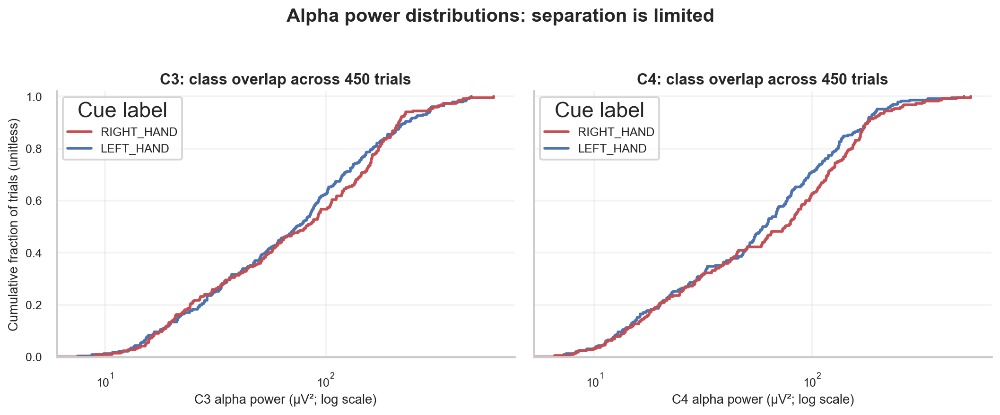
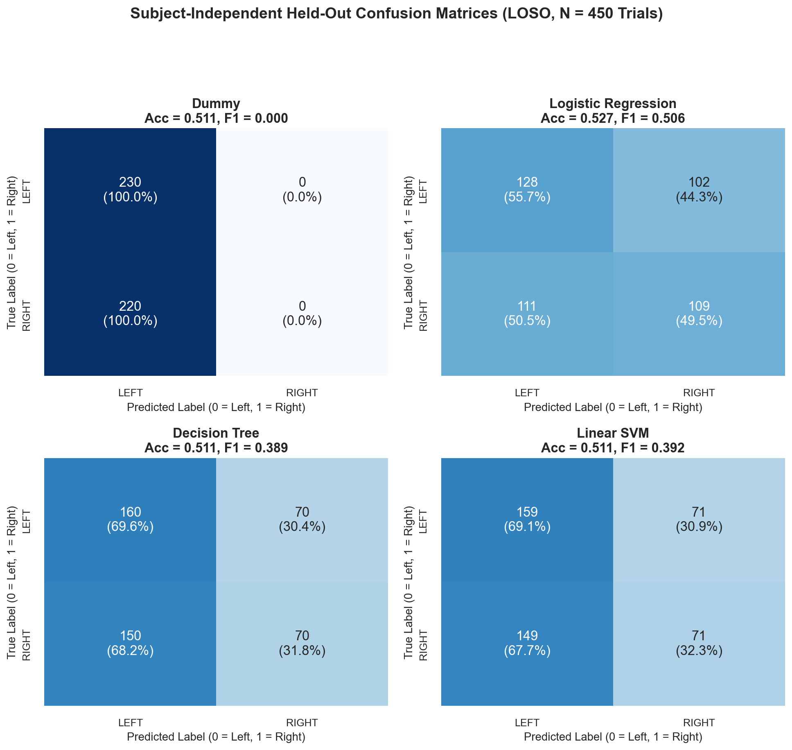
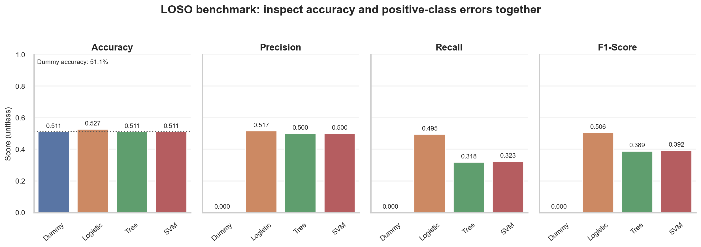
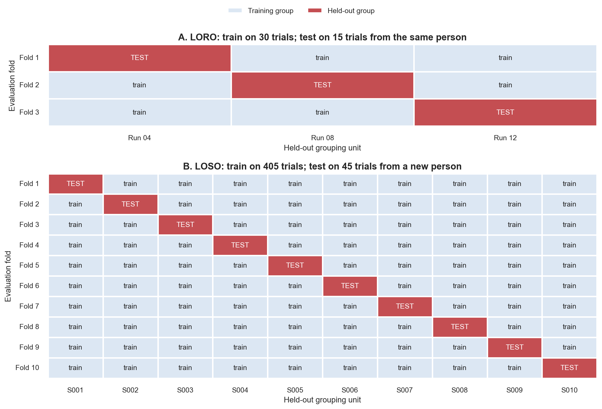

# Machine Learning for Neuroscience: From Neural Data to Prediction

> **Week 3 Review Article — Month 1 / Week 3**  
> Foundation learning phase: strong fundamentals before research.  
> Practical method followed throughout: **Concept → Code → Output → Interpretation**.

**Navigation:** ← [[week-2-report|Week 2: Signal Processing]] · [[Knowledge-Map|Knowledge Map]] · [[week-4-report|Week 4: Representation Learning]] →  
**Associated Concepts:** [[supervised-learning]] · [[feature-matrix]] · [[experimental-labels]] · [[logistic-regression]] · [[decision-tree]] · [[support-vector-machine]] · [[classification-metrics]] · [[overfitting]] · [[data-leakage]] · [[subject-generalization]]

## Abstract

Week 3 answers a single question: **how do we learn predictions from neural features without fooling ourselves through data leakage or biological variability?** Building on Week 2's signal processing and feature extraction, this module establishes the supervised machine learning framework ($X \in \mathbb{R}^{N \times P} \to y \in \{0, 1\}^N$) applied to real human electroencephalography (EEG) from the PhysioNet EEG Motor Movement/Imagery Dataset across 10 subjects. We examine linear probabilistic decoding via logistic regression, non-linear decision boundaries via decision trees, and maximum-margin separation via linear support vector machines, benchmarking each against a dummy majority baseline. Using rigorous held-out evaluation protocols—within-subject Leave-One-Run-Out (LORO) and cohort Leave-One-Subject-Out (LOSO)—we demonstrate that above-chance subject-dependent decoding does not guarantee subject-independent generalization. We quantify performance using confusion matrices, precision, recall, and F1-scores, exposing the accuracy paradox under class imbalance and classifying data leakage pitfalls. The resulting empirical framework establishes how to evaluate electrophysiological predictors with scientific integrity.

## Keywords

Supervised learning, classification, feature matrix, experimental labels, logistic regression, decision trees, support vector machines, confusion matrix, precision, recall, F1-score, overfitting, data leakage, subject-dependent decoding, subject-independent generalization, motor imagery EEG, PhysioNet EEGBCI

**Reading guide:** Start with [data and features](#2-fundamental-concepts), then [labels and the learning problem](#3-the-supervised-learning-framework-for-electrophysiology), [logistic regression](#4-logistic-regression-linear-probabilistic-decoding), [trees and SVMs](#5-non-linear-and-maximum-margin-baselines-decision-trees-and-support-vector-machines), [metrics](#6-evaluation-performance-metrics-and-the-overfitting-hazard), and [leakage and generalization](#7-preventing-optimism-data-leakage-and-subject-generalization). Read the laboratory blocks after the definitions; the daily notes provide additional practice.

> [!IMPORTANT]
> **The central result:** With 15 fixed features per trial, pooled LOSO accuracy is 52.7% for logistic regression and 51.1% for both the tree and linear SVM, against a 51.1% training-majority baseline. These descriptive results establish a reproducible baseline; they do not establish reliable decoding in a new person.

## 1. Introduction

Week 1 established electroencephalography (EEG) as a continuous voltage matrix of shape $\text{Channels} \times \text{Time}$, grounded in postsynaptic currents generated by aligned pyramidal populations. Week 2 demonstrated how analog-to-digital sampling, artifact contamination, band-pass filtering, and temporal windowing transform continuous recordings into structured numerical features. Week 2 concluded with an essential open question:

> **The Inherited Week 2 Question:** Once neural signals are filtered and compressed into numerical features, how do we use them to predict cognitive or behavioral states without fooling ourselves through data leakage or biological variability?

Answering this question requires bridging neuroscience and machine learning. In electrophysiology, machine learning is not merely a tool for maximizing empirical benchmark scores. It provides an operational test of whether a given set of physiological measurements carries reliable, generalizable information about an organism's behavioral intention, cognitive state, or clinical condition. 

However, applying machine learning to neural data poses severe methodological hazards. Electrophysiological recordings exhibit poor signal-to-noise ratios (SNR), pervasive physiological and environmental artifacts, non-stationarity over time, and massive inter-subject anatomical and functional variability. A naive pipeline can achieve deceptively high classification accuracy by exploiting data leakage—such as fitting feature transformers across temporal boundaries or training and testing on correlated windows from the same subject—without learning any valid neural representation.

### Week 3 Syllabus & Learning Sequence

The five laboratories follow the same representation and progressively strengthen its evaluation:

| Day | Core Focus | Laboratory / Practical Tasks |
| --- | --- | --- |
| [[w3d1\|**W3D1**]] | From neural features to supervised datasets | Epoch real multichannel EEG; extract 15 time- and frequency-domain features on sensorimotor electrodes ($C_3, C_z, C_4$); construct row-aligned matrix $X$ and label vector $y$. |
| [[w3d2\|**W3D2**]] | Logistic regression and held-out predictions | Implement pipeline standardization; train $L_2$-regularized logistic regression on Subject 1 (Runs 4/8); evaluate on held-out Run 12; compare with dummy baseline. |
| [[w3d3\|**W3D3**]] | Decision trees and support vector machines | Train depth-bounded decision trees and linear support vector machines on identical partitions; visualize 2-feature decision boundaries; measure tree complexity vs. overfitting. |
| [[w3d4\|**W3D4**]] | Evaluation, metrics, and data leakage | Manually derive TP, TN, FP, FN, precision, recall, and F1 from confusion matrices; demonstrate the accuracy paradox under hypothetical seizure imbalance; audit leakage mechanisms. |
| [[w3d5\|**W3D5**]] | Subject generalization and synthesis | Execute Leave-One-Subject-Out (LOSO) across a 10-subject cohort ($N = 450$ trials); analyze biological heterogeneity; conduct single-trial error analysis; complete mastery evaluation. |

The objective of this module is strong fundamentals: transparent mathematical definitions, leak-free empirical pipelines, and honest interpretation of modest biological decodability.

## 2. Fundamental Concepts

### 2.1 Classification, Detection, Continuous Prediction, and Decoding

Machine learning problems in neuroscience fall into four distinct operational paradigms:

1. **Classification:** Assigning an epoch of neural data to one of two or more discrete categories. In motor imagery brain-computer interfaces (BCIs), an algorithm classifies whether an epoch reflects imagined movement of the left hand ($y = 0$) or right hand ($y = 1$).
2. **Detection:** Identifying the precise occurrence or onset of a transient, discrete neurophysiological event within a continuous time series. Examples include automated seizure detection in epileptic electrocorticography or sleep spindle detection in polysomnography. Detection can involve severe imbalance; event prevalence depends on the cohort, recording, and definition.

3. **Continuous Prediction (Regression):** Mapping neural features onto a continuous kinematic or physiological variable. Examples include predicting the two-dimensional Cartesian velocity of a robotic cursor from motor cortex spike rates or estimating intracranial pressure from continuous EEG.

4. **Neural Decoding:** The overarching scientific objective of inferring sensory stimuli, internal cognitive states, or motor commands directly from neural activity. Decoding serves as an operational test: if an algorithm can predict a stimulus or behavior from neural signals above chance on held-out data, the measurements contain predictive information under that evaluation. Artifacts or experimental confounds can also carry that information; prediction alone does not establish a neural source.

### 2.2 The Representation Bridge: From Continuous Voltage to Supervised Matrix

To apply supervised machine learning, continuous multivariate electrophysiology must be converted into a structured tabular representation.


**Figure 1.** Event-aligned raw EEG from S001, Run 04 for the first left- and right-hand cues. The dashed cue line anchors time; the shaded `[0.5, 3.5)` s window contains 480 samples at 160 Hz. The dotted line marks the annotation end for each displayed trial. Delaying the window reduces early cue exposure without proving artifact removal or successful imagery.

Continuous EEG has shape `[Channels × Time]`. Here, $V \in \mathbb{R}^{C \times T}$ contains $C$ channels and $T$ time samples. The chosen tabular classifiers require one fixed-length feature row and one aligned label per trial. Epoching creates rows; it does **not** make trials statistically independent. Runs and subjects remain grouping variables throughout evaluation.


**Figure 2.** Raw and offline 1–35 Hz filtered C3 voltage from S001, Run 04, with full-run Welch spectra. Filtering attenuates out-of-band components rather than creating a sharp spectral wall. Alpha and Beta shading identifies the feature ranges; in-band artifacts can remain.

The transformation proceeds in four discrete stages:

1. **Filtering:** Raw continuous data $V$ is band-pass filtered (1.0–35.0 Hz) per run using a zero-phase 4th-order Butterworth filter to attenuate slow drift and out-of-band components with zero net phase delay (Figure 2).
2. **Epoching:** Given an experimental event timestamp $t_i^{\text{onset}}$, an analysis epoch is extracted over $[t_i^{\text{onset}} + 0.5, t_i^{\text{onset}} + 3.5)\text{ s}$ ($M = 480$ samples at $f_s = 160\text{ Hz}$). Starting 500 ms after the cue reduces exposure to early cue responses; it does not guarantee their absence or verify sustained imagery. The interval is half-open, `[0.5, 3.5)` s, so the final sample occurs at 3.49375 s.

3. **Feature Extraction:** For each channel $c \in \{C_3, C_z, C_4\}$, five summary features are computed across the epoch:
   - Mean amplitude: $\mu_c = \frac{1}{M}\sum_{m=1}^M v_c[m]$
   - Signal variance: $\sigma_c^2 = \frac{1}{M}\sum_{m=1}^M (v_c[m] - \mu_c)^2$
   - Peak-to-peak amplitude: $\text{P2P}_c = \max_m v_c[m] - \min_m v_c[m]$
   - Alpha band power: $P_{c, \alpha} = \int_{8\text{ Hz}}^{12\text{ Hz}} S_{vv}(f) df$ via Welch's periodogram
   - Beta band power: $P_{c, \beta} = \int_{13\text{ Hz}}^{30\text{ Hz}} S_{vv}(f) df$

4. **Matrix Assembly:** Concatenating the 5 features across 3 channels yields a single 15-dimensional feature vector $x_i \in \mathbb{R}^{15}$ for trial $i$. Stacking $N$ trials produces the feature matrix $X \in \mathbb{R}^{N \times 15}$ paired with the binary label vector $y \in \{0, 1\}^N$ (Figure 3).


**Figure 3.** A filtered `(3, 480)` epoch becomes one `(15,)` feature vector and one row of X. The middle panel and first 20 matrix rows use per-column means and SDs fitted only to S001 Runs 04/08. Heatmap color saturates at ±3 z-scores for display. Standardization across observations respects feature units; taking a mean across the 15 mixed-unit entries would not.

### 2.3 Feature definitions, units, and retained information

| Feature per channel | Physical unit | What it summarizes | Interpretation pitfall |
| --- | --- | --- | --- |
| **Mean** | µV | Average voltage over 480 samples | A near-zero mean does not imply inactivity. |
| **Variance** | µV² | Spread about the window mean (`ddof=0`) | Neural oscillations and artifacts both increase it. |
| **Peak-to-peak** | µV | Largest minus smallest observed voltage | One transient can dominate the feature. |
| **Alpha power** | µV² | Welch PSD bins from 8–12 Hz | Sensorimotor Alpha is not a unique imagery label. |
| **Beta power** | µV² | Welch PSD bins from 13–30 Hz | Muscle contamination can survive in this range. |

**Mathematical formulation:** Welch uses a 240-sample (1.5 s) segment with 120-sample overlap at 160 Hz, giving bin spacing $\Delta f=160/240\approx0.667$ Hz. The implementation estimates power as $\widehat P_B=\Delta f\sum_{k:f_k\in B}\widehat S_{vv}(f_k)$, a bin-sum approximation to the integrals above. PSD is in µV²/Hz, so multiplication by Hz yields µV². Band-edge conventions and spectral leakage affect the estimate; it is not an exact integral of the unknown biological spectrum.

**The Dangerous Misconception:** “Filtering and epoching produce clean, independent neural observations.” **Why this is false:** In-band artifacts remain, and nearby trials share recording conditions. `filtfilt` also uses future samples: this is an offline decoding experiment. A streaming BCI would need causal filtering and a separate latency evaluation.

## 3. The Supervised Learning Framework for Electrophysiology

### 3.1 Mathematical Formulation

In supervised binary classification, we are given a training dataset:
$$\mathcal{D}_{\text{train}} = \{(x_i, y_i)\}_{i=1}^{N_{\text{train}}}, \quad x_i \in \mathbb{R}^P, \quad y_i \in \{0, 1\}$$
where $x_i$ represents the 15-dimensional physiological feature vector for trial $i$, and $y_i$ represents the true behavioral label ($y_i = 0$ for left-hand motor imagery, $y_i = 1$ for right-hand motor imagery).

The objective is to learn a mapping function $f: \mathbb{R}^P \to \{0, 1\}$ (or a conditional probability estimator $\hat{p}(x) = P(Y = 1 \mid X = x)$) that generalizes to unseen test observations:
$$\mathcal{D}_{\text{test}} = \{(x_j^*, y_j^*)\}_{j=1}^{N_{\text{test}}}$$
such that the expected generalization error $\mathbb{E}_{(x, y)}[\mathcal{L}(f(x), y)]$ is minimized under a specified loss function $\mathcal{L}$.

### 3.2 Trial Balance and Cohort Integrity

We examine a 10-subject cohort (Subjects S001 through S010) from the PhysioNet EEG Motor Movement/Imagery Dataset. For each subject, exactly three experimental runs are analyzed: Runs 04, 08, and 12. In these runs, subjects performed sustained mental imagery of opening and closing either the left fist ($T_1$) or right fist ($T_2$) following an on-screen target cue.


**Figure 4.** Left- and right-hand cue counts across S001–S010, with 45 trials per person. The cohort contains 230 Left and 220 Right trials. Extraction asserts recording bounds and `(3, 480)` shape for every retained window; all 450 pass. Boundary validity is not an artifact-quality audit.

Figure 4 confirms that each subject contributed exactly 45 valid trials across the three runs (15 trials per run), yielding $N = 450$ total trials across the cohort. Because the dataset exhibits near-perfect class balance (51.1% Left Hand vs. 48.9% Right Hand), the full-cohort majority-class reference is:
$$\text{Baseline Accuracy} = \frac{230}{450} = 51.1\%$$

**Crucial Distinction:** A fair binary random guess has expected accuracy 50%; always predicting the cohort majority gives 51.1%. The evaluated `DummyClassifier` chooses its majority from each **training fold**, never from test labels. Both references must be named rather than called interchangeable “chance.”

**Label provenance:** For Runs 04, 08, and 12 only, `T1 → LEFT_HAND → 0` and `T2 → RIGHT_HAND → 1`. Rest (`T0`) is excluded. These annotations record the instructed condition, not a direct measurement of successful imagery. Event meanings change in other run types ([PhysioNet dataset documentation](https://physionet.org/content/eegmmidb/1.0.0/)).

### 3.3 Physiological Overlap and Low Signal-to-Noise Ratio

In classical motor physiology, voluntary movement or imagined movement of one hand elicits event-related desynchronization (ERD)—a reduction in alpha (8–12 Hz) and beta (13–30 Hz) power—over the contralateral sensorimotor cortex. Specifically:
- **Left-hand imagery** may produce contralateral ERD over the right hemisphere (electrode $C_4$), resulting in lower $C_4$ alpha power relative to $C_3$.
- **Right-hand imagery** may produce contralateral ERD over the left hemisphere (electrode $C_3$), resulting in lower $C_3$ alpha power relative to $C_4$.



**Figure 5.** Empirical cumulative distributions of C3 and C4 alpha powers across 450 trials, displayed on a logarithmic power axis. Each curve retains the observed nonnegative powers without KDE smoothing. Extensive class overlap limits separation by each feature alone; it does not identify the underlying source of that overlap.

**How to read Figure 5:** At any power value, the vertical coordinate is the fraction of trials at or below that value. The logarithmic horizontal scale retains the long right tail without allowing it to compress most observations. Nearby class curves indicate weak separation by that individual feature.

**Sensor constraint:** ERD means a power decrease relative to a stated reference interval, often $100(P_{task}-P_{baseline})/P_{baseline}$. This experiment uses absolute task-window powers and does not compute baseline-normalized ERD. A difference between $C_3$ and $C_4$ cannot by itself prove contralateral desynchronization. Pooling subjects can also hide person-specific patterns.

## 4. Logistic Regression: Linear Probabilistic Decoding

### 4.1 Mathematical Formulation

Logistic regression models the posterior probability of the positive class ($Y = 1$, Right Hand) as a logistic sigmoid function of a linear combination of input features:
$$\hat{p}(x) = P(Y = 1 \mid X = x) = \sigma(z) = \frac{1}{1 + e^{-z}}$$
where $z$ is the linear score (logit):
$$z = w^T x + b = \sum_{j=1}^P w_j x_j + b$$
The weight vector $w \in \mathbb{R}^P$ determines the orientation and steepness of the decision boundary, while the bias scalar $b \in \mathbb{R}$ determines its spatial offset from the origin.

The binary decision rule applies a decision threshold $\tau \in [0, 1]$ (default $\tau = 0.5$):
$$\hat{y} = \begin{cases} 1 & \text{if } \hat{p}(x) \ge 0.5 \iff z \ge 0 \\ 0 & \text{if } \hat{p}(x) < 0.5 \iff z < 0 \end{cases}$$
The decision boundary corresponds to the hyperplane where $z = 0$, or $w^T x + b = 0$.

### 4.2 Regularization and Feature Standardization

The parameters $w$ and $b$ are estimated by minimizing the $L_2$-regularized negative log-likelihood (binary cross-entropy loss):
$$J(w, b) = -\frac{1}{N} \sum_{i=1}^N \left[ y_i \log(\hat{p}(x_i)) + (1 - y_i) \log(1 - \hat{p}(x_i)) \right] + \frac{\lambda}{2} \|w\|_2^2$$
where $\lambda>0$ penalizes large coefficients. In scikit-learn, `C` controls inverse regularization strength; the precise loss normalization and intercept treatment depend on the solver. The displayed expression describes the principle rather than claiming an exact `liblinear` objective ([scikit-learn formulation](https://scikit-learn.org/stable/modules/linear_model.html#logistic-regression)). Regularization discourages unstable fits; it does not guarantee generalization.

**Why scaling matters:** A feature expressed in larger numerical units can achieve the same change in score with a smaller coefficient. An equal coefficient penalty therefore gives unequal effective regularization across differently scaled features. Standardization makes scale comparable and improves optimization for these linear baselines. Each feature must be transformed to zero mean and unit variance:
$$x_{ij}^{\text{std}} = \frac{x_{ij} - \mu_j^{\text{train}}}{\sigma_j^{\text{train}}}$$
Critically, the mean $\mu_j^{\text{train}}$ and standard deviation $\sigma_j^{\text{train}}$ must be computed **strictly on the training partition** and applied unchanged to the test partition, preventing data leakage.

### 4.3 Concept → Code → Output → Interpretation: Held-Out Run

To establish our first benchmark, we train an $L_2$-regularized logistic regression pipeline (`StandardScaler` + `LogisticRegression`) on Subject 001. Training is conducted on Runs 04 and 08 ($N_{\text{train}} = 30$ trials), and evaluation is performed on the completely held-out Run 12 ($N_{\text{test}} = 15$ trials).

**Concept:** Fit every learned transformation on Runs 04/08, then predict Run 12 once. Execute from the vault root after regenerating the features (Appendix A).

**Code:**

```python
import pandas as pd
import numpy as np
from pathlib import Path
from sklearn.pipeline import Pipeline
from sklearn.preprocessing import StandardScaler
from sklearn.linear_model import LogisticRegression
from sklearn.dummy import DummyClassifier
from sklearn.metrics import accuracy_score, precision_score, recall_score, f1_score, confusion_matrix

ROOT = Path.cwd()
df = pd.read_csv(ROOT / 'data/week3_features.csv')
s1_df = df[df['subject'] == 1].reset_index(drop=True)

feat_cols = [c for c in s1_df.columns if any(c.startswith(ch) for ch in ['C3', 'Cz', 'C4'])]
train_mask = s1_df['run'].isin([4, 8]).values
test_mask = (s1_df['run'] == 12).values

X_train, y_train = s1_df.loc[train_mask, feat_cols].values, s1_df.loc[train_mask, 'target'].values
X_test, y_test = s1_df.loc[test_mask, feat_cols].values, s1_df.loc[test_mask, 'target'].values

# Baseline: Dummy majority classifier
dummy = DummyClassifier(strategy='most_frequent')
dummy.fit(X_train, y_train)
dummy_pred = dummy.predict(X_test)

# Pipeline: Training-only StandardScaler + L2-regularized Logistic Regression
lr_pipe = Pipeline([
    ('scaler', StandardScaler()),
    ('clf', LogisticRegression(solver='liblinear', C=1.0, random_state=42))
])
lr_pipe.fit(X_train, y_train)
lr_pred = lr_pipe.predict(X_test)
lr_probs = lr_pipe.predict_proba(X_test)[:, 1]

print(f"Subject 1 (Train: Runs 4/8 [N={len(y_train)}], Test: Run 12 [N={len(y_test)}])")
print(f"Dummy Classifier  — Accuracy: {accuracy_score(y_test, dummy_pred):.3f}")
print(f"Logistic Reg      — Accuracy: {accuracy_score(y_test, lr_pred):.3f}, Precision: {precision_score(y_test, lr_pred, zero_division=0):.3f}, Recall: {recall_score(y_test, lr_pred, zero_division=0):.3f}, F1: {f1_score(y_test, lr_pred, zero_division=0):.3f}")
print("Confusion Matrix (y_true on rows, y_pred on cols):")
print(confusion_matrix(y_test, lr_pred))
print(f"Sample held-out probabilities P(Right): {lr_probs[:5].round(3)}")
```

**Output:**

```text
Subject 1 (Train: Runs 4/8 [N=30], Test: Run 12 [N=15])
Dummy Classifier  — Accuracy: 0.467
Logistic Reg      — Accuracy: 0.467, Precision: 0.500, Recall: 0.625, F1: 0.556
Confusion Matrix (y_true on rows, y_pred on cols):
[[2 5]
 [3 5]]
Sample held-out probabilities P(Right): [0.261 0.718 0.235 0.673 0.809]
```

**Interpretation:** On Subject 001's held-out Run 12, Logistic Regression achieves an accuracy of $46.7\%$ ($7 / 15$ trials correct), matching the Dummy majority classifier ($46.7\%$). The model correctly identified 5 of 8 right-hand trials (recall = $62.5\%$), but falsely predicted right-hand imagery on 5 of 7 left-hand trials. The model's estimated probabilities (e.g., $\hat{p} = 0.809$) represent internal mathematical confidence given the fitted sigmoid surface; they do not represent biological certainty.

## 5. Non-Linear and Maximum-Margin Baselines: Decision Trees and Support Vector Machines

To evaluate whether non-linear or margin-maximizing algorithms improve single-trial decoding, we benchmark two foundational alternatives on the identical training and testing partitions.

### 5.1 Decision Trees: Recursive Axis-Aligned Splitting

A decision tree partitions the feature space into hyper-rectangles through recursive binary splits. At each node, the algorithm evaluates all features $j$ and split thresholds $t$, selecting the split that maximizes the reduction in Gini impurity:
$$I_G(S) = 1 - \sum_{k=0}^1 p_k^2$$
where $p_k$ is the proportion of class $k$ in node $S$.

Decision trees require no feature scaling because monotonic transformations do not alter split ordering. However, unconstrained trees are notorious for memorizing training noise, creating complex, fragmented boundaries that fail catastrophically on test data. Constraining tree complexity—using `max_depth=3` with `min_samples_leaf=3` in the single-subject laboratory and `min_samples_leaf=5` in the cohort benchmark—enforces regularization.

### 5.2 Support Vector Machines: Maximum Margin Hyperplanes

A linear Support Vector Machine (SVM) finds the separating hyperplane $w^T x + b = 0$ that maximizes the geometric margin between the two classes. For linearly non-separable distributions, the soft-margin SVM optimizes:
$$\min_{w, b, \xi} \frac{1}{2} \|w\|_2^2 + C \sum_{i=1}^N \xi_i \quad \text{s.t.} \quad \widetilde y_i(w^T x_i + b) \ge 1 - \xi_i, \quad \xi_i \ge 0$$
where $\widetilde y_i=2y_i-1\in\{-1,+1\}$ is the SVM sign-coded label and $\xi_i$ are slack variables allowing margin violations, and $C > 0$ governs the trade-off between maximizing the margin ($2 / \|w\|_2$) and penalizing misclassifications.

Remarkably, the solution vector $w = \sum_{i \in \text{SV}} \alpha_i \widetilde y_i x_i$ depends exclusively on the **support vectors**—the subset of training observations that lie directly on or within the margin boundaries. In noisy EEG feature spaces, a substantial fraction of training points become support vectors. In our Subject 001 experiment, the linear SVM identified $20$ support vectors out of $30$ training trials ($66.7\%$), reflecting high within-margin variance.


**Figure 6.** Three separately fitted classifiers use only the two displayed log-alpha features for S001. Circles/squares denote training Runs 04/08; crosses/stars denote held-out Run 12. Background colors show predicted classes; the dashed line shows their boundary. Held-out accuracy is 0.53 for logistic regression, 0.40 for the tree, and 0.60 for SVM. This geometric illustration differs from the 15-feature benchmark.

Figure 6 illustrates the distinct geometric characteristics of the three model families on a matched two-dimensional feature space ($\log_{10} C_3\ \alpha$ vs. $\log_{10} C_4\ \alpha$). The background shows hard class predictions, not probability or confidence. Logistic regression has a straight boundary in the displayed log-power coordinates. The decision tree slices the feature space into discrete rectangular regions, capturing non-linear interactions at the risk of sharp edge artifacts. The linear SVM balances margin size against violations; overlapping classes need not be separated perfectly.

### 5.3 Comparing the three learning rules

| Model | What is learned | Role of feature scale | Main limitation |
| --- | --- | --- | --- |
| **Logistic regression** | Linear log-odds; sigmoid probability estimate | Training-only scaling makes the coefficient penalty comparable | A fitted probability is not automatically calibrated on new subjects. |
| **Decision tree** | Feature thresholds forming rectangular regions | Split ordering is largely invariant to monotone scaling | Deep trees can fit noise; small leaves give unstable decisions. |
| **Linear SVM** | Linear score balancing margin and violations | Scaling determines the geometry and effective penalty | The default decision score is not a probability. |

**Design rule of thumb:** Compare models on identical held-out groups, name the feature representation, and fix or select hyperparameters using training data only. A favorable two-feature picture is not evidence that the same algorithm wins with 15 features.

## 6. Evaluation, Performance Metrics, and the Overfitting Hazard

### 6.1 The Confusion Matrix and Derived Metrics

Binary classification decisions evaluated against ground-truth labels produce four mutually exclusive outcomes:
- **True Positive (TP):** True label is Right Hand ($y=1$), model predicts Right Hand ($\hat{y}=1$).
- **True Negative (TN):** True label is Left Hand ($y=0$), model predicts Left Hand ($\hat{y}=0$).
- **False Positive (FP, Type I error):** True label is Left Hand ($y=0$), model predicts Right Hand ($\hat{y}=1$).
- **False Negative (FN, Type II error):** True label is Right Hand ($y=1$), model predicts Left Hand ($\hat{y}=0$).

From these four fundamental counts, we derive four primary performance metrics:
$$\text{Accuracy} = \frac{\text{TP} + \text{TN}}{\text{TP} + \text{TN} + \text{FP} + \text{FN}}$$
$$\text{Precision} = \frac{\text{TP}}{\text{TP} + \text{FP}}$$
$$\text{Recall (Sensitivity)} = \frac{\text{TP}}{\text{TP} + \text{FN}}$$
$$\text{F}_1\text{-Score} = 2 \cdot \frac{\text{Precision} \cdot \text{Recall}}{\text{Precision} + \text{Recall}} = \frac{2\text{TP}}{2\text{TP} + \text{FP} + \text{FN}}$$

### 6.2 Concept → Code → Output → Interpretation: Metric Verification

**Concept:** Use a constructed 15-trial example to verify the equations. These arrays are **not** the logistic regression predictions in §4.3. The second computation uses a hypothetical 1% seizure prevalence, not a clinical dataset.

**Code:**

```python
import numpy as np
from sklearn.metrics import accuracy_score, precision_score, recall_score, f1_score, confusion_matrix

# Part 1: Worked Confusion Matrix Derivation
# Constructed teaching example (15 trials, 7 Left, 8 Right); not model predictions
y_true = np.array([0, 0, 0, 0, 0, 0, 0, 1, 1, 1, 1, 1, 1, 1, 1])
y_pred = np.array([0, 1, 0, 0, 1, 0, 1, 0, 1, 1, 0, 1, 1, 1, 1]) # 6 of 8 Right correct, 4 of 7 Left correct

tn = np.sum((y_true == 0) & (y_pred == 0))
fp = np.sum((y_true == 0) & (y_pred == 1))
fn = np.sum((y_true == 1) & (y_pred == 0))
tp = np.sum((y_true == 1) & (y_pred == 1))

acc_manual = (tp + tn) / (tp + tn + fp + fn)
prec_manual = tp / (tp + fp)
rec_manual = tp / (tp + fn)
f1_manual = 2 * (prec_manual * rec_manual) / (prec_manual + rec_manual)

print("Manual Metric Derivation:")
print(f"  TN={tn}, FP={fp}, FN={fn}, TP={tp}")
print(f"  Accuracy:  {acc_manual:.4f} (Library: {accuracy_score(y_true, y_pred):.4f})")
print(f"  Precision: {prec_manual:.4f} (Library: {precision_score(y_true, y_pred):.4f})")
print(f"  Recall:    {rec_manual:.4f} (Library: {recall_score(y_true, y_pred):.4f})")
print(f"  F1-Score:  {f1_manual:.4f} (Library: {f1_score(y_true, y_pred):.4f})")

# Part 2: Hypothetical Seizure Imbalance Demonstration (Accuracy Paradox)
N = 1000
y_imbalanced_true = np.zeros(N, dtype=int)
y_imbalanced_true[:10] = 1 # 10 seizure windows (1%), 990 non-seizure windows (99%)

# Trivial majority classifier: predicts all non-seizure (0)
y_trivial_pred = np.zeros(N, dtype=int)
cm_imb = confusion_matrix(y_imbalanced_true, y_trivial_pred)
acc_imb = accuracy_score(y_imbalanced_true, y_trivial_pred)
rec_imb = recall_score(y_imbalanced_true, y_trivial_pred, zero_division=0)
f1_imb = f1_score(y_imbalanced_true, y_trivial_pred, zero_division=0)

print("\nHypothetical Seizure Imbalance Demonstration (10 seizures, 990 background):")
print(f"  Trivial All-Negative Accuracy: {acc_imb:.1%}  <-- Deceptively high!")
print(f"  Clinical Recall (Sensitivity): {rec_imb:.1%}  <-- Completely useless (missed 100% of seizures)!")
print(f"  Clinical F1-Score:             {f1_imb:.4f}")
print(f"  Confusion Matrix:\n{cm_imb}")
```

**Output:**

```text
Manual Metric Derivation:
  TN=4, FP=3, FN=2, TP=6
  Accuracy:  0.6667 (Library: 0.6667)
  Precision: 0.6667 (Library: 0.6667)
  Recall:    0.7500 (Library: 0.7500)
  F1-Score:  0.7059 (Library: 0.7059)

Hypothetical Seizure Imbalance Demonstration (10 seizures, 990 background):
  Trivial All-Negative Accuracy: 99.0%  <-- Deceptively high!
  Clinical Recall (Sensitivity): 0.0%  <-- Completely useless (missed 100% of seizures)!
  Clinical F1-Score:             0.0000
  Confusion Matrix:
[[990   0]
 [ 10   0]]
```

**Interpretation:** The constructed example has 10 correct predictions out of 15 and recall $6/8=0.75$. In the imbalance example, all 10 positive windows are missed despite 99% accuracy. Precision is undefined when no positive predictions exist; `zero_division=0` reports zero by convention. F1 is not a balanced-accuracy metric and ignores true negatives; report class-wise errors as well.

### 6.3 Held-Out Benchmark across the Full Cohort

We evaluate all four models across the full 10-subject cohort ($N = 450$ trials) using the Subject-Independent Leave-One-Subject-Out (LOSO) protocol.



**Figure 7.** Pooled LOSO confusion matrices from 450 held-out predictions. Cells show counts and percentages within each true-label row; color uses the same 0–100% row-normalized scale in every panel. Right is the positive class. Logistic regression achieves accuracy 0.527 and F1 0.506; the tree achieves 0.511 and 0.389; SVM achieves 0.511 and 0.392. The dummy never predicts Right.



**Figure 8.** Accuracy, precision, recall, and F1 on identical LOSO partitions, with numeric bar labels and a shared 0–1 scale. The 51.1% dummy reference appears only on the accuracy panel because it is not a chance reference for the other metrics. Precision, recall, and F1 refer to Right-hand imagery.

| Model | Accuracy | Precision (Right) | Recall (Right) | F1 (Right) | Main limitation |
| --- | --- | --- | --- | --- | --- |
| **Dummy** | 0.511 | 0.000 | 0.000 | 0.000 | Predicts Left on every held-out trial. |
| **Logistic Regression** | 0.527 | 0.517 | 0.495 | 0.506 | Near-majority accuracy; does not establish dependable transfer. |
| **Decision Tree** | 0.511 | 0.500 | 0.318 | 0.389 | Near-majority accuracy; does not establish dependable transfer. |
| **Linear SVM** | 0.511 | 0.500 | 0.323 | 0.392 | Near-majority accuracy; does not establish dependable transfer. |

**Interpretation:** Logistic regression exceeds the dummy accuracy by only 1.6 percentage points. The tree and SVM match dummy accuracy while making different errors. A model can obtain the same accuracy through very different precision/recall trade-offs; Figures 7–8 expose those differences.

**Statistical scope:** These are descriptive out-of-fold scores from a fixed ten-subject cohort. They do not establish a statistically significant advantage. Trials within a subject are dependent and LOSO training sets overlap; a naive confidence interval treating 450 trials or ten folds as independent would misrepresent uncertainty. Population claims require an appropriate subject-level analysis and external validation.

### 6.4 The Accuracy Paradox under Class Imbalance

To understand why accuracy is an unreliable metric in clinical neuroscience, consider a continuous electrocorticography recording monitored for epileptic seizures. Seizure events are rare, occupying roughly 1% of total recording time:
- Total epochs: $N = 1,000$ (10 seizure epochs [$y=1$], 990 background interictal epochs [$y=0$]).
- A trivial majority classifier that outputs "No Seizure" ($\hat{y} = 0$) for every epoch achieves:
$$\text{Accuracy} = \frac{0 + 990}{1000} = 99.0\%$$
- However, its clinical sensitivity (recall) is:
$$\text{Recall} = \frac{0}{10 + 0} = 0.0\%$$
This trivial model misses 100% of epileptic seizures while reporting $99\%$ accuracy. In clinical detection problems, **precision, recall, and F1-score are mandatory**, and false negatives carry life-threatening costs.

### 6.5 Tree Complexity and Empirical Overfitting

Overfitting occurs when a model learns idiosyncrasies and random noise specific to the training sample rather than generalizable underlying structure.


**Figure 9.** Tree-depth study with S001 excluded from every fit and validation fold. Each of nine inner folds holds out one complete subject from S002–S010. Training accuracy rises from 56.7% at depth 1 to 89.7% at depth 10; the highest inner validation mean is 55.3% at depth 6. Shading is ±1 population SD across held-out subjects, not a confidence interval. Increased fitting capacity does not produce a comparable transfer improvement.

**Output & Interpretation:** The depth-6 mean is descriptive, not a universal optimum. At depth 10, inner validation accuracy is 49.1% despite 89.7% training accuracy. The curve is saved in `data/week3_tree_validation.json`; the cohort benchmark retains its prespecified depth-3 model and is not retuned using LOSO test scores. If depth were tuned for every outer subject, the entire selection process would need to repeat inside each outer fold ([grouped cross-validation guidance](https://scikit-learn.org/stable/modules/cross_validation.html)).

## 7. Preventing Optimism: Data Leakage and Subject Generalization

### 7.1 Data Leakage Taxonomy in Electrophysiology

Data leakage occurs when information from the test dataset contaminates the training pipeline, leading to overly optimistic performance estimates that fail completely in real-world deployment. In electrophysiology, data leakage takes three primary forms:

1. **Preprocessing Leakage (Global Transformation Leakage):** Fitting standardizers, data-adaptive filters, ICA decompositions, or PCA projections across the entire dataset prior to splitting into train and test sets. When `StandardScaler.fit()` is applied to the full matrix $X$, test set means $\mu_{\text{test}}$ and standard deviations $\sigma_{\text{test}}$ inform the training representation.
   - *Remedy:* Encapsulate preprocessing inside a scikit-learn `Pipeline`, ensuring that `fit()` is called strictly on training folds, and only `transform()` is called on test folds.
2. **Temporal Correlation Leakage (Epoch Overlap):** Splitting sequential time series using random shuffle cross-validation (`train_test_split(shuffle=True)`). Because EEG possesses strong temporal autocorrelation (slow drifts, ongoing background rhythms, vigilance fluctuations), adjacent 3-second windows are highly correlated. Random shuffling places window $t$ in train and window $t + 1$ in test, allowing the classifier to identify temporal proximity rather than task-specific cognitive states.
   - *Remedy:* Partition data by discrete, temporally separated recording runs (`LeaveOneGroupOut` grouped by run index).

3. **Subject Identity Leakage (Inter-Subject Pooling):** Pooling all trials from multiple subjects into a single matrix and applying random cross-validation. The classifier learns to identify idiosyncratic subject traits (skull thickness, electrode impedance, individual resting alpha peak frequency) rather than generalizable motor imagery patterns.
   - *Remedy:* Enforce strict subject-independent grouping (`LeaveOneGroupOut` grouped by subject ID).



**Figure 10.** Complete fold assignments for LORO within a person and LOSO across ten people. Red cells identify the held-out group and light-blue cells the training groups; annotations and colors agree. Each run fold trains on 30 and tests on 15 trials. Each subject fold trains on 405 and tests on 45 trials.

**Crucial Distinction:** A fixed Butterworth design does not learn a mean or component from the cohort. Filtering each run separately before a run/subject split is compatible with this offline experiment. Filtering an entire recording across a temporal train/test boundary can still mix observations through the filter impulse response; forward-backward filtering is also unsuitable for claims of causal streaming performance.

### 7.2 Subject-Dependent vs. Subject-Independent Performance

We directly compare two distinct evaluation protocols across all 10 subjects:
- **Protocol 1: Subject-Dependent (LORO):** A separate model is trained for each individual subject using Leave-One-Run-Out cross-validation across Runs 04, 08, and 12.
- **Protocol 2: Subject-Independent (LOSO):** A single model is evaluated on each subject using Leave-One-Subject-Out cross-validation across all 10 subjects.

| Subject | Left / Right trials | LORO accuracy | LOSO accuracy |
| --- | --- | --- | --- |
| **S001** | 23 / 22 | 0.511 | 0.578 |
| **S002** | 23 / 22 | 0.489 | 0.511 |
| **S003** | 23 / 22 | 0.467 | 0.422 |
| **S004** | 23 / 22 | 0.711 | 0.511 |
| **S005** | 21 / 24 | 0.533 | 0.467 |
| **S006** | 24 / 21 | 0.511 | 0.533 |
| **S007** | 23 / 22 | 0.778 | 0.489 |
| **S008** | 22 / 23 | 0.511 | 0.533 |
| **S009** | 24 / 21 | 0.622 | 0.489 |
| **S010** | 24 / 21 | 0.489 | 0.578 |
| **Mean ± population SD** | 230 / 220 total | 0.562 ± 0.100 | 0.511 ± 0.046 |


**Figure 11.** Paired per-subject SVM accuracies under LORO and LOSO on a common 0–1 scale. Horizontal lines mark fair-guess expectation (50%) and protocol means (56.2% LORO; 51.1% LOSO). Population SD across subjects is 10.0 and 4.6 percentage points, respectively; these spreads are not confidence intervals. Better within-person scores do not ensure transfer to a new person.

**Interpretation:** S007 achieves 35/45 correct predictions under LORO (77.8%) but 22/45 under LOSO (48.9%). The LORO model has access to other runs from S007; the LOSO model has access only to other people. These are separate models answering different questions, not the same model evaluated twice. The cohort means are 56.2% and 51.1%, respectively.

**The Dangerous Misconception:** “The best-performing person establishes a general-purpose decoder.” **Why this is false:** Selecting the largest observed score emphasizes favorable variation. Forty-five trials per person and only ten people limit precision. Neither accuracy nor these descriptive SDs identifies the physiological cause of performance differences.

### 7.3 Single-Trial Error Analysis

To connect held-out predictions to recorded waveforms, we inspect S007, the subject with the highest LORO SVM accuracy. The illustrated predictions come from LOSO, where S007 was excluded from training.


**Figure 12.** First available TP, TN, FP, and FN examples from S007 under LOSO. Filtered C3 and C4 voltages share time and amplitude scales, and panel titles give measured alpha powers in µV². These selected traces connect predictions to recordings; they do not demonstrate causal error mechanisms.

**Interpretation:** The four panels are the first available examples of each confusion-matrix outcome for S007, rather than a random or representative sample. Their titles report actual task-window alpha powers. These values can motivate an audit, but the SVM used all 15 features: the plots cannot attribute a prediction to one alpha ratio or diagnose attention, muscle activity, or failed ERD. Establishing those mechanisms requires additional measurements or controlled analysis.

## 8. Applications in Neuroscience

The same supervised formulation supports different scientific questions. Each requires its own labels, units, evaluation groups, and failure analysis. These are application formulations, not demonstrated clinical outcomes of this laboratory.

### 8.1 Motor Imagery BCI

- **Biological Event:** A participant follows a left/right imagery cue.
- **Neural Activity:** Sensorimotor rhythm modulation may accompany imagery.
- **Neural Data:** Three-channel 3 s epochs and the 15 features defined in §2.
- **Target / Label:** Cue condition, `LEFT_HAND` or `RIGHT_HAND`.
- **AI Task:** Estimate $P(Y=1\mid x)$ and map a validated decision to a command.
- **Primary Failure Mode:** Cue-related or muscular shortcuts; poor transfer to new people or sessions.

### 8.2 Seizure Detection

- **Biological Event:** A clinically annotated seizure occurs during monitoring.
- **Neural Activity:** Evolving pathological population activity alters EEG waveforms.
- **Neural Data:** Timestamped multichannel windows with artifact annotations.
- **Target / Label:** Expert event labels aligned to each window.
- **AI Task:** Estimate an event score; report sensitivity, false alarms per hour, and detection delay.
- **Primary Failure Mode:** Rare-event imbalance and movement artifacts; the 1% example is illustrative only.

### 8.3 Sleep Staging

- **Biological Event:** A participant progresses through sleep.
- **Neural Activity:** Oscillations and transient events change across stages.
- **Neural Data:** EEG with appropriate supporting EOG/EMG and fixed epoch timing.
- **Target / Label:** Expert-scored sleep-stage categories.
- **AI Task:** Predict $\hat y=\arg\max_k P(Y=k\mid x)$ and inspect per-stage errors.
- **Primary Failure Mode:** Ambiguous transitions and class imbalance; EEG feature accuracy alone is not expert equivalence.

### 8.4 Candidate Biomarker Evaluation

- **Biological Event:** A study compares clinical groups.
- **Neural Activity:** Disease-related physiological differences may alter measured features.
- **Neural Data:** EEG collected with documented site, medication, and demographic metadata.
- **Target / Label:** Independently established group membership.
- **AI Task:** Evaluate whether features predict labels in held-out subjects and external sites.
- **Primary Failure Mode:** Site, age, medication, and recruitment confounds; classification does not validate a diagnostic biomarker.

## 9. Limitations and Open Questions

While supervised learning provides powerful decoding tools, its application to non-invasive electrophysiology faces severe intrinsic limitations:

1. **Non-Stationarity:** Neural dynamics change continuously across time due to circadian rhythms, mental fatigue, cognitive drift, and physical sensor changes (drying electrolyte gel, micro-movements of the electrode cap). A morning-trained model can degrade on later recordings; this study does not measure cross-day drift.
2. **Low Signal-to-Noise Ratio and Volume Conduction:** Scalp electrodes record spatially blurred, attenuated summations of millions of underlying cortical dipoles. Signals are heavily contaminated by ocular, cardiac, and cranial myogenic potentials that often exceed neural voltages by an order of magnitude.

3. **The Feature Engineering Bottleneck:** The classical machine learning pipeline evaluated this week relies on handcrafted summary statistics (mean, variance, band powers). While interpretable, these features discard fine-grained temporal phase dynamics, cross-frequency couplings, and transient waveform geometries.

4. **The Need for Representation Learning:** How can we discover optimal spatiotemporal filters directly from raw multichannel time series without relying on manual feature selection? This fundamental challenge motivates **Week 4 (Unsupervised Learning and Neural Networks)**, where we explore automated representation learning, dimensionality reduction, and deep neural architectures.

## 10. Conclusion

Week 3 established the mathematical, computational, and empirical foundations of supervised machine learning in electrophysiology:

1. **The Supervised Representation Bridge:** Converting continuous multichannel voltage matrices into discrete, row-aligned feature matrices $X \in \mathbb{R}^{N \times P}$ and label vectors $y \in \{0, 1\}^N$ requires principled temporal windowing and feature extraction.
2. **Baseline Comparison is Mandatory:** In binary classification, achieving $\sim 51\%$ accuracy is trivial; models must be benchmarked against a Dummy majority baseline and evaluated using class-specific precision, recall, F1-score, and confusion matrices.

3. **Class Imbalance Distorts Accuracy:** When events are rare (e.g., clinical seizures), accuracy becomes deceptively high while clinical sensitivity collapses, making confusion matrix analysis indispensable.

4. **Strict Isolation Guards against Leakage:** Preprocessing transformations must be fit exclusively on training folds, and data splits must respect continuous run boundaries to reduce leakage from correlated observations.

5. **Subject Generalization is the Ultimate Test:** Higher observed accuracy within an individual (reaching $77.8\%$ in this cohort) does not imply zero-shot generalizability across a population ($51.1\%$ cohort mean). Generalizable neurotechnology requires accounting for biological heterogeneity.

**The Week 4 Handoff:** The fixed `[Samples × Features]` representation makes the evaluation rules explicit but discards temporal detail. [[week-4-report|Week 4]] asks whether learned representations can retain useful structure from `[Trials × Channels × Time]` while preserving the same training-only transformations, grouped splits, and baseline comparisons. Greater model capacity does not relax these requirements.

## 11. References

1. **PhysioNet resource infrastructure:** Goldberger, A. L., Amaral, L. A. N., Glass, L., Hausdorff, J. M., Ivanov, P. C., Mark, R. G., Mietus, J. E., Moody, G. B., Peng, C. K., & Stanley, H. E. (2000). PhysioBank, PhysioToolkit, and PhysioNet: Components of a new research resource for complex physiologic signals. *Circulation*, 101(23), e215–e220. DOI: [10.1161/01.CIR.101.23.e215](https://doi.org/10.1161/01.CIR.101.23.e215). Dataset: [10.13026/C28G6P](https://doi.org/10.13026/C28G6P).  
   **Contribution:** Provides the repository infrastructure underlying the EEG dataset; the dataset-specific citation is listed separately below.

2. **Brain-Computer Interfaces for Communication and Control:** Wolpaw, J. R., Birbaumer, N., McFarland, D. J., Pfurtscheller, G., & Vaughan, T. M. (2002). Brain-computer interfaces for communication and control. *Clinical Neurophysiology*, 113(6), 767–791. DOI: [10.1016/S1388-2457(02)00057-3](https://doi.org/10.1016/S1388-2457(02)00057-3).  
   **Contribution:** Defines communication and control formulations for BCIs.

3. **Review of Classification Algorithms for EEG-Based BCIs:** Lotte, F., Congedo, M., Lécuyer, A., Lamarche, F., & Arnaldi, B. (2007). A review of classification algorithms for EEG-based brain-computer interfaces. *Journal of Neural Engineering*, 4(2), R1–R13. DOI: [10.1088/1741-2560/4/2/R01](https://doi.org/10.1088/1741-2560/4/2/R01).  
   **Contribution:** Reviews foundational EEG classifier families and their practical trade-offs.

4. **Introduction to Machine Learning for EEG Analysis:** Lemm, S., Blankertz, B., Dickhaus, T., & Müller, K. R. (2011). Introduction to machine learning for brain-computer interfaces. *NeuroImage*, 56(2), 840–860. DOI: [10.1016/j.neuroimage.2010.10.094](https://doi.org/10.1016/j.neuroimage.2010.10.094).  
   **Contribution:** Connects neural representations with sound machine-learning evaluation.

5. **Pattern Recognition and Machine Learning:** Bishop, C. M. (2006). *Pattern Recognition and Machine Learning*. Springer, New York. ISBN: 978-0-387-31073-2.  
   **Contribution:** Develops probabilistic classification and regularization theory.

6. **The Elements of Statistical Learning:** Hastie, T., Tibshirani, R., & Friedman, J. (2009). *The Elements of Statistical Learning: Data Mining, Inference, and Prediction* (2nd ed.). Springer, New York. DOI: [10.1007/978-0-387-84858-7](https://doi.org/10.1007/978-0-387-84858-7).  
   **Contribution:** Explains model complexity, generalization, and statistical learning.

7. **Scikit-Learn Machine Learning in Python:** Pedregosa, F., Varoquaux, G., Gramfort, A., Michel, V., Thirion, B., Grisel, O., Blondel, M., Prettenhofer, P., Weiss, R., Dubourg, V., Vanderplas, J., Passos, A., Cournapeau, D., Brucher, M., Perrot, M., & Duchesnay, É. (2011). Scikit-learn: Machine learning in Python. *Journal of Machine Learning Research*, 12, 2825–2830.  
   **Contribution:** Documents the machine-learning library used in the laboratories; this JMLR article has no assigned DOI.

8. **MEG and EEG Data Analysis with MNE-Python:** Gramfort, A., Luessi, M., Larson, E., Engemann, D. A., Strohmeier, D., Brodbeck, C., Goj, R., Jas, M., Brooks, T., Parkkonen, L., & Hämäläinen, M. S. (2013). MEG and EEG data analysis with MNE-Python. *Frontiers in Neuroscience*, 7, 267. DOI: [10.3389/fnins.2013.00267](https://doi.org/10.3389/fnins.2013.00267).  
   **Contribution:** Describes the EEG software used for EDF loading and annotations.

9. Schalk, G. (2009). *EEG Motor Movement/Imagery Dataset*, version 1.0.0. PhysioNet. [DOI: 10.13026/C28G6P](https://doi.org/10.13026/C28G6P).  
   **Contribution:** Defines the EDF records, sampling rate, and run-dependent task annotations used here.

10. Schalk, G., McFarland, D. J., Hinterberger, T., Birbaumer, N., & Wolpaw, J. R. (2004). BCI2000: A general-purpose brain-computer interface (BCI) system. *IEEE Transactions on Biomedical Engineering*, 51(6), 1034–1043. [DOI: 10.1109/TBME.2004.827072](https://doi.org/10.1109/TBME.2004.827072).  
   **Contribution:** Describes the recording system used to acquire the dataset.

## Appendix A — Reproducibility (UV + Python)

Execute from the `NeuroScience/` root:

```bash
uv sync --locked
uv run python 'generate_week3_plots.py'
```

The script verifies 30 cached EDF files (S001–S010, Runs 04/08/12) against MNE's bundled EEGBCI SHA-256 registry, checks sample rate and epoch bounds, extracts features, runs the grouped benchmarks, saves all 12 figures, and executes the five teaching laboratories. Missing EDF files are downloaded from the PhysioNet public mirror. Checksum agreement establishes file identity, not physiological signal quality. Dataset access is governed by the [Open Data Commons Attribution License v1.0](https://physionet.org/content/eegmmidb/1.0.0/).

**Verified environment:** NumPy 2.2.6, pandas 2.3.3, SciPy 1.14.1, scikit-learn 1.7.2, MNE 1.12.1, Matplotlib 3.10.9, and Seaborn 0.13.2. `uv.lock` records the resolved environment; pandas is a direct dependency because the source imports it. The script fixes randomized estimators to `random_state=42`. PNGs are saved at 180 dpi with fixed metadata; repeated executions were checked for identical image hashes and stdout on this environment.

| Artifact | Purpose | Interpretation limit |
| --- | --- | --- |
| **`data/provenance_manifest.json`** | File identities, checksums, and sources | Does not certify artifact-free EEG. |
| **`data/week3_features.csv`** | 450 feature rows with subject/run/onset metadata | Labels are instructed conditions. |
| **`data/feature_schema.json`** | Ordered 15-feature definitions and units | Feature compression discards timing and phase. |
| **`data/week3_predictions.csv`** | Out-of-fold labels and predictions | Scores refer to this fixed cohort and protocol. |
| **`data/week3_metrics.json`** | Pooled and per-subject benchmark results | Subject SD is descriptive, not a confidence interval. |
| **`data/week3_tree_validation.json`** | Grouped inner depth study for Figure 9 | Uses S002–S010 only; does not retune the benchmark. |
| **`data/week3_lab_outputs.json`** | Actual stdout from standalone teaching blocks | The metrics arrays are constructed examples. |

**Laboratory agreement:** The Python blocks in §§4.3 and 6.2 are standalone source strings from the generator and their text blocks are captured stdout. The daily tree laboratory also contains a small shuffled-trial demonstration; it is not the subject-grouped validation study in Figure 9 and cannot estimate transfer to unseen subjects.

## Appendix B — Knowledge Graph Connections

This review article links bi-directionally into the `NeuroScience` vault knowledge network:

- **Upstream Foundations:**
  - [[week-1-report|Week 1: Introduction to AI in Neuroscience]] — Provided the multi-electrode geometry ($C \times T$ continuous voltage matrix) and sampling foundation.
  - [[week-2-report|Week 2: Fundamentals of Neural Signal Processing]] — Established the signal processing pipeline, Nyquist filtering, and time/frequency feature extraction.
- **Core Concept Nodes (Created in Week 3):**
  - [[supervised-learning]] — The formal framework mapping electrophysiological features to cognitive and behavioral states.
  - [[feature-matrix]] — The mathematical definition and shape properties of $X \in \mathbb{R}^{N \times P}$.
  - [[experimental-labels]] — The provenance, timing, and discrete encoding of target vector $y \in \{0, 1\}^N$.
  - [[logistic-regression]] — Linear probabilistic decoding, sigmoid activation, and $L_2$ regularization.
  - [[decision-tree]] — Recursive axis-aligned splitting, Gini impurity, and depth control.
  - [[support-vector-machine]] — Maximum-margin hyperplanes, slack variables, and support vector sparsity.
  - [[classification-metrics]] — Confusion matrix derivation of Accuracy, Precision, Recall, and F1-score.
  - [[overfitting]] — The bias-variance trade-off, model complexity, and memorization of neural noise.
  - [[data-leakage]] — Taxonomy of preprocessing, temporal, and subject identity leakage in electrophysiology.
  - [[subject-generalization]] — Inter-subject biological variability and the divergence between LORO and LOSO performance.
- **Reused Concept Nodes:**
  - [[artifact-contamination]] — Non-neural noise sources distorting single-trial feature distributions.
  - [[band-pass-filtering]] — Zero-phase Butterworth filtering preserving sensorimotor mu rhythms.
  - [[time-domain-features]] — Mean, variance, and peak-to-peak amplitude compression.
  - [[band-power-features]] — Welch spectral integration across alpha (8–12 Hz) and beta (13–30 Hz) bands.
- **Downstream Trajectory:**
  - [[week-4-report|Week 4: Deep Learning for Neuroscience]] — Moving beyond manual feature engineering toward automated representation learning, 1D CNNs, LSTMs, Transformers, and evaluation of subject transfer.
