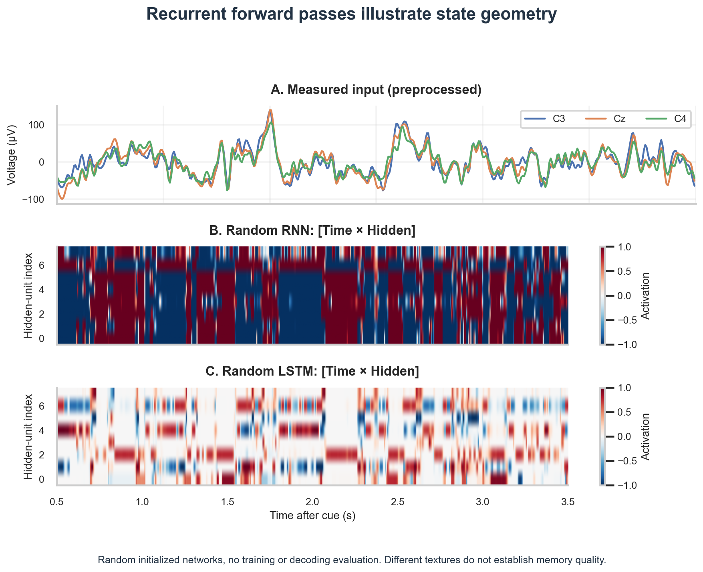

# W4D3: Sequential Data, Recurrent Neural Networks, and LSTMs

## 1. Executive Briefing

In [[w4d2|W4D2]], we examined how 1D Convolutional Neural Networks detect localized oscillatory waveforms using sliding kernels. While effective for extracting transient burst envelopes within 200 ms windows, standard convolutions lack an explicit mechanism to maintain a continuous, running internal memory across extended temporal horizons.

Electrophysiological recordings are fundamentally **sequential time series**. At a sampling rate of $f_s = 160\text{ Hz}$, a single 3.0-second motor imagery epoch contains 480 sequentially ordered voltage measurements. Brain states do not jump discontinuously from sample to sample; cortical dynamics exhibit strong temporal auto-correlation, continuous phase progression, and slow cognitive state transitions.

Today's module formalizes sequential deep learning for neuroscience:
1. **Electrophysiology as Sequential Data:** Why temporal order matters, comparing Markovian assumptions with non-local neural dependencies.
2. **Vanilla Recurrent Neural Networks (RNNs):** Formulating the hidden state update equation $h_t = \tanh(W_{ih} x_t + W_{hh} h_{t-1} + b)$ and analyzing recurrence as an unfolding computational graph.
3. **The Vanishing Gradient Pathology:** Explaining mathematically why Backpropagation Through Time (BPTT) fails when unrolled over 480 steps.
4. **Long Short-Term Memory (LSTM):** How the additive cell state $c_t$ and gating mechanisms (forget, input, output gates) preserve gradient highways across hundreds of time steps.
5. **Empirical State Dynamics on Real EEG:** Passing real 3-channel human EEG epochs through PyTorch `nn.RNN` and `nn.LSTM` to observe state trajectories over time.

---

## 2. Why EEG is Fundamentally Sequential Data

In tabular machine learning or image processing, sample order or pixel permutations can be partially compensated for by dense layers. In electrophysiology, however, temporal sequence is the primary carrier of information:
1. **Continuous Phase Progression:** An oscillatory cycle (e.g., a 10 Hz mu wave with a 100 ms period) unfolds smoothly through peak, downward zero-crossing, trough, and upward zero-crossing. Disrupting sample order completely destroys phase information.
2. **Asymmetric Causal Dependency:** The voltage measurement at time $t$ is physically constrained by the membrane potential, refractory states, and synaptic conductance established at times $t-1, t-2, \dots, t-k$. Time possesses a strict physical arrow of causality.
3. **Multi-Scale Temporal Dependencies:** Neural signals contain nested timescales operating simultaneously:
   - *Micro-timescales (5–25 ms):* Action potential generation, post-synaptic potentials, and gamma-band oscillations.
   - *Meso-timescales (50–300 ms):* Sensorimotor alpha/beta desynchronization and evoked potential components (e.g., P300, N400).
   - *Macro-timescales (seconds to minutes):* Task engagement, cognitive fatigue, attentional drifting, and sleep-stage transitions.

---

## 3. Mathematical Foundations of Recurrent Networks

### 3.1 The Vanilla RNN Cell

A [[recurrent-neural-network]] processes an input sequence $x = (x_1, x_2, \dots, x_T)$, where $x_t \in \mathbb{R}^{C_{in}}$, by maintaining a persistent hidden state vector $h_t \in \mathbb{R}^H$ that is updated recursively at each time step $t$:
$$h_t = \tanh\left( W_{ih} x_t + b_{ih} + W_{hh} h_{t-1} + b_{hh} \right)$$
where:
- $W_{ih} \in \mathbb{R}^{H \times C_{in}}$ projects the external sensory input into the hidden state.
- $W_{hh} \in \mathbb{R}^{H \times H}$ is the recurrent transition matrix that propagates memory from $t-1$ to $t$.
- $\tanh(\cdot)$ bounds the hidden state activations to the interval $(-1, 1)$.
- $b_{ih}, b_{hh} \in \mathbb{R}^H$ are bias vectors.

The recurrent weight matrix $W_{hh}$ is **shared across all time steps** $t \in [1, T]$. This parameter-sharing property allows the model to process sequences of arbitrary duration without increasing the number of trainable parameters.

### 3.2 Backpropagation Through Time (BPTT) and Vanishing Gradients

To optimize parameters $\{W_{ih}, W_{hh}\}$, the network is unrolled across all $T$ time steps. If a scalar loss $L_T$ is evaluated at the final step $T$, the gradient with respect to the initial hidden state $h_1$ requires applying the chain rule across the entire sequence:
$$\frac{\partial L_T}{\partial h_1} = \frac{\partial L_T}{\partial h_T} \prod_{k=2}^T \frac{\partial h_k}{\partial h_{k-1}}$$
The Jacobian matrix of the recurrent step is:
$$\frac{\partial h_k}{\partial h_{k-1}} = \text{diag}\left( 1 - h_k^2 \right) W_{hh}^T$$
Over our 3.0-second trial at 160 Hz ($T = 480$ time steps), evaluating this product requires multiplying $W_{hh}^T$ by itself 479 times:
$$\prod_{k=2}^{480} \frac{\partial h_k}{\partial h_{k-1}} \propto \left( W_{hh}^T \right)^{479}$$
By the spectral radius theorem, let $\lambda_{max}$ be the largest eigenvalue of $W_{hh}$:
- **If $|\lambda_{max}| < 1$:** As $T \to 480$, $(|\lambda_{max}|)^{479} \to 0$. The gradient vanishes exponentially. Error signals from the end of the trial cannot reach early time steps, making it impossible for the network to learn relationships longer than ~10–20 samples (100 ms).
- **If $|\lambda_{max}| > 1$:** The product grows exponentially toward infinity, triggering exploding gradients, numerical overflow (`NaN`), and training collapse.

---

## 4. Why LSTM was Introduced: Gated Memory Cells

To overcome the catastrophic vanishing gradient barrier over multi-hundred-sample sequences, Hochreiter & Schmidhuber (1997) introduced the [[long-short-term-memory]] network.

Instead of passing the hidden state through a saturating non-linearity at every step, an LSTM introduces an internal **cell state** $c_t \in \mathbb{R}^H$ that acts as a linear, unattenuated memory highway running through the sequence:

```text
========================================================================================================
                                     LSTM CELL ARCHITECTURE
========================================================================================================
Historical Memory  c_{t-1} ───────────[ ⊗ ]───────────────────────[ ⊕ ]───────────────► Updated Memory c_t
                                        ▲                          ▲                      │
                                        │                          │                      ▼
                                   Forget Gate                Input Gate               [ tanh ]
                                      f_t                        i_t                      │
                                       │                          │                       ▼
Hidden State      h_{t-1} ───┬─────────┴──────────────┬───────────┴─────────┬──────────[ ⊗ ]──► Output h_t
                             │                        │                     │             ▲
Input Vector      x_t     ───┴────────────────────────┴─────────────────────┴─────────────┤
                                                                                     Output Gate
                                                                                         o_t
========================================================================================================
```

### 4.1 The Three Multiplicative Gates

Information access to the cell state $c_t$ is strictly regulated by three specialized gating mechanisms, each computing soft values between 0 (completely closed) and 1 (completely open) via the logistic sigmoid $\sigma$:
1. **Forget Gate ($f_t \in [0, 1]^H$):** Decides what portion of the existing cell memory to erase. If $f_t = 0$, historical memory is purged; if $f_t = 1$, memory is preserved unchanged.
2. **Input Gate ($i_t \in [0, 1]^H$):** Decides which new candidate features $\tilde{c}_t = \tanh(W_{c} [h_{t-1}, x_t] + b_c)$ are added into the cell state:
   $$c_t = f_t \odot c_{t-1} + i_t \odot \tilde{c}_t$$
   Notice the **additive update**: because $c_t$ updates by addition rather than repeated matrix multiplication, the gradient $\frac{\partial c_t}{\partial c_{t-1}} \approx f_t$. If the forget gate is saturated near 1, gradients propagate backward across hundreds of time steps with zero exponential decay (the "constant error carousel").
3. **Output Gate ($o_t \in [0, 1]^H$):** Determines what proportion of the internal memory $c_t$ is exposed to the observable hidden state:
   $$h_t = o_t \odot \tanh(c_t)$$

---

## 5. Laboratory: Recurrent State Dynamics on Real Continuous EEG

We pass an entire 3.0-second multichannel epoch from Subject 1, Trial 0 ($x \in \mathbb{R}^{1 \times 480 \times 3}$) through PyTorch `nn.RNN` and `nn.LSTM` instances (hidden dimension $H = 8$, `batch_first=True`) to observe internal state trajectories across all 480 time steps.

```python
import torch
import torch.nn as nn
import numpy as np

# Load real EEG epoch: [3 channels, 480 time samples]
raw_epoch = X_epochs[0]  # Shape: (3, 480)

# Format for PyTorch sequential models: [Batch=1, Time=480, Channels=3]
trial_tensor = torch.from_numpy(raw_epoch.T).unsqueeze(0).float()

# Initialize recurrent models
rnn = nn.RNN(input_size=3, hidden_size=8, batch_first=True)
lstm = nn.LSTM(input_size=3, hidden_size=8, batch_first=True)

rnn.eval()
lstm.eval()

with torch.no_grad():
    # Forward pass through vanilla RNN
    rnn_out, rnn_hn = rnn(trial_tensor)
    
    # Forward pass through LSTM
    lstm_out, (lstm_hn, lstm_cn) = lstm(trial_tensor)

print(f"Input Shape:       {list(trial_tensor.shape)}")
print(f"RNN Output Shape:  {list(rnn_out.shape)}, Hidden Shape: {list(rnn_hn.shape)}")
print(f"LSTM Output Shape: {list(lstm_out.shape)}, Cell Shape:   {list(lstm_cn.shape)}")
```

### Captured Console Output

```text
--- RECURRENT MECHANISM FORWARD PASS (REAL EEG) ---
Input Tensor (batch_first=True): [1, 480, 3] [Batch=1, Time=480, Channels=3]
nn.RNN Forward Pass:
  Output Sequence Shape: [1, 480, 8] [Batch=1, Time=480, Hidden=8]
  Final Hidden State h_n Shape: [1, 1, 8] [Layers=1, Batch=1, Hidden=8]
nn.LSTM Forward Pass:
  Output Sequence Shape: [1, 480, 8] [Batch=1, Time=480, Hidden=8]
  Final Hidden State h_n Shape: [1, 1, 8] [Layers=1, Batch=1, Hidden=8]
  Final Cell State c_n Shape:   [1, 1, 8] [Layers=1, Batch=1, Hidden=8]
Notice: Gated cell state c_t maintains cumulative internal memory across all 480 steps.
```



**Figure 1.** The same measured trial is passed through random initialized RNN and LSTM layers. Hidden activations share a −1 to 1 color scale; their differing textures reflect different computations and initialization. These untrained states neither demonstrate noise removal nor measure memory retention or decoding performance.

---

## 6. Critical Analysis & Biological Interpretation

Figure 1 compares the state textures of two randomly initialized layers. No training objective has made either representation encode motor intention, reject noise, or retain a task-relevant event.

**Interpretation Limit:** LSTM gating provides an additive memory path, but these forward-pass images do not measure retention. Vanilla RNNs also include a recurrent contribution from their previous hidden state. Testing memory requires a defined retention task or a measured gradient path; [[week-4-report|Week 4 Report]] §5 distinguishes the mechanism from its demonstrated evidence.
---

## 7. Daily Knowledge Checkpoint

### Question 1: Vanishing Gradients and Sequence Length
**Prompt:** A researcher attempts to train a vanilla RNN directly on 10-second continuous EEG epochs recorded at $f_s = 250\text{ Hz}$.
1. Calculate the total number of unrolled time steps $T$.
2. If the largest singular value of the recurrent weight matrix is $\sigma_1 = 0.95$, compute the gradient attenuation factor over the full sequence: $\sigma_1^{T-1}$.
3. What happens to the error gradient computed at $t = 10\text{ s}$ when it backpropagates to $t = 0\text{ s}$?

**Solution:**
1. The total number of unrolled time steps is:
   $$T = 10\text{ s} \times 250\text{ Hz} = 2,500\text{ samples}$$
2. The gradient attenuation factor over 2,499 backward steps is:
   $$(0.95)^{2499} \approx 10^{-56}$$
3. The gradient evaluated at $t = 10\text{ s}$ is multiplied by $10^{-56}$ before reaching $t = 0\text{ s}$. In standard 32-bit floating point arithmetic (where the smallest subnormal positive number is $\sim 1.4 \times 10^{-45}$), the gradient underflows to exact zero. The model is mathematically incapable of learning any parameter updates at early time steps based on late-sequence outcomes.

### Question 2: LSTM Gate Function Under Artifact Contamination
**Prompt:** During a continuous EEG recording, a high-voltage muscle artifact (EMG, $+150\ \mu\text{V}$) strikes an electrode for 50 ms. Explain how a properly trained LSTM handles this artifact using its forget and input gates, compared to a vanilla RNN.

**Solution:**
- **Vanilla RNN:** Lacks gating control. The large $+150\ \mu\text{V}$ transient is multiplied directly by $W_{ih}$, saturating the $\tanh$ activation and completely corrupting the internal hidden state $h_t$. Because $h_t$ is recursively fed forward, the artifact corrupts all future predictions for hundreds of milliseconds.
- **LSTM:** The network detects the anomalous out-of-distribution voltage signature. The input gate $i_t$ can close ($i_t \approx 0$), blocking the artifact from entering the persistent cell state $c_t$. Simultaneously, the forget gate remains open ($f_t \approx 1$), preserving pre-existing contextual memory uninterrupted across the artifact burst.

### Question 3: Computational Bottleneck of Sequential Models
**Prompt:** In modern GPU computing, why is training a 1D CNN substantially faster and more hardware-efficient than training an RNN or LSTM of comparable parameter size on long sequences?

**Solution:**
- **1D CNN:** Convolutions are non-recurrent and feed-forward. All temporal kernel operations across all time steps $t \in [1, T]$ and all batch samples are computed in parallel using matrix multiplications (e.g., cuDNN `gemm`). Time does not serialize computation.
- **RNN / LSTM:** Sequential recurrence imposes a strict temporal serialization bottleneck: step $h_t$ cannot be computed until step $h_{t-1}$ has completed its forward execution. This sequential dependency prevents parallel execution across the time axis, leaving modern highly parallel GPU tensor cores underutilized.

---

## 8. Forward Handoff to W4D4

Today demonstrated that while LSTMs resolve vanishing gradients, their strictly sequential nature forces time steps to be evaluated one-by-one. Tomorrow ([[w4d4|W4D4]]), we break free from sequential constraints by introducing **Attention Mechanisms and Transformers**. We will examine how self-attention computes direct, parallel pairwise associations between temporal patches across an entire EEG trial, eliminating recurrent bottlenecks while modeling long-range neural interactions.

---

## 9. Verification and Related Concepts

- [[recurrent-neural-network]]
- [[long-short-term-memory]]
- [[self-attention]]
- [[transformer]]
- [[convolution]]
- [[week-4-report]]
