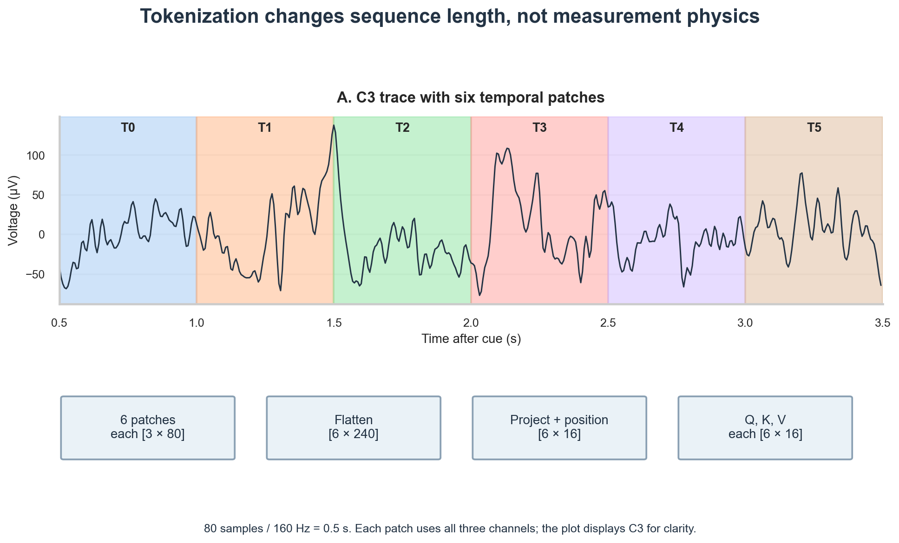
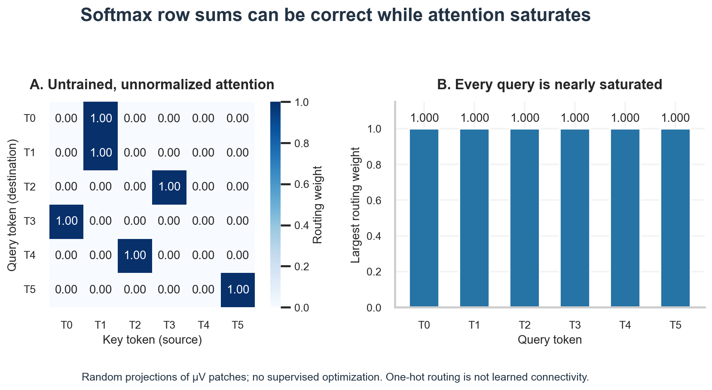

# W4D4: Attention Mechanisms, Self-Attention, and Transformers for EEG

## 1. Executive Briefing

In [[w4d3|W4D3]], we observed that while LSTMs stabilize memory gradients via additive gating, they remain bound to a strictly **sequential processing bottleneck**:
1. **Information Compression:** An LSTM must compress all historical context from hundreds of time steps into a single, fixed-dimensional hidden vector $h_t \in \mathbb{R}^H$. As sequence lengths expand, earlier information is inevitably blurred.
2. **Computational Serialization:** Step $t$ cannot be computed until step $t-1$ has finished, preventing parallel execution across modern tensor-accelerated hardware.

Today, we transition to the modern deep learning paradigm: **Attention Mechanisms and Transformers**. Instead of forcing information through a step-by-step recurrent chain, [[self-attention]] creates direct, pairwise computational links between every pair of positions in a sequence simultaneously.

Today's module formalizes:
1. **The Conceptual Shift:** From sequential memory propagation to direct, content-based associative retrieval.
2. **The Mathematics of Scaled Dot-Product Attention:** Formulating Query ($Q$), Key ($K$), and Value ($V$) projections and the normalization factor $\frac{1}{\sqrt{d_k}}$.
3. **EEG Patch Tokenization:** How continuous multichannel voltage epochs are divided into structured temporal tokens (patches) and augmented with positional encodings.
4. **Execution on Real Human EEG:** Extracting a $[6 \times 6]$ empirical attention weight matrix across a 3.0-second trial from Subject 1.
5. **The Neuroscientific Interpretation Guardrail:** Clarifying why mathematical attention weights do **not** represent biological brain connectivity.

---

## 2. The Recurrent Bottleneck and the Emergence of Attention

Consider decoding a 3.0-second motor imagery trial ($T = 480$ samples). In recurrent models, a motor preparation signal occurring at $t = 0.5\text{ s}$ must be passed through more than 300 recurrent update steps before it can influence a decision at the end of the trial ($t = 3.0\text{ s}$). At each step, new incoming voltage measurements compete for representation inside $h_t$.

The [[transformer]] architecture resolves this limitation by discarding recurrence entirely. It computes relevance scores directly between all temporal positions:
$$\text{Recurrent Model: } x_1 \to h_1 \to h_2 \to \dots \to h_{480} \to \text{Decision}$$
$$\text{Attention Model: } \text{Decision} \leftarrow \sum_{j=1}^N \alpha_j \cdot x_j \quad (\text{Direct parallel access to all tokens})$$

---

## 3. Mathematical Formulation of Self-Attention

### 3.1 Queries, Keys, and Values

Let an input sequence be represented as a token matrix $X \in \mathbb{R}^{N \times d}$, where $N$ is the number of sequence tokens and $d$ is the feature dimension. The sequence is linearly projected into three distinct representation spaces using learnable parameter matrices $W_Q, W_K, W_V \in \mathbb{R}^{d \times d_k}$:
- **Queries ($Q = X W_Q \in \mathbb{R}^{N \times d_k}$):** What each token is "searching for" or attending from.
- **Keys ($K = X W_K \in \mathbb{R}^{N \times d_k}$):** What each token "contains" or offers to other tokens.
- **Values ($V = X W_V \in \mathbb{R}^{N \times d_k}$):** The actual informational content retrieved and propagated forward.

### 3.2 Scaled Dot-Product Attention

The pairwise compatibility score between query token $i$ and key token $j$ is calculated via their inner product:
$$S_{i, j} = q_i^T k_j = \left( Q K^T \right)_{i, j}$$
To prevent the dot products from growing excessively large for high dimensions $d_k$ (which pushes the softmax function into regions with vanishingly small gradients), the scores are scaled by $\frac{1}{\sqrt{d_k}}$:
$$A = \text{Attention}(Q, K, V) = \text{softmax}\left( \frac{Q K^T}{\sqrt{d_k}} \right) V$$
where the $\text{softmax}$ is evaluated row-wise:
$$\alpha_{i, j} = \frac{\exp\left( \frac{q_i^T k_j}{\sqrt{d_k}} \right)}{\sum_{l=1}^N \exp\left( \frac{q_i^T k_l}{\sqrt{d_k}} \right)}, \quad \sum_{j=1}^N \alpha_{i, j} = 1.0 \quad \forall i$$
The resulting attention weight $\alpha_{i, j} \in [0, 1]$ represents the fraction of representation capacity that token $i$ allocates to token $j$.

---

## 4. EEG Tokenization Geometry: Time Patches into Sequences

In natural language processing, text naturally separates into discrete word or subword tokens. Continuous EEG, however, is a continuous voltage matrix of shape $[\text{Channels} \times \text{Time}]$.

Because computing self-attention over raw time samples has a quadratic computational complexity of $\mathcal{O}(T^2)$, applying attention to 480 raw samples would require a $[480 \times 480] = 230,400$-element attention matrix per head per layer. This is both computationally inefficient and neurophysiologically uninformative (single sample points at 160 Hz carry little autonomous meaning).

Instead, modern EEG transformers apply **temporal patch tokenization**:
1. **Partitioning:** The 3.0-second epoch (480 samples) is partitioned into $N = 6$ non-overlapping temporal patches of duration 0.5 seconds ($L = 80$ samples at 160 Hz).
2. **Flattening:** For $C = 3$ channels ($C_3, C_z, C_4$), each temporal patch contains $3 \times 80 = 240$ continuous microvolt values.
3. **Linear Projection:** A learnable linear projection $W_{in} \in \mathbb{R}^{240 \times d_{model}}$ maps each 240-dimensional patch into an embedding space of dimension $d_{model} = 16$.
4. **Positional Encoding:** Because self-attention is permutation-invariant, an additive positional embedding matrix $P \in \mathbb{R}^{N \times d_{model}}$ is added to the projected tokens to inject temporal order.



**Figure 1.** The patch boundaries cover 0.5–3.5 s after the cue. Each token includes all three channels, even though the top panel shows only C3. Flattening and projection produce `[6, 240]` → `[6, 16]`; tokenization compresses the sequence and changes its resolution.

---

## 5. Laboratory: Self-Attention on Real Multichannel EEG Tokens

We implement patch tokenization and execute the scaled dot-product attention mechanism on Subject 1, Trial 0.

```python
import torch
import torch.nn as nn
import numpy as np

# Load real EEG trial: [3 channels, 480 time samples]
raw_trial = X_epochs[0]  # Shape: (3, 480)

# 1. Partition into 6 non-overlapping temporal tokens (80 samples = 0.5 s each)
num_tokens = 6
patch_len = 80
tokens = []
token_labels = []

for i in range(num_tokens):
    s = i * patch_len
    e = (i + 1) * patch_len
    patch = raw_trial[:, s:e].flatten()  # 3 * 80 = 240 values
    tokens.append(patch)
    token_labels.append(f"T{i} ({0.5 + i*0.5:.1f}-{0.5 + (i+1)*0.5:.1f}s)")

tokens_tensor = torch.from_numpy(np.array(tokens, dtype=np.float32)).unsqueeze(0)  # [1, 6, 240]

# 2. Linear projection to d_model = 16
d_model = 16
proj = nn.Linear(240, d_model)
pos_embed = nn.Parameter(torch.randn(1, num_tokens, d_model) * 0.02)

with torch.no_grad():
    x_embed = proj(tokens_tensor) + pos_embed  # [1, 6, 16]
    
    # 3. Query, Key, Value Projections
    W_q = nn.Linear(d_model, d_model, bias=False)
    W_k = nn.Linear(d_model, d_model, bias=False)
    W_v = nn.Linear(d_model, d_model, bias=False)
    
    Q = W_q(x_embed)  # [1, 6, 16]
    K = W_k(x_embed)  # [1, 6, 16]
    V = W_v(x_embed)  # [1, 6, 16]
    
    # 4. Scaled Dot-Product Attention: softmax(Q @ K.T / sqrt(d_k))
    scores = torch.bmm(Q, K.transpose(1, 2)) / np.sqrt(d_model)  # [1, 6, 6]
    attn_weights = torch.softmax(scores, dim=-1).squeeze(0).numpy()

print("Extracted 6 tokens, attention matrix shape:", attn_weights.shape)
print("Softmax row sums:", np.sum(attn_weights, axis=1))
```

### Captured Console Output

```text
--- SELF-ATTENTION MECHANISM ON TEMPORAL TOKENS ---
EEG Trial Partition: 6 Non-Overlapping Tokens of 80 samples (0.5 s) each
Token Dimensions: 3 channels x 80 samples = 240 values per patch
Linear Projection to d_model=16 + Positional Embedding: Shape [1, 6, 16]
Query, Key, Value Matrices: Q, K, V each [1, 6, 16]
Scaled Dot-Product Attention: softmax(Q @ K.T / sqrt(16))
Attention Weight Matrix [6, 6] Check (Row Sums = 1.0):
[1. 1. 1. 1. 1. 1.]
Primary Attention per Token:
  T0 (0.5-1.0s) attends most strongly to T1 (1.0-1.5s) (weight = 1.000)
  T1 (1.0-1.5s) attends most strongly to T1 (1.0-1.5s) (weight = 1.000)
  T2 (1.5-2.0s) attends most strongly to T3 (2.0-2.5s) (weight = 1.000)
  T3 (2.0-2.5s) attends most strongly to T0 (0.5-1.0s) (weight = 1.000)
  T4 (2.5-3.0s) attends most strongly to T2 (1.5-2.0s) (weight = 1.000)
  T5 (3.0-3.5s) attends most strongly to T5 (3.0-3.5s) (weight = 1.000)
```



**Figure 2.** The routing heatmap and per-query maxima expose numerical saturation in the existing random, unnormalized demonstration. Query rows are destinations and key columns are sources. Apparently decisive weights are not evidence of learned temporal dependencies.

---

## 6. Critical Analysis & The Neuroscientific Interpretation Guardrail

> [!CAUTION]
> **Essential Methodological Guardrail: Attention Weights $\neq$ Neural Functional Connectivity**
> A frequent, dangerous fallacy in neurotechnology literature is interpreting learned self-attention weights $\alpha_{i, j}$ as biological "functional connectivity" or evidence of causal synaptic communication between brain regions or temporal phases.
> 
> Self-attention weights are **purely computational routing coefficients** within an artificial neural network. They indicate which latent feature vectors the model combined to minimize its objective loss. They do **not** reflect:
> 1. Anatomical axonal tracts or synaptic connections.
> 2. Statistical Granger causality or phase-locking value (PLV) in biological tissue.
> 3. Physiological information transmission between cortical populations.

Furthermore, training full transformers on small EEG datasets is notoriously hazardous. Because transformers lack the localized spatial and temporal inductive biases hardcoded into CNNs, they have immense representational freedom. When trained on cohorts with only hundreds of trials, transformers frequently memorize subject-specific sensor artifacts or scalp impedance shifts. Transformers in neuroscience are most effective when pre-trained on massive multi-cohort foundation datasets (e.g., hundreds of thousands of hours of polysomnography or resting-state EEG) before fine-tuning on downstream tasks.

---

## 7. Daily Knowledge Checkpoint

### Question 1: Mathematical Need for Scaling Factor $\frac{1}{\sqrt{d_k}}$
**Prompt:** Assume query vector $q \in \mathbb{R}^{d_k}$ and key vector $k \in \mathbb{R}^{d_k}$ have components drawn independently from a standard normal distribution with mean 0 and variance 1 ($\mathcal{N}(0, 1)$).
1. Derive the mean and variance of their dot product $z = q^T k = \sum_{i=1}^{d_k} q_i k_i$.
2. Explain what happens to the softmax distribution as $d_k$ grows large if the $\frac{1}{\sqrt{d_k}}$ scaling factor is omitted.
3. How does this affect backpropagation gradients?

**Solution:**
1. Let $z_i = q_i k_i$. Because $q_i, k_i \sim \mathcal{N}(0, 1)$ are independent:
   $$\mathbb{E}[z_i] = \mathbb{E}[q_i] \mathbb{E}[k_i] = 0 \times 0 = 0$$
   $$\text{Var}(z_i) = \mathbb{E}[z_i^2] - (\mathbb{E}[z_i])^2 = \mathbb{E}[q_i^2] \mathbb{E}[k_i^2] - 0 = 1 \times 1 = 1$$
   Since the $d_k$ components are independent, the mean and variance of their sum are:
   $$\mathbb{E}[z] = \sum_{i=1}^{d_k} \mathbb{E}[z_i] = 0$$
   $$\text{Var}(z) = \sum_{i=1}^{d_k} \text{Var}(z_i) = \sum_{i=1}^{d_k} 1 = d_k$$
2. As $d_k$ increases, the standard deviation of $z$ grows as $\sqrt{d_k}$. Without scaling, the inputs to the softmax have large absolute magnitudes. The softmax function exponentiates these large values, driving the distribution toward an extreme one-hot vector (assigning probability $\approx 1.0$ to the single largest score and $\approx 0$ to all others).
3. The derivative of the softmax function $\frac{\partial \alpha_i}{\partial z_j} = \alpha_i (\delta_{ij} - \alpha_j)$ approaches zero when probabilities saturate near 0 or 1. Without the $\frac{1}{\sqrt{d_k}}$ scaling factor, the gradients vanish, causing optimization to stall completely during backpropagation.

### Question 2: Permutation Invariance and Positional Encodings
**Prompt:** Why is standard self-attention strictly permutation-invariant with respect to token order? Describe what would happen to an EEG transformer's output if the temporal sequence of tokens was reversed without positional encodings.

**Solution:**
Self-attention computes dot-product similarities pairwise: $\alpha_{i, j} \propto \exp(q_i^T k_j / \sqrt{d_k})$. If the order of the input tokens is permuted by a permutation matrix $P$, the resulting output token representations are simply permuted by the exact same matrix:
$$\text{Attention}(P X W_Q, P X W_K, P X W_V) = P \, \text{Attention}(X W_Q, X W_K, X W_V)$$
The mechanism has no inherent awareness of which token came first in physical time. If the temporal sequence of EEG patches is reversed (e.g., passing post-movement beta rebound before the cue presentation), an attention model without positional encodings produces the exact same set of output representations, simply in reversed order. Positional encodings (either sinusoidal vectors or learned embeddings) add a unique temporal signature to each token vector before attention calculation, breaking permutation symmetry and preserving physical time order.

### Question 3: Computational Complexity Trade-off
**Prompt:** Compare the computational complexity and memory footprint of evaluating a 1D CNN with kernel length $K = 32$ versus a sample-level Self-Attention layer across an EEG recording of length $T = 1,000$ samples.

**Solution:**
- **1D CNN:** Computational complexity scales linearly with sequence length: $\mathcal{O}(T \cdot K \cdot C_{in} \cdot C_{out})$. For $T = 1,000$ and $K = 32$, each channel performs approximately $32 \times 1,000 = 3.2 \times 10^4$ operations. Memory consumption is $\mathcal{O}(T \cdot C_{out})$.
- **Sample-Level Self-Attention:** Must compute an attention score between every pair of samples, scaling quadratically with sequence length: $\mathcal{O}(T^2 \cdot d)$. For $T = 1,000$, computing the attention matrix requires $1,000^2 = 1,000,000$ dot products, and storing the attention weight matrix consumes $[1000 \times 1000]$ floating-point values per head.
This quadratic scaling makes sample-level self-attention impractical for high-sampling-rate electrophysiology, necessitating temporal patch tokenization.

---

## 8. Forward Handoff to W4D5

Over Days 1–4, we built the complete theoretical and implementation toolkit of deep learning for neuroscience: artificial neurons, backpropagation, 1D CNNs, RNNs/LSTMs, and self-attention transformers. Tomorrow ([[w4d5|W4D5]]), we synthesize the entire month. We will survey the **Seven Major Application Paradigms of AI in Neuroscience**, execute our cohort-wide **Leave-One-Subject-Out (LOSO) benchmark across all 10 subjects (450 trials)**, deliver honest empirical comparisons against classical baselines, and complete the Month 1 capstone milestone.

---

## 9. Verification and Related Concepts

- [[self-attention]]
- [[transformer]]
- [[recurrent-neural-network]]
- [[long-short-term-memory]]
- [[representation-learning]]
- [[convolution]]
- [[week-4-report]]
