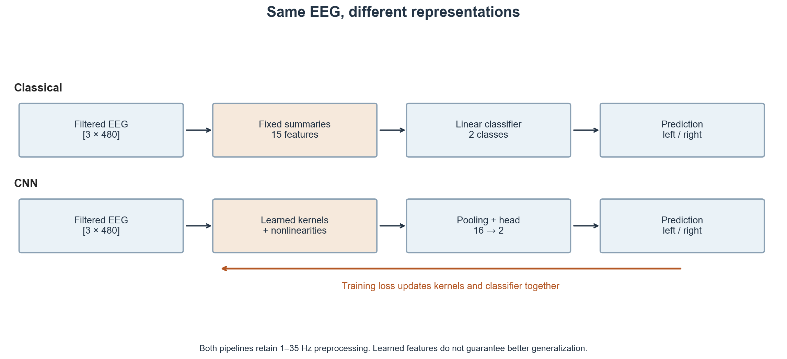
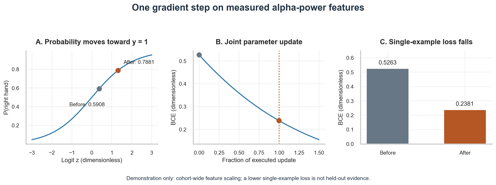
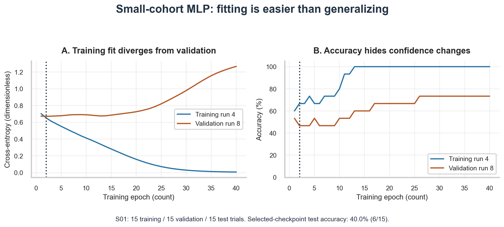
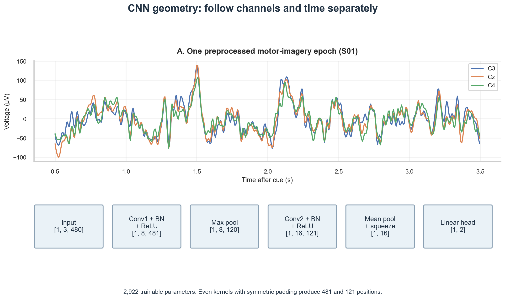
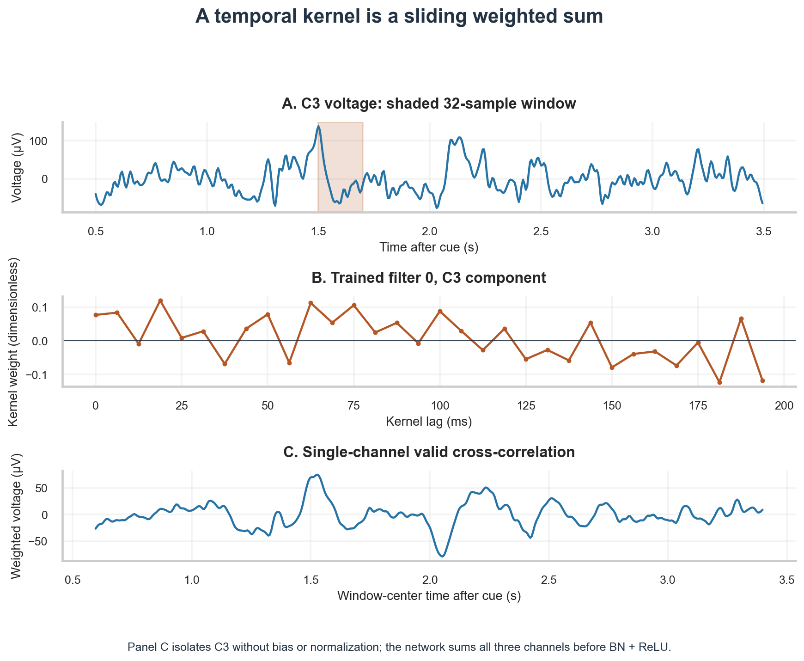
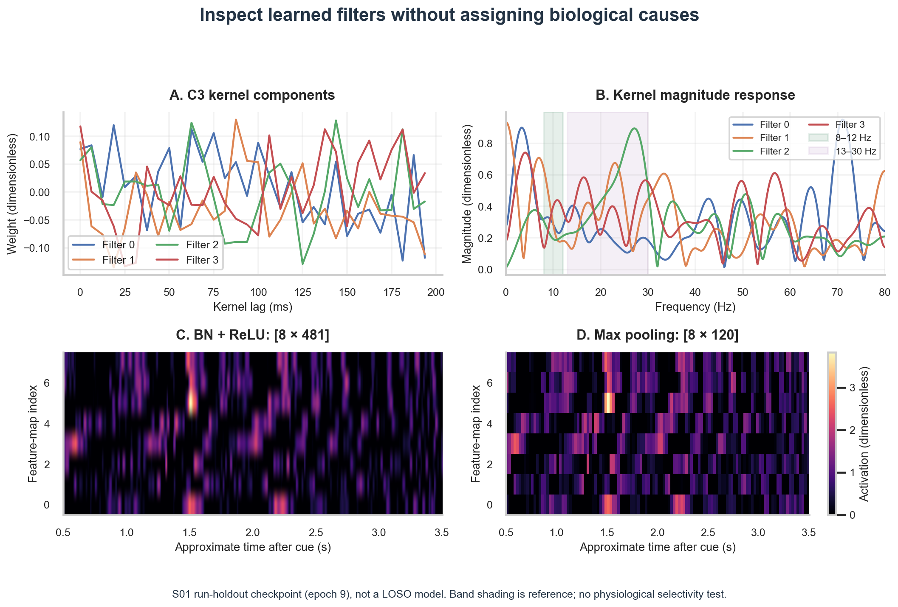
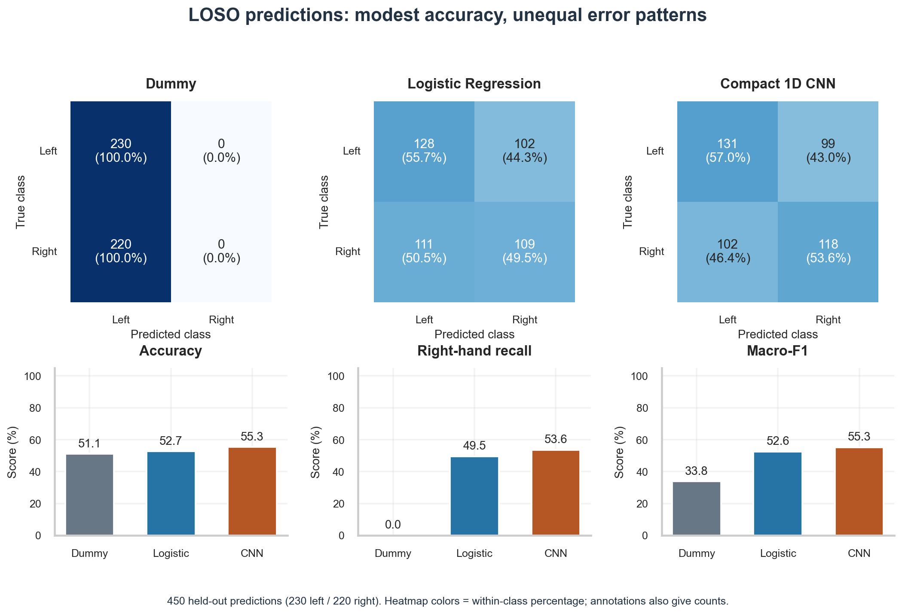
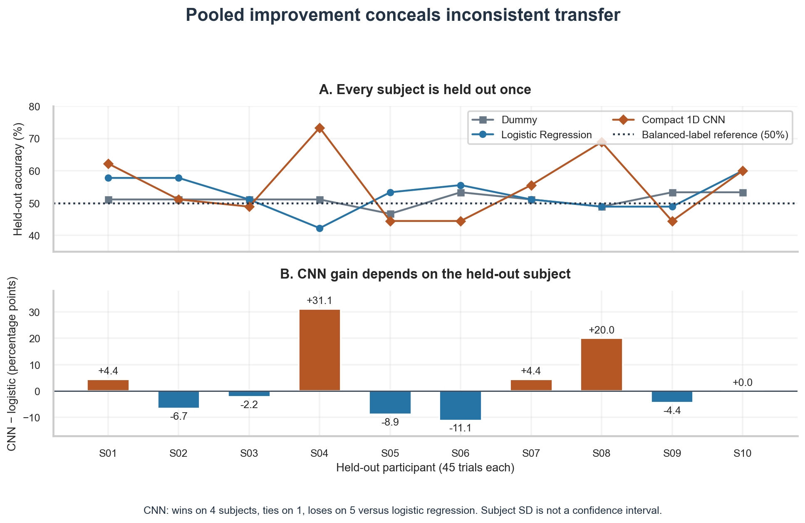
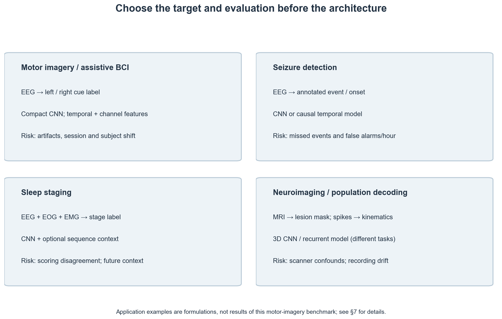

# Deep Learning for Neuroscience: Neural Networks, CNNs, Sequential Models and Applications

> **Week 4 Review Article — Month 1 / Week 4**  
> Foundation learning phase: strong fundamentals before research.  
> Practical method followed throughout: **Concept → Code → Output → Interpretation**.

**Navigation:** ← [[week-3-report|Week 3: Machine Learning for Neuroscience]] · [[Knowledge-Map|Knowledge Map]]  
**Associated Concepts:** [[artificial-neuron]] · [[backpropagation]] · [[convolution]] · [[pooling]] · [[long-short-term-memory]] · [[self-attention]] · [[representation-learning]]

---

## Abstract

Week 4 asks **how a neural network learns a representation of multichannel EEG, and how we distinguish successful optimization from generalization to an unseen person**. Building on Week 3's `[Samples × Features]` matrix and held-out evaluation, we derive the affine neuron, binary cross-entropy gradient, temporal convolution, recurrent state update, and scaled dot-product attention. Laboratories use 450 motor-imagery trials from 10 PhysioNet participants, represented either by 15 handcrafted features or by preprocessed epochs of shape `[3, 480]` at 160 Hz. A 2,922-parameter CNN achieves 55.3% pooled accuracy and 55.3% macro-F1 under 10-fold leave-one-subject-out evaluation, compared with 52.7% accuracy for logistic regression and 51.1% for a majority-class baseline. The CNN's subject accuracies range from 44.4% to 73.3%, and its 2.7 percentage-point gain over logistic regression is descriptive evidence from one cohort and training configuration, rather than proof of general superiority. Untrained RNN, LSTM, and attention forward passes establish computational mechanisms and tensor geometry; they provide no decoding benchmark or causal account of the measured brain activity.

## Keywords

Representation learning, artificial neuron, binary cross-entropy, backpropagation, temporal convolution, pooling, recurrent neural network, long short-term memory, self-attention, Transformer, motor imagery, EEG, `[Batch × Channels × Time]`, leave-one-subject-out evaluation

---

## 1. Introduction & Week 4 Syllabus

Week 3 supplied a row-aligned `[Samples × Features]` matrix, experimental labels, and subject-aware held-out evaluation. Its logistic regression classifier learned a decision rule **after** features had been fixed. Week 4 keeps that evaluation discipline and asks whether the feature transformation can also be learned from the task loss.

**The AI Connection:** A neural network applies parameterized transformations to measured data. Backpropagation adjusts those parameters so that training predictions better match experimental labels. This changes the numerical representation available to a classifier; it does not remove the measurement limits established in Weeks 1–2.

### 1.1 Week 4 Syllabus & Laboratory Sequence

| Day | Core Focus | Laboratory / Practical Tasks |
| :--- | :--- | :--- |
| [[w4d1\|**W4D1**]] | Neurons, nonlinearities, and optimization | Derive a BCE gradient; execute one update on measured alpha-power features; inspect MLP overfitting. |
| [[w4d2\|**W4D2**]] | Temporal CNNs | Trace exact layer shapes; relate kernel length to physical time; inspect kernels and feature maps. |
| [[w4d3\|**W4D3**]] | RNNs and LSTMs | Transpose EEG into a sequence; verify recurrent state geometry; analyze gradient propagation. |
| [[w4d4\|**W4D4**]] | Tokenization and attention | Construct six multichannel patches; verify softmax normalization; diagnose saturated untrained routing. |
| [[w4d5\|**W4D5**]] | Evaluation and applications | Reproduce 10-fold LOSO predictions; compare class errors and subject variability; complete the Month 1 synthesis. |

### 1.2 Reading Guide

- **Understand the learning rule:** §§2–3 connect input representations to forward propagation, loss, and a gradient update.
- **Understand the architectures:** §§4–5 explain what convolution, recurrence, and attention compute, including exact shapes and failure modes.
- **Assess the evidence:** §6 separates the 15-trial run holdout from the 450-trial subject holdout and interprets their results.
- **Transfer the principles:** §§7–9 connect targets, measurement constraints, and evaluation to scientific applications.
- **Reproduce the work:** Appendix A lists commands, inputs, generated artifacts, and determinism checks.

### 1.3 What Was Actually Tested?

| Component | Execution / Training | Evidence Available | Interpretation Limit |
| --- | --- | --- | --- |
| **Single sigmoid neuron** | One analytical gradient step on one measured feature pair | Local loss reduction | Cohort-scaled teaching example; no generalization claim. |
| **Compact MLP** | 40 epochs; checkpoint selected by validation loss | S01 held-out run, 15 trials | One small run split cannot establish architecture rankings. |
| **Compact 1D CNN** | S01 run holdout plus 10 LOSO folds | Held-out trial predictions and class metrics | One seed configuration and 10 participants; no external validation. |
| **RNN / LSTM** | Random initialized forward passes | Output and state shapes | No training, memory-retention test, or decoding accuracy. |
| **Self-attention** | Random projections of unnormalized µV patches | Routing weights and row sums | Numerical mechanism only; no trained Transformer or connectivity inference. |

---

## 2. Fundamental Concepts — From Measured Voltage to a Learned Representation

### 2.1 The Dataset and Its Units

The laboratory uses a subset of the **PhysioNet EEG Motor Movement/Imagery Dataset**: participants S001–S010, runs 04, 08, and 12. These runs contain cued left- and right-hand motor imagery; dataset event annotations supply the labels. The dataset and acquisition framework are documented by [PhysioNet](https://physionet.org/content/eegmmidb/1.0.0/) and Schalk et al. (2004).

Each trial retains channels `C3`, `Cz`, and `C4` over the interval from 0.5 s to just before 3.5 s after the cue. At `sampling_rate = 160 Hz`, this is `3 × 160 = 480` samples per channel, with a 6.25 ms sample interval. The cached epochs already underwent a fourth-order 1–35 Hz Butterworth forward-backward band-pass per run.

| Representation | Shape | Numerical Meaning | Interpretation Pitfall |
| --- | --- | --- | --- |
| **Feature matrix** | `[450, 15]` | Five summaries per channel: mean, variance, peak-to-peak, alpha power, beta power | Columns have mixed units (µV and µV²); scaling must use training rows. |
| **EEG epochs** | `[450, 3, 480]` | Preprocessed voltages in µV | Filtered is not artifact-free; these are not untouched raw EDF samples. |
| **CNN minibatch** | `[Batch, 3, 480]` | Channels precede temporal positions | Swapping axes changes which dimension the convolution traverses. |
| **Recurrent minibatch** | `[Batch, 480, 3]` | Three channel values at each time step | `batch_first=True` places time on the second axis. |
| **Targets** | `[450]` | `0 = LEFT_HAND`, `1 = RIGHT_HAND` | Cue labels specify instructions, not verified moment-by-moment imagery compliance. |

**The Physical Connection:** Scalp channels contain mixtures of neural population fields, reference effects, and non-neural contamination. A representation may predict a cue condition by exploiting artifacts or experimental structure. Held-out accuracy tests predictive transfer; additional evidence is needed to identify the physiological source.

### 2.2 Handcrafted Features and Representation Learning

A classical pipeline learns $g_\phi$ after a fixed feature mapping $\psi$:

$$\hat y = g_\phi\bigl(\psi(X)\bigr).$$

A neural pipeline can learn the feature mapping and classifier together:

$$\hat y = g_\phi\bigl(\psi_\theta(X)\bigr), \qquad
(\theta,\phi) \leftarrow (\theta,\phi)-\eta\nabla_{\theta,\phi}\mathcal L.$$



**Figure 1.** Both workflows start with the same preprocessed EEG. The classical branch fixes its summaries before classification; the CNN branch adjusts kernels and the classification head jointly through training loss. End-to-end learning refers to this optimization boundary, not to removal of acquisition or preprocessing choices.

**Crucial Distinction:** Channel-wise band powers omit within-window phase and explicit cross-channel phase relationships. Handcrafted features can also include phase, coherence, or time–frequency structure; manual feature engineering is not inherently restricted to 15 scalar summaries.

**The Dangerous Misconception:** “A learned representation automatically preserves everything useful.” **Why this is false:** Nonlinearities, strides, and pooling discard information too. A CNN can learn an artifact shortcut, and its final global mean pooling removes explicit temporal positions. Its advantages must be measured on the intended deployment split.

---

## 3. Neural Networks — Forward Propagation, Loss, and Backpropagation

### 3.1 An Artificial Neuron Is an Affine Map Followed by an Activation

For $P$ inputs, a weight vector $w$, and bias $b$, the [[artificial-neuron]] computes:

$$z=w^\top x+b=\sum_{j=1}^{P}w_jx_j+b, \qquad \hat y=f(z).$$

The logit $z$ is a real score. For binary classification, the sigmoid converts it into a probability assigned to class 1:

$$\sigma(z)=\frac{1}{1+e^{-z}}, \qquad \sigma'(z)=\sigma(z)\bigl(1-\sigma(z)\bigr).$$

Hidden layers often use $\operatorname{ReLU}(z)=\max(0,z)$. ReLU has derivative 1 for positive inputs and 0 for negative inputs; software adopts a convention at zero. It avoids sigmoid saturation on its positive branch, but does not guarantee healthy gradients throughout a network and can produce inactive units.

**The Dangerous Misconception:** “An artificial neuron is a simulated biological spike generator.” **Why this is false:** This unit has no membrane dynamics, spike times, or synaptic conductances. It is an algebraic transformation inspired loosely by weighted integration, not a point-process model of a biological neuron.

### 3.2 Deriving the Binary Cross-Entropy Gradient

For one target $y\in\{0,1\}$ and sigmoid probability $\hat y$, binary cross-entropy is:

$$L=-\left[y\log\hat y+(1-y)\log(1-\hat y)\right].$$

[[backpropagation]] applies the chain rule:

$$\frac{\partial L}{\partial w_j}=
\underbrace{\frac{\hat y-y}{\hat y(1-\hat y)}}_{\partial L/\partial\hat y}
\underbrace{\hat y(1-\hat y)}_{\partial\hat y/\partial z}
\underbrace{x_j}_{\partial z/\partial w_j}
=(\hat y-y)x_j.$$

Therefore:

$$\frac{\partial L}{\partial z}=\hat y-y,\qquad
\nabla_wL=(\hat y-y)x,\qquad
\frac{\partial L}{\partial b}=\hat y-y.$$

Gradient descent with learning rate $\eta$ updates:

$$w_{new}=w-\eta(\hat y-y)x,\qquad b_{new}=b-\eta(\hat y-y).$$

**Algorithmic Implication:** If $y=1$ and $\hat y<1$, the bias gradient is negative, so its update increases the logit. The weights change in proportion to the corresponding inputs. A sufficiently small step follows local descent; an arbitrary large step has no general guarantee of reducing loss.

### 3.3 Concept → Code → Output → Interpretation: One Measured Feature Pair

**Concept:** Execute the derivative above using measured `C3_alpha` and `C4_alpha` powers from the first cached trial. Cohort-wide scaling is used only to reproduce this algebraic demonstration; it is not used for any held-out classifier in §6.

**Code:** Run this block from the track root with `uv run python`.

```python
import numpy as np
import pandas as pd

# 1. Read measured powers (uV^2); demonstration-only cohort scaling.
df = pd.read_csv('data/week3_features.csv')
cols = ['C3_alpha', 'C4_alpha']
raw = df.loc[0, cols].to_numpy(dtype=np.float32)
x = np.array([(raw[i] - df[c].mean()) / df[c].std()
              for i, c in enumerate(cols)], dtype=np.float32)
y = int(df.loc[0, 'target'])

# 2. Forward pass; standardized inputs and logits are dimensionless.
w = np.array([0.60, -0.40], dtype=np.float32)
b, eta = 0.10, 0.50
z0 = float(w @ x + b)
p0 = float(1 / (1 + np.exp(-z0)))
loss0 = -(y * np.log(p0) + (1-y) * np.log(1-p0))

# 3. Analytical gradient and joint weight/bias update.
grad = p0-y
w_new, b_new = w-eta*grad*x, b-eta*grad
z1 = float(w_new @ x + b_new)
p1 = float(1 / (1 + np.exp(-z1)))
loss1 = -(y * np.log(p1) + (1-y) * np.log(1-p1))
print(f'Target: {y}; standardized inputs: {x[0]:.4f}, {x[1]:.4f}')
print(f'Before: z={z0:.4f}, p={p0:.4f}, BCE={loss0:.4f}')
print(f'Gradients: dw={grad*x}, db={grad:.4f}')
print(f'After:  z={z1:.4f}, p={p1:.4f}, BCE={loss1:.4f}')
print(f'Loss reduction: {loss0-loss1:.4f}')
```

**Output:**

```text
Target: 1; standardized inputs: 1.3445, 1.3485
Before: z=0.3673, p=0.5908, BCE=0.5263
Gradients: dw=[-0.5501643 -0.5518127], db=-0.4092
After:  z=1.3138, p=0.7881, BCE=0.2381
Loss reduction: 0.2882
```

**Interpretation:** The target is right hand (`y = 1`). The update raises its assigned probability from 0.5908 to 0.7881 and lowers single-example BCE from 0.5263 to 0.2381. This verifies the local learning rule, not a trained motor-imagery decoder or a calibrated probability estimate.



**Figure 2.** The probability moves toward the observed target, and loss falls along the executed joint update. The middle panel interpolates both weights and bias; a fixed-bias contour would not describe the complete parameter displacement. The final panel reports the actual before/after losses.

### 3.4 Multi-Layer Perceptrons and Small-Cohort Overfitting

The `CompactMLP` maps 15 standardized features through 8 ReLU units to 2 class logits. Its parameter count is $(15\times8+8)+(8\times2+2)=146$. Nonlinearity permits decision boundaries unavailable to a single affine classifier, but also increases flexibility relative to a 15-trial training set.

For S01, run 04 supplies training, run 08 validation, and run 12 test data: 15 trials each. The feature scaler is fitted on training data. Training continues for 40 epochs; the stored checkpoint has the lowest validation cross-entropy, at epoch 2.



**Figure 3.** Training loss decreases from about 0.703 to 0.00665 and training accuracy reaches 100%; validation loss is lowest at epoch 2 (0.6708). Validation accuracy later improves while validation loss worsens because confident errors are penalized more strongly by cross-entropy. The selected checkpoint correctly classifies 6 of 15 test trials (40.0%).

**Concept → Code → Output → Interpretation:** Re-execute the MLP training function used by the generation script, then report the validation-selected checkpoint and its held-out result.

```python
import pandas as pd
from generate_week4_plots import run_experiment_2_mlp

# 1. Training/validation/test runs and training-only scaling are defined in the generator.
features = pd.read_csv('data/week3_features.csv')
result = run_experiment_2_mlp(features)

# 2. Report selection and test evaluation separately.
print(f'Selected epoch: {result["best_epoch"]}')
print(f'Validation loss: {result["best_val_loss"]:.4f}')
print(f'Test accuracy: {100*result["test_accuracy"]:.1f}%')
print(f'Test confusion: {result["confusion_matrix"]}')
```

**Output:**

```text
Selected epoch: 2
Validation loss: 0.6708
Test accuracy: 40.0%
Test confusion: [[6, 1], [8, 0]]
```

**Interpretation:** This split illustrates overfitting and the difference between loss and accuracy. It does not establish that MLPs are intrinsically unsuitable for EEG or that CNNs solve the small-sample problem: the CNN also scores 40.0% on this S01 test run.

---

## 4. Convolutional Architectures — Learnable Local Transformations

### 4.1 The Temporal Operator and Its Physical Scale

PyTorch's `Conv1d` implements cross-correlation (the kernel is not reversed). With zero padding $p$, stride $s$, and dilation $d$, output feature map $m$ is:

$$y_m[t]=b_m+\sum_{c=1}^{C_{in}}\sum_{k=0}^{K-1}W_{m,c,k}\,x_c[ts-p+kd].$$

The weights have shape `[Output maps, Input channels, Kernel samples]`. Out-of-range padded samples are zero. Temporal weight sharing gives approximately translation-equivariant responses away from boundaries; it does not by itself make predictions invariant to time shifts.

The nominal sampled-window duration is $K/f_s$. Here $32/160=0.200$ s, which contains two cycles of a 10 Hz oscillation. The first-to-last sample separation is $(K-1)/f_s=193.75$ ms; these are different duration conventions.

**The Physical Connection:** Before nonlinearities, each channel's kernel component resembles an FIR filter. The full output sums responses across channels, and batch normalization, ReLU, and pooling make the complete network nonlinear. A first-layer kernel's spectrum alone is not the network's frequency response.



**Figure 4.** One preprocessed `[3, 480]` epoch enters the network. The actual sequence is `[1, 3, 480]` → `[1, 8, 481]` → `[1, 8, 120]` → `[1, 16, 121]` → `[1, 16]` → `[1, 2]`. Even-length kernels with the stated symmetric padding add one temporal position at each convolution.

### 4.2 Output Length, Parameter Counts, and Receptive Fields

The [PyTorch `Conv1d` definition](https://docs.pytorch.org/docs/2.14/generated/torch.nn.Conv1d.html) gives:

$$T_{out}=\left\lfloor\frac{T_{in}+2p-d(K-1)-1}{s}+1\right\rfloor.$$

Thus the first convolution yields $480+32-31=481$ positions. Max pooling yields $\lfloor(481-4)/4+1\rfloor=120$. The second convolution yields $120+16-15=121$.

| Stage | Configuration | Output Shape | Trainable Parameters | Interpretation Pitfall |
| --- | --- | --- | --- | --- |
| **Input** | 3 channels, 480 samples | `[B, 3, 480]` | 0 | Units are µV before training-fold normalization. |
| **Conv1** | 3 → 8, kernel 32, padding 16 | `[B, 8, 481]` | 776 | Symmetric padding is not causal. |
| **BatchNorm1 + ReLU** | 8 maps | `[B, 8, 481]` | 16 | Running statistics must be frozen for evaluation. |
| **MaxPool** | Kernel 4, stride 4 | `[B, 8, 120]` | 0 | Nonlinear downsampling is not guaranteed anti-aliasing. |
| **Conv2** | 8 → 16, kernel 16, padding 8 | `[B, 16, 121]` | 2,064 | Kernel positions now lie on a grid spaced by 25 ms. |
| **BatchNorm2 + ReLU** | 16 maps | `[B, 16, 121]` | 32 | Activations do not retain physical voltage units. |
| **Adaptive mean + squeeze** | Average over temporal positions | `[B, 16]` | 0 | Explicit within-epoch position is discarded. |
| **Linear head** | 16 → 2 logits | `[B, 2]` | 34 | Logits require softmax to obtain class probabilities. |
| **Total** | Custom compact CNN | — | **2,922** | This model is not the published depthwise-separable EEGNet. |

**Receptive Field:** Track both the receptive field $r$ in original samples and the jump $j$ between adjacent activations. Starting with $r=1,j=1$, each layer updates $r_{new}=r+(K-1)j$ and $j_{new}=js$. Conv1 gives $r=32,j=1$; pooling gives $r=35,j=4$; Conv2 gives $r=95,j=4$. An interior Conv2 activation can therefore depend on a nominal 95-sample input window, or 593.75 ms, rather than 100 ms. Boundary windows include padding.

### 4.3 Pooling Reduces Resolution; It Is Not a Power Estimator

For feature map $a_m$, temporal max pooling computes:

$$p_m[t]=\max_{0\le j<P}a_m[ts_p+j].$$

After ReLU, it retains the strongest positive activation in each window. Average pooling retains an average activation instead. Neither operation is generally equivalent to full-wave rectification followed by low-pass envelope detection, and neither automatically estimates oscillatory band power.

A stride of 4 changes feature-grid spacing from 6.25 ms to 25 ms. Calling this a 40 Hz feature grid is appropriate; treating it as a correctly anti-aliased physical EEG recording at 40 Hz is not.



**Figure 5.** The shaded input window spans 32 samples, and the kernel supplies one weight per sample. The lower panel isolates valid cross-correlation on C3 without bias or normalization and uses window-center timestamps. It illustrates the weighted sum; the network's complete activation also includes Cz/C4, training-fold scaling, bias, batch normalization, and ReLU.

### 4.4 Concept → Code → Output → Interpretation: Verify the Executed Architecture

**Concept:** Load the S01 run-holdout checkpoint and trace a real epoch through each transformation. The architecture is defined in the root generation script; the following block is runnable from the track root after regeneration.

**Code:**

```python
import numpy as np
import torch
from generate_week4_plots import CompactEEGNet1D

# 1. Load the S01 validation-selected model and its training-run scaler.
checkpoint = torch.load('data/week4_cnn_checkpoint.pt', weights_only=True)
model = CompactEEGNet1D()
model.load_state_dict(checkpoint['model_state_dict'])
model.eval()
raw = np.load('data/week4_epochs.npy')[:1]  # uV, [1, 3, 480]
mean = np.array(checkpoint['channel_mean'], dtype=np.float32)
std = np.array(checkpoint['channel_std'], dtype=np.float32)
x = torch.from_numpy((raw-mean)/std)

# 2. Freeze batch-normalization statistics and inspect true tensor shapes.
with torch.no_grad():
    a = model.relu(model.bn1(model.conv1(x)))
    p = model.pool1(a)
    b = model.relu(model.bn2(model.conv2(p)))
    pooled = model.pool2(b).squeeze(-1)
    logits = model.classifier(pooled)
for name, value in [('Input', x), ('Conv1 + BN + ReLU', a),
                    ('MaxPool', p), ('Conv2 + BN + ReLU', b),
                    ('MeanPool + squeeze', pooled), ('Logits', logits)]:
    print(f'{name}: {list(value.shape)}')
print(f'Parameters: {sum(p.numel() for p in model.parameters())}')
print(f'Selected S01 epoch: {checkpoint["best_epoch"]}')
```

**Output:**

```text
Input: [1, 3, 480]
Conv1 + BN + ReLU: [1, 8, 481]
MaxPool: [1, 8, 120]
Conv2 + BN + ReLU: [1, 16, 121]
MeanPool + squeeze: [1, 16]
Logits: [1, 2]
Parameters: 2922
Selected S01 epoch: 9
```

**Interpretation:** The measured shapes agree with the length formula and parameter table. The loaded checkpoint is selected from S01 run 08 and evaluated on run 12; it is separate from the ten models trained for LOSO. A successful forward pass verifies implementation, not predictive performance.

### 4.5 What Kernel Inspection Can Establish

For one channel component of a finite kernel, a diagnostic magnitude spectrum is:

$$|H(f)|=\left|\sum_{k=0}^{K-1}w[k]e^{-i2\pi fk/f_s}\right|.$$



**Figure 6.** The top panels display four C3 kernel components from the S01 checkpoint and their magnitude spectra. Alpha/mu and beta shading provides frequency reference, rather than proof of physiological selectivity. Bottom panels share an activation color scale and show BN/ReLU maps before and after max pooling; time is approximate because padding and pooling alter alignment.

**The Dangerous Misconception:** “A kernel with energy near 10 Hz proves the model learned motor-cortex physiology.” **Why this is false:** Random short kernels also have nonuniform spectra, and the network jointly mixes channels and applies nonlinear operations. An initialized-versus-trained comparison, perturbation experiment, or carefully controlled attribution analysis would be needed to strengthen that interpretation. This laboratory provides a diagnostic visualization only.

---

## 5. Sequential Models — Recurrence, Gated Memory, and Attention

### 5.1 RNNs Process One Ordered Step at a Time

A vanilla [[recurrent-neural-network]] combines the current channel vector with the previous hidden state:

$$h_t=\tanh(W_{ih}x_t+b_{ih}+W_{hh}h_{t-1}+b_{hh}).$$

Here each $x_t$ contains 3 channel values, and the demonstration uses 8 hidden units. Its input has shape `[1, 480, 3]`; its output sequence has shape `[1, 480, 8]`.

The local hidden-state Jacobian includes the activation derivative:

$$J_t=\frac{\partial h_t}{\partial h_{t-1}}=
\operatorname{diag}(1-h_t^2)W_{hh}, \qquad
\frac{\partial h_T}{\partial h_t}=J_TJ_{T-1}\cdots J_{t+1}.$$

Products of these time-varying matrices can shrink or grow gradients. Replacing the product by a power of $W_{hh}$ ignores nonlinear activation derivatives and does not generally diagnose the full dynamics. In a simplified scalar path with gain 0.95 per step, 479 transitions multiply the gradient by $0.95^{479}$, approximately $2.1\times10^{-11}$.

### 5.2 LSTM Gates Provide an Additive Memory Path

A [[long-short-term-memory]] layer uses gates and a candidate update:

$$\begin{aligned}
f_t&=\sigma(W_fx_t+U_fh_{t-1}+b_f),\\
i_t&=\sigma(W_ix_t+U_ih_{t-1}+b_i),\\
o_t&=\sigma(W_ox_t+U_oh_{t-1}+b_o),\\
\tilde c_t&=\tanh(W_cx_t+U_ch_{t-1}+b_c),\\
c_t&=f_t\odot c_{t-1}+i_t\odot\tilde c_t,\\
h_t&=o_t\odot\tanh(c_t).
\end{aligned}$$

**Intuition:** The forget gate controls retained cell content, the input gate controls additions, and the output gate controls exposed memory. Along the direct cell-state path, holding gate values fixed, the derivative across steps contains $\prod_t f_t$. Gates near 1 can preserve that path; gates below 1 still attenuate it. Other paths through gate dependencies also contribute to the full derivative.

**The Dangerous Misconception:** “An LSTM eliminates vanishing gradients.” **Why this is false:** It offers a better-conditioned memory route, but does not guarantee learned long-term retention, nonsaturating gates, or successful training. The principle is developed in [Hochreiter and Schmidhuber (1997)](https://doi.org/10.1162/neco.1997.9.8.1735).


**Figure 7.** The same measured trial is passed through random initialized RNN and LSTM layers. Hidden activations share a −1 to 1 color scale; their differing textures reflect different computations and initialization. These untrained states neither demonstrate noise removal nor measure memory retention or decoding performance.

### 5.3 Concept → Code → Output → Interpretation: State Geometry

**Concept:** Verify recurrent shapes and quantify the simplified scalar attenuation without interpreting random hidden units as physiological memory.

**Code:**

```python
import numpy as np
import torch
from torch import nn

# 1. Real preprocessed uV epoch; transpose channels/time explicitly.
torch.manual_seed(42)
torch.set_num_threads(2)
trial = np.load('data/week4_epochs.npy')[0]
x = torch.from_numpy(trial.T.copy()).unsqueeze(0)
rnn = nn.RNN(3, 8, batch_first=True).eval()
lstm = nn.LSTM(3, 8, batch_first=True).eval()

# 2. Untrained forward passes; h and c are dimensionless internal states.
with torch.no_grad():
    r_out, r_h = rnn(x)
    l_out, (l_h, l_c) = lstm(x)
print(f'Input: {list(x.shape)}')
print(f'RNN output / final hidden: {list(r_out.shape)} / {list(r_h.shape)}')
print(f'LSTM output / final hidden / cell: {list(l_out.shape)} / {list(l_h.shape)} / {list(l_c.shape)}')
print(f'Scalar path attenuation, 0.95^479: {0.95**479:.3e}')
```

**Output:**

```text
Input: [1, 480, 3]
RNN output / final hidden: [1, 480, 8] / [1, 1, 8]
LSTM output / final hidden / cell: [1, 480, 8] / [1, 1, 8] / [1, 1, 8]
Scalar path attenuation, 0.95^479: 2.136e-11
```

**Interpretation:** Both layers return one 8-dimensional state per sample. The LSTM additionally returns a final cell state. The scalar calculation illustrates repeated multiplication, not the measured Jacobian of either random network. Testing memory requires an explicit retention task or gradient measurement after training.

### 5.4 Tokenization Shortens the Attention Sequence

[[self-attention]] combines information from multiple sequence positions directly. The demonstration partitions each `[3, 480]` trial into 6 nonoverlapping patches of shape `[3, 80]`. Each patch covers 0.5 s and flattens into 240 values; a linear projection and positional embedding produce 6 vectors of dimension 16.


**Figure 8.** The patch boundaries cover 0.5–3.5 s after the cue. Each token includes all three channels, even though the top panel shows only C3. Flattening and projection produce `[6, 240]` → `[6, 16]`; tokenization compresses the sequence and changes its resolution.

For embedding matrix $E$, attention projections and routing are:

$$Q=EW_Q,\quad K=EW_K,\quad V=EW_V,\qquad
A=\operatorname{softmax}_{row}\left(\frac{QK^\top}{\sqrt{d_k}}\right),\qquad Z=AV.$$

In this example, `Q`, `K`, and `V` each have shape `[1, 6, 16]`, and routing $A$ has shape `[1, 6, 6]`. Each query row sums to 1 across source keys. Without a causal mask, a query can use later tokens; this is an offline operation.

Reducing sample-level tokens from 480 to 6 reduces score-matrix entries from 230,400 to 36 per head. Those are **matrix entries**, not the complete operation count: dot products depend on embedding dimension, and projection layers also have a cost.

**Crucial Distinction:** A [[transformer]] combines attention with feed-forward sublayers, residual pathways, normalization, and positional information. One random attention calculation is not a trained Transformer classifier. The architecture is defined in [Vaswani et al. (2017)](https://arxiv.org/abs/1706.03762).

### 5.5 Concept → Code → Output → Interpretation: Diagnose Attention Saturation

**Concept:** Reproduce the generator's untrained attention mechanism. It projects unnormalized µV patches, so large score magnitudes can saturate softmax even when each row sums correctly.

**Code:**

```python
import numpy as np
from generate_week4_plots import run_experiment_5_attention

# 1. Fixed-seed untrained projections; the function is defined in the generator.
epochs = np.load('data/week4_epochs.npy')  # uV
result = run_experiment_5_attention(epochs)
a = result['attention_matrix']

# 2. Check normalization and concentration independently.
print(f'Tokens: {result["num_tokens"]}; patch samples: {result["patch_samples"]}')
print(f'Routing shape: {a.shape}')
print(f'Row sums: {a.sum(axis=1)}')
print(f'Largest weight per row: {a.max(axis=1)}')
print(f'Most attended source token: {a.argmax(axis=1)}')
```

**Output:**

```text
Tokens: 6; patch samples: 80
Routing shape: (6, 6)
Row sums: [1. 1. 1. 1. 1. 1.]
Largest weight per row: [1. 1. 1. 1. 1. 1.]
Most attended source token: [1 1 3 0 2 5]
```

**Interpretation:** Each row is normalized, but its largest weight rounds to 1.0. Correct normalization alone does not make the weights informative or physiologically meaningful. These projections have received no label supervision. A trainable pipeline should fit input scaling on its training partition and examine attention entropy, optimization, and held-out predictions.


**Figure 9.** The routing heatmap and per-query maxima expose numerical saturation in the existing random, unnormalized demonstration. Query rows are destinations and key columns are sources. Apparently decisive weights are not evidence of learned temporal dependencies.

> [!CAUTION]
> **Attention weights do not establish neural connectivity.** These coefficients operate between temporal patches of mixed scalp measurements. Even trained attention describes an internal prediction computation; biological connectivity requires a justified physiological measurement and analysis.

---

## 6. Numerical Analysis — What Generalizes to an Unseen Subject?

### 6.1 Separate the Two Evaluation Questions

| Protocol | Training / Selection | Test Partition | Question Answered | Interpretation Pitfall |
| --- | --- | --- | --- | --- |
| **S01 run holdout** | Run 04 trains; run 08 selects lowest-validation-loss checkpoint | Run 12, 15 trials | Does a model transfer to another run of this participant? | Small test count; not evidence about unseen participants. |
| **10-fold LOSO** | 9 participants (405 trials) train each fold; CNN uses 15 fixed epochs | 1 participant (45 trials), repeated for all 10 | Does the learned rule transfer to an unseen person? | A small cohort and one training configuration do not quantify external reliability. |

All classifiers share trial IDs and labels. Logistic regression uses a training-fold `StandardScaler`, `C=1`, and the `liblinear` solver. CNN normalization uses per-channel mean and standard deviation over training trials and time only. Each LOSO CNN is freshly initialized with seed `42 + held_out_subject`, then trained using Adam (`lr=0.005`, `weight_decay=0.001`, batch size 32) for 15 epochs.

**Algorithmic Implication:** No LOSO test participant supplies scaler statistics, batch-normalization updates, or checkpoint selection. The fixed epoch budget avoids test-based early stopping; tuning that budget after inspecting these scores would require a fresh outer evaluation or nested validation.

### 6.2 Pooled Results and Class-Specific Errors

| Model | Representation | Parameters | Accuracy | Right-Hand Precision | Right-Hand Recall | Macro-F1 |
| --- | --- | ---: | ---: | ---: | ---: | ---: |
| **Majority dummy** | Training class prior | 0 | 51.1% | 0.0%* | 0.0% | 33.8% |
| **Logistic regression** | 15 handcrafted features | 16 | 52.7% | 51.7% | 49.5% | 52.6% |
| **Compact 1D CNN** | Preprocessed `[3, 480]` epochs | 2,922 | 55.3% | 54.4% | 53.6% | 55.3% |

*The dummy never predicts right hand; precision is undefined mathematically and reported as 0 by the explicitly selected `zero_division=0` convention. Macro-F1 averages the two class F1 scores; precision and recall here refer specifically to right hand (`y=1`). Model limitations are detailed in §§6.3–6.4.*



**Figure 10.** Each confusion matrix contains 450 held-out predictions, with 230 true left-hand and 220 true right-hand trials. Cells show both counts and within-class percentages on a common color scale. The dummy's 51.1% accuracy conceals zero right-hand recall; the CNN correctly predicts 131 left-hand and 118 right-hand trials.

For the CNN, $TN=131$, $FP=99$, $FN=102$, and $TP=118$:

$$\operatorname{Accuracy}=\frac{131+118}{450}=55.33\%,\quad
\operatorname{Precision}_{right}=\frac{118}{118+99}=54.38\%,\quad
\operatorname{Recall}_{right}=\frac{118}{118+102}=53.64\%.$$

**Interpretation:** The CNN makes 249 correct predictions versus 237 for logistic regression, a gain of 12 trials (2.67 percentage points). It is the highest-scoring model in this run, but its remaining 201 errors and modest class metrics do not support reliable assistive control.

### 6.3 Subject-Level Variation Is Part of the Result

| Subject | Dummy Accuracy | Logistic Accuracy | CNN Accuracy | CNN − Logistic |
| --- | ---: | ---: | ---: | ---: |
| **S01** | 51.1% | 57.8% | 62.2% | +4.4 pp |
| **S02** | 51.1% | 57.8% | 51.1% | −6.7 pp |
| **S03** | 51.1% | 51.1% | 48.9% | −2.2 pp |
| **S04** | 51.1% | 42.2% | 73.3% | +31.1 pp |
| **S05** | 46.7% | 53.3% | 44.4% | −8.9 pp |
| **S06** | 53.3% | 55.6% | 44.4% | −11.1 pp |
| **S07** | 51.1% | 51.1% | 55.6% | +4.4 pp |
| **S08** | 48.9% | 48.9% | 68.9% | +20.0 pp |
| **S09** | 53.3% | 48.9% | 44.4% | −4.4 pp |
| **S10** | 53.3% | 60.0% | 60.0% | 0.0 pp |



**Figure 11.** The top panel shows every held-out subject, and the bottom shows paired model differences. The CNN improves on logistic regression for 4 participants, ties for 1, and scores lower for 5. The mean gain is concentrated in S04 and S08; a single pooled score obscures this pattern. The 50% line is a balanced-label reference, while the plotted dummy reflects the actual training-fold majority class.

**Uncertainty:** Each participant contributes only 45 trials, so one additional correct prediction changes their accuracy by 2.22 percentage points. Population-normalized subject accuracy SD (`ddof=0`) is 2.0 pp for the dummy, 5.1 pp for logistic regression, and 10.0 pp for the CNN. These are descriptive spreads, not standard errors or confidence intervals. Equal trial counts make pooled accuracy equal mean subject accuracy here; unequal counts would change that relationship.

**The Dangerous Misconception:** “Low CNN accuracy identifies an anatomically non-responsive participant.” **Why this is false:** These predictions contain no anatomical measurement, direct imagery-compliance assessment, or causal source analysis. Signal quality, artifacts, task variability, model instability, and distribution shift are plausible contributors. The results establish heterogeneous predictive performance, not its cause.

### 6.4 Concept → Code → Output → Interpretation: Audit Held-Out Predictions

**Concept:** Recompute benchmark metrics from trial-level predictions and compare each subject on a paired basis. This verifies the published numbers independently of plot annotations.

**Code:**

```python
import numpy as np
import pandas as pd
from sklearn.metrics import accuracy_score, f1_score, confusion_matrix

# 1. Every row is a trial predicted while its participant was held out.
df = pd.read_csv('data/week4_predictions.csv')
y = df['y_true']
for name, col in [('Dummy', 'pred_dummy'), ('Logistic', 'pred_lr'), ('CNN', 'pred_cnn')]:
    print(f'{name}: accuracy={100*accuracy_score(y, df[col]):.1f}%, '
          f'macro-F1={100*f1_score(y, df[col], average="macro"):.1f}%')
print(f'CNN confusion: {confusion_matrix(y, df["pred_cnn"]).tolist()}')

# 2. Equal trial counts permit paired correct-count comparisons.
differences = []
for _, group in df.groupby('subject', sort=True):
    cnn_correct = int((group.pred_cnn == group.y_true).sum())
    lr_correct = int((group.pred_lr == group.y_true).sum())
    differences.append(cnn_correct-lr_correct)
delta = np.array(differences)
print(f'CNN vs logistic: wins={sum(delta>0)}, ties={sum(delta==0)}, losses={sum(delta<0)}')
print(f'Net additional correct predictions: {delta.sum()}')
```

**Output:**

```text
Dummy: accuracy=51.1%, macro-F1=33.8%
Logistic: accuracy=52.7%, macro-F1=52.6%
CNN: accuracy=55.3%, macro-F1=55.3%
CNN confusion: [[131, 99], [102, 118]]
CNN vs logistic: wins=4, ties=1, losses=5
Net additional correct predictions: 12
```

**Interpretation:** Trial-level recomputation reproduces the pooled results. The paired counts show that higher pooled accuracy is compatible with losses on several participants. Folds share training participants, and trials within a participant are not independent evidence from separate people; an uncertainty analysis must respect that grouping.

### 6.5 Architecture Comparison and the Limits of the Benchmark

| Model Family | Useful Inductive Bias | Appropriate Representation | Main Limitation Here |
| --- | --- | --- | --- |
| **Linear model** | Simple decision rule and explicit regularization | Fixed features | Cannot recover waveform detail discarded by its input features. |
| **MLP** | Nonlinear feature interactions | Features or flattened arrays | Few training examples relative to flexible boundaries. |
| **CNN** | Locality and temporal weight sharing | Multichannel epochs | Padding, pooling, artifacts, and subject shift affect transfer. |
| **RNN / LSTM** | Ordered recurrent state | Sample or epoch sequences | Sequential execution and gradient/retention challenges; not benchmarked here. |
| **Transformer** | Pairwise token interactions | Embedded temporal patches | Tokenization, data requirements, and causal masking; not benchmarked here. |

**The Takeaway:** No RNN, LSTM, or Transformer accuracy can be inferred from this report. CNN versus logistic regression also changes both architecture and input representation, so it is a pipeline comparison, not an isolated test of depth. Repeated seeds, more subjects, nested tuning, and external cohorts would be needed to assess robustness.

---

## 7. Applications — Connect the Target to the Measurement

The formulations below extend the foundation principles to other tasks. They are application examples, not experiments performed by this motor-imagery benchmark.



**Figure 12.** Each application begins with a measured input and an independently defined target. Different modalities require different tensor geometries and evaluation units; sharing a neural-network label does not make their scientific problems interchangeable.

### 7.1 Motor Imagery and Assistive Brain–Computer Interfaces

- **Biological Event:** A participant attempts or imagines a specified movement under a controlled cue.
- **Neural Activity:** Sensorimotor mu/beta modulation may accompany the task; scalp measurements remain mixtures.
- **Neural Data:** EEG or ECoG epochs in `[Channels × Time]`, with fixed montage and acquisition metadata.
- **Target / Label:** Left/right cue condition or a defined assistive-control command.
- **AI Task:** Estimate $P(y=k\mid X)$ with a compact CNN or a regularized feature classifier; evaluate on new runs or people according to intended use.
- **Primary Failure Mode:** Artifact shortcuts and session/subject shift. Learned channel mixtures do not automatically cancel common-mode noise or localize cortical sources.

**Architectural Insight:** Published EEGNet uses depthwise and separable convolutions to constrain temporal and spatial feature learning (Lawhern et al., 2018). The custom CNN here uses ordinary multichannel `Conv1d`; its name must not imply equivalence to that architecture. Learned filters also do not eliminate the need for justified preprocessing.

### 7.2 Seizure Detection and Forecasting

- **Biological Event:** An electrographic seizure occurs during monitoring.
- **Neural Activity:** Evolving pathological population activity produces variable rhythmic and transient patterns.
- **Neural Data:** Continuous scalp or intracranial EEG with expert event annotations and timestamped windows.
- **Target / Label:** Ictal event/onset for detection; a separately defined future-event horizon for forecasting.
- **AI Task:** Estimate event scores over time; evaluate event sensitivity, detection delay (s), and false alarms per hour, rather than window accuracy alone.
- **Primary Failure Mode:** Artifact-triggered false alarms, rare-event imbalance, and patient leakage. Successful detection does not establish pre-ictal forecasting.

**Mathematical Formulation:** For detection, $p_t=P(\mathrm{ictal}\mid X_{\le t})$ supports a causal alarm rule. Forecasting instead asks about an interval such as $P(\mathrm{event\ in}\ (t,t+H]\mid X_{\le t})$ and requires explicit horizon $H$, event definitions, and prospective evaluation.

### 7.3 Sleep Stage Classification

- **Biological Event:** A participant progresses through wakefulness and sleep.
- **Neural Activity:** Oscillations, spindles, slow waves, eye movements, and muscle tone vary with stage.
- **Neural Data:** EEG, EOG, and EMG; a 30 s epoch at 100 Hz has 3,000 samples per channel.
- **Target / Label:** Independently scored `WAKE`, `N1`, `N2`, `N3`, or `REM` labels.
- **AI Task:** Map each epoch and optional context to stage probabilities; report class-wise metrics on held-out participants.
- **Primary Failure Mode:** Scoring ambiguity and class imbalance. A bidirectional sequence model may use future epochs, which is permissible offline but changes real-time latency.

**Architectural Insight:** A CNN can summarize within-epoch waveforms, while a recurrent or attention model can relate successive epochs. This is an architectural rationale, not a demonstrated advantage in the present laboratory.

### 7.4 Affective Computing

- **Biological Event:** A participant experiences a stimulus and reports valence or arousal.
- **Neural Activity:** Task-related electrophysiological changes coexist with eye, facial-muscle, and autonomic responses.
- **Neural Data:** EEG and optional peripheral measurements with stimulus and response timestamps.
- **Target / Label:** Self-report score or category, with its scale explicitly documented.
- **AI Task:** Predict the recorded label under held-out subject and stimulus evaluation.
- **Primary Failure Mode:** Subjective label uncertainty and stimulus/artifact confounds. Predicting a questionnaire response does not identify a universal neural signature of emotion.

### 7.5 Neural Decoding of Motor Kinematics

- **Biological Event:** A limb or cursor follows a trajectory.
- **Neural Activity:** Motor-population activity varies with task and movement.
- **Neural Data:** Binned intracortical spike counts or LFP sequences, with stable unit/channel identifiers.
- **Target / Label:** Measured position, velocity (m/s), or force (N), aligned to neural timestamps.
- **AI Task:** Estimate continuous trajectories, for example $\hat v_t=f_\theta(X_{\le t})$, and evaluate trajectory error and closed-loop behavior.
- **Primary Failure Mode:** Recording drift and unit loss. A latent or recurrent model is not automatically robust to changing channels.

### 7.6 Neuroimaging Analysis

- **Biological Event:** Structural pathology or an experimentally defined functional condition is assessed.
- **Neural Activity:** Structural MRI reflects tissue anatomy; fMRI measures a delayed hemodynamic correlate of activity.
- **Neural Data:** Structural volumes `[Height × Width × Depth]` or fMRI `[Height × Width × Depth × Time]`.
- **Target / Label:** Expert lesion mask, clinical category, or experimental condition with documented uncertainty.
- **AI Task:** Estimate a voxel-wise mask or subject-level prediction using an appropriate 3D or temporal architecture.
- **Primary Failure Mode:** Scanner/site and demographic confounds. Split patients before slice extraction or augmentation; transferred representations require downstream validation.

---

## 8. Critical Challenges & Methodological Guardrails

### 8.1 Leakage and Deployment Boundaries

1. **Fit learned transforms on training data.** Feature scalers, channel normalization, and model selection cannot use the test partition. The cohort-scaled neuron in §3.3 is explicitly a teaching example, separate from prediction evaluation.
2. **Match the grouping to the claim.** Holding out runs tests session transfer; holding out subjects tests person transfer. Random trial splits can answer a limited within-distribution question but do not establish either form of transfer.
3. **Track temporal dependence.** Overlapping windows and segments from the same event can share substantial information. Keep relevant recordings, events, and participants together when the deployment claim requires independence.
4. **Declare use of future samples.** Forward-backward filtering, symmetric CNN padding, bidirectional recurrence, and unrestricted attention can use later information. Real-time applications require causal alternatives and measured latency.
5. **Freeze the evaluation protocol.** Inspecting test performance to choose epochs, cutoffs, models, or thresholds turns that test set into selection data. Use inner validation or a new external test for subsequent changes.

### 8.2 Sensor Limits and Model Interpretation

**The Physical Connection:** Volume conduction mixes sources across channels. A learned kernel, hidden state, or attention matrix operates on that mixture. None restores a unique biological source merely by being optimized with backpropagation.

**The Dangerous Misconception:** “If a complex model fails to beat a linear baseline, it memorized noise.” **Why this is false:** Underfitting, inadequate optimization, weak task signal, or an appropriate simple representation can also explain the result. Training/validation curves and controlled comparisons are needed to distinguish them.

**Design Rule of Thumb:** First check labels, units, row alignment, split membership, baseline behavior, and residual artifacts. Increase architectural complexity only when there is a testable reason and enough independent data to evaluate the change.

### 8.3 What Remains Unresolved

The cohort does not establish statistical superiority of the CNN, calibration of its probabilities, robustness to new acquisition sites, or suitability for clinical or assistive deployment. Subject-level variation is observed, but its anatomical or physiological causes are not measured. The untrained attention example also exposes input-scale sensitivity that must be addressed before a trained Transformer experiment.

---

## 9. Conclusion & Pedagogical Handoff

Week 4 completes the Month 1 foundation by connecting measured EEG to trainable numerical representations:

1. **A neural network learns transformations through a loss.** The explicit BCE example verifies a joint weight/bias update and local loss reduction.
2. **Architectural geometry has physical consequences.** Kernel lengths, padding, pooling, and receptive fields determine which samples interact and which timing information survives.
3. **Recurrence and attention offer different sequence mechanisms.** Their forward passes verify shapes; trained retention and decoding require separate experiments.
4. **Successful fitting is not held-out success.** The S01 MLP reaches perfect training accuracy while its selected checkpoint scores 40.0% on 15 test trials.
5. **The CNN has a modest descriptive LOSO gain.** It scores 55.3% accuracy versus 52.7% for logistic regression, with substantial participant variation and no identified biological cause.
6. **The biological measurement boundary persists.** Predictive features and attention weights do not establish neural source identity or connectivity.

**The Next Learning Question:** After [[week-1-report|measurement]], [[week-2-report|signal processing]], [[week-3-report|supervised evaluation]], and learned representations, the next phase should ask: *which spatial or latent representations improve generalization while preserving a defensible relationship to the measurement?* Spatial filtering and unsupervised representations are a proposed extension; no Week 5 report is currently present in this track.

---

## 10. Academic References & Annotated Literature

1. **Schalk, G., McFarland, D. J., Hinterberger, T., Birbaumer, N., & Wolpaw, J. R. (2004).** *BCI2000: A general-purpose brain-computer interface (BCI) system.* IEEE Transactions on Biomedical Engineering, 51(6), 1034–1043. DOI: [10.1109/TBME.2004.827072](https://doi.org/10.1109/TBME.2004.827072).  
   **Contribution:** Describes the acquisition framework associated with the motor movement/imagery recordings used here.
2. **Schalk, G., and colleagues (2009).** *EEG Motor Movement/Imagery Dataset*, version 1.0.0. PhysioNet, published 9 September 2009. [Dataset documentation](https://physionet.org/content/eegmmidb/1.0.0/).  
   **Contribution:** Supplies the run-specific imagery tasks, channel recordings, sampling metadata, and event annotations for this laboratory subset; the project records dataset DOI [10.13026/C28G6P](https://doi.org/10.13026/C28G6P).
3. **Goldberger, A. L., Amaral, L. A. N., Glass, L., Hausdorff, J. M., Ivanov, P. C., Mark, R. G., Mietus, J. E., Moody, G. B., Peng, C.-K., & Stanley, H. E. (2000).** *PhysioBank, PhysioToolkit, and PhysioNet: Components of a new research resource for complex physiologic signals.* Circulation, 101(23), e215–e220. DOI: [10.1161/01.CIR.101.23.e215](https://doi.org/10.1161/01.CIR.101.23.e215).  
   **Contribution:** Establishes the physiological-data resource; it does not itself describe the later EEG dataset as its own experimental contribution.
4. **Schirrmeister, R. T., Springenberg, J. T., Fiederer, L. D. J., Glasstetter, M., Eggensperger, K., Tangermann, M., Hutter, F., Burgard, W., & Ball, T. (2017).** *Deep learning with convolutional neural networks for EEG decoding and visualization.* Human Brain Mapping, 38(11), 5391–5420. DOI: [10.1002/hbm.23730](https://doi.org/10.1002/hbm.23730).  
   **Contribution:** Develops and evaluates EEG convolutional decoding architectures and methods for inspecting learned representations; those results do not validate the custom network here.
5. **Lawhern, V. J., Solon, A. J., Waytowich, N. R., Gordon, S. M., Hung, C. P., & Lance, B. J. (2018).** *EEGNet: A compact convolutional neural network for EEG-based brain–computer interfaces.* Journal of Neural Engineering, 15(5), 056013. DOI: [10.1088/1741-2552/aace8c](https://doi.org/10.1088/1741-2552/aace8c).  
   **Contribution:** Uses depthwise and separable convolutions to build compact EEG representations and evaluates them across several BCI paradigms.
6. **Hochreiter, S., & Schmidhuber, J. (1997).** *Long short-term memory.* Neural Computation, 9(8), 1735–1780. DOI: [10.1162/neco.1997.9.8.1735](https://doi.org/10.1162/neco.1997.9.8.1735).  
   **Contribution:** Introduces an additive memory architecture designed to support learning long time dependencies.
7. **Vaswani, A., Shazeer, N., Parmar, N., Uszkoreit, J., Jones, L., Gomez, A. N., Kaiser, Ł., & Polosukhin, I. (2017).** *Attention is all you need.* Advances in Neural Information Processing Systems, 30, 5998–6008. Preprint DOI: [10.48550/arXiv.1706.03762](https://doi.org/10.48550/arXiv.1706.03762).  
   **Contribution:** Defines the Transformer and scaled dot-product attention; its machine-translation experiments are not neuroscience validation.
8. **Pfurtscheller, G., & Lopes da Silva, F. H. (1999).** *Event-related EEG/MEG synchronization and desynchronization: Basic principles.* Clinical Neurophysiology, 110(11), 1842–1857. DOI: [10.1016/S1388-2457(99)00141-8](https://doi.org/10.1016/S1388-2457(99)00141-8).  
   **Contribution:** Defines ERD/ERS and the interpretation of task-related oscillatory changes, motivating sensorimotor feature analysis.

**Implementation Reference:** PyTorch contributors, [Conv1d](https://docs.pytorch.org/docs/2.14/generated/torch.nn.Conv1d.html), accessed 2026-10-13. Defines the cross-correlation operator and exact output-length expression used in §4.

---

## Appendix A — Computational Reproducibility (UV + Python)

Run all commands from the `NeuroScience/` track root. The generation script uses the existing cached data and trains the reported MLP/CNN models; it does not redownload or re-extract raw recordings.

```bash
# Restore the managed environment without changing its lockfile.
uv sync --locked

# Execute experiments and regenerate all 12 figures and benchmark artifacts.
uv run python 'generate_week4_plots.py'
```

**Prerequisites:** `data/week3_features.csv` and `data/week4_epochs.npy` must exist and share trial order. The feature table has 450 rows and 25 columns, of which 15 are channel features; the epoch array is float32 with shape `(450, 3, 480)`. `data/provenance_manifest.json` documents source EDF checksums and extraction provenance. Week 3's generator supplies the upstream data pipeline.

**Environment:** Exact resolved packages are recorded in `uv.lock`; broad dependency constraints in `pyproject.toml` are not exact version pins. The active runtime and direct package versions are listed below from execution:

```text
Python 3.10.18
numpy 2.2.6
scipy 1.14.1
torch 2.14.1
pandas 2.3.3
scikit-learn 1.7.2
matplotlib 3.10.9
seaborn 0.13.2
```

**Determinism:** Experiments reset NumPy/PyTorch seeds to 42, and LOSO uses `42 + subject` per fold. Training runs on CPU with two PyTorch threads. PNGs use fixed metadata, Seaborn's white-grid theme, and 180 dpi export. Repeated runs on the same locked environment are checked for byte-identical images, numerical artifacts, and console output; different hardware or library versions may change floating-point behavior. Wall-clock timing is excluded from reproducible output.

| Artifact | Purpose | Interpretation Limit |
| --- | --- | --- |
| **`week4_manifest.json`** | Dataset subset, preprocessing, seed, and image manifest | Describes the cached inputs; it is not a new raw-data extraction log. |
| **`week4_splits.json`** | S01 run split and LOSO fold sizes | Protocol summary; trial identities are available in feature/prediction rows. |
| **`week4_predictions.csv`** | Held-out predictions for all 450 trials | CNN rows originate from ten separate LOSO models. |
| **`week4_metrics.json`** | Executed experiment results and histories | Per-subject `mean_f1` is binary right-hand F1; the report benchmark uses pooled macro-F1. |
| **`week4_cnn_checkpoint.pt`** | S01 model and training-run scaling statistics | S01 run-holdout checkpoint, not a pooled LOSO model. |
| **`week4_lab_outputs.json`** | Formatted laboratory summaries | Report output fences are independently captured from the runnable blocks above. |

**Figure Manifest:** File prefixes preserve existing daily-note references; caption numbers follow the order of appearance in this report.

| Report Figure | File in `assets/` | Section |
| --- | --- | --- |
| **1** | `fig1_representation_pipeline.png` | §2.2 |
| **2** | `fig2_artificial_neuron_step.png` | §3.3 |
| **3** | `fig3_mlp_training_history.png` | §3.4 |
| **4** | `fig4_cnn_architecture_trace.png` | §4.1 |
| **5** | `fig5_temporal_convolution_sliding.png` | §4.3 |
| **6** | `fig6_learned_kernels_and_feature_maps.png` | §4.5 |
| **7** | `fig9_rnn_lstm_state_dynamics.png` | §5.2 |
| **8** | `fig10_eeg_tokenization_geometry.png` | §5.4 |
| **9** | `fig11_self_attention_matrix.png` | §5.5 |
| **10** | `fig7_heldout_confusion_matrices.png` | §6.2 |
| **11** | `fig8_subject_generalization_comparison.png` | §6.3 |
| **12** | `fig12_neuroscience_applications_landscape.png` | §7 |

The raw exports `week4-export.md` and `week-4-export.md` remain preserved alongside this synthesis. Report examples import local architecture/experiment definitions where stated; execute them from the root so those imports and relative data paths resolve.

---

## Appendix B — Knowledge Graph Connections

**Central MOC Hub:** [[Knowledge-Map]]

**Upstream:** [[week-3-report|Week 3]] — supplies experimental labels, the `[Samples × Features]` matrix, classification metrics, and subject-aware evaluation. [[week-2-report|Week 2]] supplies filtering and feature units; [[week-1-report|Week 1]] supplies measurement physics and `[Channels × Time]` geometry.

**Downstream:** The post-foundation phase can test spatial filtering, latent representations, and calibrated decoding under the same held-out evaluation discipline. A downstream report link will be added when that module exists.

**Sibling Concepts:** [[feature-matrix]] · [[experimental-labels]] · [[classification-metrics]] · [[data-leakage]] · [[overfitting]] · [[subject-generalization]] · [[convolution]] · [[pooling]] · [[self-attention]] · [[representation-learning]]

**Daily Working Notes:** [[w4d1|W4D1: Neurons and Optimization]] · [[w4d2|W4D2: CNNs]] · [[w4d3|W4D3: RNNs and LSTMs]] · [[w4d4|W4D4: Attention]] · [[w4d5|W4D5: Evaluation and Capstone]]
