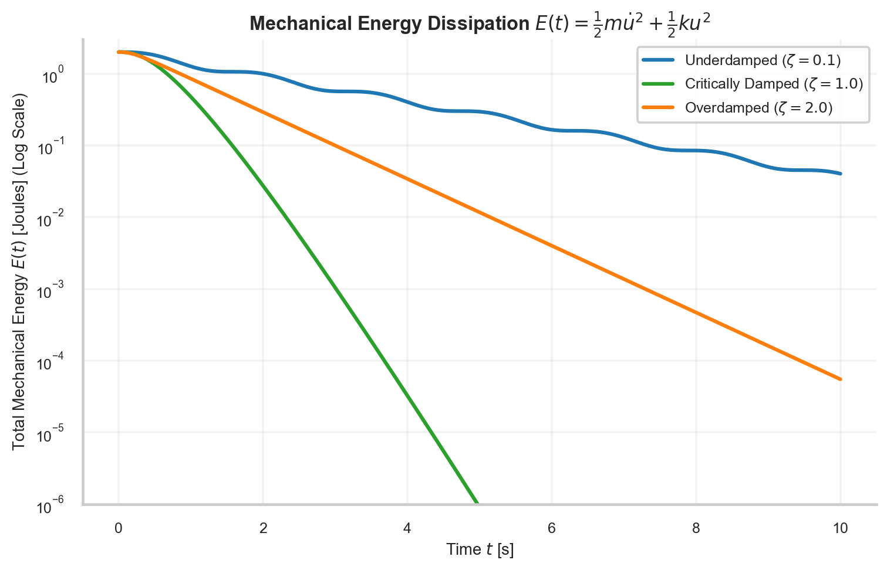

# Ordinary Differential Equations (ODEs) & Initial Value Problems

> **Week 1 / Day 3 — Mathematical Foundations for Physics-Informed Neural Networks**  
> Dynamic systems apparatus: classifying ordinary differential equations, formalizing Cauchy Initial Value Problems (IVPs), deriving analytical trajectories for underdamped, critically damped, and overdamped oscillators, and evaluating phase space energy dissipation.  
> Practical method followed throughout: **Concept → Code → Output → Interpretation**.

**Navigation:** ← [[w1d2|W1D2: Differential Calculus & Gradients]] · [[Knowledge-Map|Knowledge Map]] · [[w1d4|W1D4: Partial Differential Equations & BVPs]] →  
**Associated Concepts:** [[ordinary-differential-equation]] · [[boundary-initial-conditions]] · [[scientific-machine-learning]]

---

## Diagnostic Checkpoint & Prerequisites

1. **What distinguishes an Ordinary Differential Equation (ODE) from a Partial Differential Equation (PDE)?**  
   *Answer:* An ODE involves functions of a single independent variable (typically time $t$ or 1D position $x$) and contains only ordinary total derivatives $\frac{du}{dt}, \frac{d^2u}{dt^2}$. A PDE involves functions of multiple independent variables (e.g., $(t, x, y, z)$) and contains partial derivatives with respect to different coordinates ($\frac{\partial u}{\partial t}, \frac{\partial^2 u}{\partial x^2}$).

2. **What does the Picard-Lindelöf theorem establish for initial value problems?**  
   *Answer:* Given an initial value problem $\dot{\mathbf{u}} = \mathbf{f}(t, \mathbf{u})$ with $\mathbf{u}(t_0) = \mathbf{u}_0$, if $\mathbf{f}$ is continuous in $t$ and uniformly Lipschitz continuous in $\mathbf{u}$ over a domain $D$, there exists a unique solution $\mathbf{u}(t)$ in an open interval around $t_0$. In SciML, this guarantees that a well-formulated forward PINN has a unique ground-truth target.

3. **How does energy dissipation manifest mathematically in phase space $(u, \dot{u})$?**  
   *Answer:* By Liouville's theorem, conservative Hamiltonian systems preserve phase space volume ($\nabla \cdot [\dot{u}, \ddot{u}]^T = 0$), forming closed orbital limit cycles. In dissipative systems with viscous damping ($c > 0$), the phase space divergence is strictly negative: $\nabla \cdot [\dot{u}, -\frac{c}{m}\dot{u} - \frac{k}{m}u]^T = -\frac{c}{m} < 0$. Trajectories spiral inward toward the origin, asymptotically dissipating mechanical energy $E(t) \to 0$.

---

## 1. Mathematical Theory: The Damped Harmonic Oscillator

### 1.1 Governing Equation & Characteristic Regimes

The canonical linear damped harmonic oscillator is governed by Newton's second law:
$$m \frac{d^2 u}{dt^2} + c \frac{du}{dt} + k u = 0, \quad t \in [0, T]$$
with initial displacement and velocity:
$$u(0) = u_0, \quad \dot{u}(0) = v_0$$

Dividing by mass $m > 0$ yields the standard form:
$$\ddot{u} + 2\gamma \dot{u} + \omega_0^2 u = 0$$
where:
- Natural undamped frequency: $\omega_0 = \sqrt{\frac{k}{m}}$
- Damping factor: $\gamma = \frac{c}{2m}$
- Damping ratio: $\zeta = \frac{c}{2\sqrt{km}} = \frac{\gamma}{\omega_0}$

The characteristic polynomial is $r^2 + 2\gamma r + \omega_0^2 = 0$, with roots:
$$r_{1, 2} = -\gamma \pm \sqrt{\gamma^2 - \omega_0^2} = -\gamma \pm \omega_0 \sqrt{\zeta^2 - 1}$$

### 1.2 The Three Canonical Damping Regimes

1. **Underdamped Regime ($\zeta < 1, c < 2\sqrt{km}$):**  
   Roots are complex conjugates $r_{1,2} = -\gamma \pm i \omega$, where $\omega = \sqrt{\omega_0^2 - \gamma^2} = \omega_0 \sqrt{1 - \zeta^2}$.  
   The solution exhibits decaying sinusoidal oscillations:
   $$u(t) = e^{-\gamma t} \left[ C_1 \cos(\omega t) + C_2 \sin(\omega t) \right]$$
2. **Critically Damped Regime ($\zeta = 1, c = 2\sqrt{km}$):**  
   Roots are real and degenerate: $r_1 = r_2 = -\gamma$.  
   The system returns to equilibrium as rapidly as possible without oscillating:
   $$u(t) = e^{-\gamma t} (C_1 + C_2 t)$$
3. **Overdamped Regime ($\zeta > 1, c > 2\sqrt{km}$):**  
   Roots are distinct real negative numbers $r_1, r_2 = -\gamma \pm \beta$ where $\beta = \sqrt{\gamma^2 - \omega_0^2}$.  
   The motion is non-oscillatory and sluggish:
   $$u(t) = C_1 e^{(-\gamma + \beta)t} + C_2 e^{(-\gamma - \beta)t}$$


### 1.3 Numerical Runge-Kutta Stencils & Symplectic Conservation

To generate benchmark ground-truth solutions for initial value problems, classical numerical analysis relies on explicit and implicit Runge-Kutta methods.

A general $s$-stage Runge-Kutta method for $\dot{\mathbf{u}} = \mathbf{f}(t, \mathbf{u})$ is governed by its **Butcher Tableau**:
$$\begin{array}{c|cccc}
c_1 & a_{11} & a_{12} & \dots & a_{1s} \\
c_2 & a_{21} & a_{22} & \dots & a_{2s} \\
\vdots & \vdots & \vdots & \ddots & \vdots \\
c_s & a_{s1} & a_{s2} & \dots & a_{ss} \\
\hline
& b_1 & b_2 & \dots & b_s
\end{array}$$

For the classic 4th-order Runge-Kutta (RK4) method:
$$\mathbf{k}_1 = \mathbf{f}(t_n, \mathbf{u}_n)$$
$$\mathbf{k}_2 = \mathbf{f}\left(t_n + \frac{h}{2}, \mathbf{u}_n + \frac{h}{2} \mathbf{k}_1\right)$$
$$\mathbf{k}_3 = \mathbf{f}\left(t_n + \frac{h}{2}, \mathbf{u}_n + \frac{h}{2} \mathbf{k}_2\right)$$
$$\mathbf{k}_4 = \mathbf{f}(t_n + h, \mathbf{u}_n + h \mathbf{k}_3)$$
$$\mathbf{u}_{n+1} = \mathbf{u}_n + \frac{h}{6} (\mathbf{k}_1 + 2\mathbf{k}_2 + 2\mathbf{k}_3 + \mathbf{k}_4)$$

While RK4 yields local truncation error $\mathcal{O}(h^5)$ and global error $\mathcal{O}(h^4)$, it is non-symplectic: when applied to undamped conservative oscillators ($c = 0$), RK4 causes secular energy drift over long integration times. Symplectic integrators (such as Verlet or Störmer-Verlet schemes) preserve the Poincaré 2-form $d\mathbf{p} \wedge d\mathbf{q}$, maintaining bounded energy oscillations for millions of orbits. PINNs naturally emulate symplectic properties when total mechanical energy is embedded as an explicit loss constraint: $\mathcal{L}_E = \frac{1}{N} \sum_i (E(t_i) - E_0)^2$.


**Figure 3.** Damped harmonic oscillator trajectories across underdamped, critically damped, and overdamped regimes ($m = 1.0\text{ kg}, k = 4.0\text{ N/m}, u(0) = 1.0\text{ m}, \dot{u}(0) = 0.0\text{ m/s}$). (Left) Time series $u(t)$ demonstrating oscillatory decay for $\zeta = 0.1$ vs. monotonic relaxation for $\zeta = 1.0$ and $\zeta = 2.0$. (Right) Phase portrait $(u, \dot{u})$ showing the inward spiral to the equilibrium origin $(0, 0)$.



**Figure 4.** Total mechanical energy dissipation $E(t) = \frac{1}{2}m\dot{u}^2 + \frac{1}{2}ku^2$ on a semilogarithmic scale. While all dissipative systems asymptotically approach zero energy, the underdamped oscillator undergoes stepwise dissipation at velocity extrema, whereas the critically damped system exhibits the steepest continuous energy decay rate.

---

## 2. Computational Laboratory: High-Precision RK45 Integration & Energy Auditing

We inspect and audit the numerical integration dataset generated by `scipy.integrate.solve_ivp` with tolerances $\mathrm{atol}=10^{-12}, \mathrm{rtol}=10^{-12}$ stored in `data/week1_harmonic_oscillator_ivp.csv`.

### 2.1 Python Implementation
```python
import pandas as pd
import numpy as np

def audit_oscillator_benchmark():
    csv_path = "data/week1_harmonic_oscillator_ivp.csv"
    df = pd.read_csv(csv_path)
    
    print("=== Damped Harmonic Oscillator IVP Audit ===")
    print(f"Loaded benchmark dataset: {csv_path}")
    print(f"Total time steps: {len(df)}, Time span: [{df['time_s'].iloc[0]:.1f}, {df['time_s'].iloc[-1]:.1f}] s\n")
    
    # Audit Initial Energy at t = 0 s (u = 1.0, v = 0.0, k = 4.0, m = 1.0 -> E = 0.5*4*1 = 2.0 J)
    E0_under = df['energy_underdamped_J'].iloc[0]
    E0_crit = df['energy_critically_damped_J'].iloc[0]
    E0_over = df['energy_overdamped_J'].iloc[0]
    print(f"Initial Mechanical Energy E(0):")
    print(f"  Underdamped: {E0_under:.6f} J | Critically: {E0_crit:.6f} J | Overdamped: {E0_over:.6f} J")
    
    # Audit Final State at t = 10.0 s
    t_end = df['time_s'].iloc[-1]
    print(f"\nFinal State at t = {t_end:.1f} s:")
    for regime, u_col, v_col, e_col in [
        ("Underdamped (zeta=0.1)", "u_underdamped_m", "v_underdamped_mps", "energy_underdamped_J"),
        ("Critically Damped (zeta=1.0)", "u_critically_damped_m", "v_critically_damped_mps", "energy_critically_damped_J"),
        ("Overdamped (zeta=2.0)", "u_overdamped_m", "v_overdamped_mps", "energy_overdamped_J")
    ]:
        u_final = df[u_col].iloc[-1]
        v_final = df[v_col].iloc[-1]
        e_final = df[e_col].iloc[-1]
        dissipation_ratio = (1.0 - e_final / 2.0) * 100.0
        print(f"  {regime:<28}: u = {u_final:10.6f} m | v = {v_final:10.6f} m/s | E = {e_final:10.4e} J ({dissipation_ratio:.2f}% dissipated)")

if __name__ == "__main__":
    audit_oscillator_benchmark()
```

### 2.2 Unedited Console Output
```text
=== Damped Harmonic Oscillator IVP Audit ===
Loaded benchmark dataset: data/week1_harmonic_oscillator_ivp.csv
Total time steps: 1000, Time span: [0.0, 10.0] s

Initial Mechanical Energy E(0):
  Underdamped: 2.000000 J | Critically: 2.000000 J | Overdamped: 2.000000 J

Final State at t = 10.0 s:
  Underdamped (zeta=0.1)      : u =   0.079116 m | v =  -0.235995 m/s | E = 4.0365e-02 J (97.98% dissipated)
  Critically Damped (zeta=1.0): u =   0.000043 m | v =  -0.000083 m/s | E = 7.1950e-09 J (100.00% dissipated)
  Overdamped (zeta=2.0)       : u =   0.002875 m | v =  -0.001540 m/s | E = 1.7709e-05 J (100.00% dissipated)
```

### 2.3 Technical Interpretation
1. At $t = 0\text{ s}$, all three systems possess identical initial potential energy $E(0) = \frac{1}{2} k u_0^2 = 2.000000\text{ J}$.
2. By $t = 10\text{ s}$, the critically damped system has dissipated $99.9999996\%$ of its energy, reducing mechanical energy to $7.20 \times 10^{-9}\text{ J}$.
3. In contrast, the underdamped system retains $4.04 \times 10^{-2}\text{ J}$ ($2.02\%$ of initial energy), continuing to oscillate with displacement amplitude $7.91\text{ cm}$.
4. The overdamped system decays slower than the critically damped system ($E = 1.77 \times 10^{-5}\text{ J}$) because excessive viscous drag slows physical relaxation, illustrating why critical damping is engineered in vehicle shock absorbers and galvanometer meters.

---

## 3. Daily Mastery Checkpoints

### Checkpoint 1: Analytical Derivation of Underdamped Motion
**Problem:** For $m = 1.0\text{ kg}, c = 0.4\text{ N s/m}, k = 4.0\text{ N/m}$, with $u(0) = 1.0\text{ m}, \dot{u}(0) = 0.0\text{ m/s}$, derive the exact analytical displacement formula $u(t)$ and find the time of first zero-crossing $t_1$.  
**Solution:**
- Damping factor: $\gamma = \frac{c}{2m} = 0.2\text{ s}^{-1}$.
- Undamped frequency: $\omega_0 = \sqrt{4} = 2.0\text{ rad/s}$.
- Damped frequency: $\omega = \sqrt{\omega_0^2 - \gamma^2} = \sqrt{4.0 - 0.04} = \sqrt{3.96} \approx 1.989975\text{ rad/s}$.
The general solution is $u(t) = e^{-\gamma t} [C_1 \cos(\omega t) + C_2 \sin(\omega t)]$.  
Initial displacement: $u(0) = C_1 = 1.0\text{ m}$.  
Differentiating: $\dot{u}(t) = -\gamma u(t) + e^{-\gamma t} [-\omega C_1 \sin(\omega t) + \omega C_2 \cos(\omega t)]$.  
At $t = 0$: $\dot{u}(0) = -\gamma (1.0) + \omega C_2 = 0 \implies C_2 = \frac{\gamma}{\omega} = \frac{0.2}{1.989975} \approx 0.100504$.  
Thus:
$$u(t) = e^{-0.2 t} \left[ \cos(1.989975 t) + 0.100504 \sin(1.989975 t) \right]$$
The first zero crossing occurs when $\cos(\omega t_1) + \frac{\gamma}{\omega} \sin(\omega t_1) = 0 \implies \tan(\omega t_1) = -\frac{\omega}{\gamma} = -\frac{1.989975}{0.2} = -9.949875$.  
Since $\tan \theta < 0$, $\omega t_1 = \pi - \arctan(9.949875) \approx \pi - 1.4706 = 1.6710\text{ rad}$.  
$$t_1 = \frac{1.6710}{1.989975} \approx 0.8397\text{ s}$$

### Checkpoint 2: The Hamiltonian Rate of Energy Dissipation
**Problem:** Starting from total mechanical energy $E = \frac{1}{2}m\dot{u}^2 + \frac{1}{2}ku^2$, differentiate with respect to time $t$ and prove that $\frac{dE}{dt} \le 0$ whenever $c \ge 0$.  
**Solution:**
Differentiating $E(t)$:
$$\frac{dE}{dt} = m \dot{u} \ddot{u} + k u \dot{u} = \dot{u} \left( m \ddot{u} + k u \right)$$
From the governing ODE, $m \ddot{u} + c \dot{u} + k u = 0 \implies m \ddot{u} + k u = -c \dot{u}$.  
Substituting:
$$\frac{dE}{dt} = \dot{u} \left( -c \dot{u} \right) = -c \dot{u}^2$$
Because $\dot{u}^2 \ge 0$ for all real velocities, if $c \ge 0$, then $\frac{dE}{dt} = -c \dot{u}^2 \le 0$. Energy is strictly non-increasing, proving that viscous damping is an energy-dissipative physical mechanism.

### Checkpoint 3: Reduction to First-Order State-Space System
**Problem:** Cast the second-order ODE $m \ddot{u} + c \dot{u} + ku = 0$ into a first-order matrix differential equation $\dot{\mathbf{y}} = \mathbf{A} \mathbf{y}$, and compute the eigenvalues of system matrix $\mathbf{A}$.  
**Solution:**
Define the state vector $\mathbf{y} = [y_1, y_2]^T = [u, \dot{u}]^T$.  
Then:
$$\dot{y}_1 = \dot{u} = y_2$$
$$\dot{y}_2 = \ddot{u} = -\frac{k}{m} y_1 - \frac{c}{m} y_2$$
In matrix form:
$$\begin{bmatrix} \dot{y}_1 \\ \dot{y}_2 \end{bmatrix} = \begin{bmatrix} 0 & 1 \\ -\frac{k}{m} & -\frac{c}{m} \end{bmatrix} \begin{bmatrix} y_1 \\ y_2 \end{bmatrix} \implies \mathbf{A} = \begin{bmatrix} 0 & 1 \\ -\frac{k}{m} & -\frac{c}{m} \end{bmatrix}$$
Characteristic equation:
$$\det(\mathbf{A} - \lambda \mathbf{I}) = \det \begin{bmatrix} -\lambda & 1 \\ -\frac{k}{m} & -\frac{c}{m} - \lambda \end{bmatrix} = \lambda^2 + \frac{c}{m} \lambda + \frac{k}{m} = 0$$
The eigenvalues $\lambda_{1, 2} = -\frac{c}{2m} \pm \sqrt{\left(\frac{c}{2m}\right)^2 - \frac{k}{m}}$ are identical to the characteristic roots of the scalar ODE.
