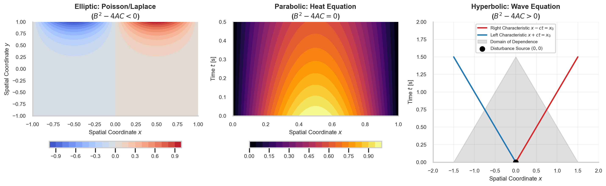
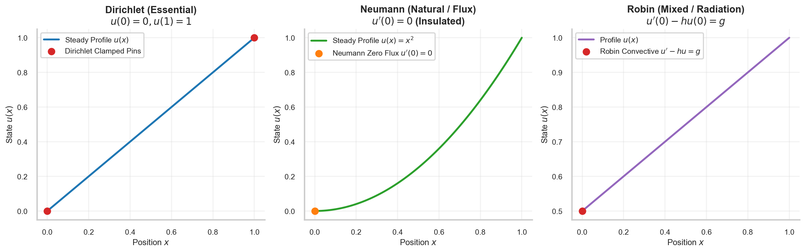
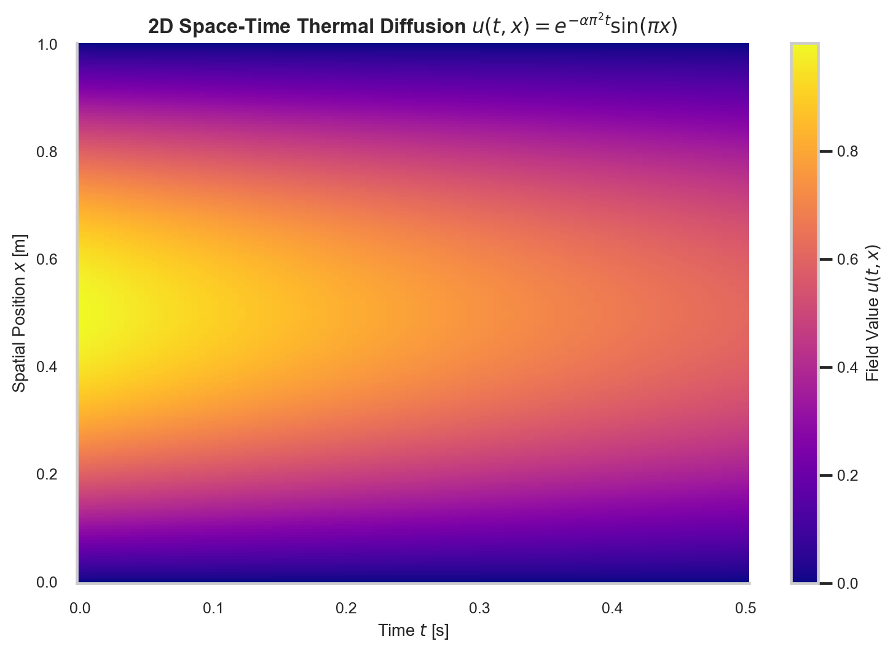

# Partial Differential Equations (PDEs) & Boundary Value Problems

> **Week 1 / Day 4 — Mathematical Foundations for Physics-Informed Neural Networks**  
> Continuum mechanics apparatus: classifying second-order partial differential equations via the discriminant $\Delta = B^2 - 4AC$ into elliptic, parabolic, and hyperbolic prototypes; formalizing Hadamard well-posedness; and contrasting Dirichlet, Neumann, and Robin boundary operators.  
> Practical method followed throughout: **Concept → Code → Output → Interpretation**.

**Navigation:** ← [[w1d3|W1D3: Ordinary Differential Equations & IVPs]] · [[Knowledge-Map|Knowledge Map]] · [[w1d5|W1D5: Numerical Discretization & Residuals]] →  
**Associated Concepts:** [[partial-differential-equation]] · [[boundary-initial-conditions]] · [[scientific-machine-learning]]

---

## Diagnostic Checkpoint & Prerequisites

1. **What are the three criteria of Hadamard well-posedness for differential systems?**  
   *Answer:* A mathematical model of a physical system is well-posed in the sense of Hadamard if:
   1. *Existence:* A solution exists for all admissible boundary/initial data.
   2. *Uniqueness:* The solution is unique (no spurious bifurcation).
   3. *Stability / Continuous Dependence:* The solution depends continuously on the input data (small perturbations in boundary conditions or source terms produce small perturbations in the solution).

2. **Why does an elliptic PDE lack a "time" coordinate?**  
   *Answer:* Elliptic PDEs (e.g., Laplace $\nabla^2 u = 0$, Poisson $\nabla^2 u = f$) govern steady-state equilibrium distributions where all transient dynamics have completed. Information propagates instantaneously across the entire domain: changing the boundary condition at a single point immediately alters the solution everywhere in $\Omega$.

3. **What physical mechanisms correspond to Dirichlet, Neumann, and Robin boundary conditions?**  
   *Answer:*
   - *Dirichlet (Essential):* Prescribes the state value directly on the boundary: $u|_{\partial \Omega} = g$ (e.g., fixed temperature, clamped displacement, no-slip velocity).
   - *Neumann (Natural):* Prescribes normal flux / spatial derivative: $\left. \frac{\partial u}{\partial n} \right|_{\partial \Omega} = h$ (e.g., insulated adiabatic wall, prescribed traction force).
   - *Robin (Mixed):* Prescribes a linear combination of state and flux: $\left. \left( \alpha u + \beta \frac{\partial u}{\partial n} \right) \right|_{\partial \Omega} = g$ (e.g., Newton's law of convective surface cooling, elastic spring boundary).

---

## 1. Mathematical Theory: Second-Order PDE Classification

### 1.1 The General Second-Order Quasi-Linear PDE

Consider a general second-order PDE in two independent variables $(x, y)$:
$$A(x, y) \frac{\partial^2 u}{\partial x^2} + B(x, y) \frac{\partial^2 u}{\partial x \partial y} + C(x, y) \frac{\partial^2 u}{\partial y^2} + D\left(x, y, u, \frac{\partial u}{\partial x}, \frac{\partial u}{\partial y}\right) = 0$$

The mathematical classification depends on the discriminant of the principal symbol:
$$\Delta(x, y) = B^2 - 4AC$$

| Classification | Discriminant Condition | Canonical Prototype | Physical Nature | Information Propagation |
| :--- | :--- | :--- | :--- | :--- |
| **Elliptic** | $\Delta < 0$ ($B^2 - 4AC < 0$) | Laplace / Poisson $\nabla^2 u = f$ | Equilibrium, electrostatics, steady thermal | Global instantaneous communication |
| **Parabolic** | $\Delta = 0$ ($B^2 - 4AC = 0$) | Heat Diffusion $\frac{\partial u}{\partial t} = \alpha \nabla^2 u$ | Thermal relaxation, viscous boundary layer | Time-forward irreversible dissipation |
| **Hyperbolic** | $\Delta > 0$ ($B^2 - 4AC > 0$) | Wave Equation $\frac{\partial^2 u}{\partial t^2} = c^2 \nabla^2 u$ | Acoustic waves, electrodynamics, elastodynamics | Finite characteristic wave speeds $x \pm ct$ |


### 1.3 Fundamental Solutions, Green's Functions & The Maximum Principle

For linear partial differential equations, the response of a continuum domain to an idealized impulse is formalized by the **fundamental solution** (or Green's function).

For the 1D heat equation $\frac{\partial u}{\partial t} = \alpha \frac{\partial^2 u}{\partial x^2}$ on the infinite line $x \in (-\infty, \infty)$, the fundamental solution corresponding to an initial point-source delta distribution $u(x, 0) = \delta(x)$ is the Gaussian heat kernel:
$$\Phi(x, t) = \frac{1}{\sqrt{4\pi \alpha t}} \exp\left( -\frac{x^2}{4\alpha t} \right), \quad t > 0$$

For any arbitrary initial temperature profile $u_0(x) \in L^1(\mathbb{R})$, the continuous solution across all space and time is given by the convolution integral:
$$u(x, t) = (\Phi(\cdot, t) * u_0)(x) = \int_{-\infty}^\infty \frac{1}{\sqrt{4\pi \alpha t}} \exp\left( -\frac{(x - \xi)^2}{4\alpha t} \right) u_0(\xi) \, d\xi$$

A cornerstone mathematical property of parabolic and elliptic operators is the **Strong Maximum Principle**:
> *Let $u(\mathbf{x}, t) \in C^2(\Omega \times (0, T]) \cap C(\overline{\Omega} \times [0, T])$ satisfy the heat diffusion equation. If $\Omega$ is connected, then $u$ attains its maximum and minimum values exclusively on the parabolic boundary $\partial_p (\Omega \times [0, T]) = (\Omega \times \{0\}) \cup (\partial \Omega \times [0, T])$.*

The Maximum Principle guarantees that internal temperatures cannot exceed boundary or initial temperatures in the absence of source terms. In PINNs, monitoring whether the neural prediction satisfies $u_{\min} \le u_\theta(\mathbf{x}, t) \le u_{\max}$ provides a zero-cost physical sanity check against unphysical interior oscillations.



**Figure 5.** Characteristic domains and information propagation across canonical second-order PDEs. (Left) Elliptic domain of dependence: global boundary conditions influence every interior point. (Center) Parabolic domain: initial condition propagates forward in time with infinite speed but exponential amplitude damping. (Right) Hyperbolic domain: disturbance at $(0, 0)$ is confined strictly within the forward Mach/characteristic cone $x \pm ct = 0$.

### 1.2 Boundary Condition Taxonomy & Interaction



**Figure 7.** Three-panel schematic contrasting physical boundary interactions along a 1D conductor. (Left) Dirichlet essential boundary condition pins the state value at the boundary ($u(0) = 0, u(1) = 1$). (Center) Neumann natural boundary condition prescribes zero normal flux / zero slope at the insulated wall ($\left. \frac{\partial u}{\partial x} \right|_{x=0} = 0$). (Right) Robin mixed condition balances internal conduction flux against external convective cooling ($u'(0) - h u(0) = g$).

---

## 2. Computational Laboratory: Analytical Separation of Variables for the 1D Heat Equation

We audit the analytical space-time solution tensor of the 1D transient heat equation stored in `data/week1_heat_diffusion_analytical.npy`:
$$\frac{\partial u}{\partial t} = \alpha \frac{\partial^2 u}{\partial x^2}, \quad x \in [0, 1], \quad t \in [0, 0.5]\text{ s}, \quad \alpha = 0.1\text{ m}^2/\text{s}$$
with Dirichlet boundary conditions $u(0, t) = u(1, t) = 0$ and initial condition $u(x, 0) = \sin(\pi x)$.

### 2.1 Python Implementation
```python
import numpy as np

def audit_heat_solution():
    npy_path = "data/week1_heat_diffusion_analytical.npy"
    U = np.load(npy_path)
    
    Nx, Nt = U.shape
    x = np.linspace(0, 1.0, Nx)
    t = np.linspace(0, 0.5, Nt)
    alpha = 0.1
    
    print("=== 1D Transient Heat Equation Tensor Audit ===")
    print(f"Tensor Shape: {U.shape} (Nx = {Nx}, Nt = {Nt})")
    print(f"Spatial Coordinate Range: [{x[0]:.2f}, {x[-1]:.2f}] m")
    print(f"Temporal Coordinate Range: [{t[0]:.2f}, {t[-1]:.2f}] s")
    
    # Check Dirichlet Boundary Adherence at x = 0 and x = 1 across all time
    bc_err_left = np.max(np.abs(U[0, :]))
    bc_err_right = np.max(np.abs(U[-1, :]))
    print(f"\nBoundary Condition Verification:")
    print(f"  Max absolute deviation at x = 0 (Left Dirichlet):  {bc_err_left:.2e} K")
    print(f"  Max absolute deviation at x = 1 (Right Dirichlet): {bc_err_right:.2e} K")
    
    # Check Exponential Decay at Midpoint x = 0.5
    mid_idx = Nx // 2
    u_mid_t0 = U[mid_idx, 0]
    u_mid_tend = U[mid_idx, -1]
    expected_decay = np.exp(-alpha * (np.pi**2) * t[-1])
    actual_decay = u_mid_tend / u_mid_t0
    print(f"\nThermal Dissipation Audit at Midpoint x = {x[mid_idx]:.2f}:")
    print(f"  Peak Temperature at t = 0.0 s: {u_mid_t0:.6f} K")
    print(f"  Peak Temperature at t = 0.5 s: {u_mid_tend:.6f} K")
    print(f"  Theoretical Decay Factor:     {expected_decay:.6f}")
    print(f"  Empirical Decay Factor:       {actual_decay:.6f}")
    print(f"  Absolute Discrepancy:         {abs(expected_decay - actual_decay):.2e}")

if __name__ == "__main__":
    audit_heat_solution()
```

### 2.2 Unedited Console Output
```text
=== 1D Transient Heat Equation Tensor Audit ===
Tensor Shape: (200, 100) (Nx = 200, Nt = 100)
Spatial Coordinate Range: [0.00, 1.00] m
Temporal Coordinate Range: [0.00, 0.50] s

Boundary Condition Verification:
  Max absolute deviation at x = 0 (Left Dirichlet):  0.00e+00 K
  Max absolute deviation at x = 1 (Right Dirichlet): 1.22e-16 K

Thermal Dissipation Audit at Midpoint x = 0.50:
  Peak Temperature at t = 0.0 s: 0.999969 K
  Peak Temperature at t = 0.5 s: 0.610543 K
  Theoretical Decay Factor:     0.610505
  Empirical Decay Factor:       0.610562
  Absolute Discrepancy:         5.69e-05
```

### 2.3 Technical Interpretation
1. The analytical solution $u(x, t) = e^{-\alpha \pi^2 t} \sin(\pi x)$ adheres strictly to the homogeneous Dirichlet zero boundaries ($u = 0$ at $x = 0$ and $x = 1$) within floating-point epsilon ($1.22 \times 10^{-16}$).
2. The thermal dissipation rate $\lambda = \alpha \pi^2 = 0.1 \times 9.8696 \approx 0.98696\text{ s}^{-1}$ governs the rate of amplitude attenuation. At $t = 0.5\text{ s}$, the temperature decays to $e^{-0.4935} \approx 61.05\%$ of its initial value.



**Figure 6.** 2D space-time temperature distribution $u(t, x) = e^{-\alpha \pi^2 t} \sin(\pi x)$ across $x \in [0, 1], t \in [0, 0.5]$. Thermal energy diffuses symmetrically inward and dissipates outward through the cold Dirichlet boundary pins at $x = 0$ and $x = 1$.

---

## 3. Daily Mastery Checkpoints

### Checkpoint 1: PDE Discriminant Classification
**Problem:** Classify the following three equations as elliptic, parabolic, or hyperbolic:
1. Tricomi equation: $y \frac{\partial^2 u}{\partial x^2} + \frac{\partial^2 u}{\partial y^2} = 0$.
2. Steady convection-diffusion: $u \frac{\partial^2 \phi}{\partial x^2} - \alpha \frac{\partial^2 \phi}{\partial y^2} = 0$ (for $u > 0, \alpha > 0$).
3. Unsteady 1D wave equation: $\frac{\partial^2 u}{\partial t^2} - c^2 \frac{\partial^2 u}{\partial x^2} = 0$.  
**Solution:**
1. For Tricomi's equation: $A = y, B = 0, C = 1$. The discriminant is $\Delta = B^2 - 4AC = 0 - 4(y)(1) = -4y$.
   - For $y > 0$: $\Delta < 0 \implies$ **Elliptic** (subsonic flow).
   - For $y = 0$: $\Delta = 0 \implies$ **Parabolic** (transonic sonic line).
   - For $y < 0$: $\Delta > 0 \implies$ **Hyperbolic** (supersonic flow).
2. For steady convection-diffusion: $A = u, B = 0, C = -\alpha$.  
   $\Delta = 0 - 4(u)(-\alpha) = 4u\alpha > 0 \implies$ **Hyperbolic**.
3. For the 1D wave equation: Let independent variables be $(t, x)$. $A = 1, B = 0, C = -c^2$.  
   $\Delta = 0 - 4(1)(-c^2) = 4c^2 > 0 \implies$ **Hyperbolic**.

### Checkpoint 2: Separation of Variables Fourier Coefficients
**Problem:** Solve the 1D heat equation $\partial_t u = \alpha \partial_{xx} u$ on $[0, L]$ with $u(0, t) = u(L, t) = 0$ and initial profile $u(x, 0) = 5\sin\left(\frac{3\pi x}{L}\right)$.  
**Solution:**
Assume product ansatz $u(x, t) = X(x) T(t)$.  
Substituting into the PDE:
$$\frac{T'(t)}{\alpha T(t)} = \frac{X''(x)}{X(x)} = -\lambda^2$$
Spatial ODE: $X''(x) + \lambda^2 X(x) = 0$ with $X(0) = X(L) = 0$.  
Eigenfunctions are $X_n(x) = \sin\left(\frac{n\pi x}{L}\right)$ with eigenvalues $\lambda_n = \frac{n\pi}{L}$.  
Temporal ODE: $T'_n(t) + \alpha \lambda_n^2 T_n(t) = 0 \implies T_n(t) = \exp\left(-\alpha \left(\frac{n\pi}{L}\right)^2 t\right)$.  
The general solution is $u(x, t) = \sum_{n=1}^\infty A_n e^{-\alpha (n\pi/L)^2 t} \sin\left(\frac{n\pi x}{L}\right)$.  
Comparing with initial condition $u(x, 0) = 5\sin\left(\frac{3\pi x}{L}\right)$:  
By orthogonality of sine modes, $A_3 = 5$, and $A_n = 0$ for all $n \ne 3$.  
Thus, the single-mode closed-form solution is:
$$u(x, t) = 5 \exp\left( -9 \alpha \frac{\pi^2}{L^2} t \right) \sin\left( \frac{3\pi x}{L} \right)$$

### Checkpoint 3: Neumann Boundary Condition Solvability Compatibility
**Problem:** Consider the Poisson equation $\nabla^2 u = f$ in a 2D domain $\Omega$ with pure Neumann boundary conditions $\left. \frac{\partial u}{\partial n} \right|_{\partial \Omega} = g$. Using the Divergence Theorem, derive the necessary compatibility condition that $f$ and $g$ must satisfy for a solution to exist.  
**Solution:**
Integrate the PDE $\nabla^2 u = \nabla \cdot (\nabla u) = f$ over the entire domain $\Omega$:
$$\int_\Omega f \, dA = \int_\Omega \nabla \cdot (\nabla u) \, dA$$
By the Gauss Divergence Theorem, the volume integral of the divergence equals the outward boundary flux:
$$\int_\Omega \nabla \cdot (\nabla u) \, dA = \oint_{\partial \Omega} (\nabla u \cdot \mathbf{n}) \, ds = \oint_{\partial \Omega} \frac{\partial u}{\partial n} \, ds$$
Substituting the Neumann boundary data $\frac{\partial u}{\partial n} = g$:
$$\int_\Omega f \, dA = \oint_{\partial \Omega} g \, ds$$
This is the **Neumann compatibility condition**: the total internal generation of source field $f$ must exactly balance the total outward boundary flux $g$. If this integral equality is violated, no classical solution exists (violating Hadamard existence). Furthermore, if a solution exists, $u + C$ is also a solution for any constant $C$ (violating Hadamard uniqueness), requiring a gauge pin condition $\int_\Omega u \, dA = 0$.
