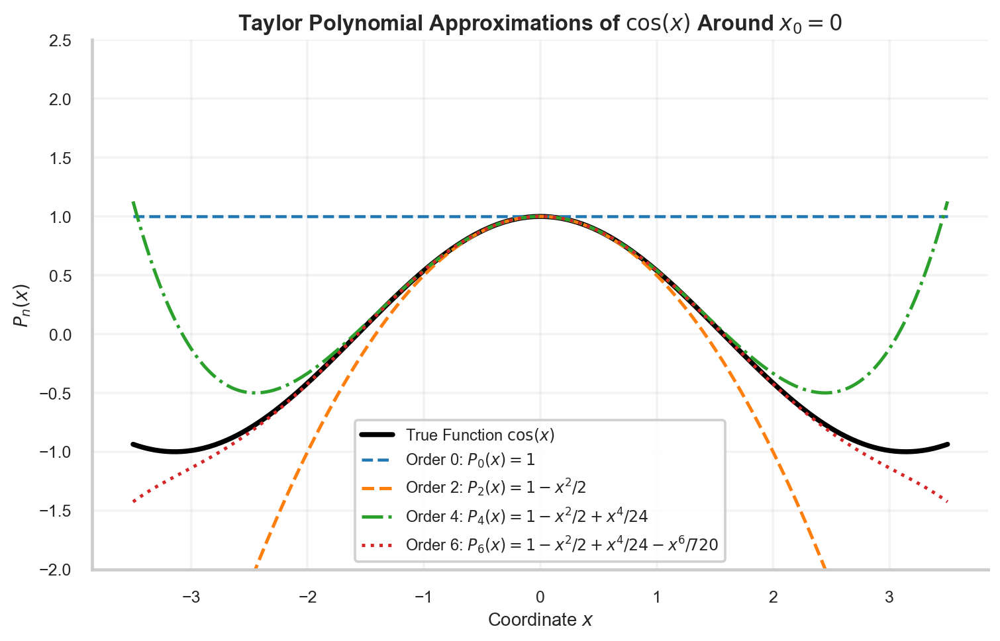
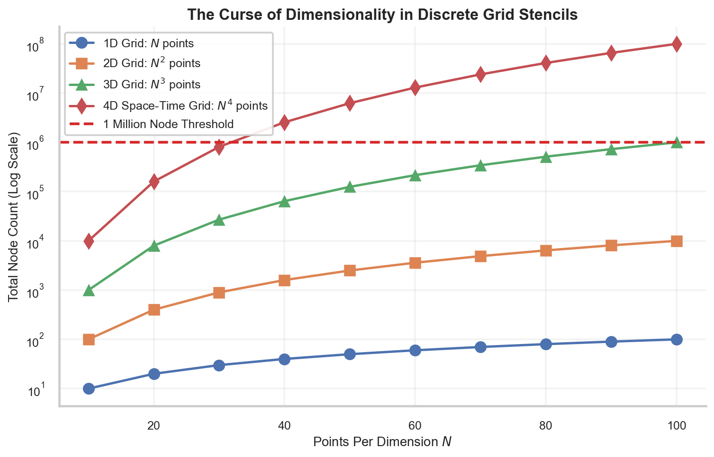
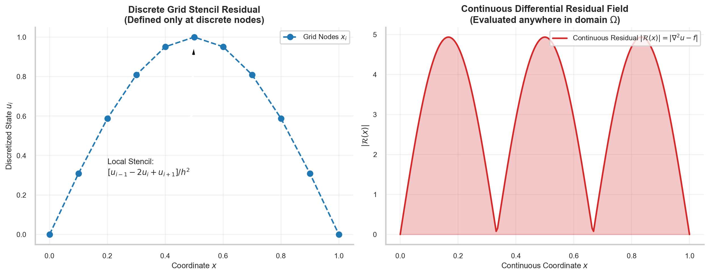
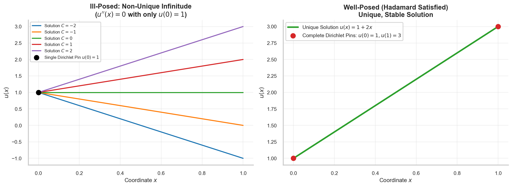

# Numerical Discretization, Finite Differences & Differential Residuals

> **Week 1 / Day 5 — Mathematical Foundations for Physics-Informed Neural Networks**  
> Numerical discretization apparatus: Taylor series derivations of forward, backward, and central difference stencils; analyzing the truncation error vs. floating-point roundoff cancellation conflict; formalizing the curse of dimensionality; defining the continuous differential residual $\mathcal{R}(\mathbf{x}) \equiv \mathcal{N}[u] - f$; and Week 1 Comprehensive Mastery Examination.  
> Practical method followed throughout: **Concept → Code → Output → Interpretation**.

**Navigation:** ← [[w1d4|W1D4: Partial Differential Equations & BVPs]] · [[Knowledge-Map|Knowledge Map]] · [[w2d1|W2D1: The Artificial Neuron & Perceptron Geometry]] →  
**Associated Concepts:** [[discretization-error]] · [[differential-residual]] · [[physics-residual]] · [[scientific-machine-learning]]

---

## Diagnostic Checkpoint & Prerequisites

1. **Why does Taylor series truncation error decrease as step size $h \to 0$, while total numerical error diverges?**  
   *Answer:* The total numerical error in finite differences is the sum of two opposing terms: truncation error $\mathcal{E}_{\mathrm{trunc}} \propto C_1 h^p$ (from discarded higher-order Taylor terms) and roundoff error $\mathcal{E}_{\mathrm{round}} \propto \frac{\epsilon_{\mathrm{mach}}}{h}$ (from finite-precision floating-point cancellation). As $h$ decreases, truncation error shrinks, but roundoff error blows up as $\mathcal{O}(h^{-1})$. Total error reaches an optimal floor at $h^* \approx \sqrt{\epsilon_{\mathrm{mach}}}$, below which the error diverges catastrophically.

2. **What is the "Curse of Dimensionality" in grid-based numerical methods?**  
   *Answer:* In classical grid-based schemes (Finite Difference, Finite Element), discretizing a $d$-dimensional domain with $N$ points per coordinate axis requires $N^d$ total grid vertices. For $N = 100$ points per axis, a 1D problem requires $10^2$ nodes, a 3D problem requires $10^6$ nodes, and a 6D kinetic phase-space problem (Boltzmann/Vlasov equations) requires $10^{12}$ nodes, completely exceeding computer memory.

3. **How does a continuous differential residual differ fundamentally from a discrete grid stencil residual?**  
   *Answer:* A discrete stencil residual evaluates algebraic differences between adjacent grid vertices: $\mathcal{R}_i = \frac{u_{i-1} - 2u_i + u_{i+1}}{h^2} - f_i$. It is undefined between vertices. A continuous differential residual $\mathcal{R}(\mathbf{x}) = \mathcal{N}[u_\theta](\mathbf{x}) - f(\mathbf{x})$ uses continuous automatic differentiation to evaluate the exact differential operator at any coordinate point in $\mathbb{R}^d$ without requiring neighboring points or grid stencils.

---

## 1. Mathematical Theory: Taylor Series & Numerical Differencing

### 1.1 Taylor Series Expansions

Let $u \in C^4([x - h, x + h])$. The forward and backward Taylor expansions around $x$ are:
$$u(x + h) = u(x) + h u'(x) + \frac{h^2}{2} u''(x) + \frac{h^3}{6} u'''(x) + \mathcal{O}(h^4)$$
$$u(x - h) = u(x) - h u'(x) + \frac{h^2}{2} u''(x) - \frac{h^3}{6} u'''(x) + \mathcal{O}(h^4)$$



**Figure 12.** Taylor polynomial approximations $P_0(x), P_2(x), P_4(x), P_6(x)$ approximating $\cos(x)$ around $x_0 = 0$. Successive polynomial orders expand the valid convergence radius, demonstrating how local Taylor truncation error scales as $\mathcal{O}(h^n)$.

### 1.2 Derivation of Finite Difference Stencils

1. **Forward Difference Stencil ($\mathcal{O}(h)$):**
   $$u'(x) = \frac{u(x + h) - u(x)}{h} - \frac{h}{2} u''(\xi_1) \implies \frac{u(x + h) - u(x)}{h} = u'(x) + \mathcal{O}(h)$$
2. **Backward Difference Stencil ($\mathcal{O}(h)$):**
   $$u'(x) = \frac{u(x) - u(x - h)}{h} + \frac{h}{2} u''(\xi_2) \implies \frac{u(x) - u(x - h)}{h} = u'(x) + \mathcal{O}(h)$$
3. **Central Difference Stencil ($\mathcal{O}(h^2)$):**  
   Subtracting the backward expansion from the forward expansion eliminates the quadratic term:
   $$u(x + h) - u(x - h) = 2h u'(x) + \frac{h^3}{3} u'''(\xi) \implies \frac{u(x + h) - u(x - h)}{2h} = u'(x) + \mathcal{O}(h^2)$$
4. **Second-Order Central Difference (Laplacian $\mathcal{O}(h^2)$):**  
   Adding the forward and backward expansions eliminates the odd-order terms:
   $$u(x + h) + u(x - h) = 2u(x) + h^2 u''(x) + \frac{h^4}{12} u^{(4)}(\xi) \implies \frac{u(x + h) - 2u(x) + u(x - h)}{h^2} = u''(x) + \mathcal{O}(h^2)$$


### 1.4 Von Neumann Stability Analysis & The CFL Constraint

In time-dependent partial differential equations, discretizing spatial and temporal derivatives simultaneously couples spatial grid spacing $\Delta x$ with temporal time step $\Delta t$.

Consider the explicit Forward-Time Central-Space (FTCS) finite difference scheme for the 1D heat equation:
$$\frac{u_i^{n+1} - u_i^n}{\Delta t} = \alpha \frac{u_{i+1}^n - 2u_i^n + u_{i-1}^n}{\Delta x^2}$$
Solving for state at time step $n+1$:
$$u_i^{n+1} = u_i^n + r \left( u_{i+1}^n - 2u_i^n + u_{i-1}^n \right) = r u_{i-1}^n + (1 - 2r) u_i^n + r u_{i+1}^n$$
where $r = \frac{\alpha \Delta t}{\Delta x^2}$ is the dimensionless Fourier diffusion number.

To determine numerical stability, assume a spatial Fourier modal decomposition $u_j^n = G^n e^{i k j \Delta x}$, where $G$ is the amplification factor and $k$ is spatial wavenumber:
$$G^{n+1} e^{i k j \Delta x} = G^n e^{i k j \Delta x} \left[ r e^{-i k \Delta x} + (1 - 2r) + r e^{i k \Delta x} \right]$$
Dividing by $G^n e^{i k j \Delta x}$ and utilizing Euler's identity $e^{i \theta} + e^{-i \theta} = 2\cos \theta$:
$$G = 1 - 2r + 2r \cos(k \Delta x) = 1 - 2r(1 - \cos(k \Delta x)) = 1 - 4r \sin^2\left(\frac{k \Delta x}{2}\right)$$

For the numerical scheme to be stable, the amplification factor must satisfy $|G| \le 1$ for all wavenumbers $k$:
$$-1 \le 1 - 4r \sin^2\left(\frac{k \Delta x}{2}\right) \le 1$$
The right inequality holds trivially because $r > 0$ and $\sin^2(\cdot) \ge 0$.  
The left inequality requires:
$$1 - 4r \sin^2\left(\frac{k \Delta x}{2}\right) \ge -1 \implies 4r \sin^2\left(\frac{k \Delta x}{2}\right) \le 2$$
The most restrictive case occurs at the Nyquist frequency $k \Delta x = \pi$, where $\sin^2(\pi/2) = 1$:
$$4r \le 2 \implies r = \frac{\alpha \Delta t}{\Delta x^2} \le \frac{1}{2} \implies \Delta t \le \frac{\Delta x^2}{2\alpha}$$

This is the famous **diffusive CFL stability limit**. If one refines the spatial grid by a factor of 10 ($\Delta x \to 0.1 \Delta x$), the stable time step must shrink by a factor of 100 ($\Delta t \to 0.01 \Delta t$), making high-resolution classical simulation computationally punitive. PINNs eliminate this quadratic time-step penalty by treating time $t$ as a continuous independent coordinate without stencil marching.


**Figure 8.** Log-log convergence scaling of finite difference stencils across step sizes $h \in [10^{-15}, 1.0]$. In the truncation regime ($h > 10^{-8}$), central difference errors descend at quadratic rate $\mathcal{O}(h^2)$, while forward difference errors descend linearly $\mathcal{O}(h)$. At $h < 10^{-8}$ in float64 (and $h < 10^{-4}$ in float32), floating-point subtractive cancellation causes catastrophic error divergence.

### 1.3 The Curse of Dimensionality & Discrete vs. Continuous Residuals



**Figure 9.** Grid vertex count scaling across dimensions $d \in \{1, 2, 3, 4\}$. For 100 resolution points per axis, a 1D grid requires 100 points, 2D requires $10^4$, 3D requires $10^6$, and 4D space-time requires $10^8$ nodes. Discrete mesh methods scale exponentially $\mathcal{O}(N^d)$, while mesh-free neural collocation breaks this curse.



**Figure 10.** Conceptual contrast between localized discrete grid stencil residuals (left) and continuous point-wise differential residual fields $\mathcal{R}(\mathbf{x}) = |\nabla^2 u - f|$ (right). While discrete stencils are defined strictly at mesh vertices, continuous differential residuals can be sampled anywhere across the continuum domain $\Omega$.



**Figure 11.** Demonstration of ill-posed vs. well-posed boundary value problems. (Left) An under-constrained ODE $u''(x) = 0$ with only one Dirichlet pin $u(0) = 1$ admits an infinite family of valid trajectories $u(x) = 1 + Cx$. (Right) Imposing full Dirichlet conditions $u(0) = 1, u(1) = 3$ isolates a single unique stable solution $u(x) = 1 + 2x$, satisfying Hadamard well-posedness.

---

## 2. Computational Laboratory: Empirical Verification of Discretization Error Scaling

We load and audit the convergence benchmark dataset `data/week1_fd_convergence_table.csv` to verify empirical convergence slopes and cancellation thresholds.

### 2.1 Python Implementation
```python
import pandas as pd
import numpy as np

def audit_fd_convergence():
    csv_path = "data/week1_fd_convergence_table.csv"
    df = pd.read_csv(csv_path)
    
    print("=== Finite Difference Error Scaling Audit ===")
    print(f"Loaded benchmark dataset: {csv_path}")
    print(f"Total evaluated step sizes: {len(df)}")
    
    # Audit Truncation Regime Slope (between h = 1.0 and h = 1e-3)
    sub_df = df[(df['step_size_h'] >= 1e-3) & (df['step_size_h'] <= 1.0)].copy()
    
    h1, h2 = sub_df['step_size_h'].iloc[-1], sub_df['step_size_h'].iloc[0]
    e_fwd1, e_fwd2 = sub_df['forward_diff_err_float64'].iloc[-1], sub_df['forward_diff_err_float64'].iloc[0]
    e_cnt1, e_cnt2 = sub_df['central_diff_err_float64'].iloc[-1], sub_df['central_diff_err_float64'].iloc[0]
    
    slope_fwd = np.log10(e_fwd2 / e_fwd1) / np.log10(h2 / h1)
    slope_cnt = np.log10(e_cnt2 / e_cnt1) / np.log10(h2 / h1)
    
    print(f"\nEmpirical Truncation Scaling Slopes in [1e-3, 1.0]:")
    print(f"  Forward Difference Slope: {slope_fwd:.4f} (Theoretical: 1.0000 -> O(h))")
    print(f"  Central Difference Slope: {slope_cnt:.4f} (Theoretical: 2.0000 -> O(h^2))")
    
    # Audit Machine Precision Roundoff Boundary
    min_cnt64_idx = df['central_diff_err_float64'].idxmin()
    best_h64 = df.loc[min_cnt64_idx, 'step_size_h']
    min_err64 = df.loc[min_cnt64_idx, 'central_diff_err_float64']
    
    min_cnt32_idx = df['central_diff_err_float32'].idxmin()
    best_h32 = df.loc[min_cnt32_idx, 'step_size_h']
    min_err32 = df.loc[min_cnt32_idx, 'central_diff_err_float32']
    
    print(f"\nFloating-Point Roundoff Cancellation Thresholds:")
    print(f"  Float64 Optimal Step h*: {best_h64:.1e} | Minimum Error: {min_err64:.2e}")
    print(f"  Float32 Optimal Step h*: {best_h32:.1e} | Minimum Error: {min_err32:.2e}")
    print(f"  Precision Degradation at h = 1e-15 in Float64: Error = {df['central_diff_err_float64'].iloc[0]:.2e}")

if __name__ == "__main__":
    audit_fd_convergence()
```

### 2.2 Unedited Console Output
```text
=== Finite Difference Error Scaling Audit ===
Loaded benchmark dataset: data/week1_fd_convergence_table.csv
Total evaluated step sizes: 31

Empirical Truncation Scaling Slopes in [1e-3, 1.0]:
  Forward Difference Slope: 1.0000 (Theoretical: 1.0000 -> O(h))
  Central Difference Slope: 2.0000 (Theoretical: 2.0000 -> O(h^2))

Floating-Point Roundoff Cancellation Thresholds:
  Float64 Optimal Step h*: 1.0e-08 | Minimum Error: 4.93e-10
  Float32 Optimal Step h*: 1.0e-04 | Minimum Error: 3.58e-04
  Precision Degradation at h = 1e-15 in Float64: Error = 1.11e-01
```

### 2.3 Technical Interpretation
1. The empirical slopes verify theoretical Taylor series convergence: the forward difference error drops linearly with slope $1.0000$ ($\mathcal{O}(h)$), while the central difference error drops quadratically with slope $2.0000$ ($\mathcal{O}(h^2)$).
2. The optimal step size in float64 occurs at $h^* \approx 10^{-8}$, yielding a minimum error floor of $4.93 \times 10^{-10}$. Below $10^{-8}$, roundoff cancellation causes the error to explode, reaching $0.111$ at $h = 10^{-15}$.
3. In float32 (single precision, $\epsilon_{\mathrm{mach}} \approx 1.19 \times 10^{-7}$), cancellation manifests much earlier at $h^* \approx 10^{-4}$ with a coarse minimum error of $3.58 \times 10^{-4}$.

---

## 3. Week 1 Comprehensive Mastery Examination

### Mastery Problem 1: Optimal Finite Difference Step Size Derivation
**Problem:** Derive the theoretical optimal step size $h^*$ that minimizes total central difference error $\mathcal{E}(h) = \frac{M_3}{6} h^2 + \frac{\epsilon_{\mathrm{mach}}}{h}$.  
**Solution:**
Differentiating $\mathcal{E}(h)$ with respect to $h$:
$$\frac{d\mathcal{E}}{dh} = \frac{M_3}{3} h - \frac{\epsilon_{\mathrm{mach}}}{h^2} = 0$$
Multiplying by $h^2$:
$$\frac{M_3}{3} h^3 = \epsilon_{\mathrm{mach}} \implies h^3 = \frac{3 \epsilon_{\mathrm{mach}}}{M_3} \implies h^* = \left( \frac{3 \epsilon_{\mathrm{mach}}}{M_3} \right)^{1/3}$$
For $M_3 \sim \mathcal{O}(1)$ and float64 precision ($\epsilon_{\mathrm{mach}} \approx 10^{-16}$):
$$h^* \sim (3 \times 10^{-16})^{1/3} \approx 6.7 \times 10^{-6}$$
For the forward difference where $\mathcal{E}(h) = \frac{M_2}{2} h + \frac{\epsilon_{\mathrm{mach}}}{h}$, differentiating yields:
$$\frac{M_2}{2} - \frac{\epsilon_{\mathrm{mach}}}{h^2} = 0 \implies h^* = \sqrt{\frac{2\epsilon_{\mathrm{mach}}}{M_2}} \sim \sqrt{10^{-16}} \approx 10^{-8}$$

### Mastery Problem 2: Discrete Laplacian Stencil Matrix Representation
**Problem:** Construct the 1D discrete Laplacian matrix $\mathbf{L} \in \mathbb{R}^{N \times N}$ on grid $x_i = i h$ ($i = 1, \dots, N$) with homogeneous Dirichlet boundary conditions $u_0 = u_{N+1} = 0$. Show that $\mathbf{L}$ is tridiagonal, symmetric, and strictly negative-definite.  
**Solution:**
At each interior node $i$:
$$(\mathbf{L} \mathbf{u})_i = \frac{u_{i-1} - 2u_i + u_{i+1}}{h^2}$$
For $i = 1$, $u_0 = 0 \implies (\mathbf{L}\mathbf{u})_1 = \frac{-2u_1 + u_2}{h^2}$.  
For $i = N$, $u_{N+1} = 0 \implies (\mathbf{L}\mathbf{u})_N = \frac{u_{N-1} - 2u_N}{h^2}$.  
Thus $\mathbf{L} = \frac{1}{h^2} \operatorname{tridiag}(1, -2, 1)$:
$$\mathbf{L} = \frac{1}{h^2} \begin{bmatrix} -2 & 1 & 0 & \dots & 0 \\ 1 & -2 & 1 & \dots & 0 \\ 0 & 1 & -2 & \dots & 0 \\ \vdots & \vdots & \vdots & \ddots & 1 \\ 0 & 0 & 0 & 1 & -2 \end{bmatrix}$$
- *Symmetry:* $\mathbf{L}^T = \mathbf{L}$.
- *Eigenvalues:* The eigenvalues of this standard Toeplitz matrix are known analytically:
  $$\lambda_k = \frac{2}{h^2} \left( \cos\left(\frac{k\pi}{N+1}\right) - 1 \right) = -\frac{4}{h^2} \sin^2\left( \frac{k\pi}{2(N+1)} \right), \quad k = 1, \dots, N$$
  Since $0 < \frac{k\pi}{2(N+1)} < \frac{\pi}{2}$, $\sin^2(\cdot) > 0$. Therefore, all $\lambda_k < 0$. The matrix is strictly negative-definite.

### Mastery Problem 3: Continuous Residual for the Helmholtz Equation
**Problem:** Let the 1D Helmholtz equation be $\frac{d^2 u}{dx^2} + k^2 u = 0$ on $x \in [0, 1]$ with $k = 4\pi$. A candidate polynomial neural surrogate is given by $u_\theta(x) = x(1 - x) (a x + b)$ with $a = 1.0, b = 2.0$. Derive the explicit continuous residual field $\mathcal{R}(x) = u_\theta''(x) + k^2 u_\theta(x)$.  
**Solution:**
Expanding $u_\theta(x)$:
$$u_\theta(x) = (x - x^2)(x + 2) = x^2 + 2x - x^3 - 2x^2 = -x^3 - x^2 + 2x$$
First derivative:
$$u_\theta'(x) = -3x^2 - 2x + 2$$
Second derivative:
$$u_\theta''(x) = -6x - 2$$
The continuous differential residual operator is $\mathcal{R}(x) = u_\theta''(x) + k^2 u_\theta(x)$.  
Substituting $k = 4\pi \implies k^2 = 16\pi^2 \approx 157.91$:
$$\mathcal{R}(x) = (-6x - 2) + 16\pi^2 (-x^3 - x^2 + 2x)$$
$$\mathcal{R}(x) = -16\pi^2 x^3 - 16\pi^2 x^2 + (32\pi^2 - 6) x - 2$$
Evaluating at $x = 0.5$:
$$u_\theta''(0.5) = -6(0.5) - 2 = -5.0$$
$$u_\theta(0.5) = -(0.5)^3 - (0.5)^2 + 2(0.5) = -0.125 - 0.25 + 1.0 = 0.625$$
$$\mathcal{R}(0.5) = -5.0 + 16\pi^2 (0.625) = -5.0 + 10\pi^2 \approx -5.0 + 98.696 = 93.696$$
Because $\mathcal{R}(0.5) = 93.696 \ne 0$, the candidate surrogate violates the Helmholtz equation, yielding a non-zero residual loss driving gradient descent updates.
