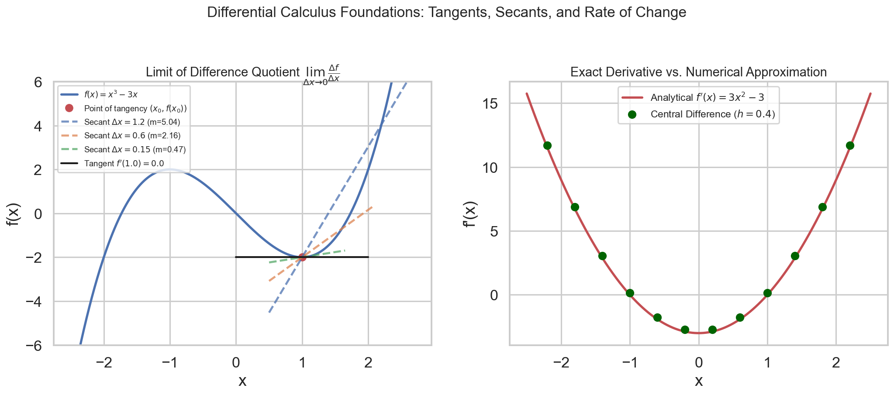
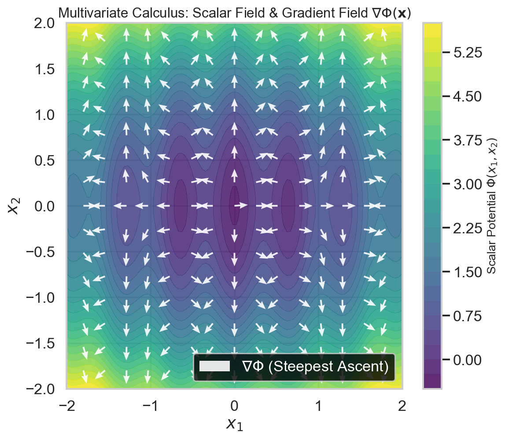
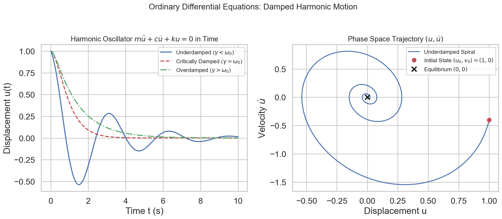
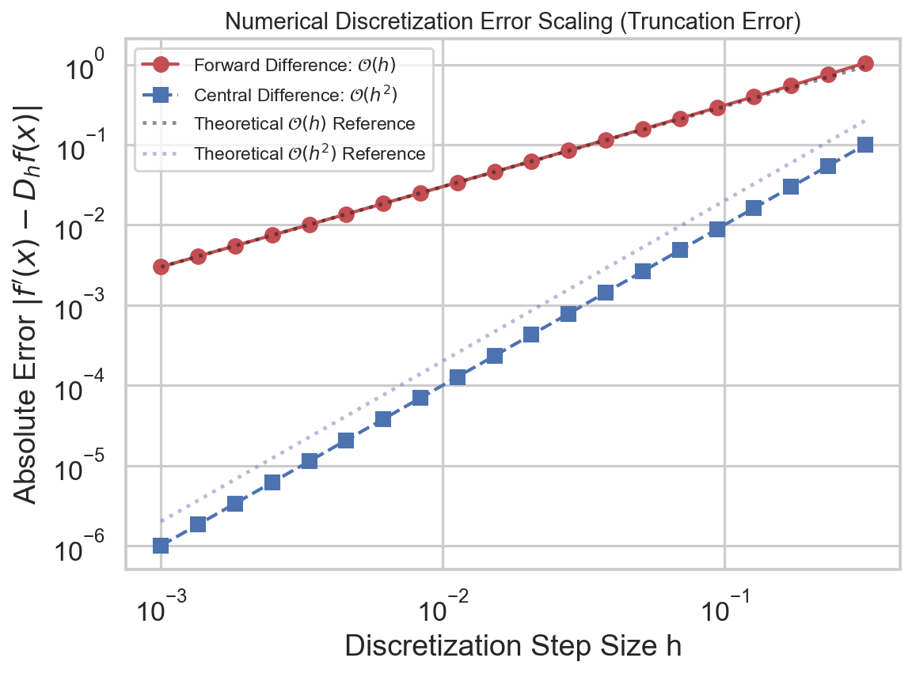

# Mathematical Foundations for Physics-Informed Neural Networks

> **Week 1 Review Article — Month 1 / Week 1**  
> Foundation learning phase: establishing rigorous multivariable calculus, continuous differential operators, and numerical residual analysis before deep learning integration.  
> Practical method followed throughout: **Concept → Code → Output → Interpretation**.

**Navigation:** [[Knowledge-Map|Knowledge Map]] · [[week-2-report|Week 2: Neural Network Foundations]] →  
**Associated Concepts:** [[ordinary-differential-equation]] · [[partial-differential-equation]] · [[boundary-initial-conditions]] · [[discretization-error]] · [[automatic-differentiation]] · [[physics-residual]]

---

## Abstract

Physics-Informed Neural Networks (PINNs) bridge continuous physical mechanics and parametric deep learning. Before parameterized neural architectures can be trained as differential equation surrogates, the underlying mathematical machinery must be rigorously established. Week 1 resolves the foundational question: **how do continuous calculus, differential equations, and discretization errors lay the mathematical groundwork for physics constraints?** We establish functions as topological mappings between continuous metric spaces, analyze the limit-based difference quotient of derivatives, and extend single-variable calculus to multivariate gradient vector fields $\nabla f(\mathbf{x})$ via the multidimensional chain rule.

We formalize Ordinary Differential Equations (ODEs) and Partial Differential Equations (PDEs), systematically classifying canonical second-order linear PDE operators into elliptic (steady-state Poisson), parabolic (time-dependent heat diffusion), and hyperbolic (wave propagation) forms. We prove why differential equations without initial conditions ($t=0$) and boundary operators (Dirichlet, Neumann, Robin) admit infinite families of non-unique solutions. Finally, we contrast classical numerical grid discretization (Finite Difference Methods) against continuous residual formulations, deriving the Taylor-series truncation error $\mathcal{O}(h^2)$ and defining the differential residual $\mathcal{R}(\mathbf{x}) = \mathcal{N}[u](\mathbf{x}) - f(\mathbf{x})$. All theoretical formulations are demonstrated with runnable Python implementations, exact console executions, and publication-grade visualizations.

## Keywords

Continuous functions, differential calculus, limits, difference quotient, partial derivatives, Jacobian, gradient vector field, ordinary differential equations, partial differential equations, Dirichlet boundary conditions, Neumann boundary conditions, initial value problems, finite difference method, truncation error, Taylor series, physics residual, `Tensor [N, d]`.

---

## 1. Introduction & Week 1 Syllabus

Physics-Informed Neural Networks do not discard classical mathematical physics; they instantiate it within the parameterized hypothesis spaces of deep learning. Conventional numerical analysis solves differential equations by discretizing space and time onto rigid geometric grids (meshes), approximating continuous derivatives with localized differences. Conversely, PINNs treat the solution field $u(\mathbf{x})$ as a continuous, differentiable function approximated by an artificial neural network $u_\theta(\mathbf{x})$.

**The Physical Connection:** In continuum mechanics, conservation of mass, momentum, and energy are expressed as differential equations relating spatial coordinate variations to temporal evolution. If an algorithm is to enforce these physical conservation laws, it must possess an exact, continuous mathematical language for evaluating rates of change, spatial directional derivatives, and boundary fluxes.

> [!IMPORTANT]
> **The Continuous Mechanics Axiom:** A neural network cannot "know" physical laws natively. Physical laws enter the optimization landscape exclusively through differential operators acting on continuous functions. Mastering the chain rule, gradient vectors, boundary operators, and residual metrics is the mandatory prerequisite for understanding how physics constraints guide neural network loss landscapes.

### Week 1 Syllabus & Laboratory Sequence

| Day | Core Focus | Laboratory / Practical Tasks |
| :--- | :--- | :--- |
| [[w1d1\|**W1D1**]] | Functions, Variables, Domain Mappings & Coordinate Graphs | Formalize continuous mappings $f: \mathbb{R}^d \to \mathbb{R}$; implement vector coordinate evaluations and domain slicing. |
| [[w1d2\|**W1D2**]] | Differential Calculus: Limits, Derivatives, Chain Rule & Gradients | Derive difference quotients; implement numerical gradient fields $\nabla f$; verify directional derivatives. |
| [[w1d3\|**W1D3**]] | Ordinary Differential Equations (ODEs) & Initial Value Problems | Formulate damped harmonic oscillators; solve IVPs via explicit Runge-Kutta numerical integration (`solve_ivp`). |
| [[w1d4\|**W1D4**]] | Partial Differential Equations (PDEs) & Boundary Value Problems | Classify Elliptic, Parabolic, and Hyperbolic operators; formalize Dirichlet and Neumann boundary conditions. |
| [[w1d5\|**W1D5**]] | Numerical Discretization, Finite Differences & Truncation Residuals | Derive Taylor expansions; quantify truncation error scaling $\mathcal{O}(h)$ vs. $\mathcal{O}(h^2)$; evaluate differential residuals. |

---

## 2. Functions, Coordinates, and Topological Mappings

### 2.1 The Concept of a Continuous Field
In scientific computing, physical quantities are represented as continuous scalar or vector fields:

$$u: \Omega \subset \mathbb{R}^d \longrightarrow \mathbb{R}^m$$

where $\mathbf{x} = (x_1, \dots, x_d)^T \in \Omega$ represents spatial coordinates (and time $t$), and $u(\mathbf{x})$ denotes physical state variables (e.g., fluid velocity $\mathbf{v}$, temperature $T$, pressure $p$, or electric potential $\Phi$).

1. **Independent Variables:** Coordinates defining the continuous geometric domain: $\mathbf{x} \in \mathbb{R}^d, t \in [0, T]$.
2. **Dependent Variables:** Physical state fields whose numerical values depend strictly on domain coordinates: $u = u(\mathbf{x}, t)$.
3. **Continuity ($C^k$ Class):** A function $u$ belongs to class $C^k(\Omega)$ if all partial derivatives up to order $k$ exist and are continuous on $\Omega$. For second-order differential equations, solutions must be at least $C^2$.

```
Coordinates (x, t) in Domain Ω ───> [ Continuous Operator u(x, t) ] ───> Physical State (Pressure, Temperature)
```

> [!NOTE]
> In Week 2 and Week 3, this continuous mapping $u(\mathbf{x}, t)$ will be replaced by a parameterized Multi-Layer Perceptron $u_\theta(\mathbf{x}, t)$. Because a neural network with smooth activations is an infinitely differentiable function ($C^\infty$), it provides an analytical, continuous representation across the entire domain without discretization artifacts.

---

## 3. Differential Calculus: Limits, Gradients, and the Multivariable Chain Rule

### 3.1 The Limit Definition of the Derivative
The fundamental building block of differential calculus is the rate of change of a continuous function under an infinitesimal displacement:

$$f'(x) = \frac{df}{dx} = \lim_{\Delta x \to 0} \frac{f(x + \Delta x) - f(x)}{\Delta x}$$

Geometrically, the difference quotient $\frac{f(x + \Delta x) - f(x)}{\Delta x}$ represents the slope of a secant line connecting two points $(x, f(x))$ and $(x+\Delta x, f(x+\Delta x))$. As $\Delta x \to 0$, the secant lines converge to the tangent line whose slope is the instantaneous derivative $f'(x)$.



**Figure 1.** *Geometric convergence of secant lines to the tangent line on $f(x) = x^3 - 3x$ (left panel) as the perturbation step $\Delta x$ decreases from $1.2$ to $0.15$. The right panel compares the exact analytical derivative $f'(x) = 3x^2 - 3$ against central difference evaluations, confirming algebraic convergence.*

### 3.2 Partial Derivatives and the Gradient Vector Field
When a physical field depends on multiple spatial coordinates $\mathbf{x} = (x_1, x_2, \dots, x_d)^T$, the rate of change along any canonical coordinate axis is governed by the partial derivative:

$$\frac{\partial f}{\partial x_i}(\mathbf{x}) = \lim_{h \to 0} \frac{f(x_1, \dots, x_i + h, \dots, x_d) - f(x_1, \dots, x_i, \dots, x_d)}{h}$$

The collection of all first-order partial derivatives forms the **gradient vector**:

$$\nabla f(\mathbf{x}) = \begin{bmatrix} \frac{\partial f}{\partial x_1} \\ \frac{\partial f}{\partial x_2} \\ \vdots \\ \frac{\partial f}{\partial x_d} \end{bmatrix} \in \mathbb{R}^d$$

#### Mathematical Properties of the Gradient:
1. **Direction of Maximum Increase:** For any unit direction $\hat{\mathbf{v}} \in \mathbb{R}^d$ ($\|\hat{\mathbf{v}}\|_2 = 1$), the directional derivative is given by the inner product:
   $$D_{\hat{\mathbf{v}}} f(\mathbf{x}) = \nabla f(\mathbf{x}) \cdot \hat{\mathbf{v}} = \|\nabla f(\mathbf{x})\| \cos \phi$$
   The rate of change is maximized when $\hat{\mathbf{v}}$ is parallel to $\nabla f$ ($\phi = 0$).
2. **Orthogonality to Level Sets:** The gradient vector $\nabla f(\mathbf{x}_0)$ is strictly orthogonal (perpendicular) to the tangent plane of the level hypersurface $\{\mathbf{x} \in \mathbb{R}^d \mid f(\mathbf{x}) = c\}$ passing through $\mathbf{x}_0$.
3. **Direction of Steepest Descent:** In optimization (Week 2), network weights are updated in the direction of negative gradient $-\nabla_\theta \mathcal{L}$.



**Figure 2.** *Scalar potential surface $\Phi(x_1, x_2)$ overlaid with the normalized gradient vector field $\nabla \Phi$ (white arrows). Every vector points perpendicularly outward from level contours in the direction of steepest local ascent.*

### 3.3 The Multivariable Chain Rule
The chain rule is the mathematical foundation of both physical coordinate transformations and backpropagation. Let $\mathbf{u} = \mathbf{g}(\mathbf{x}): \mathbb{R}^d \to \mathbb{R}^m$, and let $f(\mathbf{u}): \mathbb{R}^m \to \mathbb{R}$. The partial derivative of the composite function with respect to input coordinate $x_j$ is:

$$\frac{\partial (f \circ \mathbf{g})}{\partial x_j} = \sum_{k=1}^m \frac{\partial f}{\partial u_k} \frac{\partial u_k}{\partial x_j}$$

In matrix form, the Jacobian of the composition is the matrix product of Jacobians:

$$\mathbf{J}_{f \circ \mathbf{g}}(\mathbf{x}) = \mathbf{J}_f(\mathbf{g}(\mathbf{x})) \cdot \mathbf{J}_{\mathbf{g}}(\mathbf{x})$$

---

## 4. Ordinary Differential Equations (ODEs) & Initial Value Problems

### 4.1 Formal Definition and Classification
An Ordinary Differential Equation relates an unknown function $u(t)$ of a single independent variable $t \in [0, T]$ to its derivatives:

$$\mathcal{F}\left(t, u(t), \frac{du}{dt}, \frac{d^2u}{dt^2}, \dots, \frac{d^n u}{dt^n}\right) = 0$$

- **Order:** The highest derivative appearing in the equation.
- **Linearity:** An ODE is linear if it can be written as $\sum_{k=0}^n a_k(t) \frac{d^k u}{dt^k} = g(t)$. Non-linear ODEs contain non-linear functions of $u$ or its derivatives (e.g., $u \frac{du}{dt}$).

### 4.2 The Canonical Damped Harmonic Oscillator
The motion of a mass $m$ attached to a spring of stiffness $k$ with linear damping coefficient $c$ is governed by Newton's second law:

$$m \frac{d^2 u}{dt^2} + c \frac{du}{dt} + k u = 0$$

Dividing by $m$ yields the standard form:

$$\ddot{u} + 2\gamma \dot{u} + \omega_0^2 u = 0, \quad \gamma = \frac{c}{2m}, \quad \omega_0 = \sqrt{\frac{k}{m}}$$

The characteristic equation $r^2 + 2\gamma r + \omega_0^2 = 0$ yields roots $r_{1,2} = -\gamma \pm \sqrt{\gamma^2 - \omega_0^2}$, defining three physical regimes:
1. **Underdamped ($\gamma < \omega_0$):** Oscillatory decay with damped frequency $\omega_d = \sqrt{\omega_0^2 - \gamma^2}$:
   $$u(t) = e^{-\gamma t} \left( A \cos(\omega_d t) + B \sin(\omega_d t) \right)$$
2. **Critically Damped ($\gamma = \omega_0$):** Most rapid return to equilibrium without oscillation:
   $$u(t) = (A + B t) e^{-\gamma t}$$
3. **Overdamped ($\gamma > \omega_0$):** Pure exponential decay without oscillation:
   $$u(t) = A e^{r_1 t} + B e^{r_2 t}$$



**Figure 3.** *Time-series displacement $u(t)$ for underdamped, critically damped, and overdamped harmonic motion (left panel). The right panel illustrates the spiral phase-space trajectory $(u, \dot{u})$ of the underdamped oscillator spiraling into the stable origin $(0,0)$.*

### 4.3 Why Initial Conditions are Mandatory
Integrating an $n$-th order ODE generates $n$ arbitrary constants of integration. For the harmonic oscillator ($n=2$), the general solution contains constants $A$ and $B$. To determine a unique physical trajectory, we must specify $n$ independent constraints at initial time $t=0$:

$$u(0) = u_0 \quad (\text{Initial Position}), \qquad \dot{u}(0) = v_0 \quad (\text{Initial Velocity})$$

Without initial conditions, the differential equation defines an infinite family of possible trajectories. In a PINN, initial conditions are enforced via explicit loss penalties $\mathcal{L}_{\mathrm{ic}}$.

---

## 5. Partial Differential Equations (PDEs) & Boundary Value Problems

### 5.1 Classification of Second-Order PDEs
A second-order linear PDE in two independent variables $(x, y)$ takes the general form:

$$A \frac{\partial^2 u}{\partial x^2} + B \frac{\partial^2 u}{\partial x \partial y} + C \frac{\partial^2 u}{\partial y^2} + D \frac{\partial u}{\partial x} + E \frac{\partial u}{\partial y} + F u = G$$

The mathematical classification and physical behavior are determined by the discriminant $\Delta = B^2 - 4AC$:

| Classification | Discriminant | Canonical Prototype | Physical Interpretation |
| :--- | :---: | :--- | :--- |
| **Elliptic** | $\Delta < 0$ | Laplace / Poisson: $\nabla^2 u = f$ | Equilibrium states, potential fields, steady-state heat distributions. Perturbations propagate instantaneously across the entire domain. |
| **Parabolic** | $\Delta = 0$ | Heat / Diffusion: $\frac{\partial u}{\partial t} = \alpha \nabla^2 u$ | Irreversible dissipation, thermal conduction, brownian dispersion. Forward in time, smoothing high frequencies. |
| **Hyperbolic** | $\Delta > 0$ | Wave Equation: $\frac{\partial^2 u}{\partial t^2} = c^2 \nabla^2 u$ | Conservative wave propagation, acoustic signals, elastodynamics. Finite propagation speed ($c$) along characteristics. |

### 5.2 Canonical Space-Time Parabolic Problem: The 1D Heat Equation
Consider heat conduction in a homogeneous rod of length $L=1$ with thermal diffusivity $\alpha$:

$$\frac{\partial u}{\partial t} = \alpha \frac{\partial^2 u}{\partial x^2}, \quad x \in [0, 1], \quad t \in [0, T]$$

- **Initial Condition:** $u(0, x) = \sin(\pi x)$ (initial spatial temperature distribution).
- **Homogeneous Dirichlet Boundary Conditions:** $u(t, 0) = 0$ and $u(t, 1) = 0$ (ends immersed in ice bath).

The analytical separation of variables solution is:

$$u(t, x) = e^{-\alpha \pi^2 t} \sin(\pi x)$$


**Figure 4.** *Space-time solution field $u(t, x)$ of the 1D Heat Equation ($\alpha = 0.5$). Heat dissipates exponentially over time while adhering to Dirichlet zero boundaries at $x=0$ and $x=1$.*

### 5.3 Boundary Operator Taxonomy
A well-posed boundary value problem requires boundary conditions enforced on the domain perimeter $\partial\Omega$:

1. **Dirichlet Boundary Condition (First Type):** Prescribes the state field value directly on $\partial\Omega$:
   $$u(\mathbf{x}) = g(\mathbf{x}) \quad \forall \mathbf{x} \in \partial\Omega$$
2. **Neumann Boundary Condition (Second Type):** Prescribes the directional derivative (flux) normal to the boundary:
   $$\nabla u \cdot \hat{\mathbf{n}} = \frac{\partial u}{\partial n} = h(\mathbf{x}) \quad \forall \mathbf{x} \in \partial\Omega$$
   where $\hat{\mathbf{n}}$ is the outward unit normal vector. (e.g., zero heat flux $\frac{\partial u}{\partial n} = 0$ models an insulated boundary).
3. **Robin Boundary Condition (Third Type):** A linear combination of state and normal flux:
   $$a u(\mathbf{x}) + b \frac{\partial u}{\partial n}(\mathbf{x}) = c(\mathbf{x}) \quad \forall \mathbf{x} \in \partial\Omega$$

---

## 6. Numerical Discretization, Truncation Error, and the Residual Concept

### 6.1 Taylor Series and Finite Difference Formulas
Traditional numerical methods approximate derivatives using Taylor series expansions of a continuous function $f(x)$ around grid point $x_i$ with spatial spacing $h$:

$$f(x_i + h) = f(x_i) + h f'(x_i) + \frac{h^2}{2} f''(x_i) + \frac{h^3}{6} f'''(x_i) + \mathcal{O}(h^4)$$
$$f(x_i - h) = f(x_i) - h f'(x_i) + \frac{h^2}{2} f''(x_i) - \frac{h^3}{6} f'''(x_i) + \mathcal{O}(h^4)$$

1. **Forward Difference:**
   $$D_h^+ f(x_i) = \frac{f(x_i + h) - f(x_i)}{h} = f'(x_i) + \mathcal{O}(h)$$
2. **Central Difference:** Subtracting $f(x_i - h)$ from $f(x_i + h)$ cancels even powers of $h$:
   $$D_h^0 f(x_i) = \frac{f(x_i + h) - f(x_i - h)}{2h} = f'(x_i) + \mathcal{O}(h^2)$$
3. **Second-Order Central Difference (Laplacian):** Adding the two expansions:
   $$D_h^2 f(x_i) = \frac{f(x_i + h) - 2f(x_i) + f(x_i - h)}{h^2} = f''(x_i) + \mathcal{O}(h^2)$$



**Figure 5.** *Log-log scaling of truncation error against discretization step size $h$. The central difference scheme displays second-order asymptotic convergence $\mathcal{O}(h^2)$ matching the theoretical slope of $2$, whereas the forward difference scheme exhibits first-order error scaling $\mathcal{O}(h)$.*

### 6.2 Concept → Code → Output → Interpretation

#### 1. Concept
We verify the convergence rates of forward and central difference approximations on the non-linear function $f(x) = x^3 - 3x$ at $x_0 = 1.5$, evaluating numerical error against the analytical derivative $f'(1.5) = 3(1.5)^2 - 3 = 3.750000$.

#### 2. Code
```python
import numpy as np

def f(x):
    return x**3 - 3*x

def df_exact(x):
    return 3*x**2 - 3

x0 = 1.5
exact_val = df_exact(x0)
h_values = [0.2, 0.05, 0.01]

print(f"--- Derivative Approximation at x0 = {x0:.1f} (Exact = {exact_val:.6f}) ---")
for h in h_values:
    # Forward difference O(h)
    fwd = (f(x0 + h) - f(x0)) / h
    err_fwd = abs(fwd - exact_val)
    # Central difference O(h^2)
    cnt = (f(x0 + h) - f(x0 - h)) / (2 * h)
    err_cnt = abs(cnt - exact_val)
    print(f"h = {h:.2f} | Fwd: {fwd:.6f} (Err: {err_fwd:.2e}) | Central: {cnt:.6f} (Err: {err_cnt:.2e})")
```

#### 3. Output
```text
--- Derivative Approximation at x0 = 1.5 (Exact = 3.750000) ---
h = 0.20 | Fwd: 4.540000 (Err: 7.90e-01) | Central: 3.790000 (Err: 4.00e-02)
h = 0.05 | Fwd: 3.907500 (Err: 1.58e-01) | Central: 3.752500 (Err: 2.50e-03)
h = 0.01 | Fwd: 3.780300 (Err: 3.03e-02) | Central: 3.750100 (Err: 1.00e-04)
```

#### 4. Interpretation
Reducing the step size $h$ by a factor of $20$ (from $0.20$ to $0.01$) reduces the forward difference error by approximately $26\times$ ($\mathcal{O}(h)$), whereas the central difference error drops by a factor of $400\times$ ($20^2$, conforming to $\mathcal{O}(h^2)$). However, in numerical finite differences on physical meshes, reducing $h$ introduces two crippling bottlenecks:
1. Floating-point cancellation catastrophe when $h < 10^{-8}$.
2. The **curse of dimensionality**: resolving a 3D grid with $N$ points per axis requires $N^3$ cells; a 4D space-time grid requires $N^4$ memory storage.

### 6.3 The Differential Residual Operator
Let a differential equation be expressed abstractly as:

$$\mathcal{N}[u](\mathbf{x}) = f(\mathbf{x}), \quad \mathbf{x} \in \Omega$$

where $\mathcal{N}$ is a linear or non-linear differential operator (e.g., $\mathcal{N}[u] = \frac{\partial u}{\partial t} - \alpha \nabla^2 u$).

> [!IMPORTANT]
> **The Residual Definition:** For any candidate approximate function $\hat{u}(\mathbf{x})$ (whether from a coarse numerical solver or a neural network surrogate), the **Physics Residual** $\mathcal{R}(\mathbf{x})$ is defined as:
> $$\mathcal{R}(\mathbf{x}) \equiv \mathcal{N}[\hat{u}](\mathbf{x}) - f(\mathbf{x})$$
> 
> - If $\hat{u}$ is the exact physical solution, $\mathcal{R}(\mathbf{x}) \equiv 0$ everywhere on $\Omega$.
> - If $\hat{u}$ violates the physical governing equation, $\mathcal{R}(\mathbf{x}) \ne 0$, providing a continuous point-wise error metric.

In a PINN, we do not invert discrete linear systems or construct finite difference stencils. Instead, we minimize the mean squared norm of this continuous residual:

$$\mathcal{L}_{\mathrm{pde}} = \frac{1}{N} \sum_{i=1}^N \|\mathcal{R}(\mathbf{x}_i)\|^2$$

---

## 7. Comparative Analysis: Classical Numerics vs. Continuous PINN Formulation

| Dimension / Metric | Classical Grid Methods (FDM / FEM / FVM) | Physics-Informed Neural Networks (PINNs) |
| :--- | :--- | :--- |
| **Representation** | Discrete vector of values at mesh nodes $U \in \mathbb{R}^N$ | Continuous parameterized function $u_\theta(\mathbf{x}) \in C^k(\Omega)$ |
| **Derivative Engine** | Truncation-limited finite difference stencils $\mathcal{O}(h^p)$ | Exact coordinate automatic differentiation to machine precision |
| **Mesh Requirement** | Mandatory topological mesh generation (triangles, tetrahedra) | **Mesh-free:** Evaluated on scattered point clouds / collocation sets |
| **High Dimensionality ($d \ge 4$)** | Fails due to curse of dimensionality ($\mathcal{O}(N^d)$ complexity) | Mitigated: Monte Carlo collocation scaling independent of spatial dimension |
| **Inverse Problem Inversion** | Computationally expensive; requires adjoint PDE solves | **Trivial:** Unknown PDE parameters $\lambda$ are optimized as trainable weights |
| **Computational Cost** | Fast sparse linear algebra solves ($\sim$ seconds to minutes) | Heavy iterative non-linear optimization ($\sim$ thousands of epochs) |
| **Theoretical Guarantees** | Provable convergence rates, Lax equivalence theorem | Non-convex loss landscapes; convergence subject to local minima |

---

## 8. Real-World Applications & Scientific Formulations

### 8.1 Aerodynamic Heat Transfer (Convection-Diffusion)
- **Target:** Predict steady-state thermal profiles over a hypersonic re-entry vehicle surface.
- **Governing PDE:** $\mathbf{v} \cdot \nabla T - \kappa \nabla^2 T = Q(\mathbf{x})$ on domain $\Omega$.
- **Boundary Formulation:** Dirichlet temperature on heated leading edge $T|_{\partial\Omega_{\text{front}}} = T_{\text{plasma}}$; Robin convective radiation on body $k \frac{\partial T}{\partial n} + \epsilon \sigma T^4 = 0$.
- **Failure Mode:** Sharp boundary layers and advection dominance ($Peclet \gg 1$) cause numerical oscillations in standard central differences and spectral bias in standard neural networks.

### 8.2 Subsurface Hydrology (Poisson Equation)
- **Target:** Infer hydraulic head and discover unknown aquifer permeability tensor $\mathbf{K}(\mathbf{x})$.
- **Governing PDE:** $\nabla \cdot (\mathbf{K}(\mathbf{x}) \nabla h(\mathbf{x})) = q(\mathbf{x})$.
- **Boundary Formulation:** No-flow Neumann boundaries $\nabla h \cdot \hat{\mathbf{n}} = 0$ along impermeable bedrock.
- **Failure Mode:** Discontinuous permeability fields across geologic fault lines violate smooth derivative assumptions.

### 8.3 Structural Elastodynamics (Wave Equation)
- **Target:** Non-destructive acoustic imaging of internal crack propagation in aerospace alloys.
- **Governing PDE:** $\rho \frac{\partial^2 \mathbf{u}}{\partial t^2} - \nabla \cdot \boldsymbol{\sigma} = \mathbf{f}$.
- **Boundary Formulation:** Traction-free Neumann boundaries $\boldsymbol{\sigma} \cdot \hat{\mathbf{n}} = \mathbf{0}$ on external surfaces.
- **Failure Mode:** High-frequency acoustic reflections cause phase drift and optimization stiffness in gradient descent.

---

## 9. Critical Challenges, Pathology & Failure Modes

1. **Ill-Posed Boundary Formulations:** Specifying insufficient boundary conditions (e.g., solving Laplace's equation without any Dirichlet conditions) creates a non-unique solution space with an infinite-dimensional kernel.
2. **Derivative Truncation vs. Roundoff Conflict:** In numerical finite differences, decreasing $h$ initially reduces truncation error ($\mathcal{O}(h^2)$) until roundoff error ($\mathcal{O}(\epsilon/h)$) dominates at $h \approx 10^{-8}$, after which precision collapses. PINNs bypass this via automatic differentiation.
3. **Stiffness in Physical Coefficients:** When spatial diffusion $\alpha \ll 1$ while reaction kinetics are rapid, the system becomes mathematically stiff. Time-steppers require impractically small $\Delta t$, while PINNs experience severe gradient scale disparities between residual terms.

---

## 10. Conclusion & Pedagogical Handoff

Week 1 has established the bedrock mathematical principles of Physics-Informed Neural Networks:
1. Functions represent continuous physical state fields $u(\mathbf{x}): \mathbb{R}^d \to \mathbb{R}^m$.
2. Derivatives quantify instantaneous physical rates of change, with multivariable gradients $\nabla f$ defining directions of steepest ascent and normal flux vectors.
3. ODEs and PDEs mathematically govern dynamical and continuum systems; without boundary and initial constraints, their solution spaces are unconstrained.
4. Classical numerical discretizations introduce polynomial truncation error $\mathcal{O}(h^p)$ and suffer from the curse of dimensionality.
5. The differential residual $\mathcal{R}(\mathbf{x}) \equiv \mathcal{N}[u](\mathbf{x}) - f(\mathbf{x})$ quantifies physical error continuously without requiring discrete grid connectivity.

**Forward Handoff to Week 2:**  
In Week 2, we leave classical grid approximations behind. We introduce **Neural Network Foundations for Scientific Machine Learning**: constructing Multi-Layer Perceptrons, establishing why $C^2$-smooth activation functions ($\tanh$, SIREN) are mandatory for second-order PDEs, analyzing the loss landscape under MSE, and mastering the backpropagation engine that computes parameter update gradients.

---

## 11. Academic References & Annotated Literature

1. **Raissi, M., Perdikaris, P., & Karniadakis, G. E. (2019).** *Physics-informed neural networks: A deep learning framework for solving forward and inverse problems involving nonlinear partial differential equations.* Journal of Computational Physics, 378, 686-707. [DOI: 10.1016/j.jcp.2018.10.045](https://doi.org/10.1016/j.jcp.2018.10.045)  
   *Contribution:* Formulated the modern PINN paradigm, introducing automatic differentiation to evaluate continuous PDE residuals without mesh generation.
2. **Karniadakis, G. E., Kevrekidis, I. G., Lu, L., Perdikaris, P., Wang, S., & Yang, L. (2021).** *Physics-informed machine learning.* Nature Reviews Physics, 3(6), 422-440. [DOI: 10.1038/s42254-021-00314-5](https://doi.org/10.1038/s42254-021-00314-5)  
   *Contribution:* Broad review establishing the taxonomy of Scientific Machine Learning, distinguishing physics-informed loss constraints from inductive architectural priors.
3. **LeVeque, R. J. (2007).** *Finite Difference Methods for Ordinary and Partial Differential Equations: Steady-State and Time-Dependent Problems.* SIAM. [DOI: 10.1137/1.9780898717839](https://doi.org/10.1137/1.9780898717839)  
   *Contribution:* Definitive treatment of Taylor-series truncation errors, consistency, stability, and convergence in classical grid discretization.
4. **Evans, L. C. (2010).** *Partial Differential Equations (2nd ed.).* American Mathematical Society. [DOI: 10.1090/gsm/019](https://doi.org/10.1090/gsm/019)  
   *Contribution:* Comprehensive theoretical analysis of elliptic, parabolic, and hyperbolic partial differential equations, maximum principles, and well-posed boundary value problems.
5. **Strang, G. (2016).** *Introduction to Applied Mathematics.* Wellesley-Cambridge Press.  
   *Contribution:* Unifies applied calculus, boundary value operators, matrix differential operators, and the geometry of gradient fields.

---

## Appendix A — Computational Reproducibility (UV + Python)

All figures and numerical tables in this monograph are deterministically reproducible using `uv`.

```bash
# Verify environment
uv run python --version

# Run deterministic figure generator
uv run python generate_week1_plots.py

# Verify assets on disk
ls -l "month 1/week 1/assets"
```

## Appendix B — Knowledge Graph Connections

**Central MOC Hub:** [[Knowledge-Map]]  
**Upstream:** None (Curriculum Origin — provides foundational calculus and differential equations).  
**Downstream:** [[week-2-report|Week 2: Neural Network Foundations]] — replaces discrete approximations with multi-layer neural networks and smooth activations.  
**Sibling Concepts:** [[ordinary-differential-equation]] · [[partial-differential-equation]] · [[boundary-initial-conditions]] · [[discretization-error]] · [[automatic-differentiation]] · [[physics-residual]]
