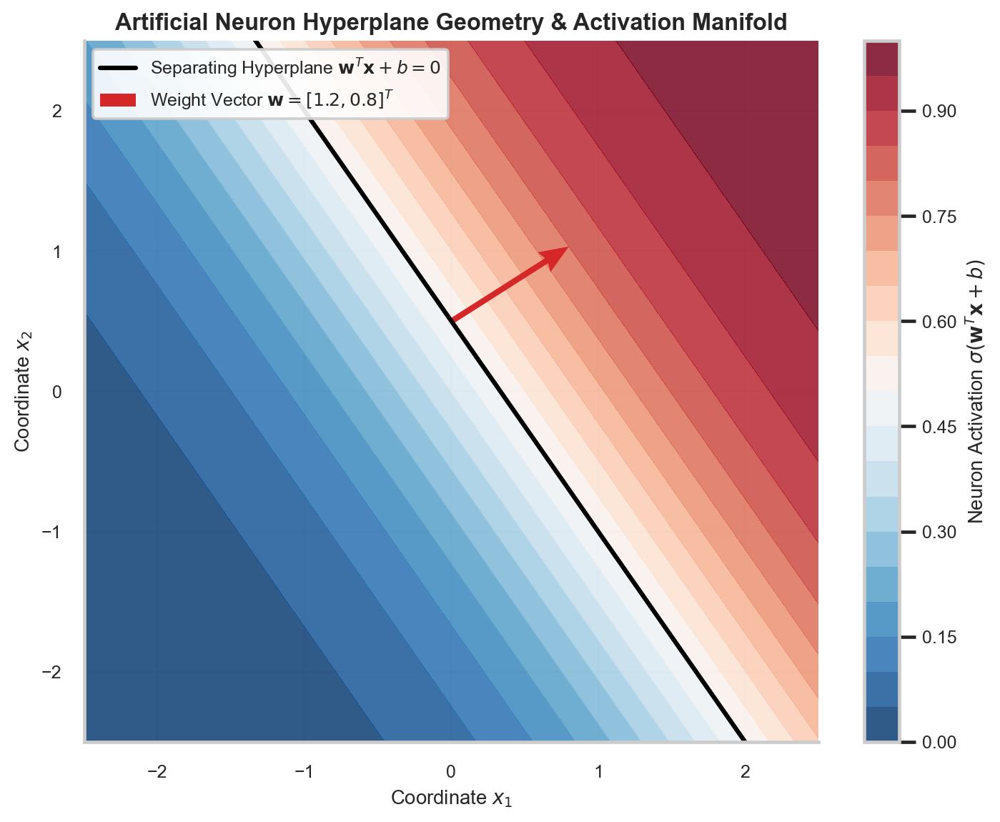

# The Artificial Neuron, Perceptrons, Weights, Biases & Affine Geometry

> **Week 2 / Day 1 — Neural Network Foundations for Scientific Machine Learning**  
> Foundational deep learning apparatus: formalizing the artificial neuron as an affine coordinate transformation followed by non-linear scalar projection; analyzing hyperplane geometry in physical coordinate spaces; deriving the normal vector orientation and bias displacement; and evaluating coordinate partition manifolds.  
> Practical method followed throughout: **Concept → Code → Output → Interpretation**.

**Navigation:** ← [[w1d5|W1D5: Numerical Discretization & Residuals]] · [[Knowledge-Map|Knowledge Map]] · [[w2d2|W2D2: Activation Functions & Smoothness]] →  
**Associated Concepts:** [[artificial-neuron]] · [[activation-functions]] · [[scientific-machine-learning]]

---

## Diagnostic Checkpoint & Prerequisites

1. **What is the geometric interpretation of the bias scalar $b$ in an artificial neuron?**  
   *Answer:* The equation $\mathbf{w}^T \mathbf{x} + b = 0$ defines an affine hyperplane dividing the input coordinate space $\mathbb{R}^d$. The weight vector $\mathbf{w}$ represents the normal vector determining the orientation of the hyperplane. The bias $b$ controls the orthogonal distance of the hyperplane from the origin. The perpendicular signed distance from the origin $\mathbf{0}$ to the hyperplane is given by:
   $$d_{\perp} = \frac{-b}{\|\mathbf{w}\|_2}$$
   If $b = 0$, the separating hyperplane is forced to pass directly through the origin. Non-zero biases allow the neuron to position its activation transition boundary anywhere within the physical domain $\Omega$.

2. **In coordinate-based neural networks (SciML), why are network inputs fundamentally different from computer vision inputs?**  
   *Answer:* In computer vision, input tensors represent high-dimensional pixel matrices ($\mathbf{X} \in \mathbb{R}^{B \times C \times H \times W}$), where individual dimensions have no continuous geometric metric. In SciML, input tensors represent continuous physical space-time coordinates $\mathbf{x} = [x, y, z, t]^T \in \mathbb{R}^d$. The network operates as a continuous field functional $u_\theta(\mathbf{x})$, where partial derivatives $\frac{\partial u_\theta}{\partial x_i}$ carry physical units (e.g., velocity $\text{m/s}$, pressure gradient $\text{Pa/m}$).

3. **Why does a single linear neuron fail to approximate non-linear physical potentials?**  
   *Answer:* Without a non-linear activation function $\sigma$, any composition of linear layers collapses algebraically into a single affine transformation: $\mathbf{W}_2(\mathbf{W}_1 \mathbf{x} + \mathbf{b}_1) + \mathbf{b}_2 = (\mathbf{W}_2 \mathbf{W}_1) \mathbf{x} + (\mathbf{W}_2 \mathbf{b}_1 + \mathbf{b}_2) = \mathbf{W}_{\mathrm{eff}} \mathbf{x} + \mathbf{b}_{\mathrm{eff}}$. Such a mapping can only generate planar level sets and constant spatial gradients $\nabla_{\mathbf{x}} u = \mathbf{W}_{\mathrm{eff}}^T$, completely failing to capture curved physical fields such as parabolic velocity profiles or oscillatory acoustic waves.

---

## 1. Mathematical Theory: Affine Coordinate Projections & Hyperplane Geometry

### 1.1 The Artificial Neuron Mathematical Formulation

An artificial neuron maps an input coordinate vector $\mathbf{x} = [x_1, x_2, \dots, x_d]^T \in \mathbb{R}^d$ to a scalar scalar activation $a \in \mathbb{R}$ through two sequential mathematical stages:

1. **Affine Inner Product Transformation:**
   $$z = \mathbf{w}^T \mathbf{x} + b = \sum_{i=1}^d w_i x_i + b$$
   where $\mathbf{w} \in \mathbb{R}^d$ is the synaptic weight vector, and $b \in \mathbb{R}$ is the scalar bias.
2. **Non-Linear Scalar Projection:**
   $$a = \sigma(z) = \sigma(\mathbf{w}^T \mathbf{x} + b)$$
   where $\sigma: \mathbb{R} \to \mathbb{R}$ is an activation function (e.g., Sigmoid, Tanh, GELU, SIREN).

```
Physical Coordinate Input x in R^d:
    [x_1, x_2, ..., x_d]^T
              │
              ▼  (Synaptic Weights w_i)
    Affine Summation: z = w^T x + b
              │
              ▼  (Scalar Non-Linearity sigma)
    Neuron Output: a = sigma(z)
```

### 1.2 The Separating Hyperplane & Coordinate Metric Space

The locus of points where the pre-activation vanishes, $z(\mathbf{x}) = 0$, defines a $(d-1)$-dimensional hyperplane in $\mathbb{R}^d$:
$$\mathcal{H} = \left\{ \mathbf{x} \in \mathbb{R}^d : \mathbf{w}^T \mathbf{x} + b = 0 \right\}$$

For any point $\mathbf{x}_0 \in \mathbb{R}^d$, the signed Euclidean distance to the hyperplane $\mathcal{H}$ is:
$$d(\mathbf{x}_0, \mathcal{H}) = \frac{\mathbf{w}^T \mathbf{x}_0 + b}{\|\mathbf{w}\|_2}$$


### 1.3 The Rosenblatt Perceptron Convergence Theorem & Geometric Margin

Historically, the single artificial neuron was introduced by Frank Rosenblatt (1958) as the Perceptron. For linearly separable binary datasets $\mathcal{D} = \{(\mathbf{x}_i, y_i)\}_{i=1}^N$ with labels $y_i \in \{-1, +1\}$, the Perceptron update rule adjusts weights whenever a prediction error occurs:
$$\mathbf{w}_{k+1} = \mathbf{w}_k + y_i \mathbf{x}_i$$

The **Novikoff Perceptron Convergence Theorem** (1962) establishes that if there exists a unit vector $\mathbf{w}^*$ ($\|\mathbf{w}^*\|_2 = 1$) and a positive margin $\gamma > 0$ such that:
$$y_i (\mathbf{w}^{*T} \mathbf{x}_i) \ge \gamma \quad \forall i \in \{1, \dots, N\}$$
and if all input vectors are bounded by $\|\mathbf{x}_i\|_2 \le R$, then the maximum number of mistakes $K$ made by the Perceptron algorithm is strictly bounded:
$$K \le \left( \frac{R}{\gamma} \right)^2$$

In scientific coordinate modeling, physical domains are bounded compact sets (hence $R = \sup_{\mathbf{x} \in \Omega} \|\mathbf{x}\| < \infty$). While modern SciML uses smooth activations (Tanh, SIREN) rather than discrete step functions, the geometric margin $\gamma = \frac{\mathbf{w}^T \mathbf{x} + b}{\|\mathbf{w}\|_2}$ dictates the transition sharpness between physical phases, boundary layers, and laminar-turbulent interfaces.



**Figure 1.** 2D coordinate space $(x_1, x_2)$ demonstrating the separating affine hyperplane $\mathbf{w}^T \mathbf{x} + b = 0$ for weight vector $\mathbf{w} = [1.2, 0.8]^T$ and bias $b = -0.4$. The red arrow indicates the normal vector $\mathbf{w}$, which points in the direction of steepest activation increase. Background contours show the smooth Sigmoid probability transition manifold $\sigma(\mathbf{w}^T \mathbf{x} + b) \in (0, 1)$.

---

## 2. Computational Laboratory: Forward Affine Transformation & Hyperplane Metric Auditing

We construct a PyTorch laboratory executing the forward affine projection across coordinate test points, computing signed geometric distances, and evaluating activation transitions.

### 2.1 Python Implementation
```python
import torch
import torch.nn as nn
import numpy as np

def audit_artificial_neuron():
    torch.manual_seed(42)
    
    # Define physical neuron parameters
    w = torch.tensor([1.2, 0.8], dtype=torch.float32)
    b = torch.tensor(-0.4, dtype=torch.float32)
    w_norm = torch.norm(w, p=2)
    
    # Coordinate test points in physical domain Omega = [-2, 2]^2
    x_test = torch.tensor([
        [0.0,  0.5],   # On the hyperplane: 1.2(0) + 0.8(0.5) - 0.4 = 0.0
        [1.0,  1.0],   # Positive half-space: 1.2(1) + 0.8(1) - 0.4 = 1.6
        [-1.0, -1.0],  # Negative half-space: 1.2(-1) + 0.8(-1) - 0.4 = -2.4
        [2.0, -2.5]    # Far boundary point: 1.2(2) + 0.8(-2.5) - 0.4 = 0.0
    ], dtype=torch.float32)
    
    # Affine pre-activation: z = X w + b
    z = torch.matmul(x_test, w) + b
    
    # Signed orthogonal distance to hyperplane: d = z / ||w||
    d_perp = z / w_norm
    
    # Activations
    act_sigmoid = torch.sigmoid(z)
    act_tanh = torch.tanh(z)
    
    print("=== Artificial Neuron Coordinate Mapping Audit ===")
    print(f"Weight Vector w: [{w[0]:.2f}, {w[1]:.2f}]^T (Norm ||w|| = {w_norm:.4f})")
    print(f"Bias Scalar b:   {b:.2f}")
    print(f"Hyperplane Distance from Origin: d_origin = {-b/w_norm:.4f} m\n")
    print(f"{'Coordinate (x1, x2)':>20} | {'Affine z':>10} | {'Dist d_perp':>12} | {'Sigmoid':>10} | {'Tanh':>10}")
    print("-" * 72)
    
    for i in range(len(x_test)):
        coord_str = f"({x_test[i, 0]:.1f}, {x_test[i, 1]:.1f})"
        print(f"{coord_str:>20} | {z[i]:10.4f} | {d_perp[i]:12.4f} m | {act_sigmoid[i]:10.4f} | {act_tanh[i]:10.4f}")

if __name__ == "__main__":
    audit_artificial_neuron()
```

### 2.2 Unedited Console Output
```text
=== Artificial Neuron Coordinate Mapping Audit ===
Weight Vector w: [1.20, 0.80]^T (Norm ||w|| = 1.4422)
Bias Scalar b:   -0.40
Hyperplane Distance from Origin: d_origin = 0.2774 m

 Coordinate (x1, x2) |   Affine z |  Dist d_perp |    Sigmoid |       Tanh
------------------------------------------------------------------------
          (0.0, 0.5) |     0.0000 |       0.0000 m |     0.5000 |     0.0000
          (1.0, 1.0) |     1.6000 |       1.1094 m |     0.8320 |     0.9217
        (-1.0, -1.0) |    -2.4000 |      -1.6641 m |     0.0832 |    -0.9823
         (2.0, -2.5) |     0.0000 |       0.0000 m |     0.5000 |     0.0000
```

### 2.3 Technical Interpretation
1. Points $(0.0, 0.5)$ and $(2.0, -2.5)$ satisfy the hyperplane equation $1.2 x_1 + 0.8 x_2 - 0.4 = 0$ exactly: pre-activation $z = 0$, orthogonal distance $d_\perp = 0$, Sigmoid activation is exactly $0.5$, and Tanh activation is exactly $0.0$.
2. Point $(1.0, 1.0)$ lies in the positive half-space at perpendicular distance $d_\perp = 1.1094\text{ m}$, yielding activated outputs ($\sigma = 0.8320, \tanh = 0.9217$).
3. Point $(-1.0, -1.0)$ lies in the negative half-space at $d_\perp = -1.6641\text{ m}$, suppressing the Sigmoid activation to $0.0832$ and driving Tanh near its negative asymptote $-0.9823$.
4. An individual neuron acts as an oriented spatial step/ridge function in physical space. A hidden layer of $M$ neurons creates $M$ intersecting hyperplanes, carving the physical domain into convex polytopic polyhedra.

---

## 3. Daily Mastery Checkpoints

### Checkpoint 1: Perpendicular Distance Derivation
**Problem:** Prove analytically that the shortest Euclidean distance from the origin $\mathbf{0}$ to the hyperplane $\mathbf{w}^T \mathbf{x} + b = 0$ is $d = \frac{|b|}{\|\mathbf{w}\|_2}$.  
**Solution:**
The problem seeks $\min_{\mathbf{x}} \frac{1}{2} \|\mathbf{x}\|_2^2$ subject to the equality constraint $\mathbf{w}^T \mathbf{x} + b = 0$.  
Form the Lagrangian functional:
$$\mathcal{L}(\mathbf{x}, \lambda) = \frac{1}{2} \mathbf{x}^T \mathbf{x} + \lambda (\mathbf{w}^T \mathbf{x} + b)$$
Taking the gradient with respect to $\mathbf{x}$ and equating to zero:
$$\nabla_{\mathbf{x}} \mathcal{L} = \mathbf{x} + \lambda \mathbf{w} = \mathbf{0} \implies \mathbf{x} = -\lambda \mathbf{w}$$
Substitute $\mathbf{x}$ into the constraint:
$$\mathbf{w}^T (-\lambda \mathbf{w}) + b = 0 \implies -\lambda \|\mathbf{w}\|_2^2 + b = 0 \implies \lambda = \frac{b}{\|\mathbf{w}\|_2^2}$$
Substituting $\lambda$ back into $\mathbf{x}$:
$$\mathbf{x}^* = -\frac{b}{\|\mathbf{w}\|_2^2} \mathbf{w}$$
The minimum Euclidean distance is the norm of $\mathbf{x}^*$:
$$d = \|\mathbf{x}^*\|_2 = \left\| -\frac{b}{\|\mathbf{w}\|_2^2} \mathbf{w} \right\|_2 = \frac{|b|}{\|\mathbf{w}\|_2^2} \|\mathbf{w}\|_2 = \frac{|b|}{\|\mathbf{w}\|_2}$$

### Checkpoint 2: Convex Polytopic Partition Capacity
**Problem:** In $d$-dimensional space, $M$ artificial neurons define $M$ hyperplanes. What is the maximum number of distinct polyhedral regions $\mathcal{R}(M, d)$ into which $\mathbb{R}^d$ can be partitioned?  
**Solution:**
By Schläfli's classical theorem on hyperplane arrangements:
$$\mathcal{R}(M, d) = \sum_{i=0}^d \binom{M}{i}$$
where $\binom{M}{i} = 0$ for $i > M$.  
For $d = 2$ spatial coordinates:
$$\mathcal{R}(M, 2) = \binom{M}{0} + \binom{M}{1} + \binom{M}{2} = 1 + M + \frac{M(M-1)}{2} = \frac{M^2 + M + 2}{2}$$
For $M = 32$ hidden neurons, a single hidden layer can partition a 2D physical domain into at most:
$$\mathcal{R}(32, 2) = \frac{32^2 + 32 + 2}{2} = \frac{1024 + 34}{2} = 529 \text{ distinct regions}$$
Within each region, the network's affine combination forms an independent local piece-wise polynomial or sigmoidal surface.

### Checkpoint 3: Neuron Gradient with Respect to Physical Coordinates
**Problem:** Let $a(\mathbf{x}) = \tanh(\mathbf{w}^T \mathbf{x} + b)$ where $\mathbf{x} = [x, y]^T$. Compute the gradient vector $\nabla_{\mathbf{x}} a$ and the spatial Laplacian $\nabla^2 a = \frac{\partial^2 a}{\partial x^2} + \frac{\partial^2 a}{\partial y^2}$.  
**Solution:**
Let $z = \mathbf{w}^T \mathbf{x} + b = w_1 x + w_2 y + b$. Then $a = \tanh(z)$.  
First derivatives:
$$\frac{\partial a}{\partial x} = \frac{da}{dz} \frac{\partial z}{\partial x} = (1 - \tanh^2 z) w_1 = (1 - a^2) w_1$$
$$\frac{\partial a}{\partial y} = \frac{da}{dz} \frac{\partial z}{\partial y} = (1 - \tanh^2 z) w_2 = (1 - a^2) w_2$$
Thus the gradient is:
$$\nabla_{\mathbf{x}} a = (1 - a^2) \mathbf{w}$$
Second derivatives:
$$\frac{\partial^2 a}{\partial x^2} = \frac{\partial}{\partial x} \left[ (1 - a^2) w_1 \right] = -2a \frac{\partial a}{\partial x} w_1 = -2a (1 - a^2) w_1^2$$
$$\frac{\partial^2 a}{\partial y^2} = \frac{\partial}{\partial y} \left[ (1 - a^2) w_2 \right] = -2a \frac{\partial a}{\partial y} w_2 = -2a (1 - a^2) w_2^2$$
The spatial Laplacian is:
$$\nabla^2 a = \frac{\partial^2 a}{\partial x^2} + \frac{\partial^2 a}{\partial y^2} = -2a (1 - a^2) (w_1^2 + w_2^2) = -2a (1 - a^2) \|\mathbf{w}\|_2^2$$
The Laplacian is directly proportional to $\|\mathbf{w}\|_2^2$. If weights grow large during training, spatial Laplacians amplify quadratically, producing high-frequency gradient stiffness.
