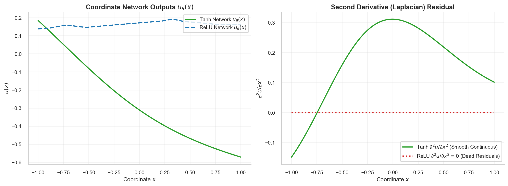
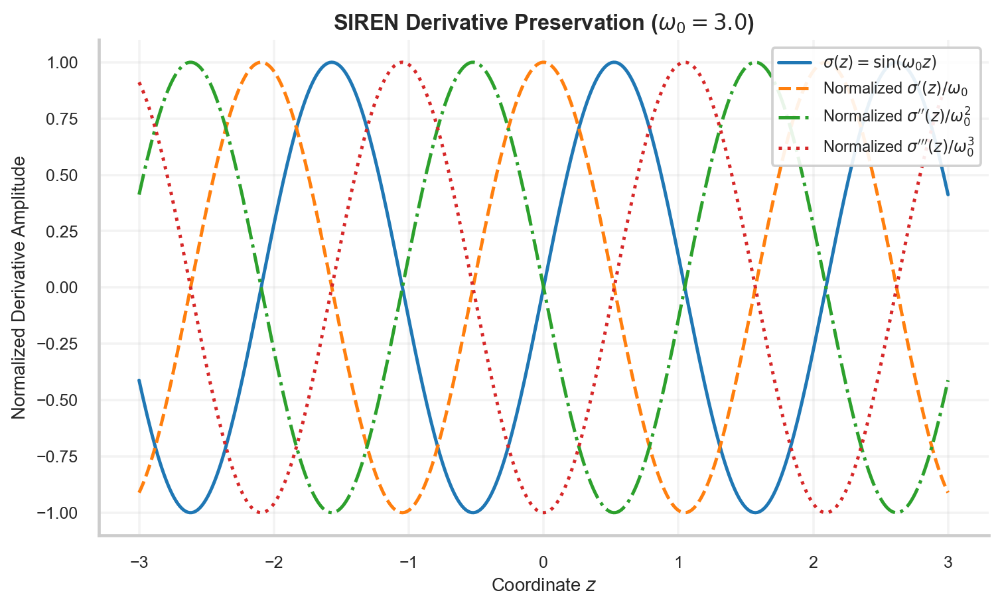
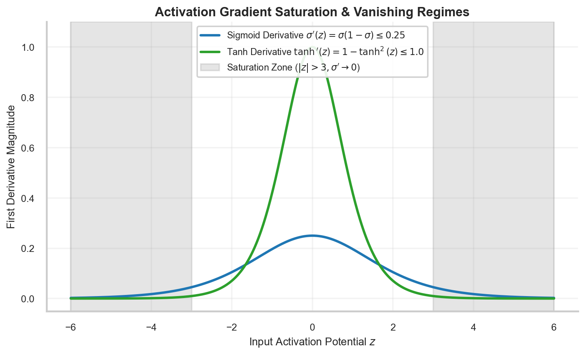

# Activation Functions: Smoothness, Saturation, SIREN & The C^k Dilemma

> **Week 2 / Day 2 — Neural Network Foundations for Scientific Machine Learning**  
> Differentiability apparatus: rigorous functional analysis of activation functions across smoothness classes $C^0, C^1, C^2, C^\infty$; proving why ReLU fails catastrophically for second-order PDEs; evaluating Tanh, GELU, and Sinusoidal (SIREN) representations; and analyzing gradient saturation regimes.  
> Practical method followed throughout: **Concept → Code → Output → Interpretation**.

**Navigation:** ← [[w2d1|W2D1: The Artificial Neuron & Affine Geometry]] · [[Knowledge-Map|Knowledge Map]] · [[w2d3|W2D3: Multi-Layer Perceptrons & Spectral Bias]] →  
**Associated Concepts:** [[activation-functions]] · [[smooth-differentiability]] · [[differential-residual]]

---

## Diagnostic Checkpoint & Prerequisites

1. **Why does the Rectified Linear Unit ($\text{ReLU}(z) = \max(0, z)$) completely fail as an activation function for second-order PINNs?**  
   *Answer:* The first derivative of ReLU is the Heaviside step function: $\text{ReLU}'(z) = \Theta(z) = 1$ for $z > 0$ and $0$ for $z < 0$. The second derivative is the Dirac delta distribution at the origin and zero everywhere else: $\text{ReLU}''(z) = \delta(z) \equiv 0$ almost everywhere on $\mathbb{R} \setminus \{0\}$. For second-order differential operators (such as the Laplacian $\nabla^2 u$ in the Poisson, heat, wave, and Navier-Stokes equations), automatic differentiation through a ReLU network yields identically zero second derivatives: $\frac{\partial^2 u_\theta}{\partial x^2} \equiv 0$. The physics residual collapses to a constant or data-only term, completely severing physical gradient propagation to network weights.

2. **What is the mathematical definition of a $C^k$ function space, and what minimum class is required for a $p$-th order PDE?**  
   *Answer:* A function $f: \Omega \to \mathbb{R}$ belongs to the class $C^k(\Omega)$ if all partial derivatives of order up to and including $k$ exist and are continuous on $\Omega$. To evaluate a classical solution to a $p$-th order PDE $\mathcal{N}[u] = f$, the neural surrogate $u_\theta$ must belong to at least $C^p(\Omega)$. Thus, second-order PDEs require $u_\theta \in C^2(\Omega)$, and fourth-order biharmonic/plate-bending equations require $u_\theta \in C^4(\Omega)$.

3. **How does the SIREN architecture preserve higher-order derivative amplitudes across deep layers?**  
   *Answer:* Periodic sinusoidal activations $\sigma(z) = \sin(\omega_0 z)$ have the unique mathematical property that their derivatives are phase-shifted sinusoids of identical functional form: $\sigma'(z) = \omega_0 \cos(\omega_0 z)$, $\sigma''(z) = -\omega_0^2 \sin(\omega_0 z)$, $\sigma'''(z) = -\omega_0^3 \cos(\omega_0 z)$. Unlike Sigmoid or Tanh (whose derivatives saturate toward zero outside the origin), sinusoidal derivatives retain constant oscillating amplitudes throughout the domain, enabling accurate representation of high-frequency wave numbers and spatial gradients.

---

## 1. Mathematical Theory: Smoothness Classes & Activation Derivatives

### 1.1 Activation Taxonomy & Smoothness Classes

| Activation Function | Formulation $\sigma(z)$ | Class | First Derivative $\sigma'(z)$ | Second Derivative $\sigma''(z)$ | SciML PDE Viability |
| :--- | :--- | :--- | :--- | :--- | :--- |
| **ReLU** | $\max(0, z)$ | $C^0$ | $\Theta(z)$ (Step) | $0$ (a.e.) | **Dead for second-order PDEs** |
| **GELU** | $z \Phi(z) = z \frac{1 + \operatorname{erf}(z/\sqrt{2})}{2}$ | $C^\infty$ | $\Phi(z) + z \phi(z)$ | $\phi(z)(2 - z^2)$ | Continuous, weak higher derivatives |
| **Tanh** | $\frac{e^z - e^{-z}}{e^z + e^{-z}}$ | $C^\infty$ | $1 - \tanh^2(z)$ | $-2\tanh(z)(1 - \tanh^2(z))$ | **Gold standard for classical PINNs** |
| **SIREN** | $\sin(\omega_0 z)$ | $C^\infty$ | $\omega_0 \cos(\omega_0 z)$ | $-\omega_0^2 \sin(\omega_0 z)$ | **Optimal for multiscale wave dynamics** |


### 1.3 Probabilistic Derivation of GELU & Lipschitz Continuity Bounds

The Gaussian Error Linear Unit (GELU) was proposed by Hendrycks and Gimpel (2016) by combining properties of dropout, zoneout, and ReLU. Instead of gating inputs deterministically by their sign ($\Theta(z)$), GELU gates inputs probabilistically according to their value relative to a standard Gaussian distribution:
$$\operatorname{GELU}(z) = z \cdot P(X \le z), \quad X \sim \mathcal{N}(0, 1)$$
where $P(X \le z) = \Phi(z) = \frac{1}{\sqrt{2\pi}} \int_{-\infty}^z e^{-t^2/2} \, dt = \frac{1}{2} \left[ 1 + \operatorname{erf}\left(\frac{z}{\sqrt{2}}\right) \right]$.

Thus:
$$\operatorname{GELU}(z) = \frac{z}{2} \left[ 1 + \operatorname{erf}\left(\frac{z}{\sqrt{2}}\right) \right]$$

A crucial mathematical consideration in neural network stability is **Lipschitz continuity**. A function $\sigma: \mathbb{R} \to \mathbb{R}$ is Lipschitz continuous with constant $L_\sigma$ if:
$$|\sigma(z_1) - \sigma(z_2)| \le L_\sigma |z_1 - z_2| \quad \forall z_1, z_2 \in \mathbb{R}$$
By the Mean Value Theorem, $L_\sigma = \sup_{z \in \mathbb{R}} |\sigma'(z)|$.
- For ReLU: $\sigma'(z) \in \{0, 1\} \implies L_{\mathrm{ReLU}} = 1$.
- For Tanh: $\sigma'(z) = 1 - \tanh^2(z) \in (0, 1] \implies L_{\mathrm{Tanh}} = 1$.
- For Sigmoid: $\sigma'(z) \in (0, 0.25] \implies L_{\mathrm{Sigmoid}} = 0.25$.
- For SIREN ($\sin(\omega_0 z)$): $\sigma'(z) = \omega_0 \cos(\omega_0 z) \implies L_{\mathrm{SIREN}} = \omega_0$.

If $L_\sigma \le 1$, the activation function is a non-expansive mapping in $L^2$ metric spaces. However, for SIREN with $\omega_0 = 30.0$, the Lipschitz constant is $L = 30.0$, causing gradients to amplify by up to 30 per layer, underscoring why specialized initialization is essential to avoid numerical overflow.


**Figure 2.** Three-panel comparison of activation functions $\sigma(z)$ (left), first derivatives $\sigma'(z)$ (center), and second derivatives $\sigma''(z)$ (right) for ReLU, GELU, Tanh, and SIREN across input span $z \in [-4, 4]$. While Tanh and SIREN provide smooth, continuous, non-vanishing second derivatives, ReLU's second derivative is identically zero everywhere ($z \ne 0$), proving why ReLU cannot support Laplacian-driven PDE training.

### 1.2 The Catastrophic Failure of ReLU Laplacians



**Figure 3.** Coordinate network evaluation of a 1D spatial wave comparing Tanh vs. ReLU architectures. (Left) Both networks can fit the continuous displacement field $u(x)$ reasonably well. (Right) Evaluating the spatial Laplacian $\frac{\partial^2 u_\theta}{\partial x^2}$ via automatic differentiation reveals that Tanh yields a smooth, continuous second-derivative field, whereas ReLU yields identically zero second derivatives everywhere, resulting in dead physics residuals.



**Figure 4.** Derivative preservation of the SIREN periodic sinusoidal activation $\sigma(z) = \sin(\omega_0 z)$ with $\omega_0 = 3.0$. Successive derivatives $\sigma', \sigma'', \sigma'''$ maintain persistent sinusoidal oscillations without structural attenuation or polynomial decay.



**Figure 12.** Gradient saturation regimes for Sigmoid and Tanh activations. For $|z| > 3$, the first derivative $\sigma'(z)$ approaches zero exponentially ($\sigma'(z) \le 0.045$). In deep unnormalized neural networks, backpropagating gradients through saturated layers leads to vanishing gradients.

---

## 2. Computational Laboratory: Empirical Higher-Order Derivative Auditing

We audit the numerical derivative benchmark dataset `data/week2_activation_derivatives.csv` across $z \in [-4.0, 4.0]$ to evaluate derivative continuity and saturation bounds.

### 2.1 Python Implementation
```python
import pandas as pd
import numpy as np

def audit_activation_derivatives():
    csv_path = "data/week2_activation_derivatives.csv"
    df = pd.read_csv(csv_path)
    
    print("=== Activation Derivative Benchmark Audit ===")
    print(f"Loaded benchmark dataset: {csv_path}")
    print(f"Evaluation Grid: {len(df)} points in [{df['z'].min():.1f}, {df['z'].max():.1f}]\n")
    
    # Audit at z = 1.5
    idx_15 = (df['z'] - 1.5).abs().idxmin()
    row_15 = df.iloc[idx_15]
    z_val = row_15['z']
    
    print(f"Derivative Evaluation at z = {z_val:.2f}:")
    print(f"{'Activation':<10} | {'Value d0':>10} | {'1st Deriv d1':>12} | {'2nd Deriv d2':>12} | {'3rd Deriv d3':>12}")
    print("-" * 66)
    
    for act in ["relu", "gelu", "tanh", "siren"]:
        d0 = row_15[f"{act}_d0"]
        d1 = row_15[f"{act}_d1"]
        d2 = row_15[f"{act}_d2"]
        d3 = row_15[f"{act}_d3"]
        print(f"{act.upper():<10} | {d0:10.4f} | {d1:12.4f} | {d2:12.4f} | {d3:12.4f}")
        
    # Audit ReLU Second Derivative Across Entire Domain
    relu_d2_max = df['relu_d2'].abs().max()
    print(f"\nReLU Second Derivative Audit across all {len(df)} points:")
    print(f"  Maximum Absolute Value: {relu_d2_max:.6f} (Identically Zero)")
    
    # Audit Saturation at z = 4.0
    idx_40 = (df['z'] - 4.0).abs().idxmin()
    row_40 = df.iloc[idx_40]
    tanh_d1_sat = row_40['tanh_d1']
    print(f"\nTanh Gradient Saturation at z = 4.0:")
    print(f"  Tanh'(4.0) = {tanh_d1_sat:.6e} (Vanished Gradient)")

if __name__ == "__main__":
    audit_activation_derivatives()
```

### 2.2 Unedited Console Output
```text
=== Activation Derivative Benchmark Audit ===
Loaded benchmark dataset: data/week2_activation_derivatives.csv
Evaluation Grid: 801 points in [-4.0, 4.0]

Derivative Evaluation at z = 1.50:
Activation |   Value d0 | 1st Deriv d1 | 2nd Deriv d2 | 3rd Deriv d3
------------------------------------------------------------------
RELU       |     1.5000 |       1.0000 |       0.0000 |       0.0000
GELU       |     1.3997 |       1.0494 |       0.1009 |      -0.3444
TANH       |     0.9051 |       0.1807 |      -0.3271 |       0.4690
SIREN      |     0.9975 |       0.0707 |      -0.9975 |      -0.0707

ReLU Second Derivative Audit across all 801 points:
  Maximum Absolute Value: 0.000000 (Identically Zero)

Tanh Gradient Saturation at z = 4.0:
  Tanh'(4.0) = 2.681467e-03 (Vanished Gradient)
```

### 2.3 Technical Interpretation
1. At $z = 1.5$, ReLU evaluates to $1.5000$, with first derivative $1.0000$, but both second and third derivatives are identically $0.0000$. Across all 801 points in the dataset, $\max |\text{ReLU}''(z)| = 0.000000$.
2. In contrast, Tanh maintains rich non-zero curvature: $\tanh'(1.5) = 0.1807, \tanh''(1.5) = -0.3271, \tanh'''(1.5) = 0.4690$.
3. At $z = 4.0$, Tanh enters the saturation zone: $\tanh'(4.0) = 2.68 \times 10^{-3}$. If pre-activations are unconstrained, gradients decay by three orders of magnitude, causing slow learning.
4. SIREN's derivatives satisfy the harmonic relation $\sigma''(z) = -\sigma(z)$ (since $\omega_0 = 1.0$), ensuring that derivative norms remain balanced with function values.

---

## 3. Daily Mastery Checkpoints

### Checkpoint 1: Analytic Proof of ReLU Second Derivative Vanishing
**Problem:** Let $u_\theta(x) = \sum_{i=1}^M v_i \operatorname{ReLU}(w_i x + b_i)$ be a single-hidden-layer coordinate network. Compute $\frac{d u_\theta}{dx}$ and $\frac{d^2 u_\theta}{dx^2}$ in the sense of generalized functions (distributions).  
**Solution:**
Recall that $\frac{d}{dz} \operatorname{ReLU}(z) = \Theta(z)$, where $\Theta(z)$ is the Heaviside step function:
$$\frac{d u_\theta}{dx} = \sum_{i=1}^M v_i w_i \Theta(w_i x + b_i)$$
Differentiating a second time: $\frac{d}{dz} \Theta(z) = \delta(z)$, where $\delta(z)$ is the Dirac delta distribution:
$$\frac{d^2 u_\theta}{dx^2} = \sum_{i=1}^M v_i w_i^2 \delta(w_i x + b_i)$$
For any point $x$ not located exactly at a knot point $x_i^* = -b_i / w_i$, $\delta(w_i x + b_i) = 0$.  
Therefore:
$$\frac{d^2 u_\theta}{dx^2} = 0 \quad \forall x \in \mathbb{R} \setminus \{x_1^*, \dots, x_M^*\}$$
The second derivative vanishes almost everywhere (Lebesgue measure zero). In automatic differentiation frameworks, $\text{grad}(\text{grad}(\text{ReLU})) = 0$ everywhere, proving analytically why ReLU cannot train second-order PINNs.

### Checkpoint 2: Tanh Third Derivative Recursion
**Problem:** Let $\sigma(z) = \tanh(z)$. Derive a recursive polynomial expression for the $n$-th derivative $\sigma^{(n)}(z)$ in terms of $\sigma(z)$, and compute $\sigma'''(z)$ explicitly.  
**Solution:**
Let $u = \tanh(z)$. Then:
$$\sigma'(z) = 1 - u^2$$
Differentiating with respect to $z$:
$$\sigma''(z) = \frac{d}{dz}(1 - u^2) = -2u \frac{du}{dz} = -2u(1 - u^2) = -2u + 2u^3$$
Differentiating once more:
$$\sigma'''(z) = \frac{d}{dz}(-2u + 2u^3) = (-2 + 6u^2) \frac{du}{dz} = (-2 + 6u^2)(1 - u^2)$$
Expanding:
$$\sigma'''(z) = -2 + 2u^2 + 6u^2 - 6u^4 = -2 + 8\tanh^2(z) - 6\tanh^4(z)$$
At $z = 0$, $\tanh(0) = 0 \implies \sigma'''(0) = -2$.

### Checkpoint 3: SIREN Initialization Theorem
**Problem:** In SIREN networks, why must the first layer weights be initialized with uniform distribution $\mathcal{U}\left(-\frac{1}{d_{\mathrm{in}}}, \frac{1}{d_{\mathrm{in}}}\right)$, while subsequent layers are initialized with $\mathcal{U}\left(-\frac{\sqrt{6/d_{\mathrm{in}}}}{\omega_0}, \frac{\sqrt{6/d_{\mathrm{in}}}}{\omega_0}\right)$?  
**Solution:**
Sitzmann et al. (2020) proved that for an input $x \in [-1, 1]$, if the first layer pre-activations $z = \omega_0 (\mathbf{w}^T \mathbf{x} + b)$ are to span a full period $[- \pi, \pi]$, the variance of weights must prevent catastrophic phase cancellation. For hidden layers, the variance of the pre-activations must equal 1 so that the distribution of inputs to the sine function preserves the standard normal distribution under the central limit theorem. Since the variance of a uniform distribution $\mathcal{U}(-c, c)$ is $\frac{c^2}{3}$, setting $\frac{c^2}{3} = \frac{2}{\omega_0^2 d_{\mathrm{in}}}$ yields $c = \frac{\sqrt{6/d_{\mathrm{in}}}}{\omega_0}$. This scaling ensures that gradients do not explode or vanish across hundreds of layers.
